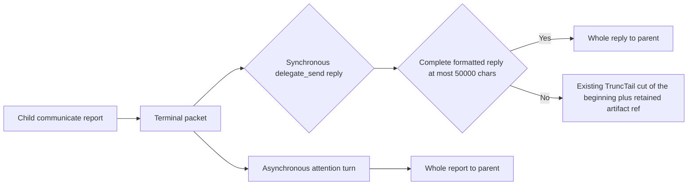

# Issue #4088: delegate reports arrive whole up to a measured size

**Status:** Revised after two independent PAR rounds and approved for
implementation.

## Problem

A parent that receives a delegate's report through the synchronous
`delegate_send` reply can get the report cut. The parent then spends a
`read_transcript` or `doctor_evener` call recovering the missing bytes. Issue
#4088 measured that recovery cost in the 2026-10-08 compaction lab round
(`sdd-plan`).

The truncation seam is the `delegate_send` registration's explicit output
limit, not the report payload and not the registry's default table.
`registerStableDelegateTool` in `agent/session_tools.go` registers
`delegate_send` with `{MaxChars: jobToolResultDefaultMaxChar, Strategy:
schema.TruncTail}`; `jobToolResultDefaultMaxChar` is 20,000
(`agent/session_tools_jobs.go`). `Registry.Register` applies
`defaultToolLimit` only when the supplied limit is empty
(`agent/internal/tool/registry.go`), so `defaultToolLimit("delegate_send")` is
never consulted for the real tool.

The registry applies that explicit limit to the text
`marshalDelegateSendResult` builds from `formatDelegateSend`: any carried
earlier results first, then the report message, then the footer and the compact
`structured_result` JSON. `truncateCharsWithStatus` with `TruncTail` keeps the
last 20,000 characters and prepends
`[Output truncated: N characters removed from the beginning.]`;
`retainToolArtifact` then appends the existing retained-artifact reference and
`read_transcript` route to the cut result.

Nothing earlier in the path caps a report. `delegateNotificationContent`
marshals the complete terminal packet, and
`appendDelegateAttentionMessageDurably` appends the complete attention turn, so
the asynchronous notification path delivers the report whole.

## Evidence

Reproduction on this worktree (2026-10-24), at the real delivery path: a root
session starts a background delegate with the real `delegate` tool, sends it a
message with a positive wait through the real `delegate_send` tool, and a
scripted child reports a 49,800-character message through the real
`communicate` handler. Before any production change:

- the parent's `delegate_send` tool result is 20,239 characters;
- the result starts with
  `[Output truncated: 79764 characters removed from the beginning.]`;
- a tail sentinel survives, a head sentinel is gone;
- the result carries `[Tool output was truncated.]`, `Full output:
  artifact:<id>` and `Read with: read_transcript(transcript_ref="artifact:<id>")`.

That reproduction reports the same text on both child generations, so the reply
carries the first report as an `earlier result 1 of 1, not delivered before:`
block ahead of the latest one; its complete formatted text is 99,764
characters. This is a live example of the multi-report reply the size policy
must describe, not a single-report measurement.

The same report delivered asynchronously arrives whole: a report of about
25,000 characters produced a 25,626-character attention frame that reached the
parent's attention fold, and the parent's next notification-turn request
contained the report tail (a review re-run with a slightly different sentinel
measured 25,658). A review re-run at 63,300 characters measured a
63,958-character frame and the tail was present in the next request. The
asynchronous path has no report-specific size cap (the transcript's 128 MiB
line cap is far above these sizes).

### Measurement

A scan of the on-disk delegate journals under this project's sessions
(`sessions/*/delegates.jsonl`) selected every `delegate_terminal_prepared` event
whose packet kind is `reported`, then computed two sizes per packet:

- the decoded `packet.message` string, which wraps the human message and its
  structured envelope;
- the formatted `delegate_send` result: that message, the
  `[delegate_id … · completed · completed]` footer, any warning lines, and the
  compact `structured_result` JSON. A live reply can also add a short worktree
  line from the descriptor; the journal measurement does not carry it.

At measurement time the scan read 16,064 reported packets. Independent re-scans
during review read 16,071-16,087 because the live journal grows; the
distribution below is stable across the scans, and 2 packets exceed 50,000 in
every scan.

| Measure | p50 | p95 | p99 | p99.9 | max |
| --- | ---: | ---: | ---: | ---: | ---: |
| Decoded terminal packet message (characters) | 786 | 5,519 | 12,082 | 23,068 | 63,300 |
| Formatted `delegate_send` result (characters) | 1,474 | 7,254 | 14,360 | 28,314 | 63,365 |

Across the 11,186 packets whose envelope carries a string `message`, the human
report text alone is p50 144, p95 3,244, p99 8,088, max 27,347 characters: the
formatted result is larger mostly because the envelope repeats content in the
structured result. Of the 16,064 formatted results, 67 (0.42%) exceed the
current 20,000-character limit and 2 (0.01%) exceed 50,000. Independent
re-scans with a slightly different formatting formula measured 66 over 20,000
of 16,071-16,087 packets, with the same 2 over 50,000; the one-packet gap is a
formula difference, not journal growth.

## Chosen behavior

`delegate_send`'s explicit registration limit becomes **50,000 characters**
with the existing **`TruncTail`** strategy. Choose that size because:

- it is the same 50,000-character budget `read_file`'s current default uses, so
  a whole report costs a parent no more context than one file read;
- it delivers 16,062 of the 16,064 measured single-packet formatted results
  (99.99%) whole, leaving the retained-artifact route for the two oversized
  packets rather than for 67;
- it stays far below the 8 MiB job-output retention cap and the session
  context limits, so a whole report is a bounded payload.

Behavior:

1. A `delegate_send` reply whose complete formatted result is at most 50,000
   characters is delivered exactly, with no truncation marker and no artifact
   reference. This includes a reply that carries earlier results when the whole
   reply fits.
2. A larger reply keeps the existing `TruncTail` behavior: the last 50,000
   characters survive, prefixed by
   `[Output truncated: N characters removed from the beginning.]` and followed
   by `[Tool output was truncated.]`, `Full output: artifact:<id>` and
   `Read with: read_transcript(transcript_ref="artifact:<id>")`. The retained
   artifact holds the complete formatted reply, and `read_transcript` pages and
   searches it as it does today. If retention is unavailable, the existing
   `[retention_failed: full output could not be retained]` line remains. The
   model-facing text usually names the delegate in its footer, and the parent's
   own `delegate_send` call already carries the delegate ID in its `to`
   argument; `job_status` on that ID returns the child's `transcript_ref`, which
   `read_transcript` reads, so the child transcript stays the recovery route
   even when a large trailing structured result pushes the footer out of the
   retained tail.
3. Because the report is rendered at the end of the reply, `TruncTail` keeps
   the newest report's ending. The newest report is whole only when its
   complete formatted contribution, including the footer and structured result
   that follow it, fits the 50,000-character window; a report whose own text is
   under 50,000 can still be cut by a large trailing structured result.
   Earlier carried reports sit at the head of the reply and are largely or
   entirely removed from the delivered text when the reply is over budget; the
   retained artifact holds them whole. The policy is therefore per complete
   `delegate_send` reply, not a promise that every report in an arbitrarily
   large bundled reply is whole.
4. The `delegate` creation result keeps its 20,000-character limit; it carries
   no report.
5. Asynchronous report delivery is unchanged: the complete terminal packet is
   appended as an attention turn and presented whole. Job notifications and
   their excerpt limits are unchanged.

## Non-goals

- No change to the notification frame, attention append, wake rules, or the
  asynchronous delivery path.
- No change to the `delegate` creation limit, job notifications, job-result
  excerpts, or the artifact store and `read_transcript` route.
- No change to the `TruncTail` cut shape. A structured result or carried
  earlier results large enough to exhaust the 50,000-character reply budget can
  still push the reply over it; the retained-artifact reference remains the
  recovery route. This is the same seam class, not a second truncation seam.
- No per-report repartitioning of a bundled reply, no secondary artifact per
  report, and no suppression of the structured result.
- No new report-size field, preview, UI surface, or transcript rendering change.
- No full local suite; CI owns the required gates.

## Second truncation seam

None on the stable-delegate path. The stable-delegate notification path was
exercised end to end at 25,000 and 63,300 characters and delivered the complete
frame and the complete request message. `job_status` for a stable delegate
exposes status, transcript ref and last outcome but no report text.
`communicate`'s own 5,000-character tool-result limit applies to the child, not
to the parent's report delivery.

The legacy job-backed delegate path keeps its 8,000-character terminal
notification excerpt (`agent/job_notify.go`). Current stable delegates do not
create jobstore records, so no current report reaches that path, and
`rejectLegacyDelegateState` refuses to bootstrap a root containing legacy
delegate lifecycle state. That legacy excerpt is out of scope and is not a
second live seam.

## Verification plan

1. Red first, before the production change: a new end-to-end test drives a real
   root session, the real `delegate` and `delegate_send` tools, the real
   registry, and a scripted child that reports through the real `communicate`
   handler. Its first generation reports a small result and its second reports
   a report just under the chosen size, so the reply isolates one report plus a
   carried small result. The current code fails this test at the 20,000
   character limit with the report head missing; after the change the reply is
   at most 50,000 characters, carries the whole report plus the small earlier
   result, and has no truncation marker or artifact reference.
2. Oversize case: a report just over the chosen size must carry the beginning
   removal marker and the retained-artifact reference, and the artifact read
   through the real `read_transcript` route must contain the head sentinel the
   delivered result lost. The report tail must remain in the delivered result,
   pinning the existing `TruncTail` shape.
3. Run the focused checks:
   `go test ./agent -run 'TestDelegateReport' -count=1`, then `make build`. Do
   not run the full suite; CI is the source of truth.
4. This revision was re-reviewed by two independent competing PAR reviewers;
   their legitimate findings are resolved above.
5. Review the implementation diff with PAR, run simplify-code, commit, run
   roborev branch review, push, and open the PR. The parent owns the CI wait and
   the merge.

## Accepted risks

- A 50,000-character reply costs about 12.5k tokens of parent context. That is
  the intended trade: one bounded delivery instead of a report cut plus
  recovery reads. The measured distribution says this happens for 0.42% of
  single-packet results, and the largest such reports are the ones a parent
  most needs whole.
- A reply bundling several undelivered reports shares the one budget. The
  newest report survives whole only when its complete formatted contribution
  and everything after it fits the window; earlier bundled reports are largely
  or entirely removed from the delivered text. The complete reply is retained
  as an artifact, so the parent may need one artifact read for a bundled reply
  over budget.
- A parent that configures a smaller `delegate_send` output limit keeps that
  smaller limit; this changes the built-in registration limit, not configured
  policy. The pre-existing 800-character JSON floor
  (`enforceJobToolJSONLimits`) still raises a configured limit below 800.

## Revision notes

The first frozen version named `defaultToolLimit` as the seam and `TruncHeadTail`
as the current strategy; both were wrong. It also stated the size claim per
report without describing `formatDelegateSend`'s earlier-results prefix. This
revision names the explicit `delegate_send` registration limit in
`registerStableDelegateTool`, keeps `TruncTail`, states the policy per complete
`delegate_send` reply, labels the measurement rows accurately, and names the
legacy job-notification excerpt as out of scope. The 50,000 size and the
asynchronous-path findings were confirmed by both reviewers and are unchanged.

A second review round confirmed the registration-limit change with a read-only
overlay and corrected three precision points: the newest report is whole only when its
complete formatted contribution and trailing content fit the window, earlier
bundled reports are largely or entirely removed rather than merely losing their
beginnings, and the retention-failed fallback reaches the child transcript
through `job_status(delegate_id)` rather than text in the model-facing result.
It also removed a thousands separator from the quoted marker, noted that packet
counts drift as the live journal grows, and recorded that
`rejectLegacyDelegateState` refuses the legacy path at bootstrap.
