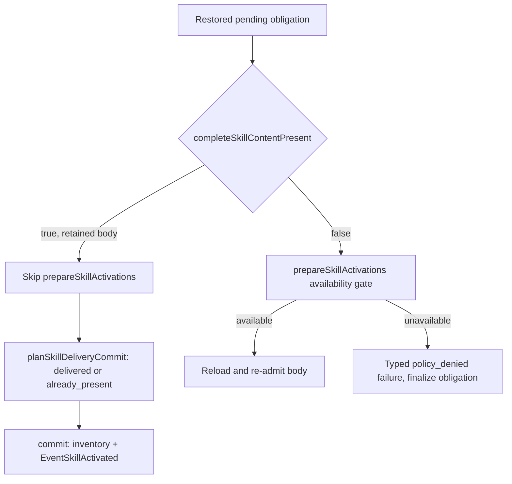

# Issue #4466: a staged skill activation rechecks availability on resume

Status: revised after two independent PAR reviews and again after the implementation PAR round, 2026-10-24. The issue's explicit acceptance criteria authorize this bounded behavior correction.

## Defect: retained content bypasses the activation gate

`Session.prepareSkillActivations` (`agent/session_skill_activation.go:376`) refuses a skill this session cannot follow before it reads the source. The check at lines 406-410 calls `s.skillAvailableToSession(descriptor.CatalogName)` and returns a typed `*skillActivationError` with code `policy_denied`. `skillAvailableToSession` (`agent/session_memory.go:107`) answers the #4208/#4456 seam: `gardening-memory` is available only while `memorySaveInstructionsEnabled()` is true, which requires the memory context and every memory save tool. Fresh `use_skill`, slash, selection, and reload routes all pass through that gate.

The dispatch-seam delivery path does not. `prepareSkillDelivery` (`agent/session_skill_delivery.go:319`) iterates the pending `SkillDeliveryObligation` records and, at line 337, skips an obligation whose complete body is still present in the outgoing request:

```go
if completeSkillContentPresent(req, obligation.Identity) {
    continue
}
```

Only an obligation that fails that presence check reaches `prepareSkillActivations` and its availability gate. `planSkillDeliveryCommit` (`agent/session_skill_delivery.go:467`) then checks presence again at line 474 and records the obligation as `delivered` (new inventory record) or `already_present` (identical prior record) at lines 480-507. `commitSkillDelivery` writes the inventory and publishes `EventSkillActivated` for a genuinely new body.



The retained body is the normal state after a session stages an activation and stops before dispatch, for example `use_skill("gardening-memory")` just before compaction or a process stop. The obligation and its complete carrier survive in the transcript and metadata. If that session is resumed with `--disable-memory`, or as a delegate, or with a profile that removes a save tool, the retained body is accepted and a successful activation is recorded even though the session can no longer save memory. That is #4466.

This change corrects finalization, not history. The retained body is not deleted, rewritten, folded, or hidden: it remains in the projected request as recorded evidence, and the denial is an additional typed notification. A fresh activation that is refused never records a body, so a resumed session has the old body plus the new denial, while a fresh refusal has only the refusal. That asymmetry is accepted: history is authoritative, and this issue is about not recording a success and about surfacing the typed denial.

## Contract

`prepareSkillDelivery` rechecks the current session's skill availability for every pending delivery obligation before it accepts retained content. When `skillAvailableToSession(obligation.Identity.Name)` is false, the obligation is treated as an unavailable activation on the delivery path:

- The session records the typed denial a fresh activation produces: a `skillActivationError` with code `policy_denied`, shaped into a `failed` `schema.SkillActivationOutcome` with `ErrorCode: "policy_denied"`, linked to the obligation's invocation, tool call, client mutation, and full retained identity. The model-facing explanation is the typed activation error's own text, which is the same text a fresh activation returns; it does not use the reload-failure wording about a source being "no longer available", because the source is available and the session's capability is what changed.
- The denial is recorded through the existing `recordSkillDeliveryNotification` door, which durably writes a typed notification turn, finalizes a failed outcome's obligation, and marks the commit as appended. The caller rebuilds the request, so the denial joins the same dispatch that finalizes the obligation, exactly as a lost-source delivery failure already does.
- The obligation is finalized through the existing `finalizeSkillDeliveryFailure` path. No inventory entry is written, no `EventSkillActivated` fires, and no successful status is recorded.
- The retained body remains in history and in the projected request as described above.

A session where the skill is still available keeps the existing behavior: `completeSkillContentPresent` accepts the retained body, `prepareSkillDelivery` skips it, and `planSkillDeliveryCommit` finalizes it against the prior inventory (`delivered` for a first admission, `already_present` for an identical prior record). No body is re-emitted, no notification turn is appended, and no new-body event fires for `already_present`.

## Recheck seam

The check lands at the top of the existing obligation loop in `prepareSkillDelivery`, before the `completeSkillContentPresent` skip:

```go
if !s.skillAvailableToSession(obligation.Identity.Name) {
    // record the typed policy_denied notification and finalize the obligation
    continue
}
```

The invocation value the loop already builds for the reload path is built before the check so the typed error carries the obligation's recorded identity. The implementation extracts the typed-denial constructor both paths use — `prepareSkillActivations` currently builds `&skillActivationError{Code: "policy_denied", ...}` inline at lines 408-409 — so the code and shape cannot drift between a fresh activation and a resumed one. The reload-failure notification keeps its existing text unchanged.

`prepareSkillDelivery` is the right seam, not `planSkillDeliveryCommit`:

- `prepareSkillDelivery` already owns the failure transaction: it appends the typed explanation to real history, sets `appendedNotifications`, finalizes the failed obligation, persists the lifecycle snapshot, and lets the caller rebuild the request. `planSkillDeliveryCommit` has no notification or finalization path; refusing there would fail the dispatch without recording the denial the model and user are owed.
- A denial recorded in `prepareSkillDelivery` removes the obligation before the dispatch plan runs, so `planSkillDeliveryCommit` cannot finalize it as a success later in the same dispatch.
- Every production dispatch preparation calls `prepareSkillDelivery` against the actual projected request before `finalizeSkillDelivery` runs, including the restored first request after resume. A retry reuses the already-finalized state and does not re-append the denial.
- Denial granularity follows the delivery seam's existing per-obligation failure semantics: a reload failure today finalizes only the obligation that failed and lets the rest deliver. A staged multi-skill group that loses one skill's capability on resume therefore denies that skill and delivers the others; a fresh selection is all-or-nothing before any obligation exists. This change deliberately keeps the delivery path's per-obligation behavior rather than redesigning group admission.

The check reuses `skillAvailableToSession`; it does not change that predicate, duplicate its memory-tool logic, or add a second availability rule. The `prepareSkillDelivery` doc comment (`agent/session_skill_delivery.go:308-318`), which currently says every obligation whose complete content is present is left for the commit, is updated to state the availability recheck.

Each failed obligation is finalized immediately after its durable notification is recorded, rather than after the whole obligation loop. A later obligation whose notification write fails, or a cancellation at the next iteration's admission check, therefore cannot leave an already-explained denial pending for a retry to deny and notify a second time. A failed metadata save still reconciles from the durable turn at restore through the existing `reconcileSkillDeliveryNotifications` path.

## Cases and preservation

- First staged `gardening-memory` activation, resumed with `--disable-memory`: typed `policy_denied` failure, no inventory record, no activation event, no pending obligation. Before this change the same state records `delivered` and fires a success event.
- Staged activation resumed as a delegate or with a save tool removed from the registry: same denial, because the recheck reads the live session capability those shapes already change.
- Staged second model-tool activation with an identical prior inventory record, resumed capable: finalizes as `already_present`, keeps the prior inventory record unchanged, emits no new-body event, and re-emits no body. This is the control that proves the fix does not disturb the retained-content path. A `user_slash`/`user_selection` duplicate whose prior record is not yet user-authorized keeps its existing behavior of rewriting the inventory with the new invocation's authorization; that route-specific exception is unchanged.
- Staged second activation with an identical prior record, resumed without the save tools: denied; the prior record was earned while the session could save memory and is preserved, but the pending activation is not finalized as a success.
- Pending obligation for any other skill: `skillAvailableToSession` is true, so behavior is exactly as before.
- An obligation whose body is no longer present and whose skill is unavailable: denied by the new check with the same `policy_denied` code instead of reaching the source loader. No new failure shape.
- No activation-policy change, no `skillAvailableToSession` change, no source-discovery change, no memory tool change, no persisted-field change, no client change, no skill-catalog change, no label change.
- Existing retained bodies remain visible in history and in the projected request after a denial; removing or folding them is outside this issue.

## Verification

Red first, in `agent/session_skill_delivery_test.go`, using the real activation and restore paths rather than a hand-built lifecycle snapshot. Every restore passes `RestoreSessionConfig{StateDir: history, MemoryStateRoot: memoryRoot}`; `MemoryStateRoot` is never persisted (`agent/session_config.go:68`, `agent/session_init.go:906`), so each subtest must supply it explicitly. The two denied-shape subtests add `DisableMemory: true` or remove `memory_write` from the restored registry; the capable subtest restores memory-enabled.

1. `TestSkillDelivery_RestoreRechecksAvailability` subtests `disabled-denies` and `revoked-save-tool-denies`: create a memory-capable session with `MaxToolRoundsPerInput: 1`, script one `use_skill` call for the bundled `gardening-memory`, and run `ProcessInput`. The tool round records the complete carrier and the obligation; the round cap stops the turn before the next dispatch with the expected tool-round budget-exhaustion error. Assert one pending obligation and no inventory record. Close, load the metadata, and restore with `MemoryStateRoot: memoryRoot`. The first subtest adds `DisableMemory: true`; the second restores memory-enabled and removes `memory_write` from the live registry, proving the recheck reads the session's current capability rather than one config field. Run one dispatch.
   - Assert no `EventSkillActivated`, no `gardening-memory` inventory entry, and no pending obligation.
   - Assert a recorded `failed` outcome for the staged invocation with `ErrorCode == "policy_denied"`.
   - Assert the resumed dispatch happened once and its projected request still carries exactly the one retained carrier envelope. The denial adds an explanation turn, not a second body.
   - Assert the dispatched request carries the denial notification turn recorded by the resumed dispatch (read from live history after `ProcessInput`). Compare the request's messages with that turn (kind, role, and content equality), not with a hardcoded phrase. This fails if the denial is recorded but the request is not rebuilt, which is the `commit.appendedNotifications` contract.
   - Before the fix this subtest fails on the first assertion: the retained body is finalized as `delivered`, the inventory gains `gardening-memory`, and the event fires.
2. `TestSkillDelivery_RestoreRechecksAvailability` subtest `capable-already-present`: first let the same session complete an identical `gardening-memory` activation (inventory record, no pending obligation), then lower `s.cfg.MaxToolRoundsPerInput` to 1 and stage a second identical `use_skill` call so its provisional `already_present` obligation stops before dispatch. Restore with `MemoryStateRoot: memoryRoot` and memory enabled.
   - Prepare the real dispatch request with `prepareModelRequestWithError` and assert the plan over that request reports `already_present` for the staged invocation.
   - Run one dispatch and assert the obligation clears, the entire prior inventory record is unchanged, no `EventSkillActivated` fires, the lifecycle revision advances (the final admission committed), no failed outcome or denial exists for the staged invocation, and the projected request carries exactly one carrier envelope.
   - This subtest passes before the fix as well; it pins that the capable path does not regress or re-emit the body.
3. `TestSkillDelivery_DenialFinalizedBeforeLoopContinues`: persist one unavailable gardening-memory obligation and one later obligation, then call `prepareSkillDelivery` with a context whose second admission check is cancelled. Assert the denied obligation is already finalized, only the later obligation remains pending, and a retry records exactly one `policy_denied` notification. This fails against a batched finalize after the loop.
4. Retain the exact failing output from the negative cases before the implementation and the passing output after it. Run:
   - `go test ./agent -run '^(TestSkillDelivery_RestoreRechecksAvailability|TestSkillDelivery_DenialFinalizedBeforeLoopContinues|TestSkillDelivery_SaveRestore|TestSkillDelivery_RevalidateAfterFold|TestSkillDelivery_FailedReloadNotifiesNextDispatch|TestMemoryGardeningSkill|TestMemoryGardeningSkillGatedBySaveCapability)$' -count=1`
   - `make build`
   Do not run the full suite locally; CI is the source of truth.
5. `docs/skills.md` ("Complete delivery at dispatch") and the S18 row in `docs/product/subsystems.md` state the resume availability recheck and the capability-loss denial.
6. Freeze and review this spec with two independent competing PAR reviewers. Review the immutable implementation diff with another two-reviewer PAR round, run simplify-code, commit, run branch RoboRev review, then push and open a PR. Fetch current `origin/main` and merge it before the final push if it moved. The parent session owns the CI wait and the merge; do not merge.
