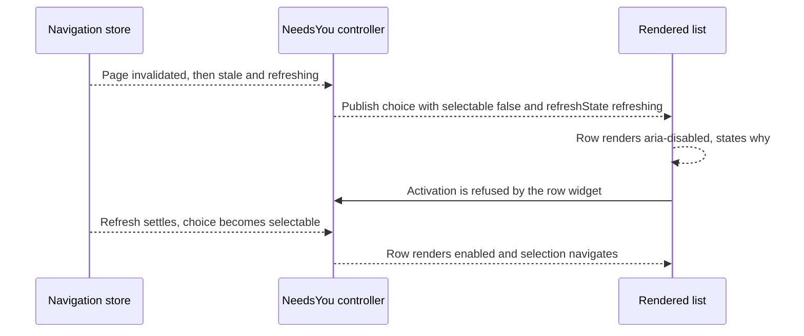

# Issue #4846: a stale Next-needs-you row is refused, not silently rejected

## Intent and scope

Make the floating Next-needs-you list's row affordance agree with the shared
needs-you controller's actual admission decision.

The lane is based on `origin/main` at
`c43ac9a99776673b14b0e7054d82d4ad4dda79cb`, the merge of PR #4854 that put the
floating control on main. Issue #4846 is a follow-up to that delivery and does
not change delivery. Main later moved through
`37233004ca996ba52978e4f2fc3f47e732f028c8` (native Board only); the final lane
merged `origin/main` at `44167f48cb7c22b6e2e2f4b0e6a21488f10320e6` before the
final push, and the focused tests were rerun against it.

Intended deliverables:

- `cmd/evener-hub/frontend/src/panes/session/NextNeedsYou.tsx` (row
  affordance and the open-focus rule);
- `cmd/evener-hub/frontend/src/shell/needsYouActions.ts` (one per-choice
  refresh-state field in the published snapshot);
- `cmd/evener-hub/frontend/src/panes/session/NextNeedsYou.test.tsx` and
  `cmd/evener-hub/frontend/src/shell/needsYouActions.test.ts` (red-first cases,
  controls, and the existing stale-refresh case's new state assertions);
- `cmd/evener-hub/frontend/src/shell/needsYouTestUtils.ts` (the shared
  test-only needs-you page fixture those suites use);
- the S02 row of `docs/product/subsystems.md` and the "Floating Next-needs-you
  control" section of `docs/web-ui/README.md`;
- this specification.

No other tracked file is intended. In particular, no widget, navigation store,
revalidator, selector, palette, selection, delivery or routing change.

## Exact stale-row race

The list at `NextNeedsYou.tsx:438-456` maps every `snapshot.choices` entry to an
interactive `ListRow` and ignores `choice.selectable`. The snapshot computes
`selectable` from the row's authoritative page (`needsYouActions.ts:116-125`):
the page must exist, have no error, and not be stale. `nextRef` gates the Next
trigger on it, and the command palette gates its own selection on it
(`CommandPalette.tsx:305-309`), but the list row does not. A row whose page
turned stale or failed therefore renders as an enabled button.

`NeedsYouController.select(ref)` at `needsYouActions.ts:432-450` re-reads
`navigationStore.getState()` and applies the real admission rule: the page must
exist, have no error, not be stale, still contain the ref, and the ref must not
be the focused session. A rejected selection returns without navigating and
without changing anything. The row's click handler closes the list before that
call, so the stale selection closes the popover and leaves the reader where they
were with no explanation. That is the reported defect.

The snapshot is recomputed on navigation-store events
(`needsYouActions.ts:159-190`). When a page goes stale or fails, the refreshed
snapshot is what the list should render; the fix is to consume the flag the
snapshot already publishes rather than adding a second admission path.

Two existing owners already cover recovery, so this change does not add one:

- the revalidator marks a loaded page stale on invalidation and starts its
  refresh (`revalidator.ts:286-305`); a failed refresh retains the page's rows
  with `stale: true, error` (`revalidator.ts:373-376`);
- `demand()` retries a failed boundary page at its own offset on the next Next
  or Load more activation (`needsYouActions.ts:343-356`).

The list's visibility predicate matters to any test of this behavior
(`NextNeedsYou.tsx:76-81`): when the only populated page goes stale with
`loading:false`, `error:null` and no remaining rows, `nextRef` becomes null,
`readFailed` stays false and `canLoadMore` is false, so the whole control
returns null and a previously captured row is detached. A stale page that is
revalidating (`stale:true, loading:true`, a retried populated page) or errored
keeps demand visible through `retryingPopulatedPage` / `failed`. Test fixtures
must include that demand, or they assert against a detached node. The existing
case at `NextNeedsYou.test.tsx:372-391` uses the detached fixture, so its click
never reaches the handler and its "does not navigate" assertion is vacuous; the
new first case replaces it.

## Chosen affordance and feedback

1. **A row that is not selectable is visibly refused.** `ListRow` gets
   `aria-disabled="true"` (the widget's documented refusal path, which keeps the
   row focusable and swallows activation). Its meta line states why the row
   cannot be selected:

   - `selectable` → the existing attention reason;
   - `refreshState === "refreshing"` → `Refreshing`;
   - `refreshState === "failed"` → `Couldn't refresh`;
   - no page → no meta (unreachable for a listed row; the controller only
     publishes rows from loaded pages).

   `refreshState: "refreshing" | "failed" | null` is published per choice by the
   controller's `read()` from the row's page (`page.error` → failed,
   `page.stale` → refreshing, otherwise null) and is included in the
   controller's `samePublicState` comparison. The component reads structured
   state, not inferred copy, and exposes it on the row as
   `data-refresh-state` for behavior tests. The row stays in place with the
   same label, order and list actions; the list is not redesigned or filtered.

2. **The open-focus rule skips refused rows.** The first-focus selector changes
   from `button:not([disabled])` to also skip `[aria-disabled="true"]`, so
   opening the list with refused rows focuses the first remaining control
   (Load more, when enabled) or the section, never a refused row. A refused row
   remains reachable by Tab and announces its state through `aria-disabled`.

3. **No click-time behavior is added.** The controller's `select` keeps its
   existing signature, guard, silent refusal and revalidator-owned refresh. A
   refused row cannot invoke it, and the row's own state plus the next snapshot
   are the feedback. There is no notice, toast, retry button or second refresh
   path.

No widget is added or changed. `ListRow` already supports `aria-disabled`, and
the meta line already carries row state.

## Preservation

- A row whose page is current still enables, closes the list, and navigates to
  that session with the existing focus and history behavior.
- Next, Load more, the popover layout, the trigger, Escape/outside/scroll
  dismissal, focus restoration, and the control's visibility rules are
  unchanged.
- Rows are not removed from the list when unavailable. They remain visible,
  labelled, and refused until the queue or a refresh changes them.
- The existing controller case "a stale resource blocks selection until its
  actual refreshed response restores it" keeps both halves: refused while
  stale, then navigates after the real refreshed response. Its new assertions
  read the published `refreshState`, not copy.
- The command palette's guarded selection and every other navigation caller are
  unchanged.

## Non-goals

- No change to Next-needs-you delivery, the `next()` action, or any
  notification/delivery path.
- No change to `select`, selection admission, or the controller's refresh
  ownership.
- No list redesign: no reordering, filtering, grouping, new actions, or new
  widget props.
- No changes to the navigation store, revalidator, selectors, or AppWire
  package.
- No command-palette, keybinding, rail, or general routing changes.
- No inline notice, toast, retry button, or new interaction surface.
- No labels and no unrelated fixes; an unrelated finding becomes its own issue.
- No full local suite, browser guard, live-provider, or deployment claim.

## Verification

Red-first, through the real list and controller (not a hand-built row object).
The stale fixtures keep the control mounted: `stale:true, loading:true` with
retained rows, or `stale:true, error` with retained rows.

1. `NextNeedsYou.test.tsx`: a row on a page that turns stale after render
   becomes refused (`aria-disabled="true"`, `data-refresh-state="refreshing"`)
   and cannot navigate; a failed refresh on the same page
   (`stale:true, error, loading:false`) changes the state to `failed` before the
   click. Replaces the vacuous case at
   `NextNeedsYou.test.tsx:372-391`. Fails before the fix at the attribute
   assertion.
2. `NextNeedsYou.test.tsx`: opening a list whose page failed focuses the first
   remaining control (Load more), not a refused row, and the refused rows carry
   `data-refresh-state="failed"`. A second case with a stale, loading page
   (Load more disabled) focuses the list section itself. Both fail before the
   fix because the first refused row receives focus.
3. `NextNeedsYou.test.tsx`: a failed page does not refuse rows from another
   current page. The failed page's row is refused with
   `data-refresh-state="failed"`, the current page's row is enabled without a
   refresh state, takes first focus, and selects. Fails before the fix because
   the failed page's row is enabled.
4. `NextNeedsYou.test.tsx`: a selectable row still closes the list and
   navigates. Passes before and after; this is the control.
5. `NextNeedsYou.test.tsx`: a refused row's page is restored through a
   notifying `navigationStore.setState` (`stale:false`); the row is enabled and
   selecting it navigates. The refused state is asserted before restoration, so
   the case now fails on base.
6. `needsYouActions.test.ts`: the existing stale-refresh case reads
   `refreshState === "refreshing"` while the page is stale and `refreshState ===
   null` after the real refreshed response; its existing refused-then-navigated
   assertions stay. Fails before the fix only if `refreshState` is absent, so
   it proves the new field.
7. `needsYouActions.test.ts`: a transition that changes only a choice's
   `refreshState` (refreshing to failed, while another page keeps the snapshot
   loading and another keeps it failed) reaches subscribers because the field
   is in `samePublicState`. Fails before the fix because the field and its
   comparison do not exist.

Commands, from the worktree:

- `cd cmd/evener-hub/frontend && npx vitest run src/panes/session/NextNeedsYou.test.tsx src/shell/needsYouActions.test.ts`
- `cd cmd/evener-hub/frontend && npm run typecheck`
- `cd cmd/evener-hub/frontend && npx biome check --write src/panes/session/NextNeedsYou.tsx src/panes/session/NextNeedsYou.test.tsx src/shell/needsYouActions.ts src/shell/needsYouActions.test.ts` then `npx biome ci` on those paths
- `cd cmd/evener-hub/frontend && npx vitest run src/dev/copyonly/copyonlyAudit.test.ts` (new tests must not be copy-only)
- `make build` from the repository root

The full frontend suite and `make test-web` are CI's job under the brief's
verification rule, not this lane's.

Freeze this specification, give two independent competing PAR reviewers the
same immutable inputs, resolve evidenced findings, then repeat PAR against the
frozen base/head implementation diff, run simplify-code, commit, and run the
required RoboRev branch review.
