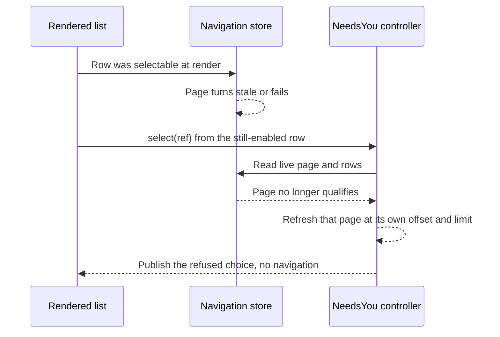

# Issue #4846: a stale Next-needs-you row is refused, and a stale click refreshes instead of vanishing

## Intent and scope

Make the floating Next-needs-you list's row affordance and its selection
feedback agree with the shared needs-you controller's actual decision.

The lane is based on `origin/main` at
`c43ac9a99776673b14b0e7054d82d4ad4dda79cb`, the merge of PR #4854 that put the
floating control on main. Issue #4846 is a follow-up to that delivery and does
not change delivery. Main later moved to `37233004ca996ba52978e4f2fc3f47e732f028c8`
(native Board only); that base merge lands before the final push, and the
focused tests are rerun against it.

Intended deliverables:

- `cmd/evener-hub/frontend/src/panes/session/NextNeedsYou.tsx` (row
  affordance, focus rule, unavailable handling);
- `cmd/evener-hub/frontend/src/shell/needsYouActions.ts` (selection outcome and
  the refused page's refresh seam);
- `cmd/evener-hub/frontend/src/panes/session/NextNeedsYou.test.tsx` and
  `cmd/evener-hub/frontend/src/shell/needsYouActions.test.ts` (red-first cases
  and controls);
- the S02 row of `docs/product/subsystems.md` and the "Floating Next-needs-you
  control" section of `docs/web-ui/README.md` for the changed behavior;
- this specification.

No other tracked file is intended. In particular, no widget, navigation store,
revalidator, selector, palette, delivery or routing change.

## Exact stale-row race

The list at `NextNeedsYou.tsx:430-447` maps every `snapshot.choices` entry to an
interactive `ListRow` and ignores `choice.selectable`. The snapshot computes
`selectable` from the row's authoritative page (`needsYouActions.ts:110-118`):
the page must exist, have no error, and not be stale. `nextRef` gates the Next
trigger on it, and the command palette gates its own selection on it
(`CommandPalette.tsx:305-309`), but the list row does not. A row whose page
turned stale therefore renders as an enabled button.

`NeedsYouController.select(ref)` at `needsYouActions.ts:428-445` re-reads
`navigationStore.getState()` and applies the real admission rule: the page must
exist, have no error, not be stale, still contain the ref, and the ref must not
be the focused session. A rejected selection returns without navigating and
without changing anything. The row's click handler
(`NextNeedsYou.tsx:441-444`) closes the list before that call, so a stale
selection closes the popover and leaves the reader where they were with no
explanation.

The control's snapshot is recomputed on navigation-store events
(`needsYouActions.ts:157-182`). A page can become stale after the list rendered;
the store update reaches React through `useSyncExternalStore`
(`NeedsYouProvider.tsx:43`). A click that lands in the window before that commit
still runs the old row's handler. That late click is the reported silent
rejection.

The list's visibility predicate matters to any test of this behavior
(`NextNeedsYou.tsx:76-81`): when the only populated page goes stale with
`loading:false`, `error:null` and no remaining rows, `nextRef` becomes null,
`readFailed` stays false and `canLoadMore` is false, so the whole control
returns null and a previously captured row is detached. A stale page that is
revalidating (`stale:true, loading:true`, a retried populated page) or errored
keeps demand visible through `retryingPopulatedPage` / `failed`. Test fixtures
must include that demand, or they assert against a detached node. The existing
case at `NextNeedsYou.test.tsx:372-391` uses the detached fixture, so its click
never reaches the handler and its "does not navigate" assertion is vacuous.

## Chosen affordance and feedback

1. **A row that is not selectable is visibly refused.** `ListRow` gets
   `aria-disabled="true"` (the widget's documented refusal path, which keeps the
   row focusable and swallows activation) and its meta line becomes `No longer
   available` instead of the attention reason. The row stays in place with the
   same label, order and list actions; the list is not redesigned or filtered.
   The open-focus selector changes from `button:not([disabled])` to also skip
   `[aria-disabled="true"]`, so opening the list with refused rows focuses the
   first remaining control (Load more, when enabled) or the section, never a
   refused row. A refused row remains reachable by Tab and announces its state
   through `aria-disabled`.

2. **A selection refusal is reported structurally.** `select` returns
   `"navigated" | "unavailable" | "ignored"`:
   - `"navigated"`: the admission rule passed and `openAttentionSession(ref)`
     ran. The list closes and navigates exactly as today.
   - `"unavailable"`: the row was in the rendered list but the live navigation
     state no longer qualifies, or the ref left the live rows. The controller
     publishes the current snapshot so the row renders refused immediately, then
     refreshes the page that held the row. The component keeps the list open so
     the now-refused row, with its availability statement, is the explanation.
     No navigation occurs.
   - `"ignored"`: disposed, blocked, or a focused-session ref. No feedback is
     needed: a disposed controller has no mounted control, blocked hides it, and
     the focused session is not listed. The component closes the list, which is
     the old close-on-click behavior.

3. **The refused page refreshes without advancing the list.** On
   `"unavailable"`, the controller re-reads only the page that held the refused
   ref, at that page's own offset and limit, through
   `navigationStore.loadSection("needs_you", offset, limit)`. It never computes
   a new offset, advances to an unloaded page, or reorders anything. A page that
   is stale and already revalidating joins the in-flight read; an errored page
   that retained its rows starts a real retry at its own offset. Failures stay
   on the resource as they do for any other reader, and the controller swallows
   the rejection (an uninitialized store rejects without recording a resource),
   so selection itself never rejects. No notice or toast is added; the refused
   row is the feedback.

No widget is added or changed. `ListRow` already supports `aria-disabled`, and
the meta line already carries row state.

## Preservation

- A row whose page is current still enables, closes the list, and navigates to
  that session with the existing focus and history behavior.
- Next, Load more, the popover layout, the trigger, Escape/outside/scroll
  dismissal, focus restoration, and the control's visibility rules are
  unchanged.
- Rows are not removed from the list when unavailable. They remain visible,
  labelled, and refused until the queue or a refresh changes them.
- The existing controller case "a stale resource blocks selection until its
  actual refreshed response restores it" keeps both halves: refused while
  stale, then navigates after the real refreshed response.
- The command palette's guarded selection and all other navigation callers are
  unchanged; they ignore the new return value.

## Non-goals

- No change to Next-needs-you delivery, the `next()` action, or any
  notification/delivery path.
- No list redesign: no reordering, filtering, grouping, new actions, or new
  widget props.
- No changes to the navigation store, revalidator, selectors, or AppWire
  package.
- No command-palette, keybinding, rail, or general routing changes.
- No inline notice, toast, retry button, or new copy surface beyond the row's
  availability meta.
- No labels and no unrelated fixes; an unrelated finding becomes its own issue.
- No full local suite, browser guard, live-provider, or deployment claim.

## Verification

Red-first, through the real list and controller (not a hand-built row object).
The stale fixtures keep the control mounted: `stale:true, loading:true` with
retained rows, or `stale:true, error` with retained rows.

1. `NextNeedsYou.test.tsx`: a row on a page that turns stale after render
   becomes refused (`aria-disabled="true"`) and cannot navigate. Fails before
   the fix at the attribute assertion.
2. `NextNeedsYou.test.tsx`: a row that turns stale between render and selection
   keeps the list open and publishes the refused row; no navigation. The live
   page is made stale in the store without a React notification, so the click
   reaches the rendered handler. Fails before the fix because the list closes.
3. `NextNeedsYou.test.tsx`: opening a list whose rows are refused focuses the
   first remaining control (Load more) or the section, not a refused row. Fails
   before the fix because the first refused row receives focus.
4. `NextNeedsYou.test.tsx`: a selectable row still closes the list and
   navigates. Passes before and after; this is the control.
5. `NextNeedsYou.test.tsx`: after the page's retained data is restored
   (`stale:false`), the row is enabled and selecting it navigates. Passes on
   base and after.
6. `needsYouActions.test.ts`: selecting a row on a stale page returns
   `"unavailable"` and does not navigate; after the real refreshed response,
   selection returns `"navigated"` and navigates. The result assertion fails
   before the fix.
7. `needsYouActions.test.ts`: a failed populated page (a real FakeClient read
   failure) makes selection return `"unavailable"`, issues the retry read at
   that page's offset and limit, and does not navigate; after the retry settles,
   selection returns `"navigated"` and navigates. Fails before the fix at the
   result and the missing retry read.

Commands, from the worktree:

- `cd cmd/evener-hub/frontend && npx vitest run src/panes/session/NextNeedsYou.test.tsx src/shell/needsYouActions.test.ts`
- `cd cmd/evener-hub/frontend && npm run typecheck`
- `cd cmd/evener-hub/frontend && npx biome check --write src/panes/session/NextNeedsYou.tsx src/panes/session/NextNeedsYou.test.tsx src/shell/needsYouActions.ts src/shell/needsYouActions.test.ts` then `npx biome ci` on those paths
- `cd cmd/evener-hub/frontend && npx vitest run src/dev/copyonly/copyonlyAudit.test.ts` (new tests must not be copy-only)
- `make build` from the repository root

The full frontend suite and `make test-web` are CI's job under the brief's
verification rule, not this lane's.

Freeze this specification, give two independent competing PAR reviewers the
same immutable inputs, resolve evidenced findings, then repeat PAR against the
frozen base/head implementation diff, run simplify-code, commit, and run the
required RoboRev branch review.
