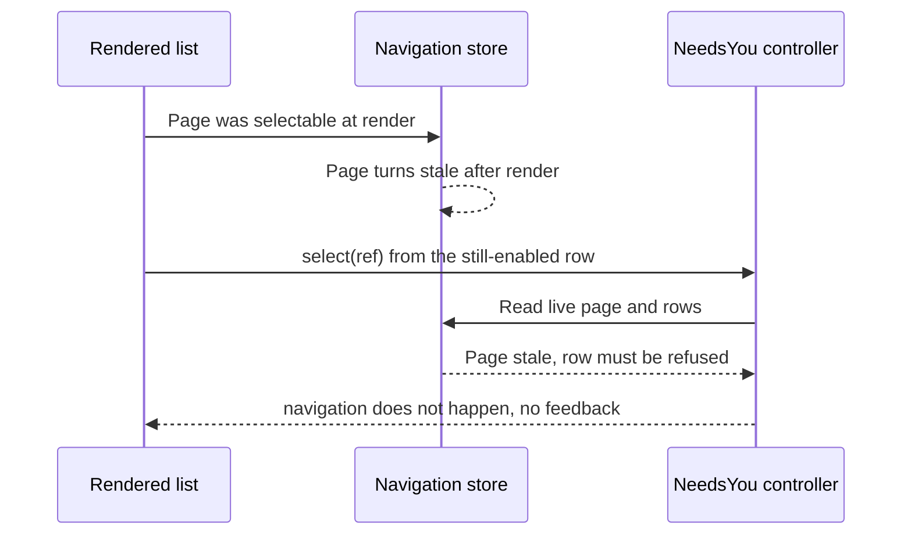

# Issue #4846: a stale Next-needs-you row is refused and refreshed, not silently ignored

## Intent and scope

Make the floating Next-needs-you list's row affordance and its selection
feedback agree with the shared needs-you controller's actual decision.

The lane is based on `origin/main` at
`c43ac9a99776673b14b0e7054d82d4ad4dda79cb`, the merge of PR #4854 that put the
floating control on main. Issue #4846 is a follow-up to that delivery and does
not change delivery.

Intended deliverables:

- `cmd/evener-hub/frontend/src/panes/session/NextNeedsYou.tsx` (row
  affordance, unavailable notice, outcome handling);
- `cmd/evener-hub/frontend/src/shell/needsYouActions.ts` (selection outcome and
  stale-page refresh seam);
- `cmd/evener-hub/frontend/src/panes/session/NextNeedsYou.test.tsx` and
  `cmd/evener-hub/frontend/src/shell/needsYouActions.test.ts` (red-first cases
  and a selectable-row control);
- the S02 row of `docs/product/subsystems.md` for the changed behavior;
- this specification.

No other tracked file is intended.

## Exact stale-row race

The list at `NextNeedsYou.tsx:430-447` maps every `snapshot.choices` entry to an
interactive `ListRow` and ignores `choice.selectable`. The snapshot already
computes `selectable` from the row's authoritative page
(`needsYouActions.ts:110-118`): the page must exist, have no error, and not be
stale. Only `nextRef` consumes the flag
(`needsYouActions.ts:146-147`), so a row whose page turned stale still renders
as an enabled button.

`NeedsYouController.select(ref)` at `needsYouActions.ts:428-445` re-reads
`navigationStore.getState()` and applies the real admission rule: the page must
exist, have no error, not be stale, still contain the ref, and the ref must not
be the focused session. A rejected selection returns without navigating and
without changing anything. The row's click handler
(`NextNeedsYou.tsx:441-444`) closes the list before that call, so a stale
selection closes the popover and leaves the reader where they were with no
explanation.

The control's snapshot is recomputed on navigation-store events only
(`needsYouActions.ts:157-182`). A page can therefore become stale after the
list rendered but before React commits a new snapshot - and a rendered row can
remain enabled when its live page no longer qualifies. That is the reported
window. The existing case at `NextNeedsYou.test.tsx:372-391` pins the current
silent behavior: it marks the page stale, clicks the still-enabled row, and
asserts only that navigation did not happen.

## Chosen affordance and feedback

1. **At render, a row that is not selectable is visibly refused.** The
   `ListRow` gets `aria-disabled="true"` (the widget's refusal path, not native
   `disabled`, so it stays focusable) and its meta line becomes `No longer
   available` instead of the attention reason. The row stays in place, with the
   same label, order and list actions; the list is not redesigned or filtered.
   The list's open-focus selector changes from
   `button:not([disabled])` to also skip `[aria-disabled="true"]`, so opening a
   list whose first row is unavailable does not focus a refused row. If every
   row is refused, the section gets focus as it does when the list is empty.

2. **A selection refusal returns a structured outcome.** `select` returns
   `"navigated" | "unavailable" | "ignored"`:
   - `"navigated"`: the admission rule passed and `openAttentionSession(ref)`
     ran; the list closes exactly as it does today.
   - `"unavailable"`: the row was in the rendered list but the live navigation
     state no longer qualifies, or its page is stale or errored. The list stays
     open and shows a neutral `InlineNotice` with `live="status"`: the session
     is no longer available and the list is refreshing. The refused row also
     re-renders through `aria-disabled` immediately because the controller
     publishes a fresh snapshot on this path.
   - `"ignored"`: blocked or focused-session refusals. The control is not
     visible while blocked, and the focused session is not listed, so this is a
     defensive outcome with no notice. Existing close-on-selection behavior is
     unchanged.

   The notice clears when the list is closed or reopened and when the affected
   ref leaves the snapshot or becomes selectable again. No copy is asserted as
   an oracle; tests assert the refused row, the notice's live role, the list
   staying open, the refresh request and the absence of navigation.

3. **A stale selection refreshes the list without navigating.** On
   `"unavailable"`, the controller re-reads every visible `needs_you` section
   page whose resource is `stale` or has an error, at that page's own offset
   and limit, through `navigationStore.loadSection("needs_you", offset,
   limit)`. It never computes a new offset, advances to an unloaded page, or
   changes ordering. Read failures stay on the resource as they do for any
   other reader and are swallowed by this best-effort refresh, so the selection
   path never rejects. A page that is stale and already refreshing simply
   joins the in-flight read. This makes the failed-boundary-page retry reachable
   from a list selection as well as from Next.

The shared navigation store and revalidator keep their existing ownership.
No widget is added or changed; `ListRow` already supports `aria-disabled` and
`InlineNotice` already has neutral/status semantics.

## Preservation

- A row whose page is current still enables, closes the list, and navigates to
  that session with the existing focus and history behavior.
- Next, Load more, the popover layout, the trigger, Escape/outside/scroll
  dismissal, focus restoration, and the control's visibility rules are
  unchanged.
- Rows are not removed from the list when unavailable. They remain visible,
  labelled, and refused until the queue or a refresh changes them.
- The existing controller case "a stale resource blocks selection until its
  actual refreshed response restores it" keeps both halves: refused while
  stale, then navigates after the real refreshed response.
- The command palette's guarded selection (`if (choice?.selectable)`) and all
  other navigation callers are unchanged; they ignore the new return value.

## Non-goals

- No change to Next-needs-you delivery, the `next()` action, or any
  notification/delivery path.
- No list redesign: no reordering, filtering, grouping, new actions, or new
  widget props.
- No changes to the navigation store, revalidator, selectors, or AppWire
  package.
- No command-palette, keybinding, rail, or general routing changes.
- No labels and no unrelated fixes; an unrelated finding becomes its own issue.
- No full local suite, browser guard, live-provider, or deployment claim.

## Verification

Red-first, through the real list and controller (not a hand-built row object):

1. `NextNeedsYou.test.tsx`: a row whose page goes stale after render becomes
   refused (`aria-disabled`) and cannot navigate, replacing the current case
   that only proves silence.
2. `NextNeedsYou.test.tsx`: a row that goes stale between render and selection
   keeps the list open, raises the status notice, requests the page refresh and
   does not navigate.
3. `NextNeedsYou.test.tsx`: a current row still closes the list and navigates.
4. `needsYouActions.test.ts`: selecting a stale page returns `"unavailable"`
   without navigating; the refreshed page makes a later selection return
   `"navigated"` and navigate.
5. `needsYouActions.test.ts`: selecting a row on a failed boundary page issues
   the real retry read at that page's offset without navigating.

Cases 1 and 2 and 5 fail on `c43ac9a997` before the fix. Cases 3 and 4's final
navigation pass before and after.

Commands, from the worktree:

- `cd cmd/evener-hub/frontend && npx vitest run src/panes/session/NextNeedsYou.test.tsx src/shell/needsYouActions.test.ts`
- `cd cmd/evener-hub/frontend && npm run typecheck`
- `cd cmd/evener-hub/frontend && npx biome check --write src/panes/session/NextNeedsYou.tsx src/panes/session/NextNeedsYou.test.tsx src/shell/needsYouActions.ts src/shell/needsYouActions.test.ts` (then `npx biome ci` on those paths)
- `make build` from the repository root

Freeze this specification, give two independent competing PAR reviewers the
same immutable inputs, resolve evidenced findings, then repeat PAR against the
frozen base/head implementation diff, run simplify-code, commit, and run the
required RoboRev branch review.
