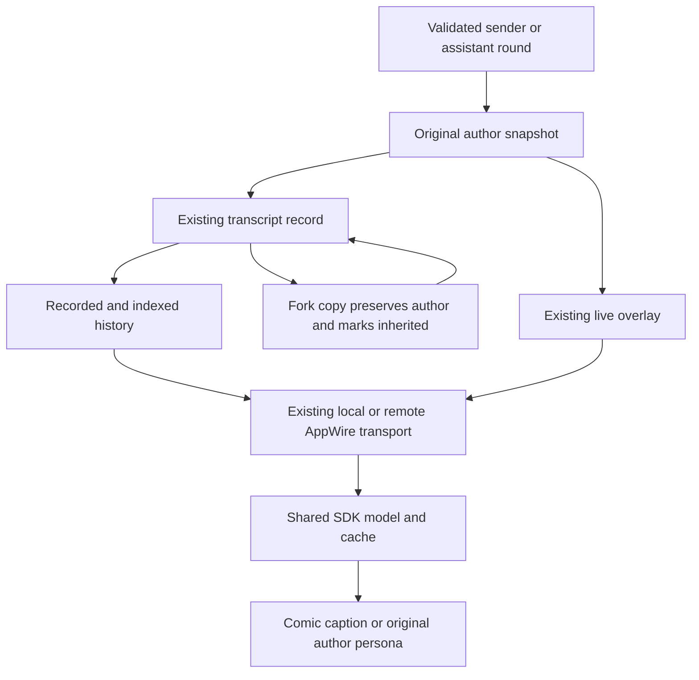

# Comic Chat amendment: shared transcript authorship

## Status and scope

Jesse approved shared authorship for parent instructions and inherited messages,
answers and thoughts, including neutral captions where older records cannot prove
an author. This document specifies that bounded change. The concrete plan and its
independent review must be accepted before implementation starts.

This amends `2026-10-25-comic-chat-thoughts-subchats-design.md`. Existing session
activity context proves ownership and supplies names; it does not prove who wrote
every entry in that session. Transcript authorship supplies that missing evidence.
The real completed-grandchild send currently renders its parent's instruction as
human speech. The inherited-human, answer and thought gaps were found by source
inspection; they are not yet browser-verified failures or fixes.

The change adds metadata to existing records, wire items and shared client models.
It changes no model input, transcript text, turn identity, permissions, delegate
lifecycle, admission, delivery order, history inclusion rule or subscription owner.
Human questions and sandbox approvals remain interactive-root-only. No new parent
read, roster fetch, identity store, cache, migration or author-reconstruction service
is permitted. Existing clients retain their current presentation; Comic consumes
the shared metadata. Fonts remain personal and outside git. Nothing is deployed.

## Author and inheritance contract

An entry records its original author separately from whether it was inherited.
The author is captured at a producer that already knows the sender, never inferred
from the page displaying it, the containing session, prose, placement or missing
mutation identity.

- **Human** identifies the existing human/client role, not an authenticated person.
  Do not record a person's name, email or a new human identity.
- **Agent** identifies the original speaking session. Delegate authors also carry
  their stable delegate ID, logical owner session and optional canonical name.
  Logical ownership uses the existing delegate controller's proof, not a nested
  descriptor's physical root store owner. A normal root assistant has no delegate
  tuple. Names are bounded display snapshots, never identity or routing keys.
- **System** identifies runtime-authored content when its producer knows this.
  This does not require restamping every system/tool record.
- **Unknown** makes missing evidence explicit. An absent authorship field means both
  author and inheritance are unknown. It does not mean human, current assistant or
  a fresh entry.

An inherited entry retains its original author and gains `inherited: true`.
Nested copies retain that same author, not the latest parent. A new parent
instruction in a child has the parent's author and `inherited: false`. Copying an
old entry proves inheritance but cannot manufacture its author: absent evidence
becomes unknown author with `inherited: true`. Copies must not mutate the source.

Delegate persona identity remains `(qualified owner ref, stable delegate ID)`.
Other agents use their qualified author session ref. The name is presentation data.
Remote host identity is part of the key. Ref qualification happens at the existing
hub source boundary; transcripts store source-local canonical IDs, not host aliases.
A missing name gets a truthful stable fallback without another activity read.

## Shared data contract

Add optional `Authorship *TranscriptAuthorship` to `schema.Turn` and
`appwire.ThreadItem`. The durable and wire shapes each have `Author` and `Inherited`.
Use the existing snake_case durable and camelCase wire conventions.

| Field | Durable author | Wire author |
| --- | --- | --- |
| Author kind | `kind` | `kind` |
| Speaking session | `session_id` | `sessionRef` |
| Logical delegate owner | `owner_session_id` | `ownerRef` |
| Stable delegate ID | `delegate_id` | `delegateId` |
| Canonical name snapshot | `delegate_name` | `delegateName` |

Kinds are `human`, `agent`, `system` and `unknown`. A valid agent author requires a
proven session ID/ref. A delegate tuple requires both owner and delegate ID. Other
kinds have no agent identity fields. The canonical name uses the existing
`activitybound.MaxLabelRunes` bound of 200. Do not add text payloads or lineage
arrays. Structurally decodable but semantically invalid or unsupported attribution
stays neutral without dropping the entry or changing whether its input can run.
Wrong-typed JSON and unknown fields still follow the existing strict decoder's
quarantine or whole-read failure behavior; this amendment does not relax it.

Preserve these values through in-memory snapshots, persisted records, full and
indexed projection, live history, live overlays, remote forwarding and the shared
TypeScript `ItemModel` and its existing cache codec. Optional metadata is not a new
store. Clone pointer values at mutable boundaries. Names must not change item IDs,
source offsets, pagination positions or stream identity.

The producer captures the author once. Both streaming and retained reads carry that
evidence through the existing transport. A fork changes inheritance, not authorship.
Comic uses the metadata already delivered with its selected transcript.

## Producer and history behavior

1. Initial delegate assignments, running parent steering and idle/completed-child
   sends capture the validated sender. Preserve existing durable-before-acknowledge
   behavior, active-source markers and input readback checks. Include nested owners.
2. Fresh human input and human steering record the human role at their existing
   admission/recording boundaries. Do not default every `USER_INPUT` to human;
   parent and harness input can share that turn kind. Queued and failed accepted
   inputs retain the same author without changing their mutation or recovery state.
3. Fresh assistant answers, thoughts and delivered communicate text record the
   speaking agent. Round-start and communicate-preview events carry that author
   before the first visible chunk. Reset/retry/reconnect and durable replacement
   preserve it, without adding metadata to every delta or another subscription.
4. Both ordinary forks and opt-in delegate fork context preserve authorship. Keep
   existing public-history and transcript-only inclusion rules. An edited human
   input at an ordinary fork's divergence is fresh human input, not an inherited
   copy. No non-opted-in child starts inheriting history.
5. Copied communicate tool exchanges may project their text later, on a paired
   result or unpaired flush. Carry the originating assistant call's authorship in
   the existing pending-call registry and its bounded index reconstruction. Do not
   use the result entry's author or alter echo suppression, placement or call IDs.

Authorship is display evidence, not authority to run work. Resolve sender identity
from existing validated state before acquiring transcript/overlay leaf locks.
Unavailable evidence is unknown; do not introduce a new lifecycle refusal or a
controller lookup under a leaf lock.

Older records remain readable by new code without rewriting them. Keep strict
transcript decoding and the existing entry-format identity version. Older binaries
may reject new fields or quarantine those entries; downgrade compatibility is not
promised. A version-matched reader restores fidelity from unchanged records. No
compatibility adapter, data rewrite or deployment is part of this amendment.

## Remote and shared client behavior

Qualify only structural author session/owner refs at existing typed/raw item
boundaries. Cover full reads, history pages and updates, overlay snapshots and
upserts. Preserve unknown raw fields. Do not recursively rewrite author-shaped
objects inside message text, raw model/tool data or structured results. Keep current
unsupported-source behavior and avoid double qualification.

The SDK exposes typed optional authorship, preserving it through history/overlay
merge, text omission, identity-only updates and cache roundtrips. Sparse updates
that omit the field retain already-known metadata for the same canonical item.
Authoritative replacement still follows existing generation/version precedence:
explicit unknown or an authoritatively absent field must not borrow stale authors.
No Comic-specific fallback store or parent-model scan is allowed.

## Comic consumption

| Evidence | Presentation |
| --- | --- |
| Known human, including inherited | Human dialogue, with inherited context indicated when proven |
| Agent-authored input/instruction | Source caption attributed to that agent, never human or child speech |
| Known answer or thought | Original author's persona, thought balloon for thoughts, inherited context when proven |
| Existing explicit human steering source | Existing human attribution |
| Parent steering without canonical author | Generic parent/source caption, no guessed name |
| Other absent, unknown or invalid authorship | Neutral caption identifying the content kind and unknown author |

Metadata takes precedence over page context. Activity context may label a matching
proven identity but cannot assign authorship to an otherwise ambiguous entry.
An absent inheritance marker never becomes a claim of inherited context. Literal
text, images, reasoning assembly, redaction, ordering and reading anchors remain
unchanged. Unknown thought text remains visible with a thought label and neutral
caption, without assigning it a character. No text, mutation-ID heuristic or
`turn_system` placement is an author oracle.

## Acceptance evidence

- Real named-parent create, active steer and completed-child send prove the same
  author in persisted records and published items. Retain the actual failing
  completed-grandchild scenario; do not replace it with only active steering.
- Real nested opt-in forks retain original human, agent answer, thought and
  communicate authors. Fresh replies use their own author. Ordinary and edited
  forks preserve inclusion rules and independent source values.
- Explicit unknown and absent old metadata stay neutral. Copying old records marks
  inheritance only. Tests compare original fixture actors and content, not another
  invocation of the projector under test.
- First live text/thought/preview chunks, reset, retry, durable replacement, crash
  recovery and cold reload agree. Assert metadata as well as unchanged item identity.
- A bounded page starting at a communicate result and an unpaired flush retain the
  original call's author. Full/indexed/live/cached paths agree without full-history
  reads or altered page boundaries.
- Distinct remote sources with identical bare IDs remain distinct across typed and
  raw forwarding. Payload lookalikes and extra raw fields remain untouched.
- The original Comic worker proves direct-page identity, nested inheritance, older
  pages, reconnect and reload through the real hub/daemon browser guard in both
  default and personal-font modes. Preserve existing literal-text, six-page, 2px,
  101-leaf, viewport, root-only interaction and subscription assertions.

The shared producer/wire/SDK change has its own test and independent review gate.
Only then does the original paused Comic worker consume it and update the owning
product guides, including S05/S10 authorship ownership and S02 Comic consumption in
the subsystem map. The shared change updates `docs/product/history-content.md`.
Both guides must accompany the code in the combined feature PR; a local prerequisite
commit is not a separately published change. Accepted discovery and name-metadata
work is not reopened. No behavior is verified merely by approving this design.
