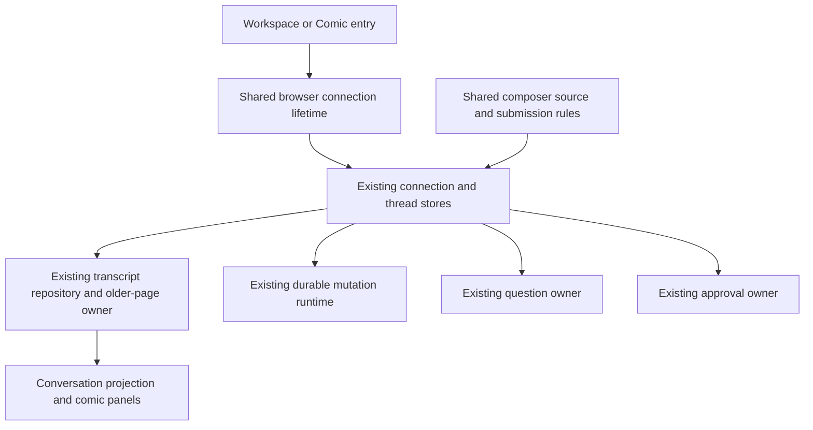

# Comic Chat client

## Status and intent

Jesse approved this design, the recorded tool-image amendment and the
[thought-bubble and sub-chat amendment](2026-10-25-comic-chat-thoughts-subchats-design.md).
The linked amendment is part of this specification and governs thinking and child
conversations. The visual preview is approved; live-client verification is pending.

Add a self-contained conversation client at a separate Evener hub endpoint.
The conversation itself is the comic: original Microsoft Comic Chat characters,
speaker-linked balloons and panels composed around the actual messages. Preserve
the approved preview's appearance, genuine Comic Sans and mobile reflow. Leave
the regular web client available and visually unchanged.

Jesse chose in-comic questions and approvals over a Playdate-sized read/send
surface. Tool logs and settings remain in the regular UI. Font use stays personal,
and font files stay outside git.

## Approaches

1. **Self-contained comic chat, selected by Jesse.** Browse conversations, read,
   send, stop, answer questions and resolve approvals in the comic. Reuse existing
   web-client state and action owners. This requires narrow extractions where
   connection and composer behavior currently live inside workspace components.
2. **Playdate-sized chat, declined.** Browse, read and send, with a handoff to the
   regular UI for questions and approvals. This needs fewer controls but breaks
   the comic interaction whenever the agent needs a structured answer.

Bot's implementation recommendation is a new presentation within the existing
React/Vite frontend. A separate websocket/state stack would duplicate recovery;
a reskin of the whole workspace would change the regular client and import
unneeded tools, panes and settings into this surface.

## Scope and builder calls

These choices define the approved first version:

- `/comic` opens a compact conversation picker. `/comic/s/:ref` opens a session;
  serialize and encode the complete existing AppWire ref, retaining host identity.
  Browser Back/Forward and refresh preserve the selected conversation.
- Use existing bounded navigation resources for live and saved root sessions,
  including attached hosts. Reuse their paging and recovery, not an unbounded
  session fetch. Honor an explicit child-session deep link without inventing a
  second activity tree.
- A link opens the same session in the regular UI for logs and settings. New
  session creation, model configuration, forks, host administration and general
  job/watch inspection remain there for this first version. Child conversations
  unfold in expandable “Meanwhile…” strips with stable per-subagent identities,
  as specified in the linked amendment.
- The comic composer supports text, the shared pending-input recovery actions,
  questions and sandbox approvals. New attachment upload and voice capture are
  outside this version. Recorded images remain visible through the existing
  `ImageGallery` and image routes, including image-only messages and tool-produced
  images such as screenshots returned by `read_file`.
- Retain the preview's scene and human-expression controls as local presentation
  choices. They never alter submitted text, prompts or model behavior. Default
  casting is Anna for the human and Xeno for the assistant.
- No new widget or widget prop is planned. Use existing widgets and a scoped
  Comic Chat token theme. Any required widget API change comes back to Jesse.

This is an additional client surface, not full workspace feature parity. Shipping
it does not authorize deploying or restarting Jesse's hub.

## Conversation as panels

Render a pure conversation projection from the existing canonical thread model.
Do not change global transcript preferences or remove hidden items from that
model. The SDK's `chat` profile includes tool intents, so selecting it alone does
not meet this design.

- Show human and assistant dialogue, including user-visible `communicate`
  messages, in original order. Preserve literal text, whitespace, paragraphs,
  code, long tokens and grapheme clusters. Markdown source remains literal in
  balloons; no summarizer or model rewrites the conversation.
- Preserve the shared projector's item identity, `sourceIndex` ordering and
  streaming-to-recorded handoff. Never group interleaved turns by turn ID alone.
- Human steering keeps human attribution. Parent instructions, human notes and
  harness notices retain their actual source; do not cast them as something
  Jesse or the assistant said. Non-dialogue attention appears as a clearly
  identified caption or interaction panel, without exposing ordinary tool logs.
- Show available thinking as thought bubbles under the linked amendment. Hide
  routine tool call/result text, tool intents and diagnostics from the comic
  transcript, while retaining canonical delegation anchors for sub-chat strips.
  Project recorded tool `outputImages` into attributed
  image panels in source order, without exposing the accompanying log text or
  casting it as dialogue. Preserve actionable failures, pending questions,
  approvals and connection state through their existing typed owners.
- Use the preview's varied wide, paired and spotlight compositions. Staging is
  deterministic presentation, not inferred sentiment. Never invent dialogue or
  a successful outcome through character poses.
- Measure text at the actual balloon width after fonts load. Partition each
  message into continuation panels with source offsets. Prefer sentence and word
  boundaries, preserving every character; never split a grapheme to make it fit.
- At 760 CSS pixels and below, use one column and recompose the panels. A wide
  viewport may also use a full-width panel where the text needs it. Scale
  characters and balloon tails around the text rather than shrinking text to fit.
- Keep streaming updates local to the affected message. Use stable source
  identities and offsets for reading anchors so continuation counts may change
  without losing the reader's place. Preserve an away reader through resize,
  font settlement, older-page prepend and reconnect. Follow new output only
  when the reader is following the end; offer an explicit jump to latest.
- Use bounded viewport rendering and the existing VirtualList measurement and
  scroll machinery where applicable. Panel-row grouping is presentation owned;
  it must not become another history cache or pager.
- Keep the preview's plain transcript view as an accessible alternate view of
  the same loaded conversation. Switching views preserves reading position and
  drafts. Decorative artwork is hidden from assistive technology; speakers and
  continuation order remain readable and selectable.

## Shared ownership

The comic owns presentation, selected-session lifetime and reading position.
Existing stores retain authority over history, input and recovery. Extract only
behavior both client surfaces need; preserve workspace behavior and tests.

| Concern | Existing source and integration rule |
| --- | --- |
| Entry and connection | `src/App.tsx`, `src/shell/AppShell.tsx`, `src/shell/clientContext.tsx`, `src/stores/connection.ts`. Extract client creation, wiring, replacement adoption and disposal into a shared lifetime. Mount exactly one surface and one client per window. Keep workspace-only registration and effects out of the comic entry. |
| Selected conversation | `src/stores/useThreadModel.ts`. Acquire foreground ownership for the selected ref and release it on replacement/unmount. Plain store selection does not retain completed transcript bodies. |
| Older history | `src/panes/session/transcript/useTranscript.ts` and `src/stores/threads.ts`. Reuse the existing pager; separate its workspace-membership adapter where necessary. The comic supplies an explicit reader lifetime and cancels its own retired demand without cancelling another reader's demand. |
| Navigation and sub-chats | Existing navigation store/resources own membership, paging and invalidation. Comic selection does not initialize workspace panes. Keep workspace background transcript prefetch unchanged. Comic acquires its selected conversation and explicitly expanded children, with shared activity demand and reader lifetimes as specified in the amendment. Never infer child ownership from navigation rows. |
| Draft and editor | `src/panes/session/composer/sourceState.ts` and `src/panes/session/composer/draft.ts`. Reuse the existing source, editor bindings and structured draft storage. Preserve any pre-existing selections, mentions or attachment recovery when moving between clients; do not flatten a structured draft into plain text. No new draft database. |
| Submission | `src/stores/threads.ts`, `src/stores/liveControls.ts`, `src/panes/session/composer/queue/pendingTurnsStore.ts` and `src/panes/session/composer/Composer.tsx`. Extract the private composer admission/press-time checks into shared behavior as needed. Use existing Send/Queue/Stop and pending tracking; never send directly to `turn/start` or guess availability from a status word. |
| Questions | Existing `askDockStore` and `AskDock`, backed by the unfiltered model. Render their controls within the comic's interaction area; retain batching, draft answers, submission exclusion and reconciliation. A pending question must never hide the composer without providing its answering surface. |
| Approvals | Existing `SandboxEscalationRail`, `model.pendingEscalations` and `threadsStore.resolveEscalation`. Keep the real requested scope, choices, busy and error state. Approval resolution is its existing direct RPC, not a new outbox mutation. Never auto-approve. |

Paths in this table are relative to `cmd/evener-hub/frontend/`. Shared projection
and mutation behavior comes from `@evener/appwire-client`, not path imports.

## Recovery and preservation

- Opening a conversation is a read. It must not launch or resume a daemon.
- Send retains the existing durable mutation identity and reconciliation rules.
  A local durable commit is pending delivery, not proof of agent receipt. Display
  the shared pending/uncertain/refused states and recovery actions faithfully.
- An active session uses the existing queue routing. Stop keeps its current
  cancellation boundary, including pending input. Preserve the normal composer's
  distinct Send/Stop identities and activation delay to prevent double-clicks
  from stopping newly sent work.
- Send-driven resume keeps the draft and reconciles uncertain delivery before
  dispatch. If resume changes identity, move the selected comic route and its
  owned state to the returned ref using existing draft-carry rules. Fence late
  callbacks from a retired selection. Preserve the existing image-lifetime limit.
- Disconnect leaves loaded panels, drafts and pending work readable. Reconnect
  rehydrates through existing owners, without duplicate balloons or sends.
  Connection Retry must update both the store and the provided client instance.
- Temporary history failures preserve demand and recover automatically. An
  unavailable host or deleted session keeps its truthful state and the user's
  draft; other conversations remain usable.
- Questions and approvals are scoped to the selected canonical ref. A late
  answer or approval response cannot change the newly selected conversation.
  Preserve existing failure/retry behavior; do not invent approval replay.

## Appearance and assets

The approved preview is
`.superpowers/brainstorm/3112257-1792887793/content/comic-transcript-preview.html`.
It is a visual reference, not production code to copy wholesale. Its adjacent
README, art manifest and attribution describe source material and extraction.

- Keep the white page, black drawn outlines, yellow spotlight, original
  characters and room/field/white scenes. No Windows title bars, menu bars,
  desktop framing or beveled controls.
- Use the existing widget barrel for controls, theme tokens for styling, visible
  keyboard focus, reduced-motion support and safe-area/keyboard clearance.
  Comic panel grammar is bespoke transcript rendering. Do not style inside
  widget DOM or introduce a parallel generic widget library.
- Commit only the needed Microsoft art, extraction provenance and MIT notice.
  Retain source references and a reproducible asset verification check.
- Deliver the original Comic Sans font from Microsoft's explicit MIT Comic Chat
  release through `@font-face`, independent of fonts installed on the visitor's
  machine. Preserve its exact bytes, original MIT notice and historical provenance
  in Git. The historical release supplies regular only; the browser synthesizes
  bold. Do not include unrelated private font files or download fonts during
  build/test. This follows Jesse's 2026-10-26 source and licensing direction.
- Missing or failed fonts leave conversation controls usable and disclose the
  loading problem. This is a degraded state, not acceptance of a substitute font.
  Verify actual regular and synthesized-bold glyphs in the ordinary build, and
  exercise blocked-font fallback separately. CI requires no private font files.

## Proof obligations

Use TDD and the repository's testing policy. Test transcript content as supplied
input data, not hardcoded production copy. Exercise real Evener code below a
scripted provider boundary for hub/daemon browser journeys; no mocked Evener
components in end-to-end tests.

1. **Reach and choose.** Load `/comic` through the built hub, verify unauthenticated
   access retains the existing gate, choose live and saved sessions across paged
   navigation, refresh a deep link and use Back/Forward. The ordinary `/s/` UI
   retains its existing appearance and behavior.
2. **Read literally.** Feed independent fixtures through the real projector:
   dialogue, `communicate`, human and parent steering, interleaved turns,
   streaming reset/settlement, image-only messages, recorded tool screenshots
   and excluded tool activity. Verify tool images retain attribution and source
   order while their routine call/result text stays hidden.
   Reconstruct balloon text by source identity and compare with the original
   input, including whitespace, long tokens, code and grapheme clusters.
3. **Read responsively.** Inspect Chrome at 1360, 760, 600, 390 and 320 pixels.
   Require readable reflow, no horizontal overflow or missing assets, actual
   regular/synthesized-bold Comic Sans use in the built client, stable away-reading
   anchors and correct end-follow during resize and font settlement.
4. **Send and recover.** Type into the production comic composer, send through
   the real hub/daemon, see recorded input and streamed reply, queue while active,
   and Stop. Disconnect/reconnect and reload around pending delivery; verify one
   accepted mutation and one transcript message, with draft and uncertainty
   preserved. Exercise send-driven resume including an identity-changing case.
   Create independent structured draft and recovery fixtures through the existing
   owner, then switch regular UI → comic → regular UI, edit and reload. Verify
   selections, mentions, attachment recovery and ownership as well as text.
   Repeat across identity-changing resume using the existing draft-carry and
   image-lifetime rules, rather than silently dropping or flattening metadata.
5. **Answer and approve.** Drive actual `ask_user` questions and sandbox approval
   requests through the session runtime. Answer, decline and approve through the
   comic; prove runtime outcomes and failure recovery. Switch sessions while a
   response is pending and prove it stays attached to its original owner.
6. **Page and retain.** Load several older pages, leave a later-page message
   visible, resize, disconnect, reconnect and refresh. Restore that reader's
   usable position without losing or duplicating content. Change sessions and
   verify late reads cannot publish into the replacement. Verify shared reader
   cleanup does not cancel another consumer.
7. **Regress shared behavior.** Extend existing connection replacement,
   foreground ownership, composer admission, question and paging tests. Run
   targeted tests, frontend typecheck/Biome and relevant real-stack browser
   guards; let CI run the full gates. Keep missing-font and empty-state paths
   usable. Verify required notices and absence of fonts from tracked files.
8. **Thoughts and child comics.** Meet the linked amendment's additional proof
   obligations for thought content, stable casting, canonical subagent producers,
   child reader ownership, nested navigation and mobile reading anchors.

Update the web guide, hub routing guide, product subsystem map and the owning
Comic Chat guide with verified behavior in the implementation change. This design
and a green preview do not count as live-client verification.

## Left to the builder

Choose component/file names, pure layout helper boundaries, measurement batching,
virtual row representation, token names and deterministic pose selection. Keep
these within the behavior above. If reuse requires a wider workspace refactor,
new recovery policy, new widget API or a scope reduction, return to Jesse before
implementation.
