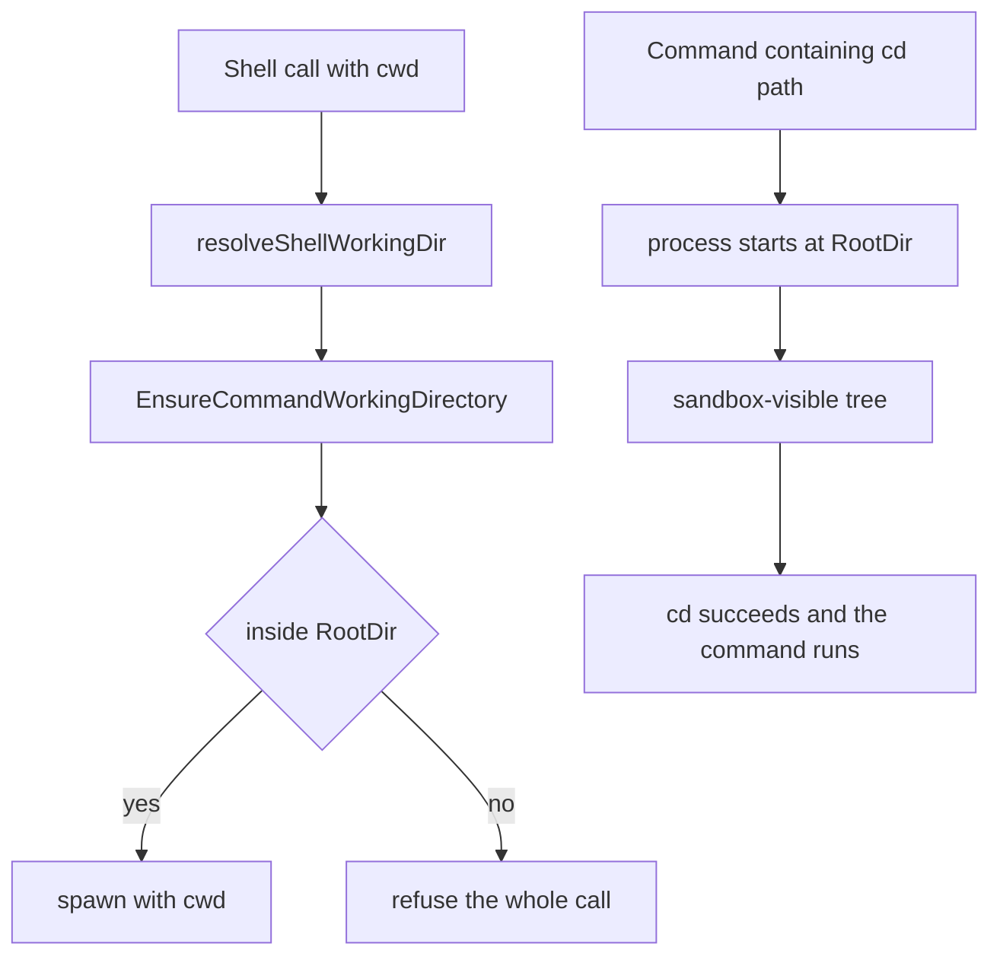

# Issue #4332: a sandboxed shell accepts a cwd it can read

## Status

**Frozen for implementation and PAR round 3.** Lane
`issue-4332-readonly-shell-cwd`, based on `origin/main` at
`f6900f5d8ff3e436a474054a7211fff746d1f451` (merged before this spec).

Revision notes:

- PAR round 1 found that a policy-only "read anywhere" rule is not the
  backend's visible set: bubblewrap hides host `/tmp` and `/dev`, and the
  wrapper's cwd re-bind would expose a model-named directory there (including
  Unix sockets the private `/tmp` exists to hide). Round 2 found the first
  repair's inside-root fast path would skip canonicalisation and masks,
  regressing today's symlink-aware containment. The rule below canonicalises
  and mask-checks first, then keeps symlink-aware containment, then requires
  both the literal and resolved spellings to be readable and visible.
- Round 1 also found the restricted branch must not treat write-only roots as
  readable, the hand-built restricted test policies need explicit scopes, the
  write-blocked off shell is already unconfined, and the real-backend fixture
  must not live in `/tmp`. Round 2 found `/dev/shm` needs a deliberate
  stricter-than-bwrap statement, the refusal needs a defined precedence and
  composition point, and the verification needs the root-under-`/tmp`,
  scratch and symlink cases. Those are incorporated.
- **Amendment 1 (implementation).** The ordered rule already puts masks first.
  This makes that precedence explicit for the write-blocked off degrade:
  `SpawnedCanRead` checks the absolute-path and mask tests before its
  unenforced short-circuit, so the degrade keeps the same credential floor as
  its file tools even though its shell is unconfined. A plain off policy has
  no masks and still allows any absolute path. This matches the existing
  `FileToolCanRead` behavior for a write-blocked policy.
- **Amendment 2 (implementation PAR).** `CommandCWDVisible` must not treat
  every `CacheRoots` entry as bound. Bubblewrap mounts cache roots only under
  `CacheStrategy == CacheOverlay`, and only the live-served subset; under
  `CacheSessionPrivate` the environment redirects the cache variables into the
  session tmp and binds nothing at the host path. A host `/tmp` cache root
  (an absolute `GOCACHE`/`GOMODCACHE` survives the resolver's root guard) would
  otherwise be accepted and then re-bound through the cwd, the widening this
  spec forbids. The predicate consults `CacheRoots` only when the strategy is
  overlay, through the same live-served check the argv uses.
- **Amendment 3 (RoboRev branch review).** A symlinked read root is bound at
  its literal spelling (bubblewrap exposes `link/sub`, not the target's own
  spelling). A symlinked cwd's resolved spelling is therefore judged against
  the grant roots' resolved spelling, not their literal spelling. That accepts
  a cwd reached through a symlinked read root while refusing the target's own
  spelling when the backend does not expose it, and still refuses a workspace
  symlink that resolves outside the read set. The cache-root test fixture uses
  an explicit `/tmp` directory and is Linux-gated, so it does not depend on
  where `t.TempDir()` lands.
- **Amendment 4 (RoboRev branch review, round 2).** Two further consequences
  surfaced. First, a read-only workspace under host `/tmp` was preserved only
  through the cwd re-bind; an accepted outside cwd removed that bind and hid
  workspace files that `cd` from the default cwd could still read. The
  file-tool anchor now joins the bwrap candidates independently of cwd.
  Second, the resolved visibility check must judge explicit grants by their
  resolved spelling too, so a literal cwd under a symlinked writable root
  under `/tmp` is accepted. The symlinked-read-root test's `pwd` expectation
  is backend-specific (bubblewrap binds the literal path, Seatbelt keeps the
  host link).

## Intent and scope

Make the shell tool's `cwd` argument agree with what a sandboxed command can
already do: a command may start in any directory its runtime can already
reach. Today a read-only session rooted at the main checkout refuses a `cwd`
outside that root even though `cd <path> && …` inside the same command works
and `read_file`/`grep` read the same path.

Intended tracked deliverables:

- `agent/sandbox/resolve.go` — `ResolvedPolicy.SpawnedCanRead`, one
  spawned-layer read predicate beside `FileToolCanRead`.
- `agent/sandbox/backend.go` — `Wrapper.CommandCWDVisible`, the
  backend-namespace companion for the private `/tmp` and `/dev` mounts.
- `agent/sandbox/bwrap.go` — the file-tool workspace anchor joins the cwd
  re-bind candidates, so a workspace under `/tmp` stays visible when the
  chosen cwd is elsewhere.
- `agent/sandbox/backend_test.go` and
  `agent/sandbox/resolve_canread_test.go` — predicate matrices.
- `agent/execenv/local.go` — `EnsureCommandWorkingDirectory` canonicalises,
  mask-checks, keeps symlink-aware containment, then asks both predicates
  plus the already-provisioned session scratch.
- `agent/execenv/execenv.go` — the capability comment.
- `agent/execenv/sandbox_off_scope_test.go` — the confined-cwd matrix,
  with an explicit restricted scope where the test needs one.
- `agent/session_tools_shell.go` — the refusal wording and comments.
- `agent/session_tools_shell_test.go` — the existing hand-built-policy
  cases updated to explicit scopes and the new expectations.
- `agent/session_tools_shell_cwd_sandbox_test.go` — the focused real
  shell/backend test.
- `agent/internal/tool/definitions.go` — the model-facing `cwd` description
  (it currently says confined policies require paths inside the root).
- `docs/sandboxing.md` and the S14 row of `docs/product/subsystems.md` — the
  owning behavior descriptions.
- this specification.

No other tracked file is intended. No sandbox backend, grant, mask, private
mount, write root, approval, or unrelated shell behavior changes.

## The two inconsistent paths

1. **`cwd` is validated as workspace containment.** The shell tool resolves
   the argument and calls `EnsureCommandWorkingDirectory`
   (`agent/session_tools_shell.go:391-415`), which today delegates to
   `ensureUnderRoot` for every `FileToolConfined` policy
   (`agent/execenv/local.go:3498-3506`). The same check runs again on every
   spawn path through `resolveCommandWorkingDir`
   (`agent/execenv/local.go:2921-2933`, callers at 2950, 3064 and 3182).
   A path outside the environment's `RootDir` is refused before a process
   exists.

2. **The sandbox's visible tree is wider than the workspace root, but
   narrower than "read anywhere".** Read-only and workspace-write resolve
   `Spawned.Read = ReadAnywhere` (`agent/sandbox/resolve.go:923-948`):
   bubblewrap starts from `--ro-bind / /` and masks the denylist and
   pseudo-fs floor (`agent/sandbox/bwrap.go:51-66`), then replaces `/tmp`
   with a private tmpfs and `/dev` with a minimal tree
   (`agent/sandbox/bwrap.go:68-80, 290-293`). Seatbelt grants read-anywhere
   minus the same masks and has no private mount namespace. Restricted
   resolves `Spawned.Read = ReadWorktreeOnly` with its worktree, extra read
   roots, system roots, git and infrastructure read grants
   (`agent/sandbox/resolve.go:950-978`). The shell process starts at the
   environment root and its own `cd` builtin can enter any of those
   directories, because no product code checks a `cd` target. The file
   tools read the read-anywhere set through `FileToolCanRead`
   (`agent/sandbox/resolve.go:228-260`).

The policy already answers most of "can a spawned command read this path".
The backend answers the rest: the private `/tmp` means a host `/tmp`
directory is not reachable by `cd`, and naming it as `cwd` would make the
wrapper re-bind it into the sandbox (`agent/sandbox/bwrap.go:96-125`),
exposing content — including Unix sockets that `connect()` can still use
through a read-only bind (`agent/sandbox/bwrap.go:96-107`,
`docs/sandboxing.md:199-206`) — that the private mount deliberately hides.

## Chosen rule

The check receives the cleaned absolute `abs` the caller resolved (relative
paths are joined against the environment working directory, an omitted `cwd`
defaults to it). It computes `resolved = resolveSymlinksBestEffort(abs)` and
then applies, in this order:

1. **Masks deny everywhere.** If `Masks(abs)` or `Masks(resolved)`, the cwd
   is refused as masked. `Masks` already carves out `UnmaskedRoots` and
   re-masks `.git` inside them, so the predicate and the backends agree.
   This includes a masked path spelled inside the workspace root: the kernel
   already masked it, so the command could not enter it; refusing it before
   the spawn gives the actionable error instead of a bare `chdir` failure.
2. **The symlink-aware workspace containment today already applies.**
   `ensureUnderRoot(abs)` resolves symlinks and accepts a path that resolves
   at or under `RootDir`. Keeping this check preserves every non-masked
   inside-root case, including a workspace root that itself lives under host
   `/tmp` (the wrapper already re-binds that root). A symlink inside the
   workspace that resolves outside it does not take this branch.
3. **Outside the root, the literal spelling must be in the spawned read set
   and visible; a symlinked literal spelling must also resolve under a
   grant's resolved spelling.**
   `ResolvedPolicy.SpawnedCanRead` models:
   - no enforced policy, after the masks above: any absolute path. Plain off
     has no masks; the write-blocked off degrade keeps its credential mask.
     There is no kernel wrapper in either case;
   - `Spawned.Read == ReadAnywhere`: any absolute path the policy does not
     mask;
   - `Spawned.Read == ReadWorktreeOnly`: an absolute path under
     `Spawned.ReadRoots` or `UnmaskedRoots`, minus masks. Write-only roots
     are not promised: Seatbelt grants a write root `file-write*` but not
     `file-read*`, so a cwd accepted from a write-only root would not work
     on every backend. The worktree is a read root in restricted mode, so
     the ordinary case is covered.

   `Wrapper.CommandCWDVisible` models the private mounts:
   - no wrapper, or a Seatbelt wrapper: true (Seatbelt has no private mount
     namespace);
   - bwrap `ReadWorktreeOnly`: true (every read, write, carved-out and
     scratch root is explicitly bound);
   - bwrap `ReadAnywhere`: true for the session tmp, the session scratch
     tree, and any path under `Spawned.ReadRoots`, `Spawned.WriteRoots` or
     `UnmaskedRoots` (all explicitly bound), plus a path under a
     `CacheRoots` entry only when the strategy is `CacheOverlay` and the
     overlay serves that entry (`liveCacheRoots`); false for a path under
     the private `/tmp` or `/dev` (`inPrivateMount`); true otherwise.
     `CommandCWDVisibleResolved` applies the same checks with each explicit
     grant's resolved spelling, which is how a literal cwd under a symlinked
     grant is accepted without accepting the target's own spelling.

   The resolved spelling is judged against the roots' resolved spelling, not
   their literal spelling: bubblewrap binds a symlinked read root at its
   literal path, so `link/sub` is enterable while the target's own spelling
   is not. Requiring the literal path against the literal grant and the
   resolved path against the resolved grant accepts the former, refuses the
   latter, and still refuses a workspace symlink that resolves to a masked
   path or outside the read roots. The backend remains the final authority
   for anything the policy admits.

4. **The session scratch is accepted.** The environment accepts the scratch
   directory it has already provisioned (through its wrapper, or the
   write-blocked degrade's own scratch) in either spelling. The check never
   provisions one: an empty scratch path is not a root.

The directory must still exist and be a directory. `EnsureCommandWorkingDirectory`
returns only a reason; `resolveShellWorkingDir` composes the refusal with the
raw argument and the resolved path. Internal spawn paths (`resolveCommandWorkingDir`)
surface the reason directly. The existing `EnsureUnderRoot` contract for URL
attachments and other narrow callers is unchanged.

## Refusal

A path outside the readable/visible set is still refused before any process
is started, so a refused `cwd` runs no command. The shell refusal names the
raw argument, the resolved absolute path, and the first applicable boundary,
in this precedence:

1. the sandbox denylist (a masked path, or `.git` in a carve-out);
2. the sandbox's readable roots (restricted mode outside them);
3. the private temporary namespace (a host `/tmp` or `/dev` path the private
   mounts hide).

It ends with the remedy: choose a directory the sandbox can read. It does
not tell the model to use `cd`, since `cd` cannot reach a hidden or masked
path either. The outer prefix becomes neutral ("which the sandbox cannot
read"), replacing today's "which escapes the sandbox".

## Consequences and preservation

- A read-only session rooted at the main checkout accepts a state-dir
  worktree (or any other unmasked, non-private directory) as `cwd`,
  matching `cd`.
- A write under that accepted cwd still fails in a real wrapped read-only
  sandbox: the policy's write roots are untouched and the kernel wrapper
  mounts the tree read-only. This applies to a non-scratch cwd and to the
  wrapped foreground, background and streaming dispatch. Detached commands
  are already launched without the wrapper (and a wrapped environment
  refuses detach), so the detached `cwd` check changes only its validation.
- Host `/tmp` and `/dev` directories remain refused as `cwd` on bubblewrap.
  The private mounts already hide them from `cd`, and accepting one would
  re-bind it and widen what the shell can reach. The rule is deliberately
  stricter than bwrap for a host `/dev/shm` subdirectory: bwrap could
  re-bind it, but exposing host shared memory is not needed for this defect,
  so it stays refused unless it is an explicit grant. Seatbelt has no
  private mount namespace and accepts an unmasked path there.
- The workspace stays visible from an accepted outside cwd, including a
  workspace under host `/tmp`: the wrapper re-binds the file-tool anchor
  independently of the chosen cwd.
- Restricted mode accepts a `cwd` in a spawned read root or an unmasked
  carve-out (for example the worktree or a system root) instead of
  requiring it under the workspace root. The shell could already `cd`
  there, so no read capability is added. A write-only root is not promised.
- The write-blocked off degrade accepts a `cwd` anywhere its denylist admits,
  matching its unconfined shell and its already read-anywhere file tools
  (masks still deny both). Its shell was already unconfined, so this replaces
  the last deliberate cwd role boundary with the shell's actual access; its
  file-tool write boundary (session scratch only) is unchanged. The docs must
  not claim the degraded shell's writes are confined.
- Relative `cwd`, the omitted-`cwd` default, and the `cd` path are
  unchanged.
- A masked path, an unreadable restricted path, a private-mount path, a
  missing directory and a non-directory are still refused, with no process
  started. A masked path inside the root is now refused before the spawn
  rather than failing at `chdir`; every non-masked inside-root case keeps
  its behavior.
- A hand-built `ResolvedPolicy` whose `Spawned` scope is left zero keeps
  the zero value's existing meaning (`ReadAnywhere`); production policies
  come from `sandbox.Resolve` and always carry an explicit scope. Tests
  that need a restricted refusal must state the scope explicitly.

## Non-goals

- No sandbox redesign: no change to resolved read grants, write roots,
  masked paths, unmasked carve-outs, private mounts, backend argv, Seatbelt
  policy, or the session scratch contract.
- No change to `FileToolCanRead`, file-tool write confinement, approval
  escalation, or the network policy.
- No new approval, retry, or recovery path for a refused `cwd`.
- No change to relative path resolution, the default `cwd`, detached
  confinement, or shell dispatch modes.
- No handling of the separate "large git diff output truncated mid-hunk"
  observation in the issue text; it is unrelated to `cwd` and gets its own
  issue if none exists.
- No labels and no unrelated fixes.

## Verification

Red-first, through the real shell tool and a real resolved sandbox policy.
The focused backend test runs where `sandbox.RealProber` reports a usable
backend and skips otherwise; it is not part of a claim about hosts without
one. Its outside-root fixture lives under `/var/tmp` (outside the private
mounts), never `t.TempDir()` alone. The tests avoid writing to the real
`$HOME`: a mask is seeded with an explicit `DenylistAdd` path under the
fixture.

1. New `agent/session_tools_shell_cwd_sandbox_test.go`: a read-only session
   rooted at `<base>/root` executes the shell tool with `cwd = <base>/outside`
   and `command = "pwd"`, and separately with `command = "cd <base>/outside
   && pwd"` from the root. Before the fix the first call is refused; after
   it, both succeed and print the same path. This is the red-first case.
2. Same file: `touch attempted-write` under that accepted `cwd` does not
   create the file and is not a pre-spawn tool error. This proves the write
   boundary is still enforced by the real wrapper.
3. Same file: a directory named by an explicit `DenylistAdd` entry is
   refused (masked), and a marker command under it leaves no file behind.
   A symlink inside the workspace root pointing at that masked directory is
   also refused, proving the canonicalisation branch; a marker command under
   the link leaves no file behind.
4. Same file: a host `/tmp` directory outside the session scratch is refused
   (private namespace), and a marker command under it leaves no file behind.
   This is the no-widening control the PAR rounds found missing. It runs
   only when the resolved backend is bwrap.
5. Same file: a restricted-mode directory outside the spawned read roots is
   refused, and a marker command leaves no file behind. A symlinked extra
   read root accepts its literal cwd and refuses the target's own spelling,
   which the restricted namespace does not bind.
6. Same file: the environment's own session scratch directory is accepted as
   a `cwd` and `pwd` runs there, proving the scratch branch on a real
   backend.
7. Same file: a root under host `/tmp` accepts a subdirectory inside the
   root (the wrapper's re-bind path) and refuses a sibling outside the root
   (private namespace). Both run only when the resolved backend is bwrap.
   A read-only session rooted under `/tmp` reads a workspace file from an
   accepted `/var/tmp` cwd, proving the workspace anchor survives the cwd
   change. A workspace-write session accepts a literal cwd under a symlinked
   extra writable root under `/tmp`, writes there, and refuses the target's
   own spelling.
8. `agent/sandbox/resolve_canread_test.go`: `SpawnedCanRead` accepts
   read-anywhere paths, rejects masked paths and `.git` under a carve-out,
   accepts restricted read roots and unmasked roots, rejects a restricted
   path outside them and a write-only root, rejects a relative path on a
   confined policy, and accepts any path on an unenforced policy.
   `SpawnedCanReadResolved` accepts the resolved spelling of a symlinked read
   root while `SpawnedCanRead` refuses that spelling against the literal
   grant.
9. `agent/sandbox/backend_test.go`: `CommandCWDVisible` accepts a host
   `/var/tmp` path under bwrap read-anywhere, rejects a host `/tmp` or
   `/dev` path, accepts the session tmp and its scratch tree, accepts an
   explicitly granted read/write/unmasked root under `/tmp`, rejects a cache
   root under an explicit `/tmp` fixture while `CacheSessionPrivate`
   redirects it and accepts the same root under `CacheOverlay` (Linux only),
   is always true for Seatbelt, for bwrap worktree-only, and for a nil
   wrapper. `CommandCWDVisibleResolved` accepts the resolved spelling of a
   symlinked writable root while `CommandCWDVisible` refuses that spelling
   against the literal grant.
10. `agent/execenv/sandbox_off_scope_test.go`: the confined-cwd matrix now
    accepts an outside root for read-only, workspace-write and the
    write-blocked off degrade (including the detached entry point when the
    platform supports it), and refuses it for a restricted policy whose
    explicit `Spawned` scope is `ReadWorktreeOnly` outside its roots; the
    inside-root and default-`cwd` cases keep passing for every policy. The
    restricted policy literal gains that explicit scope.
11. `agent/session_tools_shell_test.go`: the hand-built-policy cases are
    updated — `TestShellToolConfinedCwdOutsideWorkingDirectory` accepts for
    read-only, workspace-write and write-blocked off, and refuses for an
    explicitly scoped restricted policy;
    `TestShellToolCwdEscapingSandboxRootRejected` gains an explicit
    restricted scope so its refusal still means "outside the spawned read
    roots". The off and inside-root accepted cases stay.
12. `agent/internal/tool/definitions.go`'s `cwd` description and
    `docs/sandboxing.md`/the S14 row describe the new rule; the copy is
    reviewed in the diff, not pinned by a test.

Commands from the worktree:

- `go test ./agent -run 'TestShellTool.*Cwd|TestShell.*Cwd|TestReadOnly.*Cwd|TestShellToolConfinedCwd' -count=1`
- `go test ./agent/sandbox -run 'TestSpawnedCanRead|TestCommandCWDVisible|TestFileToolCanRead' -count=1`
- `go test ./agent/execenv -run 'TestConfinedCommandWorkingDirectory|TestSandboxOffCommandWorkingDirectory|TestSandboxOffDetachedWorkingDirectory' -count=1`
- `make build`

The full suite is CI's job under the brief's verification rule, not this
lane's.

Freeze this specification, give two independent competing PAR reviewers the
same immutable inputs, resolve evidenced findings, then repeat PAR against the
frozen base/head implementation diff, run simplify-code, commit, run the
required RoboRev branch review, and push.
