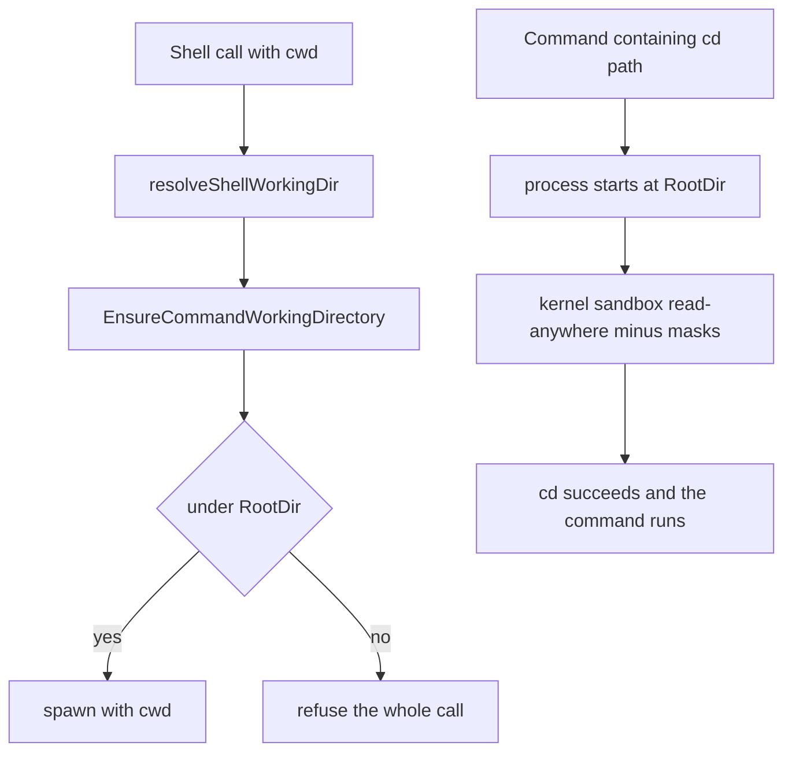

# Issue #4332: a sandboxed shell accepts a cwd it can read

## Status

**Frozen for implementation and PAR.** Lane `issue-4332-readonly-shell-cwd`,
based on `origin/main` at `f6900f5d8ff3e436a474054a7211fff746d1f451`
(merged into the lane before this spec). Issue #4332 is a bug, not a
redesign.

## Intent and scope

Make the shell tool's `cwd` argument agree with what a sandboxed command can
already do: a command may start in any directory its spawned-process layer can
read. Today a read-only session rooted at the main checkout refuses a `cwd`
outside that root even though `cd <path> && …` inside the same command works
and `read_file`/`grep` read the same path.

Intended tracked deliverables:

- `agent/sandbox/resolve.go` — one spawned-layer read predicate beside
  `FileToolCanRead`.
- `agent/execenv/local.go` — `EnsureCommandWorkingDirectory` asks that
  predicate (plus the session scratch the wrapper already grants) instead of
  requiring the workspace root.
- `agent/execenv/execenv.go` — the capability comment.
- `agent/session_tools_shell.go` — the refusal wording and comments.
- `agent/internal/tool/definitions.go` — the model-facing `cwd` description
  (it currently says confined policies require paths inside the root).
- `agent/sandbox/resolve_canread_test.go`, `agent/execenv/sandbox_off_scope_test.go`,
  `agent/session_tools_shell_test.go`, and a focused
  `agent/session_tools_shell_cwd_sandbox_test.go` — tests.
- `docs/sandboxing.md` and the S14 row of `docs/product/subsystems.md` — the
  owning behavior descriptions.
- this specification.

No other tracked file is intended. No sandbox backend, grant, mask, write
root, approval, or unrelated shell behavior changes.

## The two inconsistent paths

1. **`cwd` is validated as workspace containment.** The shell tool resolves
   the argument and calls `EnsureCommandWorkingDirectory`
   (`agent/session_tools_shell.go:391-415`), which today delegates to
   `ensureUnderRoot` for every `FileToolConfined` policy
   (`agent/execenv/local.go:3498-3506`). The same check runs again on every
   spawn path through `resolveCommandWorkingDir`
   (`agent/execenv/local.go:2921-2933`, callers at 2950, 3064 and 3182).
   A path outside the environment's `RootDir` is refused before a process
   exists.

2. **The kernel sandbox reads anywhere it is not masked, and `cd` uses that
   set.** Read-only and workspace-write resolve `Spawned.Read =
   ReadAnywhere` (`agent/sandbox/resolve.go:923-948`): bubblewrap starts from
   `--ro-bind / /` and masks only the denylist and pseudo-fs floor
   (`agent/sandbox/bwrap.go:51-66`); Seatbelt grants read-anywhere the same
   way. Restricted resolves `Spawned.Read = ReadWorktreeOnly` with its
   worktree, extra read roots, system roots, git and infrastructure read
   grants (`agent/sandbox/resolve.go:950-978`). The shell process starts at
   the environment root and its own `cd` builtin can enter any of those
   directories, because no product code checks a `cd` target. The file tools
   read the same read-anywhere set through `FileToolCanRead`
   (`agent/sandbox/resolve.go:228-260`).

So the policy already answers "can a spawned command read this path"; only the
`cwd` check asks a different, narrower question.

## Chosen rule

A resolved command `cwd` is accepted when the **spawned-process layer** of the
active policy can read it:

- No enforced policy (plain off, or the write-blocked off read-only degrade):
  any existing directory. There is no kernel wrapper, and the shell already
  reads anywhere with ordinary OS access.
- `Spawned.Read == ReadAnywhere` (read-only, workspace-write): any existing
  absolute directory that the policy does not mask. Masked paths and `.git`
  inside an unmasked carve-out stay refused.
- `Spawned.Read == ReadWorktreeOnly` (restricted): an existing absolute
  directory under `Spawned.ReadRoots`, `Spawned.WriteRoots` or
  `UnmaskedRoots` (a writable or carved-out root is readable), minus masks.
- The session scratch directory the environment already provisioned through
  its wrapper is readable and writable in every mode and is accepted as a
  `cwd` too. Checking it never provisions one.

The predicate is a new policy method, `ResolvedPolicy.SpawnedCanRead`,
modelled on `FileToolCanRead`. It answers from policy state only. The shell
check canonicalises the resolved path with the existing
`resolveSymlinksBestEffort` before asking, so a symlink inside the workspace
that points at a masked path is refused by the policy rather than failing
later as a bare `chdir` error.

The check remains: resolve relative paths against the environment working
directory, default an omitted `cwd` to it, clean the result, validate it, then
require it to exist and be a directory. Only the validation question changes.

Inside the root everything behaves as before: the root is not masked and is a
spawned read root in every mode.

## Refusal

A path outside the readable set is still refused before any process is
started, so a refused `cwd` cannot run part of a batch. The refusal names the
raw argument, the resolved absolute path, which boundary refused it (masked
denylist versus outside the readable roots), and the remedy: choose a
directory the sandbox can read. It does not tell the model to use `cd`, since
`cd` cannot reach a path the spawned layer cannot read either. The existing
`EnsureUnderRoot` contract for URL attachments and other narrow callers is
unchanged.

## Consequences and preservation

- A read-only session rooted at the main checkout accepts a state-dir
  worktree (or any other unmasked directory) as `cwd`, matching `cd`.
- A write under that accepted cwd still fails in a real read-only sandbox:
  the policy's write roots are untouched and the kernel wrapper still mounts
  the tree read-only.
- Restricted mode accepts a `cwd` in a spawned read root (for example the
  worktree or a system root) instead of requiring it under the workspace
  root. The shell could already `cd` there, so no read capability is added.
- The write-blocked off degrade accepts a `cwd` anywhere, matching its
  unconfined shell and its already read-anywhere file tools. Its write
  boundary is unchanged: only the session scratch is writable.
- Relative `cwd`, the omitted-`cwd` default, foreground, background,
  streaming and detached dispatch, and the `cd` path are unchanged.
- A masked path, an unreadable restricted path, a missing directory and a
  non-directory are still refused, with no process started.
- A hand-built `ResolvedPolicy` whose `Spawned` scope is left zero keeps the
  zero value's existing meaning (`ReadAnywhere`); production policies come
  from `sandbox.Resolve` and always carry an explicit scope.

## Non-goals

- No sandbox redesign: no change to resolved read grants, write roots,
  masked paths, unmasked carve-outs, backend argv, Seatbelt policy, or the
  session scratch contract.
- No change to `FileToolCanRead`, file-tool write confinement, approval
  escalation, or the network policy.
- No new approval, retry, or recovery path for a refused `cwd`.
- No change to relative path resolution, the default `cwd`, or shell
  dispatch modes.
- No handling of the separate "large git diff output truncated mid-hunk"
  observation in the issue text; it is unrelated to `cwd` and gets its own
  issue if none exists.
- No labels and no unrelated fixes.

## Verification

Red-first, through the real shell tool and a real resolved sandbox policy.
The focused sandbox test runs where `sandbox.RealProber` reports a usable
backend and skips otherwise; it is not part of a claim about hosts without
one.

1. New `agent/session_tools_shell_cwd_sandbox_test.go`: a read-only session
   whose root is a temp directory executes the shell tool with
   `cwd = <sibling temp dir>` and `command = "pwd"`. Before the fix the call
   is refused; after it, it succeeds and prints the sibling path. This is the
   red-first case.
2. Same file: `touch attempted-write` under that accepted `cwd` does not
   create the file and is not a pre-spawn tool error. This proves the write
   boundary is still enforced by the real wrapper.
3. Same file: a masked directory (`<home>/.ssh`) and a restricted-mode
   directory outside the spawned read roots are refused, and a marker command
   under each leaves no file behind. These are the "outside the readable set"
   controls.
4. `agent/sandbox/resolve_canread_test.go`: `SpawnedCanRead` accepts
   read-anywhere paths, rejects masked paths and `.git` under a carve-out,
   accepts restricted read/write/unmasked roots, rejects a restricted path
   outside them, rejects a relative path, and accepts any path on an
   unenforced policy.
5. `agent/execenv/sandbox_off_scope_test.go`: the confined-cwd matrix now
   accepts an outside root for read-only, workspace-write and the
   write-blocked off degrade, and refuses it for restricted when it is
   outside the spawned read roots; the inside-root and default-`cwd` cases
   keep passing for every policy.
6. `agent/session_tools_shell_test.go`: the existing hand-built-policy cases
   are updated to state explicit scopes so the restricted refusal still
   means "outside the spawned read roots", not a zero value. The off and
   inside-root accepted cases stay.
7. `agent/internal/tool/definitions.go`'s `cwd` description and
   `docs/sandboxing.md`/the S14 row describe the new rule; the copy is
   reviewed in the diff, not pinned by a test.

Commands from the worktree:

- `go test ./agent -run 'TestShellTool.*Cwd|TestShell.*Cwd|TestReadOnly.*Cwd|TestShellToolConfinedCwd' -count=1`
- `go test ./agent/sandbox -run 'TestSpawnedCanRead|TestFileToolCanRead' -count=1`
- `go test ./agent/execenv -run 'TestConfinedCommandWorkingDirectory|TestSandboxOffCommandWorkingDirectory' -count=1`
- `make build`

The full suite is CI's job under the brief's verification rule, not this
lane's.

Freeze this specification, give two independent competing PAR reviewers the
same immutable inputs, resolve evidenced findings, then repeat PAR against the
frozen base/head implementation diff, run simplify-code, commit, run the
required RoboRev branch review, and push.
