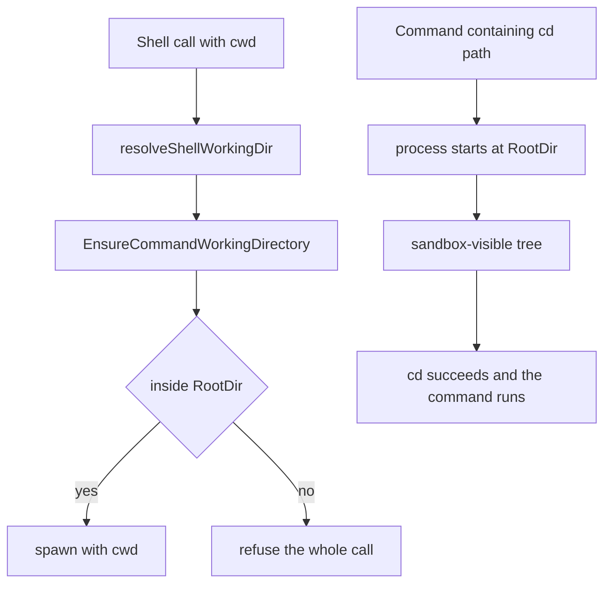

# Issue #4332: a sandboxed shell accepts a cwd it can read

## Status

**Frozen for implementation and PAR round 2.** Lane
`issue-4332-readonly-shell-cwd`, based on `origin/main` at
`f6900f5d8ff3e436a474054a7211fff746d1f451` (merged before this spec).

Revision note (PAR round 1): both reviewers independently found that a
policy-level "read anywhere" predicate is not the backend's actual visible
set: bubblewrap hides host `/tmp` and `/dev` behind private mounts, and the
wrapper's cwd re-bind would expose a model-named directory there (including
Unix sockets the private `/tmp` exists to hide). The rule below adds a
backend-visibility check and moves the real-backend fixture out of `/tmp`.
The reviewers also found that the verification plan must construct explicit
spawned scopes for the restricted hand-built policies, and that the
write-blocked-off shell is already unconfined. Those are incorporated.

## Intent and scope

Make the shell tool's `cwd` argument agree with what a sandboxed command can
already do: a command may start in any directory its runtime can already
reach. Today a read-only session rooted at the main checkout refuses a `cwd`
outside that root even though `cd <path> && …` inside the same command works
and `read_file`/`grep` read the same path.

Intended tracked deliverables:

- `agent/sandbox/resolve.go` — `ResolvedPolicy.SpawnedCanRead`, one
  spawned-layer read predicate beside `FileToolCanRead`.
- `agent/sandbox/backend.go` — `Wrapper.CommandCWDVisible`, the
  backend-namespace companion for the private `/tmp` and `/dev` mounts.
- `agent/sandbox/backend_test.go` and
  `agent/sandbox/resolve_canread_test.go` — predicate matrices.
- `agent/execenv/local.go` — `EnsureCommandWorkingDirectory` asks both
  predicates plus the already-provisioned session scratch, and keeps the
  inside-root fast path.
- `agent/execenv/execenv.go` — the capability comment.
- `agent/execenv/sandbox_off_scope_test.go` — the confined-cwd matrix,
  with an explicit restricted scope where the test needs one.
- `agent/session_tools_shell.go` — the refusal wording and comments.
- `agent/session_tools_shell_test.go` — the existing hand-built-policy
  cases updated to explicit scopes and the new expectations.
- `agent/session_tools_shell_cwd_sandbox_test.go` — the focused real
  shell/backend test.
- `agent/internal/tool/definitions.go` — the model-facing `cwd` description
  (it currently says confined policies require paths inside the root).
- `docs/sandboxing.md` and the S14 row of `docs/product/subsystems.md` — the
  owning behavior descriptions.
- this specification.

No other tracked file is intended. No sandbox backend, grant, mask, private
mount, write root, approval, or unrelated shell behavior changes.

## The two inconsistent paths

1. **`cwd` is validated as workspace containment.** The shell tool resolves
   the argument and calls `EnsureCommandWorkingDirectory`
   (`agent/session_tools_shell.go:391-415`), which today delegates to
   `ensureUnderRoot` for every `FileToolConfined` policy
   (`agent/execenv/local.go:3498-3506`). The same check runs again on every
   spawn path through `resolveCommandWorkingDir`
   (`agent/execenv/local.go:2921-2933`, callers at 2950, 3064 and 3182).
   A path outside the environment's `RootDir` is refused before a process
   exists.

2. **The sandbox's visible tree is wider than the workspace root, but
   narrower than "read anywhere".** Read-only and workspace-write resolve
   `Spawned.Read = ReadAnywhere` (`agent/sandbox/resolve.go:923-948`):
   bubblewrap starts from `--ro-bind / /` and masks the denylist and
   pseudo-fs floor (`agent/sandbox/bwrap.go:51-66`), then replaces `/tmp`
   with a private tmpfs and `/dev` with a minimal tree
   (`agent/sandbox/bwrap.go:68-80, 290-293`). Seatbelt grants read-anywhere
   minus the same masks and has no private mount namespace. Restricted
   resolves `Spawned.Read = ReadWorktreeOnly` with its worktree, extra read
   roots, system roots, git and infrastructure read grants
   (`agent/sandbox/resolve.go:950-978`). The shell process starts at the
   environment root and its own `cd` builtin can enter any of those
   directories, because no product code checks a `cd` target. The file
   tools read the read-anywhere set through `FileToolCanRead`
   (`agent/sandbox/resolve.go:228-260`).

The policy already answers most of "can a spawned command read this path".
The backend answers the rest: the private `/tmp` means a host `/tmp`
directory is not reachable by `cd`, and naming it as `cwd` would make the
wrapper re-bind it into the sandbox (`agent/sandbox/bwrap.go:96-125`),
exposing content — including Unix sockets that `connect()` can still use
through a read-only bind (`agent/sandbox/bwrap.go:96-107`,
`docs/sandboxing.md:199-206`) — that the private mount deliberately hides.

## Chosen rule

A resolved command `cwd` is accepted when either:

1. **It is at or under the environment's `RootDir`.** Every current
   inside-root case keeps working, including a workspace root that itself
   lives under host `/tmp` (the wrapper already re-binds that root).

or both of:

2. **The spawned-process layer of the policy can read it.** The predicate
   `ResolvedPolicy.SpawnedCanRead` models:
   - no enforced policy (plain off, or the write-blocked off degrade):
     any absolute path; there is no kernel wrapper;
   - `Spawned.Read == ReadAnywhere`: any absolute path the policy does not
     mask;
   - `Spawned.Read == ReadWorktreeOnly`: an absolute path under
     `Spawned.ReadRoots` or `UnmaskedRoots`, minus masks. Write-only roots
     are not promised: Seatbelt grants a write root `file-write*` but not
     `file-read*`, so a cwd accepted from a write-only root would not work
     on every backend. The worktree is a read root in restricted mode, so
     the ordinary case is covered.

3. **The backend's namespace already exposes it.** The predicate
   `Wrapper.CommandCWDVisible` models the private mounts:
   - no wrapper, or a Seatbelt wrapper: true (Seatbelt has no private mount
     namespace);
   - bwrap `ReadWorktreeOnly`: true (every read, write, carved-out and
     scratch root is explicitly bound);
   - bwrap `ReadAnywhere`: true unless the path is under the private `/tmp`
     or `/dev`. The exceptions are the session tmp, the session scratch
     tree, and the explicitly bound roots (`Spawned.WriteRoots`,
     `UnmaskedRoots`, `CacheRoots`). This preserves the private-`/tmp` floor
     and keeps `cwd` matching what `cd` can reach.

The environment also accepts the session scratch directory it has already
provisioned (through its wrapper, or the write-blocked degrade's own
scratch) as a `cwd`. The check never provisions one: an empty scratch path
is not a root.

The check runs: resolve a relative path against the environment working
directory, default an omitted `cwd` to it, clean the result, accept the
inside-root case, canonicalise the outside path with the existing
`resolveSymlinksBestEffort`, then ask both predicates. A symlink inside the
workspace that points at a masked path or a private mount is therefore
refused by the policy rather than failing later as a bare `chdir` error. The
directory must still exist and be a directory.

## Refusal

A path outside the readable/visible set is still refused before any process
is started, so a refused `cwd` runs no command. The refusal names the raw
argument, the resolved absolute path, and which boundary refused it:

- the sandbox denylist (a masked path or `.git` in a carve-out);
- the sandbox's readable roots (restricted mode outside them);
- the private temporary namespace (a host `/tmp` or `/dev` path the private
  mounts hide).

It ends with the remedy: choose a directory the sandbox can read. It does
not tell the model to use `cd`, since `cd` cannot reach a hidden or masked
path either. The existing `EnsureUnderRoot` contract for URL attachments and
other narrow callers is unchanged.

## Consequences and preservation

- A read-only session rooted at the main checkout accepts a state-dir
  worktree (or any other unmasked, non-private directory) as `cwd`,
  matching `cd`.
- A write under that accepted cwd still fails in a real wrapped read-only
  sandbox: the policy's write roots are untouched and the kernel wrapper
  mounts the tree read-only. This applies to the wrapped foreground,
  background and streaming dispatch. Detached commands are already launched
  without the wrapper (existing behavior), so the write claim is scoped to
  wrapped dispatch; the detached `cwd` check changes only its validation.
- Host `/tmp` and `/dev` directories remain refused as `cwd`. The private
  mounts already hide them from `cd`, and accepting one would re-bind it and
  widen what the shell can reach.
- Restricted mode accepts a `cwd` in a spawned read root or an unmasked
  carve-out (for example the worktree or a system root) instead of
  requiring it under the workspace root. The shell could already `cd`
  there, so no read capability is added. A write-only root is not promised.
- The write-blocked off degrade accepts a `cwd` anywhere, matching its
  unconfined shell and its already read-anywhere file tools. Its shell was
  already unconfined; only the file-tool write boundary (session scratch
  only) is preserved, and this change does not alter it.
- Relative `cwd`, the omitted-`cwd` default, and the `cd` path are
  unchanged.
- A masked path, an unreadable restricted path, a private-mount path, a
  missing directory and a non-directory are still refused, with no process
  started.
- A hand-built `ResolvedPolicy` whose `Spawned` scope is left zero keeps
  the zero value's existing meaning (`ReadAnywhere`); production policies
  come from `sandbox.Resolve` and always carry an explicit scope. Tests
  that need a restricted refusal must state the scope explicitly.

## Non-goals

- No sandbox redesign: no change to resolved read grants, write roots,
  masked paths, unmasked carve-outs, private mounts, backend argv, Seatbelt
  policy, or the session scratch contract.
- No change to `FileToolCanRead`, file-tool write confinement, approval
  escalation, or the network policy.
- No new approval, retry, or recovery path for a refused `cwd`.
- No change to relative path resolution, the default `cwd`, detached
  confinement, or shell dispatch modes.
- No handling of the separate "large git diff output truncated mid-hunk"
  observation in the issue text; it is unrelated to `cwd` and gets its own
  issue if none exists.
- No labels and no unrelated fixes.

## Verification

Red-first, through the real shell tool and a real resolved sandbox policy.
The focused backend test runs where `sandbox.RealProber` reports a usable
backend and skips otherwise; it is not part of a claim about hosts without
one. Its fixture lives under `/var/tmp` (or another host directory outside
the private mounts), never `t.TempDir()` alone, because a temp dir is
normally under `/tmp` and the private-`/tmp` control must be tested
separately.

1. New `agent/session_tools_shell_cwd_sandbox_test.go`: a read-only session
   rooted at `<base>/root` executes the shell tool with `cwd = <base>/outside`
   and `command = "pwd"`, and separately with `command = "cd <base>/outside
   && pwd"` from the root. Before the fix the first call is refused; after
   it, both succeed and print the same path. This is the red-first case.
2. Same file: `touch attempted-write` under that accepted `cwd` does not
   create the file and is not a pre-spawn tool error. This proves the write
   boundary is still enforced by the real wrapper.
3. Same file: a directory named by an explicit `DenylistAdd` entry is
   refused (masked), and a marker command under it leaves no file behind.
4. Same file: a host `/tmp` directory outside the session scratch is refused
   (private namespace), and a marker command under it leaves no file behind.
   This is the no-widening control the PAR round found missing.
5. Same file: a restricted-mode directory outside the spawned read roots is
   refused, and a marker command leaves no file behind.
6. `agent/sandbox/resolve_canread_test.go`: `SpawnedCanRead` accepts
   read-anywhere paths, rejects masked paths and `.git` under a carve-out,
   accepts restricted read roots and unmasked roots, rejects a restricted
   path outside them and a write-only root, rejects a relative path, and
   accepts any path on an unenforced policy.
7. `agent/sandbox/backend_test.go`: `CommandCWDVisible` accepts a host
   `/var/tmp` path under bwrap read-anywhere, rejects a host `/tmp` or
   `/dev` path, accepts the session tmp and its scratch tree, accepts an
   explicitly bound write or unmasked root under `/tmp`, is always true for
   Seatbelt, for bwrap worktree-only, and for a nil wrapper.
8. `agent/execenv/sandbox_off_scope_test.go`: the confined-cwd matrix now
   accepts an outside root for read-only, workspace-write and the
   write-blocked off degrade, and refuses it for a restricted policy whose
   explicit `Spawned` scope is `ReadWorktreeOnly` outside its roots; the
   inside-root and default-`cwd` cases keep passing for every policy. The
   restricted policy literal gains that explicit scope.
9. `agent/session_tools_shell_test.go`: the hand-built-policy cases are
   updated — `TestShellToolConfinedCwdOutsideWorkingDirectory` accepts for
   read-only, workspace-write and write-blocked off, and refuses for an
   explicitly scoped restricted policy; `TestShellToolCwdEscapingSandboxRootRejected`
   gains an explicit restricted scope so its refusal still means "outside
   the spawned read roots". The off and inside-root accepted cases stay.
10. `agent/internal/tool/definitions.go`'s `cwd` description and
    `docs/sandboxing.md`/the S14 row describe the new rule; the copy is
    reviewed in the diff, not pinned by a test.

Commands from the worktree:

- `go test ./agent -run 'TestShellTool.*Cwd|TestShell.*Cwd|TestReadOnly.*Cwd|TestShellToolConfinedCwd' -count=1`
- `go test ./agent/sandbox -run 'TestSpawnedCanRead|TestCommandCWDVisible|TestFileToolCanRead' -count=1`
- `go test ./agent/execenv -run 'TestConfinedCommandWorkingDirectory|TestSandboxOffCommandWorkingDirectory' -count=1`
- `make build`

The full suite is CI's job under the brief's verification rule, not this
lane's.

Freeze this specification, give two independent competing PAR reviewers the
same immutable inputs, resolve evidenced findings, then repeat PAR against the
frozen base/head implementation diff, run simplify-code, commit, run the
required RoboRev branch review, and push.
