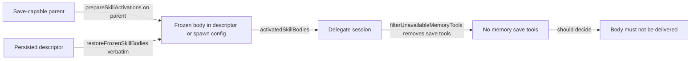

# Issue #4455: role preloads honor the delegate's own skill availability

Status: draft, frozen for the two-reviewer PAR round, 2026-10-25. The issue's explicit acceptance criteria authorize this bounded behavior correction.

## Defect: preload delivery bypasses the session's own availability

#4458 added `Session.skillAvailableToSession` (`agent/session_memory.go`) and its shared value type `skill.SessionAvailability` (`agent/skill/availability.go`). `prepareSkillActivations` (`agent/session_skill_activation.go:387`) refuses `gardening-memory` with a typed `policy_denied` when the activating session cannot save memory, and the model catalog omits it. A delegate never gets the save tools: `filterUnavailableMemoryTools` (`agent/session_memory.go:224`) removes `memory_write`, `memory_edit` and `memory_delete` from every subagent session, whatever its role or tool profile grants (#4190). So a delegate's `memorySaveInstructionsEnabled()` is false and it cannot follow `gardening-memory`.

Two role-preload delivery paths never ask the receiving session:

- **Fresh role preload.** `prepareSubagentRunFromSelection` (`agent/subagents.go:1022`) and `delegateRuntime.describe` (`agent/delegate_runtime.go:2386`) call `prepareSkillActivations` on the *creating parent*. A save-capable root passes the gate, and the rendered body is frozen into `spawn.activatedSkillBodies` / the delegate descriptor for a child that cannot use it.
- **Frozen restore.** `prepareSubagentRunFromSelection` with a descriptor (`agent/subagents.go:1002`) and `delegateRuntime.restoreIdle` (`agent/delegate_runtime.go:2777`) call `restoreFrozenSkillBodies` (`agent/subagents.go:625`), which copies the stored bodies verbatim. The body survives the child's missing capability on every restore, including a daemon restart.

No bundled role names `gardening-memory` (only `doctor` preloads `doctoring-evener`), so this is operator configuration; the delivered instructions still cannot be followed. The frozen body is also seeded into the child's skill inventory through `seedFrozenSkillPreloads`, so the unfollowable record outlives the prompt.

## Contract

The receiving session decides. A role preload body is delivered only when that session's own `skillAvailableToSession(name)` accepts the skill. An incapable delegate receives no `gardening-memory` preload body through either the fresh-role or frozen-restore path, and no preload inventory record for it. Every other role preload, including a legitimate frozen body for a followable skill, is delivered unchanged, in its original order and with its typed provenance. A save-capable session on the same path still receives the preload.

A delegate is incapable by construction, not by role name: `filterUnavailableMemoryTools` removes the save tools from every subagent session (#4190, `docs/product/memory.md`), so no production delegate can satisfy `memorySaveInstructionsEnabled()`. The acceptance's "capable delegate" control is therefore implemented as a save-capable session on the same construction seam, plus a non-`gardening-memory` role preload that still reaches a real delegate. This proves the filter is capability-based rather than keyed to the delegate kind or the skill name; it does not pretend a production delegate can save memory.

## Plumbing seam

The first exact seam where the receiving session exists and its registry is final is `Session.initSessionState` (`agent/session_init.go:1646`), shared by `NewSession` and `RestoreSessionFromMetaWithConfig`. It runs after every spawn tool policy, `toolNameCeiling` intersection and `filterUnavailableMemoryTools` (`agent/session_init.go:1817`), and before `refreshSystemPromptCache` and `seedFrozenSkillPreloads` (`agent/session_init.go:1822-1833`). Filtering there covers all four delivery paths with one capability check and never has to re-render or repair a prompt or inventory entry.

1. `spawnConfig` (`agent/session_config.go:809`) gains `activatedSkillNames []string`, parallel to `activatedSkillBodies`. The three producers set it: the fresh role loop (`agent/subagents.go:1034-1036`), the frozen restore (`agent/subagents.go:1006-1007`, from `frozen.FrozenSkillNames`), and the persisted-descriptor restore (`agent/delegate_runtime.go:2831`, from `descriptor.FrozenSkillNames`). The frozen branch clears it with the other preload fields.
2. New `Session.dropUnavailableSkillPreloads` (in `agent/session_skill_activation.go`, beside `seedFrozenSkillPreloads`) runs once from `initSessionState` immediately after `filterUnavailableMemoryTools`. When the name list and body list are the same length, it keeps each `(name, body)` pair whose `skillAvailableToSession(name)` is true and drops the rest. It drops the matching `schema.FrozenSkillPreload` records by name, so the inventory cannot seed a preload whose instructions were removed. A body without a parallel name (a direct test fixture or a caller that predates this field) is left untouched because its capability cannot be decided; the production producers always set names.
3. `restoreFrozenSkillBodies` keeps its validation and byte-for-byte copy. It answers "is this frozen record well formed", not "may this session follow it"; the construction seam owns the capability answer. A malformed descriptor still fails the restore as before.
4. The descriptor remains a faithful frozen record of what the parent prepared. The drift between a descriptor's `FrozenSkillNames`/`Bodies` and the child's delivered preloads is deliberate: a descriptor can be restored under a different build or host, and only the restoring session has the registry that decides delivery. The delivery filter is idempotent, so a restored child that later saves meta never grows the record back.

## Non-goals

- No activation-policy redesign: the routes, refusal code (`policy_denied`), catalog filtering, completion view, reload behavior and #4456 hub catalogs stay as they are.
- No change to `restoreFrozenSkillBodies`' validation contract, descriptor schema, persistence format or the delegate role/tool policy.
- No attempt to make a delegate memory-capable; #4190's rule stands.
- No new availability type: the existing `skill.SessionAvailability` / `skillAvailableToSession` mapping is the one capability answer.
- No product-doc edit: the S18 row in `docs/product/subsystems.md` already states the session-scoped availability contract; this change makes the preload paths obey it rather than changing its owner or surface.

## Cases and preservation

- A fresh in-process role preload (`spawnAgent`/`prepareSubagentRun`) of `gardening-memory` from a save-capable root reaches no incapable child: no `skill-context` envelope and no inventory preload record.
- A frozen descriptor whose `FrozenSkillNames`/`Bodies` include `gardening-memory` restores into an incapable delegate with no body and no preload record. A daemon-restart restore through `restoreIdle` uses the same construction seam.
- A role that preloads a followable skill alongside `gardening-memory` still delivers that skill in both paths, with its body, source and metadata unchanged.
- A save-capable session constructed with a `gardening-memory` preload still carries the body, proving the filter reads capability, not role kind.
- A root session with no preloads, a delegate with no preloads, a legacy descriptor with no `FrozenSkillMetadata`, and a preload with no parallel names keep their existing behavior.
- The memory-disabled, unbound-memory and save-tool-revoked shapes already fail `skillAvailableToSession`; any preload of `gardening-memory` for them is dropped by the same check.

## Verification

Red first, at the real preload/restore paths:

1. `TestRolePreloadDropsUnfollowableSkillForIncapableDelegate` in `agent`: build a save-capable root (real memory state root, project binding, save tools present) with a plugin role whose `skills:` names `gardening-memory` and a followable fixture skill. Spawn through `spawnAgent` and assert the child's provider request carries the followable skill's `skill-context` envelope and no `gardening-memory` envelope, and the child lifecycle inventory has no `gardening-memory` preload. Before the fix, the child request carries both envelopes and the inventory records both, so the negative assertion fails.
2. `TestFrozenRolePreloadDropsUnfollowableSkillForIncapableDelegate` in `agent`: build a descriptor with `FrozenSkillNames`/`Bodies` for `gardening-memory` and a followable fixture skill, restore through `prepareStableDelegateRun`, and assert the same child-side result. Before the fix, the frozen `gardening-memory` body survives.
3. `TestRolePreloadKeepsFollowableSkillForSaveCapableSession` in `agent`: construct a save-capable root session through `NewSession` with a `gardening-memory` preload in the spawn carrier and assert the body and its inventory record survive. This is the capability control required by the acceptance, in the shape the product actually permits.
4. Retain the exact red output for steps 1-2 before the implementation and the green output after it. Run:
   - `go test ./agent -run '^(TestRolePreloadDropsUnfollowableSkillForIncapableDelegate|TestFrozenRolePreloadDropsUnfollowableSkillForIncapableDelegate|TestRolePreloadKeepsFollowableSkillForSaveCapableSession|TestMemoryGardeningSkillGatedBySaveCapability)$' -count=1`
   - `go test ./agent -run '^(TestRestoreFrozenSkillBodies.*|TestCovRestoreFrozenSkillBodies|TestS5Cov_RestoreFrozenSkillBodies|TestSkillActivation_Routes|TestDelegateResourceCreate_UsesFrozenDescriptorAfterCommit)$' -count=1`
   - `make build`
   Do not run the full suite locally; CI is the source of truth.
5. Freeze and review this spec with two independent competing PAR reviewers. Review the immutable implementation diff with another two-reviewer PAR round, run simplify-code, commit, run branch RoboRev review, then push and open a PR. Fetch current `origin/main` and merge it before the final push if it moved. The parent session owns the CI wait and the merge; do not merge.
