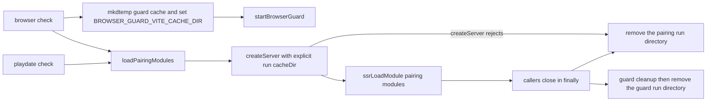

# Issue #4482: the pairing Vite servers cache outside the shared install

**Status:** Revised after two competing PAR reviews of the frozen v1
(`c09ce300a1991563c5f54542190abf11f1c286d0`); this v2 is the implementation
input and the spec used for implementation PAR.

Lane base after merging `origin/main`:
`1e37237d8e64410a73cedba6292681b27bb9fadd`, which contains the required
`f6900f5d8ff3e436a474054a7211fff746d1f451`. The lane merged `origin/main` at
`d2863d2b92d5a5c674849f205791c50702f3612c` (PR #4970) before the first push,
then merged `origin/main` at
`f40efdcc39847aa6a53fe08176bc6133de269636` (PR #4915 part 1b) after CI settled,
and the focused checks and `make build` were rerun against that final head.

## Intent and scope

`cmd/evener-hub/frontend/scripts/pairingModules.mjs` builds one Vite dev server
for the host-side pairing checks. It passes `configFile: false`, root set to the
frontend directory, and no `cacheDir`, so Vite resolves the dep-optimizer cache
to `<frontend>/node_modules/.vite` (Vite 8's `pkgDir` default). That default is
wrong in two supported layouts:

- Fleet worktrees symlink `cmd/evener-hub/frontend/node_modules` to one shared
  install ([agent-fleets](../../developing-evener/conventions/agent-fleets.md)),
  so every lane and every concurrent Vite process stages dep optimizations in
  the same `node_modules/.vite/deps_temp_*` directory. That is the #1586 race
  the app's own `cacheDir` pin already avoids.
- A read-only checkout cannot create `node_modules/.vite`, so the optimizer's
  write fails there.

The failure mode is not a rejected module load. In this Vite version
`createServer` resolves and `ssrLoadModule("/src/dev/pairingEnvelope.ts")`
succeeds through the real loader's alias; the optimizer's background scan then
creates `deps_temp_*` under `node_modules/.vite` (or logs ENOENT/EACCES when the
checkout is read-only). The issue's brief repro showed a load error because its
minimal `createServer` omitted the loader's
`@evener/appwire-client/pairing` alias, not because of the cache write. The
defect is the write target, and that is what this change fixes.

Consumers:

- `scripts/check-playdate-pairing.mjs` creates the server and closes it in
  `finally`; it needs no change.
- `scripts/check-device-pairing-browser.mjs` creates the pairing server, loads
  modules, then starts a second Vite dev server through `startBrowserGuard`. Its
  `try` currently starts after those awaits, so a failed load leaks both
  servers; and the guard server inherits the app cache
  (`<frontend>/.vite-cache`) because `BROWSER_GUARD_VITE_CACHE_DIR` is unset on
  the documented direct invocation and in `TestDevicePairingBrowserRoundTrip`.

The change:

1. gives the pairing loader a per-run `cacheDir` under `os.tmpdir()`, removed
   when that server closes;
2. keeps the browser script's loader, module loads and guard start inside its
   existing `try` so the `finally` closes everything on failure;
3. gives the browser guard a per-run cache through the existing
   `BROWSER_GUARD_VITE_CACHE_DIR` convention, removed after the guard stops.

## Exact behavior

1. Every `loadPairingModules()` call creates a fresh directory with
   `fs.mkdtempSync(path.join(os.tmpdir(), "evener-pairing-vite-"))`.
2. The Vite server receives that directory as its `cacheDir`. Every other option
   stays exactly as it is: `configFile: false`, the frontend root,
   `server.middlewareMode`, `appType: "custom"`, the `tweetnacl` dedupe, and the
   `@evener/appwire-client/pairing` alias.
3. `loadPairingModules()` keeps its Promise-shaped contract: callers still
   `await` it and receive a Vite server with the same `ssrLoadModule` and
   `close` surface. It accepts an optional `createServer` factory so the
   rejected-start cleanup can be tested; the existing callers pass no argument.
4. The server's `close()` awaits Vite's own close and then removes the run
   directory with `fs.rmSync(cacheDir, { recursive: true, force: true })`.
   Cleanup runs even when the caller closes after a failed module load. Vite's
   own close awaits/cancels the optimizer, and probes showed no re-created
   directory after removal.
5. If the injected `createServer` rejects, the run directory is removed before
   the error is rethrown. No cache directory outlives a failed start.
6. `check-device-pairing-browser.mjs` starts its `try` before
   `loadPairingModules()`, declares the server, guard and page outside it, and
   uses optional chaining in `finally`, so a failed module load, failed guard
   start or failed page setup still closes the pairing server, stops the guard,
   removes the native scratch and removes the guard cache.
7. The browser script sets `BROWSER_GUARD_VITE_CACHE_DIR` to a caller-provided
   value when one is present (and leaves that directory alone), otherwise to a
   fresh `fs.mkdtempSync(path.join(os.tmpdir(), "evener-pairing-guard-"))` that
   it removes after `guard.cleanup()`. The guard config already honors that
   variable; no Vite config is changed.
8. Per-run directories mean the pairing and guard servers never share a dep
   cache. They can run concurrently without sharing a cache; Vite's HMR
   WebSocket port (24678) remains a separate shared resource, unchanged by this
   fix, so the new test creates its servers one after another.

## Why this location

`os.tmpdir()` is the caller's writable scratch root, so a read-only checkout
only has to be readable. The directories are outside the checkout and outside
the `node_modules` symlink's target, so neither a read-only checkout nor the
shared install receives a cache write. `os.tmpdir()` is assumed to be an
absolute writable path, as every other temp user in the repository assumes; a
relative `TMPDIR` is not supported.

The alternatives do not meet both layouts:

- The checkout's `.vite-cache` convention from `vite.config.ts` is still
  unwritable in a read-only checkout, and a single shared subdirectory would
  reintroduce a race between the two pairing checks. `EVENER_FRONTEND_VITE_CACHE_DIR`
  belongs to the app config and the web gate; a pairing script invoked directly
  does not set it.
- A fixed path under `os.tmpdir()` is writable but races concurrent runs and
  leaves a permanent cache.
- A path beside the real `node_modules` target is the shared install by another
  name.

## Read-only and cleanup behavior

- The pairing loader's server needs no checkout write: its `cacheDir` is the
  run directory, and `configFile: false` avoids config bundling under the
  install. Probes with the frontend made read-only still loaded the pairing
  module and wrote only under the run cache.
- The browser guard's server uses the per-run cache set through
  `BROWSER_GUARD_VITE_CACHE_DIR`; it no longer writes `.vite-cache` in the
  checkout. The guard wrapper already uses `configLoader: "runner"`, so it
  writes no `node_modules/.vite-temp` either.
- The shared install's `node_modules/.vite` is never addressed by either
  server, so its `deps_temp_*` staging directory is not created, shared or
  raced.
- A normal or failed-run close removes both run directories. A killed process
  can leave at most one directory per server under the caller's temp root; no
  cache accumulates in the checkout or the shared install.
- The pairing checks' assertions, output, exit codes and prerequisites are
  unchanged.

## Non-goals

- No change to `vite.config.ts`, `browserguard.vite.config.mjs`,
  `device-pairing.vite.config.mjs`, the web gate, or
  `EVENER_FRONTEND_VITE_CACHE_DIR`.
- No change to the pairing protocol, module aliases, dedupe, middleware mode,
  `server.hmr`, either script's assertions, or the Go browser round-trip test.
- No cache reuse, config redesign, new dependency, or shared-cache directory.
- No product-doc update: the S23 development-and-qualification responsibility
  and source-of-truth ownership do not change, and this is internal dev tooling
  with no user-visible contract.
- No labels, no unrelated fixes, no full local suite, no deployment.

## Verification

1. Add `cmd/evener-hub/frontend/scripts/pairingModules.test.mjs` (a `node:test`
   file already collected by `node --test scripts/*.test.mjs`):
   - the server's resolved `config.cacheDir` is not under
     `<frontend>/node_modules` and is under `os.tmpdir()`. On the unfixed module
     it resolves to `<frontend>/node_modules/.vite`, so the node_modules
     assertion fails before the change;
   - two servers created one after another receive distinct run directories;
   - `/src/dev/pairingEnvelope.ts` still loads through the server and its
     exported behavior is intact (`readRecipient` / `hubSettings` / `crc32` on
     test-owned values), which is the module the playdate check loads first;
   - closing the server removes its run directory;
   - an injected `createServer` that rejects leaves no new
     `evener-pairing-vite-*` directory behind.
   Do not assert timing-dependent optimizer contents: Vite's background scan
   may write `deps_temp_*` or `deps/` after the load, and the cacheDir
   assertion is the contract.
2. Run the red case before the change and the same case after it; capture both
   outputs. Run the red case with the frontend's `node_modules` temporarily
   pointed at a scratch mirror of the shared install, so the pre-fix optimizer
   write lands in scratch rather than the shared install, then restore the
   symlink.
3. Then run:
   - `node --test scripts/pairingModules.test.mjs` from
     `cmd/evener-hub/frontend`;
   - the real pairing scripts when their documented prerequisites are present
     (`EVENER_PLAYDATE_CLIENT` and `PLAYDATE_SDK_PATH`; the browser check also
     needs `EVENER_PAIRING_E2E_URL` on loopback and Chrome). When they are
     absent, the module-load check above is the supported local substitute;
   - `npm run typecheck` from `cmd/evener-hub/frontend` as a no-regression
     check. It covers `src` and `appwire-client/typescript`, not `scripts/*.mjs`,
     so the node test and Biome are the checks that cover the changed script;
   - `npx biome check scripts/pairingModules.mjs scripts/pairingModules.test.mjs
     scripts/check-device-pairing-browser.mjs` from `cmd/evener-hub/frontend`;
   - `npm run check:scripts` from `mobile-native` only if the native script
     module graph changes (it does not here);
   - `make build` from the repository root.
   CI owns the full suite and `make test-web`.
4. Freeze this specification, give two independent competing PAR reviewers the
   same immutable spec plus base/head implementation diff, resolve evidenced
   findings, run simplify-code, commit, run the required RoboRev branch review,
   and hand the pushed PR to the controller for the CI wait and merge. Do not
   merge here.
