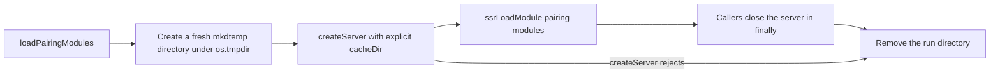

# Issue #4482: the pairing Vite server caches outside the shared install

**Status:** Frozen for PAR before implementation.

Lane base after merging `origin/main`:
`1e37237d8e64410a73cedba6292681b27bb9fadd`, which contains the required
`f6900f5d8ff3e436a474054a7211fff746d1f451`.

## Intent and scope

`cmd/evener-hub/frontend/scripts/pairingModules.mjs` builds one Vite dev server
for the host-side pairing checks. It passes `configFile: false`, root set to the
frontend directory, and no `cacheDir`, so Vite resolves the dep-optimizer cache
to `<frontend>/node_modules/.vite`.

That default is wrong in two supported layouts:

- Fleet worktrees symlink `cmd/evener-hub/frontend/node_modules` to one shared
  install ([agent-fleets](../../developing-evener/conventions/agent-fleets.md)),
  so every lane and every concurrent Vite process stages dep optimizations in
  the same `node_modules/.vite/deps_temp_*` directory. That is the #1586 race
  the app's own `cacheDir` pin already avoids.
- A read-only checkout cannot create `node_modules/.vite`, so the optimizer
  fails with EACCES before the check can load a module.

The issue's reproduction shows the optimizer writing `deps_temp_*` even when
the subsequent module load fails, so the write is not conditional on a
successful check. `scripts/check-playdate-pairing.mjs` and
`scripts/check-device-pairing-browser.mjs` (reached by
`TestDevicePairingBrowserRoundTrip` under `EVENER_PAIRING_E2E=1`) both call
`loadPairingModules()` and close the server in `finally`.

The change gives that server an explicit per-run cache directory under
`os.tmpdir()` and removes it when the server closes. Every other server option,
the loader's return shape, and both pairing scripts stay unchanged.

## Exact behavior

1. Every `loadPairingModules()` call creates a fresh directory with
   `fs.mkdtempSync(path.join(os.tmpdir(), "evener-pairing-vite-"))`.
2. The Vite server receives that directory as its `cacheDir`. Every other option
   stays exactly as it is: `configFile: false`, the frontend root,
   `server.middlewareMode`, `appType: "custom"`, the `tweetnacl` dedupe, and the
   `@evener/appwire-client/pairing` alias.
3. `loadPairingModules()` keeps its Promise-shaped contract: callers still
   `await` it and receive a Vite server with the same `ssrLoadModule` and
   `close` surface. Both existing callers stay unchanged.
4. The server's `close()` awaits Vite's own close and then removes the run
   directory with `fs.rmSync(cacheDir, { recursive: true, force: true })`.
   Cleanup runs even when the caller closes after a failed module load, because
   both scripts already use `finally`.
5. If `createServer` rejects, the run directory is removed before the error is
   rethrown. No cache directory outlives a failed start.
6. Per-run uniqueness means the playdate check and the browser pairing check can
   run concurrently without sharing a dep cache. Nothing is reused between
   runs; these are opt-in host checks, so cold optimizer work is acceptable.

## Why this location

`os.tmpdir()` is the caller's writable scratch root, so a read-only checkout
only has to be readable. The directory is outside the checkout and outside the
`node_modules` symlink's target, so neither a read-only checkout nor the shared
install receives a write.

The alternatives do not meet both layouts:

- The checkout's `.vite-cache` convention from `vite.config.ts` is still
  unwritable in a read-only checkout, and a single shared subdirectory would
  reintroduce a race between the two pairing checks. `EVENER_FRONTEND_VITE_CACHE_DIR`
  belongs to the app config and the web gate; a pairing script invoked directly
  does not set it, and depending on ambient environment would make the
  read-only guarantee conditional.
- A fixed path under `os.tmpdir()` is writable but races concurrent runs and
  leaves a permanent cache.
- A path beside the real `node_modules` target is the shared install by another
  name.

## Read-only and cleanup behavior

- A read-only checkout needs no write permission: Vite's only cache write is
  inside the run directory, and `configFile: false` avoids config bundling
  under the install.
- The shared install's `node_modules/.vite` is never addressed, so its
  `deps_temp_*` staging directory is not created, shared or raced.
- A normal close (the existing `finally` in both scripts) removes the run
  directory. A killed process can leave at most one empty-or-partial
  `evener-pairing-vite-*` directory under the caller's temp root; no cache
  accumulates in the checkout or the shared install.
- The pairing checks' assertions, output, exit codes, and prerequisites are
  unchanged.

## Non-goals

- No change to `vite.config.ts`, `browserguard.vite.config.mjs`,
  `device-pairing.vite.config.mjs`, the web gate, or
  `EVENER_FRONTEND_VITE_CACHE_DIR`.
- No change to the pairing protocol, module aliases, dedupe, middleware mode,
  either pairing script, or the Go browser round-trip test.
- No cache reuse, config redesign, new dependency, or shared-cache directory.
- No product-doc update: the S23 development-and-qualification responsibility
  and source-of-truth ownership do not change, and this is internal dev tooling
  with no user-visible contract.
- No labels, no unrelated fixes, no full local suite, no deployment.

## Verification

1. Add `cmd/evener-hub/frontend/scripts/pairingModules.test.mjs` (a `node:test`
   file already collected by `node --test scripts/*.test.mjs`):
   - the server's resolved `config.cacheDir` is under `os.tmpdir()` and not
     under `<frontend>/node_modules`. On the unfixed module it resolves to
     `<frontend>/node_modules/.vite`, so this assertion fails before the change.
   - two servers receive distinct run directories, and the optimizer writes
     inside the run directory after `ssrLoadModule`.
   - `/src/dev/pairingEnvelope.ts` still loads through the server and its
     exported behavior is intact (`readRecipient` / `hubSettings` / `crc32` on
     test-owned values). This is the module the playdate check loads first.
   - closing the server removes its run directory.
2. Run the red case before the change and the same case after it; capture both
   outputs. Then run:
   - `node --test scripts/pairingModules.test.mjs` from
     `cmd/evener-hub/frontend`;
   - the real pairing scripts when their documented prerequisites are present
     (`EVENER_PLAYDATE_CLIENT`, `PLAYDATE_SDK_PATH`, and for the browser check
     `EVENER_PAIRING_E2E_URL` on loopback plus Chrome); otherwise name the
     missing prerequisite and rely on the module-load check plus the opt-in Go
     test's existing coverage;
   - `npm run typecheck` from `cmd/evener-hub/frontend`;
   - `npx biome check scripts/pairingModules.mjs scripts/pairingModules.test.mjs`
     from `cmd/evener-hub/frontend`;
   - `npm run check:scripts` from `mobile-native` only if the native script
     module graph changes (it does not here);
   - `make build` from the repository root.
   CI owns the full suite and `make test-web`.
3. Freeze this specification, give two independent competing PAR reviewers the
   same immutable inputs, resolve evidenced findings, then repeat PAR on the
   frozen base/head implementation diff, run simplify-code, commit, run the
   required RoboRev branch review, and hand the pushed PR to the controller for
   the CI wait and merge. Do not merge here.
