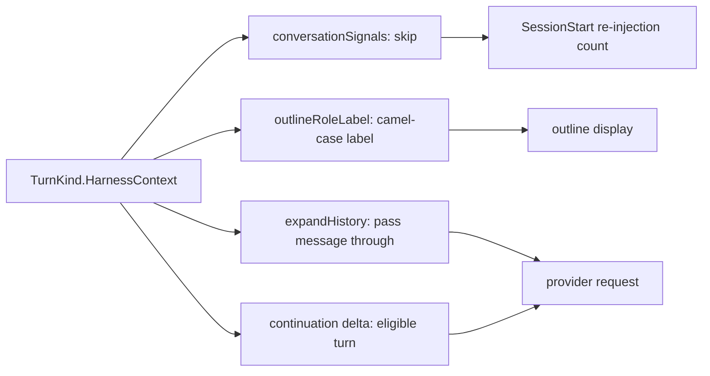

# Issue #4538: derive the harness-context turn-kind lists from one schema predicate

Status: frozen for PAR, 2026-10-25. Scope is the cleanup the issue describes; no turn-kind behavior changes.
Base: `dc6c93e081` (`issue-4538-harness-context-predicate`). The branch merges the current `origin/main` before the final push (it was `7c57edb6e56c5a4124aabf78fcee298c0906753e` at implementation time).

## Goal and scope

Add one `schema.TurnKind` predicate for the harness-projected context kinds and derive the four production lists the issue names from it. Today each list names the kinds by hand, so a new context kind can land in the schema while one consumer silently omits it — the drift that added notes to `conversationSignals` in `1f7c3f07e3` and memory in #3733. The issue's five sites share one set: `TurnEnvironment`, `TurnNotesContext`, `TurnMemoryContext`.

The confirmed defect is structural, not a current runtime bug. The refactor must classify every turn kind exactly as it does today at every touched site. The missing `TurnMemoryContext` in `turn_identity_test.go` is the one existing test gap; behavior there is already correct.

## Decision: `TurnKind.HarnessContext()`

Add to `agent/schema/turn.go`, beside `TranscriptOnly` and `PublicTranscript`:

```go
// HarnessContext reports whether entries of this kind are context the harness
// projects into the model conversation rather than conversation a person or the
// model produced: model-bound, text-only user-role messages that are only ever
// appended. Consumers that pass conversation through, count it, or label it
// derive that set here rather than listing the kinds again.
func (k TurnKind) HarnessContext() bool {
	switch k {
	case TurnEnvironment, TurnNotesContext, TurnMemoryContext:
		return true
	default:
		return false
	}
}
```

The domain name comes from the issue's own term ("harness-context turn-kind lists") and from the existing `turn.go`/`session_outline.go` comments that call these turns "harness-injected"/"harness context". It is a query about the kind, like `TranscriptOnly`, so the method form matches the package's predicates.

The set is exactly the three kinds at every named site:

| Site | Current kinds | Shared subset |
| --- | --- | --- |
| `agent/session_init.go` `conversationSignals` | `TurnHookCompleted` + the three | exactly the three; hook stays separate (presentational, not context) |
| `agent/session_outline.go` `outlineRoleLabel` | labels for all conversational kinds; the three get camel-case labels | exactly the three |
| `agent/session_model_call.go` `expandHistory` | the three | exactly the three |
| `agent/responses_continuation_eligibility.go` `responsesContinuationDeltaIneligibleReason` | `TurnUserInput` + the three | exactly the three |

`outlineRoleLabel` is the one site whose list is not a boolean membership test: it renders `ENVIRONMENT` → `Environment`, `NOTES_CONTEXT` → `NotesContext`, `MEMORY_CONTEXT` → `MemoryContext`. It therefore derives the *set* from the predicate and renders the label mechanically from the kind token: split on `_`, lowercase each part, then uppercase its first rune. A future harness-context kind gets a sane label instead of the raw token. No per-kind display cases remain for these three.

## Site derivations



- `conversationSignals`: `if t.Kind == schema.TurnHookCompleted || t.Kind.HarnessContext() { continue }`. Hook telemetry keeps its own exclusion; the three context kinds come from the predicate.
- `outlineRoleLabel`: `if kind.HarnessContext() { return camelCaseKindLabel(kind) }` before the switch, then the existing conversational cases and raw-kind default. `camelCaseKindLabel` lives in `session_outline.go` because it is display logic; it lowercases each underscore-separated part before uppercasing its first rune, so `NOTES_CONTEXT` yields `NotesContext` rather than `NOTESCONTEXT`.
- `expandHistory`: before the kind switch, the existing notes-self-echo exception (only `TurnNotesContext`) skips the turn, then `if t.Kind.HarnessContext() { ... }` appends the message and continues. The switch loses its three-kind case. Placement before the switch preserves the old behavior because no other case matched these kinds.
- `responsesContinuationDeltaIneligibleReason`: change the tag switch to a tagless `switch {`. Its first case becomes `case turn.Kind == schema.TurnUserInput || turn.Kind.HarnessContext():` with an empty body (eligible without extra work); the tool-result case becomes `case turn.Kind == schema.TurnToolResults || turn.Kind == schema.TurnTool:` with its existing body; `default` keeps the unsupported-kind return. The unsafe-content check still runs for every eligible turn.

## Behavior-preservation matrix

For each kind, the classification after the change equals the classification before it:

| Kind | conversationSignals | outlineRoleLabel | expandHistory | continuation |
| --- | --- | --- | --- | --- |
| `ENVIRONMENT` | skipped | `Environment` | appended | eligible |
| `NOTES_CONTEXT` | skipped | `NotesContext` | appended (self-echo exception unchanged) | eligible |
| `MEMORY_CONTEXT` | skipped | `MemoryContext` | appended | eligible |
| every other kind | unchanged | unchanged | unchanged | unchanged |

The existing focused tests that pin these classifications are rerun: SessionStart re-injection (notes-only and memory-only history), outline role labels, environment/memory model expansion, notes self-echo, and continuation environment/memory deltas.

## Test gap and completeness guard

Add `TurnMemoryContext` to the not-transcript-only list in `agent/schema/turn_identity_test.go`; the test then asserts the kind it previously skipped.

Add two guards:

1. **Every declared turn kind is classified** (`TestHarnessContextKindsAreClassified`, beside `TestTranscriptOnlyKinds` in `agent/schema/turn_identity_test.go`). Parse every const declaration in the schema package's non-test files, collecting each spec that declares its type as `TurnKind` (across every const block and file, so a kind declared elsewhere still counts), then compare the predicate against one explicit map of every kind to its expected classification. A new kind fails until its author states which side it is on. The failure names the kind and says to add it to `HarnessContext` if the harness projects it as context.
2. **Every issue-named production site keeps deriving from the predicate** (`agent/harness_context_derivation_test.go`). Parse `session_init.go`, `session_outline.go`, `session_model_call.go`, and `responses_continuation_eligibility.go`. Each named function (`conversationSignals`, `outlineRoleLabel`, `expandHistory`, `responsesContinuationDeltaIneligibleReason`) must exist in its file and its body must contain exactly one `.HarnessContext()` call. The guard reads the kind names from the predicate's own switch and rejects both direct `schema.`-qualified references and case-clause references to them; `expandHistory` may keep its `TurnNotesContext` self-echo check in an if condition. A rename, move, or revert to a literal kind list, or a re-added literal case, fails.

The source-level guard follows the existing AST-guard convention (`agent/steering_kind_coverage_test.go`, `agent/schema/turn_order_test.go`).

## Red proof

Before the final tests, mutate in place and restore:

1. Remove `TurnMemoryContext` from `HarnessContext`'s switch. Expect the schema classification guard to fail naming `MEMORY_CONTEXT`, and the continuation memory-delta test and the SessionStart memory-only re-injection test to fail if run. (The expandHistory output can stay identical because its default branch also appends these user-role messages, so that is not the red proof to rely on.)
2. Replace one site's predicate call with the old literal list (or delete the call). Expect the site-derivation guard to fail naming that function.

Record both failures and the restored green runs. No mutation is committed.

## Non-goals

No turn-kind, model-prompt, transcript, continuation, or outline behavior change. No widening to sites the issue did not name: `agent/transcript_render.go`, `agent/session_notes_rpc.go`, `internal/apptranscript`, `cmd/evener-doctor/reconstruct.go` keep their current lists. `agent/transcript_render.go:754` is the one other exact-three production list; a future harness-context kind would render there as a raw kind instead of a typed context label, so it is named in the PR as a follow-up rather than changed here. No new dependency, config, RPC, or wire shape. No labels; unrelated findings become separate GitHub issues.

## Verification and review

- PAR: two independent competing reviewers on this frozen spec and base, resolved before implementation; then two independent reviewers on the implementation diff.
- Focused Go tests: `go test ./agent/schema`, and `go test ./agent -run` for SessionStart re-injection, outline, model-call expansion, notes self-echo, continuation eligibility, and the new guards.
- `make build`.
- simplify-code's four-angle review on the diff, then focused tests again.
- Commit, merge `origin/main` if it is not an ancestor, push, open a main-targeted PR, and run the required branch RoboRev review. CI owns the full suite. Do not merge.
