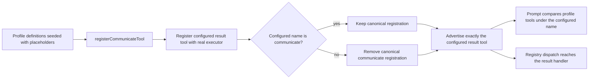

# Issue #4906: a renamed result tool must replace the canonical communicate placeholder

Status: approved scope from the issue request, frozen for PAR before implementation.

## Goal and exact contract

With `SessionConfig{ResultToolName: "respond"}` (or any name other than
`communicate`), the session advertises exactly one result tool, under the
configured name, with the real result-tool executor. It does not advertise the
canonical `communicate` definition, and it does not register a second callable
alias.

- `ToolDefinitions()` contains the configured result tool and does not contain
  `communicate`.
- Every advertised definition resolves to a registered tool whose executor is
  the real one, not the placeholder `buildProfileToolRegistry` installs for
  seeded profile definitions.
- Dispatching the configured result tool through the registry with a valid
  argument object reaches the result-tool handler and captures a terminal
  result.
- `ResultToolName: ""` and `ResultToolName: "communicate"` keep today's
  behavior: the canonical profile definition is adopted, wired, and advertised
  as `communicate`.
- An invalid configured result-tool name fails session construction with a
  registration error naming the configured value and the `--result-tool-name`
  flag instead of producing a session whose advertised set has no result tool.
  `ResultToolName` is not validated before registration
  (`llm.ValidateToolName` runs only inside `tool.Registry.Register`), so the
  registration error is the only place this configuration mistake surfaces.
- Existing result-name collision refusals, the profile-definition adoption
  order, and the optional `end_reason` overlay keep their current behavior.
- The system prompt's "provider tools currently unavailable" list does not gain
  `communicate` just because the result tool was renamed. The profile's
  canonical `communicate` definition is represented under the configured result
  name.

## Evidence and chosen seam

The defect is a registration leftover:

- `newProfileToolRegistry` seeds every profile definition, including canonical
  `communicate`, with a placeholder executor that returns
  `tool executor not wired` (`agent/session_tool_registry.go`).
- `registerCommunicateTool` registers the configured result tool — the profile
  definition when the name is `communicate`, the base definition otherwise — but
  leaves the canonical registration in place when the name differs
  (`agent/session_tools_communicate.go`).
- `rebuildToolDefsCache` includes every registered profile definition, so the
  leftover canonical `communicate` is advertised alongside the real result tool
  (`agent/session_tools.go`).

The fix belongs at result-tool registration, which already owns the configured
name and the real executor:

1. Build and register the configured result tool. Unlike today's discarded
   `reg.Register` error, a failed registration is returned, so an invalid name
   (or a profile definition whose schema will not compile) refuses session
   construction rather than leaving a session with no result tool. For a
   non-default name the error names the configured value and the
   `--result-tool-name` flag, matching the collision refusals above it.
2. When the configured name is not `tool.DefaultResultToolName`, remove the
   canonical registration **after** the configured result tool registered
   successfully. `tool.Registry.Remove` is idempotent, so the minimal-worktree
   registry path, which has no seeded profile definition, needs no special case.
3. In `profileWireToolDefs`, rename the profile's canonical `communicate`
   definition to `s.resultToolName()` before comparing it with the advertised
   set. That function exists to compute the prompt's unavailable-tool list; a
   renamed result tool is available, under its configured name.

Removal happens after registration so a future definition-adoption change can
still read the canonical definition at its existing key before it is removed.
The profile registry cache holds a clone, so removing a tool from a session's
registry does not mutate the cached profile registry or another session.

The placeholder executor becomes one named function,
`profilePlaceholderExecutor`, instead of an inline closure. The regression
identifies an unwired tool by that symbol's code pointer, so it does not depend
on two separately written closures sharing an identity.



## Scope, preservation, and recovery

Change result-tool registration and the prompt's profile-tool comparison, their
tests, and this spec. No tool-call wire format, provider request shape, result
collision rule, or unrelated registration changes. No alias or compatibility
name is introduced. The profile's definition is not mutated: the prompt
comparison renames a copy returned by `Profile.ToolDefinitions()`.

This is a construction-time fix. There is no new retry, migration, persisted
state, or recovery path. Existing sessions that were constructed with the
leftover registration are not rewritten; a restored session re-registers from
its persisted `ResultToolName` and gets the corrected advertised set. The
product subsystem map needs no boundary amendment: S14 already owns tool
dispatch and registration, and this change restores the stated contract that
only usable tools are advertised.

## Non-goals

- Preserving profile output-schema overrides across a rename. That is issue
  #4454 / #4908 and belongs in its own lane; this fix only removes the
  canonical registration after whichever definition was chosen is registered.
- No communicator, provider, CLI, prompt-template, or result-output refactor.
- No changes to allowed-decision parsing, collision reservations, or `intent`.
- No live provider qualification, UI changes, labels, full local suite, or
  deployment. File unrelated defects separately.

## Verification

Deterministic regression in `agent/result_tool_placeholder_test.go` using the
existing `newResultToolSession` fixture, over three cases: empty name, explicit
`communicate`, and `respond`. For each case it asserts:

1. The configured result tool is advertised with the communicate `message` and
   `end_turn` parameters and is registered with the same shape; for `respond`,
   `communicate` is absent from the advertised set **and** from the registry, so
   no callable alias remains.
2. Registry dispatch of the configured result tool with a valid argument object
   succeeds and captures a terminal result.
3. No advertised definition resolves to a registered tool with the placeholder
   executor. The placeholder is identified by `profilePlaceholderExecutor`'s
   code pointer, so the check never runs a real tool.
4. `buildPromptData(...).UnavailableProfileToolNames` does not name canonical
   `communicate`. `buildPromptData` computes this list even when
   `minimalSystemPrompt` skips prompt rendering; the fixture is sufficient.
5. An invalid configured name (`respond-result`) makes `NewSession` fail with a
   `*llm.ConfigurationError` rather than construct a session with no advertised
   result tool. The propagated error names the flag and the offending value for
   the operator; the regression asserts the structured error type, not its
   wording.

Record the red run before production changes: the `respond` case reports that
`communicate` is advertised and keeps the placeholder executor, the invalid-name
case reports that `NewSession` accepted it, and the two default cases pass. Then
apply the fix and rerun.

Focused checks:

```sh
go test ./agent -run '^TestResultToolAdvertisement' -count=1 -v
go test ./agent -run 'Test.*(ResultTool|Communicate|ToolDefinitions|ToolRegistry)' -count=1
make build
```

Run two independent competing PAR reviewers on the frozen spec and again on the
implementation diff. Then run simplify-code's four angles, commit, and run the
branch RoboRev review. Fetch and merge current `origin/main` before the final
push if it moved. Push one round at a time and report the PR URL, exact head
SHA, and the settle command; the parent owns the CI wait and merge.
