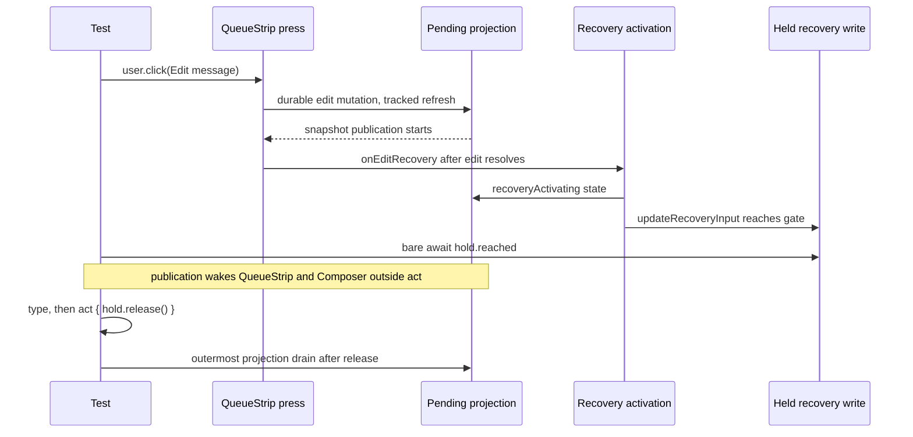

# Issues #4942 and #4998: own the held recovery gate in act

## Scope and acceptance

Both issues name the same case in
`cmd/evener-hub/frontend/src/panes/session/composer/Composer.queuedMessages.test.tsx`:
`two offline edits consolidate one durable owner and preserve typing during
commit`. #4942 reports an intermittent `web-unit` failure of that case; #4998
reports the strict console failure behind it, `An update to QueueStrip inside a
test was not wrapped in act(...)` (plus more `QueueStrip` and `Composer` calls).
The case must pass repeatedly with zero unexpected console output. Every
existing recovery, ownership, typing and send assertion stays intact. This is a
browser component-test synchronization fix, not a product behavior change.

The implementation may touch only that test file. No helper change is expected.
This specification is the only other new tracked file. One PR closes both
issues because the reproduction below shows one mechanism for both signatures.

## Contract and evidence

`docs/product/subsystems.md`'s S02 Browser workspace row owns composing in the
browser, and its S11 "Input, queues and attention" row owns retaining queued
messages and pending delivery: "Client storage owns unsent intent; daemon
mutation/queue state owns accepted work" (S11, line 154). The existing case
exercises the real `Composer`, `QueueStrip`, pending-turns store and IndexedDB
adapter with a fake transport: two offline queued messages, two **Edit
message** presses, typing while the second consolidation write is durably
committed but still in flight, then one send carrying the typed merge.

Both CI failures came from PRs that changed no frontend code, and each passed on
rerun. Local reproduction on current `main` (`dc6c93e081`):

- 25 focused executions with `-t "two offline edits"`: run 17 failed with
  `Unexpected console output: console.error("An update to %s inside a test was
  not wrapped in act(...). ...", "QueueStrip") and 7 more call(s).` The failing
  test's own assertions never ran to a failure; the console guard failed it.
- 45 focused executions under three concurrent loops: 2 failed with the same
  guard error (5–7 `QueueStrip` and 2–3 `Composer` warnings). Temporary
  phase markers on unmodified source placed every warning between the second
  **Edit message** click's return and `await hold.reached` in the case. The
  markers and console forwarding were removed before the fix.

A single clean run is therefore not evidence: the defect needs load and repeats.

## Exact asynchronous boundary

`QueueStrip`'s `Edit message` handler is fire-and-forget from the button:

```tsx
onClick={() => void handleLocalAction(record, "edit")}
```

`handleLocalAction` awaits `editQueuedPendingTurn`, which runs the durable edit
mutation and then a tracked `refreshPendingTurnsProjection`; afterwards it
awaits `onEditRecovery`, whose `source.activateRecovery` publishes
`recoveryActivating` and then awaits `updateRecoveryPendingTurn` →
`updateRecoveryInput`. The test deliberately holds that last write's
`complete` event with `holdNextWriteTransaction(["recovery"])` so it can type
while the commit is in flight.

`await user.click(...)` returns when the click's RTL act scope ends; it does
not await the fire-and-forget continuation. The continuation's projection
publication and activation state land while the test waits on the bare
`await hold.reached`, outside any act scope, which is the strict guard's
failure. Those publications cannot be drained with
`flushPendingTurnsProjectionForTests()`: the held `updateRecoveryPendingTurn` is
itself tracked work, so a flush would wait on this test's own gate.



## Fix

Wrap the held gate await in an explicit RTL act scope, matching the accepted
rule from the sibling #4896 fix (`Composer.integration.test.tsx`):

```ts
await act(async () => {
  await hold.reached;
});
```

Add a short comment: the press continuation is fire-and-forget, a flush cannot
cover it because it would wait on this test's held gate, and restored text is
not evidence that the earlier publications finished. Keep the existing release
act and the outermost `flushPendingTurnsProjectionForTests()` after it. Do not
move, weaken or remove any assertion.

## Why this does not hide a product race

Act owns React publication timing only. It does not release the held write,
change the durable edit/consolidation order, skip the typing-during-commit
window, alter the single-owner merge, or replace the send-path assertions. The
held transaction still commits before typing and is still released explicitly;
the final payload must still be exactly the typed merge, the second recovery
must still be absent, and the first recovery must still be consumed by Send.
The strict console guard and the act-scope guard stay enabled, so a real
escaping publication still fails the case.

## Non-goals

- No product, native client, test setup, Vite, configuration, lockfile or
  console-guard changes.
- No console mock, warning allowance, blanket act wrapper, fixed sleep, widened
  timeout, weaker assertion, or new helper.
- No changes to other cases in the file.
- No full local suite or browser suite; CI owns that qualification. No labels,
  no merge.

## Verification and delivery

Use the shared frontend `node_modules` only after this worktree's
`package-lock.json` is byte-identical to the install-owning checkout's. Never
run `npm ci` through the symlink. From `cmd/evener-hub/frontend`:

```sh
run_case() {
  ./node_modules/.bin/vitest run \
    src/panes/session/composer/Composer.queuedMessages.test.tsx \
    -t '^two offline edits consolidate one durable owner and preserve typing during commit$'
}
# Three concurrent loops, matching the load that reproduced the defect.
fail=0
for p in 1 2 3; do
  ( for run in $(seq 1 20); do run_case || exit 1; done ) &
done
for pid in $(jobs -p); do wait "$pid" || fail=1; done
[ "$fail" -eq 0 ] || { echo "at least one run failed"; exit 1; }
```

The driver must fail the whole batch when any run fails; a bare `for` loop
returns only its last iteration's status, so an explicit failure flag is
required. Run the same driver (with the test reverted) as the red check first:
it must fail with the strict console error for this case, not a fixture or
setup error. The post-change batch must exit zero on all 60 runs with no
unexpected output, and vitest must report `1 passed | 45 skipped` for each
focused run. With the measured pre-fix rate (2/45 and 3/40 under three-way
load), 60 green runs leave a residual false-green risk below roughly 8%;
record that limit rather than claiming proof of determinism.

Also run the whole file (`46 passed`), `npm run typecheck`, and `make build`
from the repository root. Check formatting with
`./node_modules/.bin/biome check src/panes/session/composer/Composer.queuedMessages.test.tsx`
from `cmd/evener-hub/frontend`, run `git diff --check`, and inspect the final
diff for unchanged assertions and no product changes.

Freeze this specification for two independent competing PAR reviewers before
editing the test. Review the immutable implementation diff with PAR, then
simplify-code. Commit, run `roborev-review-branch` (documented CLI equivalent
only if invocation is denied), push one round, open a PR against `main` that
closes both issues, and send the settle command. Merge a moved base locally
before the final push. Do not merge; the parent owns the CI wait.

Report the PR URL, exact head, what changed and why, the red/green commands with
actual per-run results, review routes and dispositions, refutations with
code-level reasons, and anything unverified.
