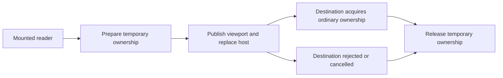

# Visible conversation handoff

## Intent and approved scope

Preserve a continuing conversation's recorded bodies while the browser replaces desktop and phone hosts. Jesse selected the focused shared repair: ordinary conversations and readable cascade columns. Comic expanded-subchat intent remains separate in issue #5486. Phone overlay retention policy stays unchanged.

A real mounted regression on main proves that component cleanup drops foreground ownership to zero while the same pane and read view survive. Both legitimate background-pruning paths run, and a later local cache read restores the bodies. Final departure already prunes correctly.

## Approach

Use a temporary, generation-fenced foreground overlap at the existing viewport publication boundary. Register only committed, started conversation claims with an exact retained read-view identity. Before the viewport changes, acquire a temporary claim for each eligible continuing reader. A matching destination starts its ordinary claim before releasing the temporary claim. Destination rejection, hiding, close, identity replacement, route departure or host failure retires the overlap.

The handoff spans delayed lazy desktop loading and later Dockview reconciliation. A pane-content commit acknowledgment runs inside the host's Suspense boundary, after descendant claims commit. Actual desktop visibility and phone pane selection stay with their current hosts. A retained pane, focus ref, or scroll capture alone never authorizes a claim.

Host and cascade scope selection must consume the published transcriptDisplay viewport, so they cannot change before preparation. Preserve useIsMobile's independent live-snapshot contract and the existing breakpoint.

## Alternatives considered

- A permanent AppShell owner would require moving or duplicating host visibility and cascade admission. It expands ownership beyond the repair and risks retaining hidden conversations.
- Layout-effect acquisition before passive cleanup handles same-commit replacement only. Lazy DockRegion and later Dockview panel creation leave a cross-commit gap.
- The selected explicit handoff adds only temporary ownership and keeps current readers, visibility policy, hydration and pruning authoritative.

## Boundaries

- Use public foreground acquisition/release; never suppress either pruner or retain copied transcript bodies.
- No timers, microtask grace period, permanent claims, stale-reader fallback, new cache or retry loop.
- Match exact live read views and qualified source identity. Same-ID replacement records cannot inherit an old handoff.
- Do not interpret readView.setReadable(false) during teardown as genuine departure; current remount cleanup also emits it.
- Destination visibility/selection rejects readers that will not appear, including cascade columns becoming spines. Read-view disposal and source replacement retire old work.
- A rapid reverse transition transfers still-valid temporary ownership without a zero-owner interval. Old-generation callbacks cannot settle a newer transition.
- Connection loss does not erase an already-started claim. Never-started readers cannot seed a bridge.
- Covered mobile panes keep their current behavior. This repair must not introduce new overlay visibility policy.
- Standalone consumers without a retained conversation read view, Tasks and document claims keep their existing semantics.

## Evidence required

Preserve the existing intermediate-publication oracle and actual final-close pruning control. Add real host coverage for both directions, a held lazy desktop destination, pre-media-event renders, desktop splits and inactive tabs, phone selection, close/reused pane IDs, ref/logical-session replacement, route departure, host failure and rapid reversal. Exercise real cascade admission, not a reconstructed visibility selector. Continuing readers require no local cache restoration or extra thread read, and temporary claims must return to ordinary counts.

Tests use real React, host, claim, store, repository and cache logic with scripted external boundaries. No internal mocked behavior or weakened assertions/timeouts. Run minimal red/green cases, typecheck and touched-file Biome locally; full suites and browser lanes run in CI.

Update the S02 product ownership description with the implementation. Keep this repair in its own PR, use the normal approval and merge queue, then integrate it into Comic. No deployment.
