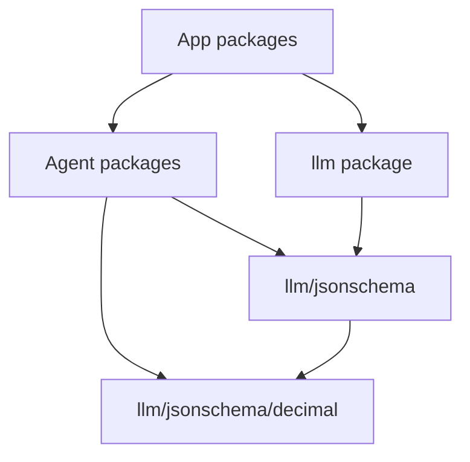
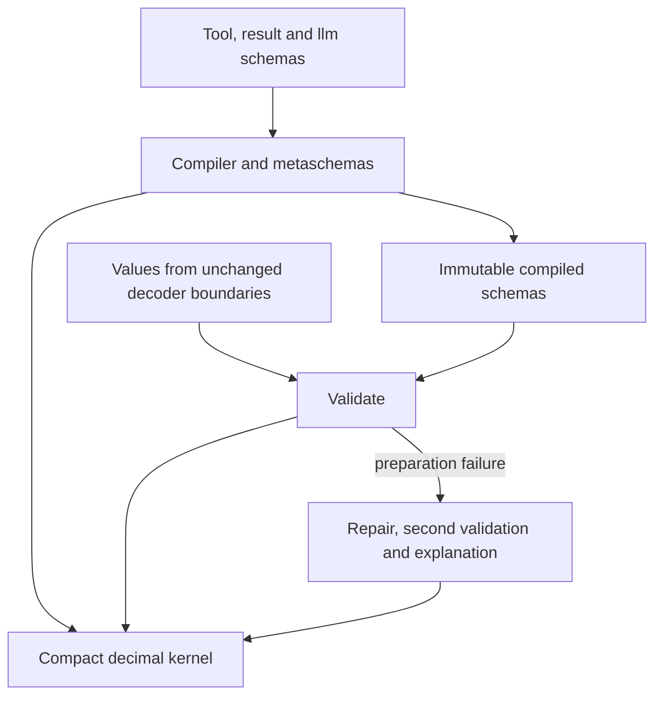

# Bounded exact JSON Schema validation

## Decision to review

Maintain a v5.3.1-derived JSON Schema validator in the existing `llm` module.
Replace exponent-sized rational expansion with immutable compact decimals, and
use the same arithmetic in argument repair. Work and storage for a numeric
operation depend on its encoded digits, rather than the magnitude of its decimal
exponent.

Jesse chose bounded exact validation and ownership in the existing `llm` module.
The algorithms, public field changes, cardinality corrections, repair changes and
three assertion amendments below are proposals for approval. This document
authorizes no implementation until Jesse approves it after the builder check.

The maintenance cost is real: Evener takes responsibility for this derivative's
arithmetic, draft conformance, security fixes and upstream reconciliation.

## Intent and boundaries

Exact JSON numbers must survive validation without rounding, exponent-sized
allocation, or refusal merely because a valid value is very small. For example,
`1e-1000000000` satisfies `minimum: 0`, is distinct from zero, and is not an
integer. A validator must decide those facts without constructing a billion-digit
denominator.

Goals:

- Bound numeric compilation, metaschema validation, instance predicates,
  equality, hashing and repair arithmetic by encoded size.
- Preserve mathematical validation, supported drafts, references, error
  structure, dispatch gates and recovery to the next usable call.
- Keep existing decoding and Go-type admission contracts. Add no numeric limit
  and widen no input boundary as part of this validator change.
- Leave each implementation PR with a real production caller and its own proof.

Non-goals:

- A universal complexity bound for JSON Schema, a new cache policy, or a new
  budget/timeout for admitting numeric inputs.
- A new module, repository, remote dependency service or compatibility facade.
- Notification transport, observation, generation, role adaptation or client UI.
- Changing ordinary-Unmarshal callers to `UseNumber` as an incidental refactor.
- Recovering precision already lost when another decoder produced a `float64`.

Anti-goals include silently stripping schema constraints, disabling metaschemas,
retaining misleading rational fields, or treating panic recovery as successful
handling of valid extreme numbers.

## Evidence and approaches

The starting dependency is `github.com/santhosh-tekuri/jsonschema/v5@v5.3.1`.
Its `schema.go` uses `big.Rat` for integer recognition, bounds, `multipleOf`,
recursive equality and numeric hashing. Its `compiler.go` expands numeric bounds
before validation. `resource.go` invokes metaschema validation during compilation.
Late extensions cannot replace these earlier operations or private equality/hash
functions. Updating only the instance-validation branch leaves unsafe paths.

The inspected v6.0.3 source still uses rational expansion. An unmodified upgrade
does not establish the required bound.

| Approach | Benefit | Cost and disposition |
| --- | --- | --- |
| Public packages in existing `llm` | Existing compiler owner and dependency edges, one review/release boundary | Expands llm's maintained public surface. Jesse selected this approach. |
| Separate in-repository module | Independent versioning and reuse | Adds manifests, workspace and release coordination without a current caller requirement. |
| Separately published fork | Independent upstream/release lifecycle | Adds a repository and publication owner, with the same arithmetic work. |

The ratified [module architecture](2026-06-01-go-monorepo-module-architecture.md#3-the-placement-rule-the-whole-point--what-goes-where)
places shared utilities in the lowest module that needs them. `llm` already
compiles and validates schemas. Agent already imports llm. These facts support
the selected ownership without an upward dependency.

## Packages, public API and maintenance

Proposed paths:

- `primeradiant.com/evener/llm/jsonschema`: the actual derived compiler,
  metaschemas, validator, error types and existing supported facilities.
- `primeradiant.com/evener/llm/jsonschema/decimal`: the small shared numeric
  kernel, with immutable values and exact predicates.

Both remain leaf packages. They import neither the parent `llm` package, agent
nor app packages. There is no nested `go.mod`. Optional upstream facilities are
retained only with their real callers or conformance tests, rather than added as
unused scaffolding.

LLM compilation and agent compilation call the same implementation. Repair uses
its decimal kernel. The leaf packages never call their consumers.

The five public numeric constraint fields change from `*big.Rat` to optional
immutable decimal values. Cardinality fields also change from native integers
and sentinels to optional exact nonnegative integer values. Nil means absence;
draft defaults remain explicit in validation. The builder chooses concrete type
names and method signatures, preserving these contracts.

Keeping exact eager rational fields would require the very allocation this
change removes. There will be no old-path alias, hidden second authority, stale
Rat field, approximate bound or automatic rational fallback. This is a new public
package identity, not a claim of source compatibility with upstream. Migrate all
in-repository concrete Schema, Compiler and ValidationError imports together
with each consumer. No production use of upstream's five Rat fields was found
in the source inventory; external uses have not been audited.

Keep `SchemaError` wrapping, `ValidationError.Causes`, `InstanceLocation`,
`KeywordLocation`, cause order and error traversal behavior. Numeric diagnostics
render compact exact bounds. Their numeric spelling may differ from upstream's
lossy Float64 rendering. Test behavior and structured locations, never prose.

Retain Apache-2.0 LICENSE and upstream attribution. Record v5.3.1 provenance,
preserve required notices, mark modified upstream files, and keep the arithmetic
delta reviewable against that source. Track upstream releases and security fixes
under llm ownership. Upstream acceptance of this change is unknown.

External consumers need an ordinary llm-module release containing the packages.
This design adds no separate publication boundary and does not fix existing
workspace-only sibling `v0.0.0` resolution. Verify the new leaf packages outside
`go.work`; do not claim every existing module now builds independently.

## Compact decimal and exact predicates

### Representation and parsing

A nonzero finite decimal is `sign × C × 10^E`:

- `C` is a positive coefficient stored as decimal digits without leading or
  trailing zeros.
- `E` is an arbitrary signed integer whose storage follows its encoded length.
- All spellings of zero, including negative zero and huge zero exponents, have
  one identity.

Parse JSON number syntax directly. Remove mantissa leading/trailing zeros and
adjust the exponent by fractional-digit and removed-zero counts. Those counts
are bounded by mantissa length. Never parse the exponent through `int` or
`int64`, materialize `10^E`, or allocate implied zero digits. Invalid numeric
representations follow the existing caller's invalid-value handling.

The kernel exposes parsing, sign/zero/integer classification, comparison,
equality, divisibility and compact canonical encoding. It exposes no mutable
`big.Int` limbs or general rational conversion. Temporary coefficient arithmetic
uses fresh receivers. Compiled values need no lazy mutation or global interning.

### Integer classification and comparison

Zero is integral. A nonzero normalized value is integral exactly when `E >= 0`.

For positive numbers, compare `len(C) + E`. Different decimal orders determine
ordering. For equal orders, compare coefficient digits with virtual right-zero
padding, scanning at most the longer encoded coefficient. Handle zero and signs
first and reverse magnitude ordering for negative values. Inclusive and exclusive
bounds use this comparator.

### multipleOf

For nonzero magnitude `x = A × 10^a` and positive divisor `y = B × 10^b`, let
`d = a - b`. Factor only 2 and 5 from the coefficient-sized integers:

`A = 2^u × 5^v × A0` and `B = 2^r × 5^s × B0`, where both cores are coprime to 10.

Then `x / y` is integral exactly when:

1. `B0` divides `A0`.
2. `d + u - r >= 0`.
3. `d + v - s >= 0`.

The residual denominator cannot be canceled by factors 2 or 5. After its removal,
the core quotient is coprime to 10, so neither negative valuation can disappear.
Conversely, the three conditions leave an integer product. This needs no general
prime factorization and constructs no exponent-sized power.

Factor removal and remainder operate only on encoded coefficients. Removing 5
repeatedly is acceptable because each step shrinks that coefficient. Loop counts
and valuation counts follow coefficient length, never `d`. Exponent inequalities
use arbitrary signed arithmetic. Zero is a multiple of every positive divisor;
negative instances use their magnitude. Metaschemas still reject nonpositive
schema divisors.

### Numeric identity in JSON trees

Canonical sign, coefficient and exponent define numeric identity. Equivalent
decimal spellings compare equal; tiny nonzero values remain distinct from zero.
Array equality is ordered. Object equality compares key sets and corresponding
values. Boolean, string, null and numeric types remain distinct.

Hash the same identity with type tags and unambiguous length framing. Sort object
keys. Normalize zero and exponent spelling. Equal nested values must hash alike.
Hashes select buckets only; exact equality resolves collisions. Retain both
upstream `uniqueItems` paths: pairwise comparison through length 20, hash buckets
above 20. A repair equality helper must use the same numeric semantics after its
existing shape conversion, including nested numeric leaves.

Share the numeric implementation. Helper factoring and any call-local memoization
are builder decisions. Do not add a second general validator or global retention
of instance number strings.

### Work and storage obligation

Let `M` be the encoded mantissa/coefficient digits involved in an operation and
`X` its encoded exponent digits. Parsing and stored identities use `O(M + X)`
information. Exponent adjustments need `O(X + log M)` digits. Comparison scans
encoded coefficients. Divisibility uses coefficient-sized integers, factor
removal bounded by their bit lengths, and exponent-sized additions/comparisons.
The straightforward algorithms have polynomial work in encoded size.

The implementation review must establish this invariant: no loop, allocation,
native-integer conversion or diagnostic expansion is driven by exponent
magnitude. Resource tests supplement that argument; passing a benchmark alone
does not prove it. No implementation or measured resource bound exists yet.

Combinators, recursive references, repeated validation, object-key sorting and
hash collisions retain their existing schema/input-dependent costs. This is an
arithmetic bound, not a universal validation complexity promise.

## Compilation and cardinalities

Use compact predicates from metaschema bootstrap onward. Replace all five bound
loaders, integer tests, bound checks, `multipleOf`, numeric const/enum equality
and numeric hashing. Include built-in and custom metaschemas and reference
targets. Do not bypass validation or remove a keyword before compiling it.

Preserve drafts 4, 6, 7, 2019-09 and 2020-12, their vocabulary selection and
reference behavior. Draft4 boolean exclusive bounds still select the associated
minimum/maximum. Later numeric exclusive bounds remain independent constraints.

Cardinality loading currently uses `json.Number.Float64` followed by native-int
conversion. Compile `min/maxProperties`, `min/maxItems`, `min/maxLength` and
`min/maxContains` as exact nonnegative integral thresholds instead. Compare these
with actual native counts without expanding powers or narrowing the schema
threshold. Keep absent/default semantics per draft, including contains defaults.

This deliberately corrects rounded or out-of-range threshold behavior. An enormous
minimum is a valid unsatisfied constraint on a small input. An enormous maximum
does not wrap and reject that input. Negative or nonintegral cardinalities remain
invalid schemas. This semantic correction is part of the requested approval.

## Admission and production integration

Arithmetic and decoding are separate contracts. Preserve these boundaries:

| Boundary | Contract |
| --- | --- |
| Tool input, including the held exact-number decoder | Retain overflow rejection for every token, including overwritten duplicate keys. `1e400` remains rejected. Accepted tiny exponents remain accepted. |
| Existing schema-resource and GenerateObject `UseNumber` paths | Validate accepted large positive/negative exponents exactly without adding a float prepass. |
| Existing float-valued llm tool loop | Keep ordinary Unmarshal and its float64 handler contract. Validate the supplied decimal interpretation, without claiming recovery of raw-token precision. |
| Current-main delegate capture | Keep its ordinary Unmarshal boundary in the validator migration. Packet bytes remain intact. The held lane's later UseNumber change is a separate lossless-result cut, not silently imported here. |
| Programmatic Go numbers | Preserve each caller's admitted kinds, finite-value policy and decimal conversion, including repair's existing float32 interpretation. |

The current-main delegate capture distinction matters: the source inventory was
made against the held numeric lane, whose capture already uses `UseNumber`.
Main's `captureDelegateStructuredResult` still uses ordinary Unmarshal. This
design bounds the backend for already accepted values; it does not smuggle in
that decoder change. A later lossless-result cut must disclose any changed
admission and obtain a ruling before changing it.

Registration and result validation share the compiler. A preparation failure
reaches repair, a second validation and explanation, so all three must avoid
arbitrary-number rational expansion.

Migration owners:

- `llm/generate.go` and `llm/generate_object.go`: real compilation, tool-loop
  validation and object validation, preserving their different decoder contracts.
- `agent/internal/tool/registry.go` and the argument validation helper: direct
  dispatch, registration, panic containment and concurrent compiled-schema reuse.
- `agent/session_tool_repair.go`: initial gate, repaired gate and concrete error
  traversal. Preparation still never executes the tool.
- `agent/internal/tool/repair/explain.go`: replace arbitrary `json.Number` Rat
  parsing, integer predicates, range checks and quotient tests. Remove Float64
  representability as a type probe on these exact paths. Preserve candidate
  conservatism and unsupported-constraint handling. Bounded FormatFloat-generated
  candidate arithmetic may remain if arbitrary inputs cannot reach it.
- `agent/jobs.go` and `agent/subagents.go`: result compilation/validation and
  terminal capture. Preserve validity/reason recording, generation identity,
  storage limits and retained packet bytes, including validation failure.

Migrate all imports, test seams and tagged compile consumers, not just the six
known production import files. The implementation plan must inspect current
sources rather than copy held mixed files. Remove old direct dependency pins
only once no remaining consumer needs them. Cache entries stay immutable and
all temporary arithmetic stays call-local. Retain existing panic containment as
defense in depth, never as the expected outcome for a valid number.

## Three held-cut assertion amendments

These tests belong to the held exact-number work. They encode upstream arithmetic
failure rather than the intended mathematical result. Approval of this design
must explicitly cover their semantic corrections; they remain untouched now.

1. `agent/internal/tool/registry_numeric_test.go`,
   `TestRegistryNumericValidationRecovery`: accept `1e-1000000000` under minimum
   0, maximum 1 and distinct `uniqueItems` arrays of sizes 2 and 21. These calls
   execute, and the following valid call also executes. Keep integer,
   multipleOf 1, const 0 and enum [0] refusals, no invalid execution, and recovery
   on the next valid call. Test both accepted and genuinely rejected scenarios.
2. `agent/session_numeric_ingestion_test.go`,
   `TestPrepareNumericValidationGates`: the tiny positive minimum-0 value has no
   `PrevalErr` at either gate. Prove both validation visits still occur and
   preparation executes nothing. Preserve promoted-string overflow rejection.
3. `agent/internal/tool/repair/numeric_test.go`, `TestNumericExact`: tiny positive
   minimum-0 becomes true. Tiny negative minimum-0 remains false; tiny positive
   remains nonintegral and unequal to zero.

No other assertion conflict is waived. Repair's recursive numeric equality,
exact cardinalities, public field types and compact diagnostic spelling are the
additional proposed behavior/API changes disclosed by this document.

## Proof obligations

Read [the testing guide](../../developing-evener/testing.md) before adding tests.
Use real Evener paths below a deterministic scripted provider where needed.
Default tests require no live credentials, internet service or current model
behavior. New tests assert behavior, numeric facts and structured errors, not
human-readable copy.

- **Independent small oracle:** compare parsing, integrality, comparison,
  equality, ranges and multipleOf with independently constructed `big.Rat`
  values in a deliberately small generated domain. Oracle caps are test-domain
  choices, never production input limits. Include signs, zeros, normalization,
  2/5 factors, residual primes and exponent cancellation.
- **Extreme witnesses:** exponents beyond int64 in both directions, equivalent
  spellings, enormous zeros, residual-prime nonmultiples and nearly canceling
  exponents. Establish the code invariant above and add isolated CPU/heap
  regression checks. Their harness budgets do not become input policy.
- **Nested identity:** equivalent spellings and insertion orders hash alike;
  distinct signs, tiny values versus zero and framed strings stay distinct.
  Force hash collisions and prove equality resolution. Exercise uniqueItems
  lengths 2, 20 and 21, with proof that each comparison path ran.
- **Real compilation:** AddResource/Compile, all supported drafts, built-in and
  custom metaschemas, references, Draft4 exclusivity, huge bounds and exact
  cardinalities. Reject nonpositive divisors and nonintegral/negative counts.
- **Dispatch and repair:** valid calls execute once, invalid calls never execute,
  later valid calls work, initial/repaired gates run, normalizer and middleware
  order stays intact, and genuinely failing extreme values reach explanation
  with correct pointers/causes. Accepted tiny values do not enter repair merely
  because of arithmetic failure.
- **Result and llm journeys:** direct result validation with exact accepted
  values; real terminal capture preserving packet bytes and current decoding;
  actual llm tool dispatch retaining float64 handlers; GenerateObject reaching
  its UseNumber validator. A shell completion with nil schema proves none of
  the schema path. Do not claim raw terminal precision until its separate cut.
- **Concurrency and distribution:** shared compiled-schema race coverage, no
  mutable numeric cache, concrete error traversal, tagged compile consumers and
  a clean downstream import of the new llm leaf packages with `go.work` disabled.
  Existing whole-module publication debt remains separately reported.

Every regression needs a behavioral red on the actual old path and a green on
the replacement. A missing-symbol compile failure is insufficient. Unsafe old
expansion scenarios run in an isolated subprocess rather than risking the test
runner. Local work stays limited to the smallest red/green selections; CI owns
suites, lint, race and browser gates. Record actual runs and untested cases.

## Independent delivery and size

The implementation plan follows approval. Its proposed useful cuts are:

1. **Bounded validator with llm callers.** Import the attributed implementation,
   implement compact arithmetic and use it in real llm compilation/validation.
   Include metaschema, identity, cardinality and GenerateObject evidence. Do not
   land a numeric library with only test callers.
2. **Agent validation and repair migration.** Switch registry, preparation and
   structured-result validation to the same implementation. Bound repair and
   prove error, recovery and concurrent-cache contracts without decoder changes.
3. **Exact tool ingestion.** Reconstruct the held numeric work against the
   landed backend, apply only the three approved assertion amendments, and prove
   decoding, hooks, normalization, dispatch and fingerprint agreement together.
4. **Lossless provider copies.** Use the already chosen lossless-copy contract
   after the bounded backend reaches its real consumers. Preserve isolation and
   error handling. Keep this separate where it has independent evidence.

Lossless terminal decoding remains a separately scoped report-preservation cut.
Notification runtime work remains separate. Each promoted cut needs its own
review, CI and merge queue result. Keep old branches/remotes intact; do not
force-push the held numeric lane to implement this sequence.

Measured source-import floor: pinned v5.3.1 has 11 root production Go files,
4,473 lines, plus six root test files, 1,435 lines. Its optional HTTP loader adds
38 production lines. These counts exclude license, README and fixtures. The
module cache has 21 testdata files, but lacks the complete external conformance
corpus used by the upstream harness. Pin and include the needed corpus with
provenance; absence must fail the test, never become an empty successful run.
Adapt fixed test ports to isolated local resources. No default remote fetch.

Planning allowance beyond copied source: roughly 600–1,300 production lines and
1,000–2,500 proof/test lines across arithmetic, repair and consumers. These are
unmeasured ranges, not delivery promises. The builder must split by real callers,
inventory the corpus and import migrations, and revise the allowance if it does
not fit. No dependency installation or implementation has happened for this design.

## Approval checklist

Approval covers the maintained llm derivative, its compact arithmetic, exact
cardinalities, explicit public field changes, repair equality/type-probe changes,
compact numeric diagnostics and the three named held-cut assertion amendments.
It preserves overflow rejection and all unchanged decoder boundaries. It does
not authorize a compatibility layer, new input limits, terminal decoder widening
or unrelated notification changes.
