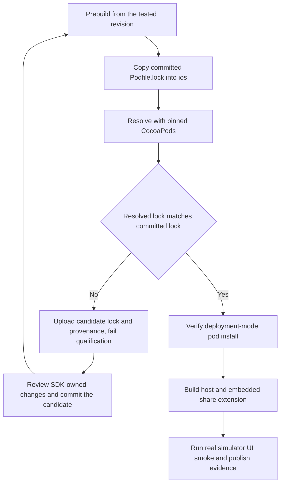

# Native dependency security and non-publishing iOS qualification

**Status: Approved by Jesse on 2026-11-04.** The approved design includes a
separate, non-publishing Mac CI path. Current product guides remain authoritative.

## Intent and scope

Remove the remaining actionable native dependency advisories without changing
Evener's iPhone behavior or publishing a build. An Expo SDK upgrade is necessary:
the current SDK 57 CLI imports Zod 3, while SDK 58 removes that direct dependency.
Updating only leaf versions cannot safely make that change.

The native lockfile audit on 2026-11-04 reports 21 affected package entries:
3 high, 17 moderate and 1 low. These are dependency-graph entries, not 21 distinct
exploits. The six advisory-bearing leaves are Zod, xmldom, UUID, glob,
minimatch and deepmerge. Web and shared-client audits were clean after the
preceding dependency update.

Deliver:

- Expo 58 and its supported React Native module set, with existing app behavior.
- Owner-scoped fixes for vulnerable Apple-target and file-matching tooling.
- A separate Mac CI workflow that compiles the app and embedded share extension
  and exercises the installed app on an iPhone simulator without publishing.
- Reviewed CocoaPods resolution, regression evidence and current build docs.
- An honest residual-audit explanation for the rejected deepmerge CVE.

### Non-goals and anti-goals

No TestFlight upload, release tag, App Store Connect access, signing-certificate
installation, production-hub access or distribution workflow dispatch. No iPad,
Android or paused accessibility project. No UI redesign, persistence migration,
new compatibility layer, generic dependency framework or deepmerge replacement.
No raising timeouts to conceal hangs, disabling patches, bypassing peer checks,
renaming packages to hide audit findings or treating a launched process as a
usable app.

## Approaches considered

1. **Expo 58 plus scoped tooling fixes and non-publishing Mac CI.** Removes the
   old CLI owner rather than forcing Zod 4 into Zod 3 callers. Adds native compile
   and simulator evidence to the existing Linux gates. Jesse chose this route.
2. **The same upgrade using an existing Mac.** Would avoid a new workflow, but no
   usable Mac endpoint or runner is established for this session. Local Xcode,
   CocoaPods and Ruby are unavailable on the Linux workstation.
3. **Stay on Expo 57 and override every leaf.** Rejected: Zod crosses an API
   major, and a blanket xmldom 0.9 override breaks the old plist parser's
   MIME-less `parseFromString` call. Leaf-only installation is insufficient.

The builder may choose small helper boundaries and precise command syntax after
checking installed tools. Broader module replacements, new app-visible behavior
or weakened preservation guarantees return to Jesse.

## Preservation contracts

| Contract | Required result |
| --- | --- |
| App identity | Keep `com.primeradiant.evener.native`, scheme `evener-native`, extension `com.primeradiant.evener.native.ShareExtension` and group `group.com.primeradiant.evener.native`. |
| Device scope | Keep iPhone-only configuration and current deployment minimum. Both SDK 57 and 58 document iOS 16.4+, Node 22.13.x+ and Xcode 26.4+. |
| Saved work | No SQLite schema, draft format, saved-hub namespace, keychain identity or share-payload format changes. Keep unsent work and pending shares until their existing durable handoff succeeds. |
| Connections | Preserve shared AppWire imports, admission, cancellation and reconnect behavior. No new live-provider dependency in default tests. |
| Native startup | One scene/window owner, one React factory, working foreground and cold startup, unchanged scheme registration and scene-owned linking. |
| Prebuild boundary | iOS generation still refuses a missing `APPLE_TEAM_ID`. Ordinary bundling/typechecking still work without one. |
| Existing patches | Preserve each patched behavior. Retire a patch only when the installed upstream implements it and regression/native checks cover it. |
| Distribution | Leave the main/tag guards and publishing path in `.github/workflows/ios-testflight.yml` unchanged. Qualification has no release credentials or upload step. |

SDK 58's scene template replaces the SDK 57 plugin-generated structure. Existing
assertions for `EXExpoAppSceneDelegate`, two AppDelegate linking calls and a
changed Swift template conflict with the new upstream ownership. Approval of
this design permits replacing those structural assertions with equal or stronger
coverage of the contracts above. It does not permit deleting scene coverage.
The gesture test's 2.32 version/patch assertions need the same treatment when
upstream 3.3 provides the behavior.

## Dependency changes

### Expo-owned module set

Use exact direct versions from the published `expo@58.0.23`
`bundledNativeModules.json`, checked against registry availability. Do not use
`npm audit fix --force` or a current-latest sweep.

| Package | Version |
| --- | --- |
| `expo` | `58.0.23` |
| `react`, `react-test-renderer` | `19.3.0` |
| `react-native` | `0.88.1` |
| `@types/react`, `@types/react-test-renderer` | `19.3.0` |
| `expo-application` | `58.1.2` |
| `expo-build-properties` | `58.0.12` |
| `expo-camera` | `58.0.14` |
| `expo-clipboard` | `58.0.4` |
| `expo-crypto` | `58.0.7` |
| `expo-file-system` | `58.0.13` |
| `expo-font` | `58.0.11` |
| `expo-glass-effect` | `58.0.5` |
| `expo-haptics` | `58.0.7` |
| `expo-image-manipulator` | `58.0.16` |
| `expo-image-picker` | `58.0.10` |
| `expo-secure-store` | `58.0.2` |
| `expo-sharing` | `58.0.22` |
| `expo-splash-screen` | `58.0.13` |
| `expo-sqlite` | `58.0.15` |
| `expo-status-bar`, `expo-symbols` | `58.0.4` |
| `expo-system-ui`, `expo-web-browser` | `58.0.7` |
| `react-native-gesture-handler` | `3.3.0` |
| `react-native-keyboard-controller` | `1.22.7` |
| `react-native-reanimated` | `4.7.1` |
| `react-native-worklets` | `0.13.0` |
| `react-native-safe-area-context` | `5.11.1` |
| `react-native-screens` | `4.30.1` |
| `react-native-webview` | `14.0.1` |

Update `@types/react` in every declaring npm tree to keep the repository's shared
exact-version rule. Browser React may retain its separate exact version. Resolve
actual strict-TypeScript failures, including native instance refs, without
loosening compiler options or replacing types with `any`.

Remove SDK 57's `ios.enableSceneSupport` setting. Exercise SDK 58's shipped
AppDelegate, SceneDelegate and plist through the actual prebuild/plugin pipeline.
Expo's `SceneEventForwarder` now owns URL/activity forwarding. Check identity,
other plugin content, repeated generation and single startup ownership.

Published gesture-handler 3.3 contains the local modal-root, children-first
mount retry and screen touch-handler fixes. Retire its 2.32 patch only after
checking those cases against installed source and the generated build. Retain
`react-native-enriched-markdown@1.0.2`, regexpu-core and tinykeys patches when
they apply. Enriched markdown's documented support stops at RN 0.87; its native
compile and rendering checks are an explicit gate, not an assumed compatibility
claim. A required replacement or broad rewrite needs a design amendment.

### Tooling owner fixes

Re-inspect the resolved SDK 58 tree before choosing override selectors. Prefer
compatible published owner updates. Scope necessary cross-major overrides to the
owners that remain; record their removal conditions in the PR.

| Owner/path | Proposed remedy and evidence obligation |
| --- | --- |
| Nested Expo config plugins using `xcode@3` and UUID 7 | Refresh compatible owner releases, including `@expo/config-plugins@55.0.12` where retained. These use xcode 4 and Node crypto instead. Do not globally force xcode 4 into unrelated owners. |
| `@bacons/xcode` and its `@expo/plist@0.0.18` | Scope xmldom to fixed `0.8.15`, which preserves the MIME-less parse API. Verify module resolution from both owners: bacons/xcode also imports xmldom without declaring it directly. Test actual plist and workspace/scheme consumers, not an isolated substitute parser. |
| `@bacons/xcode` UUID 8 dependency | Scope UUID `11.1.1`, the fixed dual CommonJS/ESM release. Confirm actual owner loading, valid UUID/PBX identifiers and buffer-boundary behavior. No global ESM-only UUID upgrade. |
| Surviving glob owners, including Apple targets, CLI 58 and fingerprint | Scope glob `14.0.3`, which includes the cancellation fix and supports minimatch 11. Preserve the caller's traversal/matching behavior. Do not put minimatch 11 under an old glob major alone. |
| Surviving direct minimatch owner, including fingerprint | Scope minimatch `11.0.4`; exercise the owner's ignore behavior and the advisory's compiled-pattern growth bound. |

Validate the whole installed tree with `npm ls`, clean `npm ci`, Expo's version
check, patch application and fresh lockfile audits. Resolve owner contexts
explicitly rather than assuming npm hoisting. No confirmed high/moderate leaf
from this baseline may remain merely because its direct caller is build tooling.

### deepmerge finding: correct the earlier premise

CVE-2026-93753 was **REJECTED** by its assigning authority on 2026-11-02 because
it does not describe a security vulnerability. GitHub's corresponding
GHSA-gcqx-w48m-w2h4 and npm still report deepmerge 4.3.1 as affected. The tested
cases change the returned object's prototype; they do not mutate global
`Object.prototype`. No app exploit or crossed trust boundary was established.

Leave this library unchanged rather than introducing a replacement or fork to
clear a stale counter. Explain the rejection and remaining dependency paths in
the PR and the existing audit-triage issue. Recheck advisory status before the
final report. Report raw audit counts and separate this known rejected finding;
do not suppress it, fake a fixed version or promise a zero audit. A new genuine
advisory requires fresh triage.

## Non-publishing Mac CI

Add `.github/workflows/ios-qualification.yml`, separate from TestFlight. Run on
pull requests to main that affect native code, shared client code, native build
scripts or this workflow, and support manual branch dispatch after registration.
Use `pull_request`, never `pull_request_target`; checkout credentials must not
persist. Grant only `contents: read`, use SHA-pinned actions and expose no Apple,
provider or production-service secrets. Do not change branch protection policy.

Use `macos-26`, Xcode `26.6`, Node `22.13.1`, Ruby `3.3.6`, Bundler `2.7.2` and
the locked CocoaPods `1.16.2`. Verify the actual tool versions. Use an available
iPhone simulator/runtime discovered from structured `simctl` output, record
its identity, and operate only on that run's disposable device. Keep Linux's
native/API checks; Mac CI supplies the missing native compilation and startup.

### Generated project and CocoaPods ownership

Prebuild with a documented, non-secret fixture team ID `EVENERCI01` used only for
qualification. Keep the real prebuild team-ID refusal. Generate and compile the
host and share targets with their real identifiers and entitlements. Use
simulator/ad-hoc signing, not a developer certificate, provisioning updates or
`CODE_SIGNING_ALLOWED=NO`. Verify generated and built app/extension identities,
shared-group entitlements and embedding. An unbuildable or unusable entitlement
configuration fails qualification; never silently strip a capability to pass.

The workstation cannot honestly regenerate `Podfile.lock`. Use a Mac resolver
artifact during the migration, then require a strict lock match:

Keep the old lock as the resolution input. If CocoaPods requires unlocking SDK
pods, diagnose its error and update only the named SDK-owned roots and their
necessary closure. Preserve unrelated pins; do not delete the lock or mass
update pods. Upload candidate lock, diff, source revision, npm-lock digest and
tool versions even when the resolver reports a mismatch. It is evidence, not a
green result. No bot commit or write token. Apply the reviewed candidate in the
branch and rerun at its new head. The final qualifying run must also pass
`pod install --deployment` without altering the committed lock.

### Real simulator smoke

Use Apple's XCTest UI runner against the Release simulator app with the embedded
Metro bundle. Add a small UI-test target only to the generated ignored project;
keep test source/helpers under `scripts/native/ios/`. Use the existing xcodeproj
gem rather than adding another test framework or an application-only test mode.

On a fresh simulator, wait for the first-run UI, open the address-entry form,
complete ordinary onboarding with a disposable hub and token, and verify the
saved hub after terminating and cold-launching the app. This must exercise real
SecureStore writes and reads, not merely form state or an in-memory profile.
Save failure, a missing restored hub or failed credential readback fails the
test. Keep entitlement inspection as a separate check.

For the native markdown gate, connect that profile to an isolated real Evener
hub and daemon running on the Mac runner. Reuse the repository's scripted
provider boundary in `test/e2e/fakellm`; no mocked hub, WebSocket proxy, production
service or provider credential. Give the hub private config/state/cache roots
and disposable authentication. Pin Go from the repository's toolchain policy.
The helper may select a deterministic response fixture at the existing LLM
boundary; it must not stub AppWire or the native renderer.

Create a session and receive a fixed markdown response through the normal app
path. Verify the actual `react-native-enriched-markdown` view mounts and lays out
fixture prose, emphasis and code with nonempty native bounds. Capture a native
screenshot and test results. Existing JS prop tests and patch-text checks cannot
satisfy this gate. Leave an unsent draft, background/reactivate, then cold-launch,
reconnect using the saved credential and reopen the same session. Verify the
exact fixture draft remains and a follow-up completes through the real hub.
An absent native view, lost draft or failed authenticated reconnect fails.

Open `evener-native://share` in warm and cold states and verify the app remains
usable. This proves scheme activation and startup, not full extension payload
delivery. Use existing `testID`/group tokens, adding stable identifiers through
existing native props where needed. Assert controls, stored fixture data,
native layout and successful navigation; do not make visible copy or arbitrary
sleeps the oracle.

Capture the actual XCTest results and require that the intended tests executed,
with zero failures. A successful `simctl launch` or empty test bundle cannot pass.
Upload logs, xcresult, simulator/tool identity, source revision and generated
project/lock diagnostics. Stop the owned fixture hub, daemon and provider, and
shut down/delete only the run's simulator on success, failure or cancellation.
Keep disposable credentials and private hub state out of artifacts. No
production data or reusable signing assets enter artifacts.

This smoke does not claim physical-device install-over preservation, Safari's
share sheet, every native gesture/keyboard geometry, App Store signing or
production-hub/provider interoperability. Keep those limitations explicit; do
not close the product's existing device-acceptance gates on this evidence.

## Proof obligations and recovery

Tests use real owner code below each boundary. Deterministic fixtures and
independent expected file sets are the oracle. No network/provider access in
default suites. Capture expected failures and assert error types/state, not
human-readable wording.

| Check | Required evidence |
| --- | --- |
| Security regressions | XML injection/serialization rejection with valid plist/workspace round trips; UUID undersized-buffer rejection without partial writes plus valid writes; glob cancellation before later filesystem reads and complete uncancelled results; bounded minimatch compiled alternatives and ordinary matching/ignore behavior. Run adversarial amplification in a bounded child process. |
| Owner integration | Actual Apple-target discovery patterns, CLI early-exit/completion glob consumers, fingerprint ignores and generated Xcode project parsing. Real filesystem fixtures and resolved owner imports, not mocked dependency implementations. |
| Scene migration | Real SDK 58 template and plugin pipeline preserve one factory/scene owner, link ownership, identifiers, plist/plugin content and idempotence. Compile and exercise startup/activation on Mac. |
| Saved work and recovery | Existing draft, local-storage, pending-share and reconnect suites stay green. Include restart/reopen and failed-write cases from their real controllers; no schema or namespace changes. The Mac journey must save/read a real SecureStore profile, reconnect with its restored credential and retain an unsent fixture draft across cold relaunch. |
| Patch preservation | Installed patch hunks apply; upstream-replaced gesture cases retain regression checks; enriched markdown compiles, existing renderer cases pass and the real-hub simulator conversation mounts and lays out the native renderer. |
| CI truthfulness | A changed/missing lock, failed build, missing extension, failed credential persistence/reconnect, lost draft, failed native rendering or zero/failed UI tests produces a nonzero job. The matching committed lock and successful real UI tests produce a green job. Test these using real tools/fixtures where available, not canned success output. |
| Repository qualification | Run targeted native/shared/web checks affected by shared pins, then `make vet` and `make lint` serially. Let CI run full and race lanes; list any lane not run and its reason. Check all npm trees and shared-toolchain pins. |

First reproduce each actionable leaf's failing behavior against the old installed
owner, then prove the same case passes after its fix. Keep old-version probes
isolated from the deliverable install. A configuration/scene expectation whose
implementation changes needs preserved behavioral assertions, not a manufactured
red test about its old version number.

On an installation or native compile failure, retain diagnostics and investigate
the owner before changing the remedy. Do not merge with a broken native lane or
silently substitute a different module. Regenerate projects from source rather
than editing ignored output as the deliverable. Never erase a user's app data to
repair startup. A required data migration, entitlement change or incompatible
module replacement returns to Jesse for amendment and review.

## Delivery and current references

Implement in small reviewed commits with failing/passing evidence by remediation.
Update `mobile-native/README.md`, `mobile-native/AGENTS.md` and the owning native
build guide for SDK 58 and the qualification commands. Update the subsystem map
only if responsibilities change. Keep this proposed design as a process record;
current product behavior stays in its owning guides.

The PR must name the actual leaf fixes, raw residual audit, rejected deepmerge
CVE, native qualification run/artifact revision, CocoaPods review, preserved
patches, omitted device checks and lanes not run. Run implementation PAR,
simplification and exact-head CI/review before the authorized merge workflow.
No qualification request grants release permission.

Research sources, checked 2026-11-04:

- [Expo SDK 57](https://docs.expo.dev/versions/v57.0.0/),
  [SDK 58](https://docs.expo.dev/versions/v58.0.0/) and
  [SDK 58 release notes](https://expo.dev/changelog/sdk-58).
- Published `expo@58.0.23`, `@expo/cli@58.1.19`, native module manifests and
  integrity-checked Apple-target/tooling package sources.
- [glob cancellation fix](https://github.com/isaacs/node-glob/commit/4682e8c9babee1b385202ede36389634e12076d7),
  [minimatch advisory](https://github.com/advisories/GHSA-g3hv-75wg-m249) and the
  native lockfile's individual XML/UUID/Zod advisories.
- [Rejected CVE-2026-93753 record](https://raw.githubusercontent.com/CVEProject/cvelistV5/main/cves/2026/93xxx/CVE-2026-93753.json)
  and [still-listed GitHub advisory](https://github.com/advisories/GHSA-gcqx-w48m-w2h4).
- [Hosted macOS 26 image](https://github.com/actions/runner-images/blob/main/images/macos/macos-26-Readme.md).
- Repository contracts: `docs/product/README.md`, S03 in
  `docs/product/subsystems.md`, `docs/developing-evener/testing.md`,
  `docs/design/mobile/ios-build-distribution.md` and `ios-v1-remaining.md`.
