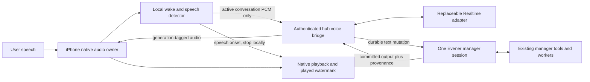
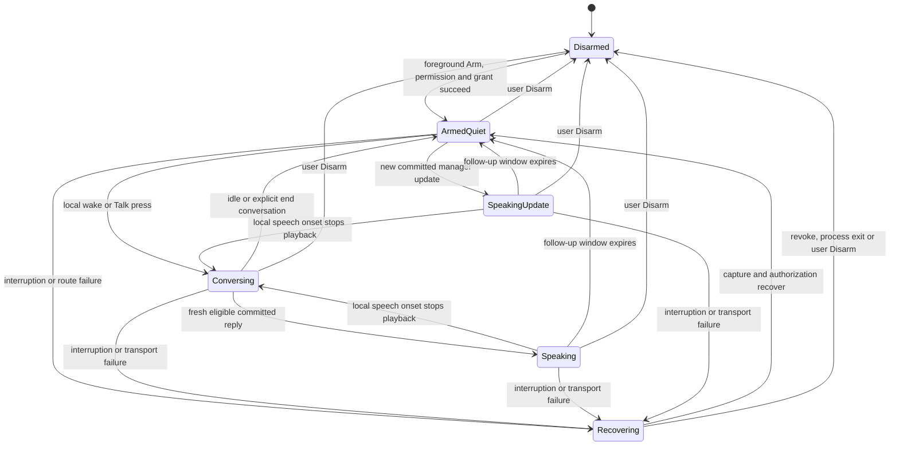
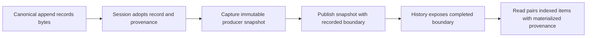
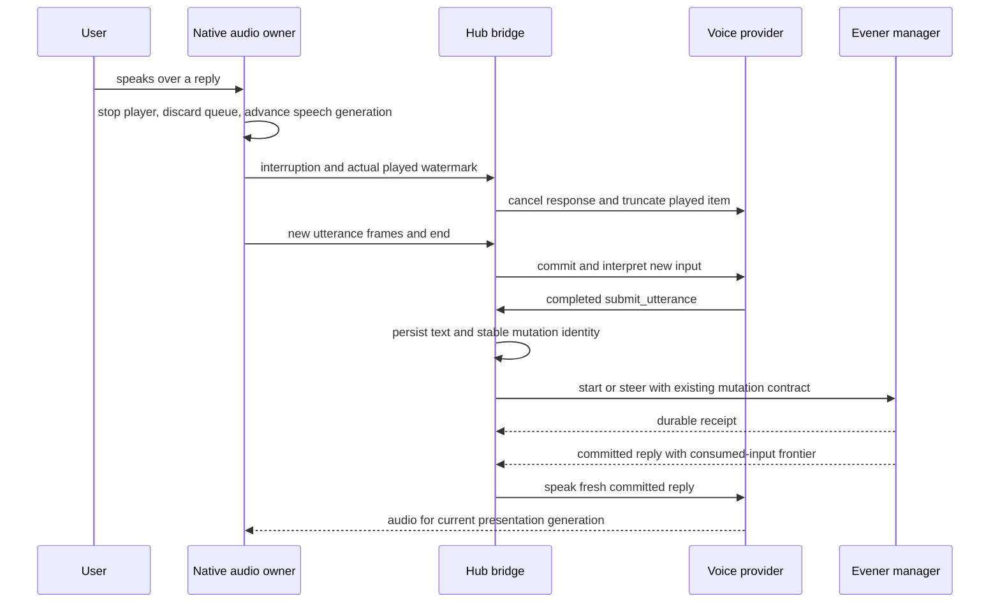

# Evener voice chief of staff: architecture and v1 specification

**Approved design baseline: 2026-11-04.** Repository observations and spike
results below describe that baseline, not current implementation evidence.
The paired-publication amendment in section 6 records the shared-history choice.

Use a native iPhone audio service, a replaceable OpenAI Realtime voice adapter,
and **one persistent Evener manager session**. The phone owns wake detection and
immediate silence on interruption. Evener owns reasoning, tools, permissions,
work history and recovery. Provider conversations are disposable.

The spikes support Realtime's protocol boundaries, not a finished voice agent.
The first “Hey Evener” experiment missed every positive sample. Locked-iPhone
listening, physical echo cancellation and the combined voice-to-manager journey
remain qualification gates. See the [spike record](../spikes/2026-11-04-voice/README.md).

## 1. Intent and scope

Jesse wants to talk to a persistent chief of staff: ask what is happening, start
work through the manager tools, correct it mid-sentence, and hear the result
without keeping a screen open. He specified iPhone listening **including while
locked**. An iOS-only v1 is acceptable; a browser tab is desirable. He prefers
clean runtime choices and expects current OpenAI models to be strong candidates.
He authorized Mac/iOS spikes on `m5max` and TestFlight distribution as appropriate.

These are **design-author calls for review**, not decisions Jesse already made:

- Start with native iPhone, local wake/VAD, and hub-brokered Realtime WebSockets.
- Use Realtime only to interpret speech and present verified Evener output.
- Qualify `gpt-realtime-2.1-mini` first because its protocol was exercised. Offer
  `gpt-realtime-2.1` through the same adapter after the same quality checks. The
  full model was listed by the API but was not measured.
- “Hey Evener” is the proposed phrase, not a qualified model or a required spelling.
- Explicit foreground **Arm** enables a listening period that can continue locked.
  Anyone nearby can speak to it. Wake detection is not authentication.
- Barge-in stops speech immediately. Work stops only after a separate, explicit
  instruction reaches Evener and its outcome is known.
- Spoken replies are concise paraphrases. The committed Evener text remains
  canonical. Exact-reading speech is a separate capability, never inferred from
  an instruction to a generative speech model.

### In v1

One chosen manager session per armed phone, ordinary text chat alongside voice,
local wake activation, follow-up conversation, barge-in, authenticated hub access,
reconnect without duplicate text submissions, proactive manager updates, and
visible listening/delivery state. The manager can inspect and control the sessions
its existing authority permits. A spoken request does not grant new authority.

### Outside v1

Android, browser background/locked operation, multiple simultaneous microphones,
speaker recognition, custom user-trained wake words, offline autonomous manager
work, voice-only permission escalation, arbitrary spoken slash-command execution,
and migration of Evener's agent brain into a speech provider. A foreground browser
adapter can follow later without changing the bridge or session contract.

“Persistent” means durable Evener identity plus a user-armed native audio lifetime.
iOS force-quit, reboot, process eviction and permission revocation can end that
lifetime. Reopen and Arm restores it. We will not claim system-wide hotword access,
background relaunch, or indefinite listening solely because a timer is running.

## 2. Approaches and choice

| Approach | Strength | Cost or unresolved risk | Decision |
|---|---|---|---|
| Realtime voice frontend, narrow relay to Evener | Completed function arguments, explicit response/item IDs, cancel/truncate acknowledgements observed | Speech and interpretation remain probabilistic; correlation and playback are ours | First v1 adapter |
| GPT-Live client delegation to Evener | Designed for an external agent and fluid full-duplex conversation | Observed delegations carry IDs/offsets but no task text or completed utterance; commentary may change wording; no comparable explicit playback truncation boundary observed | Keep as a later adapter experiment |
| Streaming ASR → Evener → speech | Clearest text boundary; easy to replace ASR and speech separately | Another endpointing/synthesis pipeline; current OpenAI speech migration is not guaranteed verbatim TTS | Control baseline and future adapter, not a second v1 implementation |

Directly giving manager tools to a Realtime model would create a second agent
with separate memory and authority. It does not meet the “one Evener session”
intent. The selected frontend exposes one relay, never filesystem, shell,
delegate, approval or session-control tools.

This recommendation changed with evidence: GPT-Live looked closest in the docs,
but the live probe had to choose Alpha/Beta from the test schedule because the
delegation contained no complete request. Realtime itself chose the completed
Alpha/Beta function arguments. That makes its bridge easier to specify and test;
it does not establish superior speech quality.

## 3. What exists and what must change

| Boundary | Observed repository behavior | Required v1 change |
|---|---|---|
| Manager sessions | Manager implementation was found on a separate branch, not this design baseline. Manager is immutable at launch, authority comes from the bound daemon. Managed workers are independent top-level sessions. | Depend on the manager feature landing. Select/create a manager explicitly, never toggle an ordinary session or turn managed workers into owned delegates. |
| AppWire input | `NormalizeMutationInput` admits text/image/skill/command; audio is not supported. | Keep PCM on a dedicated voice stream. Submit finalized interpreted text through existing input mutations. |
| Mutation custody | `clientMutationId` plus `expectedInstanceId` supports same-payload replay and rejects conflicting reuse. | Preserve those fields through the voice bridge, including uncertain delivery. Do not invent an exactly-once external-tool guarantee. |
| Stop | `turn/interrupt` cancels the session's current turn on arrival and can hold queued input. | Never use it as the acoustic barge-in mechanism. |
| Assistant output | `communicate` is recorded before publication; committed assistant messages are available to clients. | Speak committed user-facing outputs only, with consumed-input provenance described below. |
| Native lifetime | Current JS connection closes/refuses background operation. Microphone is disabled in app config and explicitly absent in a permission test. | Add an app-lifetime Swift audio/voice owner. A new permission contract needs explicit design approval before changing that assertion. |
| Locked credentials | Existing SecureStore access uses its default unlocked accessibility. | Load a narrow voice grant into native memory at Arm. Do not silently weaken storage of the general hub credential. |

The exact source revision and separately run tests are in the spike record. The
manager branch is an implementation dependency, not evidence that this baseline
already has manager mode. This document describes proposed behavior; evergreen
product guides remain unchanged until that behavior is implemented and verified.

## 4. Ownership and transport



The native service owns capture, AEC, route handling, local activation, playout
and the voice socket. It stays alive independently of a screen or React Native
AppState. The hub bridge authenticates the session binding, journals input
admission, calls the existing daemon mutation APIs and subscribes to committed
output. The provider adapter translates voice events; it cannot manage sessions.

**First transport:** native WebSocket to the hub, then hub WebSocket to OpenAI.
This adds a network hop but keeps provider keys off the phone, gives one tool-event
owner, and lets Swift own the same capture/playback graph used for local wake and
barge-in. Direct WebRTC with server-side control is a later transport option;
its media, cancellation and background behavior must be qualified separately.
No WebRTC behavior is inferred from the WebSocket spike.

Use the configured hub's authenticated secure transport. Off-tailnet connections
require TLS; tailnet deployments retain their established private transport
boundary. Do not send microphone audio over arbitrary public plaintext HTTP/WS.
The bridge is a new explicitly advertised capability. An older hub leaves text
chat usable and voice unavailable; it does not receive guessed RPC names.

### Native owner

- `AVAudioSession` in `playAndRecord`/`voiceChat`; enable
  `AVAudioEngine` voice processing while stopped, before final graph setup.
  Capture and provider PCM playback share one engine and its echo reference.
  `voiceChat` alone is not proof that AEC is enabled.
- Use actual route formats, convert to the adapter's format, and track output
  samples in the provider audio timeline. Realtime's exercised format is mono
  PCM16 at 24 kHz. The audio callback never performs network I/O or inference.
- Feed bounded buffers to local wake/VAD workers. Use a real speech detector,
  not an RMS threshold presented as VAD. The shipping wake/VAD package is a gate,
  not selected by the desktop all-miss result.
- Keep capture alive while speaking. A headset-to-speaker change stops output
  before it can leak onto the new route; the service rebuilds the graph and
  resumes listening when the route is healthy. Ask before resuming speech on a
  newly public route. An interruption stops active capture/output as required
  by iOS and automatically re-arms if the OS permits and the user did not Disarm.
- Rebuild after media-services reset. Fence callbacks from the old engine. Show
  “listening paused” if recovery cannot restore real capture; never leave a green
  microphone indicator based only on desired state.
- Use active audio background execution, not silent playback or a VoIP workaround.
  A background URLSession is not a persistent realtime WebSocket mechanism.

The [standalone native probe](../spikes/2026-11-04-voice/ios/README.md) compiled
this graph-construction source for iOS and Simulator. Its disarmed simulator run
checked a stale-callback fence, not the graph itself. No microphone, AEC, locked
lifetime or acoustic stop result follows from that build.

### Hub voice bridge

One binding contains authenticated device identity, selected session reference,
live instance identity and an armed-listening epoch. A single active phone owns
speech output for this session in v1. A second Arm request identifies the existing
owner and offers an explicit takeover. Takeover fences old audio and does not
cancel manager work.

The bridge holds the provider credential on the hub. It loads the selected voice
model independently of the manager's reasoning model. It never treats model
inventory as proof of inference access. Provider errors affect voice only; the
same session remains usable through text.

## 5. Listening and conversation states

The defaults below are testable starting points, not measured optima. Keep them
in one policy configuration rather than scattering timers across clients.



- **ArmedQuiet:** local microphone processing only. Keep a rolling two-second
  PCM buffer in RAM. No microphone frames go to a cloud provider. An authenticated
  control stream may remain subscribed for manager updates.
- **Wake/Talk:** play a short local cue, open the provider session and preserve
  speech immediately following the wake phrase. Upload from the detected wake
  start, never the earlier rolling-buffer segment. A Talk press starts at the
  press. When wake timing is uncertain, begin at the conservative detected start
  and qualify command-onset loss rather than uploading arbitrary pre-wake audio.
- **Conversing:** no repeated wake word for follow-ups. Initial policy: 600 ms
  trailing nonspeech ends a turn, maximum utterance 30 seconds, follow-up window
  12 seconds after output ends, and close cloud microphone input after 30 seconds
  without speech. A long backend wait can close the provider connection while
  the manager keeps working. Reopen output when a fresh result arrives.
- **Speaking:** continue AEC and local VAD. Near-end speech stops output locally
  and opens the follow-up window. Do not rely on the provider round trip.
- **SpeakingUpdate:** while armed, new committed chief-of-staff updates may speak
  on the selected route after a cue. Do not replay historical backlog at Arm.
  Coalesce pending notifications through the manager into a short current update.
  Output alone never opens cloud microphone input; the first local speech onset
  does. Disarm stops proactive speech as well as the microphone.
- **Recovering:** keep valid manager work and journaled input. Retry healthy
  portions automatically. If cloud voice is unavailable, a wake produces a local
  unavailable cue; text chat and existing work continue. Never announce an
  unjournaled request as accepted.

The app exposes Arm/Disarm, Talk, Stop speaking, bound chief-of-staff session,
current audio route, interpreted request, delivery state and the canonical reply.
It also shows whether the microphone is local-only or sending cloud audio.

```text
Chief of staff · Work overview
Listening for “Hey Evener” · Local only
Route: iPhone speaker                    [Disarm]

You said: Check Beta instead.
Received by chief of staff
Beta is blocked on a failing check.
                                [Talk] [Stop speaking]
```

This is a behavior sketch, not approval for new widget primitives. UI implementation
uses existing native components and accessibility conventions.

## 6. Turn admission and durable intent

The following names are proposed domain records, not existing API fields.

| Record | Owner and invariant |
|---|---|
| `VoiceBinding` | Hub, device + session + expected instance + listening epoch. Authenticated context supplies authority. Provider arguments cannot choose these values. |
| `VoiceTurn` | Hub, persisted ID before requesting interpretation, ordered input sequence and provider item mapping. One closed audio turn can produce at most one admitted text intent. |
| `VoiceIntent` | Hub, immutable interpreted text, method, target, mutation ID, receipt and custody state. Persist before attempting a daemon mutation. |
| `SpeechDelivery` | Hub plus native acknowledgements, durable presentation source, consumed-input frontier, presentation generation, provider response/item and played sample watermark. Generated, queued and played are distinct. |

### Admission protocol

1. The native detector sends start/frames/end with a stable utterance sequence in
   its listening epoch. The hub persists `VoiceTurn`, commits its provider input
   and records the returned provider input item ID. Use application-owned
   endpointing for v1. Server-VAD was exercised in the spike; client commit and
   the production detector still need their qualification scenario.
2. Request interpretation with only a narrow `submit_utterance` function whose
   single argument is `text`. It preserves the user's request, corrections,
   negations and references. It neither resolves a target session nor executes
   slash commands. Suppress all speech from this interpretation phase.
3. Admit only a completed, schema-valid call for the current input item and
   response. Ignore partial arguments. Reject unknown tools and additional calls
   for the same `VoiceTurn`. If no valid call completes, ask for a repeat; do not
   guess from partial text. The exact production relay was **not** the tool used
   in the read-status probe and needs live meaning-preservation tests.
4. Atomically record the immutable `VoiceIntent` and its mutation identity before
   sending. Use ordinary `turn/start` when idle and `turn/steer` when working.
   Persist the selected method with the payload; a retry must not change it after
   observing a different activity state. Existing admission/refusal and recovery
   paths own races with session state.
5. Show “received” only after a durable receipt. Accepted/pending work remains
   represented until authoritative transcript/queue state reflects it. On lost
   acknowledgements retry the same ID, method, payload and expected instance.
   A differing payload under the same identity is an error, not an edit.

The bridge acts as an AppWire client with a durable journal because it can outlive
its phone connection. It must reuse existing Go persistence/mutation primitives
and daemon custody rules. It does not create a second daemon queue or let the
phone's JS outbox also submit this utterance. Existing typed messages continue
through their existing outbox. Voice journal records project into the phone's
recovery UI under a distinct source identity rather than being copied into its
send queue.

**Crash recovery:** a persisted, never-attempted current-epoch intent can dispatch
while its listening grant remains valid. Once attempted, reconcile with the
original session/instance before retry. A retired binding or changed instance
holds unresolved input for explicit recovery; it never resends into a newly
created chief. A persisted acceptance remains accepted even if the user disarms.
An audio turn interrupted before a completed text intent has no durable text
receipt. Discard its partial audio and ask the user to repeat. No raw microphone
archive is required to make a stronger claim.

**Session creation:** Arm binds an existing manager. If none exists, foreground
setup creates one explicitly and stores its returned identity. Lost creation
responses require reconciliation; `thread/start` must not be blindly retried as
though it had the same replay contract as text mutations. Do not auto-create a
replacement session when reconnect fails.

### Output provenance and ordinary questions

Two explicit presentation sources are allowed: committed `communicate` messages
and the canonical public question/options of a durable, still-pending `ask_user`
call. Ordinary clarification must work while locked. The existing
`ParseAskUserCallArguments` and pending-question owner supply the validated
question data; arbitrary tool arguments remain private. Preserve a question
batch's order, option labels and pending identity. A voice reply follows the
existing free-text answer semantics for that batch. Do not invent a separate
voice questionnaire or silently select an option. Re-read pending identity before
speaking or attaching an answer so a resolved question cannot be resurrected.

Both sources must carry their session instance, durable source item identity,
run generation, and a **consumed-input frontier**: which accepted conversation
inputs had actually entered the model's context when this output was produced.
This covers voice, typed messages and steering from every input channel. Derive
it at the session input-consumption boundary and persist it with the output;
an agent-supplied assertion is insufficient. A greatest sequence number alone
is insufficient when queued and steered inputs are consumed out of admission
order. Preserve the identities relevant to outstanding presentation fences,
including through compaction and restore. This is new metadata, not a claim
about the present `communicate` or `ask_user` schema.

Without that frontier, an old operation could finish after “Beta, not Alpha” and
sound like the answer to Beta. After a new conversational input is admitted,
retain old results in the canonical transcript but suppress their speech until
an eligible output includes that input's consumed frontier. A typed correction
has the same protection as a spoken one. Ordinary progress with no newer input
fence can speak in committed order. Reasoning, other tool arguments and speculative
streaming text never become speech.

Admission of a new input also retires an already-playing older presentation.
For typed input this reaches the phone through the control stream; local speech
onset still has the faster on-device stop path. After reconnect or missed events,
refresh authoritative accepted/consumed input state before choosing speech.
Do not infer freshness solely from a best-effort notification's arrival order.

The speaking phase has no tools. Its only content source is the eligible message
or pending question and a bounded presentation instruction. Returned speech may
paraphrase it; record the generated transcript separately from canonical text.
Never use speech-model wording to record an action outcome, answer an approval,
or assert that Jesse heard something. Numbers, names, negations, option labels
and outcome claims are part of the live quality gate. If this fails, use the
chained adapter with a qualified exact-reading engine rather than relaxing the gate.

### Paired-publication amendment

Shared history must expose each canonical reply together with the producer-owned
provenance needed to resolve its actual consumed-input frontier. This applies to
all history clients, not just voice. Reads remain nonblocking with respect to
Session publication and never sample live Session state.



The Session owns a completed-publication handoff after adopting a recorded turn.
It supplies the recorded byte boundary and an immutable provenance snapshot.
The existing raw recording hook remains a leaf-lock-only staging operation;
it cannot make provenance-affecting bytes readable before the handoff. History
projection and recovery honor the completed boundary. After projection, a read
uses the latest materialized provenance for that same instance and history
identity rather than the graph captured before projection.

Capture the producer snapshot after releasing the transcript append lock and
Session mutex, while the existing mutation owner excludes the next canonical
mutation. The handoff takes only the history owner's leaf mutex. Subscription
capture remains callback-free and I/O-free, with notifications owned by the
existing projection path. Admission-only updates use the same snapshot holder
and monotonic revision fence.

Carry exact producer state. Do not merge graphs, synthesize consumed-input
coverage, introduce server-assigned revisions or wait for provenance on reads.
Reuse immutable state until provenance changes and retain only the latest state
plus reader-owned copies. Canonical recorded input retains its existing
eligibility; terminal journal-only input retains its existing retirement rule.
Input receipts, queue custody and session Stop semantics do not change.

The paired boundary must survive initial wiring, restore, compaction, queue
overflow, index rebuild, shared-index catch-up and instance replacement.
Compaction preserves original output provenance without minting a frontier for
copied entries. A retained but unsynced record remains recorded; a failed write
cannot publish a new frontier.

Qualification must force both publication gaps: a reply committed after a read
captures its envelope, and a raw record observed before Session adopts its
provenance. Use real request construction and canonical history, and assert that
every returned reply's frontier resolves. Preserve the zero-live-sampling,
stale-snapshot, paging, recovery and recorded-input tests. A passing retry of an
intermittent voice test does not prove this invariant.

### References to spoken output

Attach the current `SpeechDelivery` context to the next input as platform-sourced
presentation metadata, separate from the user's words: canonical source identity,
generated wording/order, and whether playback completed, was interrupted, or is
uncertain. It supplies conversational context, never new action authority or a
replacement action receipt. Persist this association with the intent so recovery
cannot attach a different presentation to the same words.

Treat generated wording as quoted, lower-trust data even though the platform owns
its source association. It cannot add instructions or override the user's request.

The chief grounds “the second one” in the presentation the user was offered, not
silently in a differently ordered canonical list. A completed playback report
establishes rendering, not human attention. Without word-aligned playback evidence,
an interrupted millisecond watermark cannot prove which words were heard. If the
reference cannot be resolved uniquely, the chief asks a short named clarification
before acting. The frontend never chooses the job ID. Qualify reordered lists,
partial playback and a concurrent typed reply with real model behavior tests.

## 7. Barge-in, correction and cancellation



Local speech onset wins over every later packet. Stop and flush the player before
waiting for the hub. Fence late audio by presentation generation, including
packets already buffered by the transport. Measure **rendered audio**, not bytes
received, scheduled duration, or generated transcript length. With resampling,
map the physical player's sample clock back into the provider item timeline.

For Realtime WebSockets, send `response.cancel` for the active response and
`conversation.item.truncate` with the played `audio_end_ms`. Item IDs and the
single playback FIFO determine the watermark. Items that were generated but never
played are truncated/removed as the provider supports. If the provider cannot
reconcile unheard output, replace that voice conversation and seed it from durable
text; do not restore the unheard tail as conversational fact.

| Event | Speech | Evener work |
|---|---|---|
| User starts speaking | Stop immediately | Continue until new intent arrives |
| “Stop speaking” | Already stopped locally | No automatic interrupt RPC |
| “Wait, I meant Beta” | Drop obsolete speech | Deliver correction through durable steering; effects already taken stay reported |
| “Cancel the build job” | Stop current speech | Manager resolves the named job and calls its real cancellation tool, then reports the result |
| User presses existing session Stop | Stop speech | Preserve existing session-scoped Stop semantics and held queues |
| Disarm or microphone loss | Stop capture and speech | Keep accepted work and its receipts |

A correction is not rollback. The manager must say when something already
happened or cannot be canceled. The voice layer cannot promise that a delayed
session interrupt will stop a particular earlier job. Scoped job cancellation is
performed by the manager against its authoritative job identity.

## 8. Recovery, privacy and authorization

- The phone loads a revocable, session-bound voice grant while unlocked. Keep it
  in native memory for the armed lifetime; renew through that authenticated native
  connection while authorized. The server validates device, epoch, session and
  scope on reconnect. Never persist a broader hub credential with weaker
  Keychain accessibility solely to keep voice alive. Process loss requires
  foreground re-arm. Grant expiry/revocation ends cloud access and triggers an
  honest local cue, without killing accepted manager work.
- A wake word activates an already authorized channel. It proves neither speaker
  identity nor informed consent. Arm explains that nearby people or a recording
  can issue requests and hear replies, including while locked. Existing sandbox,
  tool approvals and project boundaries still apply. Approval requests use the
  existing authenticated UI; background speech cannot answer them for the user.
- Keep only the bounded RAM audio ring and active transport buffers. Disarm,
  conversation close and failed partial turns clear them. Journals retain
  finalized request text and receipts under existing session retention, not raw
  ambient audio. Diagnostics default to IDs, times, sizes, state and reason
  codes; no transcripts, PCM, credentials or provider headers.
- Provider privacy is a separate boundary. Current OpenAI docs describe no API
  training by default and default 30-day abuse-monitoring retention for Live and
  Realtime. `store:false` does not mean zero retention. The app must disclose the
  chosen voice provider; the manager's model may use another provider.
- On a lost voice socket, stop output, fence its generation and reconnect with
  bounded backoff. Reconcile journaled input and committed output before opening
  new audio admission. Replay neither provider function calls nor old spoken
  backlog. Uncertain playback is marked interrupted; the user can request repeat.
- Provider replacement/expiry leaves the same manager session. Seed a bounded
  context from committed text and known action outcomes, excluding unplayed speech
  claims. Realtime's documented 60-minute limit requires a timed replacement
  test, even though the idle policy normally closes sessions much sooner.
- Reject an unknown binding or stale instance narrowly, then offer existing
  session recovery. Do not disable healthy text chat or delete queued work.

## 9. Runtime options and cost

Keep four replaceable boundaries: `AudioDevice`, `WakeAndSpeechDetector`,
`ConversationVoiceAdapter`, and `ChiefSessionBridge`. These are responsibilities,
not a request for a plugin framework or a universal audio protocol. Implement
one adapter and one device first. Runtime selection is session configuration;
changing it retires the voice generation, never the chief-of-staff session.

The adapter declares its actual capabilities: input completion, tool-call
completion, explicit cancel, playback truncation, exact-reading guarantee,
transcript availability, usage reporting, and connection limits. Missing semantics
must be supplied and tested by the bridge, or that adapter stays experimental.
Do not give a capability the value true because a prompt asks for it.

Local wake/VAD is mandatory for quiet-state privacy and cost. The tested sherpa
runtime could load and detect an official reference phrase, but “Hey Evener” was
not useful. Runtime license and model/training-data rights need separate review.
Porcupine or a trained phrase model remain candidates, not untested substitutions.
Local ASR/TTS and GPT-Live can later implement the voice-adapter boundary without
changing durable intent or manager authority.

The hosted probe used four sessions, including two excluded pilots, and calculated
at most **$0.0619962** from reported usage without cache discounts. That is not a
billing invoice or a cost forecast. At the inspected $0.05/minute Live rate,
leaving a session open costs $3/hour or $72/day before manager inference. Realtime
charges tokens and context; idle microphone speech can still cost money. Report
voice usage separately from the manager's inference and never keep the cloud mic
open merely because the phone is armed.

## 10. Qualification and delivery gates

These are **targets to verify**, not current measurements. Default tests remain
deterministic, with a scripted LLM/provider boundary and real Evener components
below it. Live voice/model behavior tests require explicit opt-in in addition to
credentials. No mocked microphone or simulated playback result can qualify
physical AEC, wake accuracy, lock lifetime or acoustic interruption.

| Scenario | Required evidence and pass condition |
|---|---|
| One chief survives conversations | Real hub/daemon manager, two voice conversations and a disconnect, same session identity and earlier committed context retained |
| Wake plus immediate command | Human recordings and physical phone, at least 60 intended trials across quiet/noise/distance and representative routes, ≥95% detection and no lost command onset. Separately score near-misses. “Hey Evener” is blocked by current all-miss evidence. |
| False activation and self-output | At least 30 hours of representative negative audio with zero activations, plus 100 own-output trials including the wake phrase. Report corpus and conditions. Zero in 30 hours gives a one-sided 95% Poisson upper bound near 0.10/hour, not a universal rate. |
| Locked native lifetime | Physical phone, foreground Arm then lock with no playback for 5 and 30 minutes; wake, converse and interrupt while still locked. Then an unplugged eight-hour soak without debugger, with capture-gap, battery and thermal records. No unexplained capture loss. Battery target ≤2 percentage points/hour incremental over a matched disarmed run. |
| Acoustic barge-in | At least 30 double-talk trials per supported route. p95 near-end speech onset to audible stop ≤200 ms, no stale tail, mic stays live. Provider acknowledgement time is a separate metric. |
| Meaning and spoken fidelity | At least 30 scripted human turns with names, amounts, negations, corrections and cancellation. No unintended mutation or material change to an action outcome; canonical text and generated speech both scored against independent fixtures. Full and Mini run the same corpus before claiming a quality winner. |
| Useful answer latency | At least 30 warm-session read-only turns with a bounded backend workload. Target p95 final voiced input to first useful audible result ≤3 seconds; report wake/cold-connect and manager execution separately. A cue is not an answer. |
| Duplicate, crash and stale input | Real bridge, daemon and durable storage: duplicate provider calls, hub crash before/after submit, lost receipt, phone reconnect and changed instance. One transcript admission per intent, no retargeted retry, retained uncertainty and recovery. |
| Correction/output race | Slow Alpha task, admit Beta correction, Alpha completes before steering consumption. Alpha remains in transcript but does not speak as Beta's answer. A fresh output whose consumed frontier includes Beta can speak. |
| Mixed text and voice | Repeat the correction race with a typed Beta steer during voice output, then disconnect the control stream. Freshness reconciliation suppresses the old reply without losing either input. |
| Locked clarification and references | Speak a durable `ask_user` batch and answer by voice while locked. Keep question identity and option order, never re-speak a resolved question. Reorder a spoken job list and interrupt it, then ask to cancel “the second one”; the chief selects only a uniquely grounded target or asks a named clarification. |
| Stop semantics | Speech onset and Disarm never issue session Stop. Explicit work cancellation reports actual result; irreversible work is not described as undone. Existing Stop still holds queued messages as specified. |
| Quiet-state privacy | Capture actual network/provider ingress during Arm, silence, ordinary speech and pre-wake buffer roll. Zero microphone frames uploaded until activation; buffered pre-wake prefix never uploaded. |
| Device recovery | Physical interruption, media reset, Bluetooth route change, Wi-Fi/cellular change and locked reconnect/renewal. Recover listening automatically where allowed, preserve work, prevent speaker leakage and expose genuine paused state otherwise. |
| Distribution | Signed Release build preserving app identity/data, TestFlight processing and install/update on Jesse's phone. Build/launch alone does not prove locked operation. |

For v1, qualify the iPhone built-in microphone/speaker route first. A headset route
is enabled only after its own AEC/barge-in/recovery checks; unsupported routes show
why and return to the last qualified route with the user's consent. This avoids
silently promising every Bluetooth profile from one speakerphone test.

### Delivery slices, after design approval

1. **Native audio qualification:** small opt-in debug surface in the existing app,
   working local wake/VAD, real locked-device runs. The standalone research probe
   is not shipped over the installed app. Resolve permission-test conflict with
   the approved new product contract.
2. **First complete journey:** one foreground voice turn through the real bridge,
   existing manager tools, committed reply and playback. Add the consumed-input
   provenance needed for corrections. Use real model calls for voice semantics.
3. **Persistence and interruption:** local silence, duplicate/crash/instance
   fences, correction race, background transport and locked renewal.
4. **TestFlight qualification:** preserve existing bundle, App Group, share
   extension, signing and app data. Keep voice opt-in until the physical gates
   pass. A TestFlight upload is permitted for this task but has not been done.
5. **Optional browser foreground adapter:** secure-context microphone, shared
   bridge and mutation/provenance contracts. Tab suspension and locked iPhone
   Safari are not substitutes for the native v1.

The builder chooses package/file layout, wire method names, SQLite schema details,
local speech-detector implementation and initial model prompts within these
contracts. The release gates determine whether a candidate is fit to ship. A
failed gate produces evidence and a narrowed experiment, not a weaker assertion.

## 11. Remaining decisions and evidence

- **Wake engine:** unresolved. The measured candidate failed the proposed phrase;
  human audio, model fit and operating point have not been separated. A viable,
  appropriately licensed model must pass the same gate before choosing it.
- **Physical iPhone:** unavailable to the automated Mac probe. Native compilation
  and a disarmed simulator control check completed; audio initialization did not.
  Jesse's reachable phone or a TestFlight install is needed for lock, acoustic
  and battery evidence. The Mac's pending Xcode package setup also remains open.
- **Production relay and native transport:** proposed, not exercised end to end.
  Read-only fixture calls and separate manager tests must not be added together
  and called a passing voice-to-manager journey.
- **OpenAI model quality:** Mini protocol measured, full model unmeasured. Both
  tested speech products changed supplied wording. Exact reading is unsupported
  by this evidence. Current published model IDs/prices must be rechecked at build.
- **Signing/distribution and Apple policy:** no upload made. Active recording
  behavior and clear microphone disclosure must comply with current Apple rules;
  technical background-audio capability is not App Review acceptance.

Implementation follows the approved native background microphone, armed ambient
voice, proactive locked speech and paraphrased-speech contracts. Approval does
not replace the qualification evidence required above.

## Sources

Repository contracts: [product guide](../../product/README.md),
[subsystem map](../../product/subsystems.md),
[message recovery](../../product/message-recovery.md),
[session activity](../../product/session-activity.md),
[AppWire input](../../../appwire/input.go),
[turn mutation types](../../../appwire/types_turn.go),
[native build/distribution](../../design/mobile/ios-build-distribution.md).

Current hosted protocol sources, accessed 2026-11-04:
[Realtime conversations](https://developers.openai.com/api/docs/guides/realtime-conversations),
[Live delegation](https://developers.openai.com/api/docs/guides/live-delegation),
[Live WebSocket](https://developers.openai.com/api/docs/guides/voice-websockets?api=live),
[transcription](https://developers.openai.com/api/docs/guides/realtime-transcription),
[data controls](https://developers.openai.com/api/docs/guides/your-data),
[deprecations](https://developers.openai.com/api/docs/deprecations).
The hosted spike README links model pricing and records exact observed behavior.

Native references:
[Apple voice processing, WWDC 2019](https://developer.apple.com/videos/play/wwdc2019/510/),
[Apple voice processing, WWDC 2023](https://developer.apple.com/videos/play/wwdc2023/10235/),
[Apple voiceChat](https://developer.apple.com/documentation/avfaudio/avaudiosession/mode-swift.struct/voicechat),
[Apple background URLSession](https://developer.apple.com/documentation/foundation/urlsessionconfiguration/background(withidentifier:)),
[App Review guidelines](https://developer.apple.com/app-store/review/guidelines/).
