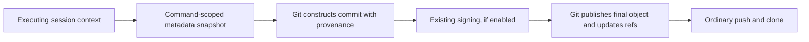

# Commit-to-session provenance: experimental design

**Status:** proposed design informed by a standalone prototype. GitHub validation
and the production insertion mechanism remain open. This is not a shipped
product contract or permission to replace Git on users' machines.

## Intent

Jesse wants someone who worked on a commit to be able to find the associated
Evener session. Each record carries Evener version, model, host and session ID.
Cryptographic identity is unnecessary. The preference is metadata inside the
commit object, transported by ordinary Git push/fetch/clone, without adding
commit-message text.

The experiment is authorized. Production deployment and changes to the merge
workflow are not part of this prototype.

## What the experiment proves

The runnable code and repeatable behavior tests are in
[`tools/commit-provenance`](../../../tools/commit-provenance/README.md).
On Git 2.43.0, a namespaced extra header survives strict object checking and a
real local bare-remote push plus fresh clone through pack transport. The commit
ID and raw bytes remain identical. No notes ref or client-specific fetch rule
is required.

Native amend retains the header. Native rebase, cherry-pick and squash create
commits without it. A merge preserves the original commits in its ancestry but
does not copy their headers onto the merge commit. Fast-forward merge preserves
the original tip object.

Writing the header after a signature invalidates that signature. A real
post-commit hook that rewrites HEAD makes `git commit` report the old commit ID,
even though HEAD points to the new object. Therefore the successful storage
experiment does not establish a safe transparent commit interceptor.

GitHub acceptance, GitHub API visibility and GitHub-generated merge behavior
remain untested. Local pack transport is not evidence of those boundaries.

## Approaches considered

| Approach | Benefit | Cost or limit |
| --- | --- | --- |
| Extra commit header | Direct attachment, ordinary object transport, unchanged message | Native Git exposes no arbitrary-header insertion flag, rewrite paths need support |
| Dedicated Git notes ref | Standard annotations, no commit rewrite | Separate synchronization and note-rewrite policy, absent from ordinary clones |
| GPG signature notation | Signed hidden metadata, ordinary object transport | Signing keys and GPG-specific integration, beyond the traceability requirement |
| Message trailers | Straightforward creation and ordinary transport | Visible message clutter |

Custom headers are the experimental direction Jesse asked us to test. The
other mechanisms are not silently added as fallbacks.

## Candidate data format

Use one complete JSON record per `evener-provenance` header:

```text
evener-provenance {"schema":1,"evener_version":"fixture-version","model":"fixture-provider/fixture-model","host":"fixture-host","session_id":"fixture-session"}
```

The header lives before the blank line preceding the message. JSON gives a
single escaping rule; it avoids parallel lists whose version/model/session
positions could drift. Repeated headers permit more than one source session.
Records use nonempty single-line UTF-8 fields. No transcript text, prompts,
credentials or working-directory paths belong here.

The record's meaning is a **breadcrumb**, not a claim of exclusive authorship.
A command snapshot identifies the session making the commit and the model
whose response produced that command. It does not establish which model wrote
every line.
Retained source records identify earlier associated sessions. Automatically
attributing uncommitted files copied from another session requires information
this prototype does not have.

Host and session ID must resolve the actual executing session, including a
delegate rather than automatically substituting its parent. Model names should
include provider identity. Version must describe the runtime executing the
command, not whichever executable currently happens to be on PATH. A launched
background job retains its launch snapshot if the parent later changes models.

The committing user publishes these fields with the commit. That disclosure is
part of the feature's behavior, not something invisibility in the GitHub UI
makes private. The prototype uses synthetic data only.

## Prototype boundary

The CLI reads a source commit, preserves its existing headers and raw message,
appends a complete provenance record, writes a new object and prints its ID.
It leaves all refs, hooks, configuration, working files and the index unchanged.
An exact repeat of a prototype-generated record yields the same object ID.
Different records append; they do not erase earlier breadcrumbs.

The CLI refuses signed source objects, incomplete records and control characters.
It uses Git to resolve revisions and hash objects rather than assuming SHA-1.
Replacement refs are ignored when reading the original object. The existing
`identifier.FilteredGitEnvironment` helper removes inherited repository selectors
so they do not override the explicit repository argument. It has no GitHub API
calls or implicit publication. Unreferenced objects may be collected by Git.

This object-only boundary makes an interrupted run harmless to existing work:
the original commit and refs remain authoritative. It is not a production
commit-creation API and does not implement the index, editor, hooks, signing,
sequencer or transaction semantics of `git commit`.

## Evener integration seams

The independent repository investigation identified these existing owners:

- `Session.ID()` in `agent/session.go` identifies the actual root or child
  session. Restore preserves that ID. A delegate resource ID is a different
  identity and must not replace it.
- `agent.BuildVersion`, populated from `buildinfo.Version()` by
  `cmd/evener/main.go`, identifies the executing process. A restored transcript's
  original header and the hub's version may both be older or different.
- `agent/session_model_call.go` returns `usedProfile` and
  `ModelAttemptMetadata.RequestModel`. Fallback may answer using a different
  profile without swapping the session's selected profile. Concurrent model
  changes can also occur during an outstanding request. Capture the responding
  request's identity, not a later read of `Session.Profile()`.
- `agent/session_lifecycle.go` currently passes `profile` to `execToolBatch`.
  Future provenance wiring must deliberately carry the responding model's
  context through this boundary; the prototype does not change it.
- `agent/execenv/local_exec.go` funnels buffered, streaming, direct-argv and
  detached execution through `launchEnv`. Shell callers already accept extra
  environment maps. Native worktree Git commands use `execenv.RunGit`.
- `agent/sandbox_delegate.go` permits parent and child sessions to share an
  execution environment. A mutable session stamp on that shared object would
  leak attribution across sessions. Use immutable invocation context instead.

There is no existing physical-host field in the inspected session environment
carrier. Choose an executing-host label explicitly. Detached commands must not
depend on helpers or metadata files that disappear with session scratch.

Plugin hook commands (`agent/internal/hooks/command_runtime.go`) and MCP server
processes (`agent/internal/mcp/manager.go`) have separate launch owners. Remote
operations and long-lived servers need their own invocation attribution
contracts. The local shell environment is not universal coverage.

The existing repository hook chain and sandbox environment floor remain intact.
`core.hooksPath` replacement is not transparent, even if supplied only on one
command. The sandbox's signing-agent and PATH restrictions must not be weakened
to make this feature appear to work.

## Production insertion must precede signing and ref publication

A correct integration needs this ordering:



Evener supplies context. Git owns commit construction, existing hooks, signing
and ref publication. The header must be present before Git signs or reports the
object ID. The mechanism must not replace repository hooks, disable signing,
change author identity or write per-session values into shared repository
configuration.

Three insertion choices remain:

1. **Native Git support for a supplied extra header.** This is the cleanest
   ordering. A Git implementation change near commit construction could cover
   native `commit`, `commit-tree`, merge and sequencer paths. It would need
   separate source-record preservation on rebase/cherry-pick and squash. Git
   does not currently offer this public option; relying on it means maintaining
   a patch or obtaining upstream support. That is an architectural decision for
   Jesse, not a hidden dependency of this feature.
2. **An explicit Evener commit operation.** It can own a documented subset of
   commit creation, but cannot honestly cover arbitrary shell scripts, Git
   aliases, libraries or existing workflows. Reimplementing normal Git commit
   behavior solely to add one header is disproportionate.
3. **Post-commit hooks, command wrappers or after-command scanning.** These can
   demonstrate best-effort annotation but have stale-output, signature,
   already-pushed-object and ref-race problems. A shell command can create and
   push a commit before Evener regains control. The prototype's measured
   post-commit result rules out treating this as transparent and harmless.

A PATH wrapper alone does not create native header support and can be bypassed
by absolute Git paths, libraries, remote commands or a changed environment.
This is not a tamper-proof feature, but an ordinary bypass must still be named
rather than described as covering every commit.

## Rewrite and contributor preservation

Proposed preservation rules, not implemented behavior:

- New commit: record the executing session's command snapshot.
- Amend: retain source records and add the current snapshot if distinct.
- Rebase/cherry-pick: carry the source record set into each replacement commit
  before signing. Do not relabel the original work as solely the replay session.
- Local squash: combine distinct records from the explicitly selected source
  commits, plus the current snapshot. Deduplication uses complete records.
- Ordinary merge: preserve source commits as Git already does and attribute the
  new merge operation separately. Do not copy the entire repository's history
  into a merge header.

Records and original objects have different lifetimes. A rebase leaving an old
object in the local object database is not preservation if a fresh clone of the
rewritten branch cannot reach it.

GitHub-created squash/rebase commits are outside the local executing session.
The [GitHub commit-creation API](https://docs.github.com/en/rest/git/commits#create-a-commit)
has no custom-header field. A local Git patch cannot make GitHub synthesize
these headers. The current remote merge
workflow therefore needs a separate decision: preserve original commits in
reachable ancestry, change where squash commits are constructed, or accept a
stated boundary. Do not introduce message trailers, notes or force-push a merged
branch as an unapproved workaround.

## Failure and recovery

A future production implementation must preserve the person's work when
metadata cannot be obtained. Whether a missing field should refuse the commit
or allow an explicitly reported attribution gap is unresolved; the prototype's
strict input validation does not decide that product policy.

Do not manufacture a hostname, model or parent session to fill a missing value.
Do not discard signatures or rewrite a published commit to repair metadata.
A failed lookup must leave the commit usable. A missing or archived session does
not invalidate the code or prevent ordinary Git operations.

## Whole-journey qualification before production

1. Create a real Evener session with a scripted provider, edit a fixture and
   commit through the supported ordinary command path. Inspect the raw object
   independently and verify message, author, tree and hook effects.
2. Push to the authorized disposable GitHub destination. Clone into a fresh
   repository without extra configuration and compare the full object bytes.
3. Resolve host/session ID back to the contributing session. Cover delegates,
   restored sessions, model switches and background-job launch snapshots.
4. Exercise signed and unsigned commits, hooks that mutate the staged tree,
   hooks that reject commits, interactive messages and detached HEAD.
5. Exercise real amend, rebase, conflict continuation, cherry-pick, local squash
   and merge. Compare contributing records on the reachable rewritten history.
6. Test the actual GitHub merge policy separately. State what survives on main,
   not only on a feature branch.
7. Fault the insertion/publication boundary and retry. Prove there is no lost
   staged work, silent signature removal, duplicated commit or false successful
   attribution. Include concurrent worktrees without shared metadata leakage.

## Decisions still needed

- A disposable GitHub destination for the live transport experiment.
- The production insertion mechanism and whether maintaining Git support is
  acceptable.
- Whether the guarantee includes GitHub-generated squash commits on main.
- Missing-metadata policy and whether copied uncommitted delegate work needs
  explicit source records in addition to the committing session's breadcrumb.

Keep these decisions separate from the successful local storage experiment.
