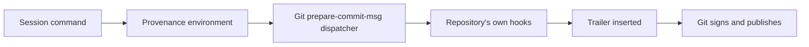
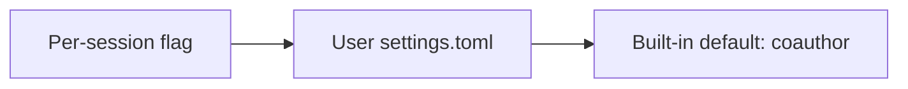

# Commit provenance: trailer design

**Status:** proposed. This document is a design for Jesse's approval; no
production code exists yet. The custom-header experiment is recorded separately
in [the experimental design](2026-11-09-commit-provenance-design.md).

## Intent

Every commit created by a command inside an Evener session should name the
Evener version, model, host and session that made it, so a person who worked on
the commit can find the contributing session. The record is a breadcrumb, not a
claim about who wrote every line and not a cryptographic signature.

Jesse proposed a `Co-authored-by` trailer and asked for a design that is
configurable globally and per session, from both the hub and the CLI. This
design adopts that proposal.

## What changes for the user

With provenance on, a commit made through a session's shell or background job
ends with:

```text
Co-authored-by: Evener 0.9.12 (anthropic/claude-opus-4.6) <034uOsahfdjKENyvpnJexm@magic-kingdom>
```

The four fields are the runtime version, the responding model as
`instance/model`, the executing host, and the session ID. A person can use the
session ID to find the transcript in Evener. GitHub keeps the trailer in the
commit message; the synthetic address is not associated with a GitHub account,
so it grants no contribution credit.

The trailer is part of the commit message. It is visible in every Git UI and in
public repositories. Hostnames and session IDs are disclosed with the commit;
that is the feature, and `off` is the way to withhold it.

## Evidence

These behaviors were measured during the design work on Git 2.43.0 and the
private probe repository, not inferred:

| Behavior | Result |
| --- | --- |
| `prepare-commit-msg` runs for `git commit`, `--amend`, merge, cherry-pick, revert and rebase | Yes, with source arguments `message`, `commit` or `merge` |
| `git commit-tree` runs `prepare-commit-msg` | No |
| `git commit --no-verify` runs `prepare-commit-msg` | Yes; it skips `pre-commit` only |
| Trailer inserted before an SSH signature | Signature verifies over the final message |
| Git configuration inherited by nested `bash` and `sh` through `GIT_CONFIG_COUNT` | Yes |
| Explicit `git -c core.hooksPath=...` overrides the inherited setting | Yes |
| Identical trailer applied twice with `--if-exists=addIfDifferent` | One copy |
| Existing human `Co-authored-by` trailers | Preserved, Evener's appended after them |
| GitHub squash merge of commits carrying the trailer | Trailer preserved; GitHub also re-emits it in the final co-author block, so it appears twice |
| Existing repository hooks under a previous `core.hooksPath` | Forwarded by the test dispatcher and ran, with their output observed |

The GitHub squash check is [probe PR 4](https://github.com/obra/evener-provenance-probe/pull/4).
The earlier custom-header experiment lost its record on GitHub squash because
the header lived outside the message. A trailer is message content, so the
squash path keeps it. GitHub re-emits recognized co-authors in the squash
commit's final trailer block while also leaving the commit-body copies in
place, so a squashed commit can show the same trailer twice. The duplication is
cosmetic and the session ID remains unambiguous.

Not yet measured: the real Evener integration, restricted-sandbox execution of
the dispatcher, remote hosts, and servers other than GitHub. Windows is not a
supported target.

## Insertion mechanism

Git has no configuration that adds a trailer to every commit. Trailer
configuration alone is inert until a command or hook calls
`git interpret-trailers`. The mechanism is therefore one managed
`prepare-commit-msg` hook, injected through Git's inherited command
configuration, that runs before Git signs and publishes the commit.



The environment is set for every command a session launches:

- `GIT_CONFIG_COUNT`, `GIT_CONFIG_KEY_n` and `GIT_CONFIG_VALUE_n` append
  `core.hooksPath=<managed hooks directory>` to the command's Git configuration.
  An existing count and its pairs are preserved.
- `EVENER_COMMIT_PROVENANCE_TRAILER` carries the complete trailer value.
- `EVENER_COMMIT_PROVENANCE_HOOKS` names the managed directory, so the
  dispatcher can avoid recursing into itself.
- `EVENER_COMMIT_PROVENANCE_GIT` carries an absolute Git path for commands that
  run with a restricted `PATH`.

The managed directory holds one POSIX shell dispatcher, linked under every
standard Git hook name. Git runs the dispatcher instead of the repository's own
hook. The dispatcher:

1. Finds the hooks directory it replaced. It reads
   `git config --show-scope --get-all core.hooksPath`, drops the value equal to
   Evener's own managed directory, and takes the last remaining value in Git's
   scope order. That honors a user's `core.hooksPath` from a global, local,
   worktree, or their own command-scope environment. When none remains it uses
   `git rev-parse --git-common-dir` plus `/hooks`.
2. Runs the replaced hook of the same name when it exists and is executable.
   A non-zero status aborts the Git command, as it would without Evener.
3. For `prepare-commit-msg` only, appends the trailer with
   `git interpret-trailers --in-place --if-exists=addIfDifferent`.
4. Does nothing else. Hooks Evener does not add are forwarded untouched.

An amend that keeps the same model and session adds no duplicate. If the model
changed before the amend, the new distinct trailer is added; both records are
truthful, and the email's session ID still ties them to one session.

The dispatcher refuses to run a hook whose resolved directory is its own, so a
configuration pointing back at Evener cannot recurse.

The script uses POSIX shell builtins for path handling and configuration
parsing, and the absolute Git path, so it keeps working when a restricted
environment leaves `PATH` empty. It depends on no other external program.

`core.hooksPath` is supplied in Git's command scope, so it never edits the
user's files, global configuration or repository configuration. A person who
runs `git -c core.hooksPath=...` intentionally overrides it. `git commit-tree`
and programs that create commit objects without running the porcelain hooks
are outside this mechanism.

The dispatcher fails open. If the trailer cannot be written, it prints one line
to stderr and lets the commit proceed; refusing the person's commit over a
provenance defect is worse than recording a gap.

The trailer is added after the repository's own `prepare-commit-msg` and before
`commit-msg`, so a repository hook that validates or rewrites messages still
sees the final text. A repository that rejects unknown trailers rejects this
one too; `off` is the supported escape hatch.

The cost is one extra shell process for each hook Git already runs and one
message line per commit. Git commands that run no hooks pay nothing beyond the
environment they already receive.

## Configuration

The setting is a mode with two values: `coauthor` (write the trailer) and `off`.
Unset means `coauthor`.

### Storage

The user-wide value lives in a new file, `<config-root>/settings.toml`, owned
by a small `internal/usersettings` package:

```toml
[git]
commit_provenance = "coauthor"
```

The file is read on every new-session launch and on every hub settings read, so
an external edit or a CLI write takes effect without restarting the hub. Writes
are atomic through `execsupport/fsatomic`, mode 0600, and rewrite the file
canonically as `launchconfig.SaveLayer` does for `launch.toml`. Comments and
unknown keys are not preserved. A missing file is the default; an unreadable or
malformed file is reported and the default is used, because a broken settings
file must not block session start.

A write refuses to overwrite a file that does not parse, and reports the path
and parse error instead. Reads treat it as the default, but silently replacing
the file would discard whatever the person was editing.

`settings.toml` is deliberately separate from `launch.toml`. Launch files are
the hub's layered launch defaults, and the CLI does not read them; this setting
must work for a direct `evener` invocation. A dedicated settings file gives the
hub and CLI one source of truth without teaching the CLI a partial launch
resolver.

### Precedence



The resolved mode is persisted with the session, like the model and sandbox
settings. A new launch resolves the flag, then the user setting, then the
default. A resume without an explicit flag keeps the session's saved mode; an
explicit flag on resume replaces it. For a new session the hub passes the value
it resolved, so sessions it spawns, including on other hosts, agree with the
setting surface the person used. For a resume the hub passes the saved value,
so a global change does not silently alter an existing session. A delegate
inherits its root session's mode and stamps its own session identity.

A session already running keeps its mode; the setting takes effect on the next
launch. A session saved before this feature existed has no saved value and
resolves the current user setting when it is resumed.

### Hub

Settings gains a host-scoped **Git commits** section under **Agent setup**. It
shows one control, `Commit provenance`, with `Record Evener session details`
and `Off`, plus a short explanation and the file path. The section follows the
existing host picker so editing a remote host writes that host's file through
that host's hub. "Global" here means user-wide on that host, the same scope as
the other user settings; Evener does not sync settings between hosts.

The wire surface mirrors the other settings stores:

| Method | Purpose |
| --- | --- |
| `evener/settings/git/get` | Return the effective mode, its source (`file` or `default`), and the path |
| `evener/settings/git/set` | Validate and write the mode; broadcast `evener/settings/git/changed` |

An invalid value is `InvalidParams` and leaves the file untouched. A missing
config root refuses the write rather than resolving a relative path.

The hub's launch controller fills `Resolved.Effective.CommitProvenance` from
this store when no per-launch override set it, before `ToArgs` builds the
daemon argv. The resolved view therefore shows the value a spawn will use.

The New session dialog gains a `Commit provenance` select fed by the launch
option schema: `(inherit)`, `Record session details`, `Off`. This is a
per-launch field only; it is not saved into `launch.toml`.

### CLI

`evener config` is the persistent surface:

```sh
evener config get commit-provenance
evener config set commit-provenance coauthor
evener config set commit-provenance off
evener config unset commit-provenance
evener config list
```

`get` prints the effective value. `list` prints the value and whether it came
from the file or the default. `set` validates before writing and prints the
new value and path. `unset` removes the key, returning to the default. An
invalid value exits non-zero without writing.

Every session launch takes a per-session override:

```sh
evener --commit-provenance off 'fix the test'
evener serve --commit-provenance coauthor ...
```

An empty flag means inherit. The flag is added to `launchFlags`, so `run` and
`serve` share its definition, and `serve` applies it to the session it starts.
The flag also appears in `--help` and in the CLI documentation.

## Runtime attribution

The trailer is built at command launch from four values:

| Field | Source |
| --- | --- |
| Version | `agent.BuildVersion`, set from `buildinfo.Version()` |
| Model | The responding profile's `ID()` and `Model()` for the tool batch |
| Host | `os.Hostname()` of the process running the session |
| Session | `Session.ID()` of the executing session |

The model must be the one that produced the tool call, not a later read of the
session's selected profile. `callModelWithFallback` already returns
`usedProfile`; `session_lifecycle.go` currently passes `profile` into
`execToolBatch`. The change carries `usedProfile` across that boundary and down
to the shell handlers. A fallback model is therefore recorded honestly, and a
model switch affects the next command, not one already launched.

A delegate stamps its own session ID and responding model, even when it shares
its parent's execution environment. A background job freezes its trailer at
launch, so a later model switch does not rewrite the job's identity. A restored
session keeps its ID. A fork gets its own ID and records that.

A rebase or cherry-pick run by a session adds that session's trailer to each
replacement commit and leaves any trailer already in the source message in
place. The rewritten history therefore records both the original contributor
and the session that rewrote it.

If any required field is empty or contains a control character, no trailer is
written for that command and the session reports a diagnostic. The design does
not invent a host, version, model or parent session to fill a gap.

## Environment injection

`LocalExecutionEnvironment` gains an immutable provenance binding: the resolved
mode and the managed hooks directory. It is tree-scoped, so a parent and its
delegates can share one environment without leaking attribution; the
per-command trailer is passed as the call's `envVars` map, which is already
per invocation.

`launchEnv` is the single funnel for buffered, streaming and detached
commands. It applies the provenance overlay after the environment policy has
filtered inherited variables:

1. If the mode is `off` or this invocation carries no trailer, do nothing.
2. Merge `core.hooksPath` into any existing `GIT_CONFIG_COUNT` pairs by
   appending a new pair and incrementing the count. A malformed count disables
   provenance for that command with a warning rather than discarding the
   person's configuration.
3. Set the trailer, hooks-directory and absolute-Git variables.

The overlay runs after filtering so `EnvPolicyNone` still gives Git its hook
configuration, and the absolute Git path keeps the dispatcher working when
`PATH` is empty. A user launch `[env]` cannot override the overlay because the
overlay is applied last.

The managed directory is `<state-root>/git-hooks/v1`, outside the working tree
and the project. It is created when a session starts with provenance on, and
re-created on the next command if it is missing. `SessionInfraRoots` adds it to
the sandbox's read/exec grants when provenance is on, using the existing rule
that session infrastructure must work in every sandbox mode. A sandboxed
session therefore runs the dispatcher without widening its write surface.

The boundary is the command surface Evener launches: `run_shell`, streaming
and detached jobs, and their descendants. MCP servers, plugin hooks and other
separate launch owners do not inherit the per-command environment unless they
are later given their own contract. Library calls that create commits without
running Git hooks are outside it. This is a best-effort breadcrumb, not a
tamper-proof audit log.

## Known limits

- Commits GitHub creates itself, such as web edits or API commits, carry no
  Evener record.
- `git commit-tree`, `git fast-import`, library commit writers and any tool that
  skips the porcelain hooks carry none.
- A repository's `commit-msg` hook runs after the trailer is added and can
  remove it. A strict message policy can reject it.
- A person or program can clear the environment, pass
  `git -c core.hooksPath=...`, or run Git outside the session. The record is
  evidence, not enforcement.
- The trailer is public wherever the commit is public.
- Windows is not a supported target, so the shell dispatcher is Unix-only.

## Failure and recovery

- A missing or malformed `settings.toml` yields the default and a diagnostic.
- A missing config root leaves the CLI/hub write refused, not redirected to a
  relative path; launches use the default.
- A failure to create the hooks directory disables provenance for the session
  with a diagnostic; commits still work.
- A dispatcher failure to resolve the replaced hook directory forwards no
  repository hook but still adds the trailer; it never blocks the commit.
- A trailer insertion failure prints one line and leaves the commit usable.
- Concurrent `settings.toml` writes are last-write-wins, protected by atomic
  rename; a torn file is impossible. The two writers are the hub and the CLI.
- Existing signatures, author identity, staging state and repository hooks are
  untouched. No post-commit rewrite exists, so Git never reports a stale commit
  ID.

## Approaches considered

| Approach | Why it loses |
| --- | --- |
| Custom commit header (prototyped) | No native insertion point before signing; post-commit rewriting invalidates signatures and reports stale IDs; native rebase, cherry-pick and squash drop it; GitHub squash dropped it |
| Git notes | A separate ref that ordinary clone and push do not carry without extra configuration; not attached to the commit |
| A `git` shim on `PATH` | Bypassed by absolute paths, libraries and changed environments; more machinery for a weaker guarantee |
| Commit template / `trailer.*` configuration alone | Does not add anything to an ordinary `git commit` |
| Put the global value in `launch.toml` | The CLI deliberately does not read launch files; reusing it would require a partial resolver or a package move, and would blur launch defaults with user behavior |
| Environment variable only | Not persistent, not hub-editable, and leaves no discoverable setting |

The chosen mechanism keeps Git responsible for commit construction and signing.
Evener supplies environment and one hook, and preserves every existing hook.

The standalone `tools/commit-provenance` writer stays as the record of the
custom-header experiment. This design does not wire it into the product; its
offline and live-gated tests remain available for reproducing those results.

## Implementation surface

| Area | Work |
| --- | --- |
| Settings | New `internal/usersettings` package: schema, load, atomic save, validation, missing/malformed handling |
| Wire | `appwire` methods and types for `evener/settings/git/{get,set,changed}` |
| Hub | Handlers, host-scoped Settings section, spawn/resume argv resolution |
| Launch config | `commit_provenance` field, per-launch only, in the schema, merge, wire and `ToArgs` |
| CLI | `evener config` command, `--commit-provenance` flag on `run` and `serve`, resolution on new launch |
| Runtime | `SessionConfig.CommitProvenance`, delegate inheritance, `usedProfile` through `execToolBatch`, trailer builder |
| Execution | Immutable provenance binding on `LocalExecutionEnvironment`, overlay in `launchEnv`, hooks-directory creation |
| Sandbox | Managed directory in `SessionInfraRoots` |
| Hooks | Embedded dispatcher script, standard hook-name links, recursion guard |

The dispatcher's standard hook-name list must match the Git the user runs. The
list is pinned in code with a comment naming the Git documentation it came
from; a newly added Git hook name will not run until it is added. That is the
one compatibility maintenance cost of taking over `core.hooksPath`.

## Testing and qualification

Unit and real-Git tests:

1. Settings: default on missing file, parse failure fallback, atomic write,
   invalid value refusal, source reporting.
2. Precedence: flag over file over default; resume keeps the saved value;
   explicit resume flag replaces it; delegates inherit and stamp their own ID.
3. Trailer: exact format, model from `usedProfile`, control-character refusal,
   missing-field refusal.
4. Dispatcher against real Git in temporary repositories: plain commit, amend,
   merge, cherry-pick, revert, rebase, `--no-verify`, `commit-tree` bypass,
   existing `pre-commit`, `prepare-commit-msg` and `commit-msg` hooks still run,
   repository `core.hooksPath` preserved, human co-authors preserved, identical
   trailer not duplicated on amend, empty message and a message without a
   trailing newline.
5. Signing: a real SSH signature verifies with the inserted trailer.
6. Environment: buffered, streaming and detached commands receive the overlay;
   an existing `GIT_CONFIG_COUNT` keeps its pairs; `EnvPolicyNone` still gets
   the hook path and absolute Git.
7. Sandbox: restricted mode runs the dispatcher from the infra grant and does
   not gain a write path.
8. Hub RPC: get/set/broadcast, invalid value, no config root, spawn argv
   carries the resolved value, resume keeps the saved value.
9. CLI: get/set/unset/list, invalid value, file path, flag precedence.

End-to-end qualification before calling it shipped:

1. A scripted-provider session edits a fixture and commits through `run_shell`.
   Inspect the raw commit with `git cat-file` and verify message, author, tree,
   signature and hooks.
2. Repeat the private-GitHub squash check with a commit created by the real
   integration, not a hand-written message.
3. Resolve the session ID back to the transcript, including a delegate and a
   restored session.
4. Exercise a repository with its own `core.hooksPath` and a repository whose
   `commit-msg` rejects unknown trailers. The second documents a real
   compatibility risk; `off` is the escape hatch.

## Rollout and documentation

The default is `coauthor`, because the feature exists to record provenance and
an off-by-default setting would leave most commits unrecorded. The release note
must say that commit messages will change and that `evener config set
commit-provenance off` or the hub toggle disables it.

Documentation updates in the same change:

- `docs/configuration.md`: `settings.toml` in the file table, the precedence
  rule, and a short "Commit provenance" section.
- `docs/cli.md`: the `--commit-provenance` flag and `evener config`.
- `docs/web-ui/README.md`: Settings → Agent setup → Git commits.
- `docs/product/subsystems.md`: the owning subsystem rows for settings,
  session launch and command execution.

## Open decisions

1. **Approve `settings.toml`** as a new user config file rather than extending
   `launch.toml` and teaching the CLI to read it.
2. **Approve the trailer text** exactly as shown, including the visible
   hostname and session ID in commit messages.
3. **Approve default-on** for all sessions, with the per-session and global
   off switches as the escape hatch.
