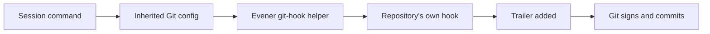
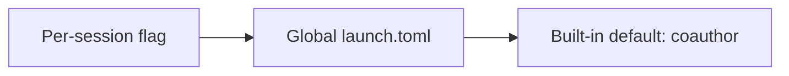

# Commit provenance: trailer design

**Status:** revised after Jesse's review. This document is a design for
approval; no production code exists yet. The custom-header experiment is
recorded separately in [the experimental design](2026-11-09-commit-provenance-design.md).

## Intent

Every commit created by a command inside an Evener session should name the
Evener version, model, host and session that made it, so a person who worked on
the commit can find the contributing session. The record is a breadcrumb, not a
claim about who wrote every line and not a cryptographic signature.

Jesse proposed a `Co-authored-by` trailer. The global scope is per host, the
default is on, and the trailer text below is approved.

## What changes for the user

With provenance on, a commit made through a session's shell or background job
ends with:

```text
Co-authored-by: Evener 0.9.12 (anthropic/claude-opus-4.6) <034uOsahfdjKENyvpnJexm@magic-kingdom>
```

The four fields are the runtime version, the responding model as
`instance/model`, the executing host, and the session ID. A person can use the
session ID to find the transcript in Evener. GitHub keeps the trailer in the
commit message; the synthetic address is not associated with a GitHub account,
so it grants no contribution credit.

The trailer is part of the commit message. It is visible in every Git UI and in
public repositories. Hostnames and session IDs are disclosed with the commit;
that is the feature, and `off` is the way to withhold it.

## Evidence

These behaviors were measured during the design work on Git 2.43.0 and the
private probe repository:

| Behavior | Result |
| --- | --- |
| `prepare-commit-msg` runs for `git commit`, `--amend`, merge, cherry-pick, revert and rebase | Yes, with source arguments `message`, `commit` or `merge` |
| `git commit-tree` runs `prepare-commit-msg` | No |
| `git commit --no-verify` runs `prepare-commit-msg` | Yes; it skips `pre-commit` only |
| Trailer inserted before an SSH signature | Signature verifies over the final message |
| Git configuration inherited by nested `bash` and `sh` through `GIT_CONFIG_COUNT` | Yes |
| Explicit `git -c core.hooksPath=...` overrides the inherited setting | Yes |
| Identical trailer applied twice with `--if-exists=addIfDifferent` | One copy |
| Existing human `Co-authored-by` trailers | Preserved, Evener's appended after them |
| GitHub squash merge of commits carrying the trailer | Trailer preserved; GitHub also re-emits it in the final co-author block, so it appears twice |
| Git config-defined hooks (`hook.<name>.event` / `.command`) run automatically during `git commit` | No; only `git hook run` invokes them |
| A `git` alias named `commit` shadows the built-in | No |
| Git executes a symlink in `core.hooksPath` as a hook | Yes, with the symlink path as `argv[0]` |
| Existing repository hooks under a previous `core.hooksPath` | Forwarded by the fixture helper and ran, with their output observed |

The GitHub squash check is [probe PR 4](https://github.com/obra/evener-provenance-probe/pull/4).
The earlier custom-header experiment lost its record on GitHub squash because
the header lived outside the message. A trailer is message content, so the
squash path keeps it. GitHub re-emits recognized co-authors in the squash
commit's final trailer block while also leaving the commit-body copies in
place, so a squashed commit can show the same trailer twice. The duplication is
cosmetic and the session ID remains unambiguous.

Not yet measured: the real Evener integration, restricted-sandbox execution of
the hook helper, remote hosts, and servers other than GitHub. Windows is not a
supported target.

## Insertion mechanism

Git has no automatic pre-sign insertion point other than a hook. Trailer
configuration alone is inert; config-defined hooks are not run by `git commit`;
aliases do not shadow built-ins; `--trailer` requires an explicit command-line
argument; and a post-commit rewrite invalidates signatures and makes Git report
a stale commit ID. A hook is required.

Jesse rejected hand-written hook scripts. The design therefore uses a compiled
Evener helper, not shell:



The helper is a hidden `evener git-hook` subcommand. The managed hooks directory
contains symlinks to the Evener binary under every standard Git hook name, so
Git invokes the binary directly. The binary learns the hook name from
`filepath.Base(os.Args[0])`; the symlink path is preserved as `argv[0]`
(measured). There are no shell scripts, no `awk`, no hand-copied hook files, and
no dependency on `PATH`.

For each invocation the helper:

1. Resolves the hooks directory it replaced. It reads
   `git config --show-scope --get-all core.hooksPath`, drops the value equal to
   its own managed directory, and takes the last remaining value in Git's scope
   order. When none remains it uses `git rev-parse --git-common-dir` plus
   `/hooks`. This honors a user's global, local, worktree, or command-scope
   `core.hooksPath`.
2. Runs the replaced hook of the same name when it exists and is executable,
   with the same arguments, environment and standard streams. A non-zero status
   aborts the Git command, as it would without Evener.
3. For `prepare-commit-msg` only, after the original hook succeeds, appends the
   trailer by running `git interpret-trailers --in-place
   --if-exists=addIfDifferent`. The trailer value comes from the command
   environment. The helper never parses or rewrites the trailer block itself.
4. For every other hook name, exits with the original hook's status and does
   nothing else.

The helper refuses to run a hook whose resolved directory is its own, so a
configuration pointing back at Evener cannot recurse. It runs `git` at the
absolute path supplied in the environment, or resolves it normally.

`core.hooksPath` is supplied in Git's command scope, so it never edits the
user's files, global configuration or repository configuration. A person who
runs `git -c core.hooksPath=...` intentionally overrides it. `git commit-tree`
and programs that create commit objects without running the porcelain hooks
are outside this mechanism.

The helper fails open. If the trailer cannot be written, it prints one line to
stderr and lets the commit proceed; refusing the person's commit over a
provenance defect is worse than recording a gap.

The trailer is added after the repository's own `prepare-commit-msg` and before
`commit-msg`, so a repository hook that validates or rewrites messages still
sees the final text. A repository that rejects unknown trailers rejects this
one too; `off` is the supported escape hatch.

The cost is one extra process for each hook Git already runs and one message
line per commit. Git commands that run no hooks pay nothing beyond the
environment they already receive.

## Configuration

The setting is a launch option in the existing layered launch configuration,
not a new settings store:

| Scope | Where |
| --- | --- |
| Global, per host | `<config-root>/launch.toml`, the existing user-wide launch defaults |
| Per session | The launch layer: `--commit-provenance` or the New session dialog |
| Built-in default | `coauthor` |

Values are `coauthor` (write the trailer) and `off`. Empty means inherit.

The field is added to `launchconfig.Layer` as
`CommitProvenance string` with TOML tag `commit_provenance,omitempty`. The launch
option schema offers it in the global layer and the per-launch override only;
a repository or project layer value is ignored with a diagnostic. Merge is the
existing scalar rule: the last non-empty value wins, and an explicit `off`
overrides an earlier `coauthor`.

`cmd/evener-hub/internal/launchconfig` moves to `internal/launchconfig` so the
CLI and the hub share one `Layer`, one schema and one loader. The package
comment changes from hub-only to shared. This is a package move with import
updates, not a second configuration path.

### Hub

Settings → Agent setup → Session defaults already edits the global launch
layer through `evener/launch/setLayer`. The schema-driven form gains a
`Commit provenance` select, so the hub needs no new settings RPC, no new store
and no new section. The New session dialog shows the same select as a
per-launch override.

"Global" means user-wide on the selected host, the same scope as the other
launch defaults; Evener does not sync settings between hosts.

### CLI

`evener config` is a thin front-end to that same global layer:

```sh
evener config get commit-provenance
evener config set commit-provenance coauthor
evener config set commit-provenance off
evener config unset commit-provenance
evener config list
```

`get` prints the effective global value. `list` prints the value and whether it
came from the file or the default. `set` validates before writing, loads the
existing global `Layer`, changes the field and saves it atomically with
`launchconfig.SaveLayer`. `unset` clears the field. Other launch defaults in
the file are preserved through the shared `Layer`; comments and unknown keys
are not, matching the hub's existing save path. A malformed `launch.toml`
refuses the write and reports the parse error.

Every session launch takes a per-session override:

```sh
evener --commit-provenance off 'fix the test'
evener serve --commit-provenance coauthor ...
```

The flag is added to `launchFlags`, so `run` and `serve` share it. A direct CLI
launch with no flag reads `commit_provenance` from the global launch layer and
uses `coauthor` when it is unset. This is the one field a direct CLI launch
honors from `launch.toml`; other launch defaults keep their current CLI
behavior. The documentation states that explicitly.

### Precedence



The resolved mode is persisted with the session, like the model and sandbox
settings. A new launch resolves the flag, then the global layer, then the
default. A resume without an explicit flag keeps the session's saved mode; an
explicit flag on resume replaces it. For a new session the hub passes the value
it resolved, so sessions it spawns, including on other hosts, agree with the
setting surface the person used. For a resume the hub passes the saved value,
so a global change does not silently alter an existing session. A delegate
inherits its root session's mode and stamps its own session identity.

A session already running keeps its mode; the setting takes effect on the next
launch. A session saved before this feature existed has no saved value and
resolves the current global setting when it is resumed.

## Runtime attribution

The trailer is built at command launch from four values:

| Field | Source |
| --- | --- |
| Version | `agent.BuildVersion`, set from `buildinfo.Version()` |
| Model | The responding profile's `ID()` and `Model()` for the tool batch |
| Host | `os.Hostname()` of the process running the session |
| Session | `Session.ID()` of the executing session |

The model must be the one that produced the tool call, not a later read of the
session's selected profile. `callModelWithFallback` already returns
`usedProfile`; `session_lifecycle.go` currently passes `profile` into
`execToolBatch`. The change carries `usedProfile` across that boundary and down
to the shell handlers. A fallback model is therefore recorded honestly, and a
model switch affects the next command, not one already launched.

A delegate stamps its own session ID and responding model, even when it shares
its parent's execution environment. A background job freezes its trailer at
launch, so a later model switch does not rewrite the job's identity. A restored
session keeps its ID. A fork gets its own ID and records that.

A rebase or cherry-pick run by a session adds that session's trailer to each
replacement commit and leaves any trailer already in the source message in
place. The rewritten history therefore records both the original contributor
and the session that rewrote it.

If any required field is empty or contains a control character, no trailer is
written for that command and the session reports a diagnostic. The design does
not invent a host, version, model or parent session to fill a gap.

## Environment injection

`LocalExecutionEnvironment` gains an immutable provenance binding: the resolved
mode, the managed hooks directory and the helper binary path. It is tree-scoped,
so a parent and its delegates can share one environment without leaking
attribution; the per-command trailer is passed as the call's `envVars` map,
which is already per invocation.

`launchEnv` is the single funnel for buffered, streaming and detached commands.
It applies the provenance overlay after the environment policy has filtered
inherited variables:

1. If the mode is `off` or this invocation carries no trailer, do nothing.
2. Merge `core.hooksPath` into any existing `GIT_CONFIG_COUNT` pairs by
   appending a new pair and incrementing the count. A malformed count disables
   provenance for that command with a warning rather than discarding the
   person's configuration.
3. Set the trailer, hooks-directory, helper-binary and absolute-Git variables.

The overlay runs after filtering so `EnvPolicyNone` still gives Git its hook
configuration, and the absolute paths keep the helper working when `PATH` is
empty. A user launch `[env]` cannot override the overlay because the overlay is
applied last.

The managed directory is `<state-root>/git-hooks/v1`, outside the working tree
and the project. It contains symlinks to the running Evener binary under the
standard hook names. It is created when a session starts with provenance on,
and re-created on the next command if it is missing. `SessionInfraRoots` adds
the directory and the binary to the sandbox's read/exec grants when provenance
is on, using the existing rule that session infrastructure must work in every
sandbox mode. A sandboxed session therefore runs the helper without widening
its write surface.

The boundary is the command surface Evener launches: `run_shell`, streaming and
detached jobs, and their descendants. MCP servers, plugin hooks and other
separate launch owners do not inherit the per-command environment unless they
are later given their own contract. Library calls that create commits without
running Git hooks are outside it. This is a best-effort breadcrumb, not a
tamper-proof audit log.

## Known limits

- Commits GitHub creates itself, such as web edits or API commits, carry no
  Evener record.
- `git commit-tree`, `git fast-import`, library commit writers and any tool that
  skips the porcelain hooks carry none.
- A repository's `commit-msg` hook runs after the trailer is added and can
  remove it. A strict message policy can reject it.
- A person or program can clear the environment, pass
  `git -c core.hooksPath=...`, or run Git outside the session. The record is
  evidence, not enforcement.
- The trailer is public wherever the commit is public.
- The managed directory must list the standard Git hook names. A hook name added
  by a future Git release does not run until it is added to that list.
- Windows is not a supported target, so the helper and its symlinks are
  Unix-only.

## Failure and recovery

- A missing `launch.toml` uses the built-in default. A malformed file is
  reported; a direct CLI launch uses the default rather than blocking. The hub
  follows the launch resolver's existing failure handling.
- `evener config set` refuses to rewrite a malformed `launch.toml` and reports
  the path and parse error, so a typo is not silently discarded.
- A failure to create the managed hooks directory disables provenance for the
  session with a diagnostic; commits still work.
- A helper failure to resolve the replaced hook directory forwards no repository
  hook but still adds the trailer; it never blocks the commit.
- A trailer insertion failure prints one line and leaves the commit usable.
- Concurrent `launch.toml` writes are last-write-wins, protected by the existing
  atomic save; the writers are the hub and the CLI.
- Existing signatures, author identity, staging state and repository hooks are
  untouched. No post-commit rewrite exists, so Git never reports a stale commit
  ID.

## Approaches considered

| Approach | Why it loses |
| --- | --- |
| Custom commit header (prototyped) | No native insertion point before signing; post-commit rewriting invalidates signatures and reports stale IDs; native rebase, cherry-pick and squash drop it; GitHub squash dropped it |
| Git notes | A separate ref that ordinary clone and push do not carry without extra configuration; not attached to the commit |
| A `git` shim on `PATH` | Bypassed by absolute paths, libraries and changed environments; misses merge, cherry-pick and rebase; more machinery for a weaker guarantee |
| Commit template / `trailer.*` configuration alone | Does not add anything to an ordinary `git commit` |
| Git config-defined hooks (`hook.<name>.command`) | Not run by `git commit` on Git 2.43; only `git hook run` invokes them |
| A new `settings.toml` | Duplicates the existing layered launch settings facility; rejected by Jesse |
| Hand-written shell hook dispatcher | Fragile shell parsing, `PATH` sensitivity and a symlink farm of scripts; rejected by Jesse |
| A compiled Evener hook helper | Still a Git hook, because Git has no other automatic pre-sign insertion point; recommended |

The chosen mechanism keeps Git responsible for commit construction and signing.
Evener supplies environment and one compiled helper, and preserves every
existing hook.

The standalone `tools/commit-provenance` writer stays as the record of the
custom-header experiment. This design does not wire it into the product; its
offline and live-gated tests remain available for reproducing those results.

## Implementation surface

| Area | Work |
| --- | --- |
| Launch config | Move `cmd/evener-hub/internal/launchconfig` to `internal/launchconfig`; add `CommitProvenance` to `Layer`, the schema, merge, wire and `ToArgs` |
| CLI | `evener config get/set/unset/list` writes the global layer; `--commit-provenance` on `run` and `serve`; direct launches read the global field |
| Hub | No new RPC or store; the existing Session defaults form and New session override gain the field |
| Runtime | `SessionConfig.CommitProvenance`, delegate inheritance, `usedProfile` through `execToolBatch`, trailer builder |
| Execution | Immutable provenance binding on `LocalExecutionEnvironment`, overlay in `launchEnv`, managed hooks directory |
| Sandbox | Managed directory and binary in `SessionInfraRoots` |
| Hook helper | Hidden `evener git-hook` subcommand, symlinks under standard hook names, original-hook forwarding, `interpret-trailers` call |

The helper's standard hook-name list must match the Git the user runs. The list
is pinned in code with a comment naming the Git documentation it came from; a
newly added Git hook name will not run until it is added. That is the one
compatibility maintenance cost of taking over `core.hooksPath`.

## Testing and qualification

Unit and real-Git tests:

1. Launch config: the field loads and saves in the global layer, other fields
   survive a `config set`, an invalid value is refused, and a malformed file is
   reported.
2. Precedence: flag over global over default; resume keeps the saved value; an
   explicit resume flag replaces it; delegates inherit and stamp their own ID.
3. Trailer: exact format, model from `usedProfile`, control-character refusal,
   missing-field refusal.
4. Helper against real Git in temporary repositories: plain commit, amend,
   merge, cherry-pick, revert, rebase, `--no-verify`, `commit-tree` bypass,
   existing `pre-commit`, `prepare-commit-msg` and `commit-msg` hooks still run,
   repository `core.hooksPath` preserved, a command-scope user hooks path
   preserved, human co-authors preserved, identical trailer not duplicated on
   amend, empty message and a message without a trailing newline.
5. Signing: a real SSH signature verifies with the inserted trailer.
6. Environment: buffered, streaming and detached commands receive the overlay;
   an existing `GIT_CONFIG_COUNT` keeps its pairs; `EnvPolicyNone` still gets
   the hook path and absolute paths.
7. Sandbox: restricted mode runs the helper from the infra grant and does not
   gain a write path.
8. Hub: the existing launch schema shows the field, `setLayer` persists it, the
   spawn argv carries it, and resume keeps the saved value.
9. CLI: config get/set/unset/list, invalid value, file path, flag precedence,
   and a direct launch that reads the global value.

End-to-end qualification before calling it shipped:

1. A scripted-provider session edits a fixture and commits through `run_shell`.
   Inspect the raw commit with `git cat-file` and verify message, author, tree,
   signature and hooks.
2. Repeat the private-GitHub squash check with a commit created by the real
   integration, not a hand-written message.
3. Resolve the session ID back to the transcript, including a delegate and a
   restored session.
4. Exercise a repository with its own `core.hooksPath` and a repository whose
   `commit-msg` rejects unknown trailers. The second documents a real
   compatibility risk; `off` is the escape hatch.

## Rollout and documentation

The default is `coauthor`, because the feature exists to record provenance and
an off-by-default setting would leave most commits unrecorded. The release note
must say that commit messages will change and that `evener config set
commit-provenance off` or the hub toggle disables it.

Documentation updates in the same change:

- `docs/configuration.md`: the new launch field, its global-only and
  per-launch scopes, and the direct-CLI exception.
- `docs/cli.md`: the `--commit-provenance` flag and `evener config`.
- `docs/web-ui/README.md`: Settings → Agent setup → Session defaults and the
  New session override.
- `docs/product/subsystems.md`: the owning subsystem rows for launch
  configuration, session execution and hooks.

## Decisions

Approved by Jesse in review:

- Global scope is per host.
- Default is on.
- The trailer text is as shown.

Still open:

1. Confirm that `launch.toml` plus `evener/launch/setLayer` is the existing
   settings facility meant by "we have a facility for that." This design maps
   the setting to `launchconfig.Layer` and the Session defaults form.
2. Approve the compiled Evener hook helper as the automatic mechanism. It still
   uses a Git hook because Git has no other pre-sign insertion point. If that is
   unacceptable, the alternatives are a weaker `git` wrapper or provenance only
   for commits Evener creates itself.
3. Confirm that a direct CLI launch may read this one field from
   `launch.toml`. Other launch defaults keep their current CLI behavior.
