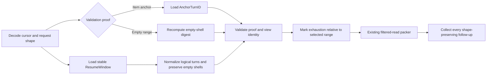

# Manager filtered-read continuation resolver design

## Intent

Manager filtered reads must continue the exact logical turn window that produced
the cursor. Appends, empty selected turns, old-daemon page fragments, and
unrelated older history must not change that window. Every recoverable omission
must expose a structured follow-up that preserves the original read shape.

This is a correctness slice for the filtered-read work currently based on PR
#5846. It replaces the repeated source-specific continuation repairs with one
hub-owned continuation contract before that feature ships.

## Goals

- Separate reconstruction of the remaining logical turn range from validation of
  the positioned item/version fence.
- Give live, saved-index, remote, and old-daemon compatibility reads the same
  continuation orchestration.
- Count and exhaust old-daemon windows by logical turn, not by transport
  fragments or by the daemon's unrelated native history cursor.
- Preserve empty selected turn shells.
- Publish page-level and per-turn continuation cursors through shape-preserving
  `FollowUps`.
- Keep traversal, cursor size, item lines, and encoded responses bounded.

## Non-goals

- No second transcript packer.
- No change to canonical fetch bytes, fetch cursors, or the hub canonical-byte
  store.
- No new remote capability bit or capability probe.
- No unbounded old-daemon history scan.
- No change to legacy unwindowed paging.
- No attempt to make a continuation survive a changed item version, source
  incarnation, or projection identity.

## Anti-goals

A technically passing change still fails this design if it:

- rereads the caller's original moving selector after a cursor exists;
- treats one transport fragment as one logical turn;
- uses an empty turn shell as an item-validation anchor;
- infers selected-window exhaustion from unrelated older transcript history;
- fixes live, saved, and compatibility paths independently;
- weakens identity or item-version validation; or
- hides a usable continuation cursor from structured `FollowUps`.

## Constraints

- The existing filtered-read packer remains the only packer and continues to own
  filtering, byte bounds, item limits, cursor-line bounds, budgeting, and split
  elision.
- A continuation cursor remains opaque and bounded. Its stable selector may name a
  resume boundary and its item-validation form may name one distinct anchor turn;
  it never carries the selected turn list. The empty-range form carries one
  fixed-size digest instead of an item anchor.
- `{latest:N}` and the forward/backward limits have no local or saved-index turn
  maximum. Those paths resolve a finite indexed selection and let the existing
  packer bound each response. Old-daemon compatibility alone may traverse at
  most the existing eight legacy network pages and must reject cursor cycles.
- The controller attempts stopped remote filtered reads without a new feature
  bit and passes through the remote hub's typed failure.
- This cursor form has not shipped. The required validation proof is part of its
  first released form; no decoder for the superseded branch-only shape will be
  added.
- Existing identity, direction, selection-shape, position, and item-version
  fences remain exact.

## Approaches considered

### 1. Explicit validation anchor plus one hub resolver, selected

Add an anchor turn ID beside the window cursor's existing position/version.
`ResumeWindow` reconstructs content. The anchor turn ID locates the positioned
item used to validate the fence. When the remaining range has no positioned
item at all, a fixed-size digest of its ordered canonical empty shells replaces
the item anchor. One hub orchestration path decodes the cursor, loads the stable
logical window, validates the anchor or digest independently, and hands only
that resolved range to the existing packer.

This is the smallest approach that fixes the abstraction rather than its five
current symptoms. It keeps source-specific I/O behind narrow loaders while the
hub owns continuation semantics.

### 2. Source-owned position validation

Keep the cursor unchanged and add a position/version lookup contract to live
sources, saved indexes, remote sources, and compatibility scanners. This makes
anchor lookup explicit without a turn ID and avoids changing the cursor form.
It also broadens source interfaces and storage machinery substantially, while
still requiring the shared logical-turn resolver and follow-up work.

### 3. Embed the resolved turn IDs

Put the immutable selected turn list and anchor in every cursor. This freezes
moving `latest` directly, but cursor size grows with the window, duplicates
index state, and conflicts with the bounded-cursor contract.

## Cursor contract

A window cursor carries two independent facts:

1. **Resume selection:** `ResumeWindow`, a stable non-`latest` selector that
   reconstructs exactly the remaining logical turn range, including empty
   shells.
2. **Validation proof:** exactly one of:
   - `AnchorTurnID` plus the existing `Position` and `ItemVersion`, identifying
     the exact settled item observed when the cursor was minted; or
   - `EmptyRangeDigest`, a fixed-size digest used only when every logical turn
     in the remaining range has zero positioned candidates.

The item anchor is not inferred from `ResumeWindow`. The digest input is the
ordered resolved turn shells after logical-fragment normalization, with items
and response elision fields cleared, encoded by one shared helper. Spending a
digest cursor requires the resolved range still to have zero positioned
candidates and the recomputed digest to match. A new item, changed shell,
reorder, insertion, or removal therefore fails stale.

For a forward item-limit continuation, both facts usually name the same turn.
For a backward whole-turn continuation they may differ. Given positioned A,
empty B, and positioned C, a cursor that continues before B has:

- `ResumeWindow = before B`, because A is the remaining content; and
- `AnchorTurnID = C`, because C contains the first positioned item on the served
  side of the exclusive boundary.

Remote cursor translation changes only the thread namespace. It preserves the
resume selector, validation proof, direction, incarnation, and projection
identity.

## Hub-owned continuation flow

The hub owns this order. Source-specific loaders supply data, but they do not
reinterpret cursor semantics.

1. Decode the self-contained cursor for the requested ref and direction.
2. Replace the caller's original `TurnWindow` with the cursor's
   `ResumeWindow`. The original selector is never consulted again.
3. Load the selected logical range and its view identity.
4. For an item-anchor cursor, load the anchor turn independently when the
   selected range does not contain it. For an empty-range cursor, verify the
   whole resolved range has no positioned candidate and recompute its shell
   digest.
5. Fully validate cursor identity, direction, and the chosen proof: anchor
   position/version or empty-range digest.
6. Return only the selected logical range with exhaustion scoped to that range.
7. Pass it to the existing packer.

A missing anchor, changed version, changed identity, nonempty digest range,
digest mismatch, malformed direction, or unresolvable bounded compatibility
scan returns the existing typed stale/item-changed result. There is no fallback
to the original selector or a broader history page.

## Source behavior

### Current live daemon

The live loader reads `ResumeWindow` through the existing window API. It reads
`AnchorTurnID` as an exact turn only when the anchor is outside that selected
range. The shared resolver performs the fence validation and selection-relative
exhaustion before packing.

### Saved local index

The saved loader decodes the cursor before calling the index. It resolves
`ResumeWindow`, not the request's original `latest`, and resolves the anchor as
an exact saved-index turn. An append after cursor mint cannot enter or displace
that continuation chain.

### Current remote hub

The remote hub remains the view owner. The controller translates the complete
cursor without inspecting or repacking the returned page. The owning hub runs
the same resolver. A remote hub that cannot serve the filtered-read form returns
its typed failure unchanged.

### Older local daemon compatibility

The compatibility loader accumulates bounded legacy pages and normalizes them
before selection:

- adjacent fragments with the same turn ID form one logical turn;
- distinct turn IDs, not fragment rows, count against `latest`, `since`, and
  `before` limits;
- every selected fragment is retained in source order;
- empty selected turns remain as shells;
- a boundary turn is incomplete while its fragment/candidate metadata says
  earlier items remain;
- the loader stops once the requested logical IDs and validation anchor are
  complete, or returns typed stale after eight pages or a cursor cycle; and
- after resolution, unrelated older native pages do not make the selected
  window unexhausted.

Initial compatibility reads and continuation reads use the same logical-window
normalizer. Candidate grouping inside the packer remains a presentation step,
not a repair for fragments discarded before packing.

## Structured follow-ups

One helper collects continuation cursors after a turns response is packed:

1. the page-level window continuation, when present;
2. each turn's `Elision.ContinuationCursor`, in response order; and
3. the legacy `NextCursor` for an unwindowed response.

It deduplicates equal cursors. Every emitted `read_transcript` follow-up carries
the original ref, turn window, item types, byte bounds, budget, and item limit,
plus exactly one continuation cursor. A raw cursor must not be recoverable only
by inspecting response internals.

## Recovery and preservation

- Appending turns after cursor mint leaves the continuation chain unchanged.
- An item-version change fails typed before any page is returned.
- An empty shell can be selected and replayed, but never serves as an item
  anchor. An over-budget all-empty range uses the digest proof; any later item or
  shell change makes that cursor stale.
- Local and saved-index selection remains finite but has no artificial turn-count
  cap. Only old-daemon network traversal is capped.
- Old-daemon traversal failure is bounded and explicit. It never returns a
  partial logical turn as complete.
- Remote inability remains a typed failure; no local reconstruction guesses at
  remote state.
- Every successful continuation preserves the original filters and bounds.

## Behavior evidence

Implementation starts with these failing journeys:

1. **Saved append stability:** mint `latest:3`, append a turn, follow the whole
   chain, and observe only the originally selected turns in order.
2. **Empty-shell backward continuation:** positioned A, empty B, positioned C;
   serve B+C first, then continue successfully to A through live and saved
   owners. The remote translation test proves the anchor survives ref
   translation.
3. **Fragmented old-daemon turn:** split B across legacy pages. `latest` counts B
   once, and exact B returns all B fragments through item-limit continuations
   without A.
4. **Selector-relative exhaustion:** resolve B+C while native page A remains;
   the final B continuation reports no withheld turn and cannot continue to A.
5. **Structured exact-turn recovery:** an exact turn elided by `itemLimit`
   exposes a `FollowUps` entry carrying the same read shape and its per-turn
   continuation cursor.
6. **All-empty budget continuation:** enough empty shells to exceed the effective
   budget page through fixed-size digest cursors. An unchanged range completes in
   order; adding an item or changing a shell before the next page fails stale.

Cursor unit tests cover the mutually exclusive item-anchor and empty-range proof
forms, malformed proofs, direction and identity fences, encoded-size bounds, and
remote translation. Each red test must fail for the reported behavior before
implementation begins.

## Owning documentation and shared files

The implementation updates:

- `docs/product/subsystems.md`, S10, to name the hub continuation resolver's
  selection, validation, and compatibility-normalization ownership;
- `docs/automation.md` to state that every window and per-turn continuation is
  published as a shape-preserving follow-up; and
- the filtered-read specification only if implementation reveals a true
  contract conflict, in which case work stops for Jesse rather than silently
  changing it.

Expected shared-file touches are the internal cursor form, hub read/packing
paths, Manager operation follow-up construction, focused tests, and the two
owning evergreen documents. No AppWire field or generated client type is
expected.
