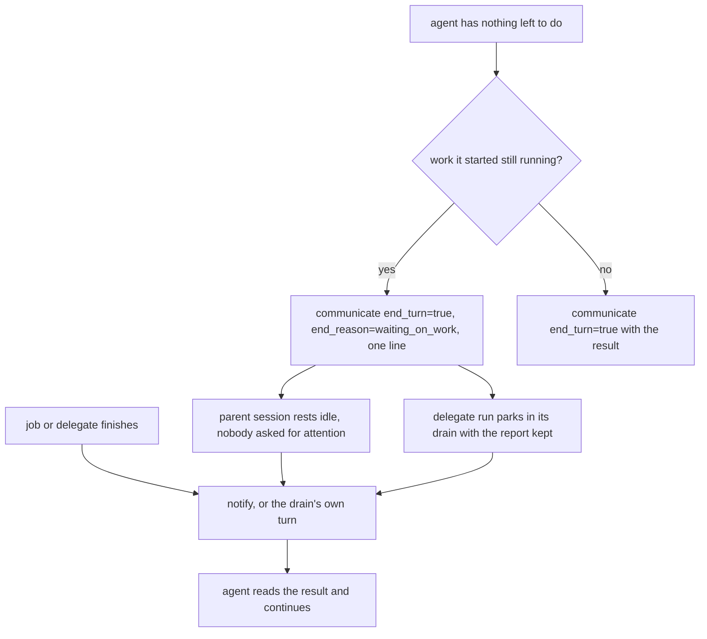

# Waiting is a turn end, not an incomplete report

## The failure

A session ended a turn's work and thought:

> Now let me wait for remaining delegates. I'll arm a check or just end turn? I can't
> end turn without reporting. Let me use job_watch? Actually, notifications arrive
> automatically. But I need to do something until they arrive.

It had nothing left to do, its delegates were still running, and it believed ending the
turn required a result it did not have yet. So it kept working to fill time.

The runtime needs none of that. The prompt told it the right thing in one place and the
opposite in eight others.

## What the runtime actually does

`agent/prompts/system.md.tmpl:94` already states the rule:

> When you have nothing else to do while it runs, end your turn: call `communicate` with
> `end_turn=true`, `end_reason="waiting_on_work"`, and one sentence saying what you are
> waiting for.

What backs it, per session kind:

- **A served root** ends on `waiting_on_work` and rests `SessionIdle`, not
  `SessionAwaiting` (`agent/session_awaiting_test.go:105`, `:348`): nobody is asked for
  attention. A finished job or delegate calls `Session.notify` (`agent/session.go:1347`),
  which the server wires to the input channel (`cmd/evener/serve.go:1326-1327`), and a
  resting session gets a new turn. A watch frame reaches it the same way
  (`agent/session_attention.go:626-665`).
- **A one-shot `evener run`** (`TurnEndsProcess`) is woken by its drain rather than the
  serve loop: `cmd/evener/run.go:493-504` calls `runDrainJobTree` after `ProcessInput`, and
  the drain wires its own notify (`agent/session_jobtree_drain.go:1041-1042`). Its child's
  report drives a notification turn whose reply becomes the run's answer
  (`cmd/evener/run_drain_test.go:242`, `TestRunDrainsDelegatedJobTreeBeforeExit`, passes).
- **A delegate** keeps its run open after the turn: `drainForFinalization`
  (`agent/subagents.go:2103-2124`) calls `DrainJobTreeKeepingReport` (`:2110`), which waits
  while `treeHasOutstandingWork` holds (`agent/session_jobtree_drain.go:258`), and
  `keepingReport` restores a report an intermediate turn would otherwise erase (`:989-1006`).
- **A nested coordinator delegate is the exception.** Its child's completion *report* is
  queued for the generation's end and does not itself start a coordinator turn
  (`agent/session_state.go:185-191`); the child's mid-work *update* wakes it, and the
  report rides that turn or the drain's end (`agent/delegate_update_test.go:679`).

So the gap is prose, not machinery: one `end_turn=true` call has three legitimate shapes,
the result, the wait line, and an observer's readiness line before a watch frame.

## Where the prose contradicts the rule

| # | Site | What it tells the agent |
|---|---|---|
| 1 | `agent/internal/tool/definitions.go:709` | `end_turn=true` is for "final answers, completed results, blocking requests for input, or readiness markers that wait for future user/caller/watch-frame input". Waiting on delegates or a job is not in the list. |
| 2 | `agent/internal/tool/definitions.go:721` | The `end_turn` parameter repeats the same four-item list. |
| 3 | `agent/internal/tool/definitions.go:796` | A delegate's `end_turn=true` "is your final report … put the complete result in it"; only a "readiness marker … before waiting for watch frames" is another case. A delegate with neither a watch frame nor a result yet is offered no shape. |
| 4 | `agent/internal/tool/definitions.go:810` | The parameter says `end_turn=true` means "your final report, or a readiness marker before you wait for watch frames". |
| 5 | `agent/internal/tool/definitions.go:369` | `delegate_send`: "end_turn=true for your final report". |
| 6 | `agent/subagents.go:1767-1771` | `communicateNudge`: "You MUST call … end_turn=true and a message summarizing your complete findings before stopping … Report your results now." |
| 7 | `agent/internal/tool/definitions.go:785-787` | `ObserverReporting`, interpolated into three descriptions: `end_turn=true` is only "report findings". An observer's readiness line is a wait. |
| 8 | `agent/job_watch.go:1021-1026` | `parentObserverRepair`, the validation-error twin of site 7: same two-shape vocabulary, no wait line. |
| 9 | `agent/prompts/system.md.tmpl:273` | "Before you end a turn, check where your answer is … If your answer is not there, another turn will run so you can correct it." |

Site 3 is the sharpest. `end_turn=false` is an update the parent receives, so a delegate
that wants to end its turn without a result reads its only option as "your final report".

`system.md.tmpl:160` ("Your final report names each deliverable…") is **not** a site: it
says what the eventual final report contains and does not forbid an intermediate wait.

## Design: one vocabulary

Stop calling `end_turn=true` a report. It ends the turn, and its message carries the
result, the wait line, or an observer's readiness line. Every site that describes the
parameter names all three, and keeps the literal phrase `communicate(end_turn=true)` where
it already appears so the existing observer pins stay true.

The rules the finished prompt states:

1. Ending a turn while work you started is still running is a normal turn end, not an
   incomplete report.
2. That message is one line naming what you are waiting for.
3. You are woken when it finishes (or the drain carries it home), so do not poll and do
   not fill the time with work you do not need.
4. A root that offers `end_reason` marks the wait `waiting_on_work`. A delegate has no
   `end_reason` (`agent/session_tools_ask.go:63-67`), so its one line is the signal.
5. The wait covers completion-notified work: a delegate, a managed job, a one-shot drain.
   An observer waiting on a watch frame also ends its turn; that is readiness, not a wait
   on completion. A bare armed timer holds no drain work open, so it keeps a one-shot run
   alive only through a job already outstanding.

## Exact edits

Each replacement below is quoted at its full sentence, so it can be applied verbatim.

1. `DefCommunicateNamed` (`agent/internal/tool/definitions.go:709`): the list becomes
   "final answers, completed results, blocking requests for input, readiness markers that
   wait for future user/caller/watch-frame input, and a line naming the work you are
   waiting on". Keep the first sentence's "readiness marker" term; it is now explained by
   the list. `:721` gets the same five-item list.
2. `communicateDelegateDescription` (`:793-797`): "With `end_turn=true` the message ends
   your turn with your report, your one line naming the work you are waiting on, or a
   readiness line before you wait for watch frames: put the complete result in a report."
   Keep every delivery-status sentence unchanged. `:810`: "false: send an update and keep
   working; your parent receives it, and it wakes a parent that is waiting on you. true:
   send your report, the one line naming the work you are waiting on, or a readiness line
   before you wait for watch frames, and end your turn."
3. `DefDelegateSend` (`:369`): "To reach your own parent, use `communicate` instead:
   end_turn=false for an update, end_turn=true for your report, the one line naming the
   work you are waiting on, or a readiness line before a watch frame."
4. `ObserverReporting` (`:785-787`): "Observers send updates with
   `communicate(end_turn=false)`, a readiness line or their findings with
   `communicate(end_turn=true)`." The literal `communicate(end_turn=true)` stays, so the
   three existing pins (`agent/internal/tool/definitions_test.go:275`, `:564`, `:591-594`)
   keep passing; only the lead-in gains the readiness shape.
5. `parentObserverRepair` (`agent/job_watch.go:1021-1026`): use the same sentence as edit 4
   rather than its own copy, and update the exact-text constant at
   `agent/job_watch_config_test.go:1260` with it.
6. `communicateNudge` (`agent/subagents.go:1767-1771`): "You MUST call `communicate` with
   end_turn=true and a message summarizing your complete findings, or naming the work you
   are waiting on, before stopping." Its closing line becomes "Report your results, or what
   you are waiting on, now."
7. `agent/prompts/system.md.tmpl`:
   - Background work (`:92-94`): add, before the existing instruction, "Ending a turn
     while work you started still runs is a normal turn end, not an incomplete report."
     Place it in the shared tail scoped to work that will wake you, so it renders in the
     `TurnEndsProcess` branch without softening `:91`'s job_watch caveat.
   - Reporting (`:126`): a turn end owes the result only when the work is done; a wait owes
     the one line.
   - Pre-end check (`:273`): "If you have no answer yet because work you started will wake
     you, the one line naming what you wait for is the message."
8. `internal/bundled/agents/subagent.md:28-33`: "send it, like a readiness line and
   observer findings, with `communicate(end_turn=true)`" and add the wait: "When work you
   started is still running and you have nothing left to do, end your turn with one line
   naming what you wait for."

## Limits, stated rather than papered over

- **A delegate with a required `result_schema`** still has `output` required on every
  communicate call, including an `end_turn=false` update
  (`agent/provider/profile_overrides.go:138-145`), and a missing required field is rejected
  rather than invented (`agent/session_communicate_issue627_test.go`). A verdict-shaped
  schema admits no truthful pending result, so such a delegate cannot use the wait line; it
  keeps the turn open. The wording must not tell it to fabricate output. The motivating
  case was a root, which has no schema.
- **A one-shot run** cuts watch frames already queued at drain entry
  (`agent/session_jobtree_drain_terminal.go:35-46`) and stops an unwatched background shell
  after its announcements (`agent/session_jobtree_drain.go:1342`). A watch frame armed
  during the drain still drives a turn (`:1207-1208`), and a job that is still running holds
  the drain open. So its wait is safe for a delegate or an outstanding job; a timer alone
  does not keep the process alive.
- **A nested coordinator** is not woken by each child's report, only by an update or the
  generation's end. Its wait is still correct: the report is kept and delivered then.

## Non-goals

- No runtime change. The resting state, the notify path, the drain and report preservation
  already do what the words will claim.
- No `end_reason` for delegates: a parent does not read a delegate's resting state, so it
  would be write-only. Revisit only if a parent must tell "waiting" from "done".
- No change to result-schema validation. A schema stays as strict as it is.
- No change to `system.md.tmpl:160`.

## Verification

- New whole-output goldens for the prose the four messaging goldens do not cover:
  `agent/testdata/backgroundwork/{root,delegate,oneshot}.md`, rendered with
  `agenttest.CheckGolden` and `-update-prompt`. Each holds the Background work section, the
  complete pre-end-check paragraph (`system.md.tmpl:273`, the site no golden covers today),
  `communicateNudge("communicate")`, and the bundled `subagent.md` Reporting block. The
  one-shot case renders from the headless coordinator config (`TurnEndsProcess` true,
  `agent/system_prompt_test.go:88`). No substring prose assertions. Because edit 4 keeps the
  literal `communicate(end_turn=true)`, the existing checks at
  `agent/internal/tool/definitions_test.go:275`, `:564`, `:591-594` stay true and move
  nowhere.
- Regenerate and read the four messaging goldens:
  `go test ./agent -run 'TestDelegateMessagingGuidanceGolden' -count=1 -update-prompt`.
  They already carry edits 1, 2, 3 and 4 plus the Reporting bullet; the nudge is not in them.
- `agent/job_watch_config_test.go:1260`'s exact repair constant is updated with edit 5.
- One behavior test that does not exist today: a root ends its turn `waiting_on_work` while
  a delegate runs; the delegate's report starts a new root turn and reaches the model. The
  test wires `SetNotifyFunc` itself, following `agent/delegate_update_test.go:148-154`; the
  closest existing tests are `TestDelegateUpdateWakesAnIdleRoot` (`:139`, an update, driven
  by hand) and `TestRunDrainsDelegatedJobTreeBeforeExit` (the one-shot drain).
- `go test ./agent/...` and `make lint`.
