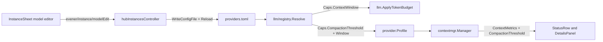

# Per-model settings and compaction thresholds

Date: 2026-11-12
Status: proposed (UI placement chosen by Jesse, 2026-11-12; awaiting spec approval)
Size: project (roughly 1,400 lines with tests across `llm/registry`, `agent`, `appwire`, `cmd/evener-hub`, `cmd/evener`, `appwire-client`, and `cmd/evener-hub/frontend`)

## Intent and why

Some models lose coherence well below their physical context limit. For example, `deepseek-4.1-flash` hallucinates past roughly 250K input tokens even when served with a 1M physical window. Operators need a durable, user-controllable setting to trigger automatic history compaction at 250K tokens for that model without shrinking its wire limit.

Lowering `context_window` cannot solve this problem. `llm.ApplyTokenBudget` (`llm/token_budget.go`) treats `context_window` as a hard wire ceiling: as input approaches `context_window`, it clamps `MaxTokens` down, and once input reaches `context_window`, it rejects the request before transmission with `ContextBudgetError("context_window")`. A single large tool output or a retained post-compaction verbatim tail at 260K tokens succeeds on a 1M-window endpoint when `context_window` stays 1M, and fails locally if `context_window` was faked to 250K.

At the same time, `providers.toml` already supports rich per-model capability and routing overrides under `[providers.<instance>.models."<id>"]` (`context_window`, `max_output_tokens`, `reasoning`, `default_effort`, `effort_values`, `input_modalities`, `tools`, `protocol`, `surface`, `thinking_format`, `thinking_shape`, `wire_id`, `alias_of`), while the web admin UI in `InstanceSheet` (`Settings -> Providers & credentials`) only exposes an enable/disable switch per model.

This design adds `compaction_threshold` (in tokens) to `registry.Caps` and extends the existing `Models` list inside `InstanceSheet` with summary facts, custom model creation, and an in-sheet drill-in model editor.

## Goals

- Add `compaction_threshold` (`*int`, token count) to `registry.Caps` across all catalog layers (`providers_overlay.toml`, provider defaults, model globs, `alias_of` inheritance, and exact `[providers.<instance>.models."<id>"]` rows in `providers.toml`).
- Trigger automatic session compaction (`contextmgr`) when estimated or measured input tokens reach `compaction_threshold`, while keeping `llm.ApplyTokenBudget` governed by physical `context_window`, `max_input_tokens`, and `max_output_tokens`.
- Preserve existing `Session.ContextStatus()` invariants (`pressure == float64(Used) / float64(Window)`, `Remaining == max(Window - Used, 0)`, and the two-allocation ceiling) while surfacing active compaction thresholds coherently in `StatusRow`, `DetailsPanel`, model-switch warnings, and unknown-window handling.
- Extend `InstanceSheet -> Models` in the web UI so users can inspect per-model summary facts, add custom uncatalogued gateway models, drill into a per-model editor within the same `Sheet`, view inherited values alongside their provenance, edit or reset per-field overrides, and remove custom-only model rows.
- Surface `compaction_threshold` in `evener models list` and `evener models inspect`.

## Non-goals

- Hot-reloading `providers.toml` into already-running `evener serve` daemon processes. Matching every other `providers.toml` edit, changes take effect on new session launches, cold session resumes, and mid-session model switches resolved against a reloaded registry.
- Rebuilding provider/model administration natively in `mobile-native`. Per project policy (`docs/product/subsystems.md` S03/S15), phone administration opens the responsive mobile web UI, where `InstanceSheet` renders as a bottom `Sheet`.
- Authoring wildcard `[models."<glob>"]` or `[providers.X.models."<glob>"]` rules from the web UI. Hand-authored globs in `providers.toml` remain supported and report `"glob"` provenance in the model editor; UI saves write exact `[providers.<instance>.models."<id>"]` entries.
- Exposing low-level wire-transform tables (`headers`, `cost`, `fields`, `chat_template_kwargs`, `finish_reason_map`, message-transform booleans) as form controls. Hand-authored values in those keys on the same model row remain intact across UI edits and resets.
- Proxying per-model writes to remote hosts over `evener/host/request`. Matching `evener/instance/setModelDisabled` and `evener/instance/refreshModels` (`appwire/host_request.go`), model detail reads and edits operate on the local controller hub's `providers.toml`.

## Anti-goals

- Persisting inherited catalog, overlay, or live values into `providers.toml` when the user did not edit them. Only user-authored overrides are written to disk.
- Failing `providers.toml` load when a provider-wide or glob `compaction_threshold` exceeds one smaller model's `context_window`, which would flip `writesRefused` and lock the user out of corrective edits in the UI.
- Stacking a second `Sheet` or modal editor over `InstanceSheet`, or showing two competing `Save` buttons simultaneously.

## Approaches considered

### UI placement and interaction

1. **Extend `InstanceSheet -> Models` with an in-sheet drill-in subview (chosen by Jesse).** Each provider connection (`lunaroute`, `kimi`, `groq3`, `oai-jrv`) already owns its model list, live refresh, search box, and `[providers.<name>.models."<id>"]` config entries inside `InstanceSheet`. Keeping the `[●]` enable `Switch` on the left of each row and adding summary facts plus a drill-in trigger on the right builds directly on the existing workflow. Transitioning `InstanceSheet` in place to the selected model's form (`← <instance>` at top, one `Save` button in the sheet footer) avoids stacked overlays and preserves search query, scroll offset, and unsaved connection drafts on return.
2. **Add a standalone `Settings -> Model catalog` navigation page (rejected).** Duplicates the per-connection model lists already inside `Providers & credentials` and adds an extra Settings destination for the same `providers.toml` entries.
3. **Expand an inline accordion inside `InstanceSheet`'s model list (rejected).** Cramps 10+ fields into a scrolling list and puts a per-row save control in visual competition with `InstanceSheet`'s sticky footer `Save` button.

### Compaction threshold representation and pressure math

1. **Absolute token count `compaction_threshold *int` on `registry.Caps`, scaling `contextmgr` layer fractions against `effectiveWindowOf(prof)` (chosen).** Operators discover degradation cliffs in tokens (`250000`). Keeping `ContextMetrics.Window` equal to the physical (or assumed) window preserves `Session.ContextStatus()` invariants (`pressure == Used / Window`) and `llm.ApplyTokenBudget` wire admission, while `contextmgr` scales its internal layer thresholds so Layer 1 checkpointing fires at exact `Used == compaction_threshold`.
2. **Reuse `context_window` as the compaction knob (rejected).** Causes `llm.ApplyTokenBudget` to clamp `MaxTokens` prematurely and reject valid requests above 250K with `ContextBudgetError`.
3. **Store a percentage float (`0.0` to `1.0`) per model (rejected).** Shifts the compaction point silently whenever a live listing updates `context_window` (for example from 512K to 1M) and cannot state a concrete token budget when `context_window` is unknown.

## Architecture and behavior



`providers.toml` remains the single durable source of truth. `hubInstancesController` serializes writes under its existing `lockMutation`, dry-parses through `registry.WriteConfigFile`, reloads the held `ProviderRegistry` (preserving cached live model listings and advancing the launch-model cache generation), and broadcasts `evener/auth/updated` post-commit. `llm.ApplyTokenBudget` continues reading `Caps.ContextWindow` for wire admission, while `provider.Profile` exposes `CompactionThreshold()` to `contextmgr.Manager` and session status projections.

### 1. Registry schema, inheritance, and validation (`llm/registry`)

- **Field:** Add `CompactionThreshold *int` (`toml:"compaction_threshold" json:"compaction_threshold,omitempty"`) to the model-facts block of `registry.Caps` (`llm/registry/types.go`).
- **Parse validation (`llm/registry/schema.go`):** Define `const MinCompactionThreshold = 4096`. In `validateCaps`, reject any non-nil `CompactionThreshold` below `MinCompactionThreshold` (`"%s: compaction_threshold must be at least %d tokens"`). Requiring `>= 4096` rejects non-positive numbers and catches unit-scale mistakes such as writing `250` when meaning `250000`.
- **Cloning, merging, and marshaling:**
  - `cloneCaps` (`llm/registry/load.go`) clones `CompactionThreshold` via `clonePointer`.
  - `mergeCaps` (`llm/registry/merge.go`) and `capsInto` (`llm/registry/write.go`) already reflect over pointer fields on `Caps`, so layer precedence (`snapshot/cache -> overlay -> live -> config provider -> config top-glob -> config provider-glob -> config exact row`), `Resolved.Provenance["CompactionThreshold"]`, and sparse TOML output work without special-case branches.
  - `seedFromAlias` (`llm/registry/resolve.go`) copies `CompactionThreshold: target.Caps.CompactionThreshold` into `facts` and preserves `target.Provenance["CompactionThreshold"]` when non-empty, matching `ContextWindow` provenance retention.
  - When a curated overlay alias row declares its own `CompactionThreshold` and `applyLive` matches the base model by `wire_id`, `applyLive` preserves the overlay row's `CompactionThreshold` under the same rule `overlayRowDeclaresWindow` applies to `ContextWindow`.
- **Cross-field clamping during resolution (`llm/registry/derive.go` / `resolve.go`):**
  - A provider default or glob may set `compaction_threshold = 250000` while one model under that provider has `context_window = 128000`. `ParseConfig` and `Load` accept this configuration so `providers.toml` remains loadable.
  - During resolution, when both `Caps.CompactionThreshold` (`T`) and `Caps.ContextWindow` (`W`) are non-nil and `*T >= *W`, derivation clears `Caps.CompactionThreshold` to `nil`, sets `prov["CompactionThreshold"] = "derived"`, and appends a diagnostic to `Resolved.Warnings` stating that `compaction_threshold` (`*T`) meets or exceeds `context_window` (`*W`) and was ignored.

### 2. Profile and `contextmgr` compaction math (`agent/provider`, `agent/internal/contextmgr`, `agent`)

- **`provider.Profile` (`agent/provider/profile.go`):**
  - Add `func (p *Profile) CompactionThreshold() int`. Returns `0` when `p == nil` or `p.res.Caps.CompactionThreshold == nil` or `*p.res.Caps.CompactionThreshold <= 0`. If `WithContextWindow` (`p.contextWindow > 0`) overrode the profile's window in a test or caller to a value `<= *p.res.Caps.CompactionThreshold`, `CompactionThreshold()` returns `0` so the override stays self-consistent. Otherwise returns `*p.res.Caps.CompactionThreshold`.
- **Unknown physical window with explicit `compaction_threshold` (`agent/internal/contextmgr/pressure.go`, `compact.go`):**
  - When `prof.ContextWindowSize() == 0` and `ct := prof.CompactionThreshold(); ct > 0`:
    - `effectiveWindowOf(prof)` returns `(max(AssumedContextWindow, int(math.Ceil(float64(ct)/defaultCheckpointThreshold))), true)`, where `defaultCheckpointThreshold = 0.80`. For `ct = 250000`, the assumed physical window becomes `312500` (`Assumed: true`), keeping `ct < Window` so `Remaining` and `pressure = Used / Window` remain well-formed past `ct`.
    - `discloseAssumedWindow` skips `WarningCodeContextWindowAssumed` because compaction is governed by the user's explicit `compaction_threshold`.
    - `unknownWindowTripwireFires` returns `false` when `prof.CompactionThreshold() > 0` so `UnknownWindowInputTripwire` (`200000`) never preempts a higher configured threshold such as `250000`.
- **Canonical layer thresholds (`agent/internal/contextmgr/pressure.go`):**
  - Introduce one unexported struct `layerThresholds { observationMask, thinkingClear, warn, checkpoint, summarize float64 }` and one method `(cm *Manager) thresholdsFor(prof *provider.Profile) layerThresholds` (plus exported readers `WarnThresholdFor(prof)` and `CheckpointThresholdFor(prof)` for `agent` package callers).
  - When `ct := prof.CompactionThreshold(); ct <= 0` or `cw <= 0` or `ct >= cw`: `thresholdsFor` returns the manager's five fields (`cm.ObservationMaskThreshold`, `cm.ThinkingClearThreshold`, `cm.WarnThreshold`, `cm.CheckpointThreshold`, `cm.SummarizeThreshold`) unchanged. Existing defaults, direct test field assignments (`cm.CheckpointThreshold = ...`), and `ApplyThresholdScale` retain identical behavior.
  - When `0 < ct < cw`:
    - Let `target := float64(ct) / float64(cw)` and `k := target / defaultCheckpointThreshold` (`0.80`).
    - `observationMask = cm.ObservationMaskThreshold * k`
    - `thinkingClear = cm.ThinkingClearThreshold * k`
    - `warn = cm.WarnThreshold * k` (at default `0.75`, fires at `93.75%` of `ct`, e.g. `234,375` tokens for `ct = 250,000`, giving the agent one clean-seam self-compaction nudge before checkpointing)
    - `checkpoint = cm.CheckpointThreshold * k` (at default `0.80`, equals `target`, firing Layer 1 checkpoint + pinned-note elicitation at exact `Used == ct`)
    - `summarize = min(cm.SummarizeThreshold * k, max(checkpoint, cm.SummarizeThreshold))` (at `ct = 250,000` on a `1M` window, equals `296,875` tokens; when `ct` is set above `80%` of `cw`, caps at `max(checkpoint, 0.95)` so Layer 2 stays below `cw` and never falls below `checkpoint`).
  - Every compaction gate reads `thresholdsFor(prof)`:
    - `MaybeCompact` (`compact.go`)
    - `SessionLogStrategy.ManageContext` (`strategy_session_log.go`, inherited by `OODAStrategy`)
    - `maybeElicitNoteBeforeCompaction` and `maybeNudgeSelfCompact` (`agent/session_self_compact.go`)
    - `SetModel` context-shrink warning (`agent/session.go`)
    - `maybeWarnContextUsage` (`agent/session_model_call.go`): warns at `ct` (or `0.8 * cw` when `ct == 0`) so pre-request usage warnings align with the active compaction threshold.

### 3. Session context status and chrome (`agent/schema`, `appwire`, `appwire-client`, `StatusRow`, `DetailsPanel`)

- **`schema.ContextMetrics` (`agent/schema/context_metrics.go`):**
  - Add `CompactionThreshold int` (`0` when unconfigured; `ct` when `0 < ct < Window`).
  - `EstimateStatus` (`pressure.go`) populates `CompactionThreshold` from the same `prof` snapshot with zero additional allocations. `Used`, `Window`, `Remaining`, and `pressure = float64(Used) / float64(Window)` keep their exact formulas (`TestContextStatusParityAcrossMutations`, `TestContextStatusAllocationBudget`, and `checkContextStatusInvariants` pass unchanged).
- **Wire and client state (`appwire/types_thread.go`, `appwire/types_models_nav.go`, `appwire-client/typescript`):**
  - Add `CompactionThreshold int` (`json:"compactionThreshold,omitempty"`) to `appwire.EvenerThread`, populated wherever `ContextWindow` and `ContextUsed` are projected from `Session.ContextStatus()`.
  - Add `CompactionThreshold *int` (`json:"compactionThreshold,omitempty"`) to `appwire.ModelDescriptor` (`model/list`), populated from `Resolved.Caps.CompactionThreshold`.
  - Run `make generate` so `appwire-client/typescript/types.gen.ts` picks up the wire fields, and thread `compactionThreshold` onto `ThreadModel` in the protocol reducer (`0` when absent).
- **Shared gauge calculation (`cmd/evener-hub/frontend/src/panes/session/chrome/statusFormat.ts`):**
  - `StatusRow` and `DetailsPanel` share one pure helper `effectiveContextStatus(model)` so both surfaces always report the same percentage and `Meter` tone (`statusFormat.ts`'s single-severity rule):
    - When `model.compactionThreshold > 0`: `ceiling = model.compactionThreshold`, `pressure = model.contextUsed / model.compactionThreshold`, `remaining = Math.max(0, model.compactionThreshold - model.contextUsed)`, `hasCustomThreshold = true`. At `200K / 250K`, `pressure` is `0.80` (`attention` amber); at `237.5K / 250K`, `pressure` is `0.95` (`danger`); at `250K / 250K` (`100%`), auto-compaction runs on the next request.
    - When `model.compactionThreshold <= 0`: returns today's `{ ceiling: model.contextWindow, pressure: model.contextPressure, remaining: Math.max(0, model.contextWindow - model.contextUsed), hasCustomThreshold: false }`.
  - **`StatusRow.tsx`:** Uses `effectiveContextStatus(model)` for its 64px `<Meter>`, percentage text, and accessible label (naming both the auto-compact threshold and the model's context window when `hasCustomThreshold` is true).
  - **`DetailsPanel.tsx`:** Uses `effectiveContextStatus(model)` for the `Context` row's `<Meter>` and readout: when `hasCustomThreshold` is true, renders `80% of 250K compact · 200K used · 50K left (1M window)` (with `~` on the window when `contextAssumed` is true); when false, renders today's output unchanged.

### 4. Hub RPCs and `providers.toml` persistence (`appwire`, `cmd/evener-hub`)

All new RPCs are `ScopeHub` and remain absent from `hostRequestMethods` (`appwire/host_request.go`), matching `evener/instance/setModelDisabled` and `evener/instance/refreshModels`.

1. **Enriched list summary (`appwire.InstanceModelEntry` in `appwire/types_auth_commands.go`):**
   ```go
   type InstanceModelEntry struct {
       ID                  string `json:"id"`
       Disabled            bool   `json:"disabled,omitempty"`
       Customized          bool   `json:"customized,omitempty"`
       ContextWindow       *int   `json:"contextWindow,omitempty"`
       CompactionThreshold *int   `json:"compactionThreshold,omitempty"`
   }
   ```
   - `instanceModels` (`cmd/evener-hub/app_instances.go`) resolves each listed ID via `r.ResolveInstanceModelFacts(name, id)` (network-free, credential-free) to populate `ContextWindow` and `CompactionThreshold`, and sets `Customized: true` when the user layer (`providers.toml`) has an authored entry `l.Providers[name].Models[id]` with any non-`Disabled` field set.

2. **Single-model detail read (`evener/instance/modelGet`):**
   - `InstanceModelGetParams`: `{ Name string, Model string }`.
   - `InstanceModelDetailResponse`:
     - `Name string`, `Model string`
     - `Disabled bool`
     - `AuthoredOnly bool` (true when `Model` exists only in `l.Providers[name].Models` and is absent from upstream snapshot/cache, curated overlay, and cached live listing for `name`)
     - `Effective InstanceModelEffective`: `{ ContextWindow *int, CompactionThreshold *int, MaxOutputTokens *int, Reasoning *bool, DefaultEffort string, EffortValues []string, InputModalities []string, Tools *bool, Protocol string, Surface string, ThinkingFormat string, ThinkingShape string, WireID string, AliasOf string }`
     - `Provenance map[string]string`: per-field normalized source label (`"catalog"` for snapshot/cache, `"overlay"`, `"live"`, `"provider"`, `"glob"`, `"alias"`, `"derived"`, `"config"`)
     - `Authored InstanceModelAuthored`: exact overrides present on `l.Providers[name].Models[model]` (`nil` pointers / empty strings when unset on that exact row)
     - `HasOverrides bool`: true when `l.Providers[name].Models[model]` sets any UI-editable override (excluding `Disabled`)
     - `ThinkingFormats []string`: sorted vocabulary from `registry.ThinkingFormats()` so the UI never hardcodes a stale dialect list
     - `Warnings []string`: `Resolved.Warnings`
   - Acquires `c.mu.RLock()` and reads the held registry plus `c.read()`. Works while `WritesRefused` is true (using the last good registry, with `Authored` empty if `providers.toml` currently fails to parse). Refuses unknown instances, glob IDs, or unresolvable unknown models with `appwire.InvalidParams`.

3. **Single-model mutation (`evener/instance/modelEdit`):**
   - `InstanceModelEditParams`:
     - `Name string`, `Model string`
     - `Create bool` (true from `+ Add custom model`: refuses if `Model` is already listed in `InstanceModels(name)`)
     - `RemoveCustom bool` (deletes `l.Providers[name].Models[model]`; refused unless `AuthoredOnly` is true)
     - `ResetAll bool` (clears all UI-editable capability/routing fields on `l.Providers[name].Models[model]`, keeping `Disabled` and any non-UI hand-authored fields)
     - Explicit set/clear pairs matching `InstanceEditParams`'s v4 convention (`CompactionThreshold *int` + `ClearCompactionThreshold bool`, `ContextWindow *int` + `ClearContextWindow bool`, `MaxOutputTokens *int` + `ClearMaxOutputTokens bool`, `Reasoning *bool` + `ClearReasoning bool`, `DefaultEffort string` + `ClearDefaultEffort bool`, `EffortValues []string` + `ClearEffortValues bool`, `InputModalities []string` + `ClearInputModalities bool`, `Tools *bool` + `ClearTools bool`, `Protocol string` + `ClearProtocol bool`, `Surface string` + `ClearSurface bool`, `ThinkingFormat string` + `ClearThinkingFormat bool`, `ThinkingShape string` + `ClearThinkingShape bool`, `WireID string` + `ClearWireID bool`, `AliasOf string` + `ClearAliasOf bool`)
     - `ExpectedEndpointFingerprint string` (verified via `verifyEndpointFingerprint` so a concurrent re-point or same-name instance replacement refuses the write with an endpoint conflict)
     - `OriginClientId string` (echoed into `evener/auth/updated` post-commit broadcast)
   - `InstanceModelEditResponse`: `{ List InstanceListResponse, Detail *InstanceModelDetailResponse }`, captured atomically under the same `lockMutation` hold so both the credentials store and the open model editor settle from one authoritative snapshot.
   - **Exact-row targeting and preservation:**
     - Refuses empty or glob (`*`) `Model` IDs with `appwire.InvalidParams`.
     - Writes capability and routing fields onto `p.Models[model]` (the exact model ID, never redirected through `AliasTarget`, because alias rows such as `claude-opus-4-5[1m]` or `gpt-6.1-sol-1m` exist specifically to carry distinct windows and thresholds from their base rows).
     - Shadows an implicit instance with `registry.Provider{ID: name}` when `l.Providers[name]` does not yet exist, matching `SetModelDisabled`.
     - Mutates only the fields named in `InstanceModelEditParams`. Hand-authored non-UI fields on `p.Models[model]` (`Headers`, `Transport`, `Cost`, `Fields`, `ChatTemplateKwargs`, `FinishReasonMap`, message-transform flags, `Family`) remain untouched.
     - On `ResetAll` or per-field clears on a non-`AuthoredOnly` model, if the resulting `registry.Model` has zero authored fields (`isZeroModelRow`), deletes `p.Models[model]` so `providers.toml` retains no empty `[providers.X.models."Y"]` table.
     - Validates via `writeAndReload(before, l, name, "edit model")`. Additionally, when `row.Caps.CompactionThreshold != nil` and the reloaded `ResolveInstanceModelFacts(name, model)` reports `ContextWindow != nil` with `*row.Caps.CompactionThreshold >= *resolvedWindow` (i.e. derivation clamped the just-authored threshold), `EditModel` restores `before`, reloads, resets `applied`, and returns `appwire.InvalidParams` naming both limits so single-model edits fail fast with a clear form error.

### 5. Web UI (`cmd/evener-hub/frontend/src/panes/settings/sections/credentials`)

All controls compose strictly from barrelled `src/widgets` (`Sheet`, `Switch`, `Button`, `Chip`, `FormRow`, `Input`, `Select`, `SegmentedControl`, `Disclosure`, `InlineNotice`, `ConfirmDialog`, `Skeleton`, `Loader`) and CSS custom properties from `src/styles/tokens.css`, introducing zero new widgets or widget props.

1. **`InstanceSheet` overview `Models` section:**
   - Header action row renders `Refresh live models` (`Button variant="quiet"`) alongside `+ Add custom model` (`Button variant="quiet"`, hidden when `instance.auth === "oauth-openai-codex"`, disabled when `busy || writesRefused`).
   - Each model row renders as a two-part flex row:
     - Left: existing `<Switch label={row.id} checked={!row.disabled} pending={...} disabled={busy || writesRefused} onChange={...} />`, preserving existing keyboard/switch behavior and accessible name.
     - Right: `<Chip kind="customized">customized</Chip>` (default `neutral` tone) when `row.customized` is true, compact summary text (`1M ctx · compact 250K` using `formatTokenCount` from `@evener/appwire-client`), and `<Button variant="quiet" size="sm" aria-label={`Configure ${row.id}`} onClick={...}>Configure ›</Button>`.
   - Clicking `Configure ›` or `+ Add custom model` while `renameGap` is active calls `refuseDuringRename()`.

2. **In-sheet drill-in subview (`InstanceModelEditor`):**
   - `InstanceSheet` holds `activeModelView: { mode: "edit"; model: string } | { mode: "create" } | null`.
   - While `activeModelView !== null`:
     - `Sheet` `title` becomes `${instance.name} / ${activeModelView.model}` (or `${instance.name} / Add model` in `create` mode).
     - `Sheet` `footer` renders the model form's `Save` button (`disabled={!modelDirty || writesRefused}`, `aria-disabled={modelBusy}`).
     - `InstanceSheet`'s own connection `draft`, `modelSearch`, and overview scroll offset stay retained in React state/refs so clicking `<Button variant="link" onClick={backToOverview}>← {instance.name}</Button>` restores the overview immediately without discarding unsaved connection edits.
     - Switching to a different instance or closing `InstanceSheet` resets `activeModelView` to `null`. Across an instance rename, `activeModelView` resets before save because model drill-in is disabled while `busy` or `renameGap`.
   - **Loading and concurrency:**
     - Opening `mode: "edit"` fetches `evener/instance/modelGet({ name: instance.name, model })` (showing `<Skeleton />` until settled, or `<InlineNotice tone="danger">` with `Retry` on failure).
     - Draft baseline tracks `seededIdentity(instance)` and `instance.endpointFingerprint` (`expectedEndpointFingerprint`), matching `InstanceSheet.handleSave`: if another client replaces or re-points the instance while the model subview is open, `Save` refuses the stale write, surfaces the conflict notice, and re-anchors to the current entry.
     - Untouched fields follow external `evener/auth/updated` refreshes; touched fields retain the user's draft.
   - **Token count parsing (`parseTokenCount` in `@evener/appwire-client`):**
     - Accepts positive integers (`250000`), comma separators (`250,000`), and case-insensitive `K` (`* 1,000`) or `M` (`* 1,000,000`) suffixes (`250k` -> `250000`, `1.5m` -> `1500000`). Rejects non-positive, fractional-token, or unparseable strings inline via `FormRow` `error` before sending an RPC.
   - **Fields and grouping:**
     - **Model ID** (`mode === "create"` only): `FormRow` + `Input` (required, non-empty, no `*`).
     - **Availability & context:**
       - `Enabled` (`Switch`, `edit` mode only, wired to `onToggleModel`).
       - `Auto-compact threshold`: `FormRow` + `Input` + inline `<Button variant="link" onClick={...}>Reset</Button>` when authored. Placeholder displays the effective default (`Default: 800K (80% of 1M window)` or inherited value + provenance source). Client-side validation checks `>= 4096` and `< effectiveContextWindow` (comparing against drafted `Context window` when set, else inherited `Effective.ContextWindow`).
       - `Context window`: `FormRow` + `Input` + `Reset` when authored; placeholder shows inherited value + provenance (`1,048,576 (live)` or `Unknown (assumes 128K)`).
       - `Max output tokens`: `FormRow` + `Input` + `Reset` when authored; placeholder shows inherited value + provenance.
     - **Capabilities & reasoning:**
       - `Reasoning`: `FormRow` (group mode) + `SegmentedControl` (`Inherited (On/Off)`, `On`, `Off`).
       - `Default effort`: `FormRow` + `Select` (`Inherited (...)`, `none (off)`, `minimal`, `low`, `medium`, `high`, `xhigh`, `max`).
       - `Allowed effort levels`: `FormRow` (group mode) + toggleable `<Button size="xs" variant={selected ? "secondary" : "quiet"} aria-pressed={selected}>` pills for `none`, `minimal`, `low`, `medium`, `high`, `xhigh`, `max`, plus `Reset` when authored.
       - `Input modalities`: `FormRow` (group mode) + `Switch` controls for `Image` and `PDF` (preserving `"text"` and any non-UI modality strings present on the effective/authored list), plus `Reset` when authored.
       - `Tool calling`: `FormRow` + `Select` (`Inherited (...)`, `Supported`, `Unsupported`).
     - **Routing & wire overrides:** Controlled `Disclosure` (`summary="Routing & wire overrides"`), defaulting open when `mode === "create"` or any routing/wire field is authored:
       - `Protocol` (`Select`: `Inherited (...)`, `openai-chat`, `openai-responses`, `anthropic`, `google`)
       - `Surface` (`Select`: `Inherited (...)`, `openai`, `anthropic`, `google`, `generic`)
       - `Thinking format` (`Select`: `Inherited (...)`, options from `detail.thinkingFormats`)
       - `Thinking shape` (`Select`: `Inherited (...)`, `adaptive`, `budget`, `budget+effort`, `level`)
       - `Wire model ID` (`Input` + `Reset`)
       - `Alias of` (`Input` + `Reset`)
     - **Reset and custom removal:**
       - Header bar offers `Reset all overrides` (`Button variant="quiet" size="sm"`) when `detail.hasOverrides` is true, calling `evener/instance/modelEdit` with `ResetAll: true`.
       - When `detail.authoredOnly` is true, a divider at the bottom exposes `Remove custom model` (`Button variant="dangerQuiet"`) gated by `ConfirmDialog`, calling `RemoveCustom: true` and returning to the instance overview on success.

### 6. CLI and evergreen documentation (`cmd/evener/models.go`, `docs/`)

- **`cmd/evener/models.go`:**
  - `evener models inspect <instance/model>` automatically serializes `caps.compaction_threshold` and `provenance.CompactionThreshold` through `registry.Resolved`.
  - `evener models list` appends `compact=<N>` to the `NOTES` column whenever `res.Caps.CompactionThreshold != nil` (preserving existing column headers and tab order).
- **Evergreen docs updated in the same change:**
  - `docs/llm-providers.md`: document `compaction_threshold` under `providers.toml` per-model keys and explain how it differs from `context_window`.
  - `docs/product/subsystems.md`: update **S15** / **S16** / **S02** rows to record `InstanceSheet` per-model overrides, `evener/instance/modelGet` + `modelEdit`, and `compaction_threshold` ownership.
  - `docs/design/context.md`: document per-model `CompactionThreshold` scaling alongside `CheckpointThreshold`, `WarnThreshold`, and `SummarizeThreshold`.

## Recovery, preservation, and version skew

- **Broken `providers.toml` recovery:** While `WritesRefused` is true, `InstanceSheet` keeps `evener/instance/modelGet` inspectable against the last good registry while disabling `Save`, `Reset all overrides`, `+ Add custom model`, and `Remove custom model` until the external syntax error is repaired. An invalid edit proposed through `modelEdit` fails dry-parse or `Reload()` rollback inside `writeAndReload`, restoring the prior `providers.toml` bytes so the UI never locks itself out.
- **Hand-authored TOML preservation:** `EditModel` mutates only the targeted fields on `l.Providers[name].Models[model]`. Unexposed fields (`headers`, `cost`, `fields`, `chat_template_kwargs`, transport overrides) survive edits and `ResetAll`, and empty-row cleanup runs only when the entire `registry.Model` struct is zero.
- **Concurrent client edits:** `ExpectedEndpointFingerprint` guards against instance replacement/re-pointing under the same name; `OriginClientId` prevents self-echo refetches while keeping cross-tab convergence live.
- **Version skew (`docs/product/README.md#compatibility`):**
  - *Hub and older daemon:* `compaction_threshold` in `providers.toml` is a new key in schema 2; an already-running older daemon keeps its startup private copy of `providers.toml` (S15) and never re-parses the live file until exit. Upgrading the binary before launching new daemons is the normal rollout path.
  - *Web client and older hub:* If an older hub lacks `evener/instance/modelGet`, the drill-in view catches the unsupported-method RPC error and renders an `InlineNotice` explaining that the connected hub must be updated to edit per-model settings, while leaving `InstanceSheet`'s existing fields and enable/disable switches usable.
  - *On-disk state:* `compaction_threshold` is an optional integer in `providers.toml`; unset rows write nothing. No migration or compatibility shim is needed.

## Whole-journey test plan

All tests assert observable behavior without checking error or UI copy (`docs/developing-evener/testing.md`), and run deterministically with no live network calls:

1. **`llm/registry` unit and golden tests:**
   - Parse and round-trip `compaction_threshold` via `ParseConfig` / `MarshalConfig` / `WriteConfigFile` at provider, top-glob, provider-glob, and exact-row levels; verify nil writes nothing.
   - Reject `compaction_threshold <= 0` and `< 4096` at parse time; accept `>= 4096`.
   - Verify layer precedence (`config/row` beats `live`, `config/glob`, `overlay`), `seedFromAlias` inheritance + provenance retention, `applyLive` preservation when an overlay alias declares `compaction_threshold`, and derivation clamping + warning when `compaction_threshold >= context_window` without failing `Load`.
2. **`agent/provider` and `agent/internal/contextmgr` tests:**
   - With `ContextWindow = 1_000_000` and `CompactionThreshold = 250_000`: verify `llm.ApplyTokenBudget` still admits a `300_000`-token request without `ContextBudgetError` and without clamping `MaxTokens` against `250_000`.
   - Verify `MaybeCompact` and `SessionLogStrategy` / `OODAStrategy` hold off below `250_000`, trigger `WarnThreshold` self-compact nudge above `234_375`, run Layer 1 checkpoint + note elicitation at `250_000`, and run Layer 2 summarize at `296_875`; verify `compaction_threshold > 0.80 * ContextWindow` (e.g. `900_000` on `1_000_000`) delays compaction until `900_000` while keeping `Summarize <= 0.95 * ContextWindow`.
   - With unknown `ContextWindow` (`0`) and `CompactionThreshold = 250_000`: verify `UnknownWindowInputTripwire` (`200_000`) does not fire at `210_000`, `WarningCodeContextWindowAssumed` is not emitted, compaction fires at `250_000`, and `checkContextStatusInvariants` + `TestContextStatusAllocationBudget` hold across all states.
   - Verify `Session.SetModel` emits a context-shrink warning on the switch marker when switching to a model whose `CompactionThreshold` is exceeded by current history.
3. **`cmd/evener-hub` and `cmd/evener` integration tests:**
   - End-to-end RPC journey: `evener/instance/list` -> `evener/instance/modelGet` -> `evener/instance/modelEdit` (setting `compaction_threshold = 250000`, `protocol = "openai-chat"`, `input_modalities = ["text", "image"]` on an implicit and an explicit instance) -> verify `providers.toml` bytes on disk, live-listing survival across reload, `launchModels` / `model/list` reflecting the updated `compactionThreshold` and `supportsVision`, and `evener/auth/updated` broadcast carrying `OriginClientId`.
   - Verify hand-authored `headers` and `cost` on `[providers.X.models."Y"]` survive both targeted `modelEdit` and `ResetAll`, and verify clearing the last override on a catalogued model deletes the empty model table from `providers.toml`.
   - Verify `Create: true`, `AuthoredOnly` detection, `RemoveCustom: true` refusal on catalogued rows, single-row `compaction_threshold >= context_window` refusal + rollback, and `ExpectedEndpointFingerprint` conflict refusal.
   - Verify `evener models list` and `evener models inspect` output with `compaction_threshold` configured.
4. **Frontend (`appwire-client` and `cmd/evener-hub/frontend`) tests:**
   - Unit tests for `parseTokenCount` (`250000`, `250,000`, `250k`, `1.5M`, invalid inputs) and `effectiveContextStatus` across `StatusRow.test.tsx` and `DetailsPanel.test.tsx` (verifying identical tone and percentage on both surfaces when `compactionThreshold` is set vs unset).
   - Component/integration tests on `InstanceSheet`: summary chips and `Configure` action on model rows; drilling into a model, inspecting inherited placeholders and provenance, editing `Auto-compact threshold` (`250k`), saving, resetting individual fields and `Reset all overrides`, adding and removing a custom model, preserving unsaved connection fields and `modelSearch` across `← <instance>` Back navigation, and respecting `writesRefused` and `renameGap`.
   - Run `node scripts/ds-audit.mjs` and `make test-web` to verify zero raw-element or token-contract regressions.
