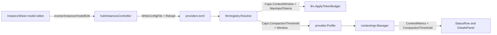

# Per-model settings and compaction thresholds

Date: 2026-11-12
Status: approved for planning and subagent-driven execution (Jesse, 2026-11-12)
Size: project (roughly 1,450 lines with tests across `llm/registry`, `llm`, `agent`, `appwire`, `cmd/evener-hub`, `cmd/evener`, `appwire-client`, and `cmd/evener-hub/frontend`)

## Intent and why

Some models lose coherence well below their physical context limit. For example, `deepseek-4.1-flash` hallucinates past roughly 250K input tokens even when served with a 1M physical window. Operators need a durable, user-controllable setting to trigger automatic history compaction at 250K tokens for that model while keeping its full wire limit intact.

Lowering `context_window` cannot solve this problem. `llm.ApplyTokenBudget` (`llm/token_budget.go`) treats `context_window` as a hard wire ceiling: as input approaches `context_window`, it clamps `MaxTokens` down, and once input reaches `context_window`, it rejects the request locally with `ContextBudgetError("context_window")`. A single large tool output or a retained post-compaction verbatim tail at 260K tokens succeeds on a 1M-window endpoint when `context_window` stays 1M, and fails locally if `context_window` was faked to 250K.

At the same time, `providers.toml` already supports rich per-model capability and routing overrides under `[providers.<instance>.models."<id>"]` (`context_window`, `max_output_tokens`, `reasoning`, `default_effort`, `effort_values`, `input_modalities`, `tools`, `protocol`, `surface`, `thinking_format`, `thinking_shape`, `wire_id`, `alias_of`), while the web admin UI in `InstanceSheet` (`Settings -> Providers & credentials`) only exposes an enable/disable switch per model.

This design adds `compaction_threshold` (in tokens) to `registry.Caps` and extends the existing `Models` list inside `InstanceSheet` with summary facts, custom model creation, and an in-sheet drill-in model editor.

## Goals

- Add `compaction_threshold` (`*int`, token count) to `registry.Caps` across all catalog layers (`providers_overlay.toml`, provider defaults, model globs, `alias_of` inheritance, and exact `[providers.<instance>.models."<id>"]` rows in `providers.toml`).
- Trigger automatic session compaction (`contextmgr`) when estimated or measured input tokens reach `compaction_threshold`, while keeping `llm.ApplyTokenBudget` governed by physical `context_window`, `max_input_tokens`, and `max_output_tokens`.
- Preserve existing `Session.ContextStatus()` invariants (`pressure == float64(Used) / float64(Window)`, `Remaining == max(Window - Used, 0)`, parity with `SessionMeta` and `TurnModelSwitch`, and the two-allocation ceiling) while surfacing active compaction thresholds coherently in `StatusRow`, `DetailsPanel`, mid-session `ModelSwitch` updates, model-switch markers, and unknown-window handling.
- Extend `InstanceSheet -> Models` in the web UI so users can inspect per-model summary facts, add custom uncatalogued models, drill into a per-model editor within the same `Sheet`, view inherited values alongside their provenance, edit or reset per-field overrides, and remove custom-only model rows.
- Surface `compaction_threshold` in `evener models list` and `evener models inspect`.

## Non-goals

- Hot-reloading `providers.toml` into already-running `evener serve` daemon processes. Each `evener serve` daemon loads `providers.toml` once at startup and holds that snapshot across turns and mid-session model switches; edits to `providers.toml` apply to new session launches and cold session resumes (which spawn a fresh daemon).
- Rebuilding provider/model administration natively in `mobile-native`. Per project policy (`docs/product/subsystems.md` S03/S15), phone administration opens the responsive mobile web UI, where `InstanceSheet` renders as a bottom `Sheet`.
- Authoring wildcard `[models."<glob>"]` or `[providers.X.models."<glob>"]` rules from the web UI. Hand-authored globs in `providers.toml` remain supported and report `"glob"` provenance in the model editor; UI saves write exact `[providers.<instance>.models."<id>"]` entries.
- Exposing low-level wire-transform tables (`headers`, `cost`, `fields`, `chat_template_kwargs`, `finish_reason_map`, message-transform booleans) as form controls. Hand-authored values in those keys on the same model row remain intact across UI edits and resets.
- Proxying per-model writes to remote hosts over `evener/host/request`. Matching `evener/instance/setModelDisabled` and `evener/instance/refreshModels` (`appwire/host_request.go`), model detail reads and edits operate on the local controller hub's `providers.toml`.

## Anti-goals

- Persisting inherited catalog, overlay, or live values into `providers.toml` when the user did not edit them. Only user-authored overrides are written to disk.
- Failing `providers.toml` load when a provider-wide or glob `compaction_threshold` exceeds one smaller model's `context_window` or `max_input_tokens`, which would flip `writesRefused` and lock the user out of corrective edits in the UI.
- Leaving empty `[providers.<name>.models."<id>"]` or bare implicit-shadow `[providers.<name>]` tables in `providers.toml` after overrides are cleared.
- Stacking a second `Sheet` over `InstanceSheet` or showing two competing `Save` buttons simultaneously.

## Approaches considered

### UI placement and interaction

1. **Extend `InstanceSheet -> Models` with an in-sheet drill-in subview (chosen by Jesse).** Each provider connection (`lunaroute`, `kimi`, `groq3`, `oai-jrv`) already owns its model list, live refresh, search box, and `[providers.<name>.models."<id>"]` config entries inside `InstanceSheet`. Keeping the `[●]` enable `Switch` on the left of each row and adding summary facts plus a drill-in trigger on the right builds directly on the existing workflow. Transitioning `InstanceSheet` in place to the selected model's form (`← <instance>` at top, one `Save` button in the sheet footer) avoids stacked sheets and preserves search query, scroll offset, and unsaved connection drafts on return.
2. **Add a standalone `Settings -> Model catalog` navigation page (rejected).** Duplicates the per-connection model lists already inside `Providers & credentials` and adds an extra Settings destination for the same `providers.toml` entries.
3. **Expand an inline accordion inside `InstanceSheet`'s model list (rejected).** Cramps 10+ fields into a scrolling list and puts a per-row save control in visual competition with `InstanceSheet`'s sticky footer `Save` button.

### Compaction threshold representation and pressure math

1. **Absolute token count `compaction_threshold *int` on `registry.Caps`, deriving `contextmgr` layer fractions against `EffectiveWindow(prof)` (chosen).** Operators discover degradation cliffs in tokens (`250000`). Keeping `ContextMetrics.Window` equal to the physical (or assumed) window preserves `Session.ContextStatus()` invariants (`pressure == Used / Window`) and `llm.ApplyTokenBudget` wire admission, while `contextmgr` computes per-profile layer fractions (`warn`, `checkpoint`, `summarize`) so Layer 1 checkpointing fires at exact `Used == compaction_threshold`.
2. **Reuse `context_window` as the compaction knob (rejected).** Causes `llm.ApplyTokenBudget` to clamp `MaxTokens` prematurely and reject valid requests above 250K with `ContextBudgetError`.
3. **Store a percentage float (`0.0` to `1.0`) per model (rejected).** Shifts the compaction point silently whenever a live listing updates `context_window` (for example from 512K to 1M) and cannot state a concrete token budget when `context_window` is unknown.

## Architecture and behavior



`providers.toml` remains the single durable source of truth. `hubInstancesController` serializes writes under its existing `lockMutation`, dry-parses through `registry.WriteConfigFile`, reloads the held `ProviderRegistry` (preserving cached live model listings and advancing the launch-model cache generation), and broadcasts `evener/auth/updated` post-commit. `llm.ApplyTokenBudget` continues reading `Caps.ContextWindow` and `Caps.MaxInputTokens` for wire admission, while `provider.Profile` exposes `CompactionThreshold()` to `contextmgr.Manager` and session status projections.

### 1. Registry schema, summaries, provenance, and validation (`llm/registry`, `llm`)

- **Field and shared ceiling helper (`llm/registry/types.go`, `llm/token_budget.go`):**
  - Add `CompactionThreshold *int` (`toml:"compaction_threshold" json:"compaction_threshold,omitempty"`) to the model-facts block of `registry.Caps`.
  - Extract the smaller-positive-input-ceiling logic from `tokenSafetyReserve` (`llm/token_budget.go:81-88`) onto `func (c Caps) InputCeiling() int` in `llm/registry/types.go` (`0` when both `ContextWindow` and `MaxInputTokens` are nil/non-positive; otherwise the smaller positive value), and call `c.InputCeiling()` from `tokenSafetyReserve`, `derive`, and `Profile.CompactionThreshold()`.
- **Parse validation and vocabularies (`llm/registry/schema.go`):**
  - Define `const MinCompactionThreshold = 4096` and `const MaxTokenLimit = math.MaxInt32` (`2_147_483_647`).
  - In `validateCaps`, reject any non-nil `CompactionThreshold` outside `[MinCompactionThreshold, MaxTokenLimit]`, and cap `ContextWindow`, `MaxInputTokens`, and `MaxOutputTokens` at `<= MaxTokenLimit`. Requiring `compaction_threshold >= 4096` rejects non-positive numbers and catches unit-scale mistakes such as writing `250` when meaning `250000`.
  - Export `func ThinkingShapes() []string` alongside `ThinkingFormats()` (`llm/registry/schema.go:517`) so callers read the canonical sorted `thinkingShapes` vocabulary directly.
- **Cloning, merging, alias seeding, and row scalar provenance:**
  - `cloneCaps` (`llm/registry/load.go`) clones `CompactionThreshold` via `clonePointer`.
  - Retain the parsed user `*Layer` on `Registry` during `loadUserLayer` (`llm/registry/load.go`) and expose cloned read-only accessors `AuthoredProvider(name string) (Provider, bool)` and `AuthoredModel(name, model string) (Model, bool)` so hub read paths (`listLocked`, `modelGet`) read the in-memory user layer with zero redundant `os.ReadFile` / `ParseConfig` I/O.
  - `mergeCaps` (`llm/registry/merge.go`) and `capsInto` (`llm/registry/write.go`) reflect over pointer fields on `Caps`, so layer precedence (`snapshot/cache -> overlay -> live -> config/provider -> config/glob -> config/row`), `Resolved.Provenance["CompactionThreshold"]`, and sparse TOML output work automatically (`liveFacts` in `resolve.go` does not populate `CompactionThreshold`, so live `/models` responses never overwrite curated or user thresholds).
  - `seedFromAlias` (`llm/registry/resolve.go`) copies `CompactionThreshold: target.Caps.CompactionThreshold` into `facts` and preserves `target.Provenance["CompactionThreshold"]` when non-empty, matching `ContextWindow` provenance retention.
  - `applyRowScalars` and `resolveLayersModeLive` (`llm/registry/resolve.go`) record `prov["Protocol"]`, `prov["WireID"]`, and `prov["AliasOf"]` alongside `Surface`, `Family`, and `Disabled` (initializing `prov["Protocol"]` from the provider layer that supplied `rec.head.Protocol` when no model row overrides it).
  - Expose `func (r *Registry) CheckAliasTarget(instance, model, aliasOf string) error` backed by `r.aliasTargetRow` (`llm/registry/resolve.go:976`) and `validateRecord`'s one-hop rules (`llm/registry/load.go:878`) so the hub validates `alias_of` edits in memory through the single owner of alias semantics.
- **Cross-field clamping during resolution (`llm/registry/derive.go`, `resolve.go`):**
  - A provider default or glob may set `compaction_threshold = 250000` while one model under that provider has `context_window = 128000` or `max_input_tokens = 200000`. `ParseConfig` and `Load` accept this configuration so `providers.toml` stays loadable.
  - Update `derive` (`llm/registry/derive.go`) to return `warnings []string`, appended onto `warnings` in `resolveLayersModeLive` (`llm/registry/resolve.go`). When `c.CompactionThreshold != nil` and `ceiling := c.InputCeiling(); ceiling > 0 && *c.CompactionThreshold >= ceiling`, `derive` clears `c.CompactionThreshold` to `nil`, sets `prov["CompactionThreshold"] = "derived"`, and returns a warning naming both limits.
- **Fast scalar inventory summary and `AuthoredOnly` ownership (`llm/registry/types.go`, `resolve.go`):**
  - Extend `registry.InstanceModel` (`llm/registry/types.go:260`) with `{ ID string, Disabled bool, AuthoredOnly bool, Customized bool, ContextWindow *int, CompactionThreshold *int }` and expose `func (r *Registry) IsAuthoredOnlyModel(instance, model string) bool`.
  - Inside `(*Registry).InstanceModels(instance)` (`llm/registry/resolve.go:1664`), snapshot the live row map once under `r.liveMu.RLock()` (avoiding O(M² log M) `LiveModels` slice clones/sorts) and compute `{ Disabled, ContextWindow, CompactionThreshold }` via a lightweight non-reflection scalar replay (`modelSummary`, modeled on `modelDisabled` at `resolve.go:1475`, replaying only `Disabled`, `ContextWindow`, `MaxInputTokens`, and `CompactionThreshold` + `InputCeiling` clamp, skipping `ResolveInstanceModelFacts`'s reflection, `buildTransport`, and `firstPartyEndpoint` URL parsing across 900+ rows).
  - Compute `AuthoredOnly` inside `llm/registry` using the same candidate-ID rules as `modelIDs` (`resolve.go:1734`) with `LayerConfig` excluded: `AuthoredOnly` is `true` iff `r.userLayer` has exact `Providers[instance].Models[id]` AND `id` is absent from non-`LayerConfig` visible IDs on `rec` (`LayerOverlay` + live map when live rows exist; all non-`LayerConfig` layers on `rec` when no live rows exist). `Customized` is `true` when `AuthoredOnly` holds OR the authored `Model` row sets any field other than `ID` and `Disabled`.

### 2. Profile and `contextmgr` compaction math (`agent/provider`, `agent/internal/contextmgr`, `agent`)

- **`provider.Profile` (`agent/provider/profile.go`):**
  - Add `func (p *Profile) CompactionThreshold() int`. Returns `0` when `p == nil || p.rowFactsInherited || p.res.Caps.CompactionThreshold == nil || *p.res.Caps.CompactionThreshold <= 0`, or when `ceiling := p.res.Caps.InputCeiling(); ceiling > 0 && *p.res.Caps.CompactionThreshold >= ceiling`. Otherwise returns `*p.res.Caps.CompactionThreshold`.
- **Single window authority and unknown-window gating (`agent/internal/contextmgr/pressure.go`, `compact.go`, `agent/context_metrics.go`):**
  - Export `func EffectiveWindow(prof *provider.Profile) (window int, assumed bool)` in `contextmgr` (`effectiveWindowOf` calls it), using `DefaultCompactAt` (`0.90`):
    - When `prof == nil`: returns `(0, false)`.
    - When `cw := prof.ContextWindowSize(); cw > 0`: returns `(cw, false)`.
    - When `ct := prof.CompactionThreshold(); ct > 0`: returns `(max(AssumedContextWindow, int(math.Ceil(float64(ct)/DefaultCompactAt))), true)`. For `ct = 250000`, the derived window is `277778` (`Assumed: true`), keeping `ct < Window` so `Remaining` and `pressure = Used / Window` stay well-formed past `ct`.
    - Otherwise: returns `(AssumedContextWindow, true)` (`128000`).
  - Update `budgetingWindow(profile)` in `agent/context_metrics.go` to read `window, _ := contextmgr.EffectiveWindow(profile)` so `Session.ContextStatus()`, `Session.Meta()` (`meta.json`), and `TurnModelSwitch.ModelSwitch` all report the exact same `ContextWindow`.
  - Update `assumptionStillGoverns(captured, current)` (`compact.go:257`) to include `&& current.CompactionThreshold() == 0`, and route `discloseAssumedWindow`, `claimAssumedWindowDisclosure`, and `unknownWindowTripwireFires` (`compact.go:195, 220, 239`) through `assumptionStillGoverns`: an explicit `compaction_threshold` suppresses both `WarningCodeContextWindowAssumed` and `UnknownWindowInputTripwire` (`200000`) through one shared predicate under `cm.mu`. `SetProfile` (`pressure.go`) also resets `cm.assumedWindowDisclosed = false` when `(cm.profile.CompactionThreshold() > 0) != (profile.CompactionThreshold() > 0)`.
- **Canonical layer thresholds (`agent/internal/contextmgr/manager.go`, `pressure.go`):**
  - `Manager` holds `WarnThreshold`, `CheckpointThreshold`, and `SummarizeThreshold` (initialized via `SetCompactAt(DefaultCompactAt)` to `0.75`, `0.90`, `0.95`), plus unexported `explicitCompactAt float64` (`0` until `SessionConfig.CompactAtPercent > 0` sets an explicit session percentage) and `thresholdScale float64` (set by test-only `ApplyThresholdScale`, `1.0` by default).
  - Introduce `layerThresholds { warn, checkpoint, summarize float64 }` and `(cm *Manager) thresholdsFor(prof *provider.Profile) layerThresholds` (plus exported `WarnThresholdFor(prof)` and `CheckpointThresholdFor(prof)`):
    - **Case A (`prof == nil` or `prof.CompactionThreshold() <= 0`):** returns `{ cm.WarnThreshold, cm.CheckpointThreshold, cm.SummarizeThreshold }` verbatim.
    - **Case B (`ct := prof.CompactionThreshold(); ct > 0` with `cw, _ := EffectiveWindow(prof)` and `ct < cw`):**
      - Compute `fraction := float64(ct) / float64(cw)`. If `cm.explicitCompactAt > 0 && cm.explicitCompactAt < fraction`, set `fraction = cm.explicitCompactAt` (a tighter session-level `compact_at_percent` wins over a looser model default; otherwise `compaction_threshold` governs directly, replacing `DefaultCompactAt`).
      - Derive the three gates from `fraction`:
        - `checkpoint = fraction` (fires Layer 1 deterministic checkpoint + note elicitation at exact `Used == ct` when `explicitCompactAt` did not lower it).
        - `lead := min(nudgeLead, fraction*0.20)`, `warn = min(selfCompactNudgeAt, max(0, fraction-lead))` (`200,000` tokens for `ct = 250,000` on `1,000,000`; strictly positive and `< checkpoint` even for small thresholds like `8192` on `1M`).
        - `summarize = max(fraction, min(fraction*(summarizeBackstopAt/DefaultCompactAt), summarizeBackstopAt))` (`263,889` tokens for `ct = 250,000` on `1,000,000`; caps at `max(fraction, 0.95) < 1.0` when `ct` is above `90%` of `cw`).
      - If `cm.thresholdScale > 0 && cm.thresholdScale != 1.0`, scale `warn`, `checkpoint`, and `summarize` with `max(0.20, v*cm.thresholdScale)`.
  - Every compaction site consults `thresholdsFor(prof)`: `MaybeCompact` (`compact.go`), `SessionLogStrategy.ManageContext` (`strategy_session_log.go`, embedded by `OODAStrategy`), `maybeElicitNoteBeforeCompaction` and `maybeNudgeSelfCompact` (`agent/session_self_compact.go`), and `Session.SetModel` (`agent/session.go`, formatting the switch-marker warning against the active token threshold whenever `CompactionThreshold` governs).

### 3. Session context status, mid-session model switches, and chrome (`agent/schema`, `appwire`, `appwire-client`, `StatusRow`, `DetailsPanel`)

- **`schema.ContextMetrics` (`agent/schema/context_metrics.go`):**
  - Add `CompactionThreshold int` (`0` when Case A governs; `int(math.Round(th.checkpoint * float64(window)))` when `prof.CompactionThreshold() > 0`, matching the active trigger in every configuration).
  - `EstimateStatusFor` (`status_profile.go` / `pressure.go`) populates `CompactionThreshold` from the same `prof` snapshot with zero extra heap allocations. `Used`, `Window`, `Remaining`, and `pressure = float64(Used) / float64(Window)` keep their exact formulas (`TestContextStatusParityAcrossMutations`, `TestContextStatusAllocationBudget`, and `checkContextStatusInvariants` hold unchanged).
- **Mid-session model switch event (`agent/events`, `internal/appprojector`, `appwire`):**
  - Reusing the single `EstimateUsage` sample already computed in `Session.SetModel` (`agent/session.go:2175`), extend `events.ModelChangedData` (`agent/events/payloads.go`) and `appwire.ThreadModelChangedParams` (`appwire/types_turn.go`, projected in `internal/appprojector/appwire_projection.go`) with `ContextUsed int`, `ContextWindow int`, `ContextPressure float64`, `ContextAssumed bool`, and `CompactionThreshold int` (`omitempty`) so live client chrome updates immediately on `ModelSwitch`.
- **Wire and TypeScript client state (`appwire/types_thread.go`, `appwire/types_models_nav.go`, `appwire-client/typescript`):**
  - Add `CompactionThreshold int` (`json:"compactionThreshold,omitempty"`) to `appwire.EvenerThread` and `CompactionThreshold *int` (`json:"compactionThreshold,omitempty"`) to `appwire.ModelDescriptor` (`model/list`). Run `make generate` to update `appwire-client/typescript/types.gen.ts`.
  - Following `contextAssumed`'s exact client wiring (preserving version-1 `CURRENT_TRANSCRIPT_FIELD_KEYS` compatibility in `transcriptValidators.ts`), add `compactionThreshold: number` (`0` when absent) to `ThreadModel` in `appwire-client/typescript/model.ts`, hydrate `thread.evener.compactionThreshold ?? 0` in `transcriptItems.ts`, thread through `threadUsage.ts`, initialize `compactionThreshold: 0` in `transcriptCache.ts` (`threadModelFromCurrentState`, `threadModelFromCache`) and test fixtures (`state/mutation/testing.ts`, `threadModelFromCache.test.ts`), and update `reducer.ts`'s `case "thread/model/changed":` to apply the new context fields.
- **Shared gauge calculation (`cmd/evener-hub/frontend/src/panes/session/chrome/statusFormat.ts`, `StatusRow.tsx`, `DetailsPanel.tsx`):**
  - Share one pure helper `effectiveContextStatus(model)` in `statusFormat.ts`:
    - When `model.compactionThreshold > 0`: `ceiling = model.compactionThreshold`, `pressure = model.contextUsed / model.compactionThreshold`, `remaining = Math.max(0, model.compactionThreshold - model.contextUsed)`, `hasCustomThreshold = true`.
    - When `model.compactionThreshold <= 0`: returns `{ ceiling: model.contextWindow, pressure: model.contextPressure, remaining: Math.max(0, model.contextWindow - model.contextUsed), hasCustomThreshold: false }`.
  - **`StatusRow.tsx`:** Uses `effectiveContextStatus(model)` for both `<VisuallyHidden><meter value={Math.min(status.ceiling, Math.max(0, model.contextUsed))} max={status.ceiling} /></VisuallyHidden>` and `<Meter value={model.contextUsed} max={status.ceiling} tone={contextTone(status.pressure)} />`, plus percentage text and `contextLabel` (omitting the synthetic window figure when `hasCustomThreshold && model.contextAssumed`).
  - **`DetailsPanel.tsx`:** Uses `effectiveContextStatus(model)` for the `Context` row's `<Meter>` and readout. When `hasCustomThreshold` is true: `remaining` carries no `assumedWindowMark`; appends `(${formatTokenCount(model.contextWindow)} window)` when `!model.contextAssumed`, or `(window unknown)` when `model.contextAssumed`.

### 4. Hub RPCs, store integration, and `providers.toml` persistence (`appwire`, `cmd/evener-hub`, `appwire-client`)

All new RPCs are `ScopeHub` and stay absent from `hostRequestMethods` (`appwire/host_request.go`), matching `evener/instance/setModelDisabled` and `evener/instance/refreshModels`.

1. **Enriched list summary (`appwire.InstanceModelEntry` in `appwire/types_auth_commands.go`):**
   ```go
   type InstanceModelEntry struct {
       ID                  string `json:"id"`
       Disabled            bool   `json:"disabled,omitempty"`
       Customized          bool   `json:"customized,omitempty"`
       ContextWindow       *int   `json:"contextWindow,omitempty"`
       CompactionThreshold *int   `json:"compactionThreshold,omitempty"`
   }
   ```
   - `instanceModels` (`cmd/evener-hub/app_instances.go`) maps directly from `r.InstanceModels(name)` (zero extra disk reads or full resolves). In `listLocked` (`app_instances.go:193-225`), read authored provider entries via `r.AuthoredProvider` and reuse an already-built `InstanceEntry` from `entries` when populating `AvailableProviders[i].Setup` so implicit instances are never constructed twice.

2. **Single-model detail read (`evener/instance/modelGet`):**
   - `InstanceModelGetParams`: `{ Name string, Model string }`.
   - `InstanceModelDetailResponse`:
     - `Name string`, `Model string`
     - `Disabled bool` (effective verdict via `r.InstanceModels` / `modelDisabled`), `DisabledLockstepTarget string` (`omitempty`; non-empty when `r.AliasTarget(name, model)` resolves to a different model ID on `name`)
     - `AuthoredOnly bool` (`r.IsAuthoredOnlyModel(name, model)`)
     - `Effective InstanceModelEffective`: `{ ContextWindow *int, MaxInputTokens *int, CompactionThreshold *int, MaxOutputTokens *int, Reasoning *bool, DefaultEffort string, EffortValues []string, InputModalities []string, Tools *bool, Protocol string, Surface string, ThinkingFormat string, ThinkingShape string, WireID string, AliasOf string }`
     - `Provenance map[string]string`: restricted to `InstanceModelEffective` fields, mapped from `Resolved.Provenance` (`snapshot/*`, `cache/*` -> `"catalog"`; `overlay/*` -> `"overlay"`; `live` -> `"live"`; `config/provider` -> `"provider"`; `config/glob:*` -> `"glob"`; `config/row` -> `"config"`; `alias` -> `"alias"`; `derived` -> `"derived"`)
     - `Authored InstanceModelAuthored`: exact overrides from `r.AuthoredModel(name, model)` (`nil` pointers / slices and `""` strings when unset; clients derive override presence directly from `Authored`, with no redundant `HasOverrides` wire boolean)
     - `ThinkingFormats []string` (`registry.ThinkingFormats()`), `ThinkingShapes []string` (`registry.ThinkingShapes()`)
     - `Warnings []string` (`Resolved.Warnings`)
   - Acquires `c.mu.RLock()`, reads the held registry (`r.ResolveInstanceModelFacts` + `r.AuthoredModel`, zero disk I/O), and works while `WritesRefused` is true. Refuses unknown instances, glob IDs, or unknown unauthored models with `appwire.InvalidParams`.

3. **Single-model mutation (`evener/instance/modelEdit`):**
   - `InstanceModelEditParams`:
     - `Name string`, `Model string`
     - Mutually exclusive mode flags (`Create bool`, `RemoveCustom bool`, `ResetAll bool`): `RemoveCustom` cannot combine with `Create`, `ResetAll`, or any field set/clear; `Create` cannot combine with `ResetAll`.
     - Explicit set/clear pairs for the 14 editable fields (`CompactionThreshold *int` / `ClearCompactionThreshold bool`, `ContextWindow *int` / `ClearContextWindow bool`, `MaxOutputTokens *int` / `ClearMaxOutputTokens bool`, `Reasoning *bool` / `ClearReasoning bool`, `DefaultEffort string` / `ClearDefaultEffort bool`, `EffortValues []string` / `ClearEffortValues bool`, `InputModalities []string` / `ClearInputModalities bool`, `Tools *bool` / `ClearTools bool`, `Protocol string` / `ClearProtocol bool`, `Surface string` / `ClearSurface bool`, `ThinkingFormat string` / `ClearThinkingFormat bool`, `ThinkingShape string` / `ClearThinkingShape bool`, `WireID string` / `ClearWireID bool`, `AliasOf string` / `ClearAliasOf bool`).
     - `ExpectedEndpointFingerprint string`, `OriginClientId string`.
   - `InstanceModelEditResponse`: `{ List InstanceListResponse, Detail *InstanceModelDetailResponse }` (`Detail` is `nil` after `RemoveCustom`, populated otherwise).
   - **Validation, lock discipline, and shared transaction rollback (`hubInstancesController.EditModel`):**
     - Validates `refuseModelEditSetClearPair(params)` (matching `refuseEditSetClearPair`, `#1025`), rejects empty or glob (`*`) `Model`, and rejects empty non-nil `EffortValues` or `InputModalities` when set without `Clear*`.
     - Calls `key, keyErr := resolveEndpointFingerprintKey(c.authStateDir())` **before** `defer c.lockMutation(&err)()`, matching `hubInstancesController.edit`.
     - Inside `lockMutation`: checks `if params.ExpectedEndpointFingerprint != ""` via `c.auth.verifyEndpointFingerprint(name, params.ExpectedEndpointFingerprint, key, keyErr)`.
     - Reads `l, _, err := c.read()` once and clones `before` in memory (avoiding a second disk read).
     - Pre-validates non-empty `AliasOf` via `c.reg.Get().CheckAliasTarget(name, model, aliasOf)` and pre-checks `CompactionThreshold >= effectiveHardCeiling` in memory so common user mistakes return `appwire.InvalidParams` before any disk write or `fsync`.
     - Mutates only the targeted fields on `p.Models[model]` (exact key), preserving `Disabled` and all non-UI hand-authored fields (`Headers`, `Transport`, `Cost`, `Fields`, `ChatTemplateKwargs`, `FinishReasonMap`, message-transform flags, `Family`).
     - On `RemoveCustom`, verifies `c.reg.Get().IsAuthoredOnlyModel(name, model)` (refusing catalog/overlay/live rows with `InvalidParams`) and deletes `p.Models[model]`.
     - On `ResetAll` or per-field clears on a non-`AuthoredOnly` model, deletes `p.Models[model]` when `modelRowIsBare(row)` (`reflect.DeepEqual(row, registry.Model{ID: row.ID})`, matching `providerIsBare`). When `len(p.Models) == 0`, sets `p.Models = nil`; if `!wasAuthoredProvider && providerIsBare(p)`, also deletes `l.Providers[name]` (`#1024`).
     - Extends `writeAndReload` (`app_instances.go:2678`) with an optional `validate func(*registry.Registry) error` callback so post-reload clamp checks (for indirect glob/alias interactions) run inside the single shared rollback sequence (`c.write(before)` + `errConfigRestoreFailed` + `c.applied.resetApplied()` + `_ = c.reg.Reload()`).
     - Reuses `effectiveAccessIdentity`, `effectiveAccessChanged`, and `authoredAccessDiffers` (`app_instances.go:1524-1608`) to call `c.auth.forgetCredentialRejection(name)` when editing the default model's protocol/transport altered effective access (including on unkeyable hubs).
     - Captures `List: c.listLocked(key, keyErr)` and `Detail: c.modelDetailLocked(name, model)` under `lockMutation`, and routes RPC registration through a generic `instanceWriteResult[T]` helper in `app_rpc.go` sharing `writeDidApply` + `notifyInstanceUpdated`.

4. **Client credentials store (`appwire-client/typescript/state/credentials/instances.ts`):**
   - Add `getModel(params: InstanceModelGetParams): Promise<InstanceModelDetailResponse>` (`requireClient()` + `connectionStillCurrent(client)`) and `editModel(params: Omit<InstanceModelEditParams, "originClientId">, options?: { onSuperseded?: (response: InstanceModelEditResponse) => void }): Promise<{ applied: boolean; detail: InstanceModelDetailResponse | null }>` to `CredentialInstancesState`.
   - Route `editModel` through `applyMutation` so `requestVersion`, `noteLocalMutation(undefined)`, `landedMutations`, and `settleMutation` work identically to `edit` and `setModelDisabled`.
   - Extend `keepRefreshedModels` (`WrittenModel` reconciliation) to upsert the full `InstanceModelEntry` on edit/create and remove `model` on `removeCustom` when a concurrent `refreshModels` landed during flight.

### 5. Web UI (`cmd/evener-hub/frontend/src/panes/settings/sections/credentials`)

All controls compose strictly from barrelled `src/widgets` (`Sheet`, `Switch`, `Button`, `Chip`, `FormRow`, `Input`, `Select`, `SegmentedControl`, `Disclosure`, `InlineNotice`, `ConfirmDialog`, `Skeleton`, `useFocusRehome`) and CSS custom properties from `src/styles/tokens.css`, introducing zero new widgets or widget props. Re-export `EFFORT_TIERS` from `appwire-client/typescript/reasoningEffort.gen.ts` through `reasoningEffort.ts` and `index.ts` (satisfying `internal/devtool/repoaudit/effortvocabulary.go`), and reuse `PROTOCOL_OPTIONS` and `SURFACE_OPTIONS` from `credentials/instanceEdit.ts`. CSS module class names in `credentials/*.module.css` avoid all `ds-audit.mjs` `WIDGET_CONCEPTS` substrings (`chip`, `badge`, `pill`, `btn`, `button`, `card`, `empty`, `menu`, `tooltip`, `switch`, `toggle`, `skeleton`, `kbd`, `meter`).

1. **`InstanceSheet` overview `Models` section:**
   - Header action row renders `Refresh live models` (`Button variant="quiet"`) alongside `+ Add custom model` (`Button variant="quiet"`, disabled when `busy || writesRefused`).
   - Each model row renders as a two-part flex row (`.modelRow`):
     - Left: existing `<Switch label={row.id} checked={!row.disabled} pending={...} disabled={busy || writesRefused} onChange={...} />`.
     - Right: `<Chip kind="customized">customized</Chip>` (default `neutral` tone) when `row.customized` is true, compact summary text (`1M ctx · compact 250K` via `formatTokenCount`), and `<Button variant="quiet" size="sm" aria-label={`Configure ${row.id}`} onClick={...}>Configure ›</Button>`.
   - Clicking `Configure ›` or `+ Add custom model` while `renameGap` is active calls `refuseDuringRename()`.

2. **In-sheet drill-in subview (`InstanceModelEditor`) and overlay mechanics:**
   - `InstanceSheet` holds `activeModelView: { mode: "edit"; model: string } | { mode: "create" } | null`.
   - **DOM mounting, scroll, focus, Escape, and `ConfirmDialog` placement:**
     - Keep **only** the overview wrapper mounted with `hidden={activeModelView !== null}` (preserving overview DOM state) and **conditionally mount** `{activeModelView !== null && <InstanceModelEditor ... />}` so the 14-field editor subtree is absent while browsing the overview. Before entering `activeModelView`, `InstanceSheet` saves `overviewRef.current?.parentElement?.scrollTop` (`OverlayPanel`'s `.body` container) and resets `.scrollTop = 0` in `useLayoutEffect`; returning via `← <instance>` restores the saved `scrollTop` in `useLayoutEffect`.
     - Entering `activeModelView` focuses `<Button variant="link">← {instance.name}</Button>` (or `Model ID` input in `create` mode); returning to overview restores focus to `Configure ${model}` (or `+ Add custom model`), with `useFocusRehome` attached to the sheet content root.
     - Pressing `Escape` inside `InstanceModelEditor` calls `event.preventDefault(); backToOverview()` on the subview root (`OverlayPanel` checks `!event.defaultPrevented`, keeping `Sheet` open), whereas clicking `Sheet`'s `[×]` Close button dismisses `InstanceSheet`.
     - `ConfirmDialog` for `Remove custom model` renders as a **sibling outside `<Sheet>`** (matching `CredentialsSection.tsx`).
   - **Identity and concurrency:**
     - `InstanceModelEditor` captures `seededIdentity(instance)` and `instance.endpointFingerprint` (`expectedEndpointFingerprint`). When its own `editModel` succeeds (`applied === true`), `InstanceSheet` re-anchors `seededIdentity.current`, `seededFingerprint.current`, and untouched `initial`/`draft` fields from the returned `InstanceEntry`, and updates `InstanceModelEditor`'s baseline from `response.detail`.
   - **Decimal-exact token parsing (`parseTokenCount` in `@evener/appwire-client`):**
     - Matches `/^\s*([0-9][0-9,]*)(?:\.([0-9]+))?\s*([kKmM])?\s*$/`, strips commas, shifts base-10 digits directly without floating-point multiplication (rejecting fractional digits with no suffix, > 3 fractional digits for `K`, or > 6 fractional digits for `M`), and enforces `1 <= value <= 2_147_483_647`.
   - **Fields and grouping:**
     - **Model ID** (`mode === "create"` only): `FormRow` + `Input` (required, trimmed non-empty, no `*`, not already in `instance.models`).
     - **Availability & context:**
       - `Enabled`: bare `Switch` (`edit` mode only, wired to `onToggleModel`, with `description` disclosing `detail.disabledLockstepTarget` when non-empty).
       - `Auto-compact threshold`: `FormRow` + `Input` + inline `<Button variant="link">Reset</Button>` when authored. Placeholder displays `Default: 900K (90% of 1M window)` (`DefaultCompactAt = 0.90`) or inherited value + provenance. Client validation checks `>= 4096` and `< hardCeiling`.
       - `Context window` and `Max output tokens`: `FormRow` + `Input` + `Reset` when authored; placeholder shows inherited value + provenance.
     - **Capabilities & reasoning:**
       - `Reasoning`: `FormRow` (group mode) + `SegmentedControl` (`Inherited (On)` when `detail.effective.reasoning !== false`, `Inherited (Off)` when `false`, `On`, `Off`).
       - `Default effort`: `FormRow` + `Select` built from `["none", ...EFFORT_TIERS]` and `effortLabel` with leading `Inherited (...)` -> `""`.
       - `Allowed effort levels`: `FormRow` (group mode) + `<Button size="xs" variant={selected ? "secondary" : "quiet"} aria-pressed={selected}>` controls built from `["none", ...EFFORT_TIERS]` and `effortLabel`. Draft is `string[] | null` (`null` = Inherited; non-null empty `[]` is refused inline with a `FormRow` `error`).
       - `Input modalities`: `FormRow` (group mode) + `Switch` controls for `Image` and `PDF`. Draft is `string[] | null` (`null` = Inherited; toggling forks an array retaining `"text"` plus non-UI baseline modalities).
       - `Tool calling`: `FormRow` + `Select` (`Inherited (Supported)` when `detail.effective.tools !== false`, `Inherited (Unsupported)` when `false`, `Supported`, `Unsupported`).
     - **Routing & wire overrides:** Controlled `Disclosure` (`summary="Routing & wire overrides"`), defaulting open when `mode === "create"` or any routing/wire field is authored:
       - `Protocol` and `Surface` (`Select` reusing `PROTOCOL_OPTIONS` and `SURFACE_OPTIONS` from `instanceEdit.ts` with leading `Inherited (<effective>)`)
       - `Thinking format` (`Select` from `detail.thinkingFormats`) and `Thinking shape` (`Select` from `detail.thinkingShapes`)
       - `Wire model ID` and `Alias of` (`Input` + `Reset`)
     - **Reset and custom removal:**
       - Subview header offers `Reset all overrides` (`Button variant="quiet" size="sm"`) when `hasAuthoredOverrides(detail.authored)` is true, calling `editModel({ name, model, resetAll: true })`.
       - When `detail.authoredOnly` is true, a divider at the bottom exposes `Remove custom model` (`Button variant="dangerQuiet"`), opening the sibling `ConfirmDialog` and calling `editModel({ name, model, removeCustom: true })`.

### 6. CLI and evergreen documentation (`cmd/evener/models.go`, `docs/`)

- **`cmd/evener/models.go`:**
  - `evener models inspect <instance/model>` automatically serializes `caps.compaction_threshold` and `provenance.CompactionThreshold` through `registry.Resolved`.
  - `evener models list` builds `notes []string`: when `res.Caps.CompactionThreshold != nil`, prepends `fmt.Sprintf("compact=%d", *res.Caps.CompactionThreshold)`, appends `res.Warnings...`, and prints `strings.Join(notes, "; ")` in the `NOTES` column.
- **Evergreen docs updated in the same change:**
  - `docs/llm-providers.md`, `docs/product/subsystems.md` (**S15** / **S16** / **S02**), and `docs/design/context.md`.

## Recovery, preservation, and version skew

- **Broken `providers.toml` recovery:** While `WritesRefused` is true, `InstanceSheet` keeps `evener/instance/modelGet` inspectable against the last good in-memory registry while disabling `Save`, `Reset all overrides`, `+ Add custom model`, and `Remove custom model`. Invalid `modelEdit` calls fail pre-validation, dry-parse, or `writeAndReload`'s shared rollback so the UI never locks itself out.
- **Hand-authored TOML and clean shadow preservation:** `EditModel` mutates only targeted fields on `l.Providers[name].Models[model]`, preserving unexposed keys (`headers`, `cost`, `fields`, `chat_template_kwargs`, transport overrides) and removing bare `[providers.<name>.models."<id>"]` (`modelRowIsBare`) and bare implicit-shadow `[providers.<name>]` (`providerIsBare`, `#1024`) tables.
- **Concurrent client edits:** `ExpectedEndpointFingerprint` guards against instance replacement/re-pointing when present; `CredentialInstancesState.applyMutation` correlates `OriginClientId` echoes and reconciles concurrent `refreshModels` / `readListing` responses.
- **Version skew (`docs/product/README.md#compatibility`):**
  - *Hub and older daemon:* Running older daemons keep their startup `providers.toml` copy (S15); omitted zero `compactionThreshold` decodes as `0`.
  - *Web client and older hub:* Unsupported `evener/instance/modelGet` surfaces an `InlineNotice` in the subview while keeping `InstanceSheet`'s existing controls and switches usable.
  - *On-disk state:* Optional integer in `providers.toml`; cached transcripts without `compactionThreshold` hydrate with `0`.

## Whole-journey test plan

All tests assert observable behavior without checking error or UI copy (`docs/developing-evener/testing.md`), and run deterministically with no live network calls:

1. **`llm/registry` and `llm` unit, golden, and benchmark tests:**
   - Parse and round-trip `compaction_threshold` across layers; reject `< 4096` and `> math.MaxInt32`; verify `(Caps).InputCeiling()` in `llm/token_budget.go` and `derive` clamping + warning; verify `seedFromAlias` inheritance, `Protocol`/`WireID`/`AliasOf` provenance, `ThinkingShapes()`, `CheckAliasTarget`, `AuthoredProvider`/`AuthoredModel`, and fast `InstanceModels` summary (`Customized`, `AuthoredOnly`, `ContextWindow`, `CompactionThreshold`) without regressing `InstanceModels` latency.
2. **`agent/provider` and `agent/internal/contextmgr` tests:**
   - Verify `llm.ApplyTokenBudget` admits a `300_000`-token request when `ContextWindow = 1_000_000` and `CompactionThreshold = 250_000`.
   - Verify `MaybeCompact`, `SessionLogStrategy`, and `OODAStrategy` hold off below `250_000`, fire `WarnThreshold` at `200_000`, Layer 1 checkpoint + note elicitation at `250_000`, and Layer 2 summarize at `263_889`; verify `compaction_threshold = 920_000` on `1_000_000` and `SessionConfig.CompactAtPercent` interaction.
   - Verify unknown `ContextWindow` (`0`) with `CompactionThreshold = 250_000` via `assumptionStillGoverns` and `EffectiveWindow`, preserving `Session.ContextStatus()`, `Session.Meta()`, `TurnModelSwitch`, `checkContextStatusInvariants`, and `TestContextStatusAllocationBudget`.
   - Verify `Session.SetModel` populates context fields on `EventModelChanged` -> `ThreadModelChangedParams` and warns accurately on the switch marker; verify `Profile.CompactionThreshold()` respects `rowFactsInherited` and `InputCeiling()`.
3. **`cmd/evener-hub` and `cmd/evener` integration tests:**
   - Full RPC journey (`list` -> `modelGet` -> `modelEdit` -> `providers.toml` bytes -> live-listing survival -> `model/list` `compactionThreshold` -> `effectiveAccessChanged` `forgetCredentialRejection` -> `OriginClientId` broadcast), hand-authored TOML preservation, `modelRowIsBare` + `providerIsBare` cleanup, symmetric `Create` / `AuthoredOnly` / `RemoveCustom`, `refuseModelEditSetClearPair`, `CheckAliasTarget`, clamp pre-check + `writeAndReload` validator rollback, `ExpectedEndpointFingerprint`, and `evener models list` / `inspect`.
4. **Frontend (`appwire-client` and `cmd/evener-hub/frontend`) tests:**
   - Unit tests for decimal-exact `parseTokenCount`, `CredentialInstancesStore` (`getModel`, `editModel` echo suppression, `keepRefreshedModels`), `reducer.ts` `thread/model/changed`, `transcriptCache`, and `effectiveContextStatus` across `StatusRow.test.tsx` and `DetailsPanel.test.tsx`.
   - Component tests on `InstanceSheet`: summary metadata and `Configure` action; conditional mounting of `InstanceModelEditor` with hidden overview `scrollTop` restoration; focus transitions + `Escape` back vs `[×]` close; re-anchoring connection `draft` after default-model protocol edit; editing `Auto-compact threshold` (`250k`), `EFFORT_TIERS` controls, `Input modalities` (`["text"]` retention), per-field `Reset`, `Reset all overrides`, custom model add + sibling `ConfirmDialog` removal, `writesRefused`, and `renameGap`.
   - Run `node cmd/evener-hub/frontend/scripts/ds-audit.mjs`, `make lint-repo-audit`, and `make test-web`.
