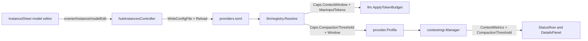

# Per-model settings and compaction thresholds

Date: 2026-11-12
Status: proposed (UI placement chosen by Jesse, 2026-11-12; awaiting spec approval)
Size: project (roughly 1,500 lines with tests across `llm/registry`, `agent`, `appwire`, `cmd/evener-hub`, `cmd/evener`, `appwire-client`, and `cmd/evener-hub/frontend`)

## Intent and why

Some models lose coherence well below their physical context limit. For example, `deepseek-4.1-flash` hallucinates past roughly 250K input tokens even when served with a 1M physical window. Operators need a durable, user-controllable setting to trigger automatic history compaction at 250K tokens for that model while keeping its full wire limit intact.

Lowering `context_window` cannot solve this problem. `llm.ApplyTokenBudget` (`llm/token_budget.go`) treats `context_window` as a hard wire ceiling: as input approaches `context_window`, it clamps `MaxTokens` down, and once input reaches `context_window`, it rejects the request locally with `ContextBudgetError("context_window")`. A single large tool output or a retained post-compaction verbatim tail at 260K tokens succeeds on a 1M-window endpoint when `context_window` stays 1M, and fails locally if `context_window` was faked to 250K.

At the same time, `providers.toml` already supports rich per-model capability and routing overrides under `[providers.<instance>.models."<id>"]` (`context_window`, `max_output_tokens`, `reasoning`, `default_effort`, `effort_values`, `input_modalities`, `tools`, `protocol`, `surface`, `thinking_format`, `thinking_shape`, `wire_id`, `alias_of`), while the web admin UI in `InstanceSheet` (`Settings -> Providers & credentials`) only exposes an enable/disable switch per model.

This design adds `compaction_threshold` (in tokens) to `registry.Caps` and extends the existing `Models` list inside `InstanceSheet` with summary facts, custom model creation, and an in-sheet drill-in model editor.

## Goals

- Add `compaction_threshold` (`*int`, token count) to `registry.Caps` across all catalog layers (`providers_overlay.toml`, provider defaults, model globs, `alias_of` inheritance, and exact `[providers.<instance>.models."<id>"]` rows in `providers.toml`).
- Trigger automatic session compaction (`contextmgr`) when estimated or measured input tokens reach `compaction_threshold`, while keeping `llm.ApplyTokenBudget` governed by physical `context_window`, `max_input_tokens`, and `max_output_tokens`.
- Preserve existing `Session.ContextStatus()` invariants (`pressure == float64(Used) / float64(Window)`, `Remaining == max(Window - Used, 0)`, parity with `SessionMeta` and `TurnModelSwitch`, and the two-allocation ceiling) while surfacing active compaction thresholds coherently in `StatusRow`, `DetailsPanel`, mid-session `ModelSwitch` updates, model-switch markers, and unknown-window handling.
- Extend `InstanceSheet -> Models` in the web UI so users can inspect per-model summary facts, add custom uncatalogued models, drill into a per-model editor within the same `Sheet`, view inherited values alongside their provenance, edit or reset per-field overrides, and remove custom-only model rows.
- Surface `compaction_threshold` in `evener models list` and `evener models inspect`.

## Non-goals

- Hot-reloading `providers.toml` into already-running `evener serve` daemon processes. Each `evener serve` daemon loads `providers.toml` once at startup and holds that snapshot across turns and mid-session model switches; edits to `providers.toml` apply to new session launches and cold session resumes (which spawn a fresh daemon).
- Rebuilding provider/model administration natively in `mobile-native`. Per project policy (`docs/product/subsystems.md` S03/S15), phone administration opens the responsive mobile web UI, where `InstanceSheet` renders as a bottom `Sheet`.
- Authoring wildcard `[models."<glob>"]` or `[providers.X.models."<glob>"]` rules from the web UI. Hand-authored globs in `providers.toml` remain supported and report `"glob"` provenance in the model editor; UI saves write exact `[providers.<instance>.models."<id>"]` entries.
- Exposing low-level wire-transform tables (`headers`, `cost`, `fields`, `chat_template_kwargs`, `finish_reason_map`, message-transform booleans) as form controls. Hand-authored values in those keys on the same model row remain intact across UI edits and resets.
- Proxying per-model writes to remote hosts over `evener/host/request`. Matching `evener/instance/setModelDisabled` and `evener/instance/refreshModels` (`appwire/host_request.go`), model detail reads and edits operate on the local controller hub's `providers.toml`.

## Anti-goals

- Persisting inherited catalog, overlay, or live values into `providers.toml` when the user did not edit them. Only user-authored overrides are written to disk.
- Failing `providers.toml` load when a provider-wide or glob `compaction_threshold` exceeds one smaller model's `context_window` or `max_input_tokens`, which would flip `writesRefused` and lock the user out of corrective edits in the UI.
- Leaving empty `[providers.<name>.models."<id>"]` or bare implicit-shadow `[providers.<name>]` tables in `providers.toml` after overrides are cleared.
- Stacking a second `Sheet` over `InstanceSheet` or showing two competing `Save` buttons simultaneously.

## Approaches considered

### UI placement and interaction

1. **Extend `InstanceSheet -> Models` with an in-sheet drill-in subview (chosen by Jesse).** Each provider connection (`lunaroute`, `kimi`, `groq3`, `oai-jrv`) already owns its model list, live refresh, search box, and `[providers.<name>.models."<id>"]` config entries inside `InstanceSheet`. Keeping the `[●]` enable `Switch` on the left of each row and adding summary facts plus a drill-in trigger on the right builds directly on the existing workflow. Transitioning `InstanceSheet` in place to the selected model's form (`← <instance>` at top, one `Save` button in the sheet footer) avoids stacked sheets and preserves search query, scroll offset, and unsaved connection drafts on return.
2. **Add a standalone `Settings -> Model catalog` navigation page (rejected).** Duplicates the per-connection model lists already inside `Providers & credentials` and adds an extra Settings destination for the same `providers.toml` entries.
3. **Expand an inline accordion inside `InstanceSheet`'s model list (rejected).** Cramps 10+ fields into a scrolling list and puts a per-row save control in visual competition with `InstanceSheet`'s sticky footer `Save` button.

### Compaction threshold representation and pressure math

1. **Absolute token count `compaction_threshold *int` on `registry.Caps`, deriving `contextmgr` layer fractions against `EffectiveWindow(prof)` (chosen).** Operators discover degradation cliffs in tokens (`250000`). Keeping `ContextMetrics.Window` equal to the physical (or assumed) window preserves `Session.ContextStatus()` invariants (`pressure == Used / Window`) and `llm.ApplyTokenBudget` wire admission, while `contextmgr` computes per-profile layer fractions (`warn`, `checkpoint`, `summarize`) so Layer 1 checkpointing fires at exact `Used == compaction_threshold`.
2. **Reuse `context_window` as the compaction knob (rejected).** Causes `llm.ApplyTokenBudget` to clamp `MaxTokens` prematurely and reject valid requests above 250K with `ContextBudgetError`.
3. **Store a percentage float (`0.0` to `1.0`) per model (rejected).** Shifts the compaction point silently whenever a live listing updates `context_window` (for example from 512K to 1M) and cannot state a concrete token budget when `context_window` is unknown.

## Architecture and behavior



`providers.toml` remains the single durable source of truth. `hubInstancesController` serializes writes under its existing `lockMutation`, dry-parses through `registry.WriteConfigFile`, reloads the held `ProviderRegistry` (preserving cached live model listings and advancing the launch-model cache generation), and broadcasts `evener/auth/updated` post-commit. `llm.ApplyTokenBudget` continues reading `Caps.ContextWindow` and `Caps.MaxInputTokens` for wire admission, while `provider.Profile` exposes `CompactionThreshold()` to `contextmgr.Manager` and session status projections.

### 1. Registry schema, inheritance, provenance, and validation (`llm/registry`)

- **Field:** Add `CompactionThreshold *int` (`toml:"compaction_threshold" json:"compaction_threshold,omitempty"`) to the model-facts block of `registry.Caps` (`llm/registry/types.go`).
- **Parse validation (`llm/registry/schema.go`):**
  - Define `const MinCompactionThreshold = 4096` and `const MaxTokenLimit = math.MaxInt32` (`2_147_483_647`).
  - In `validateCaps`, reject any non-nil `CompactionThreshold` outside `[MinCompactionThreshold, MaxTokenLimit]`, and cap `ContextWindow`, `MaxInputTokens`, and `MaxOutputTokens` at `<= MaxTokenLimit`. Requiring `compaction_threshold >= 4096` rejects non-positive numbers and catches unit-scale mistakes such as writing `250` when meaning `250000`.
- **Cloning, merging, alias seeding, and row scalar provenance:**
  - `cloneCaps` (`llm/registry/load.go`) clones `CompactionThreshold` via `clonePointer`.
  - `mergeCaps` (`llm/registry/merge.go`) and `capsInto` (`llm/registry/write.go`) reflect over pointer fields on `Caps`, so layer precedence (`snapshot/cache -> overlay -> live -> config/provider -> config/glob -> config/row`), `Resolved.Provenance["CompactionThreshold"]`, and sparse TOML output work automatically (`liveFacts` in `resolve.go` does not populate `CompactionThreshold`, so live `/models` responses never overwrite curated or user thresholds).
  - `seedFromAlias` (`llm/registry/resolve.go`) copies `CompactionThreshold: target.Caps.CompactionThreshold` into `facts` and preserves `target.Provenance["CompactionThreshold"]` when non-empty, matching `ContextWindow` provenance retention.
  - `applyRowScalars` and `resolveLayersModeLive` (`llm/registry/resolve.go`) record `prov["Protocol"]`, `prov["WireID"]`, and `prov["AliasOf"]` alongside `Surface`, `Family`, and `Disabled` (initializing `prov["Protocol"]` from the provider layer that supplied `rec.head.Protocol` when no model row overrides it) so every UI-editable routing field carries authoritative provenance.
- **Cross-field clamping during resolution (`llm/registry/derive.go`, `resolve.go`):**
  - A provider default or glob may set `compaction_threshold = 250000` while one model under that provider has `context_window = 128000` or `max_input_tokens = 200000`. `ParseConfig` and `Load` accept this configuration so `providers.toml` stays loadable.
  - Update `derive` (`llm/registry/derive.go`) to return `warnings []string`, appended onto `warnings` in `resolveLayersModeLive` (`llm/registry/resolve.go`). Define `hardCeiling` as the smaller positive limit among `Caps.ContextWindow` and `Caps.MaxInputTokens` (`0` when both are nil). When `Caps.CompactionThreshold != nil && hardCeiling > 0 && *Caps.CompactionThreshold >= hardCeiling`, `derive` clears `Caps.CompactionThreshold` to `nil`, sets `prov["CompactionThreshold"] = "derived"`, and returns a warning naming both limits.

### 2. Profile and `contextmgr` compaction math (`agent/provider`, `agent/internal/contextmgr`, `agent`)

- **`provider.Profile` (`agent/provider/profile.go`):**
  - Add `func (p *Profile) CompactionThreshold() int`. Returns `0` when `p == nil || p.rowFactsInherited || p.res.Caps.CompactionThreshold == nil || *p.res.Caps.CompactionThreshold <= 0`. Also checks `cw := p.ContextWindowSize()` and `mi := p.MaxInputTokens()`: if `(cw > 0 && *p.res.Caps.CompactionThreshold >= cw) || (mi > 0 && *p.res.Caps.CompactionThreshold >= mi)`, returns `0` so programmatic `WithResolved` overrides in callers or tests stay self-consistent without calling `derive`.
- **Single window authority across `contextmgr` and `agent` (`agent/internal/contextmgr/pressure.go`, `agent/context_metrics.go`, `compact.go`):**
  - Export `func EffectiveWindow(prof *provider.Profile) (window int, assumed bool)` in `contextmgr` (`effectiveWindowOf` aliases or calls it), using `DefaultCompactAt` (`0.90`):
    - When `prof == nil`: returns `(0, false)`.
    - When `cw := prof.ContextWindowSize(); cw > 0`: returns `(cw, false)`.
    - When `ct := prof.CompactionThreshold(); ct > 0`: returns `(max(AssumedContextWindow, int(math.Ceil(float64(ct)/DefaultCompactAt))), true)`. For `ct = 250000`, the derived window is `277778` (`Assumed: true`), keeping `ct < Window` so `Remaining` and `pressure = Used / Window` stay well-formed past `ct`.
    - Otherwise: returns `(AssumedContextWindow, true)` (`128000`).
  - Update `budgetingWindow(profile)` in `agent/context_metrics.go` to read `window, _ := contextmgr.EffectiveWindow(profile)` so `Session.ContextStatus()`, `Session.Meta()` (`meta.json`), and `TurnModelSwitch.ModelSwitch` all report the exact same `ContextWindow`.
  - When `prof.CompactionThreshold() > 0` on an unknown-window model:
    - `discloseAssumedWindow` (`compact.go`) skips `WarningCodeContextWindowAssumed` because compaction is governed by the explicit `compaction_threshold`.
    - `unknownWindowTripwireFires` (`compact.go`) checks `cm.profile.CompactionThreshold() == 0` under `cm.mu` alongside `sameProfileTarget(captured, cm.profile)` so `UnknownWindowInputTripwire` (`200000`) never preempts a higher configured threshold such as `250000`.
    - `SetProfile` (`pressure.go`) resets `cm.assumedWindowDisclosed = false` whenever `(cm.profile.CompactionThreshold() > 0) != (profile.CompactionThreshold() > 0)` in addition to `!sameProfileTarget(cm.profile, profile)`.
- **Canonical layer thresholds (`agent/internal/contextmgr/manager.go`, `pressure.go`):**
  - `Manager` currently holds three fraction fields (`WarnThreshold`, `CheckpointThreshold`, `SummarizeThreshold`, initialized via `SetCompactAt(DefaultCompactAt)` to `0.75`, `0.90`, `0.95`). Add two unexported tracking fields on `Manager`: `explicitCompactAt float64` (`0` until `SessionConfig.CompactAtPercent > 0` calls `SetExplicitCompactAt`, distinguishing a user-chosen session percentage from `DefaultCompactAt`) and `thresholdScale float64` (set by test-only `ApplyThresholdScale`, `1.0` by default).
  - Introduce `layerThresholds { warn, checkpoint, summarize float64 }` and `(cm *Manager) thresholdsFor(prof *provider.Profile) layerThresholds` (plus exported `WarnThresholdFor(prof)` and `CheckpointThresholdFor(prof)`):
    - **Case A (`prof == nil` or `prof.CompactionThreshold() <= 0`):** returns `{ cm.WarnThreshold, cm.CheckpointThreshold, cm.SummarizeThreshold }` verbatim. Direct field assignments in existing tests (`cm.CheckpointThreshold = ...`), `SetCompactAt`, and `ApplyThresholdScale` behave identically to today.
    - **Case B (`ct := prof.CompactionThreshold(); ct > 0` with `cw, _ := EffectiveWindow(prof)` and `ct < cw`):**
      - Compute `fraction := float64(ct) / float64(cw)`. If `cm.explicitCompactAt > 0 && cm.explicitCompactAt < fraction`, set `fraction = cm.explicitCompactAt` (a tighter session-level `compact_at_percent` wins over a looser model default; otherwise the model's `compaction_threshold` governs directly, replacing `DefaultCompactAt`).
      - Derive the three gates from `fraction`:
        - `checkpoint = fraction` (fires Layer 1 deterministic checkpoint + note elicitation at exact `Used == ct` when `explicitCompactAt` did not lower it).
        - `lead := min(nudgeLead, fraction*0.20)` (`0.05` for ordinary fractions `>= 0.25`; proportionally smaller for tiny fractions such as `8192 / 1048576` so `warn` always remains strictly positive and strictly below `checkpoint`), `warn = min(selfCompactNudgeAt, max(0, fraction-lead))`. For `ct = 250,000` on `1,000,000` (`fraction = 0.25`), `warn = 0.20` (`200,000` tokens).
        - `summarize = min(max(fraction, fraction*(summarizeBackstopAt/DefaultCompactAt)), max(fraction, summarizeBackstopAt))`. For `ct = 250,000` on `1,000,000`, `summarize` is `263,889` tokens (`0.25 * 0.95 / 0.90`), giving Layer 1 room to fold first while guaranteeing Layer 2 LLM summarization runs before input drifts deep past `ct` when preserved recent turns are huge; when `ct` is above `90%` of `cw`, `summarize` caps at `max(fraction, 0.95) < 1.0`.
      - If `cm.thresholdScale > 0 && cm.thresholdScale != 1.0`, scale each of `warn`, `checkpoint`, `summarize` with `ApplyThresholdScale`'s `max(0.20, v*cm.thresholdScale)` clamp.
  - Every compaction site consults `thresholdsFor(prof)`:
    - `MaybeCompact` (`compact.go`)
    - `SessionLogStrategy.ManageContext` (`strategy_session_log.go`, embedded by `OODAStrategy`)
    - `maybeElicitNoteBeforeCompaction` and `maybeNudgeSelfCompact` (`agent/session_self_compact.go`)
    - `Session.SetModel` context-shrink warning (`agent/session.go`): compares `pressure >= s.contextMgr.CheckpointThresholdFor(nextProfile)`. When triggered by a model with `effectiveCompactTokens > 0` (`CompactionThreshold` active), `buildModelSwitchMarkerText` formats the warning against that token threshold (`~<Used> tokens, over <Model>'s <Threshold>-token compaction threshold`) so it never prints a misleading small window percentage (`26% of window`) or a synthetic assumed window (`~277778 tokens`).

### 3. Session context status, mid-session model switches, and chrome (`agent/schema`, `appwire`, `appwire-client`, `StatusRow`, `DetailsPanel`)

- **`schema.ContextMetrics` (`agent/schema/context_metrics.go`):**
  - Add `CompactionThreshold int` (`0` when Case A governs; `int(math.Round(th.checkpoint * float64(window)))` when `prof.CompactionThreshold() > 0`, which equals exact `ct` unless a tighter `CompactAtPercent` lowered `th.checkpoint`, keeping the UI gauge and actual trigger identical in every configuration).
  - `EstimateStatusFor` (`pressure.go`) populates `CompactionThreshold` from the same `prof` snapshot with zero extra heap allocations. `Used`, `Window`, `Remaining`, and `pressure = float64(Used) / float64(Window)` keep their exact formulas (`TestContextStatusParityAcrossMutations`, `TestContextStatusAllocationBudget`, and `checkContextStatusInvariants` hold unchanged).
- **Mid-session model switch event (`agent/events`, `internal/appprojector`, `appwire`):**
  - `Session.SetModel` (`agent/session.go`) already computes `usage := s.contextMgr.EstimateUsage(...)` on `nextProfile` before emitting `EventModelChanged`. Extend `events.ModelChangedData` (`agent/events/payloads.go`) and `appwire.ThreadModelChangedParams` (`appwire/types_turn.go`, projected in `internal/appprojector/appwire_projection.go`) with `ContextUsed int`, `ContextWindow int`, `ContextPressure float64`, `ContextAssumed bool`, and `CompactionThreshold int` (`omitempty`), so switching between a thresholded model (`deepseek-4.1-flash`) and an unthresholded model (`claude-opus-5`) updates live client chrome immediately without waiting for the next turn or reload.
- **Wire and TypeScript client state (`appwire/types_thread.go`, `appwire/types_models_nav.go`, `appwire-client/typescript`):**
  - Add `CompactionThreshold int` (`json:"compactionThreshold,omitempty"`) to `appwire.EvenerThread`, populated wherever `ContextWindow` and `ContextUsed` are projected from `Session.ContextStatus()`.
  - Add `CompactionThreshold *int` (`json:"compactionThreshold,omitempty"`) to `appwire.ModelDescriptor` (`model/list`), populated from `Resolved.Caps.CompactionThreshold`.
  - Run `make generate` to update `appwire-client/typescript/types.gen.ts`.
  - Following `contextAssumed`'s exact client wiring (preserving version-1 `CURRENT_TRANSCRIPT_FIELD_KEYS` compatibility in `transcriptValidators.ts`), add `compactionThreshold: number` (`0` when absent) to `ThreadModel` in `appwire-client/typescript/model.ts`, hydrate `thread.evener.compactionThreshold ?? 0` in `transcriptItems.ts`, thread through `threadUsage.ts`, initialize `compactionThreshold: 0` in `transcriptCache.ts` (`threadModelFromCurrentState`, `threadModelFromCache`) and test fixtures (`state/mutation/testing.ts`, `threadModelFromCache.test.ts`), and update `reducer.ts`'s `case "thread/model/changed":` to apply the new context fields from `ThreadModelChangedParams`.
- **Shared gauge calculation (`cmd/evener-hub/frontend/src/panes/session/chrome/statusFormat.ts`, `StatusRow.tsx`, `DetailsPanel.tsx`):**
  - `StatusRow` and `DetailsPanel` share one pure helper `effectiveContextStatus(model)` in `statusFormat.ts`:
    - When `model.compactionThreshold > 0`: `ceiling = model.compactionThreshold`, `pressure = model.contextUsed / model.compactionThreshold`, `remaining = Math.max(0, model.compactionThreshold - model.contextUsed)`, `hasCustomThreshold = true`. At `200K / 250K`, `pressure` is `0.80` (`attention` amber via `contextTone`); at `237.5K / 250K`, `pressure` is `0.95` (`danger`); above `250K` (e.g. a single large tool output before the next request folds), `remaining` floors at `0`.
    - When `model.compactionThreshold <= 0`: returns `{ ceiling: model.contextWindow, pressure: model.contextPressure, remaining: Math.max(0, model.contextWindow - model.contextUsed), hasCustomThreshold: false }`.
  - **`StatusRow.tsx`:** Uses `effectiveContextStatus(model)` for **both** the `<VisuallyHidden><meter value={Math.min(status.ceiling, Math.max(0, model.contextUsed))} max={status.ceiling} /></VisuallyHidden>` element and the visual `<Meter value={model.contextUsed} max={status.ceiling} tone={contextTone(status.pressure)} />`, plus percentage text and `contextLabel` (omitting the synthetic window figure when `hasCustomThreshold && model.contextAssumed`).
  - **`DetailsPanel.tsx`:** Uses `effectiveContextStatus(model)` for the `Context` row's `<Meter>` and readout. When `hasCustomThreshold` is true: `remaining` (`status.remaining`) is measured against the exact `compactionThreshold` and never takes `assumedWindowMark`; if `!model.contextAssumed`, appends `(${formatTokenCount(model.contextWindow)} window)`, and if `model.contextAssumed`, appends `(window unknown)` so the internal `ct / DefaultCompactAt` figure is never shown as an estimated model window.

### 4. Hub RPCs, store integration, and `providers.toml` persistence (`appwire`, `cmd/evener-hub`, `appwire-client`)

All new RPCs are `ScopeHub` and stay absent from `hostRequestMethods` (`appwire/host_request.go`), matching `evener/instance/setModelDisabled` and `evener/instance/refreshModels`.

1. **Enriched list summary (`appwire.InstanceModelEntry` in `appwire/types_auth_commands.go`):**
   ```go
   type InstanceModelEntry struct {
       ID                  string `json:"id"`
       Disabled            bool   `json:"disabled,omitempty"`
       Customized          bool   `json:"customized,omitempty"`
       ContextWindow       *int   `json:"contextWindow,omitempty"`
       CompactionThreshold *int   `json:"compactionThreshold,omitempty"`
   }
   ```
   - `instanceModels` (`cmd/evener-hub/app_instances.go`) resolves each listed ID via `r.ResolveInstanceModelFacts(name, id)` (network-free, credential-free) to populate `ContextWindow` and `CompactionThreshold`, and sets `Customized: true` when `authoredOnly(r, layer, name, id)` is true OR `layer.Providers[name].Models[id]` sets any field other than `ID` and `Disabled`.

2. **Symmetric `authoredOnly` predicate:**
   - A model `id` on instance `name` is `authoredOnly` iff `layer != nil`, `layer.Providers[name].Models[id]` exists (exact key), AND `id` would not appear in `InstanceModels(name)` without `LayerConfig`'s `Models[id]` entry: specifically, on `rec` (the instance's registry record), when `len(r.LiveModels(name)) > 0`, `id` is absent from `r.LiveModels(name)` and absent from every `LayerOverlay` layer's non-glob `rows` on `rec`; when `len(r.LiveModels(name)) == 0`, `id` is absent from every non-`LayerConfig` layer's non-glob `rows` on `rec` (which already accounts for `base`, `inherit_models`, and `inherit_models_matching`).
   - This guarantees exact symmetry between `Create: true` and `RemoveCustom: true`: every row created through `+ Add custom model` has `AuthoredOnly == true` and can be removed via `Remove custom model`.

3. **Single-model detail read (`evener/instance/modelGet`):**
   - `InstanceModelGetParams`: `{ Name string, Model string }`.
   - `InstanceModelDetailResponse`:
     - `Name string`, `Model string`
     - `Disabled bool` (effective verdict via `r.InstanceModels` / `modelDisabled`, honoring globs and same-provider alias lockstep)
     - `DisabledLockstepTarget string` (`omitempty`; non-empty when `r.AliasTarget(name, model)` resolves to a different model ID on `name`, so the UI can disclose that toggling `Enabled` toggles the target model in lockstep)
     - `AuthoredOnly bool`
     - `Effective InstanceModelEffective`: `{ ContextWindow *int, MaxInputTokens *int, CompactionThreshold *int, MaxOutputTokens *int, Reasoning *bool, DefaultEffort string, EffortValues []string, InputModalities []string, Tools *bool, Protocol string, Surface string, ThinkingFormat string, ThinkingShape string, WireID string, AliasOf string }`
     - `Provenance map[string]string`: restricted to the fields of `InstanceModelEffective`, mapped deterministically from `Resolved.Provenance`:
       - `snapshot/*`, `cache/*` -> `"catalog"`
       - `overlay/*` -> `"overlay"`
       - `live` -> `"live"`
       - `config/provider` -> `"provider"`
       - `config/glob:*` -> `"glob"`
       - `config/row` -> `"config"`
       - `alias` -> `"alias"`
       - `derived` -> `"derived"`
     - `Authored InstanceModelAuthored`: exact overrides present on `l.Providers[name].Models[model]` (`nil` pointers / slices and `""` strings when unset on that exact row)
     - `HasOverrides bool`: true when `l.Providers[name].Models[model]` sets any UI-editable override field (excluding `Disabled`)
     - `ThinkingFormats []string`: `registry.ThinkingFormats()`
     - `Warnings []string`: `Resolved.Warnings`
   - Acquires `c.mu.RLock()` and reads the held registry plus `c.read()`. Works while `WritesRefused` is true against the last good registry. Refuses unknown instances, glob IDs, or unknown unauthored models with `appwire.InvalidParams`.

4. **Single-model mutation (`evener/instance/modelEdit`):**
   - `InstanceModelEditParams`:
     - `Name string`, `Model string`
     - Mutually exclusive mode flags (`Create bool`, `RemoveCustom bool`, `ResetAll bool`): `RemoveCustom` cannot combine with `Create`, `ResetAll`, or any field set/clear; `Create` cannot combine with `ResetAll`.
     - Explicit set/clear pairs for the 14 editable fields (`CompactionThreshold *int` / `ClearCompactionThreshold bool`, `ContextWindow *int` / `ClearContextWindow bool`, `MaxOutputTokens *int` / `ClearMaxOutputTokens bool`, `Reasoning *bool` / `ClearReasoning bool`, `DefaultEffort string` / `ClearDefaultEffort bool`, `EffortValues []string` / `ClearEffortValues bool`, `InputModalities []string` / `ClearInputModalities bool`, `Tools *bool` / `ClearTools bool`, `Protocol string` / `ClearProtocol bool`, `Surface string` / `ClearSurface bool`, `ThinkingFormat string` / `ClearThinkingFormat bool`, `ThinkingShape string` / `ClearThinkingShape bool`, `WireID string` / `ClearWireID bool`, `AliasOf string` / `ClearAliasOf bool`).
     - `ExpectedEndpointFingerprint string`, `OriginClientId string`.
   - `InstanceModelEditResponse`: `{ List InstanceListResponse, Detail *InstanceModelDetailResponse }` (`Detail` is `nil` after `RemoveCustom`, populated otherwise).
   - **Pre-lock and lock discipline (`hubInstancesController.EditModel`):**
     - Validates `refuseModelEditSetClearPair(params)` (matching `refuseEditSetClearPair`, `#1025`), rejects empty or glob (`*`) `Model`, and rejects empty non-nil `EffortValues` or `InputModalities` when set without `Clear*` (because `capsInto` in `llm/registry/write.go` omits zero-length slices; `Reasoning = false` is how effort is disabled, and `InputModalities` always includes `"text"`).
     - Calls `key, keyErr := resolveEndpointFingerprintKey(c.authStateDir())` **before** `defer c.lockMutation(&err)()`, matching `hubInstancesController.edit`'s lock-ordering rule.
     - Inside `lockMutation`: checks `if params.ExpectedEndpointFingerprint != ""` via `c.auth.verifyEndpointFingerprint(name, params.ExpectedEndpointFingerprint, key, keyErr)` (matching `edit`, so non-secret edits still work on hubs without a fingerprint key when no fingerprint was asserted).
     - Pre-validates non-empty `AliasOf` against the held registry (not equal to `model`, not a glob, resolves to an existing non-alias row on `name` or `<curated-provider>/<id>`) so typos fail in memory with `appwire.InvalidParams` before touching disk.
     - Records `beforeAccess := c.effectiveAccessIdentity(c.reg.Get(), name)` before writing and compares `afterAccess` after reload: if editing the instance's default model changed effective protocol/transport access, calls `c.auth.forgetCredentialRejection(name)` (matching `edit`).
   - **Row mutation, rollback, and empty-table cleanup:**
     - Writes capability/routing edits onto `p.Models[model]` (exact key), preserving `Disabled` and all non-UI hand-authored fields (`Headers`, `Transport`, `Cost`, `Fields`, `ChatTemplateKwargs`, `FinishReasonMap`, message-transform flags, `Family`).
     - On `RemoveCustom`, verifies `authoredOnly` is true (refusing catalog/overlay/live rows with `InvalidParams`) and deletes `p.Models[model]`.
     - On `ResetAll` or per-field clears on a non-`AuthoredOnly` model, if `isZeroModelRow(row)` holds (every field on `registry.Model` except `ID` is nil/zero/empty), deletes `p.Models[model]`.
     - Whenever `delete(p.Models, model)` leaves `len(p.Models) == 0`, sets `p.Models = nil`; if `!wasAuthoredProvider && providerIsBare(p)` (an implicit instance shadowed solely to hold that model row), also executes `delete(l.Providers, name)` so `providers.toml` retains no bare `[providers.<name>]` shadow (`#1024`).
     - Commits via `writeAndReload(before, l, name, "edit model")`. Next, checks post-reload consistency: if the effective row on `name` had `CompactionThreshold` clamped away by `derive` (`(row.Caps.CompactionThreshold != nil || preClampedThresholdOnRow) && res.Provenance["CompactionThreshold"] == "derived"`), runs the exact `writeAndReload` rollback (`if restoreErr := c.write(before); restoreErr != nil { return fmt.Errorf("%w (and %w: %w)", clampErr, errConfigRestoreFailed, restoreErr) }`, else `c.applied.resetApplied(); _ = c.reg.Reload(); return appwire.InvalidParams(clampErr.Error())`). This catches both setting `CompactionThreshold >= ContextWindow/MaxInputTokens` and lowering `ContextWindow` below an existing `CompactionThreshold`.
     - Captures `List: c.listLocked(key, keyErr)` and `Detail: c.modelDetailLocked(name, model)` before releasing `lockMutation`, and routes RPC registration through `instanceWrite(params.OriginClientId, ...)` in `app_rpc.go`.

5. **Client credentials store (`appwire-client/typescript/state/credentials/instances.ts`):**
   - Add `getModel(params: InstanceModelGetParams): Promise<InstanceModelDetailResponse>` (using `requireClient()` + `connectionStillCurrent(client)` guard) and `editModel(params: Omit<InstanceModelEditParams, "originClientId">, options?: { onSuperseded?: (response: InstanceModelEditResponse) => void }): Promise<{ applied: boolean; detail: InstanceModelDetailResponse | null }>` to `CredentialInstancesState`.
   - Route `editModel` through `applyMutation` so `requestVersion`, `noteLocalMutation(undefined)` (`OriginClientId` self-echo correlation), `landedMutations`, and `settleMutation` work identically to `edit` and `setModelDisabled`.
   - Extend `keepRefreshedModels` (`WrittenModel` reconciliation) to support full `InstanceModelEntry` upsert (preserving `disabled`, `customized`, `contextWindow`, `compactionThreshold` on edit/create) and model removal (filtering out `model` on `removeCustom`) when a concurrent `refreshModels` landed during flight.

### 5. Web UI (`cmd/evener-hub/frontend/src/panes/settings/sections/credentials`)

All controls compose strictly from barrelled `src/widgets` (`Sheet`, `Switch`, `Button`, `Chip`, `FormRow`, `Input`, `Select`, `SegmentedControl`, `Disclosure`, `InlineNotice`, `ConfirmDialog`, `Skeleton`, `useFocusRehome`) and CSS custom properties from `src/styles/tokens.css`, introducing zero new widgets or widget props. CSS module class names in `credentials/*.module.css` avoid all `ds-audit.mjs` `WIDGET_CONCEPTS` substrings (`chip`, `badge`, `pill`, `btn`, `button`, `card`, `empty`, `menu`, `tooltip`, `switch`, `toggle`, `skeleton`, `kbd`, `meter`), using layout names such as `.modelRow`, `.modelSummary`, `.fieldInline`, `.effortGroup`, `.subviewHeader`.

1. **`InstanceSheet` overview `Models` section:**
   - Header action row renders `Refresh live models` (`Button variant="quiet"`) alongside `+ Add custom model` (`Button variant="quiet"`, disabled when `busy || writesRefused`).
   - Each model row renders as a two-part flex row (`.modelRow`):
     - Left: existing `<Switch label={row.id} checked={!row.disabled} pending={...} disabled={busy || writesRefused} onChange={...} />`, preserving existing accessible name and toggle behavior.
     - Right: `<Chip kind="customized">customized</Chip>` (default `neutral` tone) when `row.customized` is true, compact summary text (`1M ctx · compact 250K` via `formatTokenCount`), and `<Button variant="quiet" size="sm" aria-label={`Configure ${row.id}`} onClick={...}>Configure ›</Button>`.
   - Clicking `Configure ›` or `+ Add custom model` while `renameGap` is active calls `refuseDuringRename()`.

2. **In-sheet drill-in subview (`InstanceModelEditor`) and overlay mechanics:**
   - `InstanceSheet` holds `activeModelView: { mode: "edit"; model: string } | { mode: "create" } | null`.
   - **Scroll, focus, Escape, and `ConfirmDialog` placement:**
     - Both the overview body wrapper and the `InstanceModelEditor` wrapper stay mounted inside `Sheet` with the inactive one marked `hidden`, preserving `InstanceSheet`'s connection `draft` and `modelSearch` state. Before entering `activeModelView`, `InstanceSheet` records `overviewRef.current?.parentElement?.scrollTop` (which is `OverlayPanel`'s `.body` scroll container) and resets `.scrollTop = 0` in `useLayoutEffect`; returning via `← <instance>` restores the saved `scrollTop` in `useLayoutEffect`.
     - Focus transitions explicitly: entering `activeModelView` focuses the `<Button variant="link">← {instance.name}</Button>` control (or `Model ID` input in `create` mode); returning to overview restores focus to the originating `Configure ${model}` button (or `+ Add custom model`), with `useFocusRehome` attached to the sheet content root as a fallback when a control unmounts (`Remove custom model`).
     - Pressing `Escape` while inside `InstanceModelEditor` handles `onKeyDown` on the subview root (`event.preventDefault(); backToOverview()`), stepping back to the instance overview (`OverlayPanel` checks `!event.defaultPrevented`, so `Sheet` stays open), whereas clicking `Sheet`'s `[×]` Close button invokes `onClose` and dismisses `InstanceSheet`.
     - `ConfirmDialog` for `Remove custom model` renders as a **sibling outside `<Sheet>`** (matching `CredentialsSection.tsx`), never inside `<Sheet>`'s transformed panel DOM where `transform` creates a containing block that breaks `position: fixed` overlays.
   - **Identity and concurrency:**
     - `InstanceModelEditor` captures `seededIdentity(instance)` and `instance.endpointFingerprint` (`expectedEndpointFingerprint`). When a `modelEdit` initiated by this sheet succeeds (`applied === true`), `InstanceSheet` re-anchors its own `seededIdentity.current`, `seededFingerprint.current`, and untouched `initial`/`draft` fields to the returned `InstanceEntry` (in case editing the default model's protocol moved the instance's `endpointFingerprint` or `protocol`), and updates `InstanceModelEditor`'s baseline from `response.detail`.
   - **Decimal-exact token parsing (`parseTokenCount` in `@evener/appwire-client`):**
     - Matches `/^\s*([0-9][0-9,]*)(?:\.([0-9]+))?\s*([kKmM])?\s*$/`, strips commas, shifts base-10 digits directly without floating-point rounding (rejecting fractional digits when no suffix is given, > 3 fractional digits for `K`, or > 6 fractional digits for `M`, so `"1.13k"` -> `1130` and `"0.29m"` -> `290000` never suffer IEEE-754 float drift), and enforces `1 <= value <= 2_147_483_647`.
   - **Fields and grouping:**
     - **Model ID** (`mode === "create"` only): `FormRow` + `Input` (required, trimmed non-empty, no `*`, not already in `instance.models`).
     - **Availability & context:**
       - `Enabled`: bare `Switch` (never wrapped in `FormRow`, per `FormRow`'s contract), `edit` mode only, wired to `onToggleModel`, with `description` disclosing lockstep target when `detail.disabledLockstepTarget` is non-empty.
       - `Auto-compact threshold`: `FormRow` + `Input` + inline `<Button variant="link">Reset</Button>` when authored. Placeholder displays the effective default (`Default: 900K (90% of 1M window)` using `DefaultCompactAt = 0.90`, or inherited value + provenance source). Client validation checks `>= 4096` and `< hardCeiling` (smaller positive limit of drafted/effective `Context window` and `Effective.MaxInputTokens`).
       - `Context window`: `FormRow` + `Input` + `Reset` when authored; placeholder shows inherited value + provenance (`1,048,576 (live)` or `Unknown (assumes 128K)`).
       - `Max output tokens`: `FormRow` + `Input` + `Reset` when authored; placeholder shows inherited value + provenance.
     - **Capabilities & reasoning:**
       - `Reasoning`: `FormRow` (group mode) + `SegmentedControl` (`Inherited (On)` when `detail.effective.reasoning !== false`, `Inherited (Off)` when `false`, plus `On` and `Off`).
       - `Default effort`: `FormRow` + `Select` (`Inherited (...)` -> `""`, `none (off)` -> `"none"`, `minimal`, `low`, `medium`, `high`, `xhigh`, `max`).
       - `Allowed effort levels`: `FormRow` (group mode) + `<Button size="xs" variant={selected ? "secondary" : "quiet"} aria-pressed={selected}>` controls for `none`, `minimal`, `low`, `medium`, `high`, `xhigh`, `max`. Draft state is `string[] | null` (`null` = Inherited, displaying effective levels with `"Inherited (<provenance>)"` caption; clicking any level forks a concrete array and shows `Reset` to return to `null`). Saving a non-null empty array `[]` is refused inline with a `FormRow` `error` directing the user to select at least one level, set `Reasoning` to `Off`, or click `Reset`.
       - `Input modalities`: `FormRow` (group mode) + `Switch` controls for `Image` and `PDF`. Draft state is `string[] | null` (`null` = Inherited; toggling forks an array that always retains `"text"` plus any non-UI modalities from the baseline, so unchecking both `Image` and `PDF` sends `["text"]`, which `MarshalConfig` persists cleanly; `Reset` returns to `null`).
       - `Tool calling`: `FormRow` + `Select` (`Inherited (Supported)` when `detail.effective.tools !== false`, `Inherited (Unsupported)` when `false`, `Supported`, `Unsupported`).
     - **Routing & wire overrides:** Controlled `Disclosure` (`summary="Routing & wire overrides"`), defaulting open when `mode === "create"` or any routing/wire field is authored:
       - `Protocol` (`Select`: `Inherited (<effective.protocol>)`, `openai-chat`, `openai-responses`, `anthropic`, `google`)
       - `Surface` (`Select`: `Inherited (<effective.surface>)`, `openai`, `anthropic`, `google`, `generic`)
       - `Thinking format` (`Select`: `Inherited (...)`, options from `detail.thinkingFormats`)
       - `Thinking shape` (`Select`: `Inherited (...)`, `adaptive`, `budget`, `budget+effort`, `level`)
       - `Wire model ID` (`Input` + `Reset`)
       - `Alias of` (`Input` + `Reset`)
     - **Reset and custom removal:**
       - Subview header offers `Reset all overrides` (`Button variant="quiet" size="sm"`) when `detail.hasOverrides` is true, calling `editModel({ name, model, resetAll: true })`.
       - When `detail.authoredOnly` is true, a divider at the bottom exposes `Remove custom model` (`Button variant="dangerQuiet"`), opening the sibling `ConfirmDialog` and calling `editModel({ name, model, removeCustom: true })`, then returning to the instance overview.

### 6. CLI and evergreen documentation (`cmd/evener/models.go`, `docs/`)

- **`cmd/evener/models.go`:**
  - `evener models inspect <instance/model>` automatically serializes `caps.compaction_threshold` and `provenance.CompactionThreshold` through `registry.Resolved`.
  - `evener models list` builds `notes []string`: when `res.Caps.CompactionThreshold != nil`, prepends `fmt.Sprintf("compact=%d", *res.Caps.CompactionThreshold)`, appends `res.Warnings...`, and prints `strings.Join(notes, "; ")` in the `NOTES` column (preserving existing column headers and raw integer formatting).
- **Evergreen docs updated in the same change:**
  - `docs/llm-providers.md`: document `compaction_threshold` under `providers.toml` per-model keys and explain how it interacts with `context_window` and `max_input_tokens`.
  - `docs/product/subsystems.md`: update **S15** / **S16** / **S02** rows to record `InstanceSheet` per-model overrides, `evener/instance/modelGet` + `modelEdit`, and `compaction_threshold` ownership.
  - `docs/design/context.md`: document per-model `CompactionThreshold` alongside `DefaultCompactAt` (`0.90`), `SetCompactAt`, and `CompactAtPercent`.

## Recovery, preservation, and version skew

- **Broken `providers.toml` recovery:** While `WritesRefused` is true, `InstanceSheet` keeps `evener/instance/modelGet` inspectable against the last good registry while disabling `Save`, `Reset all overrides`, `+ Add custom model`, and `Remove custom model` until the external syntax error is repaired. An invalid edit proposed through `modelEdit` fails pre-validation, dry-parse, or `Reload()` rollback, restoring the prior `providers.toml` bytes (and preserving `applied` if disk restore itself fails) so the UI never locks itself out.
- **Hand-authored TOML and clean shadow preservation:** `EditModel` mutates only the targeted fields on `l.Providers[name].Models[model]`. Unexposed fields (`headers`, `cost`, `fields`, `chat_template_kwargs`, transport overrides) survive edits and `ResetAll`. Deleting the last authored model row on an implicit-shadow provider entry removes `l.Providers[name]` as well when `providerIsBare(p)` holds.
- **Concurrent client edits:** `ExpectedEndpointFingerprint` guards against instance replacement/re-pointing when a fingerprint is present; `CredentialInstancesState.applyMutation` correlates `OriginClientId` echoes and reconciles concurrent `refreshModels` / `readListing` responses without clobbering model edits.
- **Version skew (`docs/product/README.md#compatibility`):**
  - *Hub and older daemon:* An already-running older daemon keeps its startup private copy of `providers.toml` (S15) until exit; `ThreadModelChangedParams` and `EvenerThread` omit zero `compactionThreshold`, which new clients decode as `0`.
  - *Web client and older hub:* If an older hub lacks `evener/instance/modelGet`, the drill-in view catches the unsupported-method RPC error and renders an `InlineNotice` explaining that the connected hub must be updated to edit per-model settings, while leaving `InstanceSheet`'s existing fields and enable/disable switches usable.
  - *On-disk state:* `compaction_threshold` is an optional integer in `providers.toml`; cached transcripts in IndexedDB/SQLite without `compactionThreshold` hydrate with `0`. No migration shim is needed.

## Whole-journey test plan

All tests assert observable behavior without checking error or UI copy (`docs/developing-evener/testing.md`), and run deterministically with no live network calls:

1. **`llm/registry` unit and golden tests:**
   - Parse and round-trip `compaction_threshold` via `ParseConfig` / `MarshalConfig` / `WriteConfigFile` at provider, top-glob, provider-glob, and exact-row levels; verify nil writes nothing.
   - Reject `compaction_threshold < 4096` and `> math.MaxInt32` at parse time; accept `[4096, math.MaxInt32]`.
   - Verify layer precedence (`config/row` beats `live`, `config/glob`, `overlay`), `seedFromAlias` inheritance + provenance retention, `Protocol`/`WireID`/`AliasOf` provenance tags, and `derive` clamping + warning when `compaction_threshold >= context_window` or `>= max_input_tokens` without failing `Load`.
2. **`agent/provider` and `agent/internal/contextmgr` tests:**
   - With `ContextWindow = 1_000_000` and `CompactionThreshold = 250_000`: verify `llm.ApplyTokenBudget` admits a `300_000`-token request without `ContextBudgetError` and without clamping `MaxTokens` against `250_000`.
   - Verify `MaybeCompact` and `SessionLogStrategy` / `OODAStrategy` hold off below `250_000`, trigger `WarnThreshold` self-compact nudge at `200_000` (`0.25 - 0.05`), run Layer 1 checkpoint + note elicitation at `250_000`, and run Layer 2 summarize at `263_889` (`250_000 * 0.95 / 0.90`); verify `compaction_threshold = 920_000` on `1_000_000` delays compaction past `DefaultCompactAt` (`900_000`) to `920_000` while keeping `Summarize` at `950_000`; verify interaction with `SessionConfig.CompactAtPercent`.
   - With unknown `ContextWindow` (`0`) and `CompactionThreshold = 250_000`: verify `UnknownWindowInputTripwire` (`200_000`) does not fire at `210_000`, `WarningCodeContextWindowAssumed` is not emitted, compaction fires at `250_000`, and `Session.ContextStatus()`, `Session.Meta()`, `TurnModelSwitch`, `checkContextStatusInvariants`, and `TestContextStatusAllocationBudget` all agree and pass.
   - Verify `Session.SetModel` emits `ContextWindow`, `ContextUsed`, `ContextPressure`, `ContextAssumed`, and `CompactionThreshold` on `EventModelChanged` -> `ThreadModelChangedParams`, and warns on the switch marker when current history exceeds `nextProfile`'s `CompactionThreshold`.
   - Verify `Profile.CompactionThreshold()` returns `0` when `rowFactsInherited` is true or when `ContextWindowSize()` / `MaxInputTokens()` is `<= CompactionThreshold`.
3. **`cmd/evener-hub` and `cmd/evener` integration tests:**
   - End-to-end RPC journey: `evener/instance/list` -> `evener/instance/modelGet` -> `evener/instance/modelEdit` (setting `compaction_threshold = 250000`, `protocol = "openai-chat"`, `input_modalities = ["text", "image"]` on both an implicit and an explicit instance) -> verify `providers.toml` bytes on disk, live-listing survival across reload, `launchModels` / `model/list` reflecting `compactionThreshold` and `supportsVision`, `forgetCredentialRejection` when the default model's protocol changes, and `evener/auth/updated` broadcast carrying `OriginClientId`.
   - Verify hand-authored `headers` and `cost` on `[providers.X.models."Y"]` survive targeted `modelEdit` and `ResetAll`; verify clearing the last override deletes the empty model table AND deletes a bare implicit-shadow `[providers.<name>]` entry (`providerIsBare`).
   - Verify symmetric `Create: true` / `AuthoredOnly` / `RemoveCustom: true` (including when a live listing hides upstream snapshot rows and on `oauth-openai-codex` rows), `refuseModelEditSetClearPair`, pre-validated `AliasOf` errors, single-row `compaction_threshold >= context_window` rollback, and `ExpectedEndpointFingerprint` verification when non-empty vs empty on unkeyable hubs.
   - Verify `evener models list` (`compact=250000` in `NOTES`) and `evener models inspect` JSON output.
4. **Frontend (`appwire-client` and `cmd/evener-hub/frontend`) tests:**
   - Unit tests for decimal-exact `parseTokenCount` (`250000`, `250,000`, `250k`, `1.13k`, `0.29m`, `1.5M`, out-of-range/fractional rejections), `CredentialInstancesStore` (`getModel`, `editModel` own-echo suppression, `keepRefreshedModels` preserving `customized`/`compactionThreshold`/custom rows/removals), `reducer.ts` `thread/model/changed` context updates, `transcriptCache` round-trip, and `effectiveContextStatus` across `StatusRow.test.tsx` (both `<meter>` and `<Meter>`) and `DetailsPanel.test.tsx`.
   - Component/integration tests on `InstanceSheet`: summary metadata and `Configure` action on model rows; drilling in and focusing `← <instance>`, Escape stepping back to overview while `[×]` closes the sheet, preserving overview scroll offset and unsaved connection `draft` (including re-anchoring after editing the default model's protocol), editing `Auto-compact threshold` (`250k`), toggling `Allowed effort levels` and `Input modalities` (`["text"]` retention on uncheck), resetting individual fields and `Reset all overrides`, adding and confirming removal of a custom model via the sibling `ConfirmDialog`, and respecting `writesRefused` and `renameGap`.
   - Run `node cmd/evener-hub/frontend/scripts/ds-audit.mjs` and `make test-web` to verify zero raw-element, `WIDGET_CONCEPTS`, or token-contract regressions.
