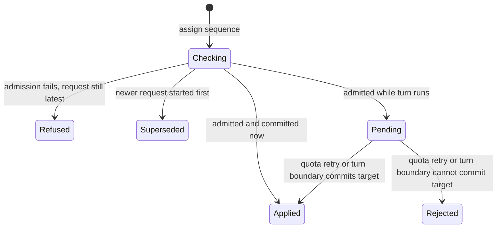
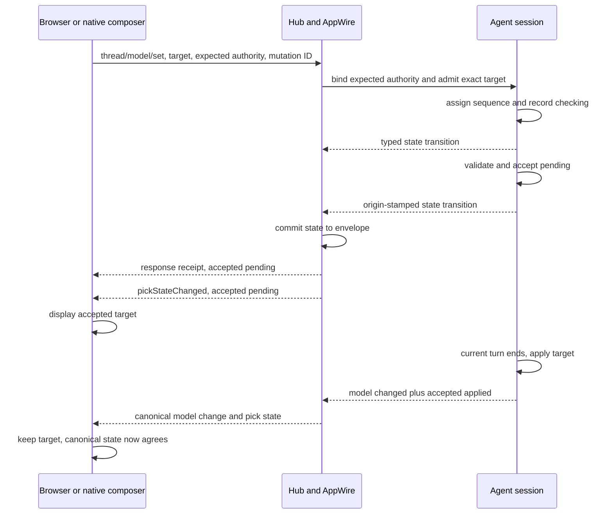

# Model-Switch Authority Uses Separate Attempt and Accepted-Pick Records

Date: 2026-11-15
Status: Proposed

## Summary

Changing the composer model during a running turn must take effect at the next safe model-selection point and must appear in every connected composer as soon as the daemon accepts it. Today, `thread/model/set` returns an empty response while the canonical model changes only after `thread/model/changed`. A queued switch therefore leaves the composer showing the running turn's old model, and overlapping switches cannot be reconciled safely.

Add an ephemeral, daemon-owned model-pick authority with two explicit records:

1. **Latest attempt** names the newest request and whether admission is still being checked, accepted, refused, or superseded.
2. **Latest accepted pick** names the newest request that passed admission and whether it is pending, applied, or rejected.

The daemon publishes both records in the model-set response, a typed state notification, and `thread/read`. Browser and native clients merge those carriers through one shared reducer. The displayed model comes from a pending or applied accepted pick; otherwise it comes from the canonical active model. A later refused attempt never erases an earlier accepted pick, and a later accepted pick permanently supersedes an older one.

The authority is fenced by the thread instance and daemon boot generation. It is not persisted. After a daemon restart or thread replacement, the active model is authoritative until the new daemon accepts another pick.

## Intent and why

The model control is a promise about the next turn, not only a report about the turn currently running. When a user selects a model during a turn, Evener already queues a valid switch. The control should show that accepted choice immediately and keep showing it while the current turn finishes.

The fix also has to remain correct when:

- two tabs or clients issue overlapping picks;
- a newer request is refused while an older accepted pick remains pending;
- a queued pick fails when a turn boundary or quota retry applies it;
- an active-model notification is delayed behind a newer accepted pick;
- the client disconnects and recovers from `thread/read`;
- the selected model is already active and no `thread/model/changed` event is emitted;
- either side is an older Evener version.

A client-only pending label cannot distinguish those cases. The session that admits and applies model switches must own the ordering and outcome.

## Goals

- Show a model as soon as the daemon accepts that pick, including during a running turn.
- Give every client one daemon-owned ordering for local and foreign picks.
- Identify each request exactly with an additive client mutation ID.
- Keep an accepted pick visible when a newer attempt is refused.
- Replace an older accepted pick when a newer attempt is accepted, regardless of which client sent it.
- Remove a rejected accepted pick and fall back to the canonical active model.
- Recover the same answer through live notifications and `thread/read`.
- Preserve the active model as a separate canonical fact.
- Keep new clients safe with older hubs and daemons, and keep old clients working with new ones.
- Use the same reconciliation behavior in the browser and native client.

## Non-goals

- Do not change when model switches are admitted or applied. An idle pick applies immediately. A pick during an ordinary provider call waits for the turn boundary, while a pick made during a quota wait applies at that wait's existing retry-safe point so the retry uses it.
- Do not change model catalogs, profile resolution, provider qualification, reasoning-effort behavior, or model persistence.
- Do not make the running turn change models midway through a provider call.
- Do not persist model-pick authority across daemon boots.
- Do not expose a history of every pick.
- Do not infer request identity from FIFO order, a provider/model string, timing, warning text, or a transport request ID.
- Do not make the displayed accepted pick overwrite the canonical active model in client state.

## Anti-goals

The change fails even if the common case looks right when any of these is true:

- a rejected pick can remain displayed indefinitely;
- a later refused attempt resurrects or erases an older accepted pick;
- reconnect changes the answer without an authority-identity change;
- an older response or notification can overwrite a newer outcome;
- one client can display its local belief after another client has become authoritative;
- a provider/model pair is reconstructed by splitting a qualified string;
- clients parse a human-readable error or warning to reconcile state.

## Constraints

- `agent.Session` currently assigns model-pick sequences, admits queued switches, applies them at the turn boundary or the retry-safe end of a quota wait, and learns about deferred failures. It is the only component that can author both records.
- `thread/model/set` currently returns `EmptyResponse`. Its replacement response must decode safely from an older daemon's `{}`.
- An older daemon ignores additive request fields and emits no model-pick authority. New clients must then keep the current conservative behavior: display the canonical model until `thread/model/changed` arrives.
- Old clients ignore additive response fields, snapshot fields, request fields, and unknown notifications. Their existing canonical-model behavior remains valid.
- Older hubs typed-decode and re-encode model requests, responses, and reads, but relay unknown notifications opaquely. They can therefore split the new carriers. A new client may enable model-pick authority only after an accepted read advertises end-to-end protocol support for that authority.
- `thread/read` already carries `BootGeneration`, and the thread snapshot carries `InstanceID`. A sequence is comparable only inside that authority pair.
- Live thread snapshots are materialized through the server envelope. Exact model-pick transitions need a typed carrier into that envelope; a callback pull during a read would violate the envelope's single-writer rule and can sample the wrong transition.
- Generated AppWire TypeScript and protocol documentation come from `make generate`; they are never edited by hand.
- Default tests use scripted providers and real Evener code below the provider boundary. They require no network or credentials.

## Approaches

### Selected: two explicit records

Keep the latest attempt and latest accepted pick separately. This directly represents the important case: pick 1 was accepted and remains pending, while pick 2 was refused. It also lets a newer accepted pick replace the older accepted pick without retaining a ledger.

This is the approach Jesse selected. It is larger than a client-only patch because it adds protocol state, but it gives snapshots and every client the same answer.

### Rejected: bounded pick ledger

A small ledger could retain every recent transition and let clients derive the answer. It would require retention bounds, truncation semantics, replay rules, and more client logic. None of that is needed to answer which attempt is newest and which accepted pick controls the display.

### Rejected: reread after model events

Clients could call `thread/read` after warnings or model changes and compare the canonical model. This cannot recover a same-model accepted pick, cannot identify a specific rejection, and leaves races between the triggering event and the read. It also turns a local state transition into extra network traffic.

## Authority and protocol model

### Identity and target

A model-pick authority is identified by:

- `instanceId`: the live thread incarnation;
- `bootGeneration`: the daemon generation serving it.

These fields fence records; they do not order thread incarnations. Only an accepted `thread/read` replacement, admitted through the client's existing read-generation, boot-generation, and instance fences, installs a different authority. A response or notification whose identity does not exactly match the installed thread cannot replace it. It triggers the existing invalidate-and-reread path, and the client drops the old display override as soon as invalidation begins.

Mutation targeting uses the complete authority. `ThreadModelSetParams` carries optional `expectedInstanceId` and `expectedBootGeneration` as well as `clientMutationId`. A capable client sends all three. The daemon atomically verifies its serving boot, resolves the stable ref to a session, and verifies that session's ID before starting admission; it never performs a separate precheck followed by a second lookup of the live session. A request composed before clear or daemon replacement therefore cannot mutate the replacement authority.

Boot generation and instance are equality fences, never values to order. A boot or instance mismatch refuses the mutation before sequence assignment and forces the client through the normal replacement read.

A pick target always carries separate `modelProvider` and `model` fields. The daemon qualifies those fields for profile lookup, but no protocol or client code reparses a combined `provider/model` string.

Every `thread/model/set` request may carry a `clientMutationId`. Browser and native clients generate a secure UUID for every pick. The mutation ID and expected authority fields remain optional for legacy callers. A server advertising model-pick authority requires all three for that protocol. A request with all three absent follows the legacy canonical-model path and creates no authority record; a partial set is malformed and fails before mutation. The daemon preserves a supplied mutation ID unchanged in every record and receipt derived from that request.

### Server sequence

After AppWire has accepted a well-formed request and atomically bound it to the expected live authority, that session assigns a monotonically increasing unsigned sequence before model admission starts. Protocol-shape or target-identity failures, such as an empty model, invalid ref, partial authority fields, or stale expected boot or instance, never enter the model-pick state machine. Assignment and record transitions are serialized under session state. A sequence is meaningful only within the originating session and boot authority.

Once assigned, admission is a session mutation rather than transport-scoped work. It continues to a terminal attempt outcome if the caller disconnects or cancels its request. If the daemon exits first, the next boot's different authority discards the unfinished `checking` record. A request therefore cannot remain `checking` forever inside a live authority merely because its transport disappeared.

Strictly newer sequence wins. Equal sequence means another observation of the same request farther through its lifecycle. A lower sequence never changes either record.

### Latest attempt record

`ModelPickAttempt` contains:

- `sequence`;
- optional `clientMutationId`;
- exact target, `modelProvider` and `model`;
- `outcome`: `checking`, `accepted`, `refused`, or `superseded`.

The shared `latestAttempt` is the newest sequence the session has seen. Starting a request installs `checking`. Final admission changes the same record to `accepted` or `refused` only if it is still latest.

A request whose admission finishes after a newer sequence started cannot become accepted. Its request receipt reports `superseded`, while the shared `latestAttempt` remains the newer record. This prevents a slow older validation from overtaking a newer user choice.

A refused attempt remains `latestAttempt` for diagnostics and reconciliation. It does not alter `latestAcceptedPick`.

### Latest accepted-pick record

`ModelAcceptedPick` contains:

- the same `sequence`, optional `clientMutationId`, and exact target;
- `lifecycle`: `pending`, `applied`, or `rejected`.

When the latest attempt passes admission, it becomes `accepted` and replaces `latestAcceptedPick`:

- `pending` when it is queued behind a running turn or quota wait;
- `applied` when the active profile has committed, including a pick of the model already in force;
- `rejected` when a previously accepted pending pick fails at a turn boundary or quota-wait application point.

The profile commit, accepted-pick move to `applied`, and `activeModelSequence` advance are one session-state transition. A rejection leaves `activeModelSequence` unchanged.

A newer accepted pick permanently replaces the older accepted-pick record. If the newer pick later rejects, clients fall back to the canonical active model. They do not resurrect the older accepted record.

A deferred result may update `latestAcceptedPick` only when its sequence still matches. A failure from an older, already superseded pick cannot reject a newer pick.

The machine-readable `rejected` lifecycle is the coded rejection signal. Existing warnings continue to carry human-readable detail, but clients never parse warning text to settle state.

### State and receipt carriers

`ModelPickState` contains the authority identity, an optional `activeModelSequence`, and the two optional records. `activeModelSequence` is the sequence whose target most recently committed as the canonical session profile, including a same-model commit; it remains unchanged when a newer pending pick rejects. It is an ordering floor, not a third history record. `latestAttempt` exists after the first request in a boot. `latestAcceptedPick` exists only after some request in that boot passes admission.

`ThreadModelSetParams` gains optional `clientMutationId`, `expectedInstanceId`, and `expectedBootGeneration`.

`thread/model/set` returns an additive `ThreadModelSetResponse` with optional `receipt`. An older daemon's `{}` decodes as a response with no receipt. The receipt contains:

- the authority identity;
- the completed record for this request, including `superseded` when applicable;
- the full current `ModelPickState` at response time.

The receipt and every session event carry the immutable originating authority captured from the bound session. The server never stamps a result from whichever session happens to be live when slow admission finishes. If clear retires the origin meanwhile, its envelope commit is rejected by the normal projection identity fence and the client ignores the origin-mismatched response.

A directly refused request keeps the existing RPC error behavior. The caller already knows that request's mutation ID and settles only that local call. The daemon also publishes the resulting shared state so other clients see the refused latest attempt.

A successful response can therefore report either accepted or superseded. It never claims that a valid but overtaken request controls the next turn.

Add `thread/model/pickStateChanged`, carrying `ref`, `threadId`, and the full `ModelPickState`. Publish it for externally observable transitions: request start, final admission, queue acceptance, immediate or quota-wait apply, turn-boundary apply, and deferred rejection. Coalescing may skip intermediate `checking`, but no published state may regress either record.

Add optional authority, sequence, and client mutation ID fields to `thread/model/changed`. They identify which accepted pick produced that canonical active-model change. Older producers omit them. Outside a version-1 authority, clients retain the existing behavior and apply every valid canonical change. Inside one, the applied-sequence floor below prevents a delayed event from regressing a fact already committed by a newer accepted pick.

Add `modelPickAuthorityVersion` and optional `modelPickState` to the live thread snapshot returned by `thread/read`. Version 1 means the complete request, response, notification, and snapshot protocol is available end to end. An accepted read without the version disables authority reconciliation for that thread, even if an intermediary forwards a new notification opaquely. Daemonless snapshots, older daemons, and old typed hubs omit the version. A capable new boot with no pick advertises the version and omits only the state.

The exact Go type placement and helper names are left to the implementation plan. The wire fields and state meanings above are fixed.

## Server state transitions

`Refused` and `Superseded` are attempt outcomes. `Pending`, `Applied`, and `Rejected` are accepted-pick lifecycles. They are separate records rather than one state machine in storage; the diagram shows the outcome of one request.

The session updates records under its state lock and emits immutable transition data, including its originating authority, after unlocking through the existing model-switch publication serialization. Event publication must preserve transition order for one session. The server converts those typed session events into AppWire notifications and feeds the same data directly into the cached thread envelope under its projection and delivery-generation fences.

The final transition for a successful RPC also has a synchronous direct-carrier path into that same envelope. The origin-fenced envelope commit must finish before the success response becomes observable. A `thread/read` begun after the response therefore cannot return an absent or older same-authority state while the asynchronous notification drain catches up. This is the same happens-before purpose as the existing synchronous canonical-session-info refresh, without adding a read-time callback.

The envelope, notification, response, and snapshot all serialize the same state type. No read-time callback samples session state as a fallback.

The atomic mutation binding captures the origin `instanceId` and `bootGeneration`; every transition and receipt derived from the mutation carries that immutable origin. The server accepts those values only while its projection still serves that origin. Snapshots use the identity already committed with the envelope. If the thread instance changes or the daemon restarts, the new identity starts with no model-pick state.

Clients learn that reset through the existing authoritative replacement paths. `thread/clear` invalidates the old authority but cannot install a complete replacement authority because its response has no boot generation; the replacement remains unavailable for authority-aware model mutation until a fresh `thread/read` completes. Reconnect, daemon replacement, or any identity mismatch does the same. Invalidation clears the old display override before useful rendering resumes. A version-1 replacement read may omit `modelPickState`, which explicitly means that authority has no accepted override. The protocol does not need an empty pick-state notification solely to announce a reset.

### End-to-end flow

The response and notification may arrive in either order after the envelope commit. Equal-sequence monotonic merging makes the result identical.

## Shared client reconciliation

The AppWire TypeScript package owns a pure merge function used by browser and native clients. `ThreadModel` keeps `modelPickState`, including its active-model sequence floor, separate from canonical `modelProvider` and `model`. The reducer enables those fields only when its accepted read advertises `modelPickAuthorityVersion: 1`; otherwise it ignores receipts and pick-state notifications and preserves legacy canonical behavior.

For every response receipt, state notification, or snapshot:

1. Require an exact match with the authority already installed by an accepted thread read before comparing sequence.
2. Ignore a carrier from an older boot according to the existing boot-generation rules.
3. On any other identity mismatch, invalidate the thread, clear its display override, and use the existing fresh-read replacement path. Never decide which opaque `instanceId` is newer.
4. An accepted version-1 replacement read installs its authority and its complete model-pick state. An absent state under that capable authority means no accepted override. Without the version, absence means unsupported rather than empty.
5. Within one authority, merge `latestAttempt` and `latestAcceptedPick` independently by sequence, and merge `activeModelSequence` only upward.
6. For equal sequence, allow only forward lifecycle movement:
   - attempt: `checking` to one terminal outcome;
   - accepted pick: `pending` to `applied` or `rejected`.
7. Ignore lower sequences and equal-sequence regressions. A delayed pending response cannot overwrite a terminal notification.
8. Preserve a newer live state when a read that began earlier completes. Existing read-generation and snapshot fences still apply before the field merge.

The display projection is:

- if `latestAcceptedPick.lifecycle` is `pending` or `applied`, show that record's exact target;
- if it is `rejected` or absent, show the canonical active model.

`latestAttempt` never directly controls the label. It explains why a newer request did not take authority without hiding an already accepted pick.

Canonical `thread/model/changed` handling remains independent while respecting facts the daemon has already committed. Observing a higher `activeModelSequence`, either in model-pick state or on a model-changed event being applied, raises the floor for that authority. A lower-sequence model-changed event is ignored because it would regress the canonical projection behind a model known to be active. The matching or newer model-changed event updates provider/model and profile metadata. The floor survives replacement of `latestAcceptedPick` by a newer pending or rejected pick, is recovered from an authoritative read, and resets only on identity invalidation.

A newer accepted pick that is still `pending` does not raise the floor. A delayed sequence 1 commit can therefore update canonical state while pending sequence 2 remains displayed; sequence 2's eventual application raises the floor, while its rejection reveals the sequence 1 canonical model. The response need not duplicate profile metadata: until the matching model-changed event arrives, the accepted display is correct and the last non-regressed canonical metadata remains in place. Same-model application raises `activeModelSequence` but needs no model-changed event because its canonical metadata is already current.

Within one live authority, production code changes the canonical session profile only through `applyModelSwitch`, so every active-model change after startup belongs to an accepted pick. Startup profile resolution happens before the authority begins. Any future production path that changes the canonical model must either enter this state machine or explicitly retire the accepted-pick record in the same transition. A new-daemon model-changed event that omits pick identity while model-pick state is installed is a protocol inconsistency: the client invalidates and rereads rather than guessing which fact wins.

## Browser behavior

After a version-1 read, the thread store generates a secure `clientMutationId`, sends it with the installed expected instance, expected boot generation, and qualified provider/model pair, and merges an optional response receipt through the shared reducer. It does not install a separate component-local pending label. When the read does not advertise version 1, the store uses the legacy request and canonical display behavior.

`ModelSwitch` renders the shared display projection. Every browser view of a thread consumes the same daemon authority, including picks made by another view. Per-request transport bookkeeping may remain local, but it cannot override the shared authority.

On a direct RPC error, only that call settles. Because a pick is not displayed before daemon acceptance, direct refusal needs no speculative rollback. A matching live state notification may still update `latestAttempt` for all views.

## Native behavior

After a version-1 read, the conversation service generates the same secure mutation ID, sends it with the installed expected instance, expected boot generation, and already separate provider/model pair, decodes the optional receipt, and merges it through the shared reducer. Without that version it uses the legacy request and canonical display behavior. The native model label uses the same display projection as the browser, with its existing Board-row fallback when model metadata is incomplete.

The native client currently discards the model-set result. That changes only for the optional receipt; an empty old-daemon response remains valid.

## Failure and ordering cases

| Case | Authoritative result |
|---|---|
| Pick 1 accepted pending; pick 2 refused | Latest attempt is refused pick 2; latest accepted remains pending pick 1; display pick 1 |
| Pick 1 accepted; pick 2 accepted | Both records become pick 2; pick 1 can no longer affect either record |
| Accepted pick rejects at boundary or quota retry | Its accepted record becomes rejected; display falls back to canonical active model |
| Older validation finishes after newer request starts | Older receipt says superseded; shared records remain on the newer request |
| Older deferred failure arrives after newer acceptance | Sequence mismatch; failure cannot reject the newer accepted pick |
| Same-model pick is accepted | Accepted record becomes applied even if no model-changed event is emitted |
| Applied sequence 2 arrives before model-changed sequence 1 | Applied floor rejects the stale canonical event; canonical and displayed state cannot regress behind sequence 2 |
| Pending sequence 2 exists when model-changed sequence 1 arrives | Canonical state advances to sequence 1 while display remains pending sequence 2 |
| Pending response arrives after applied/rejected notification | Equal-sequence regression is ignored |
| Caller disconnects after sequence assignment | Session admission continues to a terminal attempt outcome |
| Client reconnects through a capable path | Version-1 snapshot restores both records under the same authority identity |
| Thread is cleared | Client invalidates and clears the old override; authority-aware mutation remains unavailable until a fresh read installs the replacement boot and instance |
| Daemon boot or thread instance changes | Client invalidates, clears the old override, and installs only an accepted replacement read; absent state under version 1 means canonical model controls display |
| Request carries a stale expected boot or instance | Atomic authority binding refuses it before sequence assignment; it cannot mutate the replacement session |
| Slow admission finishes after clear | Its origin identity cannot update the replacement envelope, and the origin-mismatched response cannot replace client authority |
| Success response is followed immediately by thread/read | The synchronous envelope commit makes the read return at least the response's same-authority state |
| Delayed old-instance response follows replacement | Identity mismatch cannot replace the installed authority; the stale response is ignored |
| New-daemon model change lacks pick identity while authority state exists | Protocol inconsistency invalidates the thread and forces a fresh read |
| Old typed hub relays a new notification but drops new read/response fields | Read advertises no authority version, so the notification is ignored and canonical behavior is unchanged |
| Old daemon returns `{}` | Read advertises no authority version; no accepted override is invented and canonical behavior is unchanged |
| New daemon serves old client | Old client ignores additive fields/notification and follows canonical model changes |

## Compatibility and rollout

All wire changes are additive except that the declared response type of `thread/model/set` becomes a struct whose zero JSON shape is compatible with `{}`:

- request `clientMutationId` is optional;
- request `expectedInstanceId` is optional;
- request `expectedBootGeneration` is optional;
- response `receipt` is optional;
- snapshot `modelPickAuthorityVersion` is optional;
- snapshot `modelPickState` is optional;
- model-changed authority fields are optional;
- the pick-state notification is new.

Keep the existing Go client's error-only model-set method for current callers. Add a receipt-returning variant or internal request helper for callers that need the response; the implementation plan chooses the smallest API that avoids duplicated request code.

A version-1 read is the end-to-end capability handshake. Only then does a new client send identity-bearing requests or consume authority receipts and notifications. An older typed hub drops the version while re-encoding the read, so an opaquely relayed notification cannot accidentally enable half of the protocol. A mixed-version client deliberately keeps the original delayed-label behavior rather than guessing and displaying the wrong model.

A new hub must preserve the request identity fields, decode and return the typed response receipt, and preserve the version and state in `thread/read`. A new daemon still accepts legacy requests from old clients, but those requests create no model-pick authority and remain observable only through canonical model changes.

This replacement supersedes PR #6345. Do not merge or close #6345 until the replacement has passed its behavior gates and Jesse separately authorizes the repository action. No code or generated output should be copied from that branch without revalidating it against this design.

## Testing strategy

Read and follow `docs/developing-evener/testing.md`. Tests assert state and behavior rather than human-readable copy.

### Agent state machine

Use real `Session` model switching with controlled profile resolution and turn boundaries. Cover:

- sequence assignment before model admission, after protocol-shape validation;
- transport cancellation after assignment still reaching a terminal attempt outcome;
- slow older validation superseded by a newer request;
- refused latest attempt preserving the accepted record;
- pending to applied and pending to rejected;
- pending application at the quota-wait retry-safe point as well as the turn boundary;
- an older deferred result unable to change a newer accepted record;
- same-model acceptance reaching applied without relying on `EventModelChanged`.

### Daemon, server, and AppWire

Use a scripted provider at the LLM boundary and real session, event, envelope, RPC, and snapshot paths below it. Prove:

- a mid-turn set response carries an accepted pending receipt;
- pick-state notifications and `thread/read` agree;
- a success response happens after the same-origin envelope commit, so an immediately following read cannot return older state;
- an idle-tail rejection reaches both notification and snapshot;
- cached-envelope overlap cannot install an older model-pick state;
- the active-model notification carries its originating identity when known;
- a daemonless read omits authority state;
- boot and instance replacement invalidate first, clear the old display override, and install authority only from the accepted replacement read;
- clear followed by model set before the replacement read cannot issue an authority-aware mutation;
- stale expected boot or instance is refused atomically and cannot mutate an authority installed by concurrent clear or restart;
- slow admission retains its origin identity across clear and cannot update the replacement projection;
- a delayed response from an old opaque instance cannot replace the accepted authority;
- an old typed hub that drops the version and typed fields cannot enable authority from an opaquely relayed notification;
- a new-daemon unqualified model change with installed pick state forces resynchronization;
- `{}` decodes as a valid receipt-less response.

### Shared TypeScript reducer

Table-test every carrier ordering, including:

- response before notification and notification before response;
- delayed pending after applied and after rejected;
- lower sequence after higher sequence;
- pick 1 accepted, pick 2 refused, pick 1 rejected;
- local pick 1, foreign pick 2 accepted, pick 3 refused;
- applied sequence 2 raising a snapshot-recoverable floor that rejects delayed canonical sequence 1, including after sequence 3 becomes pending or rejected and after reconnect;
- pending sequence 2 allowing canonical sequence 1 to advance;
- same authority reconnect and replacement authority reset;
- identity-mismatched responses and notifications invalidating rather than ordering opaque instance IDs;
- version-1 absent state as an explicit empty authority and version-absent old-daemon state as unsupported.

### Browser

Drive the real store and composer control with the AppWire test client. Prove that:

- selecting during a running turn changes the label after acceptance;
- a direct refusal keeps the previous accepted or canonical label;
- another view's accepted pick supersedes the local display;
- a later refused foreign attempt does not restore an older local pick;
- reconnect through a version-1 read restores a pending pick and a rejected pick falls back;
- an old typed hub's split carriers never create a pending display;
- clear removes the display override and waits for the replacement read before sending an authority-aware pick;
- two views of one ref keep independent request fences while converging on shared authority.

### Native

Cover request UUID and expected-authority generation, receipt merging, live state, version-gated snapshot recovery, split old-hub carriers, old-daemon empty response, clear-before-read behavior, and label projection with the existing Board-row fallback.

### Generated and repository gates

Run `make generate` and commit the generated AppWire TypeScript and `docs/appwire-protocol.md` changes. Run focused Go, shared-client, browser, and native tests; TypeScript typecheck; `make test-web`; `make vet`; and one `make lint` before push. The implementation plan may add narrower gates based on the touched packages.

## Acceptance criteria

1. A model accepted during a running turn appears in the initiating composer as soon as `thread/model/set` succeeds.
2. Every connected browser and native view converges on the same accepted pick.
3. A newer refused attempt leaves the prior accepted pick visible.
4. A newer accepted pick supersedes every older pick, including one from another client.
5. Deferred rejection removes only the exact accepted pick and survives reconnect.
6. Same-model acceptance settles without requiring `thread/model/changed`.
7. Delayed responses, notifications, and reads cannot regress either record.
8. An applied accepted pick prevents a delayed lower-sequence event from regressing canonical client state, while a pending pick does not hide an earlier committed canonical change.
9. A stale-authority request cannot mutate a replacement session, and a retired session's result cannot update the replacement projection.
10. A read begun after a successful model-set response observes at least that response's same-authority state.
11. Daemon restart, clear, and thread replacement discard stale authority before sequence comparison; clear waits for a replacement read before authority-aware mutation resumes.
12. New clients enable authority only after a version-1 read, remain conservative through old hubs and daemons, and old clients continue to follow canonical model changes from new daemons.
13. No client infers identity from order, target value, timing, or warning text.
14. Default tests exercise the real Evener path below a scripted provider boundary and require no network or credentials.

## Builder decisions left open

The implementation plan may choose symbol names, file boundaries, helper names, and whether the existing Go client exposes a new public receipt-returning method or keeps that helper internal. It may coalesce intermediate `checking` notifications, provided the current shared records and every accepted-pick lifecycle transition remain recoverable through a later notification or snapshot and state never regresses. A connected caller's receipt reports its own superseded attempt; the protocol intentionally does not retain superseded attempt history for later reconnect.
