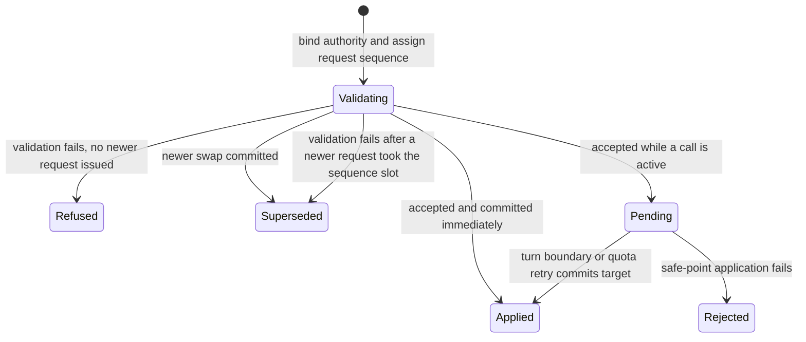
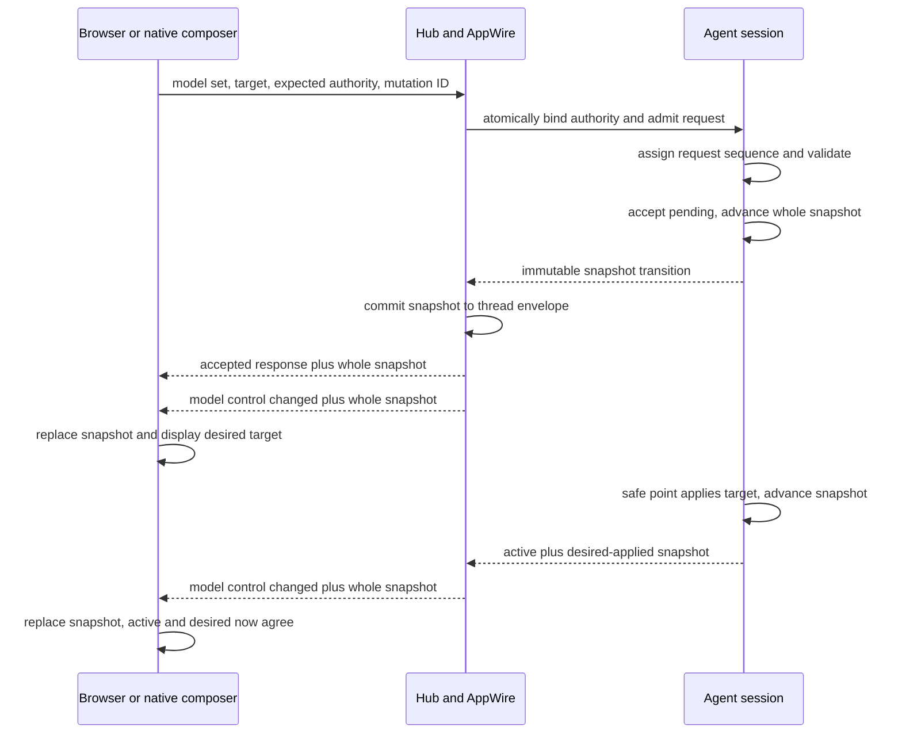
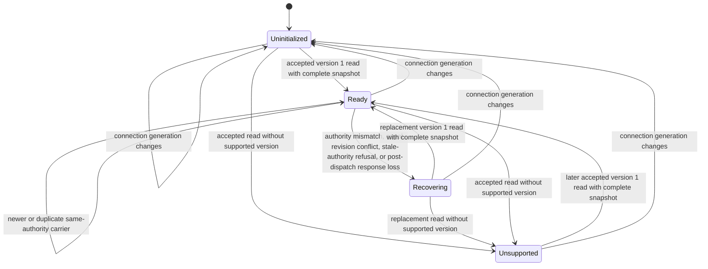

# Model-Switch Authority Is One Revisioned Snapshot

Date: 2026-11-16
Status: Implemented

## Summary

Changing the composer model during a running turn must appear as soon as the daemon accepts the choice and must take effect at the next safe model-selection point. Today, `thread/model/set` returns no state while the canonical model changes only after `thread/model/changed`. The composer therefore keeps showing the running turn's old model, and client-local pending labels cannot reconcile overlapping clients, deferred rejection, reconnect, or a pick of the model already in force.

Add one ephemeral, daemon-owned `ModelControlSnapshot`. It contains:

- the authority identity and one monotonic revision;
- the complete active model metadata;
- the optional accepted desired-model intent and its lifecycle.

The model-set response, a typed notification, and `thread/read` carry the same whole snapshot. Browser and native clients reconcile it through one shared client state: `uninitialized`, `ready`, `recovering`, or `unsupported`. Only `ready` contains mutation authority. Clients never merge individual model-control fields from different carriers and never fall back to an identity-free model mutation.

Direct refusal and supersession remain results for the request that caused them. They do not become shared state. A deferred rejection is shared because it changes an already accepted desired intent, and it retains that request's exact `clientMutationId`.

The snapshot is fenced by thread instance and daemon boot generation and is not persisted. A new thread instance or daemon boot begins a new authority whose active metadata controls the display until that authority accepts a desired model.

## Intent and why

The model control is a promise about the next provider call, not only a report about the call currently running. When a user selects a model during a turn, Evener already queues a valid switch. Every composer should show that accepted choice immediately and keep showing it while the current call finishes.

The state must remain correct when:

- two clients issue overlapping picks;
- a newer request is refused while an older accepted intent remains pending;
- an accepted queued switch rejects at the turn boundary or quota-retry safe point;
- response, notification, and read arrive in any order;
- the client disconnects and recovers through `thread/read`;
- the selected model is already active and no `thread/model/changed` event is emitted;
- a client temporarily loses usable authority while a replacement read is in flight;
- a read is missing, malformed, rejected, or advertises an unsupported protocol version.

The daemon session that admits and applies switches is the only component that knows all of those facts. It must publish one answer rather than making clients combine an attempt record, accepted-pick record, canonical-event floor, and independently delivered canonical metadata.

## Goals

- Show an accepted model choice during a running turn.
- Give every connected client one daemon-owned answer for active and desired model state.
- Identify each model mutation with a required `clientMutationId`.
- Preserve an earlier accepted desired intent when a newer request is directly refused.
- Permanently replace an older desired intent when a newer request is accepted, regardless of its originating client.
- Settle a deferred rejection against the exact accepted mutation and recover that result after reconnect.
- Make same-model acceptance observable without relying on `thread/model/changed`.
- Require supported authority for every model mutation.
- Keep browser, native, and Manager mutation semantics aligned.
- Keep a session readable when a client cannot establish model-control authority, while disabling model changes.

## Non-goals

- Do not change admission or application timing. An idle pick applies immediately. A pick during an ordinary provider call waits for the turn boundary. A pick made during a quota wait applies at the existing retry-safe point so the retry uses it.
- Do not switch models in the middle of a provider call.
- Do not change model catalogs, profile resolution, provider qualification, reasoning-effort controls, vision-model controls, or model persistence.
- Do not persist model-control state across daemon boots.
- Do not expose request history.
- Do not speculate in the client before daemon acceptance.
- Do not infer request identity from FIFO order, target value, timing, warning text, or transport request ID.
- Do not make model-control recovery invalidate otherwise valid transcript history.
- Do not support mixed-version model-control deployments: no fallback method, old-response decoding, or identity-free mutation path for a peer that does not speak version 1. Evener is pre-release, so the method changes in place. A client on a below-v8 connection still reads and updates its hub; only model switching is disabled there.

## Anti-goals

The change fails even when its common path looks right if:

- a rejected desired model can remain displayed;
- a direct refusal can erase or resurrect a different accepted intent;
- reconnect produces a different answer within the same authority and revision;
- a delayed carrier can combine old active metadata with a new desired intent;
- a client without current supported authority can send a model mutation;
- one client can keep displaying its local belief after another client's accepted choice becomes authoritative;
- a provider/model pair is reconstructed by splitting a qualified string;
- clients parse human-readable errors or warnings to reconcile state.

## Constraints

- `agent.Session` already assigns model-pick sequence numbers, admits queued switches, applies them at turn boundaries and quota-retry safe points, and learns deferred failures. It owns the snapshot state machine.
- `thread/model/set` changed in place from `EmptyResponse` to required authority fields and a typed response; it provides no old-endpoint compatibility path.
- Hubs typed-decode and re-encode model requests, responses, and reads while relaying notifications. Every shipped hop changes together and forwards the complete authority-bound contract.
- `thread/read` already carries `BootGeneration`, and its thread carries `InstanceID`. Revisions are comparable only inside that identity pair.
- Live thread snapshots are materialized through the server envelope. The model-control snapshot needs a typed facet updated through `refreshFacets` and read by `appThread`; a callback fallback during read would violate the envelope's single-writer rule and could sample a different transition.
- Existing `thread/model/changed` combines canonical model metadata with effective context status. Context usage changes independently, and fallback can change the answering profile's window, assumed state, threshold, pressure, and source without changing the selected canonical model. Those context fields remain under their existing context-status authority and outside the model-control revision domain.
- Generated AppWire TypeScript and protocol documentation come only from `make generate`.
- Default behavior tests use scripted providers and real Evener code below the provider boundary. They require no network or credentials.

## Approaches

### Selected server authority: one focused model-control snapshot

One revision orders one immutable value containing active model metadata and the accepted desired intent. Every carrier transports that value whole. A newer value replaces an older one atomically.

Jesse selected this approach after review showed that independently merging latest-attempt, latest-accepted, active-sequence-floor, and canonical-metadata authorities creates ordering exceptions. The focused snapshot is slightly broader at each transition but much smaller as a consistency model.

### Selected client authority: one explicit control state

Browser and native share a discriminated state with four exhaustive cases: `uninitialized`, `ready(snapshot)`, `recovering(lastSafeDisplay)`, and `unsupported(lastCanonicalDisplay)`. The shared reducer returns both the next state and whether one replacement read must start. Only `ready` may compose a model mutation.

Jesse selected this after PAR reproduced three consequences of representing protocol version and snapshot as independent optional fields: a conflict could lose its reread, a capable client could mistake recovery for a no-snapshot mutation path and send without identity, and native could abort the whole conversation on an unknown version. The explicit state makes those invalid combinations unrepresentable.

### Rejected client alternative: optional fields plus guards

A shared mutation guard and another recovery flag would make a smaller diff, but the invalid combinations would remain representable in every `ThreadModel`. Each read owner, notification owner, and mutation caller would still need to interpret optional-field combinations as unsupported, recovering, or ready.

### Rejected client alternative: opaque server lease

An opaque token could replace the instance and boot fields, but the client would still need the same `ready` and `recovering` distinction. The existing authority pair already provides an unforgeable comparison domain for this purpose, so another wire identity adds machinery without strengthening the guarantee.

### Rejected server alternative: separate attempt and accepted-pick records

Separate records directly represent “pick 1 accepted, pick 2 refused,” but they also require independent merge rules, an active-model sequence floor, and separate canonical metadata ordering. Review found concrete failures where a same-model apply could suppress the only delayed metadata event and independent records could reinstall stale state. Adding more cross-record rules would repeat the design mistake.

### Rejected: bounded request ledger

A ledger could replay every transition, but it needs retention, truncation, replay, and compaction semantics. Clients would still derive current authority from partial history. The product needs the current answer, not history.

### Rejected: client-local pending state or reread after events

Local state cannot represent another client's accepted choice and disappears on reconnect. Rereading after warnings or model events cannot identify a particular rejection or recover same-model acceptance and introduces a race between the trigger and the read.

## Authoritative state

### Identity and target

A `ModelControlSnapshot` is identified by:

- `instanceId`, the live thread incarnation;
- `bootGeneration`, the daemon generation serving it.

These fields are equality fences, not sortable values. Only an accepted `thread/read`, admitted through the existing read-generation, boot-generation, and instance fences, installs a replacement authority. A response or notification with a different identity cannot be ordered against the installed one. It invalidates the old view and triggers the existing fresh-read replacement path.

A model target always has separate `modelProvider` and `model` fields. The daemon may qualify them for profile lookup, but no protocol or client code reparses a combined `provider/model` string.

### Snapshot shape

The version-1 snapshot has this semantic shape:

```text
ModelControlSnapshot
  authority
    instanceId
    bootGeneration
  revision
  active
    modelProvider
    model
    reasoningEffortLevels
    supportsReasoning
  desired, optional
    clientMutationId
    modelProvider
    model
    lifecycle: pending | applied | rejected
```

The daemon still orders accepted requests by an internal issue counter; that
counter is not part of the wire shape (a later protocol cut removed it from
the published record — clients settle a desired record by its
`clientMutationId`).

`revision` is unsigned and strictly increases for every shared model-control transition in one authority. A snapshot is immutable once published. Equal identity and equal revision must mean equal content; different content at the same revision is a protocol inconsistency.

`active` is complete for the stable metadata controlled by the active model profile:

- provider and model;
- supported reasoning levels and whether reasoning is supported.

The snapshot deliberately excludes independently changing state:

- current reasoning effort remains owned by `thread/reasoning-effort/changed`;
- vision routing remains owned by its existing setting and notification;
- all context status remains owned by the existing context-status projection: usage, effective window, pressure, assumed state, compaction threshold, and window source;
- usage, cost, work time, and turn status remain in their existing snapshot fields.

A capable client updates provider, model, and reasoning capability atomically from `ModelControlSnapshot`. It continues to accept context status from the existing read and live carriers without treating those fields as canonical model identity. This separation matters when a fallback answers: the selected model remains `active`, while effective context status follows the profile that answered.

`desired` exists only after this authority accepts a request. Its lifecycle means:

- `pending`: accepted and queued for an existing safe application point;
- `applied`: the target committed as `active`, including a pick already in force;
- `rejected`: an accepted pending request failed when application was attempted.

An applied or rejected desired record remains recoverable until a later request is accepted or the authority ends. A rejected record preserves the exact mutation identity while the display falls back to `active`.

A new accepted request permanently replaces the previous desired record. A later rejection never resurrects the replaced intent.

### Request identity and admission order

`ThreadModelSetParams` gains required `clientMutationId`, `expectedInstanceId`, and `expectedBootGeneration`. Browser and native generate a secure UUID after a version-1 read. The Manager adapter generates the UUID and injects authority after its own read. Validation still refuses an empty or partial wire request before sequence assignment, because JSON decoding does not enforce required fields by itself.

The daemon atomically verifies its serving boot, resolves the stable ref, verifies the session instance, and binds the mutation to that authority before admission begins. It never performs a precheck followed by a second live-session lookup. A capable request composed before clear or restart therefore cannot mutate the replacement session.

After shape and authority validation, the session assigns a monotonically increasing `requestSequence` before model admission starts. Assignment is serialized with model-control state. The sequence decides which concurrently validating request may be accepted; it is not a second client merge authority.

Two different rules both end a request as superseded, and they key on different counters. Keep them apart.

**Application eligibility is decided at commit, by the committed watermark.** A newer request that has merely been issued does not disqualify an older one: both may still be validating, and either may fail. An older pick that commits first advances the watermark to its own issue, and because the newer pick's issue is higher it is *not* below the watermark — the newer pick may still commit afterwards if it passes its own validation and no higher-sequence request has committed in the meantime. Only a swap that has already committed passes a pick whose issue is below it, and that pick settles superseded at its own commit check without altering the snapshot. This is what preserves an already accepted desired intent when a newer invalid choice is refused: the older pick still lands because nothing newer committed.

**A validation failure is a separate path, keyed on the request sequence.** Every validation failure, whether it runs before admission or in a deferred queue preflight, settles through one handler. That handler returns superseded when a newer request has taken the sequence slot (`fence.pickSeq != modelControlRequestSequence`) or when the fence's authority no longer matches, and otherwise reports the failure as refused. A newer issuance is therefore sufficient to supersede the older call: it can already have committed its own swap, and this path does not require that it has. A refusal that never entered shared state never alters the snapshot: it settles only the originating call's result, so settling an older refusal leaves the current snapshot as it is even when a newer swap already committed. A *deferred* rejection is the one case that does publish, because it settles a desired intent already accepted; it advances the revision and marks that exact `desired` record rejected while the active model stays where it was. `TestModelControlSlowObsoleteRefusalReturnsSuperseded` covers the non-deferred shape, with the newer swap committing before the older validation fails.

A direct admission failure cannot alter the snapshot either. All of these outcomes belong only to their originating calls.

Keep the two records distinct when reading this. The **newest desired record** is the latest accepted request and its lifecycle, and a newer acceptance replaces it, so a superseded pick leaves the newer intent intact while the older queue entry is dropped. The **active model** is the profile the session is actually running, and it moves only through the committed transitions below. A pending desired record can therefore name a model the session is not running yet, and a rejected one can name a model it never ran.

Once assigned, admission continues to a per-call terminal result if the transport disconnects. An accepted disposition requires a snapshot transition; shutdown before that transition returns an error or superseded result, never accepted with an unchanged snapshot. If the daemon exits, the new boot's identity discards the unfinished work.

The method is not replay-idempotent: the snapshot retains only the latest desired mutation, not a receipt ledger. A forwarding hop may retry only when it proves the request was never dispatched. Once dispatch begins, response loss is returned as `mutationOutcome=unknown` with `retryDisposition=blocked` and must not replay the mutation. It triggers one authoritative read; that read may show the mutation, a newer superseding mutation, or neither. The originating call settles from that evidence or remains outcome-unknown, but it never sends the same intent again.

## Server transitions



`Refused` and `Superseded` are per-call results and do not change shared state. `Pending`, `Applied`, and `Rejected` are desired-intent lifecycles stored in the whole snapshot.

The shared transitions are:

1. **Accepted pending:** increment revision, keep `active`, replace `desired` with the request in `pending`.
2. **Accepted immediate apply:** commit the profile, increment revision, replace `active` with complete metadata, and replace `desired` with the request in `applied` as one session transition.
3. **Queued apply:** only if the pending request still matches, commit the profile, increment revision, replace `active`, and move that exact `desired` to `applied` as one transition.
4. **Deferred rejection:** only if the pending request still matches, increment revision, keep `active`, and move that exact `desired` to `rejected`.
5. **Same-model acceptance:** increment revision and publish an `applied` snapshot even when the profile values are unchanged and no model-change event is emitted.

Every active-model change after authority startup must pass through one of these transitions. A future path that changes the canonical profile must update the snapshot in the same atomic session transition. Startup profile resolution happens before the authority begins.

The session emits immutable transition data after unlocking through its existing model-switch publication serialization. Transition publication preserves revision order. The server feeds the same value into the thread envelope and the typed notification under existing projection and delivery-generation fences.

A successful RPC has a synchronous path into that same envelope. Its origin-fenced envelope commit finishes before the response becomes observable. A `thread/read` begun after that response therefore returns the same revision or a newer one, never an older same-authority snapshot while an asynchronous notification is still draining.

The snapshot facet is written only by `refreshFacets` and read only by `appThread`. There is no read-time callback into session state.

### Transport matrix

| Carrier | Version-1 behavior |
|---|---|
| `thread/model/set` accepted response | Typed disposition plus the full current `ModelControlSnapshot` after its envelope commit |
| `thread/model/set` superseded response | Per-call superseded disposition plus the full current snapshot; no shared transition is invented for that request |
| `thread/model/set` stale-authority refusal | Per-call RPC failure with a machine-readable `authorityStale` reason; shared state is unchanged, and a client whose captured authority is still current starts recovery |
| `thread/model/set` other direct refusal | Existing per-call RPC failure; only that call settles and shared state is unchanged |
| `thread/model/controlChanged` | New typed notification carrying `ref`, `threadId`, and the full snapshot |
| `thread/read` | Capability version plus the full snapshot from the envelope facet |
| `thread/model/changed` | Retained as canonical display information for clients without supported authority; `ready` and `recovering` clients do not use it as model-control authority |

The response, notification, and read serialize the same `ModelControlSnapshot` type. A carrier may observe a later revision than the request that triggered it, but it never constructs a partial request-specific snapshot.

Every hub hop must stop discarding the model-set response. The shared `appsource.Source` contract, `LocalDaemonSource`, `RemoteHubSource` and its remote result forwarding, the resume wrapper, the hub application method, and the browser-facing RPC all return the typed response to browser and native callers. Model-set forwarding also carries dispatch provenance: a failure known to precede dispatch may follow the existing resume path, while any failure after dispatch becomes outcome-unknown with blocked retry and cannot resend the request. A resume that creates a new authority cannot silently rewrite the caller's expected authority; the client must establish that authority before composing a new request. This is required scope, not an optional optimization. Without it, the initiating composer would wait for notification delivery, response loss could replay stale intent, and the three carriers would not implement one protocol.

Existing `thread/model/changed` remains for canonical display on unsupported clients and retains its existing context-status update for supported clients. After a version-1 read, the shared reducer treats `ModelControlSnapshot` as the only writer of model provider, model, and reasoning capability. It does not let a delayed event overwrite those snapshot-owned fields. Effective context policy and usage remain separate because fallback may change them without a canonical model transition.

### End-to-end flow



Response and notification may arrive in either order. Whole-snapshot revision comparison makes their result identical.

## Shared client reconciliation

The AppWire TypeScript package owns one pure reducer used by browser and native clients. Model control is one discriminated state, not a capability field plus an independently optional snapshot:

```text
ModelControlClientState
  uninitialized
    canonicalDisplay
  ready
    snapshot
  recovering
    lastSafeDisplay
  unsupported
    canonicalDisplay
```

`uninitialized` means no accepted read has classified the connection. `ready` is the only state with mutation authority. `recovering` means a supported authority was invalidated and only a fresh accepted read may establish the next state. `unsupported` means an accepted read omitted version 1 or advertised a version this client does not implement. Sessions remain readable in every state.



The reducer returns the next state, its carrier decision, and a `replacementReadRequired` effect. Entering `recovering` emits that effect once for the recovery episode. The thread binding owns at most one establishing or replacement-read promise and installs it in the same serialized action that exposes the new state, so a racing mutation can wait for that exact read. More conflicting carriers cannot create a read loop. A repeated malformed version-1 read leaves the client in `recovering`, reports the protocol failure, promptly fails every mutation waiting on that read, and waits for the existing reconnect or explicit retry path rather than immediately rearming itself. Model-control recovery never marks valid transcript history invalid.

Every client connection-generation change, including reconnect and same-ref rebind, runs one serialized retirement action before the new connection can invoke model mutation: preserve only canonical display, move every bound model-control state to `uninitialized`, retire every snapshot authority and request fence, and install the establishing-read promise for the new binding. `uninitialized` therefore means the current connection has not been classified; it never means that authority from the prior connection remains usable.

The subscription starts before its establishing or replacement read. Notifications belonging to that read are quarantined under its read generation. If the accepted read enters `ready`, the client replays matching-authority quarantined carriers over the read snapshot in arrival order. If the read enters `unsupported` or is rejected, it discards the quarantine. A notification cannot establish or restore authority by itself.

For an accepted read, response, or notification:

1. Apply the existing client, read-generation, boot-generation, and instance fences first.
2. Treat every accepted read as authoritative for protocol state. Version 1 with a complete snapshot whose authority matches the read's thread instance and boot generation enters `ready`. An absent or unknown version enters `unsupported`. Version 1 with a missing snapshot or mismatched snapshot authority enters or remains `recovering`.
3. In `uninitialized`, quarantine carriers only for the in-flight establishing read; otherwise ignore them.
4. In `unsupported`, ignore model-control responses and notifications. Only a later accepted read can enter `ready`.
5. In `ready`, require exact `instanceId` and `bootGeneration` equality before comparing revision. Never order opaque identity values.
6. On a current-generation identity mismatch or equal-revision content conflict, enter `recovering`, preserve `lastSafeDisplay`, and request one replacement read.
7. Before a model-set response enters the reducer, compare its captured request authority and client/read generations with the current `ready` state. Discard a response whose authority retired. A delayed response cannot invalidate a replacement.
8. Within one authority, replace the whole snapshot only when its revision is strictly newer; equal content is a duplicate and lower revision is ignored.
9. In `recovering`, only an accepted read may leave the state. Carriers associated with its in-flight read remain quarantined for replay after that read.
10. A machine-readable `authorityStale` refusal against the captured, still-current `ready` authority enters `recovering` and requests one replacement read. Other admission refusals settle only their call. A stale refusal from a retired request fence is discarded.
11. A post-dispatch response loss enters `recovering` and requests one replacement read, but the request is never replayed. The read may establish what became authoritative; it does not turn uncertainty into permission to resend.
12. Preserve a newer live snapshot when a read that began earlier completes through the existing generation fences.

Every establishing or replacement-read promise has a terminal waiter rule. If the same binding reaches `ready`, waiting mutations recheck the binding and may compose a request. If it reaches `unsupported`, or if the read is malformed, rejected, cancelled, or fails in transport, every waiter fails locally and no model-set request is sent. The failure does not automatically create another read.

Display follows the state:

- `ready` with `desired.pending` or `desired.applied`: show the desired target;
- `ready` with `desired.rejected` or no desired record: show the active target;
- `recovering`: keep the last safe display without claiming it is current authority;
- `uninitialized` or `unsupported`: show canonical read/event fields.

A response's direct refusal settles only its own local call. It never rolls back shared display state. A superseded call may merge the response's current whole snapshot only if its captured authority is still `ready`. Only the typed stale-authority reason changes protocol state, as described above. No component-local pending label may override this projection.

## Browser and native behavior

After a version-1 read, each client:

- generates a secure mutation UUID;
- sends it with the installed expected instance and boot generation and separate provider/model target;
- decodes the typed response;
- merges response, notification, and read through the shared reducer;
- renders the shared display projection.

A model pick is offered in `ready`, and in the `unsupported` that a cold session reads as. A cold session has no daemon to hold authority, and the hub resumes it behind the mutation, so the picker offers the change before any authority exists. The dispatch then waits for the post-resume read, which is the first read that can name the resumed daemon: it must reach `ready` for the binding the resume resolved, or the pick fails before its frame exists and nothing is sent.

`recovering` and `uninitialized` hold the picker instead. `recovering` has a replacement read the store owns, and a pick must not race it; `uninitialized` is what a connection retire leaves until a read lands. A live `unsupported` holds it too: a daemon whose read carries no complete snapshot has nothing to resume and no authority to accept a pick.

In `ready`, a call that races with entry into `uninitialized` or `recovering` waits for the already in-flight establishing or replacement read and composes the request only if that read reaches `ready` for the same thread binding. If the binding retires, the read reaches `unsupported`, or the read settles unsuccessfully, the call fails locally without sending. No state sends an identity-free request.

Without version 1, each client continues to display canonical model events but disables model changes. It does not speculate locally. That is per connection, not per client build: a client that negotiates a protocol below v8 reads and updates the hub normally, and only its model switching is disabled, because v8 is what carries the client mutation id and the exact authority a daemon fences a pick on.

The browser thread store owns the shared snapshot so two views of one thread converge even when one view issued the request. Per-call transport bookkeeping remains local but cannot override shared authority.

The native conversation service uses the same reducer and display projection. Its model label keeps the existing Board-row fallback when catalog metadata is incomplete.

`thread/clear` enters `recovering` and invalidates the old authority. Because its response carries no boot generation, a client waits for a fresh accepted `thread/read` before enabling another model mutation.

## Manager behavior

The Manager `session_control` model action is an authority-bound client of the same method. Its tool schema exposes only the user-controlled ref, provider, and model fields; it never exposes mutation identity or authority fields to the model.

For each invocation, the hub adapter first uses the existing session-availability path to auto-resume an exited session without issuing a model mutation. It then performs a just-in-time, unsubscribed `thread/read` that does not start a turn. A complete, identity-matching version-1 read lets the adapter generate a secure mutation UUID and send `thread/model/set` with that exact authority. An absent or unknown version, malformed snapshot, refused read, or read transport failure rejects the Manager invocation locally and sends no mutation.

The adapter does not retain a long-lived authority cache. A machine-readable stale-authority refusal or post-dispatch outcome-unknown result may trigger one fresh read for diagnosis and current-state reporting, but it never automatically replays the already-dispatched mutation. The Manager invocation fails with structured current state so its caller can decide whether to make a new request.

## Coordinated protocol change

Add a `modelControlVersion` capability and full `modelControl` snapshot to `thread/read`. Version 1 means the complete request, response, notification, and read protocol is available end to end. A capable daemon always includes a complete snapshot, even before any request; only `desired` is optional.

This is one in-place, coordinated pre-release protocol change:

- required request mutation and expected-authority fields on `thread/model/set`;
- a typed `thread/model/set` response;
- read capability and snapshot fields;
- one new notification;
- no required change to the existing canonical model-change notification.

Every hub, daemon, generated client, browser, native client, and Manager adapter in a deployment upgrades together for this protocol. The existing method name changes in place; there is no second RPC, old-response decoding, identity-free mutation path, or mixed-version routing guarantee. Skew still has to work at the boundaries the deployment already tolerates: a client that negotiated a protocol below v8 keeps reading, browsing, and updating its hub, and only model switching is disabled on that connection, exactly as a read without version 1 is displayed.

The typed response is structurally complete: its disposition and full snapshot are required. `{}` or any response missing either field is a post-dispatch protocol failure, not an unsupported success. The call fails, automatic retry remains blocked, and the client performs the same one-read recovery used for response loss without replaying the mutation.

Every accepted read re-evaluates authority support. A read without version 1 atomically enters `unsupported`, clears mutation authority, discards its pre-read quarantine, continues canonical display updates, and disables model changes. Notifications never upgrade support by themselves.

This replacement supersedes PR #6345. Do not merge or close #6345 until this replacement passes its behavior gates and Jesse separately authorizes that repository action. Revalidate rather than copying code from that branch.

## Failure and ordering cases

| Case | Authoritative result |
|---|---|
| Pick 1 accepted pending; pick 2 directly refused | Snapshot remains on pending pick 1; pick 2's caller receives refusal |
| Pick 1 accepted; pick 2 accepted | Acceptance replaces the desired record: one newer snapshot carries pick 2's desired identity, displacing pick 1's |
| Accepted pick rejects at boundary or quota retry | New snapshot keeps active metadata and marks that exact desired mutation rejected; display falls back active |
| Older validation finishes after a newer swap commits | Older call is superseded and cannot publish a snapshot transition |
| Older validation finishes after a newer request is issued but before it commits | Older call still commits if it gets there first, advancing the watermark to its own issue; the newer pick's issue is higher, so it may still commit afterwards if it passes its own validation and no higher-sequence request has committed |
| Immediate application fails validation while a newer request has been issued | That call settles superseded without publishing; the snapshot is unchanged and no rejection lifecycle is written |
| Queue preflight fails validation (the deferred pick re-resolves before acceptance) | The same non-deferred failure handler runs as for immediate application, before any desired record of this pick exists: the snapshot is unchanged, the pick settles superseded when a newer request has been issued and rejected by the validation otherwise, and the code's existing rejection lifecycle handles any earlier desired record the pick was about to replace |
| Newer queued pick accepted, older queued pick still pending | Only the newer swap's committed application bars the older pick from applying: the watermark advances at commit, never at acceptance, so if the newer pick fails its own deferred validation the boundary applier can still choose the older pick and it becomes active |
| Older deferred result arrives after newer acceptance | Desired identity no longer matches, so it cannot change the newer snapshot |
| Same-model pick is accepted | Revision advances and desired becomes applied even without a canonical model-change event |
| Old active-model event arrives after a newer snapshot | Capable reducer cannot use it to overwrite snapshot-owned metadata |
| Older response arrives after a newer notification | Lower snapshot revision is ignored |
| Initial notification revision 2 arrives while capability read revision 1 is in flight | Client quarantines it, installs version 1 from the read, then replays revision 2 |
| Equal revision arrives with different content | Protocol inconsistency invalidates and rereads |
| Caller disconnects after request sequence assignment | Session admission reaches a per-call terminal outcome; shared state changes only if accepted |
| Connection generation changes while a client is `ready`, `recovering`, or `unsupported` | Before model mutation is callable, the client preserves canonical display only, retires every authority and request fence, enters `uninitialized`, and installs the new binding's read promise |
| Mutation is attempted while client state is `uninitialized` or `recovering` | Caller waits for the current read and sends only if the same thread binding reaches `ready` |
| Establishing or recovery read is malformed, rejected, cancelled, or transport-failed | Every waiter on that read fails locally and promptly; no mutation is sent and no replacement read is automatically rearmed |
| Accepted read omits version 1 or advertises an unknown version | Client enters `unsupported`, keeps canonical display usable, and disables model changes |
| Version-1 read omits its complete snapshot or carries mismatched authority | Client enters or remains `recovering`, reports the protocol failure, and does not start an immediate reread loop |
| Client reconnects through a capable path | One read restores active metadata and desired lifecycle from the whole snapshot |
| Accepted replacement read omits version 1 | Client atomically enters `unsupported`, clears mutation authority, discards quarantined model-control carriers, and retains canonical display behavior |
| Thread is cleared | Client drops old snapshot and waits for replacement read before authority-aware mutation |
| Daemon boot or thread instance changes | Identity reset happens before revision comparison; replacement read installs the new authority |
| Request carries stale expected identity | Atomic binding refuses it before sequence assignment; replacement session is untouched |
| Request omits mutation or expected identity | Session refuses it before sequence assignment; no model-control state changes |
| Slow admission finishes after clear | Origin identity cannot update the replacement envelope or client authority |
| Old model-set response arrives after replacement read | Request-generation fence proves its captured authority retired, so the response is discarded without invalidating the replacement |
| Successful response is followed immediately by read | Synchronous envelope commit makes read return that revision or newer |
| Session closes after request admission | Call returns an error or superseded result; it cannot report accepted with an unchanged snapshot |
| A `ready` client's request receives machine-readable `authorityStale` | If its captured authority remains current, the client enters `recovering`, fails the call, and starts one replacement read; an ordinary validation refusal does not recover |
| Response is lost after pick 1 was dispatched, then pick 2 is accepted | The forwarding path never replays pick 1; one read converges on pick 2 or reports the outcome unknown, and pick 1 cannot resurrect |
| Successful RPC frame contains `{}` or a partial typed response | Client treats it as a post-dispatch protocol failure with blocked retry, starts one read, and never silently succeeds, enters `unsupported`, or replays the mutation |
| Manager invokes model action after a complete version-1 read | Hub generates the UUID, injects exact authority, and forwards one mutation |
| Manager read is unsupported, malformed, refused, or transport-failed | Manager invocation fails locally and sends no mutation |
| Manager loses a response after dispatch | It may read current state for reporting but never replays the mutation |
| Fallback with a different context window answers | Canonical active model snapshot is unchanged; existing context status reports the answering profile's effective policy |

## Testing strategy

Read and follow `docs/developing-evener/testing.md`. Tests assert state and behavior, not human-readable phrasing.

### Session state machine

Use real `Session` model switching with controlled profile resolution and safe points. Cover:

- request-sequence assignment after shape and identity validation but before admission;
- transport cancellation after assignment;
- slow older validation superseded by a newer committed swap, and the same slow validation still committing when the newer request has only been issued;
- direct refusal preserving the current snapshot;
- accepted pending, immediate applied, pending-to-applied, and pending-to-rejected transitions;
- application at quota retry and turn boundary;
- an older deferred result unable to change a newer desired intent;
- same-model acceptance advancing revision without `EventModelChanged`;
- missing, partial, and stale request identity refused before sequence assignment;
- stale expected authority returned with a machine-readable reason distinct from ordinary model validation refusal;
- shutdown after admission never returning accepted with an unchanged snapshot;
- complete canonical active metadata captured in the same transition as profile commit;
- fallback changing effective context policy without changing canonical model-control state.

### Daemon, server, hub, and AppWire

Use a scripted provider with real session, event, envelope, RPC, and snapshot paths below it. Prove:

- a mid-turn set response carries the accepted pending snapshot;
- response, notification, and read serialize the same snapshot shape and value;
- `appsource.Source`, local-daemon forwarding, application RPC, and browser-facing RPC return rather than discard the typed response;
- a controller hub forwards the exact typed response through `RemoteHubSource` to and from the daemon;
- dispatch provenance distinguishes a proven pre-dispatch failure from post-dispatch outcome unknown;
- the resume wrapper does not resend a model mutation after dispatch, including when an accepted pick 1 response is lost and pick 2 is accepted before recovery;
- success follows the same-origin envelope commit, so an immediate read cannot be older;
- an idle-tail rejection reaches notification and read with exact mutation identity;
- cached-envelope overlap cannot install an older revision;
- same-model acceptance publishes the new notification and read state without a canonical model-change event;
- an identity-free mutation is refused without advancing revision or replacing desired state;
- clear, boot replacement, and instance replacement invalidate before accepting new authority;
- stale expected identity cannot mutate a concurrent replacement;
- slow admission retains origin identity across clear;
- forwarded hub capability expectations include version 1 and the complete snapshot;
- AppWire Go and generated TypeScript clients reject `{}` and every partial model-set response as a post-dispatch protocol failure with blocked retry rather than decoding an unsupported success;
- generated protocol assertions keep the existing `thread/model/set` method and require every request identity field, response disposition, and response snapshot;
- Manager's model action performs a just-in-time read, injects a generated UUID and exact authority, and sends one mutation on the supported path;
- Manager's unsupported, malformed, refused, and failed reads send no mutation, and post-dispatch response loss never replays one;
- generated protocol and TypeScript types are current.

### Shared TypeScript reducer

Table-test:

- every `ModelControlClientState` transition and its `replacementReadRequired` effect;
- response before notification and notification before response;
- lower revision after higher revision;
- equal duplicate and equal conflicting content;
- pending to applied and pending to rejected;
- pick 1 accepted, pick 2 refused, then pick 1 rejected;
- local pick followed by foreign accepted pick;
- same-model applied snapshot correcting stale client metadata;
- delayed canonical model-change payload unable to overwrite ready snapshot-owned metadata;
- fallback-derived context policy remaining authoritative while canonical model metadata stays in the snapshot;
- same-authority reconnect first entering `uninitialized`, then restoring `ready` only from the new connection's read;
- current-generation notification identity mismatch invalidation before revision comparison;
- equal-revision conflict requesting exactly one replacement read even when transcript history was previously discarded;
- delayed response from a retired request authority discarded without invalidating the replacement;
- complete, read-identity-matching version-1 snapshot entering `ready`, and absent or unknown version entering `unsupported` without aborting the conversation;
- malformed, rejected, cancelled, and transport-failed reads entering or retaining the conservative state, settling all waiting mutations, and not starting an immediate retry loop;
- machine-readable stale-authority refusal from a current `ready` request entering `recovering` and requesting one replacement read, while an ordinary validation refusal does neither;
- post-dispatch response loss requesting recovery without producing a replay effect;
- `uninitialized`, `recovering`, and `unsupported` rejecting mutation eligibility;
- each connection-generation transition atomically retiring authority and entering `uninitialized` before mutation eligibility can be observed;
- accepted capable-to-unsupported read atomically clearing mutation authority;
- revision-2 notification quarantined during the revision-1 capability read, then replayed;
- unsupported establishing read discarding its quarantined model-control carriers.

### Browser

Drive the real store and composer with the AppWire test client. Prove:

- selecting during a running turn changes the label after daemon acceptance;
- direct refusal keeps the previous accepted or active label;
- another view's accepted choice supersedes local display;
- rejected desired intent falls back to active after live delivery and reconnect;
- same-model acceptance settles through response or notification;
- a notification arriving during the capability-establishing read is replayed over that read;
- an absent or unknown-version read clears the old desired display, preserves canonical display, and disables the selector;
- a reconnect with its establishing read held retires the previous `ready` authority before the selector or mutation call can send;
- malformed, rejected, cancelled, and transport-failed establishing or recovery reads promptly fail waiting selector calls with zero model-set requests;
- an authority mismatch while its replacement read is held cannot send an identity-free request, then enables a request bound to the fresh authority after that read;
- a machine-readable stale-authority refusal starts one recovery read while an ordinary validation refusal does not;
- losing the response after dispatch starts recovery without replaying that mutation;
- an empty or partial successful RPC response fails as a protocol error, starts one recovery read, and never silently succeeds, enters `unsupported`, or replays the mutation;
- a model-control conflict recovers even when transcript history has already been discarded;
- a delayed response issued under a replaced authority cannot clear the replacement snapshot;
- clear removes the old snapshot and waits for replacement read;
- two views retain independent request fences while converging on shared state.

### Native

Cover mutation UUID and expected-authority generation, typed-response forwarding, shared reducer behavior, live notification, establishing-read quarantine and replay, capable-to-unsupported downgrade, unknown-version conversation usability with model changes disabled, delayed retired-authority response, reconnect retirement before the held read, every unsuccessful read settling waiters with zero sends, typed stale-authority recovery, post-dispatch response loss without replay, `{}` and partial responses failing as protocol errors with one read and no replay, clear-before-read behavior, and Board-row label fallback.

### Manager

Drive the real `session_control` model action through its hub adapter. Prove that a complete matching version-1 read injects one generated UUID and its exact authority without exposing those fields in the tool schema. Prove that unsupported, malformed, refused, and transport-failed reads each fail the invocation with zero model-set sends. Lose a dispatched response, accept a newer model choice, and prove the adapter reads for current state without replaying or resurrecting the older request.

### Repository gates

Run `make generate` and commit generated AppWire TypeScript and `docs/appwire-protocol.md`. Run focused Go, shared-client, browser, and native tests; TypeScript typecheck; `make test-web`; `make vet`; and one `make lint` before push. The implementation plan may name narrower package checks in addition to these gates.

## Acceptance criteria

1. A model accepted during a running turn appears in the initiating composer as soon as `thread/model/set` succeeds.
2. Every connected browser and native view converges on the same whole snapshot and displayed target.
3. A direct refusal leaves the prior accepted desired intent visible.
4. A newer *committed* swap supersedes every older pick at its commit check. A merely issued newer request does not, so an older pick may commit first and the newer may commit after it; only a direct validation failure settles a call superseded on the issue counter alone, and that changes no shared state.
5. Deferred rejection settles the exact accepted mutation, survives reconnect, and falls back to active.
6. Same-model acceptance advances shared state without requiring `thread/model/changed`.
7. Response, notification, and read cannot be combined into a mixed-revision value.
8. Only `ready` browser and native clients send model mutations; every sent request carries a mutation ID and exact expected authority.
9. `uninitialized`, `recovering`, and `unsupported` never send a mutation. Sessions remain readable and canonically displayed while model changes are unavailable.
10. Every connection-generation change atomically retires prior authority and enters `uninitialized` before the new connection can invoke model mutation.
11. Each recovery episode requests at most one replacement read. Every establishing or recovery read that cannot establish `ready` promptly settles its waiting mutations, sends none, and does not create an immediate retry loop.
12. Machine-readable stale-authority refusal triggers recovery only for a request whose captured authority is still current; ordinary validation refusal remains local.
13. Once dispatch begins, response loss never replays a model mutation. A recovery read cannot resurrect an older choice after a newer choice is accepted.
14. Manager establishes session availability, performs a just-in-time read, injects generated identity only on complete version-1 authority, and sends no mutation on any non-ready read outcome.
15. Manager never exposes protocol identity fields to the model and never replays a dispatched mutation.
16. Model-control recovery is independent of transcript-history retention or invalidation.
17. Delayed canonical model events cannot regress snapshot-owned active metadata, while fallback-owned effective context status remains independent.
18. A stale-authority request cannot mutate a replacement session, and a retired session cannot update the replacement projection.
19. A read begun after a successful response observes that same-authority revision or newer.
20. Restart, clear, replacement, reconnect, and rebind discard old authority before revision comparison or mutation eligibility.
21. Clients enter `ready` only after a complete version-1 read whose snapshot authority matches the read, and enter `unsupported` on an accepted absent or unknown version without aborting the conversation.
22. An accepted response always represents an accepted snapshot transition; shutdown cannot return accepted with unchanged state.
23. Daemons refuse missing or partial mutation authority before sequence assignment without making other session operations unavailable.
24. `thread/model/set` changes in place as one coordinated protocol. The implementation provides no mixed-version compatibility path, second RPC, identity-free mutation, or empty-response decoding; `{}` and partial responses are post-dispatch protocol failures with blocked retry and one-read recovery.
25. No client infers identity from order, target, timing, warning text, or transport request ID.
26. Default tests exercise real Evener paths below a scripted provider boundary without network or credentials.

## Builder decisions left open

The implementation plan may choose Go and TypeScript symbol names, file boundaries, helper names, and whether the existing Go client gains a public typed-response method or uses an internal shared request helper. It may coalesce notification delivery because every published carrier contains a complete snapshot and reconnect recovers the latest revision.

The builder must use one explicit discriminated client state and may not represent mutation authority as independently optional capability and snapshot fields. The builder must change `thread/model/set` in place with required identity fields, adapt Manager without exposing those fields, preserve dispatch provenance, and treat every post-dispatch failure as non-replayable. A receipt ledger, compatibility RPC, or automatic replay is outside this design.

The builder may not split snapshot fields into independently merged authorities, omit the hub response path, send or accept an identity-free mutation, retain `ready` across a connection-generation change, leave read waiters unsettled, parse text to identify stale authority, treat canonical display events as mutation authority, tie model-control recovery to transcript-history state, or change the field ownership defined above.
