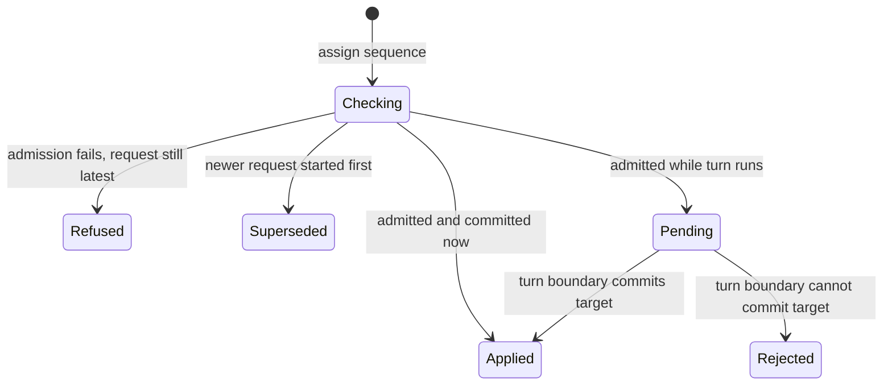
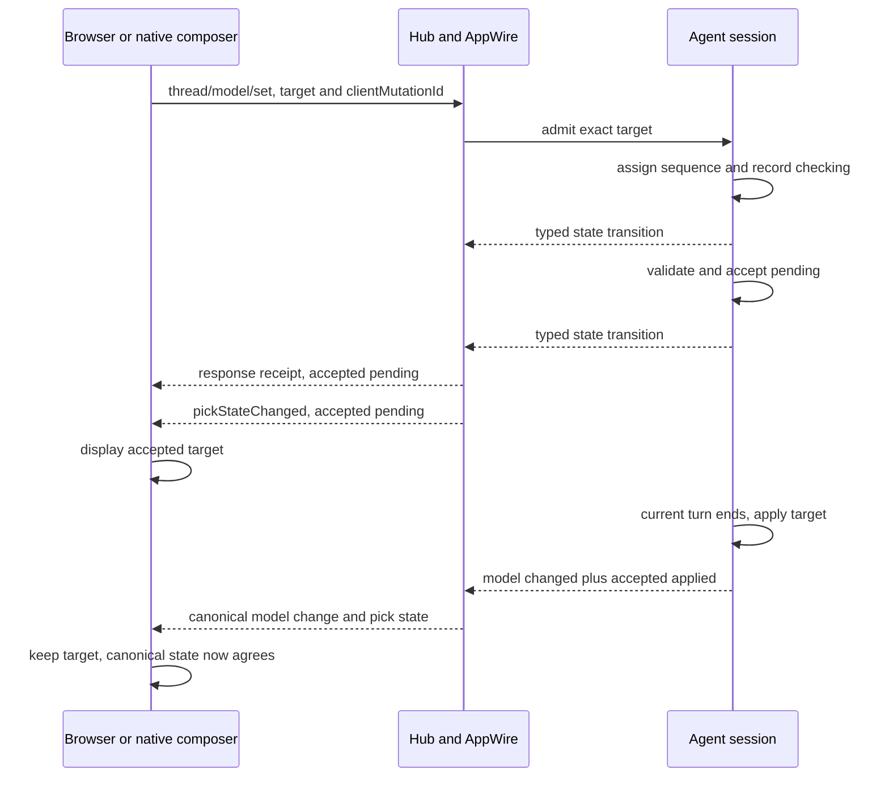

# Model-Switch Authority Uses Separate Attempt and Accepted-Pick Records

Date: 2026-11-15
Status: Proposed

## Summary

Changing the composer model during a running turn must take effect at the turn boundary and must appear in every connected composer as soon as the daemon accepts it. Today, `thread/model/set` returns an empty response while the canonical model changes only after `thread/model/changed`. A queued switch therefore leaves the composer showing the running turn's old model, and overlapping switches cannot be reconciled safely.

Add an ephemeral, daemon-owned model-pick authority with two explicit records:

1. **Latest attempt** names the newest request and whether admission is still being checked, accepted, refused, or superseded.
2. **Latest accepted pick** names the newest request that passed admission and whether it is pending, applied, or rejected.

The daemon publishes both records in the model-set response, a typed state notification, and `thread/read`. Browser and native clients merge those carriers through one shared reducer. The displayed model comes from a pending or applied accepted pick; otherwise it comes from the canonical active model. A later refused attempt never erases an earlier accepted pick, and a later accepted pick permanently supersedes an older one.

The authority is fenced by the thread instance and daemon boot generation. It is not persisted. After a daemon restart or thread replacement, the active model is authoritative until the new daemon accepts another pick.

## Intent and why

The model control is a promise about the next turn, not only a report about the turn currently running. When a user selects a model during a turn, Evener already queues a valid switch. The control should show that accepted choice immediately and keep showing it while the current turn finishes.

The fix also has to remain correct when:

- two tabs or clients issue overlapping picks;
- a newer request is refused while an older accepted pick remains pending;
- a queued pick fails when the turn boundary applies it;
- an active-model notification is delayed behind a newer accepted pick;
- the client disconnects and recovers from `thread/read`;
- the selected model is already active and no `thread/model/changed` event is emitted;
- either side is an older Evener version.

A client-only pending label cannot distinguish those cases. The session that admits and applies model switches must own the ordering and outcome.

## Goals

- Show a model as soon as the daemon accepts that pick, including during a running turn.
- Give every client one daemon-owned ordering for local and foreign picks.
- Identify each request exactly with an additive client mutation ID.
- Keep an accepted pick visible when a newer attempt is refused.
- Replace an older accepted pick when a newer attempt is accepted, regardless of which client sent it.
- Remove a rejected accepted pick and fall back to the canonical active model.
- Recover the same answer through live notifications and `thread/read`.
- Preserve the active model as a separate canonical fact.
- Keep new clients safe with older hubs and daemons, and keep old clients working with new ones.
- Use the same reconciliation behavior in the browser and native client.

## Non-goals

- Do not change when model switches are admitted or applied. A valid pick during a turn still waits for the turn boundary; an idle pick still applies immediately.
- Do not change model catalogs, profile resolution, provider qualification, reasoning-effort behavior, or model persistence.
- Do not make the running turn change models midway through a provider call.
- Do not persist model-pick authority across daemon boots.
- Do not expose a history of every pick.
- Do not infer request identity from FIFO order, a provider/model string, timing, warning text, or a transport request ID.
- Do not make the displayed accepted pick overwrite the canonical active model in client state.

## Anti-goals

The change fails even if the common case looks right when any of these is true:

- a rejected pick can remain displayed indefinitely;
- a later refused attempt resurrects or erases an older accepted pick;
- reconnect changes the answer without an authority-identity change;
- an older response or notification can overwrite a newer outcome;
- one client can display its local belief after another client has become authoritative;
- a provider/model pair is reconstructed by splitting a qualified string;
- clients parse a human-readable error or warning to reconcile state.

## Constraints

- `agent.Session` currently assigns model-pick sequences, admits queued switches, applies them at the turn boundary, and learns about deferred failures. It is the only component that can author both records.
- `thread/model/set` currently returns `EmptyResponse`. Its replacement response must decode safely from an older daemon's `{}`.
- An older daemon ignores additive request fields and emits no model-pick authority. New clients must then keep the current conservative behavior: display the canonical model until `thread/model/changed` arrives.
- Old clients ignore additive response fields, snapshot fields, request fields, and unknown notifications. Their existing canonical-model behavior remains valid.
- `thread/read` already carries `BootGeneration`, and the thread snapshot carries `InstanceID`. A sequence is comparable only inside that authority pair.
- Live thread snapshots are materialized through the server envelope. Exact model-pick transitions need a typed carrier into that envelope; a callback pull during a read would violate the envelope's single-writer rule and can sample the wrong transition.
- Generated AppWire TypeScript and protocol documentation come from `make generate`; they are never edited by hand.
- Default tests use scripted providers and real Evener code below the provider boundary. They require no network or credentials.

## Approaches

### Selected: two explicit records

Keep the latest attempt and latest accepted pick separately. This directly represents the important case: pick 1 was accepted and remains pending, while pick 2 was refused. It also lets a newer accepted pick replace the older accepted pick without retaining a ledger.

This is the approach Jesse selected. It is larger than a client-only patch because it adds protocol state, but it gives snapshots and every client the same answer.

### Rejected: bounded pick ledger

A small ledger could retain every recent transition and let clients derive the answer. It would require retention bounds, truncation semantics, replay rules, and more client logic. None of that is needed to answer which attempt is newest and which accepted pick controls the display.

### Rejected: reread after model events

Clients could call `thread/read` after warnings or model changes and compare the canonical model. This cannot recover a same-model accepted pick, cannot identify a specific rejection, and leaves races between the triggering event and the read. It also turns a local state transition into extra network traffic.

## Authority and protocol model

### Identity and target

A model-pick authority is identified by:

- `instanceId`: the live thread incarnation;
- `bootGeneration`: the daemon generation serving it.

A pick target always carries separate `modelProvider` and `model` fields. The daemon qualifies those fields for profile lookup, but no protocol or client code reparses a combined `provider/model` string.

Every `thread/model/set` request may carry a `clientMutationId`. Browser and native clients generate a secure UUID for every pick. The field remains optional so older clients continue to work. The daemon preserves it unchanged in every record and receipt derived from that request.

### Server sequence

The session assigns a monotonically increasing unsigned sequence before admission work starts. Assignment and record transitions are serialized under session state. A sequence is meaningful only within the authority identity above.

Strictly newer sequence wins. Equal sequence means another observation of the same request farther through its lifecycle. A lower sequence never changes either record.

### Latest attempt record

`ModelPickAttempt` contains:

- `sequence`;
- optional `clientMutationId`;
- exact target, `modelProvider` and `model`;
- `outcome`: `checking`, `accepted`, `refused`, or `superseded`.

The shared `latestAttempt` is the newest sequence the session has seen. Starting a request installs `checking`. Final admission changes the same record to `accepted` or `refused` only if it is still latest.

A request whose admission finishes after a newer sequence started cannot become accepted. Its request receipt reports `superseded`, while the shared `latestAttempt` remains the newer record. This prevents a slow older validation from overtaking a newer user choice.

A refused attempt remains `latestAttempt` for diagnostics and reconciliation. It does not alter `latestAcceptedPick`.

### Latest accepted-pick record

`ModelAcceptedPick` contains:

- the same `sequence`, optional `clientMutationId`, and exact target;
- `lifecycle`: `pending`, `applied`, or `rejected`.

When the latest attempt passes admission, it becomes `accepted` and replaces `latestAcceptedPick`:

- `pending` when it is queued behind a running turn;
- `applied` when the active profile has committed, including a pick of the model already in force;
- `rejected` when a previously accepted pending pick fails at the boundary.

A newer accepted pick permanently replaces the older accepted-pick record. If the newer pick later rejects, clients fall back to the canonical active model. They do not resurrect the older accepted record.

A deferred result may update `latestAcceptedPick` only when its sequence still matches. A failure from an older, already superseded pick cannot reject a newer pick.

The machine-readable `rejected` lifecycle is the coded rejection signal. Existing warnings continue to carry human-readable detail, but clients never parse warning text to settle state.

### State and receipt carriers

`ModelPickState` contains the authority identity plus the two optional records. `latestAttempt` exists after the first request in a boot. `latestAcceptedPick` exists only after some request in that boot passes admission.

`ThreadModelSetParams` gains optional `clientMutationId`.

`thread/model/set` returns an additive `ThreadModelSetResponse` with optional `receipt`. An older daemon's `{}` decodes as a response with no receipt. The receipt contains:

- the authority identity;
- the completed record for this request, including `superseded` when applicable;
- the full current `ModelPickState` at response time.

A directly refused request keeps the existing RPC error behavior. The caller already knows that request's mutation ID and settles only that local call. The daemon also publishes the resulting shared state so other clients see the refused latest attempt.

A successful response can therefore report either accepted or superseded. It never claims that a valid but overtaken request controls the next turn.

Add `thread/model/pickStateChanged`, carrying `ref`, `threadId`, and the full `ModelPickState`. Publish it for externally observable transitions: request start, final admission, queue acceptance, immediate apply, and deferred rejection. Coalescing may skip intermediate `checking`, but no published state may regress either record.

Add optional authority, sequence, and client mutation ID fields to `thread/model/changed`. They identify which accepted pick produced that canonical active-model change. Older producers omit them. The client still applies the canonical model from every valid model-changed notification; pick ordering controls only the displayed accepted override.

Add optional `modelPickState` to the live thread snapshot returned by `thread/read`. Daemonless snapshots and a new boot with no pick omit it.

The exact Go type placement and helper names are left to the implementation plan. The wire fields and state meanings above are fixed.

## Server state transitions

`Refused` and `Superseded` are attempt outcomes. `Pending`, `Applied`, and `Rejected` are accepted-pick lifecycles. They are separate records rather than one state machine in storage; the diagram shows the outcome of one request.

The session updates records under its state lock and emits immutable transition data after unlocking through the existing model-switch publication serialization. Event publication must preserve transition order for one session. The server converts those typed session events into AppWire notifications and feeds the same data directly into the cached thread envelope under its projection and delivery-generation fences.

The envelope, notification, response, and snapshot all serialize the same state type. No read-time callback samples session state as a fallback.

The server stamps the live `instanceId` and serving `bootGeneration` when it builds a response, notification, or snapshot. If the thread instance changes or the daemon restarts, the new identity starts with no model-pick state.

### End-to-end flow

The response and notification may arrive in either order. Equal-sequence monotonic merging makes the result identical.

## Shared client reconciliation

The AppWire TypeScript package owns a pure merge function used by browser and native clients. `ThreadModel` keeps `modelPickState` separate from canonical `modelProvider` and `model`.

For every response receipt, state notification, or snapshot:

1. Compare authority identities before comparing sequence.
2. Ignore an older boot generation for the same live identity according to the existing boot-generation rules.
3. Replace state on a new instance or replacement boot; absent state under the new authority means no accepted override.
4. Within one authority, merge `latestAttempt` and `latestAcceptedPick` independently by sequence.
5. For equal sequence, allow only forward lifecycle movement:
   - attempt: `checking` to one terminal outcome;
   - accepted pick: `pending` to `applied` or `rejected`.
6. Ignore lower sequences and equal-sequence regressions. A delayed pending response cannot overwrite a terminal notification.
7. Preserve a newer live state when a read that began earlier completes. Existing read-generation and snapshot fences still apply before the field merge.

The display projection is:

- if `latestAcceptedPick.lifecycle` is `pending` or `applied`, show that record's exact target;
- if it is `rejected` or absent, show the canonical active model.

`latestAttempt` never directly controls the label. It explains why a newer request did not take authority without hiding an already accepted pick.

Canonical `thread/model/changed` handling remains independent. The reducer applies the active provider/model and its profile metadata even when that change belongs to an older sequence than the displayed accepted pick. For example, a delayed sequence 1 commit can update canonical state while accepted sequence 2 remains displayed. Sequence 2's eventual apply or rejection then resolves the display without lying about what the daemon currently runs.

## Browser behavior

The thread store generates a secure `clientMutationId`, sends the qualified provider and model, and merges an optional response receipt through the shared reducer. It does not install a separate component-local pending label.

`ModelSwitch` renders the shared display projection. Every browser view of a thread consumes the same daemon authority, including picks made by another view. Per-request transport bookkeeping may remain local, but it cannot override the shared authority.

On a direct RPC error, only that call settles. Because a pick is not displayed before daemon acceptance, direct refusal needs no speculative rollback. A matching live state notification may still update `latestAttempt` for all views.

## Native behavior

The conversation service generates the same secure mutation ID, sends it with the already separate provider/model pair, decodes the optional receipt, and merges it through the shared reducer. The native model label uses the same display projection as the browser, with its existing Board-row fallback when model metadata is incomplete.

The native client currently discards the model-set result. That changes only for the optional receipt; an empty old-daemon response remains valid.

## Failure and ordering cases

| Case | Authoritative result |
|---|---|
| Pick 1 accepted pending; pick 2 refused | Latest attempt is refused pick 2; latest accepted remains pending pick 1; display pick 1 |
| Pick 1 accepted; pick 2 accepted | Both records become pick 2; pick 1 can no longer affect either record |
| Accepted pick rejects at boundary | Its accepted record becomes rejected; display falls back to canonical active model |
| Older validation finishes after newer request starts | Older receipt says superseded; shared records remain on the newer request |
| Older deferred failure arrives after newer acceptance | Sequence mismatch; failure cannot reject the newer accepted pick |
| Same-model pick is accepted | Accepted record becomes applied even if no model-changed event is emitted |
| Model-changed sequence 1 arrives after accepted sequence 2 | Canonical active model updates from sequence 1; display remains accepted sequence 2 |
| Pending response arrives after applied/rejected notification | Equal-sequence regression is ignored |
| Client reconnects | Snapshot restores both records under the same authority identity |
| Daemon boot or thread instance changes | Old authority is discarded; absent new state means canonical model controls display |
| Old daemon returns `{}` | No accepted override is invented; canonical model behavior is unchanged |
| New daemon serves old client | Old client ignores additive fields/notification and follows canonical model changes |

## Compatibility and rollout

All wire changes are additive except that the declared response type of `thread/model/set` becomes a struct whose zero JSON shape is compatible with `{}`:

- request `clientMutationId` is optional;
- response `receipt` is optional;
- snapshot `modelPickState` is optional;
- model-changed authority fields are optional;
- the pick-state notification is new.

Keep the existing Go client's error-only model-set method for current callers. Add a receipt-returning variant or internal request helper for callers that need the response; the implementation plan chooses the smallest API that avoids duplicated request code.

A mixed-version new client must not advertise a local pending model when no daemon receipt or authority state exists. This deliberately leaves the original delayed-label behavior on old daemons rather than guessing and displaying the wrong model.

This replacement supersedes PR #6345. Do not merge or close #6345 until the replacement has passed its behavior gates and Jesse separately authorizes the repository action. No code or generated output should be copied from that branch without revalidating it against this design.

## Testing strategy

Read and follow `docs/developing-evener/testing.md`. Tests assert state and behavior rather than human-readable copy.

### Agent state machine

Use real `Session` model switching with controlled profile resolution and turn boundaries. Cover:

- sequence assignment before validation;
- slow older validation superseded by a newer request;
- refused latest attempt preserving the accepted record;
- pending to applied and pending to rejected;
- an older deferred result unable to change a newer accepted record;
- same-model acceptance reaching applied without relying on `EventModelChanged`.

### Daemon, server, and AppWire

Use a scripted provider at the LLM boundary and real session, event, envelope, RPC, and snapshot paths below it. Prove:

- a mid-turn set response carries an accepted pending receipt;
- pick-state notifications and `thread/read` agree;
- an idle-tail rejection reaches both notification and snapshot;
- cached-envelope overlap cannot install an older model-pick state;
- the active-model notification carries its originating identity when known;
- a daemonless read omits authority state;
- boot and instance replacement clear old authority;
- `{}` decodes as a valid receipt-less response.

### Shared TypeScript reducer

Table-test every carrier ordering, including:

- response before notification and notification before response;
- delayed pending after applied and after rejected;
- lower sequence after higher sequence;
- pick 1 accepted, pick 2 refused, pick 1 rejected;
- local pick 1, foreign pick 2 accepted, pick 3 refused;
- delayed canonical sequence 1 change after accepted sequence 2;
- same authority reconnect and replacement authority reset;
- absent old-daemon state.

### Browser

Drive the real store and composer control with the AppWire test client. Prove that:

- selecting during a running turn changes the label after acceptance;
- a direct refusal keeps the previous accepted or canonical label;
- another view's accepted pick supersedes the local display;
- a later refused foreign attempt does not restore an older local pick;
- reconnect restores a pending pick and a rejected pick falls back;
- two views of one ref keep independent request fences while converging on shared authority.

### Native

Cover request UUID generation, receipt merging, live state, snapshot recovery, old-daemon empty response, and label projection with the existing Board-row fallback.

### Generated and repository gates

Run `make generate` and commit the generated AppWire TypeScript and `docs/appwire-protocol.md` changes. Run focused Go, shared-client, browser, and native tests; TypeScript typecheck; `make test-web`; `make vet`; and one `make lint` before push. The implementation plan may add narrower gates based on the touched packages.

## Acceptance criteria

1. A model accepted during a running turn appears in the initiating composer as soon as `thread/model/set` succeeds.
2. Every connected browser and native view converges on the same accepted pick.
3. A newer refused attempt leaves the prior accepted pick visible.
4. A newer accepted pick supersedes every older pick, including one from another client.
5. Deferred rejection removes only the exact accepted pick and survives reconnect.
6. Same-model acceptance settles without requiring `thread/model/changed`.
7. Delayed responses, notifications, and reads cannot regress either record.
8. The canonical active model remains accurate independently of the accepted display override.
9. Daemon restart and thread replacement discard stale authority before sequence comparison.
10. New clients remain conservative with old daemons, and old clients continue to follow canonical model changes from new daemons.
11. No client infers identity from order, target value, timing, or warning text.
12. Default tests exercise the real Evener path below a scripted provider boundary and require no network or credentials.

## Builder decisions left open

The implementation plan may choose symbol names, file boundaries, helper names, and whether the existing Go client exposes a new public receipt-returning method or keeps that helper internal. It may coalesce intermediate `checking` notifications, provided every terminal attempt and every accepted-pick lifecycle transition is recoverable through a later notification or snapshot and state never regresses.
