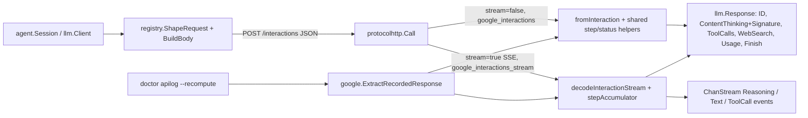

# Google Interactions API client and `google-vertex-express` retirement

## Intent and why

Gemini 4 sessions running through `llm/providers/google` (`generateContent` and `streamGenerateContent`) hit deep-context turn-boundary rollovers (such as 40 fabricated `<job-notification>` and `<delegate-notification>` envelopes in session `03507HVKeWCiXCzGHXBqyK`) and `<end_of_image>` empty-decode failures. Those failures trace directly to protocol mismatches between Evener's `generateContent` adapter and Gemini 3/4 multi-turn reasoning rules:

- `toGeminiContents` emits consecutive `{"role": "user"}` turns whenever tool results are followed by deferred steering or notifications, violating `generateContent`'s strict `user`/`model` alternation requirement.
- `stream.go` and `response.go` drop `thoughtSignature` on bare-text turns and empty trailing chunks, and `request.go` strips `ContentThinking` on replay, severing multi-turn reasoning continuity.
- `request.go` clamps `xhigh` down to `HIGH`, allows `minimal` on models that reject it, and disables `google_search` whenever `len(req.Tools) > 0`.

Google's **Interactions API** (`POST /interactions`) is Google's unified model endpoint across both the Gemini Developer API and Vertex AI (Gemini Enterprise Agent Platform). It replaces `contents[]` and part-attached signatures with a typed `steps[]` timeline (`user_input`, `thought` with explicit `signature` and `summary`, `function_call` with required `id`, `function_result` with `call_id`, `google_search_call`, `google_search_result`, and `model_output`), explicit interaction terminal statuses, lowercase `thinking_level` (`minimal | low | medium | high | xhigh`), and combined `google_search` plus `function` tools.

Jesse decided on a clean-break replacement of `generateContent` under `ProtocolGoogle` (`"google"`) and retirement of the built-in `google-vertex-express` preset, whose legacy `https://aiplatform.googleapis.com/v1` base URL and catalog-only `models_endpoint = "-"` targeted `:generateContent` rather than Vertex's `/interactions` routes (`v1/projects/{project}/locations/global/interactions` or Express Mode `v1beta1/locations/global/interactions`).

## Goals

- Replace `generateContent` and `streamGenerateContent` in `llm/providers/google` with Google's Interactions API (`POST /interactions`) for both `Complete` and `Stream`.
- Round-trip native Interactions `thought` steps (both `summary` text and cryptographic `signature`, including signature-only thoughts with empty summary), wire tool-call IDs and signatures (`function_call.id`, `function_call.signature`, and `function_result.call_id`), user images and documents (`RoleUser`), raster-image tool results (`RoleTool`, keeping PDF tool results on Evener's user-document side channel), and `google_search_call` / `google_search_result` responses with source citations.
- Support Gemini 3 and Gemini 4 `thinking_level` values (`minimal`, `low`, `medium`, `high`, `xhigh`) and `thinking_summaries` (`"auto"` / `"none"`), curating missing Gemini 4 and Gemini 2.5 capabilities in `providers_overlay.toml`.
- Enable `{"type": "google_search"}` alongside `{"type": "function", ...}` tools on models whose registry capabilities vouch for combined search and function calling.
- Default unanchored requests to stateless execution with interaction storage disabled (`"store": false` and full `steps[]` history replay whenever the row allows sending `"store"`) while supporting stateful anchored continuation (`req.PreviousResponseID` -> `"previous_interaction_id"` with `"store": true` and delta `input`), `req.Store`, and `Response.ID` (`interaction.id`) at the `llm.Protocol` boundary.
- Retire `google-vertex-express`, `GOOGLE_VERTEX_API_KEY`, and `GOOGLE_VERTEX_EXPRESS_BASE_URL` cleanly across registry, CLI, Hub tests, wire captures, envvar catalog, and documentation.
- Keep `evener doctor apilog --recompute`, local input-token estimation (`llm/token_count.go`), UI transcript projection (`internal/apptranscript`), and live model discovery (`ListModels`) accurate under the new wire contract.

## Non-goals and anti-goals

- **No `generateContent` fallback or backward-compatibility shims.** Do not keep a legacy `generateContent` code path, do not accept deprecated camelCase `fields.` paths (`generationConfig.thinkingConfig`, `safetySettings`, `toolConfig`, `cachedContent`) in `providers.toml`, do not synthesize `thought` steps from legacy `ToolCallData.ThoughtSignature`, and do not keep a deprecation alias for `google-vertex-express`.
- **No `Session`-level stateful `previous_interaction_id` anchor planner in this change.** Generalizing `Session`'s multi-phase `OpenAIResponsesContinuation` state machine to Google is separate follow-up work; `Session` sends full `steps[]` history with `"store": false` by default.
- **No managed-agent, asynchronous background polling, or outbound `continuation_token` resumption.** Do not implement `agent`-targeted requests, `background: true` submission or polling (`GET /interactions/{id}`, `/cancel`, `DELETE`), or outbound `continuation_token` resumption for `status: "requires_continuation"` (which requires empty `input` and Vertex `v1beta1`). Foreground `Complete` and `Stream` reject `"agent"`, `background: true`, and outbound `continuation_token` up front while preserving partial output and returned `r.Raw["continuation_token"]`.
- **No generated image, audio, video, or document outputs.** `ProtocolGoogle` remains a text/tool chat adapter; `RoleAssistant` rejects `ContentAudio` and `ContentDocument` on input (matching `anthropic` and `responses`), and responses containing only non-text generated media surface an explicit error rather than settling as empty completions.
- **No assistant-output string filters in `Session`.** Typed Q&A user-turn markup (`AskReply`) and `TurnSummary` provenance are tracked separately in issue `#6988`.

## Constraints

1. **Verified endpoints and Vertex location rules:**
   - **Gemini Developer API (`google`):** `POST {BASE_URL}/interactions` where default `BASE_URL` is `https://generativelanguage.googleapis.com/v1beta` (`https://generativelanguage.googleapis.com/v1beta/interactions`), authenticated via `x-goog-api-key`. Both `/v1beta/interactions` and `/v1/interactions` are served upstream.
   - **Vertex AI (`google-vertex`):** `POST {GOOGLE_VERTEX_HOST}/v1/projects/{GOOGLE_VERTEX_PROJECT}/locations/{GOOGLE_VERTEX_LOCATION}/interactions`, authenticated via `Authorization: Bearer <token>` (`gcp-adc`, requiring IAM permission `aiplatform.interactions.create` on `projects/{project}/locations/{location}`, included in `roles/aiplatform.user` and `roles/aiplatform.admin`). Per Google Cloud's Interactions API documentation, only `global` (`https://aiplatform.googleapis.com`), `us` (`https://aiplatform.us.rep.googleapis.com`), and `eu` (`https://aiplatform.eu.rep.googleapis.com`) serve `/interactions`; single-region endpoints (`us-central1`, `europe-west1`, etc.) return HTTP 404 for every model. Evener's `vertex-location` host rule (`llm/registry/hostrules.go`) already derives those exact three hosts.
   - **Streaming:** Uses the same `POST .../interactions` URL with `"stream": true` in the JSON request body, returning `text/event-stream` SSE terminated by `event: done` / `data: [DONE]`.
2. **Model family support:**
   - **Vertex AI `/interactions`** serves Gemini 3.1+ and Gemini 4 (`gemini-3.1*`, `gemini-3.5*`..`gemini-3.8*`, `gemini-4*`, `gemini-omni*`, `lyria-3*`), while rejecting `gemini-1.5-*`, `gemini-2.5-*`, and early 3.0 preview IDs documented by Google Cloud as `GenerateContent`-only or retired (`gemini-3-flash-preview` and `gemini-3-pro-preview`).
   - **Gemini Developer API `/v1beta/interactions`** serves Gemini 2.5, Gemini 3, Gemini 4, Omni, and Gemma 4, using `thinking_level` only (`GenerationConfig` has no `thinking_budget` field).
3. **Server storage default (`store: true`):**
   - Omitting `"store"` defaults to `"store": true` upstream, with surface-specific retention: on the **Gemini Developer API** (`google`), stored interactions are retained for **55 days** by default on the Paid Tier (customizable to 7, 14, 28, or 55 days in Google AI Studio) and **1 day** on the Free Tier (distinct from Google's separate 55-day safety/abuse-monitoring retention on non-exempt accounts); on **Vertex AI** (`google-vertex`), stored interactions are retained for **7 days** (subject to Vertex's 240 GiB/day stateful write quota and 500 concurrent stateful interaction limit, and rejected by stateless-only models such as `lyria-3-*`). `"store"` is therefore sendable by default (`prunable[ProtocolGoogle]["store"] == true`) on all `ProtocolGoogle` providers, and `BuildBody` emits `"store": false` on unanchored calls unless overridden per Design §2.1. Note that `"store": false` disables interaction-resource persistence only: Google documents separate retention rules when Grounding with Google Search is enabled on both the Gemini Developer API and Vertex AI, and custom `google-compatible` rows with `fields.store = false` omit `"store"` and delegate retention to that gateway's own policy.
4. **Wire schema invariants (`googleapis/go-genai` `interactions/models/interactions`):**
   - `model` is a bare model ID string (`"gemini-4-neon"`, `"gemini-3.8-flash"`) in the JSON body on both Gemini API and Vertex AI.
   - `input` is `string | Content | []Content | []Step` (never a bare single `Step` object).
   - `system_instruction` is a plain `string` (never `{parts: [...]}`).
   - `response_format` is top-level `{"type": "text", "mime_type": "application/json", "schema"?: {...}}` (outside `generation_config`, with no `json_schema` wrapper key).
   - `safety_settings` is a top-level array of `{"type": "<harm_category>", "threshold": "<threshold>", "method"?: "<method>"}` with lowercase snake_case enums (`harassment`, `hate_speech`, `sexually_explicit`, `dangerous_content`; `block_only_high`, etc.).
   - `function_result.result`: while the Gemini Developer API documents `string | object | []FunctionResultSubcontent`, the Vertex AI Interactions REST reference documents **only** `string` or `[]FunctionResultSubcontent` (omitting bare JSON objects, and parsing arrays as typed `text`/`image` subcontent items). Serializing all non-image structured tool outputs (`map[string]any`, slices, primitives) to JSON `string` and emitting `[]FunctionResultSubcontent` only for inline raster-image tool results keeps one wire representation valid across both surfaces.
   - Response `Interaction` carries `id`, `model`, `status` (`in_progress | requires_action | completed | failed | cancelled | incomplete | budget_exceeded | queued | requires_continuation`), `steps[]`, `usage`, and `errors[]` (`{code: string, message: string}`). `outputs` and `finish_reason` do not exist.
   - Assembled `function_call.arguments` is a JSON object, whereas streamed SSE `step.delta` `arguments_delta.arguments` is a JSON string fragment concatenated across deltas.
5. **Discovery and token counting:**
   - Interactions defines no model-list or token-count endpoints. `ListModels` stays on `GET {BASE_URL}/models` (Gemini API) and `GET {scheme}://{host}/v1beta1/publishers/google/models` (Vertex). `CountTokensEndpoint` becomes `"-"` and `Protocol.CountTokens` unconditionally returns `llm.ErrInputTokenCountUnsupported`, delegating pre-call token accounting to `llm/token_count.go`.

## Approaches

1. **Sibling `google-interactions` protocol alongside `google` (`generateContent`).** Adds a fifth protocol ID (`google-interactions`) for Gemini 3/4 while keeping `llm/providers/google` (`generateContent`) for Vertex 2.5, `google-vertex-express`, third-party `google-compatible` `:generateContent` gateways, and `:countTokens`. Preserves legacy surfaces at the cost of maintaining two Google wire adapters and keeping `generateContent` failure modes in the tree. Rejected by Jesse.
2. **Clean-break replacement of `generateContent` under `ProtocolGoogle` and retirement of `google-vertex-express` (Chosen by Jesse).** Replaces `llm/providers/google`'s request, response, stream, and recompute paths in place with `/interactions`, retires `google-vertex-express`, hides unsupported `<3` Gemini rows on `google-vertex`, and removes `:countTokens`. Keeps one Google protocol and deletes the legacy wire surface outright.
3. **Depend on `google.golang.org/genai` directly.** Adds a heavy generated SDK dependency, bypasses `protocolhttp.Call` (`Prune`, `ApplyBodyConstants`, credential sanitization, `APIAttemptRecord` raw body capture, byte-faithful `RawArguments` decoding, and `AdapterTimeout`), and trips over stale Vertex example guards in upstream `go-genai`. Rejected.

## Design

### Architecture overview

`llm/providers/google` remains the single registered implementation of `registry.ProtocolGoogle` (`"google"`). `Complete` and `Stream` build an Interactions JSON body via `buildBody(req, res, stream)` and `POST` to `protocolhttp.URL(res, res.Transport.Endpoint)` (or `StreamEndpoint`), recording under endpoint families `"google_interactions"` (JSON) and `"google_interactions_stream"` (SSE) so `evener-fuzz-harvest` routes only SSE streams to the stream fuzz corpus while `doctor apilog --recompute` registers both families against `google.ExtractRecordedResponse`.

### 1. Registry, transports, providers, and `google-vertex-express` retirement

#### Decisions from Jesse
- `ProtocolGoogle` switches cleanly to `/interactions` with no legacy `generateContent` fallback.
- `google-vertex-express` is retired completely.

#### Registry and overlay changes (engineering calls)
- **`llm/registry/resolve.go` (`protocolDefaults[ProtocolGoogle]`):**
  - `Endpoint`: `"/interactions"`
  - `StreamEndpoint`: `"/interactions"`
  - `ModelsEndpoint`: `"/models"`
  - `CountTokensEndpoint`: `EndpointUnsupported` (`"-"`)
- **`llm/registry/types.go` and `schema.go` (`Caps.CombinedSearchAndFunctions`):**
  - Add `CombinedSearchAndFunctions *bool` (`toml:"combined_search_and_functions" json:"combined_search_and_functions,omitempty"`, layered and provenanced alongside `MultimodalToolResults` and `WebSearch`) so model-family eligibility for combining `google_search` with `function` tools lives in registry data rather than hardcoded string prefixes in `request.go`.
- **`llm/registry/data/providers_overlay.toml`:**
  - **`[transports."vertex-gemini"]`:** specify only `auth = "gcp-adc"` and `models_endpoint = "/publishers/google/models"`; `endpoint`, `stream_endpoint`, and `count_tokens_endpoint` inherit `protocolDefaults[ProtocolGoogle]`.
  - **`[providers.google]` and `[providers."google-vertex"]`:** bump `cheap_model` from `"gemini-2.5-flash-lite"` to `"gemini-3.5-flash-lite"` on both, and set `web_search = false` by default on **both** (deferring built-in `Session` and `cmd/llmcall --web-search` Google Grounding enablement until Search Suggestions rendering and non-replayed Grounded Result retention exist — `cmd/llmcall` rejects `--web-search` before HTTP when the resolved target speaks `ProtocolGoogle` while preserving ordinary Google `llmcall` output and OpenAI/Anthropic `--web-search`; direct programmatic `llm.Client` callers that implement compliant display, retention, and non-replay may opt in explicitly via `providers.toml` `web_search = true`, updating `agent/provider/profile_test.go:101` accordingly). Enable `[providers.google.fields]` and `[providers."google-vertex".fields]`: `previous_interaction_id = true`, `service_tier = true`, `labels = true` (`cached_content` is omitted because Google documents explicit context caching as unavailable on Interactions, replaced by automatic implicit prefix caching and `previous_interaction_id`). For `gemini-2.5-pro`, `gemini-2.5-flash`, and `gemini-2.5-flash-lite` under `[providers.google.models.*]` (where `models.dev` records `budget_tokens`), curate `thinking_shape = "level"` and `effort_values = ["low", "medium", "high"]`.
  - **Curated Gemini 3 and Gemini 4 chat model globs (top-level `[models.*]`, single source of truth from `ai.google.dev/gemini-api/docs/thinking`; `gemini-omni*` and non-chat media/speech variants such as `gemini-3-pro-image` are excluded from tool-calling capabilities because Vertex/Gemini document function calling as unsupported on `gemini-omni-1.2-flash`, `gemini-3-pro-image`, TTS, transcription, and live-translate rows):**
    - `[models."*gemini-3*"]`: `multimodal_tool_results = true`, `combined_search_and_functions = true`
    - `[models."*gemini-4*"]`: `multimodal_tool_results = true`, `combined_search_and_functions = true`, `thinking_shape = "level"`
    - `[models."*gemini-flash-latest*"]`, `[models."*gemini-flash-lite-latest*"]`: `multimodal_tool_results = true`, `combined_search_and_functions = true`
    - `[models."*gemini-*-image*"]`: `tools = false`, `multimodal_tool_results = false`, `combined_search_and_functions = false` (replays after `*gemini-3*` / `*gemini-4*` via `orderedGlobKeys`, keeping function-calling caps off image rows including `gemini-3-pro-image` and `gemini-3.1-flash-lite-image` while leaving `web_search` untouched for opted-in search-only Grounding on Gemini Developer API)
    - `[models."*gemini-*-tts*"]`, `[models."*gemini-*-transcribe*"]`, `[models."*gemini-*-live*"]`: `tools = false`, `multimodal_tool_results = false`, `combined_search_and_functions = false`
    - `[models."*gemini-omni*"]`: `tools = false`, `web_search = false`, `multimodal_tool_results = false`, `combined_search_and_functions = false` (paired with `derive.go` and `request.go` guards below so a provider-wide `web_search = true` in user `LayerConfig` — which replays after `LayerOverlay` globs — still resolves `Caps.WebSearch == false` and omits `google_search` on Vertex `gemini-omni*` while enabling `google_search` on eligible Vertex models)
    - `[models."*gemini-4-neon*"]`, `[models."*gemini-4-hydrogen*"]`: `effort_values = ["low", "medium", "high", "xhigh"]`, `default_effort = "high"`
    - `[models."*gemini-4-carbon*"]`, `[models."*gemini-4-argon*"]`: `effort_values = ["low", "medium", "high"]`, `default_effort = "medium"`
    - `[models."*gemini-3.1-pro*"]`, `[models."*gemini-3-pro*"]`, `[models."*gemini-3-flash*"]`: `default_effort = "high"` (`models.dev` already supplies the Gemini 3 `effort_values` ladders, including `minimal..high` on `3.6-flash`, `3.5-flash`, `3.5-flash-lite`, `3.1-flash-lite`, and `3-flash-preview`, and `low..high` on `3.8-flash`, `3.7-flash`, and `3.1-pro-preview`).
  - **Retire `google-vertex-express`:** remove `"google-vertex-express"` from `default_order` and delete `[providers."google-vertex-express"]`.
  - **`[providers."google-compatible"]`:** unchanged in TOML; because `"store"` is `true` in `prunable[ProtocolGoogle]`, `google-compatible` sends `"store": false` by default so proxies forwarding to either the Gemini Developer API (55-day Paid Tier / 1-day Free Tier default) or Vertex AI (7-day default) do not persist interaction logs upstream. Operators targeting a gateway that rejects `"store"` can set `fields.store = false` in `providers.toml` to delegate retention to that gateway (documented in `docs/llm-providers.md`, subject to the explicit `store=false` guard in Design §2.1).
- **`llm/registry/prune.go` (`prunable[ProtocolGoogle]`):**
  Replace the camelCase `generateContent` table with exact Interactions snake_case paths:
  - Send-by-default (`true`):
    - `"generation_config.temperature": true`
    - `"generation_config.top_p": true`
    - `"generation_config.stop_sequences": true`
    - `"generation_config.max_output_tokens": true`
    - `"generation_config.thinking_level": true` (`FieldGoogleThinkingLevel`)
    - `"generation_config.thinking_summaries": true` (`FieldGoogleThinkingSummaries`)
    - `"generation_config.tool_choice": true`
    - `"safety_settings": true`
    - `"store": true`
  - Off-by-default (`false`, enabled per-provider where supported):
    - `"generation_config.seed": false`
    - `"previous_interaction_id": false`
    - `"service_tier": false`
    - `"labels": false`
  - Update `TemperaturePath(ProtocolGoogle)` to return `"generation_config.temperature"`, and update `samplingPaths(registry.ProtocolGoogle)` in `llm/registry_shape.go` to return `"generation_config.temperature"`, `"generation_config.top_p"`, and `"generation_config.stop_sequences"`.
  - Remove `FieldGoogleThinkingConfig` (`"generationConfig.thinkingConfig"`), replacing it with `FieldGoogleThinkingLevel` and `FieldGoogleThinkingSummaries`. Authored `providers.toml` files that still reference retired Google `[providers.<name>.fields]` keys fail `ValidateFields` at load time with an explicit error naming the exact **quoted** TOML replacement key(s) or removal (`"generationConfig.thinkingConfig" = false` -> both `"generation_config.thinking_level" = false` and `"generation_config.thinking_summaries" = false`, `"toolConfig"` -> `"generation_config.tool_choice"`, `"cachedContent"` -> remove, etc., since `Fields` is a flat `map[string]bool` where dotted TOML keys must be quoted) alongside the valid Interactions field paths.
  - Reject legacy authored `endpoint` or `stream_endpoint` overrides on `ProtocolGoogle` containing `:generateContent` or `:streamGenerateContent` with an actionable `ConfigurationError` telling the operator to remove the legacy endpoint override so an Interactions JSON body is never posted to a `generateContent` URL.
- **`llm/registry/derive.go` and `llm/types.go` (`EffortReachesWire`):**
  - Export one shared predicate `registry.IsVertexGeminiOmni(preset, wireID string) bool` returning `preset == PresetVertexGemini && strings.HasPrefix(strings.ToLower(strings.TrimSpace(wireID)), "gemini-omni")` (threading `TransportPreset` on `deriveInput`). In `derive.go` (landed in Stage 1 with `Caps.CombinedSearchAndFunctions`), mirror the `reasoningOff` guard for `Tools`: whenever `c.Tools != nil && !*c.Tools && BoolValue(c.CombinedSearchAndFunctions)`, set `c.CombinedSearchAndFunctions = new(false)` (`prov["CombinedSearchAndFunctions"] = provDerived`); and whenever `IsVertexGeminiOmni(in.TransportPreset, m.WireID)` is true, clamp `c.WebSearch = new(false)` (`prov["WebSearch"] = provDerived`) so a provider-wide `web_search = true` on `google-vertex` still resolves `Caps.WebSearch == false` on Vertex Gemini Omni while opted-in `google-compatible` gateways (such as an unrelated `acme-omni-chat` row) and Gemini Developer API rows keep their search settings untouched.
  - Remove the `shape = "budget"` branch for `ProtocolGoogle` in `derive.go`; `ProtocolGoogle` derives `ThinkingShape = "level"` only when `effort` is vouched by non-alias catalog/layer evidence (or set by a curated overlay rule). Any unrecognized authored `thinking_shape` (such as `"budget"`) omits `thinking_level` while still sending `thinking_summaries`.
  - Update `EffortReachesWire` (`llm/types.go`, `case registry.ProtocolGoogle:`) to gate on `caps.Fields[registry.FieldGoogleThinkingLevel]`, drop the `"budget"` branch, and mirror `google.thinkingConfig`: return `true` when the vouched (or unladdered) tier is in `{"minimal", "low", "medium", "high", "xhigh"}` (`"max"` clamps onto the ceiling and continues to report `false`).
- **Vertex regional warnings, pre-Gemini-3 hiding, and discovery (`llm/registry/modelsdev.go`, `llm/registry/resolve.go`, `llm/providers/google/vertex_models.go`, `protocol_transport.go`):**
  - Export one helper `registry.VertexSupportsGeminiModel(id string) bool` returning `false` for `gemini-1*` and `gemini-2*` (`-2.5-`) prefixes **and** for known Vertex `GenerateContent`-only or retired 3.0 preview IDs (`vertexInteractionsUnsupportedGemini`: `"gemini-3-flash-preview"` and `"gemini-3-pro-preview"`, which Google Cloud documents as unsupported on Vertex `/interactions` while `gemini-3.1-pro-preview`, `gemini-3.1-flash-lite`, `gemini-3.5*`..`gemini-3.8*`, and `gemini-4*` are supported; Gemini Developer API `google` continues serving `gemini-3-flash-preview`). Call `VertexSupportsGeminiModel` across: (1) `modelsdev.go` (`case "google-vertex":` setting `m.Hidden = true`, matching existing unservable-row hiding rather than exposing user-toggleable `disabled` rows), (2) `vertex_models.go` (`vertexTextModel`, updating `vertex_models_test.go` so `gemini-3-flash-preview` in `testdata/vertex_publisher_models.json` is filtered out alongside `gemini-2.5-*` while `gemini-3.8-flash` and `gemini-3.1-pro-preview` remain offered), (3) explicit live and cold model-switch validation (`resolveModelSwitchTarget`, `resolveStartupModelProfile`, and `validateModelSwitchMembership` in `agent/session_set_model.go` and `agent/live_model_metadata.go`, checked **before** live-listing enumeration so switching to `google-vertex/gemini-2.5-flash` or `google-vertex/gemini-3-flash-preview` fails locally before committing even when live discovery fails or is static-only, keeping the current model, transcript, and queue intact while preserving fail-open discovery for targets whose availability is unknown), (4) `validateModelFallbackEntry` (`agent/session_init.go`), and (5) `protocol_transport.go` (`completionCall` / `BuildBody`: when `isVertexTransport(res) && !registry.VertexSupportsGeminiModel(res.WireID)`, fail fast with an actionable `llm.ConfigurationError` instructing the user to switch the session to a Vertex Interactions-supported model such as `gemini-3.8-flash`). Keep `"omni"` in `vertexTextModelDenylist` so live discovery stays scoped to text-chat models.
  - Update `isVertexTransport(res)` in `vertex_models.go` to check `res.Transport.Preset == registry.PresetVertexGemini` rather than path-prefix sniffing.
  - Because Vertex `/interactions` rejects single-region endpoints (`us-central1`, `europe-west1`, etc.) for **every** model, extend the Vertex regional warning in `resolve.go` and `regionalVertexLocationRemedy` in `protocol_transport.go`: any `ProtocolGoogle` row whose host was derived by `host_rule = "vertex-location"` from a location outside `{"global", "us", "eu"}` emits a resolve warning and reclassifies an HTTP 404 from `/interactions` into an actionable `llm.ConfigurationError` advising `GOOGLE_VERTEX_LOCATION=global` (or `us` / `eu`).
  - Keep Gemini Developer API `ListModels` on `GET {BASE_URL}/models?pageSize=1000` (`supportsGenerateContent` + `registry.IsChatModelID`). Make `Protocol.CountTokens` unconditionally return `0, llm.RewriteErrorProvider(llm.ErrInputTokenCountUnsupported, res.Instance)`.
- **`google-vertex-express` removal inventory:**
  - `envvars/envvars.go` and `envvars/envvars_test.go`: delete `GoogleVertexAPIKey`, `GoogleVertexExpressBaseURL`, and `TestGoogleVertexExpressVariablesAreRegistered`.
  - `cmd/evener/models_live_test.go`, `cmd/evener-hub/frontend/src/panes/settings/sections/credentials/instanceDialogs.test.tsx`, `llm/providers/wirecapture/` (removing `google-vertex-express` captures and adding explicit `web_search = true` opt-in on the fixture stanza that captures Google's `"google_search"` tool payload), `llm/registry/resolve_test.go` (`TestResolve_WebSearchCanonicalGate` switching `vertexaliastarget` to `base = "google-vertex-anthropic"` so curated `web_search = true` endpoint-gating coverage stays intact when `google-vertex` defaults `web_search = false`), `llm/registry/golden_test.go` (plus `go test ./llm/registry -update` for surviving Google/Vertex goldens), `llm/registry/instances_test.go`, `llm/registry/overlay_test.go`, and `llm/registry/testdata/golden/google-vertex-express-gemini-2.5-flash.json`: remove `google-vertex-express` cases and golden files, and update surviving `ProtocolGoogle` live smoke paths in `cmd/evener/models_live_test.go` (`:913`, `:1078`, and stored-credential Vertex Gemini tests) to execute through `google.DefaultProtocol.Complete` and `Stream` rather than hand-crafting legacy `contents`/`generationConfig`/`candidates` payloads.
  - Keep `gcp-adc` JSON credential handling in `cmd/evener-hub/app_auth.go`, `CredentialsSection.tsx`, `llm/providers/tokenauth/gcpadc.go`, and `llm/registry/credential_json.go` intact, updating comments that cited `google-vertex-express`.
  - Regenerate and update `docs/environment-variables.md` (`make generate` / `make docs-check`), `docs/product/subsystems.md` (`S15` provider configuration and `S16` model catalog), `docs/llm-providers.md`, `docs/developing-evener/environment.md`, and `docs/developing-evener/config-knobs.md`. `docs/llm-providers.md` must document: (1) `store = false` disables interaction storage by default while documenting the distinct upstream retention windows when opting into `store = true` (Gemini Developer API: 55-day Paid Tier default customizable to 7/14/28/55 days, 1-day Free Tier default, plus separate abuse-monitoring rules; Vertex AI: 7-day retention; custom `google-compatible` gateways with `[providers.<name>.fields]` `store = false`: gateway-defined retention) and noting that Grounding with Google Search defaults `web_search = false` on both `google` and `google-vertex` (deferring `Session` enablement, documenting the Search Suggestions display, storage, and non-replay obligations for direct `llm.Client` callers opting in under either Gemini Developer API or Vertex AI Service Specific Terms, and noting the pre-cutover summary provenance boundary when pre-fold transcript entries are absent), (2) Vertex AI IAM prerequisite `aiplatform.interactions.create` on `projects/{project}/locations/{location}` (included in `roles/aiplatform.user` and `roles/aiplatform.admin`) and HTTP 403 troubleshooting for custom ADC roles that previously granted only `aiplatform.endpoints.predict` (`generateContent`), (3) `google-compatible` gateways must serve `POST {BASE_URL}/interactions` (plus `store = false` under `[providers.<name>.fields]` for gateways that reject `store`), (4) pre-upgrade `providers.toml` migrations and load-failure/call-time symptoms so operators recover healthy providers without discarding their config file — `providers.<name>: base "google-vertex-express" is not a registry id` on custom child stanzas, `providers.google-vertex-express: no protocol` on bare override stanzas, updating `default = "google-vertex-express"`, removing `:generateContent` / `:streamGenerateContent` endpoint overrides, migrating `[providers.<name>.body]` legacy `generateContent` constants (`"generationConfig.*"`, `"safetySettings"`, `"toolConfig"`, `"cachedContent"` -> snake_case `"generation_config.*"`, `"safety_settings"`, or removal, rejected at call time with an actionable `ConfigurationError`), and a **complete TOML `[providers.<name>.fields]` example plus explicit key-by-key migration table with quoted dotted keys** (because `Fields` is a flat `map[string]bool` where unquoted `generation_config.x` would create a rejected nested TOML table: `"generationConfig.temperature"` -> `"generation_config.temperature"`; `"generationConfig.topP"` -> `"generation_config.top_p"`; `"generationConfig.stopSequences"` -> `"generation_config.stop_sequences"`; `"generationConfig.thinkingConfig" = false` -> **both** `"generation_config.thinking_level" = false` and `"generation_config.thinking_summaries" = false`; `"toolConfig"` -> `"generation_config.tool_choice"`; `"safetySettings"` -> `safety_settings`; `labels` unchanged; and **remove** `"cachedContent"`, which has no direct Interactions field beyond automatic prefix caching and `previous_interaction_id`) — and (5) the three verified migration paths for retired `google-vertex-express` depending on credential type (never placing secret key values in `providers.toml`; because a custom `base_url` stops `api_key_env` inheritance, each custom stanza must bind its credential explicitly via `api_key_env = ["GOOGLE_VERTEX_API_KEY"]` — or another env var name — or via a stored credential under `<name>` in Settings -> Credentials / `evener auth`): (a) keep an existing **projectless Vertex Express API key** on Vertex via custom `[providers.<name>]` with `base = "google-compatible"`, `base_url = "https://aiplatform.googleapis.com/v1beta1/locations/global"`, `auth = "header"`, `auth_header = "x-goog-api-key"`, `api_key_env = ["GOOGLE_VERTEX_API_KEY"]` (or stored credential), `models_endpoint = "-"`, **`default_model = "gemini-3.8-flash"`, and static model stanza `[providers.<name>.models."gemini-3.8-flash"] alias_of = "google/gemini-3.8-flash"`** (since `google-compatible` carries no inherited catalog rows when `models_endpoint = "-"`, plus showing `--resume <session-id> --model <name>/gemini-3.8-flash` and UI picker selection `<name>/gemini-3.8-flash`), (b) use a **project-scoped Vertex API key** via custom `[providers.<name>]` with `base = "google-vertex"`, `GOOGLE_VERTEX_PROJECT`, `GOOGLE_VERTEX_LOCATION = "global"`, `auth = "header"`, and `auth_header = "x-goog-api-key"`, and `api_key_env = ["GOOGLE_VERTEX_API_KEY"]` (or stored credential) (`POST https://aiplatform.googleapis.com/v1/projects/{GOOGLE_VERTEX_PROJECT}/locations/global/interactions`), or (c) issue a separate **Google AI Studio key** (`GEMINI_API_KEY` / `GOOGLE_API_KEY`, distinct from a Google Cloud Express key) and use built-in `google`.

### 2. Request assembly (`llm/providers/google/request.go`)

`Protocol.BuildBody(req, res)` delegates to `buildBodyWithPolicy(req, res, false)` and returns `(body, err)`. `Complete` preserves `protocolhttp.RequiresStreamingComplete(res)` -> `protocolhttp.CompleteViaStream(ctx, res.Instance, ...)` (`protocol_transport.go:87-89`, delegating to `p.Stream` so streaming-required auth preparers send `"stream": true`, decode SSE, and record `"google_interactions_stream"`), and otherwise runs a direct JSON exchange (`stream = false`, recording `"google_interactions"`). Direct `Complete` (`stream = false`) and `Stream` (`stream = true`) call `buildBodyWithPolicy(req, res, stream)` and pass the resolved `interactionBodyPolicy{stream, wireModel, combinedTools, anchorID, storeOmitted, effectiveStore}` into `completionCall`'s `FinalizeBody`:

1. **Top-level envelope and option guards:**
   - Unconditionally set `body["model"] = res.WireID` (`CreateModelInteraction.model` is always required in the JSON body on `/interactions`, even if a custom gateway configures `{model}` in one endpoint template).
   - If `stream` is true, set `body["stream"] = true`.
   - **Anchor (`previous_interaction_id`) and `store` resolution (single source of truth):**
     - Resolve `anchorID` from `strings.TrimSpace(req.PreviousResponseID)` if non-empty, else `ProviderOptions["google"]["previous_interaction_id"]` (returning `ConfigurationError` if present and not `string`).
     - Resolve `explicitStore *bool` from `req.Store` if non-nil, else `ProviderOptions["google"]["store"]` (returning `ConfigurationError` if present and not `bool`).
     - Let `storeSendable := requestutil.WireFieldEnabled(caps, "store", res.Protocol)` (`requestutil/fields.go:10`, which returns `false` **only** when `caps.Fields["store"]` is explicitly present and `false`, and returns `true` when `"store"` is `true` or absent from an unseeded `Caps.Fields` map, matching `prunable[ProtocolGoogle]["store"] == true`).
     - **Unanchored (`anchorID == ""`):** if `!storeSendable` (an explicit `fields.store = false` gateway opt-out), require `explicitStore == nil` (returning `ConfigurationError` if the caller passed an explicit `store` setting the row forbids sending) and record `policy.storeOmitted = true`. Otherwise (`storeSendable == true`), record `policy.storeOmitted = false`, `policy.effectiveStore = false` (or `*explicitStore` when non-nil, preserving explicit stateful `store=true` requests), and set `body["store"] = policy.effectiveStore` so direct `Protocol.Complete` / `Stream` callers with nil or unseeded `Caps.Fields` still send `"store": false`.
     - **Anchored (`anchorID != ""`):** Google rejects `previous_interaction_id` when `store=false`, and the stored interaction already holds prior turns. Require `caps.Fields["previous_interaction_id"]` and `storeSendable` both `true` (else return `ConfigurationError`), reject `explicitStore != nil && !*explicitStore` with `ConfigurationError`, record `policy.anchorID = anchorID`, `policy.storeOmitted = false`, `policy.effectiveStore = true`, and set `body["store"] = true` and `body["previous_interaction_id"] = anchorID` (callers supply only the new user/tool delta turns since the anchor, matching `openai-responses`).
   - **Unsupported execution-mode and caching guards (`agent`, `background`, `continuation_token`, `cached_content`, and `service_tier="deferred"`):** return `ConfigurationError` when `options["agent"]`, `options["continuation_token"]`, or `options["cached_content"]` is present (and not `""`), when `(req.Background != nil && *req.Background)` or `options["background"]` is present and not `false`, or when `req.ServiceTier` / `options["service_tier"]` equals `"deferred"` (case-insensitive; Google's `deferred` tier requires `background=true` and `store=true`, whereas foreground tiers `"flex"`, `"standard"`, and `"priority"` remain supported).
   - **Request-local ownership in `registry.ApplyBodyConstants` and final outbound body enforcement (`FinalizeBody` in `protocol_transport.go`):** in `llm/registry/prune.go` (`ApplyBodyConstants`, `:209`, landed in Stage 1), deep-clone `map[string]any` and `[]any` constant values (`cloneJSONValue`) before `setPath` installs them onto `body`, so combining a whole-object `"generation_config"` constant with a dotted `"generation_config.seed"` constant gives each concurrent request its own mutable map before dotted writes or `FinalizeBody` run (preserving whole-object replacement and dotted-key precedence while leaving the shared `res.Transport.Body` configuration untouched). Because `protocolhttp.Prepare` runs `registry.Prune` and `registry.ApplyBodyConstants(body, res.Transport.Body)` *after* `BuildBody` (`protocolhttp/call.go:73-107`), `completionCall`'s `FinalizeBody` then enforces `policy` on the request-owned `finalBody`:
     1. **`stream` authority:** pin `finalBody["stream"] = true` when `policy.stream` is true (SSE exchange via `Stream`, including `Complete` routed through `CompleteViaStream`) and `delete(finalBody, "stream")` when `policy.stream` is false (direct JSON exchange in `Complete`), so neither `ProviderOptions` nor `Transport.Body` can desynchronize the wire `"stream"` flag from the actual exchange decoder and capture family.
     2. **`agent`, `background`, `continuation_token`, `cached_content`, `service_tier="deferred"`, and retired `generateContent` body-constant guards:** delete `finalBody["agent"]`, `finalBody["continuation_token"]`, and `finalBody["cached_content"]` when `""` and return `ConfigurationError` if any non-empty or non-string value is present on those keys; delete `finalBody["background"]` when `false` and return `ConfigurationError` for any other `finalBody["background"]` value; return `ConfigurationError` if `finalBody["service_tier"]` is non-string or case-insensitively equals `"deferred"`; and return an actionable `ConfigurationError` naming the snake_case Interactions replacement (or removal) if `ProviderOptions` or `[providers.<name>.body]` (`ApplyBodyConstants`) injected any retired `generateContent` top-level key (`"generationConfig"`, `"safetySettings"`, `"toolConfig"`, `"cachedContent"`, `"contents"`, or `"systemInstruction"`) while leaving unrelated custom gateway constants untouched.
     3. **Anchor lock:** require `finalBody["previous_interaction_id"]` to be absent when `policy.anchorID == ""` and equal to `policy.anchorID` otherwise, returning `ConfigurationError` if `Transport.Body` added, removed, or replaced the anchor after `input` was assembled.
     4. **Storage policy lock:** when `policy.storeOmitted` is true, require `"store"` to be absent from `finalBody` (returning `ConfigurationError` if `Transport.Body` injected `"store"` onto a `fields.store = false` gateway); when `policy.storeOmitted` is false, require `finalBody["store"] == policy.effectiveStore` (returning `ConfigurationError` if `Transport.Body` flipped the unanchored `store=false` default or an explicit `store` setting).
     5. **Unconditional `model` authority, zero-encode `Transport.Body` key validation, and effective-preparer snapshot lock:** require `finalBody["model"] == policy.wireModel` **unconditionally** in `FinalizeBody` on every request (rejecting any deletion or replacement of `"model"` by `Transport.Body` or a `RequestPreparer` after history signatures and capabilities were resolved for `res.WireID`). Validate configured `res.Transport.Body` keys **in O(`len(res.Transport.Body)`) before `ApplyBodyConstants` with zero extra JSON marshaling or buffer allocations** on ordinary requests — for every key `k` in `res.Transport.Body`, extract `root, _, _ := strings.Cut(k, ".")` and return `ConfigurationError` if `root` is in `{"input", "model", "tools", "response_format", "agent", "previous_interaction_id", "store", "continuation_token", "cached_content", "background"}` (rejecting top-level and nested dotted overrides such as `"response_format.mime_type"`, while allowing unrelated constants such as `"labels.env"` or `"generation_config.seed"`). Resolve the **effective** authenticator via `llm.AuthenticatorForContext(ctx, res.Transport.Auth)` (`protocolhttp.Prepare` `:92`, covering call-scoped `llm.WithAuthenticatorOverride` as well as globally registered schemes): take pre/post JSON byte snapshots of `input`, `tools`, and `response_format` **only** when `_, hasPreparer := auth.(llm.RequestPreparer)` is true, preserving the single-encode fast path for all non-preparer calls while rejecting protected-field mutations by a call-scoped or global `RequestPreparer`.
     6. **Authoritative `reasoning = false` and `generation_config.tool_choice` enforcement after all overlays:**
        - **`reasoning = false`:** when `res.Caps.ReasoningDisabled()` is true, unconditionally delete `"thinking_level"` and `"thinking_summaries"` from `finalBody["generation_config"]` (deleting `"generation_config"` if empty, while preserving sibling keys such as `"temperature"` or `"seed"` and keeping native `thought` / `function_call.signature` steps in `finalBody["input"]` intact), so neither `ProviderOptions["google"]["generation_config"]` nor `Transport.Body` constants can re-introduce generation thinking controls onto a reasoning-disabled row.
        - **`generation_config.tool_choice`:** let `toolChoiceEnabled := requestutil.WireFieldEnabled(res.Caps, "generation_config.tool_choice", res.Protocol)`. When `policy.combinedTools` is true, require `toolChoiceEnabled` **and** `finalBody["generation_config"]["tool_choice"]` present with an effective mode in `{"validated", "any", "none"}` across both wire shapes (bare string or `map[string]any` `allowed_tools.mode`), returning `ConfigurationError` before HTTP if disabled, absent, `"auto"`, or unrecognized. When `!policy.combinedTools` (function-only or tool-less requests) and `!toolChoiceEnabled`, delete `"tool_choice"` from `finalBody["generation_config"]` (deleting `"generation_config"` if empty, while preserving enabled sibling keys) so `Transport.Body["generation_config.tool_choice"]` cannot bypass `"generation_config.tool_choice" = false`.
     7. **Output-limit pruning and minimum-cap precedence (`reconcileOutputField`, combining `responses/request.go:162-169` and `google/request.go:175-189`):** check `requestutil.WireFieldEnabled(res.Caps, "generation_config.max_output_tokens", res.Protocol)` first; when `false` (the row explicitly disabled `fields."generation_config.max_output_tokens"`), delete `"max_output_tokens"` from `finalBody["generation_config"]` (deleting `"generation_config"` if empty) and return without re-creating it. When `WireFieldEnabled` is `true`, compute `ceiling := requestutil.MinPositiveInt(requestutil.PositivePointerInt(req.MaxTokens), requestutil.PositivePointerInt(res.Caps.MaxOutputTokens))` and set `genCfg["max_output_tokens"] = requestutil.MinPositiveInt(requestutil.PositiveInt(genCfg["max_output_tokens"]), ceiling)` when positive so a lower positive wire override (e.g. `200` under a `1,000` ceiling) is preserved while a higher override clamps down to `ceiling`.
   - Emit `"service_tier"` (`req.ServiceTier`), `"labels"` (converted from `req.Metadata` into a fresh request-owned `map[string]any` — never `map[string]string` — so `registry.ApplyBodyConstants`'s `setPath` descends into `body["labels"]` and merges dotted constants such as `"labels.env"` alongside request labels such as `"team"` without overwriting them or mutating `req.Metadata`), and `"system_instruction"` (joined `RoleSystem` / `RoleDeveloper` text blocks as a plain `string`) when non-empty.

2. **Conversation history -> `input` (`[]Step`):**
   Walk `req.Messages` once, maintaining `callIDToName map[string]string` (plus a FIFO queue of synthetic IDs assigned to any legacy empty-ID `ContentToolCall` parts) for O(1) `function_result` pairing, emit `input` as `steps []any`, and require `len(steps) > 0` after assembly for both unanchored and anchored calls (returning `ConfigurationError` when `req.Messages` is empty, system-only, empty-text-only, or contains only skipped legacy/foreign thinking parts):
   - **Lazy `user_input` coalescing (`RoleUser`):** accumulate `RoleUser` content items into `pendingUser []any` (user prompts, environment context, memory notifications, or deferred `<job-notification>` / `<delegate-notification>` steering) and flush `pendingUser` as a **single** `{"type": "user_input", "content": pendingUser}` step **lazily inside `appendNonUserStep(step)` right before a `model_output`, `thought`, `function_call`, or `function_result` step is actually emitted** (plus one final flush after walking `req.Messages`) — never eagerly at `RoleAssistant` or `RoleTool` message entry. If an intermediate `RoleAssistant` message contains only skipped legacy/foreign `ContentThinking` or empty text and emits zero steps, `pendingUser` stays open so the surrounding `RoleUser` messages coalesce into one `user_input` step rather than producing adjacent `user_input` steps:
     - `ContentText` (non-empty): `{"type": "text", "text": p.Text}`.
     - `ContentImage`: inline bytes or local file path normalized via `googleInlineImageBytes` and encoded with `llm.CachedBase64(b)` -> `{"type": "image", "data": b64, "mime_type": mt}`; remote/GCS URI -> `{"type": "image", "uri": u, "mime_type": mt}`.
     - `ContentDocument`: inline bytes encoded with `llm.CachedBase64(doc.Data)` -> `{"type": "document", "data": b64, "mime_type": mt}`; URI -> `{"type": "document", "uri": u, "mime_type": mt}` (default `application/pdf`).
     - `ContentAudio`: rejected with `ConfigurationError`.
   - **`RoleAssistant`:** walks `msg.Content` in order, flushing `pendingUser` via `appendNonUserStep` only when an assistant step is actually emitted:
     - **Step-boundary-faithful `ContentText` and `ContentImage` -> `model_output` replay:** add persisted `GoogleStep int` (`json:"google_step,omitempty"`, 1-based `stepIdx + 1` stamped by both JSON and SSE `appendInteractionSteps` on every `ContentText` part decoded from a `model_output` step; `0` on synthetic, non-Google, or provenance-stripped parts) on `llm.ContentPart` (`llm/types.go:131`, alongside `Phase`). Within `RoleAssistant`, both non-empty `ContentText` (`{"type": "text", "text": p.Text}`) and `ContentImage` (encoded via `googleInlineImageBytes` + `llm.CachedBase64` as `{"type": "image", "data": b64, "mime_type": mt}` or URI `{"type": "image", "uri": u, "mime_type": mt}`, preserving `TestBuildBodyAssistantAndToolResultContents` in `requestedges_test.go` and keeping `ContentImage` representable in `unrepresentableContentKinds[ProtocolGoogle]`) append in order into the open `{"type": "model_output", "content": [...]}` step while their `GoogleStep` matches (`pendingStep == p.GoogleStep`), and flush into a new `model_output` step whenever `p.GoogleStep != pendingStep` or before any `thought`, `function_call`, or `google_search_*` step — so adjacent assistant text and images stay in exact order and two consecutive `model_output` steps followed by a `function_call` replay as two `model_output` steps after transcript reload, while generated media *outputs* decoded from upstream responses remain rejected per Non-goals. `ContentAudio` and `ContentDocument` in `RoleAssistant` return `ConfigurationError` (matching `anthropic/request.go` and `responses/input.go`).
     - `ContentThinking` (**adapter-enforced non-empty `(Instance, WireID)` Interactions provenance, decoupled from `caps.ReasoningDisabled()`**): add persisted `GoogleInteraction bool` (`json:"google_interaction,omitempty"`), `GoogleInstance string` (`json:"google_instance,omitempty"`), `GoogleModel string` (`json:"google_model,omitempty"`), and `ReplayableGoogleThoughtFor(instance, wireModel string) bool` on `llm.ThinkingData` (`llm/types.go`, stamped with `(res.Instance, res.WireID)` on live `Complete` and `Stream` decode, and left with `GoogleInstance == ""` on offline `ExtractRecordedResponse`), returning `true` **only** when `t != nil && t.GoogleInteraction && !t.Redacted && t.EncryptedContent == "" && !llm.IsOpenAICompatReasoningField(t.Signature) && (strings.TrimSpace(t.Signature) != "" || len(t.Summary) > 0) && instance != "" && wireModel != "" && t.GoogleInstance == instance && t.GoogleModel == wireModel` (never treating an empty `GoogleInstance` or `GoogleModel` as a wildcard). Emit `{"type": "thought", "signature"?: sig, "summary"?: summaryItems}` (built from `t.Summary`) whenever `p.Kind == llm.ContentThinking && p.Thinking.ReplayableGoogleThoughtFor(res.Instance, res.WireID)` — enforcing the strict same-instance, same-wire-model replay boundary in `request.go` for **both** `Session` and direct `llm.Client` / `Protocol` callers (including rejecting cross-instance reuse of offline-recomputed messages while preserving their summaries for inspection), independent of `caps.ReasoningDisabled()` (`reasoning = false` suppresses outbound `thinking_level` / `thinking_summaries` generation controls only). Signed Anthropic thoughts (`GoogleInteraction == false`), pre-cutover `generateContent` display-only `ThinkingData.Text`, offline-recomputed thoughts (`GoogleInstance == ""`), and native Google thoughts from a different `(Instance, WireID)` never replay onto Google's wire.
     - `ContentWebSearch` (**no client-side Grounding history replay**): both Gemini Developer API and Vertex AI Grounding terms forbid resending stored Search Suggestions and completed Grounded Results in later prompts, while combined `google_search` + `function` tool context circulation requires signed search steps. `buildBodyWithPolicy` therefore **rejects** any `RoleAssistant` message carrying a `ContentWebSearch` part in `req.Messages` with an actionable `ConfigurationError` (preventing both raw `google_search_*` steps / `search_suggestions` and associated grounded assistant text from being resent in stateless history). Direct callers running combined `google_search` + `function` rounds continue a pending `requires_action` tool round via Google's recommended stateful mode (`store: true` on the initial request, then `previous_interaction_id` (`store: true`) + delta `input` (`[function_result]` only, with no stored Grounding steps resent) **alongside** turn-scoped `req.Tools`, `req.WebSearch = true`, `system_instruction`, and `generation_config` (`tool_choice: "validated"`), since Google persists only conversation `steps[]` on the interaction and requires resending active tool declarations on each follow-up), and omit completed grounded turns from subsequent unanchored requests.
     - `ContentToolCall` (**including adapter-enforced non-empty `(Instance, WireID)` `function_call.signature` and validated JSON object `arguments` replay, decoupled from `caps.ReasoningDisabled()`**): add persisted `GoogleInteraction bool` (`json:"google_interaction,omitempty"`), `GoogleInstance string` (`json:"google_instance,omitempty"`), and `GoogleModel string` (`json:"google_model,omitempty"`) on `llm.ToolCallData` (`llm/types.go:188`), stamped with `(true, res.Instance, res.WireID)` alongside `ThoughtSignature` on live `Complete` and `Stream` decode (and `GoogleInstance: ""` on offline `ExtractRecordedResponse`). Record `id -> tc.Name` in `callIDToName` (assigning a deterministic fallback ID if `tc.ID == ""`). While `ToolCallData.ArgumentsSpelling` / `WireArguments()` preserves the model's exact original bytes in memory and on durable transcripts for inspection, `protocolhttp.MarshalBody` delegates `json.RawMessage` to `encoding/json` (`TestMarshalBodyMatchesStdlib`), which compacts whitespace: read `rawArgs := []byte(tc.WireArguments())` and validate `trimmed := bytes.TrimSpace(rawArgs)` so when `len(trimmed) > 0 && trimmed[0] == '{' && json.Valid(trimmed)`, `json.RawMessage(trimmed)` serializes on the outbound HTTP wire as an equivalent JSON object preserving key order and exact numeric tokens (falling back to `json.RawMessage("{}")` when empty or malformed). Emit `"signature": strings.TrimSpace(tc.ThoughtSignature)` on the `function_call` step **only** when `tc.GoogleInteraction && strings.TrimSpace(tc.ThoughtSignature) != "" && res.Instance != "" && res.WireID != "" && tc.GoogleInstance == res.Instance && tc.GoogleModel == res.WireID` (never treating empty `GoogleInstance` or `GoogleModel` as a wildcard, independent of `caps.ReasoningDisabled()`, so direct `llm.Client` callers switching Google instances/models or reusing offline-recomputed messages omit the original `function_call.signature` automatically while keeping `id`, `name`, `arguments`, and same-target tool follow-ups intact, and legacy `generateContent` `ToolCallData` stays off the wire).
   - **`RoleTool` (`ContentToolResult`):** each emitted `ContentToolResult` flushes `pendingUser` via `appendNonUserStep` before appending its `function_result` step so an earlier `user_input` precedes the tool round and `function_result` precedes any subsequent deferred `RoleUser` steering step. Each `ContentToolResult` resolves `name` from `callIDToName[callID]` **first** (preserving surface tool renames such as `list_dir -> list_directory` from the matching `ContentToolCall.Name`) with fallback to `strings.TrimSpace(tr.Name)`, and emits `{"type": "function_result", "call_id": callID, "name"?: name, "is_error"?: true, "result": resultVal}`:
     - **Raster-image-only inline media (preserving Evener's PDF side channel):** `llm.DeliversToolResultMedia` and `TestRowSeesToolResultMediaStaysImageOnlyForGoogle` (`llm/document_delivery_test.go:47-60`) stay unchanged so `read_file` PDFs continue to take the `RoleUser` `ContentDocument` side channel once (`#4463`), and non-`image/*` `tr.ImageData` (such as `"application/pdf"`) is ignored here. When `len(tr.ImageData) > 0` and `mediaType := strings.ToLower(strings.TrimSpace(tr.ImageMediaType))` is `""` or `strings.HasPrefix(mediaType, "image/")`: require `registry.BoolValue(caps.MultimodalToolResults)` (else return `ConfigurationError`, matching `google/request.go:594-596`), normalize via `googleInlineImageBytes` + `llm.CachedBase64`, and emit `result` as `[{"type": "text", "text": textStr}, {"type": "image", "data": b64, "mime_type": imageType}]` (matching Gemini API's documented `(ImageContent | TextContent)[]` subcontent).
     - Otherwise pass `string` `tr.Content` directly as `string`, and serialize any non-string `tr.Content` (`map[string]any`, slices, primitives) via `json.Marshal` to a JSON `string` (satisfying both the Gemini Developer API and Vertex AI's Interactions REST schema, which documents only `string` or `[]FunctionResultSubcontent` for `function_result.result`).

3. **Tools and `google_search`:**
   - Let `toolsSupported := caps.Tools == nil || *caps.Tools`. When `len(req.Tools) > 0 && !toolsSupported` (such as `gemini-3-pro-image`, where `models.dev` records `tool_call: false`), return an actionable `llm.ConfigurationError` so neither `function` tools nor a combined `google_search` + `function` payload is ever emitted on a model that lacks function calling. Otherwise (`len(req.Tools) > 0 && toolsSupported`), validate each `req.Tools` entry with `openaichat.CyclicSchema(t.Parameters)` (returning `&llm.ConfigurationError{Cause: openaichat.ErrCyclicSchema}` on cycles, matching `responses/request.go`), then emit `{"type": "function", "name": t.Name, "description": t.Description, "parameters": sanitizeGeminiSchema(t.Parameters)}`.
   - Let `webSearch := req.WebSearch && (caps.WebSearch == nil || *caps.WebSearch) && !registry.IsVertexGeminiOmni(res.Transport.Preset, res.WireID)` (using the exact same `PresetVertexGemini` + `gemini-omni*` predicate as `derive.go`). When `webSearch` is true:
     - When `len(req.Tools) == 0`: append `{"type": "google_search"}` (single-turn search, valid with `store: false` or `store: true`, including on search-capable non-function models such as `gemini-3-pro-image` when opted in).
     - When `len(req.Tools) > 0` and `toolsSupported && registry.BoolValue(caps.CombinedSearchAndFunctions)`: require stateful mode **and** an enabled `generation_config.tool_choice` field (`policy.effectiveStore == true`, `storeSendable`, `caps.Fields["previous_interaction_id"]`, and `requestutil.WireFieldEnabled(caps, "generation_config.tool_choice", res.Protocol)`, returning `ConfigurationError` if the caller left `store` at `false`, the row forbids stateful chaining, or the operator set `"generation_config.tool_choice" = false`, since omitting `tool_choice` falls back to Google's unsupported `"auto"` default on combined tools), append `{"type": "google_search"}`, and record `policy.combinedTools = true` (when `toolsSupported` is true and `CombinedSearchAndFunctions` is false, such as `gemini-2.5-flash`, omit `google_search` and send only the `function` tools).
     - **`llm.Generate` and `llm.StreamGenerate` preflight guard (`llm/generate.go:218-248`):** because `Generate` and `StreamGenerate` run stateless `history` tool loops without advancing `PreviousResponseID`, `prepareGeneration` resolves the effective Google anchor using the exact same rule as §2.1 (`strings.TrimSpace(opts.PreviousResponseID)` else `opts.ProviderOptions["google"]["previous_interaction_id"]`) and rejects requests **before Turn 1 or any `t.Execute` handler runs** with an actionable `llm.ConfigurationError` whenever the resolved target speaks `ProtocolGoogle`, automatic tool looping is enabled (`maxToolRounds > 0 && hasActiveTool`), and **either** an effective anchor is set (including non-string invalid option values) **or** combined `google_search` + `function` tools are active — preserving `MaxToolRounds == 0` (tool looping disabled), passive tools (`!hasActiveTool`), unanchored stateless function loops, and explicit `Client.Complete` / `Client.Stream` anchored continuations.

4. **`generation_config`, `response_format`, `safety_settings`, and `ProviderOptions`:**
   - `generation_config` (emitted when non-empty):
     - `temperature`, `top_p`, `stop_sequences`, and `max_output_tokens` (reconciled via `reconcileOutputField` on `generation_config.max_output_tokens`).
     - **`google.thinkingConfig` (single owner of thinking wire fields):** when `caps.ReasoningDisabled()` is false:
       - If normalized `req.ReasoningEffort == "none"`: omit `thinking_level` and set `"thinking_summaries": "none"`.
       - Otherwise: set `"thinking_summaries": "auto"` (or lowercase `*caps.ReasoningSummary` when `"auto"` or `"none"`). When `req.ReasoningEffort != nil`, `registry.StringValue(caps.ThinkingShape) == "level"`, and `!registry.BoolValue(caps.EffortParameterUnsupported)`, resolve `level` via `llm.VouchedEffort(*req.ReasoningEffort, caps.EffortValues)` when `len(caps.EffortValues) > 0` (Note: `ShapeRequest` already clamps `"max"` onto the ladder ceiling before `BuildBody`; when `EffortValues` is empty, map `"max"` -> `"high"`), and emit `"thinking_level"` if in `{"minimal", "low", "medium", "high", "xhigh"}`.
     - **`tool_choice`:** per Google's tool-combination specification (`ai.google.dev/gemini-api/docs/tool-combination#limitations`), combining `google_search` with `function` tools activates tool context circulation, where `"auto"` mode is unsupported and automatic selection uses `"validated"`. Let `autoMode = "validated"` when **both** `google_search` and `function` tools are emitted on the request, and `"auto"` otherwise (including function-only requests): map `""` / `"auto"` -> `autoMode`; `"none"` -> `"none"`; `"required"` -> `"any"` (downgraded to `autoMode` if `caps.ToolChoiceForcing != nil && !*caps.ToolChoiceForcing`); `"named"` -> `{"allowed_tools": {"mode": "any", "tools": [req.ToolChoice.Name]}}` (error if `Name == ""`).
   - **`response_format` (top-level):** `"json"` -> `{"type": "text", "mime_type": "application/json"}`; `"json_schema"` -> validate `req.ResponseFormat.JSONSchema` with `openaichat.CyclicSchema` first (returning `&llm.ConfigurationError{Cause: openaichat.ErrCyclicSchema}` on cycles so recursive traversal never stack-overflows), then emit `{"type": "text", "mime_type": "application/json", "schema": sanitizeInteractionResponseSchema(req.ResponseFormat.JSONSchema)}`. Unlike legacy `sanitizeGeminiSchema` (which stripped `additionalProperties` and rewrote `["string", "null"]` for Gemini's old proto `Schema`), Interactions structured output supports standard JSON Schema (`ai.google.dev/gemini-api/docs/structured-output#json-schema-support`), so `sanitizeInteractionResponseSchema` strips only `$` document-metadata keys (`geminiSchemaMetaKeys`: `$schema`, `$id`, `$comment`, `$anchor`, `$dynamicAnchor`, `$vocabulary`, leaving property names under `"properties"` untouched) and preserves `"additionalProperties"` (boolean or recursively cleaned sub-schema), `"type": ["string", "null"]` arrays, `"prefixItems"`, `"minItems"`, `"maxItems"`, `"minimum"`, `"maximum"`, `"enum"`, `"format"`, `"required"`, `"title"`, and `"description"`.
   - **`safety_settings` (`agent/provider/profile.go`):** update `Profile.ProviderOptions()` for `ProtocolGoogle` to `{"safety_settings": [{"type": "harassment", "threshold": "block_only_high"}, {"type": "hate_speech", "threshold": "block_only_high"}, {"type": "sexually_explicit", "threshold": "block_only_high"}, {"type": "dangerous_content", "threshold": "block_only_high"}]}`.
   - **`ProviderOptions["google"]` merge (with request-local deep-cloning):** reject `"input"`, `"model"`, `"tools"`, and `"response_format"` in `ProviderOptions["google"]` with `ConfigurationError` (owned by typed request assembly), and **deep-clone** (`cloneJSONValue`, converting any `map[string]string` such as `options["labels"]` into a fresh `map[string]any` alongside `map[string]any` / `[]any` deep clones) remaining top-level keys onto `body` except `"generation_config"`, `"agent"`, `"stream"`, `"store"`, `"previous_interaction_id"`, `"continuation_token"`, `"cached_content"`, and `"background"` — giving every mutable option map request-local ownership so `ApplyBodyConstants` (`"labels.env"`) merges cleanly with existing labels and never mutates the caller's `ProviderOptions` or `req.Metadata`. If `options["generation_config"]` is present, require a non-nil `map[string]any` and merge deep-cloned copies of its values into the request-owned `body["generation_config"]` map (creating `genCfg` if absent) so caller-supplied keys such as `"seed"` layer onto typed settings (`temperature`, `tool_choice`, `thinking_level`) without erasing them, followed by `registry.Prune`, `ApplyBodyConstants`, and `FinalizeBody`.

### 3. Response decoding and shared settlement helpers (`llm/providers/google/response.go`)

`fromInteraction(raw map[string]any, requestedModel string, body []byte) (llm.Response, error)` and `decodeInteractionStream` share three helpers so JSON and SSE paths never diverge:

1. **Identity and continuation hash (`llm.StampContinuationIDHash`):**
   - Extract `r.ID` from `raw["id"].(string)` and `r.Model` from `raw["model"].(string)` (fallback `requestedModel`). Hoist `responses.(*Protocol).stampResponseIDHash` (`llm/providers/responses/complete.go:60-76`) to `llm.StampContinuationIDHash(ctx, &resp, p.Hasher)` and call it from both `responses` and `google`.
2. **`appendInteractionSteps` (shared step-slice -> `[]llm.ContentPart` builder):**
   - `captureInteractionArgsRaw(body)` (using `rawArgsBodyDecode`) runs lazily **at most once per response body** (`rawCaptured` guard), returning raw `arguments` tokens indexed by `stepIdx`.
   - `"thought"`: collect `summary[].text` into `summarySlice` (`Text = strings.Join(summarySlice, "\n\n")`) and `signature`; whenever `signature != ""` or `len(summarySlice) > 0`, emit `ContentThinking{Thinking: &ThinkingData{GoogleInteraction: true, GoogleInstance: instance, GoogleModel: wireModel, Text: joinedText, Signature: signature, Summary: summarySlice}}` (passing `res.Instance` and `res.WireID` on live `Complete` and `Stream`, and `""` / `r.Model` on offline `ExtractRecordedResponse`).
   - `"model_output"`: extract `url_citation` annotations (`annotation["type"] == "url_citation"`, reading `title` and `url`) from `content[].annotations` (or accumulated `text_annotation_delta` entries on SSE) as deduplicated `[]llm.WebSearchSource` entries (preserving first-seen order, skipping entries where both `title` and `url` are empty); when non-empty citations exist, attach them onto the most recent preceding `ContentWebSearch` part in `msg.Content`, **or — if no preceding `ContentWebSearch` part exists in `msg.Content` (e.g. a grounded response or anchored follow-up that omitted an explicit `google_search_*` step) — insert `ContentPart{Kind: ContentWebSearch, WebSearch: &WebSearchData{Sources: citations}}` immediately before this `model_output` step's `ContentText` part(s)** so settled answers retain citation sources for `WebSearchProjection` display and carry `ContentWebSearch` for `request.go` / `Session` / `contextmgr` / `read_transcript` Grounding replay restrictions. Emit `ContentPart{Kind: ContentText, Text: text, GoogleStep: stepIdx + 1}` for each non-empty `content[].text` (in both JSON and SSE settlement so step boundaries and intra-step `content[]` item boundaries survive persistence and stateless replay), and record `step["error"]` (`{code, message}`) and any non-text `content[].type` (`image`, `audio`, `video`, `document`) if present.
   - `"function_call"`: normalize raw `arguments` token at `stepIdx` (or marshaled `normalizeJSONNumbers(step["arguments"])`) via `llm.NormalizeToolArguments` (`llm/types.go:198-204`: valid JSON compacts into `Arguments` with original bytes in `ArgumentsSpelling`, while invalid JSON stays verbatim in `Arguments` with `RawArguments == ""` across all adapters so `Session`'s `execToolBatch` / `argrepair` at `agent/session_tool_round.go:546` validates the raw bytes before `assistantHistoryMessage` at `agent/session.go:3395` moves `!json.Valid(Arguments)` into `RawArguments` and sets `Arguments = "{}"` for durable history); preserve wire `id` (fallback `identifier.MustNewSyntheticCallID()` only if empty) and optional `step["signature"].(string)` on `ToolCallData{GoogleInteraction: true, GoogleInstance: instance, GoogleModel: wireModel, ID: id, Name: name, Arguments: argsRaw, Type: "function", ThoughtSignature: sig, ArgumentsSpelling: spelling}`; emit `ContentToolCall`.
   - `"google_search_call"` / `"google_search_result"`: pair a `"google_search_call"` (`id`, `arguments.queries`) with an immediately following `"google_search_result"` (`call_id == id`, or emit standalone if unpaired) into `ContentWebSearch{WebSearch: &WebSearchData{Query: strings.Join(queries, "; "), Raw: rawJSONArrayOfSteps}}` (`WebSearchData` in `llm/types.go` gains `Sources []WebSearchSource` `json:"sources,omitempty"` so callers and persisted transcripts retain display citations separately from the raw step payload in `ws.Raw`).
3. **`settleInteractionStatus`, `classifyStepRPCStatus`, and `classifyInteractionError` (shared status and error settlement):**
   - **Empty-output error and unsupported-media check across response-producing statuses (`"completed"`, `"incomplete"`, `"budget_exceeded"`, `"requires_continuation"`):** whenever the settled message has zero text parts and zero tool calls (preserving any response that carries partial text or tool calls alongside media), check `model_output.error` first and then check recorded non-text `model_output` modalities (`image`, `audio`, `video`, `document`), returning `&llm.ConfigurationError{...}` naming the unsupported output modality so neither completed nor length-capped media-only responses settle with empty usable output. Because Google defines `model_output.error` as a `google.rpc.Status` (`{code: int, message: string, details: []}`) rather than a string-coded `Interaction.Error`, route it through `classifyStepRPCStatus(status map[string]any) error`, mapping canonical gRPC integer codes (`3` `INVALID_ARGUMENT` -> HTTP `400`, `4` `DEADLINE_EXCEEDED` -> `408` `KindTimeout`, `5` `NOT_FOUND` -> `404`, `7` `PERMISSION_DENIED` -> `403`, `8` `RESOURCE_EXHAUSTED` -> `429` `KindRateLimit`, `13` `INTERNAL` / `14` `UNAVAILABLE` -> `503` `KindServer`, else `500`) into `llm.ErrorFromHTTPStatus` while preserving the original integer `code` and `details` on `err.Raw()`.
   - `"completed"`: `FinishReasonStop` (overridden to `FinishReasonToolCalls` if `len(r.ToolCalls()) > 0`).
   - `"requires_action"`: `FinishReasonToolCalls` (`Raw: "requires_action"`).
   - `"incomplete"`, `"budget_exceeded"`, `"requires_continuation"`: `FinishReasonLength` (`Raw: status`), preserving partial output and `r.Raw["continuation_token"]`. See §5.3 for `Session`'s immediate single-call settlement on `"requires_continuation"` before `handleNoToolCalls`.
   - `"cancelled"`: `FinishReasonOther` (`Raw: "cancelled"`).
   - `"queued"`, `"in_progress"`: because Google has already accepted the request and created the interaction resource (`interaction.id`), return a **non-retryable** protocol `llm.Error` (`Retryable() == false`, surfacing the unfinished `status`, `interaction.id`, and `err.Raw()`) so `llm.Client` never issues a duplicate `POST /interactions` that creates a second stored interaction or duplicates server work, while transient pre-acceptance / HTTP `408`/`429`/`503` failures keep their normal retryability.
   - `"failed"`: inspect `raw["errors"]` (`[]{code: string, message: string}`). Safety/content codes (`safety`, `recitation`, `prohibited_content`, `blocklist`) map to `FinishReasonContentFilter` (`Raw: code`); all other codes route through `classifyInteractionError(code, msg, raw)`, which maps `gateway_timeout` / `deadline_exceeded` to HTTP `408` (`http.StatusRequestTimeout`, producing `llm.KindTimeout` with `Retryable() == true`, matching `classifyGeminiError` in `response.go:244-245`), `resource_exhausted` / `rate_limit_exceeded` to `429` (`KindRateLimit`), `internal` / `unavailable` to `503` (`KindServer`), and `invalid_argument` to `400` (`KindInvalidRequest`) via `llm.ErrorFromHTTPStatus`, preserving the upstream `code` in raw error metadata.
   - **Default (missing `""` or unrecognized `status`):** return a shared non-retryable protocol `llm.Error` (`ErrUnexpectedInteractionStatus`, retaining `raw` on `err.Raw()` and supporting `RewriteErrorProvider`) rather than settling as an empty completion, while preserving partial output only for the explicitly supported response-producing statuses (`"completed"`, `"requires_action"`, `"incomplete"`, `"budget_exceeded"`, `"requires_continuation"`, `"cancelled"`). Live `Complete`, live `Stream` (wrapping in `&transport.FatalStreamError{Err: ...}` when `interaction.completed` carries a missing or unknown `status`), and offline `ExtractRecordedResponse` (`doctor apilog --recompute`, including SSE streams that end without `interaction.completed`) all fail with protocol errors on unexpected HTTP 200 envelopes.
4. **Usage (`raw["usage"]`):**
   - Let `baseIn := max(llm.IntFromAny(u["total_input_tokens"]), 0)`, `toolIn := max(llm.IntFromAny(u["total_tool_use_tokens"]), 0)`, `cachedRead := max(llm.IntFromAny(u["total_cached_tokens"]), 0)`, `rawOut := max(llm.IntFromAny(u["total_output_tokens"]), 0)`, `thought := max(llm.IntFromAny(u["total_thought_tokens"]), 0)`, and `total := max(llm.IntFromAny(u["total_tokens"]), 0)`.
   - Reconcile `cachedRead`, `toolIn`, and `thought` **jointly** against `total` so `llm.Usage`'s invariant (`TotalTokens == InputTokens + CacheReadTokens + OutputTokens`, with thinking tokens included once in `OutputTokens`, `ReasoningTokens` kept as display metadata, and `Raw` retaining the unmodified `u` map for diagnosis per `llm/types.go:725-748`) holds across every valid upstream breakdown:
     - Evaluate the candidate interpretations `(cacheIncluded, toolAdditive, thoughtAdditive)` in deterministic preference order: `(true, false, true)`, `(true, false, false)` (matching Google's published `CreateInteraction` subset-tool-use example `100` input, `50` tool-use, `25` output, `125` total -> `InputTokens=100, OutputTokens=25, TotalTokens=125`), `(true, true, true)`, `(true, true, false)` (matching `10` input, `20` tool-use, `25` output, `20` thought, `55` total -> `InputTokens=30, OutputTokens=25, ReasoningTokens=20, TotalTokens=55`), `(false, false, true)`, `(false, false, false)` (matching additive cache + output-included thought `100` input, `25` output, `5` thought, `10` cached, `135` total -> `InputTokens=100, CacheReadTokens=10, OutputTokens=25, ReasoningTokens=5, TotalTokens=135`), `(false, true, true)`, and `(false, true, false)`. A candidate is valid **only** when subset-containment bounds hold: if `toolAdditive` then `toolIn > 0` (`effectivePrompt = baseIn + toolIn`), else `toolIn <= baseIn` (`effectivePrompt = baseIn`, rejecting impossible subset interpretations where `toolIn > baseIn`); if `thoughtAdditive` then `thought > 0` (`billedOut = rawOut + thought`), else `thought <= rawOut` (`billedOut = rawOut`, rejecting impossible subset interpretations where `thought > rawOut`); and if `cacheIncluded` then `cachedRead <= effectivePrompt` (`uncachedIn = effectivePrompt - cachedRead`), else `cachedRead > 0` (`uncachedIn = effectivePrompt`).
     - When `total > 0`, pick the first valid candidate in the preference order above whose `uncachedIn + cachedRead + billedOut == total` (resolving genuinely ambiguous ties toward Google's standard `cacheIncluded=true, toolAdditive=false, thoughtAdditive=true` convention while retaining `Usage.Raw = u` verbatim; `TotalTokens = total == InputTokens + cachedRead + OutputTokens`).
     - **Fallback when `total == 0` (omitted) or no candidate matches `total`:** apply the exact same subset-containment bounds across all three counters (`toolIn`, `cachedRead`, and `thought`) — let `effectivePrompt = baseIn + toolIn` when `toolIn > baseIn` (proving `toolIn` cannot be a subset of `baseIn`) and `baseIn` otherwise; let `InputTokens = effectivePrompt - cachedRead` when `cachedRead <= effectivePrompt` and `effectivePrompt` when `cachedRead > effectivePrompt` (additive cache); let `OutputTokens = rawOut + thought` whenever **`thought > rawOut`** (proving `thought` cannot be a subset of `rawOut`, e.g. `10` input, `10` output, `20` thought, reported `total=30` -> `InputTokens=10, OutputTokens=30, ReasoningTokens=20, TotalTokens=40` with `OutputTokens >= ReasoningTokens` preserved) `|| total == 0 || total >= InputTokens + cachedRead + rawOut + thought` (else `rawOut`); **normalize `TotalTokens = InputTokens + cachedRead + OutputTokens`**; set `CacheReadTokens = &cachedRead` (when `cachedRead > 0`) and `ReasoningTokens = &thought` (when `thought > 0`); and retain the original provider counts (including the raw `total_tokens`) in `Usage.Raw = u` for diagnosis. Both live decoding (`Complete` / `Stream`) and `ExtractRecordedResponse` (`doctor apilog --recompute`) share `parseInteractionUsage`.

### 4. Streaming SSE decoder (`llm/providers/google/stream.go`) and offline recompute (`recompute.go`)

`decodeInteractionStream` runs inside `transport.StreamRunner` and shares `interactionStreamAccumulator` with `ExtractRecordedResponse`:

1. **Framing and dispatch:**
   - Ignore empty `ev.Data`. Treat `ev.Event == "done" || bytes.Equal(bytes.TrimSpace(ev.Data), []byte("[DONE]"))` as clean end-of-stream after terminal settlement (avoiding per-event string allocations).
   - Decode `ev.Data` JSON with `UseNumber()` and dispatch on `payload["event_type"].(string)` (fallback `ev.Event`).
2. **Per-event state machine (keyed by `index int`):**
   - `"interaction.created"` / `"interaction.status_update"`: capture `id`, `model`, `status`, any non-empty cumulative `usage` (`interaction["usage"]` or `payload["usage"]`, stored in `acc.latestUsage`), and any non-empty `continuation_token` (`interaction["continuation_token"]` or `payload["continuation_token"]`, retaining the latest checkpoint token in `acc.continuationToken`); emit `StreamEventStart` once.
   - `"step.start"`: initialize step slot at `index` and seed any initial payload carried on `step` (Google's stream places initial `thought.summary` items and the opening `model_output.content` text in `step.start`, and `interaction.completed` omits `steps[]`):
     - `"thought"`: emit `StreamEventReasoningStart`, seed `signature` from `step["signature"]`, seed `slot.summaryItems []string` with each non-empty `step["summary"][].text` entry in order, and if `len(slot.summaryItems) > 0`, emit one `StreamEventReasoningDelta` with `strings.Join(slot.summaryItems, "\n\n")`.
     - `"model_output"`: set `textID = fmt.Sprintf("text_%d", index)`, record any `step["error"]` or initial `step["content"][].annotations` (`url_citation`), and walk `step["content"]` in order: for each non-empty `"text"` item, append a new `strings.Builder` to `slot.textBuilders` (setting `slot.textNeedsNewBuilder = false`) and emit `StreamEventTextStart` (once) plus `StreamEventTextDelta`; for any non-text media item (`"image"`, `"audio"`, `"video"`, `"document"`), record the non-text output modality and set `slot.textNeedsNewBuilder = true`.
     - `"function_call"`: capture `id`, `name`, optional `step["signature"]`, and raw initial `step.arguments`, and emit `StreamEventToolCallStart`.
     - `"google_search_call"` / `"google_search_result"`: seed `id` or `call_id`, `arguments` or `result`, and optional `search_type`, `is_error`, `signature`.
   - `"step.delta"`: dispatch on `delta["type"]` at `index`:
     - `"thought_summary"`: per Google's Interactions REST reference, each `ThoughtSummaryDelta` (`delta["content"]`, `{"type": "text", "text": itemText}`) is a new `Content` item appended to the `thought` step's `summary` array at `index`. Append each non-empty `itemText` as its own element `slot.summaryItems = append(slot.summaryItems, itemText)` so settled `ThinkingData.Summary` and next-turn replayed `thought.summary` preserve exact item boundaries identically across JSON and SSE. For display parity (`ThinkingData.Text = strings.Join(slot.summaryItems, "\n\n")` and `apptranscript.identityReasoning`), emit `StreamEventReasoningDelta` with `itemText` on the first summary item of step `index` and `"\n\n" + itemText` on subsequent summary items of that step, so streamed display text and settled `ThinkingData.Text` match byte-for-byte.
     - `"thought_signature"`: set `slot.signature = delta["signature"]` (applicable to both `"thought"` and `"function_call"` step slots at `index`).
     - `"text"`: emit `StreamEventTextStart` on first chunk (if not already started in `step.start`); if `len(slot.textBuilders) == 0 || slot.textNeedsNewBuilder`, append a new `strings.Builder` and clear `slot.textNeedsNewBuilder = false`, then write `chunk` onto `&slot.textBuilders[len(slot.textBuilders)-1]` in O(`len(chunk)`) amortized time (avoiding quadratic string copying) and emit `StreamEventTextDelta` with `chunk`. At settlement (`appendInteractionSteps`), materialize each builder once (`b.String()`) into its own `ContentText` part (`GoogleStep: stepIdx + 1`), matching JSON `fromInteraction` across `step.start` items and mixed `text -> media -> text` steps (noting the inherent SSE wire limit that two adjacent text items streamed purely via `"text"` deltas with no `step.start` seed or intervening non-text delta carry no wire boundary in SSE).
     - `"text_annotation_delta"`: append `url_citation` entries (`title`, `url`) from `delta["annotations"]` (`TextAnnotationDelta`) onto the `model_output` slot's citations list so `appendInteractionSteps` attaches them to the preceding `ContentWebSearch.Sources` identically to JSON decoding.
     - `"image"`, `"audio"`, `"video"`, `"document"`: record the non-text output modality on the `model_output` slot at `index` and set `slot.textNeedsNewBuilder = true` so any subsequent `"text"` delta starts a distinct `ContentText` item after the media boundary.
     - `"arguments_delta"`: extract the argument fragment from `delta["arguments"]`, falling back to `delta["partial_arguments"]` when `"arguments"` is absent (the `go-genai` SDK spells `"arguments"` while the Vertex Interactions REST reference documents `"partial_arguments"`; decode string tokens via `protocolhttp.RawStringContent` or retain raw object bytes if a JSON object token is sent), append to slot's streamed-args buffer, and emit `StreamEventToolCallDelta`.
     - `"google_search_call"` / `"google_search_result"`: merge `GoogleSearchCallDelta` (`arguments`, `signature`) or `GoogleSearchResultDelta` (`result`, `is_error`, `signature`, plus top-level `delta["search_suggestions"]` normalized into `result` as `{"search_suggestions": s}` when `result` omits it, preserving `call_id` from `step.start`) into the slot at `index` so opted-in direct callers read `step.result[].search_suggestions` at the identical path in both JSON and SSE modes while `Session` keeps Google Grounding disabled.
   - `"step.stop"`: capture any non-empty top-level cumulative `payload["usage"].(map[string]any)` (`StepStop.usage` in Google's SSE schema, keeping any per-step `step["usage"]` separate and ignored) into `acc.latestUsage`, close open stream spans (`StreamEventReasoningEnd`, `StreamEventTextEnd`, or `StreamEventToolCallEnd` after passing streamed argument bytes through `llm.NormalizeToolArguments`, which keeps invalid JSON bytes verbatim in `ToolCallData.Arguments` with `RawArguments == ""` at the adapter boundary for `Session` `argrepair` before `assistantHistoryMessage` converts them to `Arguments = "{}"` + `RawArguments` on durable `Session` turns, falling back to initial `step.arguments` or `{}` when zero deltas arrived), and mark slot `index` finalized.
   - `"interaction.completed"`: call `acc.settle(interaction, requestedModel)` to merge terminal `interaction` metadata — preferring non-empty `interaction["usage"]` and falling back to `acc.latestUsage` when the terminal event omits `usage` (normalizing via §3.4's `parseInteractionUsage`), preserving `r.Raw["continuation_token"] = acc.continuationToken` when `interaction` omits `"continuation_token"` and `acc.continuationToken != ""`, backfilling any unfinalized slots from `interaction.steps`, building `msg.Content` in ascending index order via §3's `appendInteractionSteps`, and settling status/errors via §3's `settleInteractionStatus`. If `settleInteractionStatus` returns an error, return `&transport.FatalStreamError{Err: ...}`; otherwise, on the live `Stream` path pass `resp` to **`runner.Finish(resp)`** (`transport/runner.go:79`, which holds `StreamEventFinish` in `runner.final`, sets `*runner.Finished = true`, cancels `ParseSSE`, and ensures `runner.Run` writes the `APIAttemptRecord` with the decoded `resp` **before** publishing the single `StreamEventFinish` to the caller when API logging is active), while offline `ExtractRecordedResponse` (`recompute.go`) calls the shared `acc` directly and returns `(resp, nil)` without a `StreamRunner` or `ChanStream`.
   - `"error"`: extract `errObj, _ := payload["error"].(map[string]any)` (`code, _ := errObj["code"].(string)`, `msg, _ := errObj["message"].(string)`) from the nested SSE error envelope and return `&transport.FatalStreamError{Err: classifyInteractionError(code, msg, payload)}`, retaining the full `payload` envelope as `err.Raw()`.
3. **`ExtractRecordedResponse` (`llm/providers/google/recompute.go` and `agent/doctor/apilog.go`):**
   - Register `"google_interactions"` and `"google_interactions_stream"` -> `google.ExtractRecordedResponse` in `recomputeExtractors` (`agent/doctor/apilog.go`). Pre-cutover `"google_generate_content"` and `"google_stream_generate_content"` records remain unregistered so `recomputeRow` (`apilog.go:896-899`) skips historical rows cleanly (`return false`) in mixed logs while recomputing Interactions rows.
   - JSON (`trimmed[0] == '{'`): reject mis-filed `choices` or `candidates` bodies; call `fromInteraction`. SSE: replay through `interactionStreamAccumulator`.

### 5. Cross-cutting updates (`llm/token_count.go`, `internal/apptranscript`, `agent/`, and `cmd/evener-fuzz-harvest`)

1. **Local input-token estimation (`llm/token_count.go`):**
   - Mirror `request.go` (`ReplayableGoogleThoughtFor(target.instance, target.wireID)`, matching `ProtocolAnthropic` at `llm/token_count.go:479` and `ReplaysAssistantThinking` at `:1020`, independent of `target.reasoningOff`): in `thinkingReplayChars` (`case registry.ProtocolGoogle:`), return `0` when `p.Kind != ContentThinking || !p.Thinking.ReplayableGoogleThoughtFor(target.instance, target.wireID)`, and otherwise return `len(strings.TrimSpace(t.Signature))` plus total character length across `t.Summary` (and include `len(strings.TrimSpace(tc.ThoughtSignature))` on `ContentToolCall` parts whenever `target.protocol == registry.ProtocolGoogle && tc.GoogleInteraction && target.instance != "" && target.wireID != "" && tc.GoogleInstance == target.instance && tc.GoogleModel == target.wireID`). Keep `unsignedThinkingReplayed` and `unsignedThinkingReplayedByName` returning `false` for `ProtocolGoogle` / `"google"` / `"gemini"` because bare display `ThinkingData.Text` without `GoogleInteraction: true` is never replayed on the wire.
2. **Transcript UI projection (`internal/apptranscript/apptranscript.go`):**
   - Extend `MetadataOnlyResponsesReasoning` in place (no rename) to also return `true` when `t.Text == "" && len(t.Summary) == 0 && t.EncryptedContent == "" && (t.GoogleInteraction || t.Signature != "")`, keeping signature-only Google `thought` steps invisible without splitting adjacent assistant text bubbles.
   - Update `WebSearchProjection` (`internal/apptranscript/apptranscript.go:1185-1212`): when `len(ws.Sources) > 0`, format `ws.Sources` through `webSearchResultLine(s.Title, s.URL)`; otherwise fall back to `ws.Raw` (`GroundingChunks` / `Content`), preserving existing historical `generateContent` fixtures (`apptranscript_test.go:943`) while rendering Interactions `url_citation` source links both live and after transcript reload (raw `result[].search_suggestions` HTML/CSS is never injected into Evener's UI DOM).
3. **Session lifecycle, replay provenance, model switching, session namer, and fuzz harvesting (`agent/` and `cmd/evener-fuzz-harvest`):**
   - **`agent/session_lifecycle.go` (`requires_continuation` single-call settlement and Retry behavior):** `r.Raw["continuation_token"]` is preserved on `llm.Response.Raw` for direct `llm` callers (and in raw `apilog` capture); `schema.Turn` adds no field for `resp.Raw` or `continuation_token`. Right after `emitAssistantResponse` persists `resp.Message` (the partial text) into `s.history` (`:1788`) and before `routeNoToolCalls` / `handleNoToolCalls` (`:1840`), if `len(calls) == 0 && resp.Finish.Reason == llm.FinishReasonLength && resp.Finish.Raw == "requires_continuation"`, settle the turn immediately at a resumable failure boundary (`emitTurnFailure` + `finishProcessingAtFailureBoundary`) with a typed resumable error so an ordinary user turn with partial text and no tool calls makes **exactly one** model request without entering bare-text or empty-response retry steering. A subsequent user Retry or follow-up message starts a fresh unanchored stateless request with that partial assistant turn in `s.history` rather than resuming Google's server decode.
   - **`agent/session_model_call.go` and `llm/providers/chatcompletions/messages.go` (shared `(Instance, WireID)` Google replay criterion across aliases, `projectTurnMessage`, `extra_content` guard, and `webSearchReplayEligible`):** add `WireID string` (`profile.Resolved().WireID`) onto `replayScope` (`:1985`) and check **producer** provenance before destination `switch rs.Protocol` in `thinkingReplayEligible` / `projectTurnMessage`: for Interactions-origin parts (`t.GoogleInteraction` / `tc.GoogleInteraction` or `producer == registry.ProtocolGoogle`), use the **same non-empty `(Instance, WireID)` replay criterion** as `request.go` (`rs.Protocol == registry.ProtocolGoogle && rs.Instance != "" && rs.WireID != "" && GoogleInstance == rs.Instance && GoogleModel == rs.WireID`, falling back to `rs.Instance == t.ResponseProvider && rs.requestedModelMatches(t)` only for legacy turns lacking `GoogleModel`) — so switching between two aliases on the same Google instance that resolve to the identical `WireID` preserves native `thought` steps, `ContentPart.GoogleStep`, and `function_call.signature` across both `Session` and the adapter, while switching to `openai-chat`, `anthropic`, `openai-responses`, another Google instance, or a different `WireID` (including in-flight fallbacks where `!inFlight || rs.Protocol == registry.ProtocolGoogle || rs.producerProtocol(t) == registry.ProtocolGoogle`, preserving `ProtocolAnthropic`'s `TestExpandHistory_InFlightTurn_NotFiltered` exemption) omits them! Whenever Google provenance does not match, clear `GoogleStep` on cloned `ContentText` parts and omit `ThoughtSignature`/`GoogleInteraction`/`GoogleInstance`/`GoogleModel` on cloned `ContentToolCall` parts (plus in `llm/providers/chatcompletions/messages.go:452`, emit `extra_content.google.thought_signature` **only** when `!p.ToolCall.GoogleInteraction && sig != ""`), keeping `id`, `name`, `arguments`, paired `function_result`s, and Chat-origin (`!tc.GoogleInteraction`) Gemini signature handling intact. Return `false` for `producerProtocol == ProtocolGoogle` in `webSearchReplayEligible` (`:2171`), and when a restored `ProtocolGoogle` `TurnAssistant` carried `ContentWebSearch`, strip `ContentWebSearch` and replace its `ContentText` in `projectTurnMessage` with `"[historical grounded output omitted from model replay]"` while leaving the durable turn intact for UI viewing.
   - **Remove legacy `Session` Google `web_search` function-tool workaround and scrub legacy Grounding/search outputs from model replay (`agent/tool_web_search.go`, `agent/session_tools_web.go`, `agent/session.go`, `agent/session_model_call.go`, `agent/provider/profile.go`, `agent/session_tool_registry.go`, `agent/internal/tool/definitions.go`):**
     - Gate `req.WebSearch` in `buildModelRequest` (`agent/session_model_call.go:1423`, and fallback request assembly) on `s.providerWebSearchEnabled(profile) && protocolInjectsNativeWebSearch(profile.Protocol())` (matching `agent/session_tool_registry.go:392`), where `protocolInjectsNativeWebSearch(ProtocolGoogle)` remains `false`.
     - **Delete dead `Session` `web_search` code rather than leaving dormant registration (`AGENTS.md` production-caller rule):** delete `agent/tool_web_search.go` (`(s *Session) webSearch`), `deps.webSearchEnabled` / `deps.web.search` in `agent/session_tools_web.go` and `agent/session_tool_registry.go`, `reapplyProviderSpecificTools` in `agent/session.go:1969-1994`, `capabilityWebSearch` in `agent/provider/profile.go`, and `DefWebSearch` in `agent/internal/tool/definitions.go` (plus its two references in `definitions_test.go` and `definitions_program_fuzz_test.go`), replacing `TestWebSearch_MakesGroundingCall` (`agent/tool_web_search_test.go`) with a regression test verifying `Session` registers no `web_search` function tool and dispatches zero side Grounding calls on `ProtocolGoogle` profiles even when `providers.toml` enables `web_search = true` for direct `llm.Client` callers.
     - **Restored pre-cutover `s.webSearch`, Grounding history, already-compacted summaries, and model-facing `read_transcript` (`agent/session_init.go`, `agent/session_model_call.go`, `agent/session_tools_transcript.go`, and `agent/internal/contextmgr`):** aside from an explicit `SessionConfig{ResultToolName: "web_search"}` override (`agent/result_tool_name_test.go:199`), legacy Google `s.webSearch` (`agent/tool_web_search.go`) is the only source in `agent/` that ever registered an unprefixed client function tool named `"web_search"` (Anthropic and OpenAI Responses use server-side `ContentWebSearch` parts, and MCP/plugin tools carry `mcp__` / `plugin_` prefixes), including when a non-Google fallback model called `"web_search"` using a Google primary's tool definitions. Preserve all durable `.transcript.jsonl` entries (`TurnToolResults`, `TurnAssistant`, `TurnCheckpoint`, `TurnSummary`) untouched on disk and in `internal/apptranscript`, `server/history_read.go`, and `evener doctor transcript` for user viewing, and apply the identical non-mutating Grounding scrub across every model-facing path:
       1. **Outbound model-history expansion (`agent/session_model_call.go`) and live compaction/summarization (`agent/internal/contextmgr`'s `checkpointFold`, `summarizeFold`, and `forkSummarize`):** whenever `resultToolName != "web_search"`, replace the `Content` of any `ContentToolResult` whose `Name == "web_search"` or whose `ToolCallID` pairs with a preceding `ContentToolCall` named `"web_search"` (regardless of the assistant turn's protocol) with `"[historical web_search output omitted from model replay]"` (keeping `call_id` pairs and ordinary tool results intact), and strip `ContentWebSearch` while replacing `ContentText` with `"[historical grounded output omitted from model replay]"` on any `ProtocolGoogle` `TurnAssistant` carrying `ContentWebSearch`.
       2. **Already-compacted pre-cutover `TurnCheckpoint` / `TurnSummary` turns on restore (`agent/session_init.go`):** in Evener's append-only `.transcript.jsonl`, modern fold transactions (`agent/session_compaction.go:350-600`) stamp `Turn.OriginalOrdinal != nil` on every entry re-appended after a fold marker (`retainedTail` **and** concurrent appends in `rewriteTail`), while older builds matched copies by `StableTurnID` or `session_compaction.go:556`'s `(Kind, ClientMutationID, Timestamp.Round(0).UTC())` key without setting `OriginalOrdinal`. For an active fold marker at `m := retainedFrom(transcriptEntries)` (`m > 0`), identify active-window survivors across `transcriptEntries[m+1:]` using `OriginalOrdinal` where present **plus** `StableTurnID` (when non-empty) and `(Kind, ClientMutationID, Timestamp.Round(0).UTC())` (when `Timestamp` is non-zero, matching `session_compaction.go:556-593` right-to-left); if any entry in `transcriptEntries[m+1:]` lacks `OriginalOrdinal`, `StableTurnID`, `ClientMutationID`, and a non-zero `Timestamp` (leaving copy identity unprovable on a legacy fold), conservatively skip rebuilding `m` rather than risking duplicate partner messages, and document that legacy limit alongside `m == 0` in `docs/llm-providers.md`. Otherwise, build `foldedOriginals` across `i in 0..m-1` by: (a) **preserving an index-0 prefix-less baseline marker** (`i == 0 && (Kind == TurnCheckpoint || Kind == TurnSummary)`), (b) **excluding all later superseded `TurnCheckpoint`/`TurnSummary` markers** (`i > 0`), and (c) including every non-copy original turn not matched by an active-window survivor (`!Kind.TranscriptOnly() && !superseded[AttentionID]`). Detect and scrub `foldedOriginals` with the **exact same `scrubGoogleGroundingTurns` name-or-paired-call-ID predicate** as step 1: whenever any turn in `foldedOriginals` is scrubbed, replace `resumeHistory[0]` in memory with a deterministic `TurnCheckpoint` built from the scrubbed slice (`preserveRecent = 0`, leaving `.transcript.jsonl` untouched on disk).
       3. **Shared model-facing entry-and-summary projection across `read_transcript` and `find_session_transcripts` (`agent/session_tools_transcript.go` and `agent/session_tools_find.go`):** extract one helper `scrubGoogleGroundingTranscriptEntries(entries []transcript.Entry, targetResultToolName string, protocolOf func(string) string)` — resolving `targetResultToolName` from the **target** session's `SessionMeta.Config.ResultToolName` (`c.Meta.Config.ResultToolName` in `find_session_transcripts`, or loaded from the target session's `meta.json` in `read_transcript` and defaulting to `""` when absent/unreadable) — that applies **both** step 1's `TurnAssistant`/`TurnToolResults` scrub **and** step 2's Grounding-tainted `TurnCheckpoint`/`TurnSummary` replacement (`i > 0`) up front to the decoded `[]transcript.Entry` slice before: (a) any `read_transcript` session-ref format renders or encodes (`outline`, `markdown`, `jsonl`, and `expand_turn` `publicTranscriptLine`, preserving public turn numbering), and (b) `find_session_transcripts` content matching and snippet extraction (`contentSnippets` in `agent/session_tools_find.go:712`, so a query phrase present only inside a historical Google Grounding response, legacy `"web_search"` result, **or** a pre-cutover `TurnSummary`/`TurnCheckpoint` that copied that search text produces neither a match nor a snippet, while ordinary folded and unfolded transcript text still matches). Leave `.transcript.jsonl` on disk and human-facing UI/CLI transcript readers (`internal/apptranscript`, `server/history_read.go`, `evener doctor`) completely unredacted.
     - **Resuming pre-cutover Google sessions whose history contains legacy signed tool calls (`llm/providers/google/`):** pre-cutover `generateContent` transcripts carry `ToolCallData{ThoughtSignature: "...", GoogleInteraction: false}` with no Interactions `thought` steps. On outbound projection, `request.go` omits those non-Interactions signatures while preserving the `function_call` + `function_result` pairs; per Google's signature rules, completed prior turns ahead of a new `user_input` step do not require signatures, whereas an interrupted mid-round tool tail (or stricter upstream validation) can reject unsigned `function_call` steps with HTTP `400` (`INVALID_ARGUMENT` referencing `thought_signature` / `signature`). If `Complete` or `Stream` receives such a signature-validation `400` on a request containing unsigned `function_call` steps (`!tc.GoogleInteraction` or mismatched `(GoogleInstance, GoogleModel)`), retry **at most once** on a request-local projection that renders only the unsigned non-native `function_call` + `function_result` pairs into structured `model_output` / `user_input` transcript blocks (keeping all native signed Interactions steps, completed tool outputs, `s.history`, and `.transcript.jsonl` untouched so pre-cutover sessions always settle their post-upgrade turns without losing tool history).
   - **Cold and live saved-session recovery (`cmd/evener-hub/internal/hubcore`, `cmd/evener-hub/spawn.go`, `app_model.go`, `app_session_resume.go`, `app_threadlifecycle.go`, `agent/session_init.go`, and `agent/session_set_model.go`):**
     - Keep `ProtocolGoogle` in `unrepresentableContentKinds` (`agent/session_set_model.go`) as `{llm.ContentDocument: true, llm.ContentAudio: true}`.
     - Resolve **both** live `Session.resolveModelSwitchProfile` (`agent/session.go:1937`) and cold `setThreadModelWithResume` targets through **one shared classifier** `provider.ClassifyModelSwitchTarget(reg *registry.Registry, savedProvider, explicitProvider, model string)` (`agent/provider/profile.go`), **after** using `cfg.Past.Find` only to locate `pe.StateDir`, **reloading current `diskMeta` from disk (`schema.LoadSessionMeta(pe.StateDir, sessionID)`) under per-session ownership (`lockDeletionTarget` / `ResumeLocks`), and running `reconciledMeta := transcript.ReconcileMetaModelFromFile(pe.StateDir, diskMeta)`** (both here and in `resumeRequestForConfig` so a warmed `PastIndex` cache holding stale metadata `A` can never override a newer disk `SessionMeta` `C`, while an interrupted switch `A -> B` is adopted consistently across target classification, credential gating, launch, and change-publication comparison):
       1. When `params.ModelProvider != ""`: target is `(params.ModelProvider, params.Model)` -> qualified ref `params.ModelProvider + "/" + params.Model` (`cmdutil.ParseModelRef` splits on the first `/`, preserving slashed model IDs such as `"anthropic/claude-opus-5"` on `"openrouter"`).
       2. When `params.ModelProvider == ""`:
          - If `savedProvider` exists in `reg`: when `firstSeg, rest, ok := strings.Cut(params.Model, "/")` is true, check **first** whether `strings.EqualFold(firstSeg, savedProvider)` (stripping a redundant self-prefix so `"openrouter/free"` on `"openrouter"` resolves `(savedProvider, "free")`); **second**, check whether `res, err := reg.Resolve(savedProvider + "/" + params.Model); err == nil && !res.Synthesized` (keeping catalog/configured namespaced IDs served by `savedProvider` such as `"anthropic/claude-opus-5"` on `"openrouter"` as `(savedProvider, params.Model)`, while disabled rows fail `Resolve` so `TestSetModel_DisabledNamespacedRowDoesNotMaskSwitch` continues switching instances); **third**, if `firstSeg` is a configured instance in `reg`, switch across instances to `(firstSeg, rest)`; **fourth (unmatched slash where `firstSeg` is not a configured instance in `reg`)**, keep `(savedProvider, params.Model)` so a live-only namespaced model on `savedProvider` (such as `"acme-vendor/live-chat"` advertised only by `openrouter`'s live listing) resolves identically on both cold and live switches and is validated against `savedProvider`'s live `ListModels` membership check. When `params.Model` has no `"/"`, keep `(savedProvider, params.Model)`.
          - If `savedProvider` (`reconciledMeta.ProfileID`) does **not** exist in the Hub's registry (such as retired `"google-vertex-express"`): require `firstSeg, rest, ok := strings.Cut(params.Model, "/")` where `firstSeg` is a configured registry provider -> `(firstSeg, rest)` (else return `appwire.InvalidParams` before spawning).
       3. **Canonical target, pre-init fallback reconciliation, and single validation-and-commit point:** `setThreadModelWithResume` runs its initial `SetThreadModel` attempt under `withSessionActionOwnership` first; only when that attempt fails with `isSessionUnavailableError` on a known local ref (`ref.SourceID == appwire.LocalSourceID`) does it resolve `(rawProvider, rawModel)` via steps 1-2 above and **canonicalize** `canonTarget` once — normalizing `(strings.ToLower(strings.TrimSpace(rawProvider)), strings.TrimSpace(rawModel))` via `cmdutil.ParseModelRef` and, when `cfg.Registry != nil` and `ResolveInstanceModelFacts` succeeds, taking `(res.Instance, res.ModelID)` (preserving the `ParseModelRef`-normalized pair for live-only Codex rows or registry-less test configs). Use `canonTarget` consistently across launch (`ModelOverride: canonTarget.Qualified()`, `OverrideProvider: canonTarget.Provider`), applied-override detection, and change publication; `resumeThread` returns `appliedOverride bool` alongside `appwire.ThreadResumeResponse` (true only when `resumeThreadLockedLaunch` spawned a new daemon via `cfg.Spawner.Resume` rather than attaching to an already-running owner via `liveDaemonForThread`):
          - **Cold spawn (`appliedOverride == true` and `resumed.Thread.Evener.Profile == canonTarget.Provider && resumed.Thread.ModelProvider == canonTarget.Model`):** validation and commit run **once** during daemon startup and restore. `HubSpawner.Resume` (`cmd/evener-hub/spawn.go:273-292`) selects the credential-gate target via `cmp.Or(req.ModelOverride, req.Resolved.Effective.Model)` — passing `(canonTarget.Provider, req.ModelOverride)` when a cold override is present and `(pe.Meta.ProfileID, req.Resolved.Effective.Model)` on ordinary resumes so `TestHubSpawnerResumeJudgesThePersistedModel` continues judging model-specific auth on the saved model — and passes `"--model", req.ModelOverride` in `buildResumeArgs` (`spawn.go:412`) only when `req.ModelOverride != ""` (keeping ordinary child arguments free of `--model`), while `serve.go` (`:748`, plus `run.go`) sets `RestoreSessionConfig.ModelOverridden = strings.TrimSpace(*lf.model) != ""`. Inside `RestoreSessionFromMetaWithConfig` (`agent/session_init.go:917`):
            1. Validate `unrepresentableHistoryKinds(resumeHistory, profile.Protocol())` when `profile.ID() != strings.ToLower(strings.TrimSpace(meta.ProfileID)) || profile.Model() != strings.TrimSpace(meta.Model)`, aborting restore before any durable write if non-empty.
            2. When `restoreCfg.ModelOverridden` is true, call `resolveStartupModelProfile` (`agent/live_model_metadata.go:95`), which checks `res.Transport.Preset == registry.PresetVertexGemini && !registry.VertexSupportsGeminiModel(res.WireID)` **before** enumeration (matching `resolveModelSwitchTarget` on live switches so known unsupported Vertex models are rejected even when live discovery fails or is static-only) and otherwise reuses `restoreCfg.StartupModelListing` or enumerates once and enforces `validateModelSwitchMembership` whenever `listing.Usable` is true (failing open on listing errors for targets whose availability is unknown), instead of `resolveStartupModelProfileWithReuse` (`:112`, kept for ordinary resumes when `!restoreCfg.ModelOverridden`), aborting restore before writing any switch marker or `SessionMeta`.
            3. **Reconcile saved fallbacks and saved `SessionMeta.CheapModel` (including same-instance Vertex Interactions exclusions) on restore:** extend `validateModelFallbackEntry` (`agent/session_init.go:1961`, backing both `validateModelFallbacks` and `revalidateModelFallbacksLocked`) to also resolve same-instance fallback entries (`s.profile.WithModel(fbModel)`) and reject any Vertex Gemini target unsupported on `/interactions` (`fbResolved.Transport.Preset == registry.PresetVertexGemini && !registry.VertexSupportsGeminiModel(fbResolved.WireID)`). Likewise, before reapplying a saved `meta.CheapModel` (`agent/session_init.go:1121`), resolve its `(cheapProvider, cheapModel)` target against the client's registry: if that target names a retired/unconfigured provider (such as `"google-vertex-express/gemini-2.5-flash-lite"`) or an unsupported Vertex Gemini model (`PresetVertexGemini && !VertexSupportsGeminiModel`, such as `"gemini-2.5-flash-lite"` on `google-vertex`), skip `provider.WithCheapModel` and emit an `events.WarningData` diagnostic (persisting the cleared `CheapModel` on the next `SessionMeta` save) so auxiliary session naming and summarization fall back cleanly to the profile's healthy default `cheap_model` (`gemini-3.5-flash-lite`) or primary model while preserving valid `CheapModel` overrides. Whenever `restoreCfg.ModelFallbacks == nil` (saved `meta.Config.ModelFallbacks`, whereas explicit `--model-fallbacks` CLI entries keep strict all-or-nothing `validateModelFallbacks()` validation), run `dropped := s.revalidateModelFallbacksLocked()` **before** `s.initSessionState` (`:1438` -> `s.validateModelFallbacks()` at `:1791`) on **all** restores — ordinary resumes, same-model `--model` resumes, and cross-model cold switches alike. When the primary did **not** change and `len(dropped) > 0`, emit an `events.WarningData` diagnostic naming the dropped saved fallback(s) and persist the cleaned `SessionMeta` without recording a `TurnModelSwitch`; when the primary **did** change, record `s.lastDroppedModelFallbacks = dropped` for the switch marker below.
            4. **Ownership-ordered model selection and lineage-exact `agent/transcript` reconciliation across Hub, daemon, and CLI:** export `transcript.ReconcileMetaModelFromEntries(meta schema.SessionMeta, entries []transcript.Entry) schema.SessionMeta` and `transcript.ReconcileMetaModelFromFile(stateDir string, meta schema.SessionMeta) schema.SessionMeta` in `agent/transcript`. Both helpers follow `NewFailureCounter`'s **exact 1-based physical entry coordinate** (`agent/transcript/failures.go:127-131`: compare the **1-based physical index `idx + 1 >= meta.DivergenceTurn` first** across all physical entries — including fold copies in a compacted parent prefix copied by `fork.go` or `aside.go`, where `aside.go` sets `DivergenceTurn = len(copiedPrefix) + 1` so the child's first new entry at 0-based index `len(copiedPrefix)` has physical ordinal `idx + 1 == DivergenceTurn` — **and then skip fold copies (`e.Turn.OriginalOrdinal != nil`)** as switch candidates). Locate the latest such session-authored `TurnModelSwitch` with non-empty `ModelSwitch.NewProvider`/`NewModel`, and adopt `(NewProvider, NewModel)` **only when fresh disk `SessionMeta` never reflected that switch**: require no later session-authored `TurnAssistant` with a different `(ResponseProvider, ResponseRequestModel)`, **and** require `switchTurn.Timestamp.After(meta.UpdatedAt) || (switchTurn.Timestamp.Equal(meta.UpdatedAt) && strings.EqualFold(switchTurn.ModelSwitch.OldProvider, meta.ProfileID) && switchTurn.ModelSwitch.OldModel == meta.Model)`. In the Hub (`setThreadModelWithResume` and `resumeRequestForConfig`), reload `SessionMeta` from disk (`schema.LoadSessionMeta`) under per-session ownership (`lockDeletionTarget` / `ResumeLocks`, using `cfg.Past.Find` only to locate `pe.StateDir`) before calling `ReconcileMetaModelFromFile`. In `cmd/evener/serve.go` (`:566-636`) and `cmd/evener/run.go`, **defer resume `modelRef` resolution and `buildProfile` until AFTER `reserveSession(resumedMeta.ID)` acquires daemon ownership**: once ownership is held, reload `resumedMeta` from disk, apply `ReconcileMetaModelFromFile(sd, resumedMeta)`, and resolve `modelRef` from that post-ownership snapshot (preserving an explicit `--model` CLI override when supplied) so an exiting previous owner that committed `A -> B` just before releasing ownership can never cause an ordinary resume to build `profile` for `A` and revert `B -> A`. Inside `RestoreSessionFromMetaWithConfig`, run `ReconcileMetaModelFromEntries` on the freshly reloaded `meta` (`:941`) and decoded `transcriptEntries` (saving repaired `SessionMeta` without appending a second marker if `reconciledMeta` repaired stale disk metadata), and **record a new `TurnModelSwitch` only when `restoreCfg.ModelOverridden` is true** and `(s.profile.ID(), s.profile.Model()) != (strings.ToLower(strings.TrimSpace(reconciledMeta.ProfileID)), strings.TrimSpace(reconciledMeta.Model))` — sampling `EstimateUsage` context metrics, appending `TurnModelSwitch` (`OldProvider: reconciledMeta.ProfileID, OldModel: reconciledMeta.Model, NewProvider: s.profile.ID(), NewModel: s.profile.Model()`), refreshing `transcriptEntries`, and saving `SessionMeta`. Back in the Hub, `setThreadModelWithResume` attaches the relay (`relays.startRelayForThread(ctx, resumed.Thread)`) and — when `(canonTarget.Provider, canonTarget.Model) != (strings.ToLower(strings.TrimSpace(reconciledMeta.ProfileID)), strings.TrimSpace(reconciledMeta.Model))` and `relays != nil && relays.server != nil` — fences its Hub broadcast under `withSessionActionOwnership(ctx, cfg, params.Ref, "", ...)`: re-read `current, err := source.ReadThread(ctx, appwire.ThreadReadParams{Ref: params.Ref, IncludeTurns: false})` and broadcast `appwire.NotifyThreadModelChanged` **only if** `err == nil && current.Thread.Evener.Profile == canonTarget.Provider && current.Thread.ModelProvider == canonTarget.Model`, returning **without** reissuing `source.SetThreadModel`.
          - **Existing-daemon attach (`!appliedOverride` or `resumed.Thread` still reports a pre-switch model, such as when `liveDaemonForThread` reused a daemon that started concurrently on the saved model or a test `Spawner` stubbed `Resume`):** attach the relay (`relays.startRelayForThread`) and execute the **same ownership-and-capability-gated setter closure** as the initial attempt (`withSessionActionOwnership(ctx, cfg, params.Ref, "", ...)` -> `sourceForThread` -> `ensureThreadActionAvailable(ctx, source, params.Ref, "", "model")` -> `source.SetThreadModel(ctx, params)`) so stop, deletion-fence, restart-required, and `ChangeModel` capability gates remain enforced identically to `withSessionResume`, and `applyModelSwitch` validates, commits, and publishes `old -> replacement` once on that live daemon.
   - **`agent/session_namer.go` (`isTemperatureUnsupported`):** compare against `registry.TemperaturePath(registry.ProtocolGoogle)` (`"generation_config.temperature"`).
   - **`cmd/evener-fuzz-harvest/raw.go` (and `raw_test.go`):** map `"google_interactions_stream"` to `dirGeminiStream` in `endpointFamilyTargetDirs`; treat `"google_interactions"`, `"google_generate_content"`, and historical `"google_stream_generate_content"` as terminal no-provider-target matches in `providerTargetDirsForAttempt` (so historical `generateContent` SSE streams enter only the generic `ParseSSE` corpus and never feed retired `candidates` frames to the Interactions decoder corpus); replace `isGeminiStream` (`candidates`/`usageMetadata`/`promptFeedback`) with `isGoogleInteractionsStream` matching Interactions SSE frames (`event: interaction.` or `"event_type"` for `interaction.*`/`step.*`); and drop the blind `case "google": return []string{r.dir(dirGeminiStream)}` fallback (updating `llm/providers/google/stream_fuzz_test.go` seeds to Interactions SSE frames).

### What is left to the builder

- **Safe cutover staging (honoring `AGENTS.md`'s rule that every production symbol has a live production caller):**
  1. **Stage 1 (shared `llm` and `registry` prerequisites with live callers):** Extract `llm.StampContinuationIDHash` (immediately adopted by `llm/providers/responses`), deep-clone `map[string]any` and `[]any` constants inside `registry.ApplyBodyConstants` (`llm/registry/prune.go:209` so combining whole-object and dotted constants never mutates shared `Transport.Body` maps across concurrent requests), and add `Caps.CombinedSearchAndFunctions` + `registry.IsVertexGeminiOmni` (wired through `llm/registry` schema, layering, and resolution, verified by `go test ./llm/...`), including the `derive.go` guards clamping `CombinedSearchAndFunctions = false` when `c.Tools != nil && !*c.Tools` and clamping `WebSearch = false` only when `IsVertexGeminiOmni(in.TransportPreset, m.WireID)` is true (`PresetVertexGemini` + `gemini-omni*`).
  2. **Stage 2 (protocol-independent `Hub`, `Session`, `llm/types.go`, and `apptranscript` prerequisites, each compiling and testing cleanly before touching Google's wire format):**
     - **2a (cold model-switch, saved-fallback, and saved-cheap-model recovery, plus evergreen product/AppWire docs):** Land shared `provider.ClassifyModelSwitchTarget` (used by both live `Session.resolveModelSwitchProfile` and cold `setThreadModelWithResume` after ownership-fenced disk `SessionMeta` reload + `ReconcileMetaModelFromFile`, including live-only unmatched slashed IDs), 1-based physical `idx + 1 >= meta.DivergenceTurn` unsaved-marker-only `transcript.ReconcileMetaModelFromFile` / `transcript.ReconcileMetaModelFromEntries` in `agent/transcript` (with `serve.go` and `run.go` reloading metadata and resolving `modelRef` / `buildProfile` **after** `reserveSession` acquires daemon ownership, and `RestoreSessionFromMetaWithConfig` gating `TurnModelSwitch` commits on `restoreCfg.ModelOverridden`), `hubcore.ResumeRequest.ModelOverride`, canonical target resolution (`"GOOGLE"` -> `"google"`, `@default` alias normalization, self-prefix stripping, and slashed model IDs), ownership-fenced `NotifyThreadModelChanged` publication, and single-commit vs ownership/capability-gated (`withSessionActionOwnership` + `ensureThreadActionAvailable`) live-attach retry routing in `setThreadModelWithResume` (`cmd/evener-hub/`), `HubSpawner.Resume` credential-gate + `buildResumeArgs` wiring (`spawn.go`), and `RestoreSessionConfig.ModelOverridden` in `RestoreSessionFromMetaWithConfig` (`agent/session_init.go`: `resolveStartupModelProfile` live membership check on explicit overrides while preserving fail-open `resolveStartupModelProfileWithReuse` on ordinary resumes, unservable saved `meta.CheapModel` pruning with a diagnostic warning, pre-`initSessionState` `revalidateModelFallbacksLocked` reconciliation of saved `meta.Config.ModelFallbacks` across ordinary, same-model, and cross-model resumes alike — warning without a switch marker on same-model resumes while preserving strict validation on explicit `--model-fallbacks` — pre-publish `unrepresentableHistoryKinds` check, and crash-idempotent single-commit `saved -> replacement` `TurnModelSwitch` recording; Stage 3c adds the `VertexSupportsGeminiModel` gate onto `resolveStartupModelProfile`, `resolveModelSwitchTarget`, `validateModelFallbackEntry`, and saved `meta.CheapModel` validation at the `/interactions` cutover), **together with** evergreen updates to `docs/product/subsystems.md` (`S06`, `S08`, `S09`), `docs/product/lifecycles.md` (`Recovery and preservation ownership`), `docs/web-ui/README.md`, and `internal/appwiredoc/protocol.md.tmpl` + `make generate` (`docs/appwire-protocol.md`), verified by `e2e_model_switch_test.go`, `app_rpc_effort_resume_test.go`, `serve_test.go`/`run_test.go`, `session_init` restore tests, and `make docs-check`.
     - **2b (transcript projection types and readers):** Land `WebSearchSource` + `WebSearchData.Sources` and `ThinkingData.GoogleInteraction` (`llm/types.go`) **together with** `WebSearchProjection` and signature-only `MetadataOnlyResponsesReasoning` (`internal/apptranscript`, verified by `apptranscript_test.go`), leaving `ReplayableGoogleThoughtFor`, `GoogleInstance`/`GoogleModel`, `ToolCallData.GoogleInteraction`, decoder stamping, and wire replay for Stage 3.
  3. **Stage 3 (broken into focused, fixture-verified review checkpoints ahead of the atomic endpoint/registry/retirement switch):**
     - **3a (Interactions JSON/SSE settlement, usage reconciliation, and `doctor/apilog` recompute checkpoint):** Land `ThinkingData.{GoogleInstance,GoogleModel}`, `ContentPart.GoogleStep`, `ToolCallData.{GoogleInteraction,GoogleInstance,GoogleModel}` (plus `llm/providers/chatcompletions/messages.go` `!p.ToolCall.GoogleInteraction` `extra_content` guard), and the shared Interactions response/SSE/status/usage/recompute helpers (`fromInteraction`, `appendInteractionSteps`, `settleInteractionStatus`, `parseInteractionUsage`, `interactionStreamAccumulator`, `ExtractRecordedResponse`) wired immediately into `recomputeExtractors` (`"google_interactions"` and `"google_interactions_stream"` in `agent/doctor/apilog.go`, leaving `ReplayableGoogleThoughtFor` and `StreamRunner` wiring for Stage 3c where their production callers land), verified against deterministic JSON and SSE fixtures (`go test ./llm/... ./agent/doctor/...`).
     - **3b (`Session` Google `web_search` removal, Grounding/transcript scrub, and `Session` replay-provenance checkpoint, gated on `go test ./agent/...` without changing registry overlay defaults yet):** Remove `Session`'s legacy Google `web_search` function-tool implementation and dormant registration outright **and update every `agent/` test in the same commit** (deleting `agent/tool_web_search.go`, `deps.webSearchEnabled` in `session_tools_web.go` + `session_tool_registry.go`, `reapplyProviderSpecificTools` in `session.go`, `capabilityWebSearch` in `provider/profile.go`, and `DefWebSearch` in `internal/tool/definitions.go` + `definitions_test.go` + `definitions_program_fuzz_test.go`; updating `tool_web_search_test.go` to verify `Session` dispatches zero side Grounding calls, `provider/profile_test.go`, `profile_test.go`, `result_tool_name_test.go` preserving profile-declared `ResultToolName` collision coverage on `apply_patch`, `cov_stweb_fuzz_test.go`, `sandbox_net_test.go` preserving `+nonet` egress-denial coverage on `web_fetch`, `session_go_tail_coverage_fuzz_test.go`, `session_model_switch_queue_test.go` preserving `commitPrev` communicate-override/switch-marker/tool-schema reconciliation, `session_model_call.go` `protocolInjectsNativeWebSearch`, `session_surface_behavior_test.go`, `provider_instance_integration_test.go`, and `session_resolve_profile_test.go`) alongside activating `scrubGoogleGroundingTurns` across outbound `Session` history expansion (`session_model_call.go`), `contextmgr` (`checkpointFold`, `summarizeFold`, `forkSummarize`), pre-cutover fold reconstruction on restore (`session_init.go`), and target-`ResultToolName`-scoped upfront entry scrubbing across **both** `read_transcript` (`outline`, `markdown`, `jsonl`, `expand_turn` in `session_tools_transcript.go`) **and** `find_session_transcripts` (`contentSnippets` in `session_tools_find.go`), plus `(Instance, WireID)` `thinkingReplayEligible` / `inFlight` signature filtering (`session_replay_provenance_test.go`) and `requires_continuation` single-call `Session` settlement (`session_lifecycle.go`).
     - **3c (atomic Interactions request/endpoint activation, registry `web_search = false` and model curation, `llm.Generate`/`llmcall` guards, and `google-vertex-express` retirement, gated on `go test ./llm/... ./agent/... ./cmd/...`):** Land `ThinkingData.ReplayableGoogleThoughtFor` alongside its callers (`llm/providers/google/request.go` and `llm/token_count.go`), `llm.Generate` / `llm.StreamGenerate` pre-execution rejection of automatic active-`Execute` tool loops when a `ProtocolGoogle` request carries an effective anchor (`PreviousResponseID` or `ProviderOptions["google"]["previous_interaction_id"]`) or combined Grounding (`llm/generate.go`), `cmd/llmcall --web-search` pre-HTTP rejection on `ProtocolGoogle` (`cmd/llmcall/main.go`), `FinalizeBody` + 1-shot unsigned-legacy-tool-call `400` fallback (`protocol_transport.go`), and live `decodeInteractionStream` (`stream.go`), switching `ProtocolGoogle` (`Complete`, `Stream`, `BuildBody`, `CountTokens`) **together with** **every existing `llm/providers/google/*_test.go` suite** (`protocol_test.go`, `protocol_transport_test.go`, `transportedges_test.go`, `requestedges_test.go`, `response_test.go`, `document_test.go`, `image_media_test.go`, `inband_error_test.go`, `rawargs_test.go`, `stream_attempts_test.go`, `usage_finish_chunk_test.go`, `vertex_models_test.go`), **all five Google fuzz harnesses plus seed corpora** (`stream_fuzz_test.go`, `stream_structured_fuzz_test.go`, `complete_fuzz_test.go`, `protocol_fuzz_test.go`, `image_request_fuzz_test.go`), `cmd/evener-fuzz-harvest` (`raw.go`, `raw_test.go`, `coverage_test.go`), `registry.VertexSupportsGeminiModel` (`modelsdev.go`, `vertex_models.go`, `protocol_transport.go`, `resolveModelSwitchTarget`/`resolveStartupModelProfile`/`validateModelSwitchMembership` in `agent/session_set_model.go` + `agent/live_model_metadata.go`, and `validateModelFallbackEntry` + `meta.CheapModel` restore validation in `agent/session_init.go` excluding `gemini-1*`, `gemini-2*`, `gemini-3-flash-preview`, and `gemini-3-pro-preview` on Vertex alongside bumping `cheap_model` to `gemini-3.5-flash-lite`), `protocolDefaults[ProtocolGoogle]`, `[transports."vertex-gemini"]`, `prunable[ProtocolGoogle]` (`prune.go`, `prune_test.go`), `:generateContent` endpoint-override rejection, `samplingPaths` (`registry_shape.go`, `registry_shape_test.go`), `EffortReachesWire`, `derive.go`, `providers_overlay.toml` (`[providers.google]` and `[providers."google-vertex"]` `web_search = false`, `google-vertex-express` removal, Gemini 3 / 4 / 2.5 curation with image/TTS/transcribe/live/Omni exclusions) **staged atomically with** `llm/registry/resolve_test.go` (`TestResolve_WebSearchCanonicalGate`) and `llm/providers/wirecapture/` (opt-in `web_search = true` capture fixture and updated goldens), `envvars`, `agent/` (`profile.go` `safety_settings`, `session_dod_definition_test.go`, `session_effort_default_test.go`, `session_namer.go`, `session_namer_temperature_test.go`, `session_vision_google_pdf_test.go`), `llm/providers/difftest/`, `llm/provider_wire_testkit_test.go`, `llm/provider_operations_apilog_test.go`, `cmd/evener/models_live_test.go`, `docs/product/subsystems.md` (`S15`, `S16`), migration docs, and updated registry/wirecapture goldens (`go test ./llm/registry -update`).
  4. **End-to-end verification:** `go test ./llm/... ./agent/... ./internal/apptranscript/... ./envvars/... ./cmd/...`, `make test-web`, `make docs-check`, `make vet`, `make lint-repo-audit`, and `make lint` — including (1) a deterministic `Session` rollover regression test against a scripted `/interactions` server seeded with a sanitized multi-turn history representative of session `03507HVKeWCiXCzGHXBqyK` (asserting exact outgoing `steps[]` order, `call_id`/`name` `function_result` pairing ahead of a single coalesced `user_input` step with no adjacent `user_input` steps, and clean settlement of the next turn), (2) a deterministic `Session` restore regression test opening a representative pre-cutover `generateContent` Google transcript with legacy signed tool calls on a surviving Gemini 3/4 model and verifying both the projected unsigned historical `function_call`/`function_result` steps and the 1-shot structured-text fallback when an endpoint returns a signature-validation `400`, plus (3) opt-in live verification via `EVENER_LIVE_TESTS=1` exercising **on both built-in surfaces (`google` Gemini Developer API and `google-vertex` with `GOOGLE_VERTEX_LOCATION=global`)**: (a) `Complete` and `Stream` across a **complete two-turn stateless function-calling round**, (b) **settling the first post-upgrade turn on a pre-cutover legacy-signed tool-call history** (proving Google accepts or cleanly recovers the projected transcript with completed tool results preserved), and (c) a **two-turn stateful combined `google_search` + `function` round** using a test-local `web_search = true` config layer (requiring Turn 1 on each surface to contain **both** a `google_search_call` paired by `call_id` with a non-error `google_search_result` **and** a pending `function_call` before sending the `previous_interaction_id` anchored `function_result` delta with active `req.Tools` + `req.WebSearch = true` repeated and verifying terminal settlement), while keeping default test runs offline.
- Internal file split inside `llm/providers/google/` and focused TDD coverage for:
  - Lazy `user_input` coalescing across skipped intermediate `RoleAssistant` messages (`RoleUser` + `RoleAssistant` carrying only skipped legacy/foreign thinking + `RoleUser` producing one `user_input` step, while an emitted `function_result` flushes earlier `user_input` and precedes subsequent deferred `RoleUser` steering), `RoleAssistant` `ContentImage` replay in order with adjacent `ContentText` inside `model_output.content` (`TestBuildBodyAssistantAndToolResultContents`), `len(steps) > 0` validation across empty/system-only/skipped-legacy-thought inputs, O(1) `call_id -> name` wire-name precedence, JSON-string serialization of `map[string]any` `function_result.result` payloads across both Gemini API and Vertex tool follow-ups alongside typed `[]FunctionResultSubcontent` raster-image results and single-delivery side-channel PDFs (`#4463` including `agent/session_vision_google_pdf_test.go`), adapter-enforced non-empty `(GoogleInstance, GoogleModel)` `thought` and `function_call.signature` round-trip (`ToolCallData.{GoogleInteraction,GoogleInstance,GoogleModel}` across JSON, SSE, transcript reload, and same-target stateless `function_result` follow-up while omitting legacy `generateContent`, offline-recomputed empty-instance, and switched-model/switched-instance signatures even for direct `llm.Client` callers), `tc.WireArguments()` `function_call.arguments` replay preserving original `ArgumentsSpelling` bytes in memory/transcripts and serializing an equivalent compacted JSON object (key order and numeric tokens intact, `{}` fallback when empty or malformed) through `protocolhttp.MarshalBody`, cyclic schema `ConfigurationError` on both tool schemas and `ResponseFormat.JSONSchema`, `sanitizeInteractionResponseSchema` preserving `additionalProperties: false` and `["string", "null"]` type arrays while stripping `$schema`, and `llm.CachedBase64` on inline images and documents.
  - `GoogleInteraction` thought, `ContentPart.GoogleStep`, and `function_call` signature provenance (`ReplayableGoogleThoughtFor` + `token_count.go` + shared `(Instance, WireID)` `Session` `replayScope` + `chatcompletions` `!GoogleInteraction` `extra_content` guard across direct `llm.Client` callers, `Session` prior turns, same-wire-ID model aliases, `inFlight` fallback turns, `reasoning = false` rows, and cross-protocol switches to `openai-chat`: switching between two aliases resolving to the identical `(Instance, WireID)` retains native `thought` and `function_call.signature` steps; a Google row with `reasoning = false` omits outbound `thinking_level`/`thinking_summaries` while still replaying native same-model `thought` steps and `function_call.signature` and counting them in `token_count.go`; switching from a signed Google Interactions tool call to a reasoning-capable `openai-chat` model omits `extra_content.google.thought_signature` while keeping call IDs, paired results, and Chat-origin `!GoogleInteraction` Gemini signature handling intact; scripted same-instance fallback from Google Model A to Model B with a different `WireID` omits Model A's `thought` and `function_call` signatures while same-model follow-up or switch-back on Model A retains both; `ProtocolAnthropic`'s `TestExpandHistory_InFlightTurn_NotFiltered` stays green; signed Anthropic / legacy text-only `generateContent` thoughts never replay onto Google's wire; and two consecutive `model_output` steps followed by a `function_call` round-trip through JSON/SSE decode, transcript reload, and same-model stateless replay as two distinct `model_output` steps while `apptranscript` joins adjacent display text), multi-item `step.start` + `thought_summary` and mixed `text -> image -> text` `model_output` item-boundary parity across JSON and SSE (`textNeedsNewBuilder`), and unsupported media-only `model_output` error surfacing across `completed`, `incomplete`, `budget_exceeded`, and `requires_continuation`.
  - Single-decode `captureInteractionArgsRaw` memoization per body, streamed `arguments_delta` (`delta.arguments` and `delta.partial_arguments`) concatenation vs non-streamed `arguments` object parity, malformed streamed JSON bytes preserved verbatim in `ToolCallData.Arguments` (`RawArguments == ""`) at the `llm.Protocol` / `ExtractRecordedResponse` boundary and moved to `RawArguments` (`Arguments == "{}"`) by `Session`'s `assistantHistoryMessage`, `runner.Finish(resp)` recording the decoded response onto an active `APIAttemptRecord` before the caller observes `StreamEventFinish`, `llm/providers/difftest` parity across `Complete` and `Stream`, joint 8-way `parseInteractionUsage` billing reconciliation with subset-containment bounds across Google's published subset-`total_tool_use_tokens` (`100/50/25/125` -> `InputTokens=100, OutputTokens=25, TotalTokens=125`), subset-exceeding `toolIn > baseIn` both with `total=55` (`10/20/25/20/55` -> `InputTokens=30, OutputTokens=25, ReasoningTokens=20, TotalTokens=55`) and with omitted `total` (`10` input, `20` tool-use, `25` output -> `InputTokens=30, OutputTokens=25, TotalTokens=55`), subset-exceeding `thought > rawOut` in the unmatched-total fallback (`10` input, `10` output, `20` thought, reported `total=30` -> `InputTokens=10, OutputTokens=30, ReasoningTokens=20, TotalTokens=40` with raw `30` retained in `Usage.Raw`), additive-cache + output-included-thought (`100/25/5/10/135` -> `InputTokens=100, CacheReadTokens=10, OutputTokens=25, ReasoningTokens=5, TotalTokens=135`), cached prompt subtraction, cumulative `StepStop.usage` retention when `interaction.completed` omits `usage`, and normalized fallback `TotalTokens = InputTokens + cachedRead + OutputTokens` with `Usage.Raw` retained when no candidate matches `total` (all verified across live `Complete`, live `Stream`, and `ExtractRecordedResponse`), `llm.KindTimeout` classification for `gateway_timeout`/`deadline_exceeded` on JSON `"failed"`, nested `payload.error.{code,message}` on SSE `"error"`, and integer gRPC code `4` on `model_output.error` (`classifyStepRPCStatus`, preserving `code` and `details`), shared `ErrUnexpectedInteractionStatus` protocol errors on missing (`""`) or unrecognized `status` envelopes across live `Complete`, live `Stream`, and offline `ExtractRecordedResponse` (`doctor apilog --recompute`), `interaction.status_update` `continuation_token` checkpoint retention through live `Stream` and `ExtractRecordedResponse` when terminal `interaction.completed` omits it, and `Session` making **exactly one** model call on an ordinary user turn with partial text and no tool calls when `status == "requires_continuation"` (preserving partial text in `s.history`, keeping `r.Raw["continuation_token"]` on `llm.Response`, and starting a fresh stateless request on user Retry).
  - **Stage 3b (`agent/` tool removal and Grounding scrub):** `Session`'s legacy Google `web_search` function tool removed outright (`tool_web_search.go`, `DefWebSearch`, `reapplyProviderSpecificTools`, `tool_web_search_test.go`, `session_surface_behavior_test.go`, `provider_instance_integration_test.go`, `session_resolve_profile_test.go`, `sandbox_net_test.go`, `session_model_switch_queue_test.go`, including renamed Google instances and `providers.toml` `web_search = true` opt-ins) together with Grounding scrubbing across outbound model requests (`session_model_call.go`), live compaction/summarization (`contextmgr`'s `checkpointFold`, `summarizeFold`, and `forkSummarize`), model-facing `read_transcript` (`outline`, `markdown`, `jsonl`, `expand_turn`) **and** `find_session_transcripts` (`contentSnippets` applying `scrubGoogleGroundingTranscriptEntries` — including Grounding-tainted `TurnCheckpoint`/`TurnSummary` replacement — keyed on the **target** session's `SessionMeta.Config.ResultToolName` so a phrase present only in a legacy Grounding result or copied into a pre-cutover summary produces zero match/snippet while ordinary phrases match), and multi-compaction / concurrent-append / imported-baseline pre-cutover sessions rebuilt on restore (while `.transcript.jsonl` and UI/CLI display stay intact). **Stage 3c (`llm/` / `registry/` / `cmd/llmcall`):** default `web_search = false` on `google` and `google-vertex` staged atomically with `TestResolve_WebSearchCanonicalGate` and `wirecapture`, `cmd/llmcall --web-search` rejecting `ProtocolGoogle` before HTTP while preserving OpenAI/Anthropic `--web-search`, `llm.Generate` / `llm.StreamGenerate` rejecting automatic active-`Execute` tool loops before Turn 1 whenever a `ProtocolGoogle` request has an effective anchor (`PreviousResponseID` or `ProviderOptions["google"]["previous_interaction_id"]`) or combined Grounding (preserving `MaxToolRounds == 0`, passive tools, unanchored function loops, and explicit `Client.Complete`/`Stream` continuations), and `llm.Protocol` combined `google_search` + `function` gating (`Caps.Tools`, `Caps.CombinedSearchAndFunctions`, enabled `"generation_config.tool_choice"`, `store: true`, `previous_interaction_id` + delta `[function_result]` + turn-scoped `req.Tools`/`req.WebSearch`, `tool_choice: "validated"` vs `"auto"` on function-only requests, `ConfigurationError` on `RoleAssistant` `ContentWebSearch` replay, `gemini-4-neon` / `gemini-3.8-flash` vs function-only `gemini-2.5-flash` / `gemma-4-31b-it`, Gemini API `google/gemini-3-pro-image` search-only vs `len(req.Tools) > 0` error, Vertex `google-vertex/gemini-omni-1.2-flash` omitting search under provider-wide opt-in while `google-compatible` `"acme-omni-chat"` preserves search, and JSON/SSE `text_annotation_delta` / `search_suggestions` / standalone `url_citation` parity).
  - Unconditional `body["model"] = res.WireID` across `Complete` and `Stream` (including custom templated completion endpoints paired with untemplated stream endpoints), `RequiresStreamingComplete` routing `Complete` through `CompleteViaStream` (`"stream": true`, `"google_interactions_stream"`), unanchored `store: false` default (including when `Caps.Fields` is nil/unseeded via `requestutil.WireFieldEnabled`), explicit stateful `store: true`, `fields.store = false` gateway omission and explicit-store rejection, request-owned `map[string]any` `"labels"` from `req.Metadata` (`team="ops"` preserved alongside `Transport.Body` `"labels.env"="prod"` without mutating `req.Metadata`) and deep-cloned mutable `ProviderOptions["google"]` values (`options["labels"]` unmutated across calls and `options["generation_config"]` `seed` preserving typed `temperature` and `tool_choice`), deep-cloning object/slice constants inside `registry.ApplyBodyConstants` before dotted writes or `FinalizeBody` edits (verified when `Transport.Body` combines whole-object `"generation_config": {"max_output_tokens": 1000}` and dotted `"generation_config.seed": 7` across concurrent/consecutive `MaxTokens: 200` and `MaxTokens: 1,000` calls without mutating the shared configuration object), `FinalizeBody` enforcing `reasoning = false` (stripping `"thinking_level"` and `"thinking_summaries"` even when injected by `ProviderOptions` or `Transport.Body` while keeping sibling `generation_config` keys and native history signatures) and rejecting retired camelCase `generateContent` body constants (`"generationConfig.*"`, `"safetySettings"`, `"toolConfig"`, `"cachedContent"`), `reconcileOutputField` preserving a lower positive wire `max_output_tokens` (`200 < 1,000`), clamping a higher one (`5,000 -> 1,000`), and omitting when `fields."generation_config.max_output_tokens" = false`, `service_tier="deferred"` `ConfigurationError` vs `"flex"|"standard"|"priority"`, anchored `previous_interaction_id` (`store: true` + delta `input`), `FinalizeBody` wire-exchange `"stream"` pinning, unconditional `finalBody["model"] == policy.wireModel` enforcement, and zero-encode O(`len(Transport.Body)`) rejection of top-level or nested dotted `Transport.Body` overrides on `"input"`, `"model"`, `"tools"`, `"response_format"`, `"agent"`, `"previous_interaction_id"`, `"store"`, `"continuation_token"`, `"cached_content"`, and `"background"` alongside `llm.AuthenticatorForContext`-selected `RequestPreparer` snapshot checks, 1-shot unsigned-legacy-tool-call `400` text-projection fallback preserving pre-cutover sessions, mixed `evener-fuzz-harvest` routing, **non-retryable** `queued`/`in_progress` error handling (preventing duplicate `POST /interactions` after interaction creation), and mixed pre/post-cutover log handling in `doctor apilog --recompute`.
  - Vertex single-region (`us-central1`) resolve warning and 404 `ConfigurationError` remedy on `/interactions`, `:generateContent` authored endpoint-override `ConfigurationError`, representative migrated `providers.toml` loading quoted `[providers.<name>.fields]` opt-outs (`"generation_config.thinking_level" = false`, `"generation_config.thinking_summaries" = false`, `"generation_config.tool_choice" = false`, `safety_settings = false`) and omitting those fields on the wire alongside custom projectless Express `api_key_env`, `default_model`, and `alias_of = "google/gemini-3.8-flash"` model row configuration, Vertex unsupported-model hiding plus explicit cold/live model-switch rejection (even when live discovery fails or is static-only, keeping current model/transcript/queue intact) and call-time `ConfigurationError` switch remedy across `gemini-1*`, `gemini-2*`, `gemini-3-flash-preview`, and `gemini-3-pro-preview` while `gemini-3.8-flash` and `gemini-3.1-pro-preview` remain usable (`modelsdev.go`, `vertex_models.go`, `vertex_models_test.go`, `session_set_model.go`, `live_model_metadata.go`, `protocol_transport.go`), `protocol_transport_test.go`, `transportedges_test.go`, and `provider_operations_apilog_test.go` endpoint-family / local-estimate / `ErrInputTokenCountUnsupported` verification for `google` with zero HTTP attempts, `session_effort_default_test.go` pruned-effort parity on `FieldGoogleThinkingLevel`, ordinary and same-model session resumes pruning saved fallbacks **and** unservable saved `SessionMeta.CheapModel` overrides on retired `google-vertex-express` or unsupported Vertex models (`gemini-2.5-flash`, `gemini-2.5-flash-lite`, `gemini-3-flash-preview`) with a warning and no `TurnModelSwitch` so auxiliary naming/summarization uses healthy routes while keeping valid `CheapModel` overrides and explicit `--model-fallbacks` strict, `serve.go`/`run.go` post-`reserveSession` metadata reload + model selection (preventing an ordinary resume racing an exiting daemon's `A -> B` switch from building `A` and recording `B -> A`, while gating `TurnModelSwitch` commits on `restoreCfg.ModelOverridden`), Hub cold-session and live `thread/model/set` parity through `provider.ClassifyModelSwitchTarget` (`cmp.Or(req.ModelOverride, req.Resolved.Effective.Model)` preserving `TestHubSpawnerResumeJudgesThePersistedModel` on ordinary resumes while judging `ModelOverride` on cold switches, `resolveStartupModelProfile` rejecting a cold override absent from a usable live listing while ordinary resumes stay fail-open, reloading fresh disk `SessionMeta` under session ownership over a warmed `PastIndex` cache before 1-based physical `idx + 1 >= meta.DivergenceTurn` `transcript.ReconcileMetaModelFromFile`/`FromEntries` so a newer saved CLI `--model C` override wins over stale cache `A` + marker `B`, an aside of a compacted parent ignores inherited switches while recovering a switch in its first new entry, and an interrupted switch from retired `google-vertex-express` is repaired before provider-omitted cold classification or launch with one switch marker, self-prefix stripping `"openrouter/free"` -> `"free"` on `"openrouter"`, catalog `"anthropic/claude-opus-5"`, live-only unmatched slashed IDs such as `"acme-vendor/live-chat"` on `"openrouter"`, disabled namespaced rows still switching instances, canonical `"GOOGLE"` -> `"google"` target matching producing a single `saved -> replacement` `TurnModelSwitch` and ownership-fenced `thread/model/changed`, ownership-and-capability-gated setter retry when resume attaches to an existing daemon, rejected unrepresentable replacements leaving `SessionMeta`/transcript/queue untouched, and succeeding retries from retired `google-vertex-express` or `google-vertex/gemini-2.5-*` in `e2e_model_switch_test.go`), Stage 3c atomic `evener-fuzz-harvest` and Google fuzz-harness cutover (`stream_fuzz_test.go`, `stream_structured_fuzz_test.go`, `complete_fuzz_test.go`, `protocol_fuzz_test.go`, `image_request_fuzz_test.go`), `PresetVertexGemini` detection, and complete removal of `google-vertex-express`.
