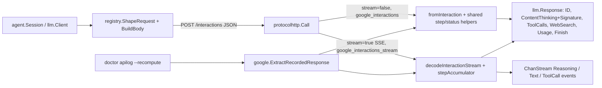

# Google Interactions API client and `google-vertex-express` retirement

## Intent and why

Gemini 4 sessions running through `llm/providers/google` (`generateContent` and `streamGenerateContent`) hit deep-context turn-boundary rollovers (such as 40 fabricated `<job-notification>` and `<delegate-notification>` envelopes in session `03507HVKeWCiXCzGHXBqyK`) and `<end_of_image>` empty-decode failures. Those failures trace directly to protocol mismatches between Evener's `generateContent` adapter and Gemini 3/4 multi-turn reasoning rules:

- `toGeminiContents` emits consecutive `{"role": "user"}` turns whenever tool results are followed by deferred steering or notifications, violating `generateContent`'s strict `user`/`model` alternation requirement.
- `stream.go` and `response.go` drop `thoughtSignature` on bare-text turns and empty trailing chunks, and `request.go` strips `ContentThinking` on replay, severing multi-turn reasoning continuity.
- `request.go` clamps `xhigh` down to `HIGH`, allows `minimal` on models that reject it, and disables `google_search` whenever `len(req.Tools) > 0`.

Google's **Interactions API** (`POST /interactions`) is Google's unified model endpoint across both the Gemini Developer API and Vertex AI (Gemini Enterprise Agent Platform). It replaces `contents[]` and part-attached signatures with a typed `steps[]` timeline (`user_input`, `thought` with explicit `signature` and `summary`, `function_call` with required `id`, `function_result` with `call_id`, `google_search_call`, `google_search_result`, and `model_output`), explicit interaction terminal statuses, lowercase `thinking_level` (`minimal | low | medium | high | xhigh`), and combined `google_search` plus `function` tools.

Jesse decided on a clean-break replacement of `generateContent` under `ProtocolGoogle` (`"google"`) and retirement of the built-in `google-vertex-express` preset, whose legacy `https://aiplatform.googleapis.com/v1` base URL and catalog-only `models_endpoint = "-"` targeted `:generateContent` rather than Vertex's `/interactions` routes (`v1/projects/{project}/locations/global/interactions` or Express Mode `v1beta1/locations/global/interactions`).

## Goals

- Replace `generateContent` and `streamGenerateContent` in `llm/providers/google` with Google's Interactions API (`POST /interactions`) for both `Complete` and `Stream`.
- Round-trip native Interactions `thought` steps (both `summary` text and cryptographic `signature`, including signature-only thoughts with empty summary), wire tool-call IDs and signatures (`function_call.id`, `function_call.signature`, and `function_result.call_id`), user images and documents (`RoleUser`), raster-image tool results (`RoleTool`, keeping PDF tool results on Evener's user-document side channel), and `google_search_call` / `google_search_result` responses with source citations.
- Support Gemini 3 and Gemini 4 `thinking_level` values (`minimal`, `low`, `medium`, `high`, `xhigh`) and `thinking_summaries` (`"auto"` / `"none"`), curating missing Gemini 4 and Gemini 2.5 capabilities in `providers_overlay.toml`.
- Enable `{"type": "google_search"}` alongside `{"type": "function", ...}` tools on models whose registry capabilities vouch for combined search and function calling.
- Default unanchored requests to stateless execution with interaction storage disabled (`"store": false` and full `steps[]` history replay whenever the row allows sending `"store"`) while supporting stateful anchored continuation (`req.PreviousResponseID` -> `"previous_interaction_id"` with `"store": true` and delta `input`), `req.Store`, and `Response.ID` (`interaction.id`) at the `llm.Protocol` boundary.
- Retire `google-vertex-express`, `GOOGLE_VERTEX_API_KEY`, and `GOOGLE_VERTEX_EXPRESS_BASE_URL` cleanly across registry, CLI, Hub tests, wire captures, envvar catalog, and documentation.
- Keep `evener doctor apilog --recompute`, local input-token estimation (`llm/token_count.go`), UI transcript projection (`internal/apptranscript`), and live model discovery (`ListModels`) accurate under the new wire contract.

## Non-goals and anti-goals

- **No `generateContent` wire fallback, deprecated config shims, or `google-vertex-express` alias.** Do not keep a legacy `generateContent` / `streamGenerateContent` endpoint path, do not accept deprecated camelCase `fields.` or `body.` keys (`generationConfig.thinkingConfig`, `safetySettings`, `toolConfig`, `cachedContent`) in `providers.toml`, do not synthesize `thought` steps from legacy `ToolCallData.ThoughtSignature`, and do not keep a deprecation alias for `google-vertex-express` (retaining only the Interactions-side pre-upgrade transcript preservation in §5.3: model-facing Grounding redaction and the 1-shot structured-text recovery when an endpoint rejects unsigned historical tool calls).
- **No `Session`-level stateful `previous_interaction_id` anchor planner in this change.** Generalizing `Session`'s multi-phase `OpenAIResponsesContinuation` state machine to Google is separate follow-up work; `Session` sends full `steps[]` history with `"store": false` by default.
- **No managed-agent, asynchronous background polling, or outbound `continuation_token` resumption.** Do not implement `agent`-targeted requests, `background: true` submission or polling (`GET /interactions/{id}`, `/cancel`, `DELETE`), or outbound `continuation_token` resumption for `status: "requires_continuation"` (which requires empty `input` and Vertex `v1beta1`). Foreground `Complete` and `Stream` reject `"agent"`, `background: true`, and outbound `continuation_token` up front while preserving partial output and returned `r.Raw["continuation_token"]`.
- **No generated image, audio, video, or document outputs.** `ProtocolGoogle` remains a text/tool chat adapter; `RoleAssistant` rejects `ContentAudio` and `ContentDocument` on input (matching `anthropic` and `responses`), and responses containing only non-text generated media surface an explicit error rather than settling as empty completions.
- **No assistant-output string filters in `Session`.** Typed Q&A user-turn markup (`AskReply`) and `TurnSummary` provenance are tracked separately in issue `#6988`.

## Constraints

1. **Verified endpoints and Vertex location rules:**
   - **Gemini Developer API (`google`):** `POST {BASE_URL}/interactions` where default `BASE_URL` is `https://generativelanguage.googleapis.com/v1beta` (`https://generativelanguage.googleapis.com/v1beta/interactions`), authenticated via `x-goog-api-key`. Both `/v1beta/interactions` and `/v1/interactions` are served upstream.
   - **Vertex AI (`google-vertex`):** `POST {GOOGLE_VERTEX_HOST}/v1/projects/{GOOGLE_VERTEX_PROJECT}/locations/{GOOGLE_VERTEX_LOCATION}/interactions`, authenticated via `Authorization: Bearer <token>` (`gcp-adc`, requiring IAM permission `aiplatform.interactions.create` on `projects/{project}/locations/{location}`, included in `roles/aiplatform.user` and `roles/aiplatform.admin`). Per Google Cloud's Interactions API documentation, only `global` (`https://aiplatform.googleapis.com`), `us` (`https://aiplatform.us.rep.googleapis.com`), and `eu` (`https://aiplatform.eu.rep.googleapis.com`) serve `/interactions`; single-region endpoints (`us-central1`, `europe-west1`, etc.) return HTTP 404 for every model. Evener's `vertex-location` host rule (`llm/registry/hostrules.go`) already derives those exact three hosts.
   - **Streaming:** Uses the same `POST .../interactions` URL with `"stream": true` in the JSON request body, returning `text/event-stream` SSE terminated by `event: done` / `data: [DONE]`.
2. **Model family support:**
   - **Vertex AI `/interactions`** serves Gemini 3.1+ and Gemini 4 (`gemini-3.1*`, `gemini-3.5*`..`gemini-3.8*`, `gemini-4*`, `gemini-omni*`, `lyria-3*`), while rejecting `gemini-1.5-*`, `gemini-2.5-*`, and early 3.0 preview IDs documented by Google Cloud as `GenerateContent`-only or retired (`gemini-3-flash-preview` and `gemini-3-pro-preview`).
   - **Gemini Developer API `/v1beta/interactions`** serves Gemini 2.5, Gemini 3, Gemini 4, Omni, and Gemma 4, using `thinking_level` only (`GenerationConfig` has no `thinking_budget` field).
3. **Server storage default (`store: true`):**
   - Omitting `"store"` defaults to `"store": true` upstream, with surface-specific retention: on the **Gemini Developer API** (`google`), stored interactions are retained for **55 days** by default on the Paid Tier (customizable to 7, 14, 28, or 55 days in Google AI Studio) and **1 day** on the Free Tier (distinct from Google's separate 55-day safety/abuse-monitoring retention on non-exempt accounts); on **Vertex AI** (`google-vertex`), stored interactions are retained for **7 days** (subject to Vertex's 240 GiB/day stateful write quota and 500 concurrent stateful interaction limit, and rejected by stateless-only models such as `lyria-3-*`). `"store"` is therefore sendable by default (`prunable[ProtocolGoogle]["store"] == true`) on all `ProtocolGoogle` providers, and `BuildBody` emits `"store": false` on unanchored calls unless overridden per Design §2.1. Note that `"store": false` disables interaction-resource persistence only: Google documents separate retention rules when Grounding with Google Search is enabled on both the Gemini Developer API and Vertex AI, and custom `google-compatible` rows with `fields.store = false` omit `"store"` and delegate retention to that gateway's own policy.
4. **Wire schema invariants (`googleapis/go-genai` `interactions/models/interactions`):**
   - `model` is a bare model ID string (`"gemini-4-neon"`, `"gemini-3.8-flash"`) in the JSON body on both Gemini API and Vertex AI.
   - `input` is `string | Content | []Content | []Step` (never a bare single `Step` object).
   - `system_instruction` is a plain `string` (never `{parts: [...]}`).
   - `response_format` is top-level `{"type": "text", "mime_type": "application/json", "schema"?: {...}}` (outside `generation_config`, with no `json_schema` wrapper key).
   - `safety_settings` is a top-level array of `{"type": "<harm_category>", "threshold": "<threshold>", "method"?: "<method>"}` with lowercase snake_case enums (`harassment`, `hate_speech`, `sexually_explicit`, `dangerous_content`; `block_only_high`, etc.).
   - `function_result.result`: while the Gemini Developer API documents `string | object | []FunctionResultSubcontent`, the Vertex AI Interactions REST reference documents **only** `string` or `[]FunctionResultSubcontent` (omitting bare JSON objects, and parsing arrays as typed `text`/`image` subcontent items). Serializing all non-image structured tool outputs (`map[string]any`, slices, primitives) to JSON `string` and emitting `[]FunctionResultSubcontent` only for inline raster-image tool results keeps one wire representation valid across both surfaces.
   - Response `Interaction` carries `id`, `model`, `status` (`in_progress | requires_action | completed | failed | cancelled | incomplete | budget_exceeded | queued | requires_continuation`), `steps[]`, `usage`, and `errors[]` (`{code: string, message: string}`). `outputs` and `finish_reason` do not exist.
   - Assembled `function_call.arguments` is a JSON object, whereas streamed SSE `step.delta` `arguments_delta.arguments` is a JSON string fragment concatenated across deltas.
5. **Discovery and token counting:**
   - Interactions defines no model-list or token-count endpoints. `ListModels` stays on `GET {BASE_URL}/models` (Gemini API) and `GET {scheme}://{host}/v1beta1/publishers/google/models` (Vertex). `CountTokensEndpoint` becomes `"-"` and `Protocol.CountTokens` unconditionally returns `llm.ErrInputTokenCountUnsupported`, delegating pre-call token accounting to `llm/token_count.go`.

## Approaches

1. **Sibling `google-interactions` protocol alongside `google` (`generateContent`).** Adds a fifth protocol ID (`google-interactions`) for Gemini 3/4 while keeping `llm/providers/google` (`generateContent`) for Vertex 2.5, `google-vertex-express`, third-party `google-compatible` `:generateContent` gateways, and `:countTokens`. Preserves legacy surfaces at the cost of maintaining two Google wire adapters and keeping `generateContent` failure modes in the tree. Rejected by Jesse.
2. **Clean-break replacement of `generateContent` under `ProtocolGoogle` and retirement of `google-vertex-express` (Chosen by Jesse).** Replaces `llm/providers/google`'s request, response, stream, and recompute paths in place with `/interactions`, retires `google-vertex-express`, hides unsupported `<3` Gemini rows on `google-vertex`, and removes `:countTokens`. Keeps one Google protocol and deletes the legacy wire surface outright.
3. **Depend on `google.golang.org/genai` directly.** Adds a heavy generated SDK dependency, bypasses `protocolhttp.Call` (`Prune`, `ApplyBodyConstants`, credential sanitization, `APIAttemptRecord` raw body capture, byte-faithful `RawArguments` decoding, and `AdapterTimeout`), and trips over stale Vertex example guards in upstream `go-genai`. Rejected.

## Design

### Architecture overview

`llm/providers/google` remains the single registered implementation of `registry.ProtocolGoogle` (`"google"`). `Complete` and `Stream` build an Interactions JSON body via `buildBody(req, res, stream)` and `POST` to `protocolhttp.URL(res, res.Transport.Endpoint)` (or `StreamEndpoint`), recording under endpoint families `"google_interactions"` (JSON) and `"google_interactions_stream"` (SSE) so `evener-fuzz-harvest` routes only SSE streams to the stream fuzz corpus while `doctor apilog --recompute` registers both families against `google.ExtractRecordedResponse`.

### 1. Registry, transports, providers, and `google-vertex-express` retirement

#### Decisions from Jesse
- `ProtocolGoogle` switches cleanly to `/interactions` with no legacy `generateContent` fallback.
- `google-vertex-express` is retired completely.

#### Registry and overlay changes (engineering calls)
- **`llm/registry/resolve.go` (`protocolDefaults[ProtocolGoogle]`):**
  - `Endpoint`: `"/interactions"`
  - `StreamEndpoint`: `"/interactions"`
  - `ModelsEndpoint`: `"/models"`
  - `CountTokensEndpoint`: `EndpointUnsupported` (`"-"`)
- **`llm/registry/types.go` and `schema.go` (`Caps.CombinedSearchAndFunctions`):**
  - Add `CombinedSearchAndFunctions *bool` (`toml:"combined_search_and_functions" json:"combined_search_and_functions,omitempty"`, layered and provenanced alongside `MultimodalToolResults` and `WebSearch`) so model-family eligibility for combining `google_search` with `function` tools lives in registry data rather than hardcoded string prefixes in `request.go`.
- **`llm/registry/data/providers_overlay.toml`:**
  - **`[transports."vertex-gemini"]`:** specify only `auth = "gcp-adc"` and `models_endpoint = "/publishers/google/models"`; `endpoint`, `stream_endpoint`, and `count_tokens_endpoint` inherit `protocolDefaults[ProtocolGoogle]`.
  - **`[providers.google]` and `[providers."google-vertex"]`:** bump `cheap_model` from `"gemini-2.5-flash-lite"` to `"gemini-3.5-flash-lite"` on both, and set `web_search = false` by default on **both** (deferring built-in `Session` and `cmd/llmcall --web-search` Google Grounding enablement until Search Suggestions rendering and non-replayed Grounded Result retention exist — `cmd/llmcall` rejects `--web-search` before HTTP when the resolved target speaks `ProtocolGoogle` while preserving ordinary Google `llmcall` output and OpenAI/Anthropic `--web-search`; direct programmatic `llm.Client` callers that implement compliant display, retention, and non-replay may opt in explicitly via `providers.toml` `web_search = true`, updating `agent/provider/profile_test.go:101` accordingly). Enable `[providers.google.fields]` (`previous_interaction_id = true`, `service_tier = true`, `labels = true`, keeping `safety_settings = true` from `prunable[ProtocolGoogle]` to match Gemini Developer API's `CreateInteraction` schema) and `[providers."google-vertex".fields]` (`previous_interaction_id = true`, `service_tier = true`, `labels = true`, **plus `safety_settings = false` by default** because Vertex AI's `CreateModelInteraction` REST schema omits `safety_settings`, letting `registry.Prune` strip `Profile.ProviderOptions()`'s `safety_settings` on `google-vertex` while preserving explicit `[providers.<name>.fields] safety_settings = true|false` overrides and documenting surface support in `docs/llm-providers.md`; `cached_content` is omitted on both because Google documents explicit context caching as unavailable on Interactions, replaced by automatic implicit prefix caching and `previous_interaction_id`). For `gemini-2.5-pro`, `gemini-2.5-flash`, and `gemini-2.5-flash-lite` under `[providers.google.models.*]` (where `models.dev` records `budget_tokens`), curate `thinking_shape = "level"` and `effort_values = ["low", "medium", "high"]`.
  - **Curated Gemini 3 and Gemini 4 chat model globs (top-level `[models.*]`, single source of truth from `ai.google.dev/gemini-api/docs/thinking`; `gemini-omni*` and non-chat media/speech variants such as `gemini-3-pro-image` are excluded from tool-calling capabilities because Vertex/Gemini document function calling as unsupported on `gemini-omni-1.2-flash`, `gemini-3-pro-image`, TTS, transcription, and live-translate rows):**
    - `[models."*gemini-3*"]`: `multimodal_tool_results = true`, `combined_search_and_functions = true`
    - `[models."*gemini-4*"]`: `multimodal_tool_results = true`, `combined_search_and_functions = true`, `thinking_shape = "level"`
    - `[models."*gemini-flash-latest*"]`, `[models."*gemini-flash-lite-latest*"]`: `multimodal_tool_results = true`, `combined_search_and_functions = true`
    - `[models."*gemini-*-image*"]`: `tools = false`, `multimodal_tool_results = false`, `combined_search_and_functions = false` (replays after `*gemini-3*` / `*gemini-4*` via `orderedGlobKeys`, keeping function-calling caps off image rows including `gemini-3-pro-image` and `gemini-3.1-flash-lite-image` while leaving `web_search` untouched for opted-in search-only Grounding on Gemini Developer API)
    - `[models."*gemini-*-tts*"]`, `[models."*gemini-*-transcribe*"]`, `[models."*gemini-*-live*"]`: `tools = false`, `multimodal_tool_results = false`, `combined_search_and_functions = false`
    - `[models."*gemini-omni*"]`: `tools = false`, `web_search = false`, `multimodal_tool_results = false`, `combined_search_and_functions = false` (paired with `derive.go` and `request.go` guards below so a provider-wide `web_search = true` in user `LayerConfig` — which replays after `LayerOverlay` globs — still resolves `Caps.WebSearch == false` and omits `google_search` on Vertex `gemini-omni*` while enabling `google_search` on eligible Vertex models)
    - `[models."*gemini-4-neon*"]`, `[models."*gemini-4-hydrogen*"]`: `effort_values = ["low", "medium", "high", "xhigh"]`, `default_effort = "high"`
    - `[models."*gemini-4-carbon*"]`, `[models."*gemini-4-argon*"]`: `effort_values = ["low", "medium", "high"]`, `default_effort = "medium"`
    - `[models."*gemini-3.1-pro*"]`, `[models."*gemini-3-pro*"]`, `[models."*gemini-3-flash*"]`: `default_effort = "high"` (`models.dev` already supplies the Gemini 3 `effort_values` ladders, including `minimal..high` on `3.6-flash`, `3.5-flash`, `3.5-flash-lite`, `3.1-flash-lite`, and `3-flash-preview`, and `low..high` on `3.8-flash`, `3.7-flash`, and `3.1-pro-preview`).
  - **Retire `google-vertex-express`:** remove `"google-vertex-express"` from `default_order` and delete `[providers."google-vertex-express"]`.
  - **`[providers."google-compatible"]`:** unchanged in TOML; because `"store"` is `true` in `prunable[ProtocolGoogle]`, `google-compatible` sends `"store": false` by default so proxies forwarding to either the Gemini Developer API (55-day Paid Tier / 1-day Free Tier default) or Vertex AI (7-day default) do not persist interaction logs upstream. Operators targeting a gateway that rejects `"store"` can set `fields.store = false` in `providers.toml` to delegate retention to that gateway (documented in `docs/llm-providers.md`, subject to the explicit `store=false` guard in Design §2.1).
- **`llm/registry/prune.go` (`prunable[ProtocolGoogle]`):**
  Replace the camelCase `generateContent` table with exact Interactions snake_case paths:
  - Send-by-default (`true`):
    - `"generation_config.temperature": true`
    - `"generation_config.top_p": true`
    - `"generation_config.stop_sequences": true`
    - `"generation_config.max_output_tokens": true`
    - `"generation_config.thinking_level": true` (`FieldGoogleThinkingLevel`)
    - `"generation_config.thinking_summaries": true` (`FieldGoogleThinkingSummaries`)
    - `"generation_config.tool_choice": true`
    - `"safety_settings": true`
    - `"store": true`
  - Off-by-default (`false`, enabled per-provider where supported):
    - `"generation_config.seed": false`
    - `"previous_interaction_id": false`
    - `"service_tier": false`
    - `"labels": false`
  - Update `TemperaturePath(ProtocolGoogle)` to return `"generation_config.temperature"`, and update `samplingPaths(registry.ProtocolGoogle)` in `llm/registry_shape.go` to return `"generation_config.temperature"`, `"generation_config.top_p"`, and `"generation_config.stop_sequences"`.
  - Remove `FieldGoogleThinkingConfig` (`"generationConfig.thinkingConfig"`), replacing it with `FieldGoogleThinkingLevel` and `FieldGoogleThinkingSummaries`. Authored `providers.toml` files that still reference retired Google `[providers.<name>.fields]` keys fail `ValidateFields` at load time with an explicit error naming the exact **quoted** TOML replacement key(s) or removal (`"generationConfig.thinkingConfig" = false` -> both `"generation_config.thinking_level" = false` and `"generation_config.thinking_summaries" = false`, `"toolConfig"` -> `"generation_config.tool_choice"`, `"cachedContent"` -> remove, etc., since `Fields` is a flat `map[string]bool` where dotted TOML keys must be quoted) alongside the valid Interactions field paths.
  - Reject legacy authored `endpoint` or `stream_endpoint` overrides on `ProtocolGoogle` containing `:generateContent` or `:streamGenerateContent` with an actionable `ConfigurationError` telling the operator to remove the legacy endpoint override so an Interactions JSON body is never posted to a `generateContent` URL.
- **`llm/registry/derive.go` and `llm/types.go` (`EffortReachesWire`):**
  - Export one shared predicate `registry.IsVertexGeminiOmni(preset, wireID string) bool` returning `preset == PresetVertexGemini && strings.HasPrefix(strings.ToLower(strings.TrimSpace(wireID)), "gemini-omni")` (threading `TransportPreset` on `deriveInput`). In `derive.go` (landed in Stage 1 with `Caps.CombinedSearchAndFunctions`), mirror the `reasoningOff` guard for `Tools`: whenever `c.Tools != nil && !*c.Tools && BoolValue(c.CombinedSearchAndFunctions)`, set `c.CombinedSearchAndFunctions = new(false)` (`prov["CombinedSearchAndFunctions"] = provDerived`); and whenever `IsVertexGeminiOmni(in.TransportPreset, m.WireID)` is true, clamp `c.WebSearch = new(false)` (`prov["WebSearch"] = provDerived`) so a provider-wide `web_search = true` on `google-vertex` still resolves `Caps.WebSearch == false` on Vertex Gemini Omni while opted-in `google-compatible` gateways (such as an unrelated `acme-omni-chat` row) and Gemini Developer API rows keep their search settings untouched.
  - Remove the `shape = "budget"` branch for `ProtocolGoogle` in `derive.go`; `ProtocolGoogle` derives `ThinkingShape = "level"` only when `effort` is vouched by non-alias catalog/layer evidence (or set by a curated overlay rule). Any unrecognized authored `thinking_shape` (such as `"budget"`) omits `thinking_level` while still sending `thinking_summaries`.
  - Update `EffortReachesWire` (`llm/types.go`, `case registry.ProtocolGoogle:`) to gate on `caps.Fields[registry.FieldGoogleThinkingLevel]`, drop the `"budget"` branch, and mirror `google.thinkingConfig`: return `true` when the vouched (or unladdered) tier is in `{"minimal", "low", "medium", "high", "xhigh"}` (`"max"` clamps onto the ceiling and continues to report `false`).
- **Vertex regional warnings, pre-Gemini-3 hiding, and discovery (`llm/registry/modelsdev.go`, `llm/registry/resolve.go`, `llm/providers/google/vertex_models.go`, `protocol_transport.go`):**
  - Export one helper `registry.VertexSupportsGeminiModel(id string) bool` returning `false` for `gemini-1*` and `gemini-2*` (`-2.5-`) prefixes **and** for known Vertex `GenerateContent`-only or retired 3.0 preview IDs (`vertexInteractionsUnsupportedGemini`: `"gemini-3-flash-preview"` and `"gemini-3-pro-preview"`, which Google Cloud documents as unsupported on Vertex `/interactions` while `gemini-3.1-pro-preview`, `gemini-3.1-flash-lite`, `gemini-3.5*`..`gemini-3.8*`, and `gemini-4*` are supported; Gemini Developer API `google` continues serving `gemini-3-flash-preview`). Call `VertexSupportsGeminiModel` across: (1) `modelsdev.go` (`case "google-vertex":` setting `m.Hidden = true`, matching existing unservable-row hiding rather than exposing user-toggleable `disabled` rows), (2) `vertex_models.go` (`vertexTextModel`, updating `vertex_models_test.go` so `gemini-3-flash-preview` in `testdata/vertex_publisher_models.json` is filtered out alongside `gemini-2.5-*` while `gemini-3.8-flash` and `gemini-3.1-pro-preview` remain offered), (3) explicit live and cold model-switch validation (`resolveModelSwitchTarget`, `resolveStartupModelProfile`, and `validateModelSwitchMembership` in `agent/session_set_model.go` and `agent/live_model_metadata.go`, checked **before** live-listing enumeration so switching to `google-vertex/gemini-2.5-flash` or `google-vertex/gemini-3-flash-preview` fails locally before committing even when live discovery fails or is static-only, keeping the current model, transcript, and queue intact while preserving fail-open discovery for targets whose availability is unknown), (4) `validateModelFallbackEntry` (`agent/session_init.go`), and (5) `protocol_transport.go` (`completionCall` / `BuildBody`: when `isVertexTransport(res) && !registry.VertexSupportsGeminiModel(res.WireID)`, fail fast with an actionable `llm.ConfigurationError` instructing the user to switch the session to a Vertex Interactions-supported model such as `gemini-3.8-flash`). Keep `"omni"` in `vertexTextModelDenylist` so live discovery stays scoped to text-chat models.
  - Update `isVertexTransport(res)` in `vertex_models.go` to check `res.Transport.Preset == registry.PresetVertexGemini` rather than path-prefix sniffing.
  - Because Vertex `/interactions` rejects single-region endpoints (`us-central1`, `europe-west1`, etc.) for **every** model, extend the Vertex regional warning in `resolve.go` and `regionalVertexLocationRemedy` in `protocol_transport.go`: any `ProtocolGoogle` row whose host was derived by `host_rule = "vertex-location"` from a location outside `{"global", "us", "eu"}` emits a resolve warning and reclassifies an HTTP 404 from `/interactions` into an actionable `llm.ConfigurationError` stating the **actual residency boundary of each supported endpoint** (`us` = United States multi-region residency, `eu` = European Union multi-region residency, `global` = global routing with **no data-residency guarantee**): lead with `GOOGLE_VERTEX_LOCATION=us` **only** for `us-*` regions, lead with `GOOGLE_VERTEX_LOCATION=eu` **only** for European Union `europe-*` regions (excluding non-EU `europe-west2` London and `europe-west6` Zurich), and for every other geography (`northamerica-*`, `southamerica-*`, `europe-west2`, `europe-west6`, `asia-*`, `australia-*`, `me-*`, `africa-*`) list `us`, `eu`, and `global` while **explicitly disclosing** in both the remedy message and `docs/llm-providers.md` that switching from `loc` changes the geographic data-residency boundary.
  - Keep Gemini Developer API `ListModels` on `GET {BASE_URL}/models?pageSize=1000` (`supportsGenerateContent` + `registry.IsChatModelID`). Make `Protocol.CountTokens` unconditionally return `0, llm.RewriteErrorProvider(llm.ErrInputTokenCountUnsupported, res.Instance)`.
- **`google-vertex-express` removal inventory:**
  - `envvars/envvars.go` and `envvars/envvars_test.go`: delete `GoogleVertexAPIKey`, `GoogleVertexExpressBaseURL`, and `TestGoogleVertexExpressVariablesAreRegistered`.
  - `cmd/evener/models_live_test.go`, `cmd/evener-hub/frontend/src/panes/settings/sections/credentials/instanceDialogs.test.tsx`, `llm/providers/wirecapture/` (removing `google-vertex-express` captures and adding explicit `web_search = true` opt-in on the fixture stanza that captures Google's `"google_search"` tool payload), `llm/registry/resolve_test.go` (`TestResolve_WebSearchCanonicalGate` switching `vertexaliastarget` to `base = "google-vertex-anthropic"` so curated `web_search = true` endpoint-gating coverage stays intact when `google-vertex` defaults `web_search = false`), `llm/registry/golden_test.go` (plus `go test ./llm/registry -update` for surviving Google/Vertex goldens), `llm/registry/instances_test.go`, `llm/registry/overlay_test.go`, and `llm/registry/testdata/golden/google-vertex-express-gemini-2.5-flash.json`: remove `google-vertex-express` cases and golden files, and update surviving `ProtocolGoogle` live smoke paths in `cmd/evener/models_live_test.go` (`:913`, `:1078`, and stored-credential Vertex Gemini tests) to execute through `google.DefaultProtocol.Complete` and `Stream` rather than hand-crafting legacy `contents`/`generationConfig`/`candidates` payloads.
  - Keep `gcp-adc` JSON credential handling in `cmd/evener-hub/app_auth.go`, `CredentialsSection.tsx`, `llm/providers/tokenauth/gcpadc.go`, and `llm/registry/credential_json.go` intact, updating comments that cited `google-vertex-express`.
  - Regenerate and update `docs/environment-variables.md` (`make generate` / `make docs-check`), `docs/product/subsystems.md` (`S15` provider configuration and `S16` model catalog), `docs/llm-providers.md`, `docs/developing-evener/environment.md`, and `docs/developing-evener/config-knobs.md`. `docs/llm-providers.md` must document: (1) `store = false` disables interaction storage by default while documenting the distinct upstream retention windows when opting into `store = true` (Gemini Developer API: 55-day Paid Tier default customizable to 7/14/28/55 days, 1-day Free Tier default, plus separate abuse-monitoring rules; Vertex AI: 7-day retention; custom `google-compatible` gateways with `[providers.<name>.fields]` `store = false`: gateway-defined retention) and noting that Grounding with Google Search defaults `web_search = false` on both `google` and `google-vertex` (deferring `Session` enablement, documenting the Search Suggestions display, storage, and non-replay obligations for direct `llm.Client` callers opting in under either Gemini Developer API or Vertex AI Service Specific Terms, and noting the pre-cutover summary provenance boundary when pre-fold transcript entries are absent), (2) Vertex AI IAM prerequisite `aiplatform.interactions.create` on `projects/{project}/locations/{location}` (included in `roles/aiplatform.user` and `roles/aiplatform.admin`) and HTTP 403 troubleshooting for custom ADC roles that previously granted only `aiplatform.endpoints.predict` (`generateContent`), (3) `google-compatible` gateways must serve `POST {BASE_URL}/interactions` (plus `store = false` under `[providers.<name>.fields]` for gateways that reject `store`), (4) pre-upgrade `providers.toml` migrations and load-failure/call-time symptoms so operators recover healthy providers without discarding their config file — `providers.<name>: base "google-vertex-express" is not a registry id` on custom child stanzas, `providers.google-vertex-express: no protocol` on bare override stanzas, updating `default = "google-vertex-express"`, removing `:generateContent` / `:streamGenerateContent` endpoint overrides, migrating `[providers.<name>.body]` legacy `generateContent` constants (`"generationConfig.*"`, `"safetySettings"`, `"toolConfig"`, `"cachedContent"` -> snake_case `"generation_config.*"`, `"safety_settings"`, or removal, rejected at call time with an actionable `ConfigurationError`), and a **complete TOML `[providers.<name>.fields]` example plus explicit key-by-key migration table with quoted dotted keys** (because `Fields` is a flat `map[string]bool` where unquoted `generation_config.x` would create a rejected nested TOML table: `"generationConfig.temperature"` -> `"generation_config.temperature"`; `"generationConfig.topP"` -> `"generation_config.top_p"`; `"generationConfig.stopSequences"` -> `"generation_config.stop_sequences"`; `"generationConfig.thinkingConfig" = false` -> **both** `"generation_config.thinking_level" = false` and `"generation_config.thinking_summaries" = false`; `"toolConfig"` -> `"generation_config.tool_choice"`; `"safetySettings"` -> `safety_settings`; `labels` unchanged; and **remove** `"cachedContent"`, which has no direct Interactions field beyond automatic prefix caching and `previous_interaction_id`) — and (5) the three verified migration paths for retired `google-vertex-express` depending on credential type (never placing secret key values in `providers.toml`; because a custom `base_url` stops `api_key_env` inheritance, each custom stanza must bind its credential explicitly via `api_key_env = ["GOOGLE_VERTEX_API_KEY"]` — or another env var name — or via a stored credential under `<name>` in Settings -> Credentials / `evener auth`): (a) keep an existing **projectless Vertex Express API key** on Vertex via custom `[providers.<name>]` with `base = "google-compatible"`, `base_url = "https://aiplatform.googleapis.com/v1beta1/locations/global"`, `auth = "header"`, `auth_header = "x-goog-api-key"`, `api_key_env = ["GOOGLE_VERTEX_API_KEY"]` (or stored credential), `models_endpoint = "-"`, **`default_model = "gemini-3.8-flash"`, and static model stanza `[providers.<name>.models."gemini-3.8-flash"] alias_of = "google/gemini-3.8-flash"`** (since `google-compatible` carries no inherited catalog rows when `models_endpoint = "-"`, plus showing `--resume <session-id> --model <name>/gemini-3.8-flash` and UI picker selection `<name>/gemini-3.8-flash`), (b) use a **project-scoped Vertex API key** via custom `[providers.<name>]` with `base = "google-vertex"`, `GOOGLE_VERTEX_PROJECT`, `GOOGLE_VERTEX_LOCATION = "global"`, `auth = "header"`, and `auth_header = "x-goog-api-key"`, and `api_key_env = ["GOOGLE_VERTEX_API_KEY"]` (or stored credential) (`POST https://aiplatform.googleapis.com/v1/projects/{GOOGLE_VERTEX_PROJECT}/locations/global/interactions`), or (c) issue a separate **Google AI Studio key** (`GEMINI_API_KEY` / `GOOGLE_API_KEY`, distinct from a Google Cloud Express key) and use built-in `google`.

### 2. Request assembly (`llm/providers/google/request.go`)

`Protocol.BuildBody(req, res)` delegates to `buildBodyWithPolicy(req, res, false)` and returns `(body, err)`. `Complete` selects SSE vs JSON via `protocolhttp.RequiresStreamingCompleteContext(ctx, res)` (`protocolhttp/exchange.go:162`, resolving `llm.AuthenticatorForContext(ctx, res.Transport.Auth)` so call-scoped `llm.WithAuthenticatorOverride` and global auth schemes share one effective `RequestPreparer` across exchange-mode selection, `PrepareRequest`, and `FinalizeBody` snapshots) -> `protocolhttp.CompleteViaStream(ctx, res.Instance, ...)` (`protocol_transport.go:87-89`, delegating to `p.Stream` so streaming-required auth preparers send `"stream": true`, decode SSE, and record `"google_interactions_stream"`), and otherwise runs a direct JSON exchange (`stream = false`, recording `"google_interactions"`). Direct `Complete` (`stream = false`) and `Stream` (`stream = true`) call `buildBodyWithPolicy(req, res, stream)` and pass the resolved `interactionBodyPolicy{stream, wireModel, combinedTools, anchorID, storeOmitted, effectiveStore}` into `completionCall`'s `FinalizeBody`:

1. **Top-level envelope and option guards:**
   - Unconditionally set `body["model"] = res.WireID` (`CreateModelInteraction.model` is always required in the JSON body on `/interactions`, even if a custom gateway configures `{model}` in one endpoint template).
   - If `stream` is true, set `body["stream"] = true`.
   - **Anchor (`previous_interaction_id`) and `store` resolution (single source of truth):**
     - Resolve `anchorID` from `strings.TrimSpace(req.PreviousResponseID)` if non-empty, else `ProviderOptions["google"]["previous_interaction_id"]` (returning `ConfigurationError` if present and not `string`).
     - Resolve `explicitStore *bool` from `req.Store` if non-nil, else `ProviderOptions["google"]["store"]` (returning `ConfigurationError` if present and not `bool`).
     - Let `storeSendable := requestutil.WireFieldEnabled(caps, "store", res.Protocol)` (`requestutil/fields.go:10`, which returns `false` **only** when `caps.Fields["store"]` is explicitly present and `false`, and returns `true` when `"store"` is `true` or absent from an unseeded `Caps.Fields` map, matching `prunable[ProtocolGoogle]["store"] == true`).
     - **Unanchored (`anchorID == ""`):** if `!storeSendable` (an explicit `fields.store = false` gateway opt-out), require `explicitStore == nil` (returning `ConfigurationError` if the caller passed an explicit `store` setting the row forbids sending) and record `policy.storeOmitted = true`. Otherwise (`storeSendable == true`), record `policy.storeOmitted = false`, `policy.effectiveStore = false` (or `*explicitStore` when non-nil, preserving explicit stateful `store=true` requests), and set `body["store"] = policy.effectiveStore` so direct `Protocol.Complete` / `Stream` callers with nil or unseeded `Caps.Fields` still send `"store": false`.
     - **Anchored (`anchorID != ""`):** Google rejects `previous_interaction_id` when `store=false`, and the stored interaction already holds prior turns. Require `caps.Fields["previous_interaction_id"]` and `storeSendable` both `true` (else return `ConfigurationError`), reject `explicitStore != nil && !*explicitStore` with `ConfigurationError`, record `policy.anchorID = anchorID`, `policy.storeOmitted = false`, `policy.effectiveStore = true`, and set `body["store"] = true` and `body["previous_interaction_id"] = anchorID` (callers supply only the new user/tool delta turns since the anchor, matching `openai-responses`).
   - **Unsupported execution-mode and caching guards (`agent`, `background`, `continuation_token`, `cached_content`, and `service_tier="deferred"`):** return `ConfigurationError` when `options["agent"]`, `options["continuation_token"]`, or `options["cached_content"]` is present (and not `""`), when `(req.Background != nil && *req.Background)` or `options["background"]` is present and not `false`, or when `req.ServiceTier` / `options["service_tier"]` equals `"deferred"` (case-insensitive; Google's `deferred` tier requires `background=true` and `store=true`, whereas foreground tiers `"flex"`, `"standard"`, and `"priority"` remain supported).
   - **Request-local ownership in `registry.ApplyBodyConstants` and final outbound body enforcement (`FinalizeBody` in `protocol_transport.go`):** in `llm/registry/prune.go` (`ApplyBodyConstants`, `:209`, landed in Stage 1), deep-clone `map[string]any` and `[]any` constant values (`cloneJSONValue`) before `setPath` installs them onto `body`, so combining a whole-object `"generation_config"` constant with a dotted `"generation_config.seed"` constant gives each concurrent request its own mutable map before dotted writes or `FinalizeBody` run (preserving whole-object replacement and dotted-key precedence while leaving the shared `res.Transport.Body` configuration untouched). Because `protocolhttp.Prepare` runs `registry.Prune` and `registry.ApplyBodyConstants(body, res.Transport.Body)` *after* `BuildBody` (`protocolhttp/call.go:73-107`), `completionCall`'s `FinalizeBody` then enforces `policy` on the request-owned `finalBody`:
     1. **`stream` authority:** pin `finalBody["stream"] = true` when `policy.stream` is true (SSE exchange via `Stream`, including `Complete` routed through `CompleteViaStream`) and `delete(finalBody, "stream")` when `policy.stream` is false (direct JSON exchange in `Complete`), so neither `ProviderOptions` nor `Transport.Body` can desynchronize the wire `"stream"` flag from the actual exchange decoder and capture family.
     2. **`agent`, `background`, `continuation_token`, `cached_content`, `service_tier="deferred"`, and retired `generateContent` body-constant guards:** delete `finalBody["agent"]`, `finalBody["continuation_token"]`, and `finalBody["cached_content"]` when `""` and return `ConfigurationError` if any non-empty or non-string value is present on those keys; delete `finalBody["background"]` when `false` and return `ConfigurationError` for any other `finalBody["background"]` value; return `ConfigurationError` if `finalBody["service_tier"]` is non-string or case-insensitively equals `"deferred"`; and return an actionable `ConfigurationError` naming the snake_case Interactions replacement (or removal) if `ProviderOptions` or `[providers.<name>.body]` (`ApplyBodyConstants`) injected any retired `generateContent` top-level key (`"generationConfig"`, `"safetySettings"`, `"toolConfig"`, `"cachedContent"`, `"contents"`, or `"systemInstruction"`) while leaving unrelated custom gateway constants untouched.
     3. **Anchor lock:** require `finalBody["previous_interaction_id"]` to be absent when `policy.anchorID == ""` and equal to `policy.anchorID` otherwise, returning `ConfigurationError` if `Transport.Body` added, removed, or replaced the anchor after `input` was assembled.
     4. **Storage policy lock:** when `policy.storeOmitted` is true, require `"store"` to be absent from `finalBody` (returning `ConfigurationError` if `Transport.Body` injected `"store"` onto a `fields.store = false` gateway); when `policy.storeOmitted` is false, require `finalBody["store"] == policy.effectiveStore` (returning `ConfigurationError` if `Transport.Body` flipped the unanchored `store=false` default or an explicit `store` setting).
     5. **Unconditional `model` authority, zero-encode `Transport.Body` key validation, and effective-preparer snapshot lock:** require `finalBody["model"] == policy.wireModel` **unconditionally** in `FinalizeBody` on every request (rejecting any deletion or replacement of `"model"` by `Transport.Body` or a `RequestPreparer` after history signatures and capabilities were resolved for `res.WireID`). Validate configured `res.Transport.Body` keys **in O(`len(res.Transport.Body)`) before `ApplyBodyConstants` with zero extra JSON marshaling or buffer allocations** on ordinary requests — for every key `k` in `res.Transport.Body`, extract `root, _, _ := strings.Cut(k, ".")` and return `ConfigurationError` if `root` is in `{"input", "model", "tools", "response_format", "agent", "previous_interaction_id", "store", "continuation_token", "cached_content", "background"}` (rejecting top-level and nested dotted overrides such as `"response_format.mime_type"`, while allowing unrelated constants such as `"labels.env"` or `"generation_config.seed"`). Resolve the **effective** authenticator via `llm.AuthenticatorForContext(ctx, res.Transport.Auth)` (`protocolhttp.Prepare` `:92`, covering call-scoped `llm.WithAuthenticatorOverride` as well as globally registered schemes): take pre/post JSON byte snapshots of `input`, `tools`, and `response_format` **only** when `_, hasPreparer := auth.(llm.RequestPreparer)` is true, preserving the single-encode fast path for all non-preparer calls while rejecting protected-field mutations by a call-scoped or global `RequestPreparer`.
     6. **Authoritative `reasoning = false` and `generation_config.tool_choice` enforcement after all overlays:**
        - **`reasoning = false`:** when `res.Caps.ReasoningDisabled()` is true, unconditionally delete `"thinking_level"` and `"thinking_summaries"` from `finalBody["generation_config"]` (deleting `"generation_config"` if empty, while preserving sibling keys such as `"temperature"` or `"seed"` and keeping native `thought` / `function_call.signature` steps in `finalBody["input"]` intact), so neither `ProviderOptions["google"]["generation_config"]` nor `Transport.Body` constants can re-introduce generation thinking controls onto a reasoning-disabled row.
        - **`generation_config.tool_choice`:** let `toolChoiceEnabled := requestutil.WireFieldEnabled(res.Caps, "generation_config.tool_choice", res.Protocol)`. When `policy.combinedTools` is true, require `toolChoiceEnabled` **and** `finalBody["generation_config"]["tool_choice"]` present with an effective mode in `{"validated", "any", "none"}` across both wire shapes (bare string or `map[string]any` `allowed_tools.mode`), returning `ConfigurationError` before HTTP if disabled, absent, `"auto"`, or unrecognized. When `!policy.combinedTools` (function-only or tool-less requests) and `!toolChoiceEnabled`, delete `"tool_choice"` from `finalBody["generation_config"]` (deleting `"generation_config"` if empty, while preserving enabled sibling keys) so `Transport.Body["generation_config.tool_choice"]` cannot bypass `"generation_config.tool_choice" = false`.
     7. **Output-limit pruning and minimum-cap precedence (`reconcileOutputField`, combining `responses/request.go:162-169` and `google/request.go:175-189`):** check `requestutil.WireFieldEnabled(res.Caps, "generation_config.max_output_tokens", res.Protocol)` first; when `false` (the row explicitly disabled `fields."generation_config.max_output_tokens"`), delete `"max_output_tokens"` from `finalBody["generation_config"]` (deleting `"generation_config"` if empty) and return without re-creating it. When `WireFieldEnabled` is `true`, compute `ceiling := requestutil.MinPositiveInt(requestutil.PositivePointerInt(req.MaxTokens), requestutil.PositivePointerInt(res.Caps.MaxOutputTokens))` and set `genCfg["max_output_tokens"] = requestutil.MinPositiveInt(requestutil.PositiveInt(genCfg["max_output_tokens"]), ceiling)` when positive so a lower positive wire override (e.g. `200` under a `1,000` ceiling) is preserved while a higher override clamps down to `ceiling`.
   - Emit `"service_tier"` (`req.ServiceTier`), `"labels"` (copying into a fresh request-owned `map[string]any` — never `map[string]string` — **only** generic `req.Metadata` entries that satisfy Google's documented Unicode code-point label rules: let `isGoogleLabelLetter(r) := unicode.IsLower(r) || (unicode.IsLetter(r) && !unicode.IsUpper(r))` and `isGoogleLabelRune(r) := isGoogleLabelLetter(r) || unicode.IsNumber(r) || r == '_' || r == '-'`; require `<= 64` entries total, lengths measured in Unicode code points via `utf8.RuneCountInString`, **every code point of both keys and values satisfying `isGoogleLabelRune(r)`**, keys `1..63` code points **starting with `isGoogleLabelLetter(firstRune)`**, and values `0..63` code points — preserving valid international labels such as `"équipe"` while silently skipping invalid generic `req.Metadata` keys or values such as `"team/id"` or `trace_id="trace/123"` without mutating `req.Metadata`, and validating any explicitly supplied `ProviderOptions["google"]["labels"]` or `Transport.Body` `"labels.*"` entries in `BuildBody` / `FinalizeBody` with a local `llm.ConfigurationError` on invalid keys, values, or counts; `setPath` descends into `body["labels"]` to merge dotted constants such as `"labels.env"` alongside request labels such as `"team"`), and `"system_instruction"` (joined `RoleSystem` / `RoleDeveloper` text blocks as a plain `string`) when non-empty.

2. **Conversation history -> `input` (`[]Step`):**
   Walk `req.Messages` once, maintaining `callIDToName map[string]string` (plus a FIFO queue of synthetic IDs assigned to any legacy empty-ID `ContentToolCall` parts) for O(1) `function_result` pairing, emit `input` as `steps []any`, and require `len(steps) > 0` after assembly for both unanchored and anchored calls (returning `ConfigurationError` when `req.Messages` is empty, system-only, empty-text-only, or contains only skipped legacy/foreign thinking parts):
   - **Lazy `user_input` coalescing (`RoleUser`):** accumulate `RoleUser` content items into `pendingUser []any` (user prompts, environment context, memory notifications, or deferred `<job-notification>` / `<delegate-notification>` steering) and flush `pendingUser` as a **single** `{"type": "user_input", "content": pendingUser}` step **lazily inside `appendNonUserStep(step)` right before a `model_output`, `thought`, `function_call`, or `function_result` step is actually emitted** (plus one final flush after walking `req.Messages`) — never eagerly at `RoleAssistant` or `RoleTool` message entry. If an intermediate `RoleAssistant` message contains only skipped legacy/foreign `ContentThinking` or empty text and emits zero steps, `pendingUser` stays open so the surrounding `RoleUser` messages coalesce into one `user_input` step rather than producing adjacent `user_input` steps:
     - `ContentText` (non-empty): `{"type": "text", "text": p.Text}`.
     - `ContentImage`: inline bytes or local file path normalized via `googleInlineImageBytes` and encoded with `llm.CachedBase64(b)` -> `{"type": "image", "data": b64, "mime_type": mt}`; remote/GCS URI -> `{"type": "image", "uri": u, "mime_type": mt}`.
     - `ContentDocument`: inline bytes encoded with `llm.CachedBase64(doc.Data)` -> `{"type": "document", "data": b64, "mime_type": mt}`; URI -> `{"type": "document", "uri": u, "mime_type": mt}` (default `application/pdf`).
     - `ContentAudio`: rejected with `ConfigurationError`.
   - **`RoleAssistant`:** walks `msg.Content` in order, flushing `pendingUser` via `appendNonUserStep` only when an assistant step is actually emitted:
     - **Step-boundary-faithful `ContentText` and `ContentImage` -> `model_output` replay:** add persisted `GoogleStep int` (`json:"google_step,omitempty"`, 1-based `stepIdx + 1` stamped by both JSON and SSE `appendInteractionSteps` on every `ContentText` part decoded from a `model_output` step; `0` on synthetic, non-Google, or provenance-stripped parts) on `llm.ContentPart` (`llm/types.go:131`, alongside `Phase`). Within `RoleAssistant`, both non-empty `ContentText` (`{"type": "text", "text": p.Text}`) and `ContentImage` (encoded via `googleInlineImageBytes` + `llm.CachedBase64` as `{"type": "image", "data": b64, "mime_type": mt}` or URI `{"type": "image", "uri": u, "mime_type": mt}`, preserving `TestBuildBodyAssistantAndToolResultContents` in `requestedges_test.go` and keeping `ContentImage` representable in `unrepresentableContentKinds[ProtocolGoogle]`) append in order into the open `{"type": "model_output", "content": [...]}` step while their `GoogleStep` matches (`pendingStep == p.GoogleStep`), and flush into a new `model_output` step whenever `p.GoogleStep != pendingStep` or before any `thought`, `function_call`, or `google_search_*` step — so adjacent assistant text and images stay in exact order and two consecutive `model_output` steps followed by a `function_call` replay as two `model_output` steps after transcript reload, while generated media *outputs* decoded from upstream responses remain rejected per Non-goals. `ContentAudio` and `ContentDocument` in `RoleAssistant` return `ConfigurationError` (matching `anthropic/request.go` and `responses/input.go`).
     - `ContentThinking` (**adapter-enforced non-empty `(Instance, WireID)` Interactions provenance, decoupled from `caps.ReasoningDisabled()`**): add persisted `GoogleInteraction bool` (`json:"google_interaction,omitempty"`), `GoogleInstance string` (`json:"google_instance,omitempty"`), `GoogleModel string` (`json:"google_model,omitempty"`), and `ReplayableGoogleThoughtFor(instance, wireModel string) bool` on `llm.ThinkingData` (`llm/types.go`, stamped with `(res.Instance, res.WireID)` on live `Complete` and `Stream` decode, and left with `GoogleInstance == ""` on offline `ExtractRecordedResponse`), returning `true` **only** when `t != nil && t.GoogleInteraction && !t.Redacted && t.EncryptedContent == "" && !llm.IsOpenAICompatReasoningField(t.Signature) && (strings.TrimSpace(t.Signature) != "" || len(t.Summary) > 0) && instance != "" && wireModel != "" && t.GoogleInstance == instance && t.GoogleModel == wireModel` (never treating an empty `GoogleInstance` or `GoogleModel` as a wildcard). Emit `{"type": "thought", "signature"?: sig, "summary"?: summaryItems}` (built from `t.Summary`) whenever `p.Kind == llm.ContentThinking && p.Thinking.ReplayableGoogleThoughtFor(res.Instance, res.WireID)` — enforcing the strict same-instance, same-wire-model replay boundary in `request.go` for **both** `Session` and direct `llm.Client` / `Protocol` callers (including rejecting cross-instance reuse of offline-recomputed messages while preserving their summaries for inspection), independent of `caps.ReasoningDisabled()` (`reasoning = false` suppresses outbound `thinking_level` / `thinking_summaries` generation controls only). Signed Anthropic thoughts (`GoogleInteraction == false`), pre-cutover `generateContent` display-only `ThinkingData.Text`, offline-recomputed thoughts (`GoogleInstance == ""`), and native Google thoughts from a different `(Instance, WireID)` never replay onto Google's wire.
     - `ContentWebSearch` (**no client-side Grounding history replay**): both Gemini Developer API and Vertex AI Grounding terms forbid resending stored Search Suggestions and completed Grounded Results in later prompts, while combined `google_search` + `function` tool context circulation requires signed search steps. `buildBodyWithPolicy` therefore **rejects** any `RoleAssistant` message carrying a `ContentWebSearch` part in `req.Messages` with an actionable `ConfigurationError` (preventing both raw `google_search_*` steps / `search_suggestions` and associated grounded assistant text from being resent in stateless history). Direct callers running combined `google_search` + `function` rounds continue a pending `requires_action` tool round via Google's recommended stateful mode (`store: true` on the initial request, then `previous_interaction_id` (`store: true`) + delta `input` (`[function_result]` only, with no stored Grounding steps resent) **alongside** turn-scoped `req.Tools`, `req.WebSearch = true`, `system_instruction`, and `generation_config` (`tool_choice: "validated"`), since Google persists only conversation `steps[]` on the interaction and requires resending active tool declarations on each follow-up), and omit completed grounded turns from subsequent unanchored requests.
     - `ContentToolCall` (**including adapter-enforced non-empty `(Instance, WireID)` `function_call.signature` and validated JSON object `arguments` replay, decoupled from `caps.ReasoningDisabled()`**): add persisted `GoogleInteraction bool` (`json:"google_interaction,omitempty"`), `GoogleInstance string` (`json:"google_instance,omitempty"`), and `GoogleModel string` (`json:"google_model,omitempty"`) on `llm.ToolCallData` (`llm/types.go:188`), stamped with `(true, res.Instance, res.WireID)` alongside `ThoughtSignature` on live `Complete` and `Stream` decode (and `GoogleInstance: ""` on offline `ExtractRecordedResponse`). Record `id -> tc.Name` in `callIDToName` (assigning a deterministic fallback ID if `tc.ID == ""`). While `ToolCallData.ArgumentsSpelling` / `WireArguments()` preserves the model's exact original bytes in memory and on durable transcripts for inspection, `protocolhttp.MarshalBody` delegates `json.RawMessage` to `encoding/json` (`TestMarshalBodyMatchesStdlib`), which compacts whitespace: read `rawArgs := []byte(tc.WireArguments())` and validate `trimmed := bytes.TrimSpace(rawArgs)` so when `len(trimmed) > 0 && trimmed[0] == '{' && json.Valid(trimmed)`, `json.RawMessage(trimmed)` serializes on the outbound HTTP wire as an equivalent JSON object preserving key order and exact numeric tokens (falling back to `json.RawMessage("{}")` when empty or malformed). Emit `"signature": strings.TrimSpace(tc.ThoughtSignature)` on the `function_call` step **only** when `tc.GoogleInteraction && strings.TrimSpace(tc.ThoughtSignature) != "" && res.Instance != "" && res.WireID != "" && tc.GoogleInstance == res.Instance && tc.GoogleModel == res.WireID` (never treating empty `GoogleInstance` or `GoogleModel` as a wildcard, independent of `caps.ReasoningDisabled()`, so direct `llm.Client` callers switching Google instances/models or reusing offline-recomputed messages omit the original `function_call.signature` automatically while keeping `id`, `name`, `arguments`, and same-target tool follow-ups intact, and legacy `generateContent` `ToolCallData` stays off the wire).
   - **`RoleTool` (`ContentToolResult`):** each emitted `ContentToolResult` flushes `pendingUser` via `appendNonUserStep` before appending its `function_result` step so an earlier `user_input` precedes the tool round and `function_result` precedes any subsequent deferred `RoleUser` steering step. Each `ContentToolResult` resolves `name` from `callIDToName[callID]` **first** (preserving surface tool renames such as `list_dir -> list_directory` from the matching `ContentToolCall.Name`) with fallback to `strings.TrimSpace(tr.Name)`, and emits `{"type": "function_result", "call_id": callID, "name"?: name, "is_error"?: true, "result": resultVal}`:
     - **Raster-image-only inline media (preserving Evener's PDF side channel):** `llm.DeliversToolResultMedia` and `TestRowSeesToolResultMediaStaysImageOnlyForGoogle` (`llm/document_delivery_test.go:47-60`) stay unchanged so `read_file` PDFs continue to take the `RoleUser` `ContentDocument` side channel once (`#4463`), and non-`image/*` `tr.ImageData` (such as `"application/pdf"`) is ignored here. When `len(tr.ImageData) > 0` and `mediaType := strings.ToLower(strings.TrimSpace(tr.ImageMediaType))` is `""` or `strings.HasPrefix(mediaType, "image/")`: require `registry.BoolValue(caps.MultimodalToolResults)` (else return `ConfigurationError`, matching `google/request.go:594-596`), normalize via `googleInlineImageBytes` + `llm.CachedBase64`, and emit `result` as `[{"type": "text", "text": textStr}, {"type": "image", "data": b64, "mime_type": imageType}]` (matching Gemini API's documented `(ImageContent | TextContent)[]` subcontent).
     - Otherwise pass `string` `tr.Content` directly as `string`, and serialize any non-string `tr.Content` (`map[string]any`, slices, primitives) via `json.Marshal` to a JSON `string` (satisfying both the Gemini Developer API and Vertex AI's Interactions REST schema, which documents only `string` or `[]FunctionResultSubcontent` for `function_result.result`).

3. **Tools and `google_search`:**
   - Let `toolsSupported := caps.Tools == nil || *caps.Tools`. When `len(req.Tools) > 0 && !toolsSupported` (such as `gemini-3-pro-image`, where `models.dev` records `tool_call: false`), return an actionable `llm.ConfigurationError` so neither `function` tools nor a combined `google_search` + `function` payload is ever emitted on a model that lacks function calling. Otherwise (`len(req.Tools) > 0 && toolsSupported`), validate each `req.Tools` entry with `openaichat.CyclicSchema(t.Parameters)` (returning `&llm.ConfigurationError{Cause: openaichat.ErrCyclicSchema}` on cycles, matching `responses/request.go`), then emit `{"type": "function", "name": t.Name, "description": t.Description, "parameters": sanitizeGeminiSchema(t.Parameters)}`.
   - Let `webSearch := req.WebSearch && (caps.WebSearch == nil || *caps.WebSearch) && !registry.IsVertexGeminiOmni(res.Transport.Preset, res.WireID)` (using the exact same `PresetVertexGemini` + `gemini-omni*` predicate as `derive.go`). When `webSearch` is true:
     - When `len(req.Tools) == 0`: append `{"type": "google_search"}` (single-turn search, valid with `store: false` or `store: true`, including on search-capable non-function models such as `gemini-3-pro-image` when opted in).
     - When `len(req.Tools) > 0` and `toolsSupported && registry.BoolValue(caps.CombinedSearchAndFunctions)`: require stateful mode **and** an enabled `generation_config.tool_choice` field (`policy.effectiveStore == true`, `storeSendable`, `caps.Fields["previous_interaction_id"]`, and `requestutil.WireFieldEnabled(caps, "generation_config.tool_choice", res.Protocol)`, returning `ConfigurationError` if the caller left `store` at `false`, the row forbids stateful chaining, or the operator set `"generation_config.tool_choice" = false`, since omitting `tool_choice` falls back to Google's unsupported `"auto"` default on combined tools), append `{"type": "google_search"}`, and record `policy.combinedTools = true` (when `toolsSupported` is true and `CombinedSearchAndFunctions` is false, such as `gemini-2.5-flash`, omit `google_search` and send only the `function` tools).
     - **`llm.Generate` and `llm.StreamGenerate` preflight guard (`llm/generate.go:218-248`):** because `Generate` and `StreamGenerate` run stateless `history` tool loops without advancing `PreviousResponseID`, `prepareGeneration` resolves the effective Google anchor using the exact same rule as §2.1 (`strings.TrimSpace(opts.PreviousResponseID)` else `opts.ProviderOptions["google"]["previous_interaction_id"]`) and rejects requests **before Turn 1 or any `t.Execute` handler runs** with an actionable `llm.ConfigurationError` whenever the resolved target speaks `ProtocolGoogle`, automatic tool looping is enabled (`maxToolRounds > 0 && hasActiveTool`), and **either** an effective anchor is set (including non-string invalid option values) **or** combined `google_search` + `function` tools are active — preserving `MaxToolRounds == 0` (tool looping disabled), passive tools (`!hasActiveTool`), unanchored stateless function loops, and explicit `Client.Complete` / `Client.Stream` anchored continuations.

4. **`generation_config`, `response_format`, `safety_settings`, and `ProviderOptions`:**
   - `generation_config` (emitted when non-empty):
     - `temperature`, `top_p`, `stop_sequences`, and `max_output_tokens` (reconciled via `reconcileOutputField` on `generation_config.max_output_tokens`).
     - **`google.thinkingConfig` (single owner of thinking wire fields):** when `caps.ReasoningDisabled()` is false:
       - If normalized `req.ReasoningEffort == "none"`: omit `thinking_level` and set `"thinking_summaries": "none"`.
       - Otherwise: set `"thinking_summaries": "auto"` (or lowercase `*caps.ReasoningSummary` when `"auto"` or `"none"`). When `req.ReasoningEffort != nil`, `registry.StringValue(caps.ThinkingShape) == "level"`, and `!registry.BoolValue(caps.EffortParameterUnsupported)`, resolve `level` via `llm.VouchedEffort(*req.ReasoningEffort, caps.EffortValues)` when `len(caps.EffortValues) > 0` (Note: `ShapeRequest` already clamps `"max"` onto the ladder ceiling before `BuildBody`; when `EffortValues` is empty, map `"max"` -> `"high"`), and emit `"thinking_level"` if in `{"minimal", "low", "medium", "high", "xhigh"}`.
     - **`tool_choice`:** per Google's tool-combination specification (`ai.google.dev/gemini-api/docs/tool-combination#limitations`), combining `google_search` with `function` tools activates tool context circulation, where `"auto"` mode is unsupported and automatic selection uses `"validated"`. Let `autoMode = "validated"` when **both** `google_search` and `function` tools are emitted on the request, and `"auto"` otherwise (including function-only requests): map `""` / `"auto"` -> `autoMode`; `"none"` -> `"none"`; `"required"` -> `"any"` (downgraded to `autoMode` if `caps.ToolChoiceForcing != nil && !*caps.ToolChoiceForcing`); `"named"` -> `{"allowed_tools": {"mode": "any", "tools": [req.ToolChoice.Name]}}` (error if `Name == ""`).
   - **`response_format` (top-level):** `"json"` -> `{"type": "text", "mime_type": "application/json"}`; `"json_schema"` -> validate `req.ResponseFormat.JSONSchema` with `openaichat.CyclicSchema` first (returning `&llm.ConfigurationError{Cause: openaichat.ErrCyclicSchema}` on cycles so recursive traversal never stack-overflows), then emit `{"type": "text", "mime_type": "application/json", "schema": sanitizeInteractionResponseSchema(req.ResponseFormat.JSONSchema)}`. Unlike legacy `sanitizeGeminiSchema` (which stripped `additionalProperties` and rewrote `["string", "null"]` for Gemini's old proto `Schema`), Interactions structured output supports standard JSON Schema (`ai.google.dev/gemini-api/docs/structured-output#json-schema-support`), so `sanitizeInteractionResponseSchema` strips only `$` document-metadata keys (`geminiSchemaMetaKeys`: `$schema`, `$id`, `$comment`, `$anchor`, `$dynamicAnchor`, `$vocabulary`, leaving property names under `"properties"` untouched) and preserves `"additionalProperties"` (boolean or recursively cleaned sub-schema), `"type": ["string", "null"]` arrays, `"prefixItems"`, `"minItems"`, `"maxItems"`, `"minimum"`, `"maximum"`, `"enum"`, `"format"`, `"required"`, `"title"`, and `"description"`.
   - **`safety_settings` (`agent/provider/profile.go`):** update `Profile.ProviderOptions()` for `ProtocolGoogle` to `{"safety_settings": [{"type": "harassment", "threshold": "block_only_high"}, {"type": "hate_speech", "threshold": "block_only_high"}, {"type": "sexually_explicit", "threshold": "block_only_high"}, {"type": "dangerous_content", "threshold": "block_only_high"}]}`.
   - **`ProviderOptions["google"]` merge (with request-local deep-cloning):** reject `"input"`, `"model"`, `"tools"`, and `"response_format"` in `ProviderOptions["google"]` with `ConfigurationError` (owned by typed request assembly), and **deep-clone** (`cloneJSONValue`, converting any `map[string]string` such as `options["labels"]` into a fresh `map[string]any` alongside `map[string]any` / `[]any` deep clones) remaining top-level keys onto `body` except `"generation_config"`, `"agent"`, `"stream"`, `"store"`, `"previous_interaction_id"`, `"continuation_token"`, `"cached_content"`, and `"background"` — giving every mutable option map request-local ownership so `ApplyBodyConstants` (`"labels.env"`) merges cleanly with existing labels and never mutates the caller's `ProviderOptions` or `req.Metadata`. If `options["generation_config"]` is present, require a non-nil `map[string]any` and merge deep-cloned copies of its values into the request-owned `body["generation_config"]` map (creating `genCfg` if absent) so caller-supplied keys such as `"seed"` layer onto typed settings (`temperature`, `tool_choice`, `thinking_level`) without erasing them, followed by `registry.Prune`, `ApplyBodyConstants`, and `FinalizeBody`.

### 3. Response decoding and shared settlement helpers (`llm/providers/google/response.go`)

`fromInteraction(raw map[string]any, requestedModel string, body []byte) (llm.Response, error)` and `decodeInteractionStream` share three helpers so JSON and SSE paths never diverge:

1. **Identity and continuation hash (`llm.StampContinuationIDHash`):**
   - Extract `r.ID` from `raw["id"].(string)` and `r.Model` from `raw["model"].(string)` (fallback `requestedModel`). Hoist `responses.(*Protocol).stampResponseIDHash` (`llm/providers/responses/complete.go:60-76`) to `llm.StampContinuationIDHash(ctx, &resp, p.Hasher)` and call it from both `responses` and `google`.
2. **`appendInteractionSteps` (shared step-slice -> `[]llm.ContentPart` builder):**
   - `captureInteractionArgsRaw(body)` (using `rawArgsBodyDecode`) runs lazily **at most once per response body** (`rawCaptured` guard), returning raw `arguments` tokens indexed by `stepIdx`.
   - `"thought"`: extract `summarySlice` via **one shared normalizer `extractThoughtSummaryItems(step["summary"])`** (shared by settled JSON `appendInteractionSteps` and SSE `step.start`, accepting **both** Gemini Developer API's `[]any` array of `{"type": "text", "text": ...}` items — preserving exact item boundaries — **and** Vertex AI's singleton `map[string]any` `ThoughtSummaryContent` object `{"text": ...}`) with `Text = strings.Join(summarySlice, "\n\n")`, plus `signature`; whenever `signature != ""` or `len(summarySlice) > 0`, emit `ContentThinking{Thinking: &ThinkingData{GoogleInteraction: true, GoogleInstance: instance, GoogleModel: wireModel, Text: joinedText, Signature: signature, Summary: summarySlice}}` (passing `res.Instance` and `res.WireID` on live `Complete` and `Stream`, and `""` / `r.Model` on offline `ExtractRecordedResponse`).
   - `"model_output"`: extract `url_citation` annotations (`annotation["type"] == "url_citation"`, reading `title` and `url`) across **all** three entry points — settled JSON `content[].annotations`, SSE `step.start` `step["content"][].annotations`, and SSE `text_annotation_delta` — via **one shared normalizer `extractCitationAnnotations(raw)`** that accepts **both** a `[]any` array of annotation objects (Gemini Developer API) **and** a singleton `map[string]any` `Annotation` object (Vertex AI Interactions reference, including `annotations`, `annotation`, or inline `url_citation` fields), returning deduplicated `[]llm.WebSearchSource` entries (preserving first-seen order, skipping entries where both `title` and `url` are empty). When non-empty citations exist, attach them onto the most recent preceding `ContentWebSearch` part in `msg.Content`, **or — if no preceding `ContentWebSearch` part exists in `msg.Content` (e.g. a citation-only Vertex or Gemini grounded response that omitted an explicit `google_search_*` step) — insert `ContentPart{Kind: ContentWebSearch, WebSearch: &WebSearchData{Sources: citations}}` immediately before this `model_output` step's `ContentText` part(s)** so settled answers produce the identical `WebSearchSource` list and `ContentWebSearch` Grounding replay guard across `Complete`, `Stream`, and offline `ExtractRecordedResponse` (`doctor apilog --recompute`). Emit `ContentPart{Kind: ContentText, Text: text, GoogleStep: stepIdx + 1}` for each non-empty `content[].text` (in both JSON and SSE settlement so step boundaries and intra-step `content[]` item boundaries survive persistence and stateless replay), and record `step["error"]` (`{code, message}`) and any non-text `content[].type` (`image`, `audio`, `video`, `document`) if present.
   - `"function_call"`: normalize raw `arguments` token at `stepIdx` (or marshaled `normalizeJSONNumbers(step["arguments"])`) via `llm.NormalizeToolArguments` (`llm/types.go:198-204`: valid JSON compacts into `Arguments` with original bytes in `ArgumentsSpelling`, while invalid JSON stays verbatim in `Arguments` with `RawArguments == ""` across all adapters so `Session`'s `execToolBatch` / `argrepair` at `agent/session_tool_round.go:546` validates the raw bytes before `assistantHistoryMessage` at `agent/session.go:3395` moves `!json.Valid(Arguments)` into `RawArguments` and sets `Arguments = "{}"` for durable history); preserve wire `id` (fallback `identifier.MustNewSyntheticCallID()` only if empty) and optional `step["signature"].(string)` on `ToolCallData{GoogleInteraction: true, GoogleInstance: instance, GoogleModel: wireModel, ID: id, Name: name, Arguments: argsRaw, Type: "function", ThoughtSignature: sig, ArgumentsSpelling: spelling}`; emit `ContentToolCall`.
   - `"google_search_call"` / `"google_search_result"`: normalize every `"google_search_result"` step in **both** synchronous JSON (`fromInteraction`) and streaming SSE (`interactionStreamAccumulator`) through one shared helper `normalizeGoogleSearchResultStep(step)` before pairing and marshaling `ws.Raw` — wrapping a singleton `map[string]any` `step["result"]` (`GoogleSearchResultItem` on Vertex AI JSON/SSE) into a 1-element `[]any{item}` array alongside Gemini API's `[]any` array, mirroring any `"rendered_content"` field onto `"search_suggestions"` when `"search_suggestions"` is absent on an item, appending a top-level `step["search_suggestions"]` / `delta["search_suggestions"]` item when no element carries `"search_suggestions"`, and preserving `step["call_id"]` — then pair a `"google_search_call"` (`id`, `arguments.queries`) with an immediately following normalized `"google_search_result"` (`call_id == id`, or emit standalone if unpaired) into `ContentWebSearch{WebSearch: &WebSearchData{Query: strings.Join(queries, "; "), Raw: rawJSONArrayOfSteps}}` (`WebSearchData` in `llm/types.go` gains `Sources []WebSearchSource` `json:"sources,omitempty"` so opted-in direct callers read `step.result[].search_suggestions` and `step.call_id` via the identical array accessor across Vertex JSON, Vertex SSE, Gemini API JSON, and Gemini API SSE).
3. **`settleInteractionStatus`, `classifyStepRPCStatus`, and `classifyInteractionError` (shared status and error settlement):**
   - **Empty-output error, unsupported-media check, and terminal-status precedence (`"completed"`, `"incomplete"`, `"budget_exceeded"`, `"requires_continuation"`):** whenever the settled message has zero text parts and zero tool calls (preserving any response that carries partial text or tool calls alongside media), inspect `model_output.error` first — routing Google's `google.rpc.Status` (`{code: int, message: string, details: []}`) through `classifyStepRPCStatus(status map[string]any) error`, mapping canonical gRPC integer codes (`3` `INVALID_ARGUMENT` -> HTTP `400`, `4` `DEADLINE_EXCEEDED` -> `408` `KindTimeout`, `5` `NOT_FOUND` -> `404` `KindNotFound`, `7` `PERMISSION_DENIED` -> `403`, `8` `RESOURCE_EXHAUSTED` -> `429` `KindRateLimit`, `13` `INTERNAL` / `14` `UNAVAILABLE` -> `503` `KindServer`, else `500`) into `llm.ErrorFromHTTPStatus` while preserving `code` and `details` on `err.Raw()` — and then check recorded non-text `model_output` modalities (`image`, `audio`, `video`, `document`), building `&llm.ConfigurationError{...}` naming the unsupported output modality. **Enforce one precedence rule between terminal status and step errors:** on `"completed"`, return that `stepErr` directly (preserving retryable `KindTimeout` on gRPC code `4` when `store: false`); on **`"incomplete"`, `"budget_exceeded"`, and `"requires_continuation"`** (where the interaction already hit a terminal budget/continuation boundary and must never re-submit automatically even under `"store": false`), wrap `stepErr` in a shared permanent non-HTTP sentinel `ErrTerminalStatusStepFailure` (`StatusCode() == 0` and `Retryable() == false` so `llm.Classify == ErrorClassPermanent`, preserving `status`, `r.ID`, and `stepErr` via `Unwrap()` in Stage 3a, and wrapped in `*llm.AcceptedInteractionError` **regardless of `store` mode** at Stage 3c's live `Complete`/`Stream` boundary alongside `ErrPendingInteractionStatus`) so retries, `ModelFallbacks`, and tool dispatch all stop after **one** `POST /interactions`!
   - `"completed"`: `FinishReasonStop` (overridden to `FinishReasonToolCalls` if `len(r.ToolCalls()) > 0`).
   - `"requires_action"`: `FinishReasonToolCalls` (`Raw: "requires_action"`).
   - `"incomplete"`, `"budget_exceeded"`, `"requires_continuation"`: `FinishReasonLength` (`Raw: status`), preserving `r.ID`, partial output (including tool calls for direct `llm.Client` inspection), and `r.Raw["continuation_token"]`. See §5.3: in `Session`, **only** `"completed"` and `"requires_action"` authorize tool dispatch; `"incomplete"`, `"budget_exceeded"`, and `"requires_continuation"` all settle terminally before tool dispatch or `handleNoToolCalls`.
   - `"cancelled"`: `FinishReasonOther` (`Raw: "cancelled"`, preserving `r.ID` and any partial output; see §5.3 for `Session`'s terminal pre-tool-dispatch single-call settlement on `"cancelled"`).
   - `"queued"`, `"in_progress"`: in shared `settleInteractionStatus` (Stage 3a, shared with offline `ExtractRecordedResponse`), return a shared permanent non-HTTP sentinel `ErrPendingInteractionStatus` (`StatusCode() == 0` and `Retryable() == false` so `llm.Classify(err) == llm.ErrorClassPermanent`, retaining `status`, `r.ID`, and `raw` on `err.Raw()`, with zero dependency on `*llm.AcceptedInteractionError` so offline `ExtractRecordedResponse` in Stage 3a compiles and surfaces pending captures cleanly). At the live `Complete` and `Stream` exchange boundary in Stage 3c (§4.2), wrap `errors.Is(err, ErrPendingInteractionStatus)` into **`*llm.AcceptedInteractionError`** **regardless of whether `store` is `true` or `false`** (`llm.NewAcceptedInteractionError(res.Instance, r.ID, err, raw)`) — making a known pending interaction terminal across **both** `llm.Client` retries **and** `Session` `ModelFallbacks` / recovery with **one** `POST /interactions` even under the default `"store": false` when fallbacks are configured, while genuinely transient stateless failures (`408`/`429`/`503` / premature `store: false` EOF) keep their normal retry and fallback behavior.
   - `"failed"`: inspect `raw["errors"]` (`[]{code: string, message: string}`). Safety/content codes (`safety`, `recitation`, `prohibited_content`, `blocklist`) map to `FinishReasonContentFilter` (`Raw: code`, stamping `r.Raw["google_accepted_stored"] = true` on live `Complete`/`Stream` whenever `mayStore && r.ID != ""` so `Session` settles accepted safety failures — whether empty or carrying partial text — terminally in §5.3 without a second `POST /interactions`, while explicit `"store": false` requests keep `Session`'s existing recovery policy); all other codes route through `classifyInteractionError(code, msg, raw)` (shared by JSON `"failed"` and SSE `"error"`), which maps **`not_found` to HTTP `404` (`http.StatusNotFound`, permanent `llm.KindNotFound` with `Retryable() == false` so an expired or unknown `previous_interaction_id` anchor fails immediately without retrying an unusable anchor)**, `permission_denied` to `403` (`KindAccessDenied`), `unauthenticated` to `401` (`KindAuth`), `gateway_timeout` / `deadline_exceeded` to `408` (`http.StatusRequestTimeout`, `llm.KindTimeout` with `Retryable() == true`), `resource_exhausted` / `rate_limit_exceeded` to `429` (`KindRateLimit`), `internal` / `unavailable` to `503` (`KindServer`), and `invalid_argument` / `failed_precondition` to `400` (`KindInvalidRequest`) via `llm.ErrorFromHTTPStatus`, preserving the upstream `code` and any accepted `interaction.id` in raw error metadata.
   - **Default (missing `""` or unrecognized `status`):** return a shared non-retryable protocol `llm.Error` (`ErrUnexpectedInteractionStatus`, retaining `raw` on `err.Raw()` and supporting `RewriteErrorProvider`) rather than settling as an empty completion, while preserving partial output only for the explicitly supported response-producing statuses (`"completed"`, `"requires_action"`, `"incomplete"`, `"budget_exceeded"`, `"requires_continuation"`, `"cancelled"`). Live `Complete`, live `Stream` (wrapping in `&transport.FatalStreamError{Err: ...}` when `interaction.completed` carries a missing or unknown `status`), and offline `ExtractRecordedResponse` (`doctor apilog --recompute`, including SSE streams that end without `interaction.completed`) all fail with protocol errors on unexpected HTTP 200 envelopes.
4. **Usage (`raw["usage"]`):**
   - Let `baseIn := max(llm.IntFromAny(u["total_input_tokens"]), 0)`, `toolIn := max(llm.IntFromAny(u["total_tool_use_tokens"]), 0)`, `cachedRead := max(llm.IntFromAny(u["total_cached_tokens"]), 0)`, `rawOut := max(llm.IntFromAny(u["total_output_tokens"]), 0)`, `thought := max(llm.IntFromAny(u["total_thought_tokens"]), 0)`, and `total := max(llm.IntFromAny(u["total_tokens"]), 0)`.
   - Reconcile `cachedRead`, `toolIn`, and `thought` **jointly** against `total` so `llm.Usage`'s invariant (`TotalTokens == InputTokens + CacheReadTokens + OutputTokens`, with thinking tokens included once in `OutputTokens`, `ReasoningTokens` kept as display metadata, and `Raw` retaining the unmodified `u` map for diagnosis per `llm/types.go:725-748`) holds across every valid upstream breakdown:
     - Evaluate the candidate interpretations `(cacheIncluded, toolAdditive, thoughtAdditive)` in deterministic preference order: `(true, false, true)`, `(true, false, false)` (matching Google's published `CreateInteraction` subset-tool-use example `100` input, `50` tool-use, `25` output, `125` total -> `InputTokens=100, OutputTokens=25, TotalTokens=125`), `(true, true, true)`, `(true, true, false)` (matching `10` input, `20` tool-use, `25` output, `20` thought, `55` total -> `InputTokens=30, OutputTokens=25, ReasoningTokens=20, TotalTokens=55`), `(false, false, true)`, `(false, false, false)` (matching additive cache + output-included thought `100` input, `25` output, `5` thought, `10` cached, `135` total -> `InputTokens=100, CacheReadTokens=10, OutputTokens=25, ReasoningTokens=5, TotalTokens=135`), `(false, true, true)`, and `(false, true, false)`. A candidate is valid **only** when subset-containment bounds hold: if `toolAdditive` then `toolIn > 0` (`effectivePrompt = baseIn + toolIn`), else `toolIn <= baseIn` (`effectivePrompt = baseIn`, rejecting impossible subset interpretations where `toolIn > baseIn`); if `thoughtAdditive` then `thought > 0` (`billedOut = rawOut + thought`), else `thought <= rawOut` (`billedOut = rawOut`, rejecting impossible subset interpretations where `thought > rawOut`); and if `cacheIncluded` then `cachedRead <= effectivePrompt` (`uncachedIn = effectivePrompt - cachedRead`), else `cachedRead > 0` (`uncachedIn = effectivePrompt`).
     - When `total > 0`, pick the first valid candidate in the preference order above whose `uncachedIn + cachedRead + billedOut == total` (resolving genuinely ambiguous ties toward Google's standard `cacheIncluded=true, toolAdditive=false, thoughtAdditive=true` convention while retaining `Usage.Raw = u` verbatim; `TotalTokens = total == InputTokens + cachedRead + OutputTokens`).
     - **Fallback when `total == 0` (omitted) or no candidate matches `total`:** apply the exact same subset-containment bounds across all three counters (`toolIn`, `cachedRead`, and `thought`) — let `effectivePrompt = baseIn + toolIn` when `toolIn > baseIn` (proving `toolIn` cannot be a subset of `baseIn`) and `baseIn` otherwise; let `InputTokens = effectivePrompt - cachedRead` when `cachedRead <= effectivePrompt` and `effectivePrompt` when `cachedRead > effectivePrompt` (additive cache); let `OutputTokens = rawOut + thought` whenever **`thought > rawOut`** (proving `thought` cannot be a subset of `rawOut`, e.g. `10` input, `10` output, `20` thought, reported `total=30` -> `InputTokens=10, OutputTokens=30, ReasoningTokens=20, TotalTokens=40` with `OutputTokens >= ReasoningTokens` preserved) `|| total == 0 || total >= InputTokens + cachedRead + rawOut + thought` (else `rawOut`); **normalize `TotalTokens = InputTokens + cachedRead + OutputTokens`**; set `CacheReadTokens = &cachedRead` (when `cachedRead > 0`) and `ReasoningTokens = &thought` (when `thought > 0`); and retain the original provider counts (including the raw `total_tokens`) in `Usage.Raw = u` for diagnosis. Both live decoding (`Complete` / `Stream`) and `ExtractRecordedResponse` (`doctor apilog --recompute`) share `parseInteractionUsage`.

### 4. Streaming SSE decoder (`llm/providers/google/stream.go`) and offline recompute (`recompute.go`)

`decodeInteractionStream` runs inside `transport.StreamRunner` and shares `interactionStreamAccumulator` with `ExtractRecordedResponse`:

1. **Framing and dispatch:**
   - Ignore empty `ev.Data`. Treat `ev.Event == "done" || bytes.Equal(bytes.TrimSpace(ev.Data), []byte("[DONE]"))` as clean end-of-stream after terminal settlement (avoiding per-event string allocations).
   - Decode `ev.Data` JSON with `UseNumber()` and dispatch on `payload["event_type"].(string)` (fallback `ev.Event`).
2. **Per-event state machine (keyed by `index int`):**
   - `"interaction.created"` / `"interaction.status_update"`: extract per-event identity and state from each frame's documented schema (`"interaction.created"` nests `interaction["id"]`, `interaction["model"]`, `interaction["status"]`, `interaction["usage"]`, `interaction["continuation_token"]`, whereas `"interaction.status_update"` carries top-level `payload["interaction_id"]`, `payload["status"]`, and optional `payload["usage"]` / `payload["continuation_token"]`), updating `acc.id` from `cmp.Or(interaction["id"], payload["interaction_id"])` whenever non-empty (**retaining** an already-known `acc.id` across later frames that omit it), updating `acc.model` and `acc.status` when non-empty, **latching sticky `acc.sawQueuedOrTerminal = true` and `acc.stickyStatus = status` whenever `status != "" && status != "in_progress"`** (retaining that sticky fact separately from latest `acc.status` even if a subsequent `"in_progress"` frame overwrites `acc.status`, such as `queued -> in_progress`), storing non-empty cumulative `usage` in `acc.latestUsage`, and retaining the latest non-empty `continuation_token` in `acc.continuationToken`. Do **not** emit a start event here: `protocolhttp.Stream` (`protocolhttp/stream.go:63`) is already the sole publisher of `llm.StreamEventStreamStart` when the HTTP 2xx stream opens.
   - **Single per-slot `Start -> Delta(s) -> End` event queue (`slot.emit(ev)` + `acc.nextEmitIndex int`, initialized to `0`):** on live `Stream`, route **every** event for slot `index` through `slot.emit(ev)` — publishing immediately when `index == acc.nextEmitIndex` (zero buffering on normal sequential `0, 1, 2, ...` streams) and appending onto `slot.deferredEvents []llm.StreamEvent` whenever `index > acc.nextEmitIndex` (while an earlier slot `j` in `acc.nextEmitIndex..index-1` is still unstarted or open so `interaction.completed.steps[j]` can still fill `j`). Advance `acc.nextEmitIndex` past slot `j` at `step.stop` **only** once slot `j` has closed its span (`slot.spanEnded == true`, or slot `j` is `"google_search_*"`), draining `slot.deferredEvents` in FIFO order as each consecutive slot becomes ready.
   - `"step.start"`: initialize step slot at `index` and seed any initial payload carried on `step` (Google's stream places initial `thought.summary` items and the opening `model_output.content` text in `step.start`, and `interaction.completed` omits `steps[]`):
     - `"thought"`: emit `StreamEventReasoningStart`, seed `signature` from `step["signature"]`, seed `slot.summaryItems []string` via §3.2's singleton-or-array `extractThoughtSummaryItems(step["summary"])` in order, and if `len(slot.summaryItems) > 0`, emit one `StreamEventReasoningDelta` with `strings.Join(slot.summaryItems, "\n\n")`.
     - `"model_output"`: set `textID = fmt.Sprintf("text_%d", index)`, record any `step["error"]` or initial `step["content"][].annotations` (normalized via §3.2's singleton-or-array `extractCitationAnnotations`), and walk `step["content"]` in order: for each non-empty `"text"` item, append a heap-allocated `new(strings.Builder)` pointer to `slot.textBuilders []*strings.Builder` (never a `[]strings.Builder` value slice, so slice reallocation across mixed text and media items never copies a populated `strings.Builder` value or violates `strings.Builder`'s no-copy invariant; set `slot.textNeedsNewBuilder = false`) and emit `StreamEventTextStart` (once) plus `StreamEventTextDelta`; for any non-text media item (`"image"`, `"audio"`, `"video"`, `"document"`), record the non-text output modality and set `slot.textNeedsNewBuilder = true`.
     - `"function_call"`: capture `id`, `name`, optional `step["signature"]`, and raw initial `step["arguments"]` — because Google's streaming protocol sends `"arguments": {}` on `step.start` as an opening placeholder before argument deltas arrive, set `slot.finalizedWireArgs = true` on `step.start` **only** when `step["arguments"]` is non-empty (`map[string]any` with `len(m) > 0` or a non-empty JSON string other than `"{}"`), leaving `slot.finalizedWireArgs = false` when `step["arguments"]` is absent, null, or the opening `{}` placeholder — and emit `StreamEventToolCallStart`.
     - `"google_search_call"` / `"google_search_result"`: seed `id` or `call_id`, `arguments` or `result`, and optional `search_type`, `is_error`, `signature`.
   - `"step.delta"`: dispatch on `delta["type"]` at `index`:
     - `"thought_summary"`: per Google's Interactions REST reference, each `ThoughtSummaryDelta` (`delta["content"]`, `{"type": "text", "text": itemText}`) is a new `Content` item appended to the `thought` step's `summary` array at `index`. Append each non-empty `itemText` as its own element `slot.summaryItems = append(slot.summaryItems, itemText)` so settled `ThinkingData.Summary` and next-turn replayed `thought.summary` preserve exact item boundaries identically across JSON and SSE. For display parity (`ThinkingData.Text = strings.Join(slot.summaryItems, "\n\n")` and `apptranscript.identityReasoning`), emit `StreamEventReasoningDelta` with `itemText` on the first summary item of step `index` and `"\n\n" + itemText` on subsequent summary items of that step, so streamed display text and settled `ThinkingData.Text` match byte-for-byte.
     - `"thought_signature"`: set `slot.signature = delta["signature"]` (applicable to both `"thought"` and `"function_call"` step slots at `index`).
     - `"text"`: emit `StreamEventTextStart` on first chunk (if not already started in `step.start`); if `len(slot.textBuilders) == 0 || slot.textNeedsNewBuilder`, append `new(strings.Builder)` onto `slot.textBuilders []*strings.Builder` and clear `slot.textNeedsNewBuilder = false`, then write `chunk` onto `slot.textBuilders[len(slot.textBuilders)-1]` at its stable heap address in O(`len(chunk)`) amortized time and emit `StreamEventTextDelta` with `chunk`. At settlement (`appendInteractionSteps`), materialize each `*strings.Builder` once (`b.String()`) into its own `ContentText` part (`GoogleStep: stepIdx + 1`), matching JSON `fromInteraction` across `step.start` items and mixed `text -> media -> text` steps (noting the inherent SSE wire limit that two adjacent text items streamed purely via `"text"` deltas with no `step.start` seed or intervening non-text delta carry no wire boundary in SSE).
     - `"text_annotation_delta"`: normalize **both** documented shapes via `extractCitationAnnotations(delta)` — an `[]any` array under `delta["annotations"]` (Gemini Developer API `TextAnnotationDelta`) **and** a singleton `map[string]any` `Annotation` object under `delta["annotations"]`, `delta["annotation"]`, or inline `url_citation` fields on `delta` (Vertex AI Interactions reference) — appending deduplicated `url_citation` entries (`title`, `url`) onto the `model_output` slot's citations list so `appendInteractionSteps` attaches them to a preceding `ContentWebSearch.Sources` **or inserts the standalone `ContentWebSearch` carrier** when no explicit `google_search_*` step preceded `model_output`, triggering the identical Grounding replay guard across Vertex SSE, Gemini API SSE, and JSON responses.
     - `"image"`, `"audio"`, `"video"`, `"document"`: record the non-text output modality on the `model_output` slot at `index` and set `slot.textNeedsNewBuilder = true` so any subsequent `"text"` delta starts a distinct `ContentText` item after the media boundary.
     - `"arguments_delta"`: extract the argument fragment from `delta["arguments"]`, falling back to `delta["partial_arguments"]` when `"arguments"` is absent (the `go-genai` SDK spells `"arguments"` while the Vertex Interactions REST reference documents `"partial_arguments"`; decode string tokens via `protocolhttp.RawStringContent` or retain raw object bytes if a JSON object token is sent), mark `slot.finalizedWireArgs = true` (including when the delta confirms an explicit empty `"{}"` object), append to slot's streamed-args buffer, and emit `StreamEventToolCallDelta`.
     - `"google_search_call"` / `"google_search_result"`: merge `GoogleSearchCallDelta` (`arguments`, `signature`) or `GoogleSearchResultDelta` (`result`, `is_error`, `signature`, `search_suggestions`, `rendered_content`, preserving `call_id` from `step.start`) into the slot at `index` and pass the assembled step through §3.2's `normalizeGoogleSearchResultStep` (wrapping any singleton `map[string]any` `result` object into `[]any{item}`, normalizing `"rendered_content"` -> `"search_suggestions"`, and appending top-level `delta["search_suggestions"]` onto `slot.result` without dropping existing items) so equivalent Vertex JSON, Vertex SSE, Gemini API JSON, and Gemini API SSE responses expose identical `step.call_id` and `step.result[].search_suggestions` structure in `ws.Raw` while `Session` keeps Google Grounding disabled.
   - `"step.stop"`: capture any non-empty top-level cumulative `payload["usage"].(map[string]any)` (`StepStop.usage` in Google's SSE schema, keeping any per-step `step["usage"]` separate and ignored) into `acc.latestUsage`, mark slot `index` finalized, and close its span via `slot.emit(...)` **only when wire payload for that span is already finalized** (deferring `End` with `slot.spanEnded = false` whenever terminal `interaction.completed.steps` can still fill the slot!): on `"thought"`, emit `StreamEventReasoningEnd` (`slot.spanEnded = true`) **only** when `slot.hadStreamedSummary` is `true` (leaving `slot.spanEnded = false` on empty/signature-only thoughts at `step.stop` so a terminal summary delta never follows `ReasoningEnd`); on `"model_output"`, emit `StreamEventTextEnd` (`slot.spanEnded = true`) **only** when `slot.hadStreamedText` is `true`; and on `"function_call"`, when `slot.finalizedWireArgs` is `true` — meaning non-empty initial arguments or at least one `arguments_delta` arrived, including a delta-confirmed `{}` object — normalize into `slot.arguments` via `llm.NormalizeToolArguments` (keeping invalid JSON bytes verbatim in `ToolCallData.Arguments` with `RawArguments == ""` at the adapter boundary for `Session` `argrepair` before `assistantHistoryMessage` converts them to `Arguments = "{}"` + `RawArguments` on durable `Session` turns), emit `StreamEventToolCallEnd` (`slot.spanEnded = true`), and advance `acc.nextEmitIndex` past consecutive `spanEnded` slots, whereas when `!slot.finalizedWireArgs` — absent/null `arguments` or only `step.start`'s opening `{}` placeholder with zero deltas — leave `slot.spanEnded = false` until `interaction.completed`.
   - `"interaction.completed"`: call `acc.settle(interaction, requestedModel)` to merge terminal `interaction` metadata — preferring non-empty `interaction["usage"]` and falling back to `acc.latestUsage` when the terminal event omits `usage` (normalizing via §3.4's `parseInteractionUsage`), preserving `r.Raw["continuation_token"] = acc.continuationToken` when `interaction` omits `"continuation_token"` and `acc.continuationToken != ""`, backfilling any unfinalized slots from `interaction.steps`, **and enriching already-finalized slots from matching `interaction.steps[index]` without duplicating streamed content** (streamed non-empty `slot.textBuilders` and `slot.summaryItems` win over terminal step text/summaries so streamed text is never appended twice, only backfilling text/summary when empty on the finalized slot; on `"function_call"`, `slot.arguments` wins whenever `slot.finalizedWireArgs` is `true` — preserving a delta-confirmed empty `{}` object — whereas when `!slot.finalizedWireArgs` and terminal `step["arguments"]` is present and non-nil, backfill `slot.arguments` via `llm.NormalizeToolArguments` and set `slot.finalizedWireArgs = true`, applying the `"{}"` default **only after** terminal merging when `!slot.finalizedWireArgs` still holds; **and on live `Stream`, before `runner.Finish(resp)`, walk slots `j = acc.nextEmitIndex .. maxIndex` in ascending `index` order and emit one canonical `Start -> Delta(s) -> End` sequence per slot `j` by draining `slot.deferredEvents` in FIFO order FIRST (publishing any deferred `Start` and streamed `Delta`s that arrived during `step.start` / `step.delta`) and THEN completing any open/unstarted span (`!slot.spanEnded`) from terminal backfills**: for a `"model_output"` slot `j` with `!slot.spanEnded` that gained non-empty text from `interaction.steps[j]`, emit `StreamEventTextStart` (if `!slot.spanStarted`), `StreamEventTextDelta` for each non-empty text item, and `StreamEventTextEnd` (`slot.spanEnded = true`); for a `"thought"` slot `j` with `!slot.spanEnded`, emit `StreamEventReasoningStart` (if `!slot.spanStarted && (len(summaryItems) > 0 || slot.signature != "")`), `StreamEventReasoningDelta(strings.Join(summaryItems, "\n\n"))` (if `!slot.hadStreamedSummary && len(summaryItems) > 0`), and `StreamEventReasoningEnd` (if started, `slot.spanEnded = true`); and for a `"function_call"` slot `j` with `!slot.spanEnded`, emit `StreamEventToolCallStart` (if `!slot.spanStarted` — whereas if `step.start` queued `ToolCallStart` in `slot.deferredEvents` behind an earlier unresolved slot, draining `slot.deferredEvents` above already published `ToolCallStart` first!), `StreamEventToolCallDelta` if terminal `step["arguments"]` supplied non-empty non-`"{}"` bytes, and `StreamEventToolCallEnd` carrying the exact settled `ToolCallData` (`slot.spanEnded = true`); terminal `step["signature"]` fills `slot.signature` when `slot.signature == ""` while a non-empty streamed `slot.signature` wins if both are present; terminal `step["error"]` fills `slot.stepError` when `slot.stepError == nil`; terminal `"model_output"` `step["content"]` annotations are extracted via `extractCitationAnnotations` and appended deduplicated by `(title, url)` after any streamed `slot.citations` so a citation arriving only in `interaction.completed.steps` produces identical `ContentWebSearch.Sources` and standalone `ContentWebSearch` Grounding-marker parity to `Complete`; and terminal `"google_search_*"` steps fill missing `call_id`, `search_type`, `is_error`, or `result`/`search_suggestions` via `normalizeGoogleSearchResultStep` when absent on the streamed slot), building `msg.Content` in ascending index order via §3's `appendInteractionSteps`, and settling status/errors via §3's `settleInteractionStatus`. In Stage 3c, if `settleInteractionStatus` returns an error on **live** `Stream` or JSON `Complete`, wrap it in `*llm.AcceptedInteractionError` (`llm.NewAcceptedInteractionError(res.Instance, settledID, err, interaction)`) whenever **`errors.Is(err, ErrPendingInteractionStatus)` or `errors.Is(err, ErrTerminalStatusStepFailure)` (in either `store` mode, including stateless `"incomplete"`/`"budget_exceeded"`/`"requires_continuation"` step errors) or (`mayStore && settledID != ""`)** (`policy.storeOmitted || policy.effectiveStore`, preserving the original cause via `Unwrap()`, upstream status/code, and `InteractionID: settledID` while keeping other pre-acceptance and explicit `"store": false` errors retryable/fallback-eligible) before returning `&transport.FatalStreamError{Err: ...}` on `Stream` (or returning the error on `Complete`); otherwise, on the live `Stream` path pass `resp` to **`runner.Finish(resp)`** (`transport/runner.go:79`, which holds `StreamEventFinish` in `runner.final`, sets `*runner.Finished = true`, cancels `ParseSSE`, and ensures `runner.Run` writes the `APIAttemptRecord` with the decoded `resp` **before** publishing the single `StreamEventFinish` to the caller when API logging is active), while offline `ExtractRecordedResponse` (`recompute.go`, landed in Stage 3a) calls the shared `acc` / `fromInteraction` directly without `*llm.AcceptedInteractionError` wrapping.
   - `"error"`: extract `errObj, _ := payload["error"].(map[string]any)` (`code, _ := errObj["code"].(string)`, `msg, _ := errObj["message"].(string)`) from the nested SSE error envelope and classify `baseErr := classifyInteractionError(code, msg, payload)` (retaining the full `payload` envelope on `err.Raw()`). Export typed **`*llm.AcceptedInteractionError`** (`llm.NewAcceptedInteractionError(provider, interactionID string, cause error, raw map[string]any) *AcceptedInteractionError` in `llm/errors.go`, landed in Stage 3c with its callers) with **`StatusCode() == 0` and `Retryable() == false`** (`llm.Classify(err) == llm.ErrorClassPermanent` per `llm/classify.go:85-95`, preserving `InteractionID`, provider message, `cause` via `Unwrap()`, `upstream_status`/`code`/`payload`/`interaction_id` on `err.Raw()`, and `RewriteErrorProvider`), and make `errors.AsType[*llm.AcceptedInteractionError](err)` **unconditionally terminal across every `Session`, summarizer, namer, and auxiliary cheap-model retry/fallback/recovery path** — returning `false` in `modelFallbackEligible` (`agent/session_init.go:2012`), `shouldFallbackSummarizationModel` (`agent/internal/contextmgr/summarize_route.go:44`, updating `FuzzFc1SummarizationRoutes`), `cheapmodel.refusesModel` (`agent/internal/cheapmodel/caller.go:388`), **and `isTemperatureUnsupported` (`agent/session_namer.go:188`)** (so an accepted cheap-model or namer `invalid_argument` failure — even one naming `"generation_config.temperature"` — stops after one submission and preserves `InteractionID`, while pre-acceptance rejections keep normal fallback and single temperature-stripped retry), breaking out of `for _, fbModel := range fallbacks` at `agent/session_model_call.go:1786` with `req = fbReq; usedProfile = fbProfile`, bypassing `waitOutQuotaLimit` and `isProviderContextLengthError` early returns in `agent/session_model_call.go`, and returning immediately from `agent/session_lifecycle.go:1683` and `handleModelError` at `agent/session_model_call.go:956` **before** document-size stripping, context-length compaction, document-context retry, content-filter compaction, or quota waits run — surfacing `InteractionID` and `cause` via `emitTurnFailure` with **one** `POST /interactions`. Using sticky `acc.sawQueuedOrTerminal` (matching `DeadlineError` and `TerminalError` below, even if a later `"in_progress"` frame arrived after `"queued"`): whenever **`(mayStore && acc.id != "") || acc.sawQueuedOrTerminal`** holds (covering both stored acceptance and any `"store": false` stream that ever reported `"queued"` or a terminal status in `interaction.created` / `interaction.status_update` before emitting an `"error"` frame!), wrap `baseErr` via `llm.NewAcceptedInteractionError(res.Instance, acc.id, baseErr, mergeErrorAndAccumulatorRaw(payload, acc))` (preserving `cmp.Or(acc.stickyStatus, acc.status)` in `upstream_status`) before returning `&transport.FatalStreamError{Err: ...}`, while pre-acceptance `"error"` frames (`acc.id == ""`) and explicit `"store": false` streams that have **only** ever reported `""` or `"in_progress"` return `baseErr` with normal retry, fallback, quota-wait, compaction, and document recovery.
   - **Premature stream close, racing terminal frames, and opt-in SDK/adapter deadlines after acceptance (`StreamRunner.DeadlineError` + `StreamRunner.TerminalError` in `transport/runner.go`, `Call.BodyTimeoutError` in `protocolhttp/exchange.go`, `RetryStream`/`Retry` in `llm/stream_retry.go` + `llm/retry.go`, and `llm.WrapContextError` in `llm/context_errors.go`):** let `mayStore := policy.storeOmitted || policy.effectiveStore` (every exchange that did **not** send explicit `"store": false`, covering both `"store": true` and `fields.store = false` gateway omission where upstream defaults `"store"` to `true`). Keep `StreamRunner.TerminalError` and the default `!Finished` branch ordering (`ctx.Err() != nil` -> `*FatalStreamError` -> `r.incomplete(parseErr)`) **unchanged whenever `r.DeadlineError == nil`** (so `responses/stream.go:412` and all other adapters preserve their exact `KindTimeout` precedence even when an in-band `FatalStreamError` races a deadline), and add opt-in **`DeadlineError func(ctxErr error) error`** on `transport.StreamRunner` (set **only** by `google/stream.go`, alongside `ParentCtx`) plus opt-in **`BodyTimeoutError func(status int, raw map[string]any, readErr error) error`** on `protocolhttp.Call` (set **only** by `google` when `mayStore` is true):
     1. **`StreamRunner.Run` (`runner.go:108-116`, when `r.DeadlineError != nil`):** evaluate `!Finished` terminal precedence in exact order: (i) **explicit caller cancellation first** (`r.ParentCtx != nil && errors.Is(r.ParentCtx.Err(), context.Canceled)`, or `r.ParentCtx == nil && errors.Is(ctx.Err(), context.Canceled)` -> `llm.WrapContextError(r.Provider, cancelErr)`); (ii) **decoded `*FatalStreamError` second** (`errors.AsType[*FatalStreamError](parseErr)` -> `fatal.Err`, scoped strictly to `r.DeadlineError != nil` so a decoded Google `*llm.AcceptedInteractionError` wins over a concurrent `DeadlineExceeded` while `responses` keeps deadline-first `KindTimeout`); (iii) **any context deadline third** (`ctx.Err() != nil` -> `r.DeadlineError(ctx.Err())`); and (iv) **`r.incomplete(parseErr)` fourth**. On `google`, evaluate sticky `acc.sawQueuedOrTerminal` (latching whenever any `"interaction.created"` or `"interaction.status_update"` frame reported `"cancelled"`, `"incomplete"`, `"budget_exceeded"`, `"requires_continuation"`, `"failed"`, `"completed"`, `"requires_action"`, or `"queued"`, even if a subsequent frame reported `"in_progress"` before the stream broke without delivering `"interaction.completed"`): whenever **`(mayStore && acc.id != "") || acc.sawQueuedOrTerminal`** holds (even under `"store": false`!), **both** `DeadlineError(ctxErr)` and `TerminalError(parseErr)` return permanent `llm.NewAcceptedInteractionError(res.Instance, acc.id, cause, rawFromAccumulator(acc))` (retaining `acc.id`, `upstream_status: cmp.Or(acc.stickyStatus, acc.status)`, and `continuation_token: acc.continuationToken` in `err.Raw()` so neither `RetryStream` nor `Session` issues a second `POST /interactions` or dispatches partial tools after Google ever reported `"queued"` or a terminal status); when neither holds (`!acc.sawQueuedOrTerminal`, so only `""` or `"in_progress"` was ever reported, and `!mayStore || acc.id == ""`), `DeadlineError(ctxErr)` returns `llm.WrapContextError(res.Instance, ctxErr)` and `TerminalError(parseErr)` returns retryable `llm.NewStreamError(res.Instance, runner.IncompleteMsg, parseErr)` across ordinary stateless disconnects, pre-acceptance EOF, `ErrSSEReadTimeout`, and socket read errors.
     2. **Synchronous JSON `protocolhttp.Do` body-read timeouts (`protocolhttp/exchange.go:76-87`) and `RetryStream` (`llm/stream_retry.go:106`) / `Retry` (`llm/retry.go`):** in `protocolhttp.Do`, right at the `readErr != nil && (ctx.Err() != nil || errors.Is(readErr, llm.ErrResponseIdleTimeout))` branch (`:85`), when `200 <= resp.StatusCode < 300`, `!errors.Is(readErr, context.Canceled)`, `jsonErr == nil && raw != nil`, and `c.BodyTimeoutError != nil`, let `google` (`mayStore == true`) inspect `id, _ := raw["id"].(string)` from the already-decoded JSON object envelope and return `llm.NewAcceptedInteractionError(c.Res.Instance, id, llm.WrapContextError(c.Res.Instance, readErr), raw)` when `strings.TrimSpace(id) != ""` (leaving explicit `context.Canceled`, incomplete/invalid JSON, missing `id`, non-2xx responses, and `store: false` timeouts on `llm.WrapContextError`). In `RetryStream` and `Retry`, at the post-attempt `if ctxErr := ctx.Err(); ctxErr != nil` check, if `accepted, ok := errors.AsType[*AcceptedInteractionError](err); ok && !errors.Is(ctxErr, context.Canceled)`, stop immediately and return `accepted` rather than discarding it for raw `ctxErr`.
     3. **`llm.WrapContextError` (`llm/context_errors.go:15`):** check `if accepted, ok := errors.AsType[*AcceptedInteractionError](err); ok { return RewriteErrorProvider(accepted, provider) }` ahead of `errors.Is(err, context.DeadlineExceeded)` so `Generate` and `StreamGenerate` return the permanent `*AcceptedInteractionError` with `InteractionID` intact after `TimeoutPerStep` / `TimeoutTotal` expires post-acceptance, while pre-acceptance and `store: false` timeouts remain `RequestTimeoutError` (`KindTimeout`).
3. **`ExtractRecordedResponse` (`llm/providers/google/recompute.go` and `agent/doctor/apilog.go`):**
   - Register `"google_interactions"` and `"google_interactions_stream"` -> `google.ExtractRecordedResponse` in `recomputeExtractors` (`agent/doctor/apilog.go`). Pre-cutover `"google_generate_content"` and `"google_stream_generate_content"` records remain unregistered so `recomputeRow` (`apilog.go:896-899`) skips historical rows cleanly (`return false`) in mixed logs while recomputing Interactions rows.
   - JSON (`trimmed[0] == '{'`): reject mis-filed `choices` or `candidates` bodies; call `fromInteraction`. SSE: replay through `interactionStreamAccumulator`.

### 5. Cross-cutting updates (`llm/token_count.go`, `internal/apptranscript`, `agent/`, and `cmd/evener-fuzz-harvest`)

1. **Local input-token estimation (`llm/token_count.go`):**
   - Guard `p.Thinking != nil && p.Thinking.GoogleInteraction && t.protocol != registry.ProtocolGoogle` **upfront in `estimateMessageInputParts` (`llm/token_count.go:423`, before `t.stripOpaqueThinking`, `chatReasoning.add`, and `thinkingReplayChars`) as well as inside `chatReasoningEstimate.add` and `thinkingReplayChars`** so a Google `thought` adds **zero** estimated input tokens across every non-Google destination — including `ProtocolOpenAIChat` rows with `thinking_as_text` enabled (`chatReasoningEstimate.add`), `stripOpaqueThinking` Responses rows, and `ProtocolAnthropic` — while native Chat/Responses/Anthropic reasoning still bills normally. For `ProtocolGoogle` (`thinkingReplayChars` `case registry.ProtocolGoogle:`, independent of `target.reasoningOff`), mirror `request.go` (`ReplayableGoogleThoughtFor(target.instance, target.wireID)`): return `0` when `p.Kind != ContentThinking || !p.Thinking.ReplayableGoogleThoughtFor(target.instance, target.wireID)`, and otherwise return `len(strings.TrimSpace(t.Signature))` plus total character length across `t.Summary` (and include `len(strings.TrimSpace(tc.ThoughtSignature))` on `ContentToolCall` parts whenever `target.protocol == registry.ProtocolGoogle && tc.GoogleInteraction && target.instance != "" && target.wireID != "" && tc.GoogleInstance == target.instance && tc.GoogleModel == target.wireID`). Keep `unsignedThinkingReplayed` and `unsignedThinkingReplayedByName` returning `false` for `ProtocolGoogle` / `"google"` / `"gemini"` because bare display `ThinkingData.Text` without `GoogleInteraction: true` is never replayed on the wire.
2. **Transcript UI projection (`internal/apptranscript/apptranscript.go`):**
   - Extend `MetadataOnlyResponsesReasoning` in place (no rename) to also return `true` when `t.Text == "" && len(t.Summary) == 0 && t.EncryptedContent == "" && (t.GoogleInteraction || t.Signature != "")`, keeping signature-only Google `thought` steps invisible without splitting adjacent assistant text bubbles.
   - Update `WebSearchProjection` (`internal/apptranscript/apptranscript.go:1185-1212`): when `len(ws.Sources) > 0`, format `ws.Sources` through `webSearchResultLine(s.Title, s.URL)`; otherwise fall back to `ws.Raw` (`GroundingChunks` / `Content`), preserving existing historical `generateContent` fixtures (`apptranscript_test.go:943`) while rendering Interactions `url_citation` source links both live and after transcript reload (raw `result[].search_suggestions` HTML/CSS is never injected into Evener's UI DOM).
3. **Session lifecycle, replay provenance, model switching, session namer, and fuzz harvesting (`agent/` and `cmd/evener-fuzz-harvest`):**
   - **`agent/session_lifecycle.go` (`ProtocolGoogle` storage-independent tool-call suppression on all non-authorizing statuses, surviving thinking persistence, and single-call settlement vs stateless safety recovery):** on Google's Interactions API, **only `"completed"` and `"requires_action"` authorize client tool execution**. `r.Raw["continuation_token"]` and `r.Raw["google_accepted_stored"]` live on `llm.Response.Raw` for direct `llm` callers and in-round `Session` settlement (`schema.Turn` adds no field for `resp.Raw`). For **every** `ProtocolGoogle` response (`usedProfile.Protocol() == registry.ProtocolGoogle`) whose status is outside `{"completed", "requires_action"}` — specifically: (a) `resp.Finish.Reason == llm.FinishReasonLength && (resp.Finish.Raw == "incomplete" || resp.Finish.Raw == "budget_exceeded" || resp.Finish.Raw == "requires_continuation")`, (b) `resp.Finish.Reason == llm.FinishReasonOther && resp.Finish.Raw == "cancelled"`, **and** (c) **every `resp.Finish.Reason == llm.FinishReasonContentFilter` safety failure regardless of whether storage was enabled (`store: true` / `fields.store = false`) or disabled (`store: false`)** — strip all `ContentToolCall` parts from `resp.Message.Content` and clear `calls = nil` **before** `emitAssistantResponse` (`:1769-1788`), reset any streamed `communicatePreviewCalls` (`s.resetCommunicatePreviews`), and close any streamed tool-call previews as non-executable so no orphan `ContentToolCall` is persisted or dispatched (**zero tool handler calls** across both `store: true` and `store: false`, even when a schema-valid `function_call` step preceded the status). Because `classifyRoundContent` (`:273-286`) marks a response with `txt == ""` and `len(calls) == 0` as `SkipHistory: true` when no part carries `Phase != ""`, **explicitly set `skipHistory = false` whenever `len(resp.Message.Content) > 0` on the terminal failure-settlement branch** (`"incomplete"`, `"budget_exceeded"`, `"requires_continuation"`, `"cancelled"`, and accepted-stored safety, mirroring `FinishReasonPauseTurn` at `:1784`) so `emitAssistantResponse` appends `TurnAssistant` to the transcript even when stripping `ContentToolCall` leaves only partial `ContentThinking` and no text! After `emitAssistantResponse` persists any surviving text/thinking (keeping `r.Raw["continuation_token"]` and `resp.ID` on `llm.Response`): for `"incomplete"`, `"budget_exceeded"`, `"requires_continuation"`, `"cancelled"`, and accepted-stored safety (`resp.Finish.Reason == llm.FinishReasonContentFilter && resp.Raw["google_accepted_stored"] == true`), **immediately** settle at a failure boundary (`emitTurnFailure` + `finishProcessingAtFailureBoundary`, surfacing `resp.ID` and `resp.Finish.Raw`) **before** `handleNoToolCalls` (`:1840`) so **one `POST /interactions`** runs and any new submission waits for an explicit user Retry; for explicit `"store": false` safety (`FinishReasonContentFilter` without `google_accepted_stored`, now with `len(calls) == 0`), fall through to `len(calls) == 0` -> `handleNoToolCalls` so `Session`'s existing stateless safety recovery policy decides whether to make a fresh request while still executing zero tool calls.
   - **`agent/session_model_call.go`, `llm/providers/anthropic/request.go`, `llm/providers/chatcompletions/messages.go`, and `llm/types.go` (shared `(Instance, WireID)` Google replay criterion across primary `Session` requests, `ModelFallbacks` re-expansion, and direct `llm.Client` destination wire boundaries):** add `WireID string` onto `replayScope` (`:1985`), populate `WireID: profile.Resolved().WireID` on primary request assembly (`session_model_call.go:241-245`), **and rebind `scope.WireID = fbProfile.Resolved().WireID` alongside `scope.Instance, scope.Model, scope.Protocol` when re-expanding `fallbackSource.turns` in the `ModelFallbacks` loop (`session_model_call.go:1711-1714`)** so falling back from Google Model A to Google Model B preserves B's own previously issued `thought` steps and `function_call.signature`s while dropping A's (and preserving signatures across aliases resolving to the same `WireID` on both primary and fallback paths). Check **producer** provenance before destination `switch rs.Protocol` in `thinkingReplayEligible` / `projectTurnMessage` (activated in Stage 3c): for Google-origin parts (`t.GoogleInteraction` / `tc.GoogleInteraction` or `producer == registry.ProtocolGoogle`), use the **exact same `GoogleInteraction` + non-empty `(Instance, WireID)` replay criterion** as `request.go` (`GoogleInteraction && rs.Protocol == registry.ProtocolGoogle && rs.Instance != "" && rs.WireID != "" && GoogleInstance == rs.Instance && GoogleModel == rs.WireID`) — so switching or falling back between two aliases on the same Google instance that resolve to the identical `WireID` preserves native `thought` steps, `ContentPart.GoogleStep`, and `function_call.signature` across both `Session` and the adapter, while legacy `!GoogleInteraction` turns and switches/fallbacks to `openai-chat`, `anthropic`, `openai-responses`, another Google instance, or a different `WireID` (including in-flight fallbacks where `!inFlight || rs.Protocol == registry.ProtocolGoogle || rs.producerProtocol(t) == registry.ProtocolGoogle`, preserving `ProtocolAnthropic`'s `TestExpandHistory_InFlightTurn_NotFiltered` exemption) omit them. Enforce the identical `!GoogleInteraction` boundary at every non-Google destination wire builder for direct `llm.Client` callers as well (landed in Stage 3a alongside `GoogleInteraction` stamping): skip `p.Thinking.GoogleInteraction` in `anthropic/request.go:468` (never emitting a Google `thought` summary/signature as an Anthropic `thinking` block), return `""` / skip `p.Thinking.GoogleInteraction` in `ThinkingData.ChatReplayText` (`llm/types.go:318`) and `chatcompletions/messages.go:236` (never emitting Google `thought` summaries onto Chat Completions `reasoning_content`), guard `!t.GoogleInteraction` in `ThinkingData.ReplayableResponsesPlaintext` (`llm/types.go:312`), and emit `extra_content.google.thought_signature` in `chatcompletions/messages.go:452` **only** when `!p.ToolCall.GoogleInteraction && sig != ""` — keeping `ThinkingData.Text`/`Summary` available for display, preserving ordinary assistant text and tool pairs, and keeping native Anthropic, Responses, and Chat-origin (`!GoogleInteraction`) reasoning replay intact. Return `false` for `producerProtocol == ProtocolGoogle` in `webSearchReplayEligible` (`:2171`), and when a restored `ProtocolGoogle` `TurnAssistant` carried `ContentWebSearch`, strip `ContentWebSearch` and replace its `ContentText` in `projectTurnMessage` with `"[historical grounded output omitted from model replay]"` while leaving the durable turn intact for UI viewing.
   - **Remove legacy `Session` Google `web_search` function-tool workaround and scrub legacy Grounding/search outputs from model replay (`agent/tool_web_search.go`, `agent/session_tools_web.go`, `agent/session.go`, `agent/session_model_call.go`, `agent/provider/profile.go`, `agent/session_tool_registry.go`, `agent/internal/tool/definitions.go`):**
     - Gate `req.WebSearch` in `buildModelRequest` (`agent/session_model_call.go:1423`, and fallback request assembly) on `s.providerWebSearchEnabled(profile) && protocolInjectsNativeWebSearch(profile.Protocol())` (matching `agent/session_tool_registry.go:392`), where `protocolInjectsNativeWebSearch(ProtocolGoogle)` remains `false`.
     - **Delete dead `Session` `web_search` code rather than leaving dormant registration (`AGENTS.md` production-caller rule):** delete `agent/tool_web_search.go` (`(s *Session) webSearch`), `deps.webSearchEnabled` / `deps.web.search` in `agent/session_tools_web.go` and `agent/session_tool_registry.go`, `reapplyProviderSpecificTools` in `agent/session.go:1969-1994`, `capabilityWebSearch` in `agent/provider/profile.go`, and `DefWebSearch` in `agent/internal/tool/definitions.go` (plus its two references in `definitions_test.go` and `definitions_program_fuzz_test.go`), replacing `TestWebSearch_MakesGroundingCall` (`agent/tool_web_search_test.go`) with a regression test verifying `Session` registers no `web_search` function tool and dispatches zero side Grounding calls on `ProtocolGoogle` profiles even when `providers.toml` enables `web_search = true` for direct `llm.Client` callers.
     - **Restored pre-cutover `s.webSearch`, Grounding history, already-compacted summaries, and model-facing `read_transcript` (`agent/session_init.go`, `agent/session_model_call.go`, `agent/session_tools_transcript.go`, and `agent/internal/contextmgr`):** aside from an explicit `SessionConfig{ResultToolName: "web_search"}` override (`agent/result_tool_name_test.go:199`), legacy Google `s.webSearch` (`agent/tool_web_search.go`) is the only source in `agent/` that ever registered an unprefixed client function tool named `"web_search"` (Anthropic and OpenAI Responses use server-side `ContentWebSearch` parts, and MCP/plugin tools carry `mcp__` / `plugin_` prefixes), including when a non-Google fallback model called `"web_search"` using a Google primary's tool definitions. Preserve all durable `.transcript.jsonl` entries (`TurnToolResults`, `TurnAssistant`, `TurnCheckpoint`, `TurnSummary`) untouched on disk and in `internal/apptranscript`, `server/history_read.go`, and `evener doctor transcript` for user viewing, and apply the identical non-mutating Grounding scrub across every model-facing path:
       1. **Outbound model-history expansion (`agent/session_model_call.go`) and live note-elicitation/compaction/summarization (`agent/internal/contextmgr`'s `ElicitNote` in `elicit.go:57` — invoked by `Session.maybeElicitNoteBeforeCompaction` ahead of automatic compaction — plus `checkpointFold`, `summarizeFold`, and `SessionLogStrategy.AfterAction` / `forkSummarize`), carrying Grounding exposure across pre-cutover user prompts whose presented history included Grounding while preserving clean pre-Grounding and post-cutover activations:** stamp `Turn.GroundingScrubbed = true` on **every post-cutover `TurnAssistant`, `TurnToolResults`, `TurnNotesContext`, `TurnMemoryContext`, `TurnCheckpoint`, and `TurnSummary`** (paired with `APIAttemptRequest.GroundingScrubbed = true` on every post-cutover model request, and deleted from `rawTurn` in `publicTranscriptLine`). Track `groundedHistoryPresented bool`, `agentNoteGrounded bool`, `groundedURLs map[string]bool`, and `groundedMemoryPages map[string]bool` (keyed by `scope + ":" + slashPath`, all seeded from `(preFoldGroundedHistoryPresented, preFoldAgentNoteGrounded, preFoldGroundedURLs, preFoldGroundedMemoryPages)` across `transcriptEntries[:m]`):
          - **When `groundedHistoryPresented` is `true` vs `false`:** before cutover (`!turn.GroundingScrubbed`), `expandHistory` did **not** scrub earlier Grounding turns, so once Grounding entered the active prompt window — via (a) **unconditionally**, any `ProtocolGoogle` `TurnAssistant` carrying `ContentWebSearch`, (b) **when `resultToolName != "web_search"`**, any `ContentToolCall`/`ContentToolResult` for `"web_search"`, (c) a pre-cutover fold marker `k` whose folded window/log carried Grounding, (d) delivery of a grounded shared-notes `Agent:` or `groundedURLs` `Link:` via `notes_read` / `TurnNotesContext` **or a Grounding-derived memory page/index entry via `TurnMemoryContext` / `memory_read` / `memory_search`**, **or (e) delivery of a pre-cutover assistant-authored delegate report/update (`<delegate-notification>` `TurnSteering` or any carried `EarlierResults` / latest report in an inline `delegate_send` `ContentToolResult`) whose source delegate generation had `groundedHistoryPresented == true`** — **every subsequent pre-cutover (`!turn.GroundingScrubbed`) model call in that retained window received the grounded history across `TurnUserInput` boundaries**! Accordingly, `groundedHistoryPresented` **stays `true` across subsequent `TurnUserInput` prompts for all pre-cutover (`!turn.GroundingScrubbed`) assistant/tool turns whose presented history included Grounding** (never resetting merely because a follow-up user prompt arrived before cutover, while keeping every `TurnUserInput` and human `TurnSteering` prompt 100% untouched!), and **evaluates to `false` on every pre-Grounding turn (`i < firstGrounding`), on any pre-cutover window following a Grounding-free fold, and on every post-cutover (`turn.GroundingScrubbed == true`) activation** (because Stage 3b's `scrubGoogleGroundingTurns` stripped all historical Grounding before presenting history to that post-cutover turn, keeping post-cutover assistant replies, `communicate`, tools, notes, URLs, memory, and `api_log` records 100% preserved and readable!).
          - **Default-deny scrub on every pre-cutover (`!turn.GroundingScrubbed`) `TurnAssistant` and paired `TurnTool`/`TurnToolResults` while `groundedHistoryPresented` is `true` (including OpenAI Responses continuation anchor invalidation):**
            - Strip `ContentWebSearch`, replace non-empty `ContentText` with `"[historical grounded output omitted from model replay]"`, clear display-only `!GoogleInteraction` `ContentThinking`, **clear `ResponseID = ""` and `ResponseIDHash = ""` on the cloned `TurnAssistant` (and skip any `!turn.GroundingScrubbed` anchor where `groundedHistoryPresented` was `true` inside `selectResponsesContinuationAnchorCandidate` in `session_model_call.go`, because the Responses fingerprint excludes `input` and reusing a pre-cutover `previous_response_id` stored after switching from Google to OpenAI Responses would restore the un-scrubbed grounded server prefix — forcing the first post-cutover Responses call to send scrubbed full history and establish a clean post-cutover `ResponseID` from which subsequent `responses_delta` continuations resume normally)**, and record the turn's `AttemptGroupID` / `[exposureStart, exposureEnd]` window in `groundedAttemptGroupIDs` / `groundedWindows` for `api_log` response withholding.
            - **Every `ContentToolCall` (`write_file`, `edit_file`, `apply_patch`, `run_shell_command`, `delegate`, `delegate_send`, `memory_write`, `urls_add`, MCP/plugin tools, `compact_context`, `notes_agent_set`, and `resultToolName` alike):** preserve call `ID`, `Name`, and `Type`, keep **only** an explicit allowlist of non-prose structural routing keys (`"file_path"` / `"path"` / `"url"` identifiers, `"end_turn"` `bool` + `"end_reason"` enum on `resultToolName`, `"reload_skills"` string slice on `"compact_context"`, `"operation"` enum, `"id"` / `"target"` / `"watch_id"` / `"to"` identifiers, and on `"apply_patch"` only `*** Begin Patch`, `*** Update/Add/Delete File: <path>`, `*** Move to: <path>`, and `*** End Patch` header lines for `collectCheckpointData` `recordWrite`), **replace all other argument payloads** in canonical `Arguments` (`{"message": "[historical grounded output omitted from model replay]", "end_turn": endTurn, "end_reason"?: endReason, "output": {"message": "", "data": {}, "artifacts": []}}` on `resultToolName`, and `{"_omitted": "[historical grounded tool input omitted from model replay]", ...structuralKeys}` on every other tool), and **clear both `ArgumentsSpelling = ""` and `RawArguments = ""`**.
            - **Every paired `ContentToolResult` (plus `"web_search"` results):** preserve `ToolCallID`, `Name`, and `IsError`, clear inline `tr.ImageData`, and route `"notes_read"`, `"urls_add"`, and **recognized `"delegate_send"` results (carrying decodeable `delegateSendResult` `ToolState`)** through their dedicated projections below **before** the generic fallback — so even when the parent turn was already Grounding-exposed (`groundedHistoryPresented == true`), `"delegate_send"` runs its per-delivery `EarlierResults` + latest classification on the **original un-scrubbed `tr.ToolState` (`delegateSendResult`)**, preserving clean carried delegate reports and their exact numbering/order in both `tr.Content` and `tr.ToolState` while scrubbing grounded or unresolved carried elements (whereas any malformed pre-cutover `"delegate_send"` result lacking decodeable `delegateSendResult` `ToolState` falls through to generic withholding). On all other paired tool results, replace `tr.Content` (`"[historical web_search output omitted from model replay]"` on `"web_search"` and `"[historical grounded tool output omitted from model replay]"` with `[exit <code>]` suffix when parseable on `"shell"`/`"run_shell_command"`) and strip prose fields from cloned `tr.ToolState` (clearing `"label"` on grounded `"urls_add"` `ToolState` and keeping only `"humanNote"` plus label-scrubbed `"urls"` on `"notes_read"`).
          - **Historical `TurnNotesContext` `<shared-notes>` snapshot and assistant-authored delegate-delivery (`<delegate-notification>` / inline `delegate_send`) rewriting (`expandHistory`, `delegate_bootstrap.go`, and `scrubGoogleGroundingTranscriptEntries`):**
            - On **every** pre-cutover (`!turn.GroundingScrubbed`) `TurnNotesContext` turn, inspect the `(agentNoteGrounded, groundedURLs)` provenance active at the time that snapshot was recorded: whenever `agentNoteGrounded` is `true` (and the snapshot carries a non-empty `Agent:` section) or any rendered labeled `Link:` matches `groundedURLs`, rewrite the `Agent:` section of `turn.Message` in memory to `Agent: [historical agent note omitted from model replay]` (when `agentNoteGrounded`) and strip `Label` from every matching `groundedURLs` `Link:` line (`Link: <URL> [id: <ID>]`, preserving `Human:`, URLs, IDs, and unrelated link labels), latching `groundedHistoryPresented = true` for subsequent pre-cutover turns and marking `changed[i] = true` on `scrubGoogleGroundingTranscriptEntries` **before** `expandHistory` or any model-facing transcript read sees the snapshot.
            - **Grounding-derived memory pages across regenerated indexes, `TurnMemoryContext` snapshots, partial `memory_edit` vs full `memory_write` / `memory_delete`, and model-facing `memory_read` / `memory_search` (`agent/session_tools_memory.go:195,212`, `agent/memorypages/memory_page.go`, `agent/session_memory.go:201,721`, `expandHistory`, and `scrubGoogleGroundingTranscriptEntries`):** leave all memory `.md` files on disk **100% untouched** unless the session itself invokes a memory save tool. Distinguish **full replacement (`memory_write`, `operation == "write"`, and `memory_delete`)** from **partial replacement (`memory_edit`, `operation == "edit"`, which replaces only `old_string` and retains the rest of the file's body and `when` frontmatter)** across both post-cutover writes and historical provenance reconstruction:
              1. **Version-bound, single-read post-cutover writes/edits (`execOwnMemoryWrite` / `stampMemoryPage` / `execMemoryEdit` in `session_tools_memory.go:195,212,369`, `EditFileCheckedWithCtx` in `agent/execenv/local_files.go:384`, and `Page.{GroundingCleanDigest,ContentDigest,GroundingWithheld}` in `memorypages.ParsePage`):** bind every clean decision to **all model-visible frontmatter (`when`, `description`, `tags`, and any custom or malformed frontmatter lines) plus the Markdown body** via `memoryPageContentDigest(raw []byte)` — computed as `hex(sha256(canonicalPageBytesWithoutBookkeeping(raw)))`, where `canonicalPageBytesWithoutBookkeeping` removes **only** the four Evener bookkeeping keys (`updated`, `by`, `grounding_clean_digest`, and `grounding_withheld`) from the opening frontmatter block and hashes the remaining frontmatter block + body verbatim! On a post-cutover full replacement (`operation == "write"`), remove `grounding_withheld` and stamp `grounding_clean_digest: <memoryPageContentDigest>` alongside `updated` and `by` (restoring the replaced page to indexes and direct reads in O(1)). **In `execMemoryEdit` (`session_tools_memory.go:369`, `operation == "edit"`), eliminate any double-read TOCTOU window via `env.EditFileCheckedWithCtx(ctx, path, oldString, newString, replaceAll, checkOriginal, stamp)` (`local_files.go:384`):** right after `EditFileCheckedWithCtx` reads the file bytes `b` into memory and **before** running `strings.Contains`, `findFuzzyMatch`, or `nearestFileRegion` diagnostics, `checkOriginal(b)` parses `page := memorypages.ParsePage(listed, b, time.Time{})` and classifies **those exact in-memory bytes `b`** via `s.isMemoryPageGrounded(ctx, scope, page)`. If `b` is Grounding-withheld (even if another session or legacy daemon replaced a clean page immediately before that read!), `checkOriginal(b)` aborts with a fixed path-only error directing the caller to `memory_write` or `memory_delete` — **never** running `nearestFileRegion` excerpt diagnostics or writing; if `b` is clean, matching, diagnostics, replacement, and `stamp(edited)` (`grounding_clean_digest`) all operate on **that single verified `b` buffer** (while preserving `grounding_withheld: true` if an external/legacy partial edit ever runs). Because `grounding_clean_digest` covers `tags`, `description`, `when`, all non-bookkeeping frontmatter, and `body`, any later frontmatter-only or body edit by an older pre-cutover daemon changes `memoryPageContentDigest(raw)` without updating `grounding_clean_digest`, invalidating the stale clean marker automatically while unchanged clean pages verify in O(1)!
              2. **Historical provenance across projects and cross-session partial edits (`isMemoryPageGrounded`, `memoryHistoryBuckets`, `resolveTranscript` in `agent/transcript_lookup.go`, and chronological `groundedMemoryPages`):** `page.GroundingWithheld == true` is immediately Grounding-derived (`true`), and `page.GroundingCleanDigest != "" && page.GroundingCleanDigest == page.ContentDigest && !page.GroundingWithheld` is immediately clean (`false`). For all other pages (including legacy pre-cutover pages and pages whose `grounding_clean_digest` was invalidated by a legacy frontmatter or body edit): resolve candidate history buckets via `memoryHistoryBuckets(currentStateDir, memoryStateRoot)` — including `currentStateDir` plus all symlink-checked sibling project buckets under `filepath.Join(memoryStateRoot, "projects", "*")` and `stateHomeFor(currentStateDir)` (`enumerateBuckets` / `resolveTranscript(page.By, currentStateDir, currentSessionID)` in `agent/transcript_lookup.go:33-130`) so a `"personal"` memory page written in Project A resolves its writer's transcript when read from Project B! (i) **Evener-stamped pages (`page.By != ""`):** locate `<byBucketDir>/sessions/<page.By>.transcript.jsonl` across `memoryHistoryBuckets` (walking `ParentSessionID` ancestry if forked). **Take the single-session `<page.By>` shortcut ONLY when `<page.By>`'s latest confirmed (`!tr.IsError`) mutation to `(scope, listedPath)` in `<page.By>` is a full `memory_write` (`operation == "write"`, with zero later partial `memory_edit`s in `<page.By>`)** — because `memory_write` replaces the entire file and stamps `by: <page.By>`, proving no partial edit produced the current version (`tainted = writeExposed`, or `true` if an unmatched interrupted grounded write/edit followed in `<page.By>`). **Whenever `<page.By>`'s latest mutation to `(scope, listedPath)` is a partial `memory_edit` (including `Session A` clean write -> `Session B` grounded partial edit -> `Session A` clean partial edit, where `by:` is `A` again and `A`'s latest mutation is `memory_edit`!)**, reconstruct the chronological mutation chain (`memory_write`, `memory_edit`, `memory_delete`) for `(scope, listedPath)` across **all** sessions in the scope's candidate buckets (the project's bucket for `"project"` scope, or all buckets in `memoryHistoryBuckets` for `"personal"` scope) up through `<page.By>`'s latest edit: confirmed `memory_write` sets `tainted = callExposed`, confirmed `memory_edit` inherits the edited version's provenance across sessions (`tainted = tainted || callExposed`, so `B`'s intervening grounded edit keeps `tainted == true` through `A`'s subsequent unrelated edit!), confirmed `memory_delete` sets `tainted = false`, and **if no confirmed base `memory_write` can be established ahead of a pre-cutover partial `memory_edit` (or `<page.By>`'s transcript is missing/unreadable), retain withholding (`true`)** until a confirmed clean full `memory_write` or `memory_delete` replaces it; (ii) **unstamped external/human pages (`page.By == ""` boundary):** preserved as human/external wiki pages (`false`) **unless** the scope's candidate transcripts record an un-superseded pre-cutover grounded write/edit (`memory_write`, `memory_edit`, or file-edit tool targeting the scope directory, cleared only by a later confirmed clean full replacement or deletion) to `(scope, listedPath)`.
              3. **Byte-bound regenerated, read, searched, and persisted memory surfaces (`session_memory.go:201`, `session_tools_memory.go:320-399`, and `agent/execenv/confined_files.go:15`):** in `renderMemoryScope` (`session_memory.go:201`) and `execMemoryRead` on `"MEMORY.md"`, filter Grounding-derived pages out of the model-facing `pages` slice passed to `memorypages.ProjectIndex` (so clean sibling pages coexist and reach resumed requests normally while Grounding-derived `when:` / `description` / `tags` stay out of regenerated `TurnMemoryContext` notifications and `"MEMORY.md"` reads). **Bind direct `memory_read` and `memory_search` checks to the exact loaded file bytes so concurrent replacements between path selection and file read can never expose withheld text, paths, or match counts:** in `execMemoryRead` (`session_tools_memory.go:344`), classify the exact `loaded` `[]byte` buffer returned by `env.ReadFileAndBytesCtx(ctx, path, offset, limit)` (`memorypages.ParsePage(listed, loaded, time.Time{})` -> `s.isMemoryPageGrounded(ctx, scope, page)`) — returning `"[historical grounded memory page omitted from model replay]"` (without recording or rendering `text`) when withheld, and preserving `offset`/`limit` paging and `recordMemoryContent` on clean pages; in `execMemorySearch` (`session_tools_memory.go:381`), add `env.GrepConfinedFilesWithContentFilter(..., allowContent func(rel string, raw []byte) bool)` (`confined_files.go:15` -> `grepConfinedNative`), evaluating `allowContent(rel, raw)` **on the exact `raw` bytes opened and read for each candidate file right before regex matching/counting** (`!s.isMemoryPageGrounded(ctx, scope, memorypages.ParsePage(rel, raw, time.Time{}))`) so replacing a clean page with a withheld version after directory walk produces zero excerpts, `files_with_matches` entries, or `count` rows while clean hits and `maxResults` paging remain intact; and refuse `memory_edit` via `EditFileCheckedWithCtx` without stored excerpts until a clean full `memory_write` or `memory_delete` replaces the page. On pre-cutover (`!turn.GroundingScrubbed`) `TurnMemoryContext` snapshots in `expandHistory` and `scrubGoogleGroundingTranscriptEntries`, remove index lines (`- [path](path) — ...`) and page-change notices matching pages Grounding-derived at or before that snapshot (combining on-disk provenance with `groundedMemoryPages`, dropping emptied scope sections while keeping clean sibling entries intact, latching `groundedHistoryPresented = true` for subsequent pre-cutover turns in that window when a grounded entry had been shown, and marking `changed[i] = true`).
            - **Assistant-authored delegate deliveries with `ParentSessionID` ancestry journal lookup via `schema.SessionDelegateJournalPath`, per-delivery `Turn.DelegateDeliveryCommits` pairing across `EarlierResults` + latest result (owning recognized `delegate_send` results even on already-exposed parent turns), and an explicit structural-field allowlist (`delegateAttentionTurn` `TurnSteering` in `session_attention.go:574`, `delegateNotificationContent` in `delegate_delivery.go:1535`, `formatDelegateSend` / `delegateSendResult` in `session_tools_delegate_send.go:53,149`, `session_tools_delegate.go:81`, `transcript_render.go:1845`, `schema.SessionDelegateJournalPath` in `agent/schema/session_layout.go:70`, `fork.go`, and pending bootstrap `ReplayDeliveries`):** never modify human partner steering (`isPartnerSteering`). Because `writeForkChildWithConfig` (`fork.go`) copies a parent's transcript prefix into a new root session without copying the parent's `delegates.jsonl`, resolve `<dlgID>` and each `DeliveryID` by walking **`schema.SessionDelegateJournalPath(bucketDir, id)` (`<bucketDir>/sessions/<id>/delegates.jsonl`, matching `agent/delegate_bootstrap.go`)** across the receiving session's **`SessionMeta.ParentSessionID` ancestry chain** (`sessionID -> parentMeta.ParentSessionID -> ...`, bounded by a visited set, and bottom-up for nested delegates): when an individual delivery's originating journal entry and `<childSessionID>` transcript ARE resolved and that generation was **clean** (`!childGenerationGrounded`), preserve that report/update verbatim (even inside a forked child session, alongside a grounded sibling in `EarlierResults`, or inside a parent turn that was already Grounding-exposed before calling `delegate_send`!); when that delivery's originating generation had **`groundedHistoryPresented == true`**, when `<childSessionID>` carried historical Grounding with unprovable generation bounds, **or when its originating journal/child transcript cannot be resolved** (unresolvable origin on a pre-cutover delivery), **project that delivery through a strict structural allowlist**. For `<delegate-notification>` `TurnSteering`, preserve `turn.AttentionID` (`DeliveryID`), `<delegate-notification delegate_id="..." name="..." kind="report"|"update">` attributes, and **only** `delegatestore.TerminalPacket{Kind, Message: json.Marshal("[historical grounded delegate output omitted from model replay]"), StructuredResultValid, StructuredResultSource}` on `kind="report"` (**omitting `StructuredResult`, `StructuredResultReason`, `Warnings`, and `Metadata`**), or `"[historical grounded delegate output omitted from model replay]"` on `kind="update"`. **For every recognized inline `delegate_send` `ContentToolResult` (carrying decodeable `delegateSendResult` `ToolState`), this per-delivery projection is the sole owner of the tool result (operating on the original un-scrubbed `delegateSendResult` regardless of whether the parent turn already had `groundedHistoryPresented == true`, while the parent's `TurnAssistant` `delegate_send` input `message` argument is still scrubbed when the parent turn was exposed):** where one reply carries `len(out.EarlierResults)` queued reports/updates ahead of its latest result (`session_tools_delegate.go:81` appends `commits := append(slices.Clone(outcome.earlierCommits), outcome.commit)` into `turn.DelegateDeliveryCommits` for `tr.ToolCallID`), collect `commitsForCall` from `turn.DelegateDeliveryCommits` matching `tr.ToolCallID` in slice order, pair `commitsForCall[0..len(out.EarlierResults)-1]` 1-to-1 with `out.EarlierResults[i]` and (when the latest result settled a delivery, `len(commitsForCall) == len(out.EarlierResults)+1`) pair `commitsForCall[len(out.EarlierResults)]` with the top-level `out` result (treating any pre-cutover element with non-empty output/structured result whose `DeliveryID` is missing or mismatched conservatively as grounded), scrub **only** the grounded elements in cloned `out` (keeping structural settlement fields `DelegateID`, `Name`, `Type`, `Status`, `Reason`, `ExhaustionBudget`, `ExhaustionLimit`, `Resumable`, `RunningInBackground`, `TimedOut`, `Action`, `TranscriptRef`, `StructuredResultValid`, `Worktree`, `WaitIgnoredReason`, `AgentType`, `Tools`, `ResolvedProfileID`, `ResolvedModel`, `ReasoningEffort`, `RunStartedAt`, `RunEndedAt`, `LatestActivityAt`, `CumulativeUsage`, setting `Output = "[historical grounded delegate output omitted from model replay]"`, and **omitting `StructuredResult`, `StructuredResultReason`, `Warnings`, `Task`, and `Description`** on each grounded element while **preserving clean `EarlierResults[i]` / latest sibling reports and their exact numbering and order**), persist `scrubbedOut` onto cloned `tr.ToolState`, and re-render `tr.Content = formatDelegateSend(scrubbedOut)` (and `transcript_render.go`), latching `groundedHistoryPresented = true` on the receiver session whenever **any** carried element was grounded and marking `changed[i] = true` on `scrubGoogleGroundingTranscriptEntries` while keeping human-facing transcripts and `delegates.jsonl` on disk untouched!
          - **Chronological mutation-order provenance for `agentNoteGrounded` and `groundedURLs` (with conservative interrupted-batch handling):** record per-`callID` `(toolName, callExposed, normalizedURL, hasNonEmptyLabel)` on `TurnAssistant`. When the batch's `TurnTool`/`TurnToolResults` follows, advance `(agentNoteGrounded, groundedURLs)` **strictly in `ContentToolResult` slice order**: (i) for `"notes_read"`, inspect the **current** `(agentNoteGrounded, groundedURLs)` state that read observed — when `agentNoteGrounded` is `true` or `tr.Content`/`tr.ToolState["urls"]` contains any labeled URL in `groundedURLs`, rewrite `Agent:` / `"agentNote"` and strip `Label` from matching `groundedURLs` entries in `tr.Content` and cloned `tr.ToolState["urls"]` (keeping `Human:` and unrelated links intact, and latching exposure); (ii) for `"notes_agent_set"`, when `!tr.IsError` (confirming the write committed), set `agentNoteGrounded = callExposed`; and (iii) for `"urls_add"` / `"urls_remove"`, when `!tr.IsError`, on `"urls_add"` mark `(entry.ID, normalizedURL)` in `groundedURLs` when `callExposed && hasNonEmptyLabel` and **delete all entries matching `entry.ID` or `normalizedURL` from `groundedURLs` when `!callExposed || !hasNonEmptyLabel`** (confirming the clean relabel/clear committed and superseding any earlier grounded write), and on `"urls_remove"` delete `id` from `groundedURLs`. **If a `TurnAssistant` tool batch was interrupted before appending `ContentToolResult`s** (`mutateAgentNote` / `mutateAddURL` might or might not have saved metadata before stopping), **conservatively mark only unmatched grounded writes** inline at that batch boundary (`agentNoteGrounded = true` when an unmatched `notes_agent_set` had `callExposed == true`; `groundedURLs[normalizedURL] = true` when an unmatched `urls_add` had `callExposed && hasNonEmptyLabel`) and **never clear existing Grounding provenance on an unconfirmed clean call** (since the process may have stopped before overwriting the prior grounded metadata, while any *later* confirmed `!tr.IsError` clean write or removal still supersedes the earlier state)!
       2. **Fold provenance (`Turn.GroundingScrubbed`) and already-compacted pre-cutover `TurnCheckpoint` / `TurnSummary` turns on restore (`agent/schema/turn.go`, `agent/session_compaction.go`, `agent/internal/contextmgr`, and `agent/session_init.go`):** add `GroundingScrubbed bool` (`json:"grounding_scrubbed,omitempty"`, declared in alphabetical JSON-key order between `goal_continuation` and `hook` in `schema.Turn` per `turn_order_test.go`, and deleted alongside `attention_id` in `publicTranscriptLine`) and stamp `GroundingScrubbed = true` on **every post-cutover `TurnCheckpoint` and `TurnSummary`** (`checkpointFold`, `summarizeFold`, and `SessionLogStrategy.sessionLogCheckpointWithMeta`) as well as post-cutover `SteeringKindNoteHandoff` turns — so a new clean summary or checkpoint generated after cutover from scrubbed history **always survives subsequent restarts untouched** even when older raw Grounding turns remain earlier in `.transcript.jsonl`. First evaluate an index-0 imported baseline marker (`i == 0 && (Kind == TurnCheckpoint || Kind == TurnSummary)`): keep it unchanged when `transcriptEntries[0].Turn.GroundingScrubbed` is true or when `transcriptEntries` and `<id>.log.jsonl` contain zero historical Grounding, and **withhold its summary body first** (`"[historical summary omitted from model replay]"`, preserving `extractOriginalPrompt` + session recovery header) whenever `!transcriptEntries[0].Turn.GroundingScrubbed` and Grounding is present anywhere in the session — feeding that already-withheld index-0 baseline (never the raw baseline prose) into any later fold reconstruction below so `collectCheckpointData` never carries affected baseline text into a replacement checkpoint. Next, for each un-provenanced pre-cutover fold marker `k` (`k > 0 && !transcriptEntries[k].Turn.GroundingScrubbed`, evaluated at `m := retainedFrom(transcriptEntries)` on restore and at **every** fold marker `k > 0` — superseded markers included — in step 5's model-facing transcript reads), let `windowEnd` be the next fold marker after `k` (or `len(transcriptEntries)`), and identify post-fold survivors across `transcriptEntries[k+1:windowEnd]` using `OriginalOrdinal` where present **plus** `StableTurnID` (when non-empty) and `(Kind, ClientMutationID, Timestamp.Round(0).UTC())` (when `Timestamp` is non-zero, matching `session_compaction.go:556-593` right-to-left). When survivor copy provenance across `k+1..windowEnd` is established, build `foldedOriginals` across `i in 0..k-1` by: (a) including index 0 **after** applying index 0's withholding decision above when `i == 0 && (Kind == TurnCheckpoint || Kind == TurnSummary)`, (b) excluding all later superseded `TurnCheckpoint`/`TurnSummary` markers (`i > 0`), and (c) including every non-copy original turn not matched by a survivor (`!Kind.TranscriptOnly() && !superseded[AttentionID]`); whenever index 0 was withheld, `scrubGoogleGroundingTurns(foldedOriginals)` scrubs any turn, **or** `k` is a session-log checkpoint / session-log-or-OODA `TurnSummary` and any turn in `transcriptEntries[:windowEnd]` (or pre-cutover `<id>.log.jsonl` entry in step 3) carried Grounding, replace marker `k` in memory with a scrubbed checkpoint built from `scrubGoogleGroundingTurns(foldedOriginals)` (and sanitized `SessionLog` when `k` is a session-log checkpoint, `preserveRecent = 0`). When survivor copy provenance across `k+1..windowEnd` is unprovable and Grounding is present in `transcriptEntries[:windowEnd]` (or `<id>.log.jsonl`), withhold marker `k`'s body as `"[historical summary omitted from model replay]"` (preserving `extractOriginalPrompt` + session recovery header on `resumeHistory[0]` without duplicating `k+1..windowEnd` partner messages, and leaving `.transcript.jsonl` untouched on disk).
       3. **Persisted `<id>.log.jsonl` entries in `session-log` and `ooda` context strategies (`agent/internal/contextmgr/strategy_session_log.go`, `strategy_ooda.go`, `fork_summarize.go`, `agent/internal/sessionlog`, and `agent/session_init.go`):** `SessionLogStrategy` embeds `s.log.String()` into new `[CONTEXT CHECKPOINT - SESSION LOG]` checkpoints (`strategy_session_log.go:104`), and `OODAStrategy` injects `s.log.String()` into `[SESSION ORIENTATION]` before every LLM call (`strategy_ooda.go:46`, which also enters `AfterAction`'s 10-turn `forkSummarize` slice on subsequent OODA turns and can transitively propagate an earlier Grounding summary even when the durable turns around `entry.Turn` are ordinary). Add `GroundingScrubbed bool` (`json:"grounding_scrubbed,omitempty"`) on `sessionlog.SessionLogEntry`, stamped `true` by `forkSummarize` (`fork_summarize.go`) on every entry generated from scrubbed post-cutover history so second and subsequent restores always preserve post-cutover entries unconditionally across both `"session-log"` and `"ooda"`. Leave `<id>.log.jsonl` **untouched on disk**; when restoring a session whose context strategy uses `SessionLog` (`"session-log"` or `"ooda"`) and whose `.transcript.jsonl` contains any historical Google Grounding turn (or when `resultToolName != "web_search"` and any loaded `!entry.GroundingScrubbed` record has `Action == "web_search"`), sanitize only pre-cutover (`!entry.GroundingScrubbed`) entries in memory before `ManageContext` runs: (a) for `"ooda"` (where `[SESSION ORIENTATION]` transitively exposes earlier log entries to every later `AfterAction`), keep `!entry.GroundingScrubbed` entries **only** when `firstFoldIndex == -1` and `1 <= entry.Turn < firstGroundingTurnOrdinal` (strictly predating the first Grounding turn, with `entry.Action != "web_search"` when `resultToolName != "web_search"`), omitting all later `!entry.GroundingScrubbed` entries from the in-memory `SessionLog` view; (b) for `"session-log"` (which never injects `s.log.String()` into `AfterAction`'s `recent` turns prior to compaction), **first run `scrubbedSource, turnChanged := scrubGoogleGroundingTurnsWithMask(sourceTurns, ...)` across the full `sourceTurns` history before selecting any 10-turn window** (matching live `AfterAction` so `groundedHistoryPresented`, `agentNoteGrounded`, `groundedURLs`, `notes_read`, and `compact_context` provenance from a search turn earlier than `entry.Turn - 10` still mark affected turns inside `[max(0, entry.Turn-10), entry.Turn)`): when `firstFoldIndex == -1` and `1 <= entry.Turn <= len(sourceTurns)`, let `winStart := max(0, entry.Turn-10)`, keep `entry` unchanged **only** when every `j` in `winStart..entry.Turn-1` has `!turnChanged[j]` (`entry.Action != "web_search"` when `resultToolName != "web_search"`), omit `entry` if `entry.Action == "web_search"` (`resultToolName != "web_search"`), and otherwise deterministically rebuild `entry` in memory from the scrubbed final turn of `scrubbedSource[winStart:entry.Turn]`; and when a prior compaction shifted `len(attentionTransparentHistory)` or `entry.Turn` is out of bounds, keep only entries provably recorded strictly before the first Grounding turn and omit affected legacy entries while preserving all `entry.GroundingScrubbed == true` entries across every restart.
       4. **Full-transcript Grounding provenance before retained-slice selection, plus chronological model-facing `SessionMeta.AgentNote` + `SessionMeta.SessionURLs` (`notes_read` / `<shared-notes>`), `SessionMeta.PinnedNote`, `PendingCompaction.Instructions`, `Turn.SkillState.Compaction.Operation.Instructions`, `compact_context` arguments, and `SteeringKindNoteHandoff` (`agent/schema/snapshot.go`, `agent/schema/skill_lifecycle.go`, `agent/session_notes_projection.go`, `agent/session_notes_context.go`, `agent/session_tools_notes.go`, `agent/session_self_compact.go`, `agent/session_compaction.go`, and `agent/session_init.go`):** because `resumeHistoryIndexedWithSuperseded` starts `resumeHistory` at the latest fold marker `m`, compute `(preFoldGrounding, preFoldGroundedHistoryPresented, preFoldAgentNoteGrounded, preFoldGroundedURLs)` (plus `<id>.log.jsonl` Grounding) from the **full decoded `transcriptEntries` before selecting `resumeHistory`**, scrub `resumeHistory` in memory right at restore with that state (leaving `.transcript.jsonl` on disk untouched), **and** record it on `Session` / `contextmgr.Manager` so outbound replay, `ElicitNote`, `checkpointFold`, `summarizeFold`, and `SessionLogStrategy.AfterAction` seed it across folds. Add `AgentNoteGroundingScrubbed bool` (`json:"agent_note_grounding_scrubbed,omitempty"`) and `PinnedNoteGroundingScrubbed bool` (`json:"pinned_note_grounding_scrubbed,omitempty"`) on `schema.SessionMeta`, `LabelGroundingScrubbed bool` (`json:"label_grounding_scrubbed,omitempty"`) on `schema.SessionURL` (`agent/schema/snapshot.go:378`), and `GroundingScrubbed bool` (`json:"grounding_scrubbed,omitempty"`) on `schema.SkillCompactionOperation` (stamped `true` on all post-cutover `mutateAgentNote` writes, `mutateAddURL` writes, pinned-note writes, `TurnAssistant`/`TurnToolResults`/`TurnNotesContext` emissions, and compaction operations, and deleted from `skill_state.compaction.operation` alongside `grounding_scrubbed` on `rawTurn` in `publicTranscriptLine`). For persisted shared notes (`meta.AgentNote` and `meta.SessionURLs`): keep raw `s.agentNote` and `s.sessionURLs` (including original `SessionURL.Label`s) **100% intact for human surfaces** (`Meta()`, `NotesUpdatedData`, `UrlsUpdatedData`, Hub/UI display); derive initial `s.agentNoteModelWithheld` and per-URL label withholding directly from the **final chronological `(agentNoteGrounded, groundedURLs)` state** produced by step 1's mutation-ordered scan over full `transcriptEntries` (where interrupted `notes_agent_set` and `urls_add` batches were resolved inline at their chronological batch boundary so a later confirmed clean relabel or `urls_remove` of the same URL/note supersedes any earlier unmatched interrupted call, while an un-superseded interrupted grounded write or index-0 imported baseline in a session with historical Grounding stays withheld when `!AgentNoteGroundingScrubbed` / `!u.LabelGroundingScrubbed`): on **all model-facing reads** (`notes_read` `Output` + `State["urls"]` in `session_tools_notes.go:80-108` and `<shared-notes>` `notesContextBlockForModel` / regenerated post-compaction `TurnNotesContext` in `session_notes_context.go:27,198`), omit `Agent:` when `agentNoteModelWithheld` is true and project withheld URL entries with `Label: ""` (`Link: <URL> [id: <ID>]`) while preserving `Human:`, URLs, IDs, clean relabels, and unrelated link labels! Likewise on restore (`session_init.go:1349-1380`), sessions with zero historical Google Grounding turns and post-cutover (`GroundingScrubbed == true`) state restore `s.pinnedNoteText` and `PendingCompaction.Instructions` unchanged; in a session with historical Google Grounding, unless `Origin == "forced"` and no Grounding turn preceded that `compact_context` call across full `transcriptEntries`, withhold un-provenanced `s.pinnedNoteText = ""` (`!meta.PinnedNoteGroundingScrubbed`) and `PendingCompaction.Instructions = ""` (`!PendingCompaction.GroundingScrubbed`) before `resumeSkillCompaction` runs while keeping `PendingCompaction` and `Selection` intact. In `scrubGoogleGroundingTurns` and `scrubGoogleGroundingTranscriptEntries`, once `priorGrounding` is true or after the first Grounding turn: (i) redact pre-cutover (`!turn.GroundingScrubbed`) `TurnSteering` with `SteeringKind == events.SteeringKindNoteHandoff`; (ii) scrub `"compact_context"` via the default-deny rule above (preserving `"reload_skills"`); and (iii) clear un-provenanced `turn.SkillState.Compaction.Operation.Instructions = ""` while preserving receipt identity and `Operation.Selection`.
       5. **Shared model-facing entry, fold, title-metadata, session-namer input, `doctor_evener`, `source="api_log"`, and JSONL-byte projection (`agent/session_tools_transcript.go`, `agent/apilog_read.go`, `llm/apilog/record.go`, `agent/session_tools_doctor.go`, `agent/doctor/`, `agent/transcript_render.go`, `agent/session_namer.go`, and `agent/session_tools_find.go`):** add `NameGroundingScrubbed bool` (`json:"name_grounding_scrubbed,omitempty"`) on `schema.SessionMeta` — stamped `true` **only** when `nameSessionFromText` generates a new title from scrubbed inputs, and omitting `currentTitle` (`passing ""` in `nameSessionFromTextGated` at `session_namer.go:589` so `sessionNamerUserPrompt` at `:237` omits `Current title:`) whenever `!s.nameGroundingScrubbed && s.name != "" && (s.nameSource == sessionNameSourceCompaction || s.nameSource == "")` in a session with historical Google Grounding (preserving `s.name` in `SessionMeta` for human readers until a clean replacement title commits) — and extract `scrubGoogleGroundingTranscriptEntries(entries []transcript.Entry, stateDir, sessionID, strategy, targetResultToolName string, protocolOf func(string) string) ([]transcript.Entry, []bool)` returning both the scrubbed `[]transcript.Entry` slice (including scrubbed `ToolResultData.ToolState`) and a per-entry `changed []bool` mask across **every** entry in `entries`, including **all** historical pre-cutover `TurnCheckpoint`/`TurnSummary` markers (index-0 imported baselines, superseded earlier folds, and the latest fold per step 2, while preserving `Turn.GroundingScrubbed == true` post-cutover folds untouched). Wire across every model-facing path: (a) `read_transcript` `outline` and `markdown` render from the scrubbed `[]transcript.Entry`; (b) **both JSONL byte emitters** — `readRaw` / `rawLinesForRange` (`format=jsonl`, `session_tools_transcript.go:1579`, `transcript_render.go:526`) and `expand_turn` (`data.EntryLines` -> `publicTranscriptLine` in `session_tools_transcript.go:1101-1161`, across every `offset_bytes` page) — leave `line` byte-identical when `!changed[i]` (preserving `TestReadSessionTranscriptExpansionLosslesslyReturnsEverySemanticTurn` on unchanged turns) and, whenever `changed[i]` is true, rewrite `rawTurn["message"]` from `json.Marshal(scrubbed[i].Turn.Message)` (whose `ContentToolResult.ToolState` already has affected `"agentNote"` / `"urls"` labels removed and whose scrubbed `ContentToolCall`s have `ArgumentsSpelling == ""` and `RawArguments == ""`) **and** (when `scrubbed[i].Turn.SkillState != nil`) `rawTurn["skill_state"]` from `json.Marshal(scrubbed[i].Turn.SkillState)` before `publicTranscriptLine` projects `seq` and deletes private correlation keys; (c) `find_session_transcripts` (`metaMatches`, `metadataSnippets`, catalog record formatting, and `contentSnippets` in `agent/session_tools_find.go:642-750`, plus `read_transcript` session headers) keeps `NameSource == "prompt"`, `NameSource == "user"`, and `NameGroundingScrubbed == true` titles searchable with zero extra I/O, while for any pre-cutover compaction-derived or un-sourced generated title (`!m.NameGroundingScrubbed && m.Name != "" && (m.NameSource == "compaction" || m.NameSource == "")`) checking target Grounding presence before matching or rendering `m.Name` (withholding `m.Name` onto `OriginalPrompt`/ID fallback when Grounding is present) and searching only scrubbed entries in `contentSnippets`; (d) **in-process `doctor_evener` tool (`agent/session_tools_doctor.go` + optional `TransformEntries` / `ScrubSessionTitle` hooks on `doctor.TranscriptOpts` and `doctor.SessionsOpts`):** set those hooks **only** inside `dispatchDoctorEvener` (`session_tools_doctor.go:142-245`, leaving `cmd/evener/doctor.go` human CLI output untouched) so `doctor_evener(command="transcript")` scrubs turn text, accepted `communicate` copies, compaction summaries, and tool-result content previews via `scrubGoogleGroundingTranscriptEntries` (and `doctor_evener(command="sessions")` withholds affected pre-cutover compaction-derived `SessionRow` titles identically to `find_session_transcripts`, while count/health/apilog-summary metrics remain unchanged); and (e) **`read_transcript(source="api_log")` body paging with Google-scoped wire-marker detection, `APIAttemptRequest.GroundingScrubbed`, `AttemptGroupID` matching, and exposure time-window fallback (`llm/apilog/record.go:30`, `agent/schema/turn.go:457`, `agent/session_model_call.go`, and `readAPILogAttempt` in `agent/apilog_read.go:327-392`), plus local and cross-hub Manager `read_transcript(hub=...)` / `job_list(hub={mode:"discovery"})` / `job_status(hub=...)` projection (`agent/session_tools_hub.go`, `cmd/evener-hub/internal/appsource/remote_hub_source.go:265`, `cmd/evener-hub/session_tools.go:36-180,296-374,460-727`, `cmd/evener-hub/session_reads.go:25-273`, and `cmd/evener-hub/app_threadread.go`):** on the Hub's Manager-only `sessionOperations.Invoke` path (keyed strictly on `appsource.ManagerInputCaller(ctx) != ""` set at `session_tools.go:475`, keeping human UI `o.Read`, `handleAppThreadRead`, and `handleAppThreadTurnsList` **100% unredacted**), isolate cursor-backed Manager fetch items in a dedicated `o.managerCanonicalItems *transcriptCanonicalStore` (separate from human UI `o.canonicalItems`, with `o.fetch` at `:670` and Manager `retainedFetchRead` borrowing **exclusively** from `o.managerCanonicalItems` so human-UI `fetchCursor` tokens are never redeemable by a Manager), withhold affected pre-cutover compaction-derived thread titles on Manager `Discover`/`Read` identically to `find_session_transcripts`, and project target session transcripts through `agent.ScrubGoogleGroundingTranscriptEntries` at the **owning Hub** **before** building `appwire.ThreadItem` candidates, packing `ThreadTurnsListResponse` windows/pages (`o.turns`, `o.read`, `pastThreadTurnsListOwned`, `pastThreadItemReadResponseOwned`), or retaining bytes in `o.managerCanonicalItems` (`retainCanonicalWindowOptions`). **Across remote Hub bridges (`RemoteHubSource.requestOn` at `remote_hub_source.go:265` and `sessionOperations.registerRemoteInput` at `session_tools.go:296`), extend authenticated `MethodHubSessionToolsInput` (`SessionToolsInput{CallerRef, Method, Params}`) to carry Manager read methods** (`MethodThreadList`, `MethodThreadRead`, `MethodThreadHistoryRead`, `MethodThreadTurnsList`, `MethodThreadHistoryTurnsList`, and `MethodEvenerThreadRetainedItemFetch`) so the **owning remote Hub** verifies the bridge peer, attaches `appsource.WithManagerInputCaller(ctx, qualifiedCallerRef)`, and executes `ScrubGoogleGroundingTranscriptEntries` with full local transcript provenance (identifying exposed follow-up turns that carry no search marker of their own!) before projecting pages or retaining `o.managerCanonicalItems` bytes (`retainRemoteWindowItems` fetches from the remote Hub's `o.managerCanonicalItems`); **if a remote Hub peer predates Manager read methods on `MethodHubSessionToolsInput`** (returning `InvalidParams` for the read method), fall back to ordinary `client.Request` **only** when the remote session's pages carry zero Google Grounding markers, and otherwise refuse the Manager transcript read with a typed `appwire.SessionUnavailable` error stating the remote host must upgrade to serve Grounding-scrubbed Manager history (never forwarding un-scrubbed pre-cutover follow-up turns from an un-upgraded peer, while keeping clean remote sessions and all human UI reads across both hubs working)! For `api_log`, add `GroundingScrubbed bool` (`json:"grounding_scrubbed,omitempty"`) on `apilog.APIAttemptRequest`, stamped `true` via `llm.WithAPIGroundingScrubbed(ctx)` on every `Session` outbound model attempt built through `scrubGoogleGroundingTurns`, and collect `groundedAttemptGroupIDs`, `cleanAttemptGroupIDs`, and `groundedWindows` from the session's transcript. **Scope wire-payload Grounding marker detection (`hasGoogleGroundingWirePayload(attempt, decodedBody)`) strictly to Google attempts** (`attempt.Request.Protocol == registry.ProtocolGoogle` or `EndpointFamily` in `{"google_interactions", "google_interactions_stream", "google_generate_content", "google_stream_generate_content"}` or Google endpoint paths `/interactions`, `:generateContent`, `:streamGenerateContent`, inspecting parsed Google JSON `steps[]` / `candidates[]` or SSE `step.*` / `interaction.*` frames for `"groundingMetadata"`, `"webSearchQueries"`, `"searchEntryPoint"`, `"google_search_call"`, `"google_search_result"`, `"search_suggestions"`, or `model_output` `"url_citation"` — **never** matching OpenAI Responses `url_citation` annotations on non-Google attempts!). Keep `readAPILogSummary`, `body == ""`, and `body == "request_headers"` unchanged, and in `readAPILogAttempt` replace `decodedBody` in memory with `[]byte("[historical grounded API body omitted from model replay]")` (`encodedBody = apilog.EncodeBody(...)`, `BodyWithheld: true`) across **every `offset_bytes` page** when (i) `body == "response"` either satisfies `hasGoogleGroundingWirePayload(attempt, decodedBody)` **or** has `!attempt.Request.GroundingScrubbed` and either `groundedAttemptGroupIDs[attempt.AttemptGroupID]` is true **or** (`!cleanAttemptGroupIDs[attempt.AttemptGroupID]` and `attempt.Timestamp` falls within `groundedWindows`), while keeping clean OpenAI Responses `url_citation` bodies, pre-Grounding responses, and post-cutover clean responses readable in full; or (ii) `body == "request"` either satisfies `hasGoogleGroundingWirePayload(attempt, decodedBody)` **or** has `!attempt.Request.GroundingScrubbed` in a session that had historical Google Grounding at or before `attempt.Timestamp` — keeping `.api.jsonl`, `.transcript.jsonl`, `meta.Name`, `internal/apptranscript`, `server/history_read.go`, `evener doctor` CLI output, and post-cutover clean requests/responses intact.
     - **Resuming pre-cutover Google sessions whose history contains legacy signed tool calls (`llm/providers/google/`):** pre-cutover `generateContent` transcripts carry `ToolCallData{ThoughtSignature: "...", GoogleInteraction: false}` with no Interactions `thought` steps. On outbound projection, `request.go` omits those non-Interactions signatures while preserving the `function_call` + `function_result` pairs; per Google's signature rules, completed prior turns ahead of a new `user_input` step do not require signatures, whereas an interrupted mid-round tool tail (or stricter upstream validation) can reject unsigned `function_call` steps with HTTP `400` (`INVALID_ARGUMENT` referencing `thought_signature` / `signature`). **Accepted-interaction settlement (§4.2) always takes precedence over signature recovery, and `Stream` transparent recovery is strictly gated on zero published content with a single logical `StreamEventStreamStart`:** if `Complete` or `Stream` fails with `*llm.AcceptedInteractionError`, return it immediately with **one** `POST /interactions`. On a pre-acceptance (or explicit `"store": false`) signature-validation `400` for a request containing unsigned `function_call` steps (`!tc.GoogleInteraction` or mismatched `(GoogleInstance, GoogleModel)`): `Complete` retries **at most once** with a request-local projection rendering only those unsigned non-native `function_call` + `function_result` pairs into structured `model_output` / `user_input` transcript blocks; and `Stream` retries transparently **at most once ONLY when zero text, reasoning, or tool-call events have been published to the caller** — either on a pre-2xx HTTP `400` (before `protocolhttp.Stream` emits `StreamEventStreamStart`) or on an HTTP `200` `store: false` stream wrapper that emits **one single `StreamEventStreamStart`** across the outer `ChanStream` and suppresses the retry's duplicate `StreamEventStreamStart` when an in-band signature `invalid_argument` arrives before any output event! **Once any text, reasoning, or tool-call delta has been published on `Stream`, never retry inside the adapter** — surface `StreamEventError` directly so the caller's existing retry boundary (`RetryStream` `OnReset` / `Session` `AssistantTextResetData`) owns attempt reset without duplicating text or leaving stale tool previews.
   - **Cold and live saved-session recovery (`cmd/evener-hub/internal/hubcore`, `cmd/evener-hub/spawn.go`, `app_model.go`, `app_session_resume.go`, `app_threadlifecycle.go`, `agent/session_init.go`, and `agent/session_set_model.go`):**
     - Keep `ProtocolGoogle` in `unrepresentableContentKinds` (`agent/session_set_model.go`) as `{llm.ContentDocument: true, llm.ContentAudio: true}`.
     - Resolve **both** live `Session.resolveModelSwitchProfile` (`agent/session.go:1937`) and cold `setThreadModelWithResume` targets through **one shared classifier** `provider.ClassifyModelSwitchTarget(reg *registry.Registry, savedProvider, explicitProvider, model string)` (`agent/provider/profile.go`). Because `resumeThread` (`app_threadlifecycle.go:547`) already acquires the session's per-alias ownership tokens (`active.AcquireOwnership(ctx)`) before calling `resumeThreadLockedLaunch` -> `resumeRequestForConfig(cfg, sessionID)`, **`resumeRequestForConfig` never reacquires `ResumeLocks`**: it uses `cfg.Past.Find` only to locate `pe.StateDir`, reloads fresh `diskMeta` (`schema.LoadSessionMeta(pe.StateDir, id)`, falling back to `pe.Meta` only if unreadable in synthetic unit fixtures), computes `reconciledMeta := transcript.ReconcileMetaModelFromFile(pe.StateDir, diskMeta)`, and builds the base `hubcore.ResumeRequest` from that snapshot while already inside the caller's ownership section — and `resumeThreadLockedLaunch` invokes `launch.prepareOverride(reconciledMeta, &resumeReq)` inside that **same** held ownership section so cold target classification, canonicalization, and `resumeReq` override attachment execute atomically with zero double-locking and zero lock-release gap before spawn:
       1. When `params.ModelProvider != ""`: target is `(params.ModelProvider, params.Model)` -> qualified ref `params.ModelProvider + "/" + params.Model` (`cmdutil.ParseModelRef` splits on the first `/`, preserving slashed model IDs such as `"anthropic/claude-opus-5"` on `"openrouter"`).
       2. When `params.ModelProvider == ""`:
          - If `savedProvider` exists in `reg`: when `firstSeg, rest, ok := strings.Cut(params.Model, "/")` is true, check **first** whether `strings.EqualFold(firstSeg, savedProvider)` (stripping a redundant self-prefix so `"openrouter/free"` on `"openrouter"` resolves `(savedProvider, "free")`); **second**, check at facts depth (matching `agent/session.go:2466` so `api_key_cmd` / credential commands on `savedProvider` are never executed during target classification under Hub session ownership, keeping credential validation solely on the selected target) whether `res, err := reg.ResolveInstanceModelFacts(savedProvider, params.Model); err == nil && !res.Synthesized && !registry.BoolValue(res.Model.Disabled)` (keeping enabled catalog/configured namespaced IDs served by `savedProvider` such as `"anthropic/claude-opus-5"` on `"openrouter"` as `(savedProvider, params.Model)` while disabled rows switch instances per `TestSetModel_DisabledNamespacedRowDoesNotMaskSwitch`, and updating `Profile.CrossProviderRef` to delegate to the same facts-depth check); **third**, if `firstSeg` is a configured instance in `reg`, switch across instances to `(firstSeg, rest)`; **fourth (unmatched slash where `firstSeg` is not a configured instance in `reg`)**, keep `(savedProvider, params.Model)` so a live-only namespaced model on `savedProvider` (such as `"acme-vendor/live-chat"` advertised only by `openrouter`'s live listing) resolves identically on both cold and live switches and is validated against `savedProvider`'s live `ListModels` membership check. When `params.Model` has no `"/"`, keep `(savedProvider, params.Model)`.
          - If `savedProvider` (`reconciledMeta.ProfileID`) does **not** exist in the Hub's registry (such as retired `"google-vertex-express"`): require `firstSeg, rest, ok := strings.Cut(params.Model, "/")` where `firstSeg` is a configured registry provider -> `(firstSeg, rest)` (else return `appwire.InvalidParams` before spawning).
       3. **Canonical target, pre-init fallback reconciliation, and single validation-and-commit point:** `setThreadModelWithResume` runs its initial `SetThreadModel` attempt under `withSessionActionOwnership` first (which releases before returning `isSessionUnavailableError`); only when that attempt fails with `isSessionUnavailableError` on a known local ref (`ref.SourceID == appwire.LocalSourceID` and `hubKnowsRef(cfg, params.Ref)`) does it call `resumeThread` with a `prepareOverride` hook that runs **inside `resumeThread`'s `active.AcquireOwnership` critical section** right after `resumeRequestForConfig` builds the reconciled snapshot (if `resumeThreadLockedLaunch` reuses an already-running owner before reaching `resumeRequestForConfig`, `appliedOverride` stays `false` and the existing-daemon branch below handles the switch). Inside `prepareOverride(reconciledMeta, &resumeReq)`, resolve `(rawProvider, rawModel)` via steps 1-2 above and **canonicalize** `canonTarget` once — normalizing `(strings.ToLower(strings.TrimSpace(rawProvider)), strings.TrimSpace(rawModel))` via `cmdutil.ParseModelRef` and, when `cfg.Registry != nil` and `ResolveInstanceModelFacts` succeeds, taking `(res.Instance, res.ModelID)` (preserving the `ParseModelRef`-normalized pair for live-only Codex rows or registry-less test configs) — recording `(canonTarget, reconciledMeta)` for the caller and populating `resumeReq.ModelOverride = canonTarget.Qualified()` and `resumeReq.OverrideProvider = canonTarget.Provider`; `resumeLaunch` records `appliedOverride = true` only when `resumeThreadLockedLaunch` actually spawns a new daemon via `cfg.Spawner.Resume`:
          - **Cold spawn (`appliedOverride == true` and `resumed.Thread.Evener.Profile == canonTarget.Provider && resumed.Thread.ModelProvider == canonTarget.Model`):** validation and commit run **once** during daemon startup and restore. `HubSpawner.Resume` (`cmd/evener-hub/spawn.go:273-292`) selects the credential-gate target via `cmp.Or(req.ModelOverride, req.Resolved.Effective.Model)` — passing `(canonTarget.Provider, req.ModelOverride)` when a cold override is present and `(pe.Meta.ProfileID, req.Resolved.Effective.Model)` on ordinary resumes so `TestHubSpawnerResumeJudgesThePersistedModel` continues judging model-specific auth on the saved model — and passes `"--model", req.ModelOverride` in `buildResumeArgs` (`spawn.go:412`) only when `req.ModelOverride != ""` (keeping ordinary child arguments free of `--model`), while `serve.go` (`:748`, plus `run.go`) sets `RestoreSessionConfig.ModelOverridden = strings.TrimSpace(*lf.model) != ""`. Inside `RestoreSessionFromMetaWithConfig` (`agent/session_init.go:917`):
            1. **Read-only `transcript.Scan` history and live-membership preflight under held ownership BEFORE `transcript.OpenWriterForSession` (`agent/transcript/scan.go:55`, `agent/session_init.go:940-1010`):** build one shared read-only helper `transcript.ScanSessionFile(ctx, path, expectedSessionID)` around `transcript.Scan(ctx, f, transcript.DefaultMaxLineBytes, visit)` (`scan.go:55`): it opens `path` read-only (`os.Open`, treating `os.ErrNotExist` as an empty slice), verifies `scanRes.Header.SessionID == expectedSessionID` (failing on header mismatch just like `OpenWriterForSession`), fails on any `*transcript.LineError` (`ErrLineTooLong`, `ErrUnsupportedFormat`, `ErrMissingHeader`, or any corrupt complete JSON record), and skips an unterminated trailing write (`scanRes.TornTail == true`) purely in memory without modifying or truncating the file on disk. Whenever `restoreCfg.ModelOverridden` is true or `profile.ID() != strings.ToLower(strings.TrimSpace(reconciledMeta.ProfileID)) || profile.Model() != strings.TrimSpace(reconciledMeta.Model)`, scan existing entries via `transcript.ScanSessionFile` to derive `preflightHistory` (`resumeHistoryIndexedWithSuperseded`) and run **both** (a) `unrepresentableHistoryKinds(preflightHistory, profile.Protocol())` (when the model/provider changed) **and** (b) `resolveStartupModelProfile` (`agent/live_model_metadata.go:95`, **only** when `restoreCfg.ModelOverridden` is true — checking `res.Transport.Preset == registry.PresetVertexGemini && !registry.VertexSupportsGeminiModel(res.WireID)` **before** enumeration and otherwise reusing `restoreCfg.StartupModelListing` or enumerating once to enforce `validateModelSwitchMembership` when `listing.Usable` is true, while keeping fail-open `resolveStartupModelProfileWithReuse` for ordinary resumes and already-admitted `ReconcileAdmittedSwitch` delegate restores) **before** calling `transcript.OpenWriterForSession`! Only after preflight succeeds does `RestoreSessionFromMetaWithConfig` open the repairing transcript writer (preserving normal torn-tail truncation on successful resumes and valid switches while leaving original `.transcript.jsonl` bytes — torn tail included — byte-for-byte untouched when a replacement model is rejected).
            3. **Reconcile saved fallbacks and saved `SessionMeta.CheapModel` (including dormant-delegate descriptor fallbacks and same-instance Vertex Interactions exclusions) on restore:** extend `validateModelFallbackEntry` (`agent/session_init.go:1961`, backing both `validateModelFallbacks` and `revalidateModelFallbacksLocked`) to also resolve same-instance fallback entries (`s.profile.WithModel(fbModel)`) and reject any Vertex Gemini target unsupported on `/interactions` (`fbResolved.Transport.Preset == registry.PresetVertexGemini && !registry.VertexSupportsGeminiModel(fbResolved.WireID)`). Likewise, before reapplying a saved `meta.CheapModel` (`agent/session_init.go:1121`), resolve its `(cheapProvider, cheapModel)` target against the client's registry: if that target names a retired/unconfigured provider (such as `"google-vertex-express/gemini-2.5-flash-lite"`) or an unsupported Vertex Gemini model (`PresetVertexGemini && !VertexSupportsGeminiModel`, such as `"gemini-2.5-flash-lite"` on `google-vertex`), skip `provider.WithCheapModel` and emit an `events.WarningData` diagnostic (persisting the cleared `CheapModel` on the next `SessionMeta` save) so auxiliary session naming and summarization fall back cleanly to the profile's healthy default `cheap_model` (`gemini-3.5-flash-lite`) or primary model while preserving valid `CheapModel` overrides. Add `ModelFallbacksExplicit bool` on `RestoreSessionConfig` — set `true` **only** when the caller explicitly passed the repeatable `--model-fallback` flag on the CLI (`cmd/evener/serve.go:426`, `cmd/evener/run.go`, `cmd/evener-hub/internal/launchconfig/args.go:122`), and left `false` for both saved `meta.Config.ModelFallbacks` and `delegateRuntime.restoreIdle`'s `descriptor.Config.ModelFallbacks` (`delegate_restore_idle.go:108`) — and whenever `!restoreCfg.ModelFallbacksExplicit`, run `dropped := s.revalidateModelFallbacksLocked()` **before** `s.initSessionState` (`:1438` -> `s.validateModelFallbacks()` at `:1791`) on **all** restores (ordinary resumes, dormant-delegate wakes, same-model `--model` resumes, and cross-model cold switches alike, syncing the pruned `s.cfg.ModelFallbacks` slice back onto `descriptor.Config.ModelFallbacks` in `restoreIdle` so valid fallbacks remain active on subsequent wakes while retired fallbacks are dropped once). When the primary did **not** change and `len(dropped) > 0`, emit an `events.WarningData` diagnostic naming the dropped saved fallback(s) and persist the cleaned `SessionMeta` without recording a `TurnModelSwitch`; when the primary **did** change, record `s.lastDroppedModelFallbacks = dropped` for the switch marker below.
            4. **Ownership-ordered model selection and lineage-exact `agent/transcript` reconciliation across Hub, daemon, and CLI:** export `transcript.ReconcileMetaModelFromEntries(meta schema.SessionMeta, entries []transcript.Entry) schema.SessionMeta` and `transcript.ReconcileMetaModelFromFile(stateDir string, meta schema.SessionMeta) schema.SessionMeta` (backed by `transcript.ScanSessionFile`) in `agent/transcript`. Both helpers follow `NewFailureCounter`'s **exact 1-based physical entry coordinate** (`agent/transcript/failures.go:127-131`: compare the **1-based physical index `idx + 1 >= meta.DivergenceTurn` first** across all physical entries — including fold copies in a compacted parent prefix copied by `fork.go` or `aside.go`, where `aside.go` sets `DivergenceTurn = len(copiedPrefix) + 1` so the child's first new entry at 0-based index `len(copiedPrefix)` has physical ordinal `idx + 1 == DivergenceTurn` — **and then skip fold copies (`e.Turn.OriginalOrdinal != nil`)** as switch candidates). Locate the latest such session-authored `TurnModelSwitch` with non-empty `ModelSwitch.NewProvider`/`NewModel`, and adopt `(NewProvider, NewModel)` **using durable model-selection records alone** (never consulting `TurnAssistant`, whose `ResponseProvider`/`ResponseRequestModel` can record a temporary `ModelFallbacks` answer `C` without superseding the committed primary switch `A -> B`): adopt `(NewProvider, NewModel)` whenever `switchTurn.Timestamp.After(meta.UpdatedAt) || (switchTurn.Timestamp.Equal(meta.UpdatedAt) && strings.EqualFold(switchTurn.ModelSwitch.OldProvider, meta.ProfileID) && switchTurn.ModelSwitch.OldModel == meta.Model)` (keeping a newer saved CLI `--model C` `SessionMeta` authoritative because saving `C` advances `meta.UpdatedAt` and sets `(meta.ProfileID, meta.Model) = C`, while still repairing an unsaved `A -> B` switch even if a fallback model `C` answered a turn before `SessionMeta` was repaired). In the Hub, `resumeRequestForConfig` (called inside `resumeThreadLockedLaunch` while `resumeThread`'s `active.AcquireOwnership` already holds the session's ownership tokens, without reacquiring any lock) reloads `SessionMeta` from disk (`schema.LoadSessionMeta`, using `cfg.Past.Find` only to locate `pe.StateDir`) and runs `ReconcileMetaModelFromFile`, passing that exact snapshot to `launch.prepareOverride` for cold `setThreadModelWithResume` classification. In `cmd/evener/serve.go` (`:566-636`) and `cmd/evener/run.go`, **defer resume `modelRef` resolution and `buildProfile` until AFTER `reserveSession(resumedMeta.ID)` acquires daemon ownership**: once ownership is held, reload `resumedMeta` from disk, apply `ReconcileMetaModelFromFile(sd, resumedMeta)`, and resolve `modelRef` from that post-ownership snapshot (preserving an explicit `--model` CLI override when supplied) so an exiting previous owner that committed `A -> B` just before releasing ownership can never cause an ordinary resume to build `profile` for `A` and revert `B -> A`. Inside `RestoreSessionFromMetaWithConfig`, run `ReconcileMetaModelFromEntries` on the freshly reloaded `meta` (`:941`) and decoded `transcriptEntries` (saving repaired `SessionMeta` without appending a second marker if `reconciledMeta` already carries a `TurnModelSwitch` written before a crash), and **record a new `TurnModelSwitch` only when `(restoreCfg.ModelOverridden || restoreCfg.ReconcileAdmittedSwitch)` is true** and `(s.profile.ID(), s.profile.Model()) != (strings.ToLower(strings.TrimSpace(reconciledMeta.ProfileID)), strings.TrimSpace(reconciledMeta.Model))` — sampling `EstimateUsage` context metrics, appending `TurnModelSwitch` (`OldProvider: reconciledMeta.ProfileID, OldModel: reconciledMeta.Model, NewProvider: s.profile.ID(), NewModel: s.profile.Model()`), refreshing `transcriptEntries`, and saving `SessionMeta`. Back in the Hub, after `resumeThread` returns and releases ownership, `setThreadModelWithResume` attaches the relay (`relays.startRelayForThread(ctx, resumed.Thread)`) and — when `(canonTarget.Provider, canonTarget.Model) != (strings.ToLower(strings.TrimSpace(reconciledMeta.ProfileID)), strings.TrimSpace(reconciledMeta.Model))` and `relays != nil && relays.server != nil` — fences its Hub broadcast under `withSessionActionOwnership(ctx, cfg, params.Ref, "", ...)`: re-read `current, err := source.ReadThread(ctx, appwire.ThreadReadParams{Ref: params.Ref, IncludeTurns: false})` and broadcast `appwire.NotifyThreadModelChanged` **only if** `err == nil && current.Thread.Evener.Profile == canonTarget.Provider && current.Thread.ModelProvider == canonTarget.Model`, returning **without** reissuing `source.SetThreadModel`.
          - **Existing-daemon attach (`!appliedOverride` or `resumed.Thread` still reports a pre-switch model, such as when `liveDaemonForThread` reused a daemon that started concurrently on the saved model or a test `Spawner` stubbed `Resume`):** attach the relay (`relays.startRelayForThread`) and execute the **same ownership-and-capability-gated setter closure** as the initial attempt (`withSessionActionOwnership(ctx, cfg, params.Ref, "", ...)` -> `sourceForThread` -> `ensureThreadActionAvailable(ctx, source, params.Ref, "", "model")` -> `source.SetThreadModel(ctx, params)`) so stop, deletion-fence, restart-required, and `ChangeModel` capability gates remain enforced identically to `withSessionResume`, and `applyModelSwitch` validates, commits, and publishes `old -> replacement` once on that live daemon.
          - **Idle and dormant delegates pinned to retired `google-vertex-express` or unsupported Vertex models (`agent/delegate_send.go`, `agent/delegate_restore_idle.go`, `agent/internal/delegatestore`, `agent/internal/tool/definitions.go`):** when `model == ""`, preserve the existing `delegate_send` path unchanged (save only `restoreIdle`'s child-ownership metadata reconciliation and `ModelFallbacksExplicit: false` pruning of retired descriptor fallbacks). When `model != ""` is passed on `delegate_send` (`DefDelegateSend`), bind the message and its staged model to **one single durable write-ahead admission event** `EventDelegateStartAdmitted{Generation, ResolvedProfileID, ResolvedModel, ModelFallbacks, Input, Author}` in `delegatestore`:
            1. **Before the `maxWaitMS == 0` steering fast path (`delegate_send.go:177`):** bypass `s.delegateController.Steer` whenever `model != ""` (`if maxWaitMS == 0 && model == ""`) so a running child hits `reserveStartAfterFinalization` and fails with `target_busy` without persisting steering onto the running generation.
            2. **Phase 1 — Strictly read-only, non-recording pre-validation before `CommitStart` using one shared model-selection precedence rule (`delegate_send.go:269-284`, `session_set_model.go:93-113`, `llm/api_attempt.go`, zero `RestoreSessionFromMetaWithConfig` or `ReserveSession` calls and zero durable writes including API logs):** export `llm.DiscardAPIAttemptSink() llm.APIAttemptSink` (`sink != nil` so `Client.beginProviderOperation` at `llm/client.go:764` never falls through to `c.middlewareSnapshot()`, with `sinkPersistsRecords(sink) == false`) and add `resolveModelSwitchTargetWithContext(baseCtx, client, profile, sessionID, ...)` (`session_set_model.go:93-113`, deriving its timeout from `baseCtx` rather than `context.Background()`). Pass `nonRecordingCtx := llm.WithAPIAttemptSink(context.Background(), llm.DiscardAPIAttemptSink())` (with `sessionID == ""`) through **both** the resident (`guarded != nil`) and cold (`guarded == nil`) Phase 1 live-listing lookups — retaining `(stagedProfile, primedListing)` to pass directly into Phase 2's live/cold handoff so valid sends never issue a second HTTP `ListModels` call while rejected or pre-`CommitStart` stopped sends record **zero** attempts to either the child's `.api.jsonl` or the unattributed API log. **Define one shared model-selection precedence helper `selectAuthoritativeDelegateModel(descriptor, lastAdmittedModelAt, reconciledMeta, latestChildSwitchAt)` used identically across Phase 1 preflight, Phase 2 cold `restoreIdle`, and Phase 2 resident `reconcileBoundDelegateRuntime`** (comparing **model-selection evidence alone** — `lastAdmittedModelAt` folded onto `delegatestore.Aggregate` by `EventDelegateStartAdmitted` vs `latestChildSwitchAt`, the timestamp of the latest session-authored `TurnModelSwitch` at `idx + 1 >= meta.DivergenceTurn && OriginalOrdinal == nil` — never consulting `SessionMeta.UpdatedAt` where unrelated note/title/turn saves advance the timestamp without changing the model): when `lastAdmittedModelAt` is non-zero and `(latestChildSwitchAt.IsZero() || !latestChildSwitchAt.After(lastAdmittedModelAt))`, the **journaled admission `(descriptor.ResolvedProfileID, descriptor.ResolvedModel)` wins** (`descriptorWins == true`, e.g. when `A -> B` committed in `CommitStart` and Stop won before child materialization); otherwise (`latestChildSwitchAt.After(lastAdmittedModelAt)` or `lastAdmittedModelAt.IsZero()`), the **child's committed model `(reconciledMeta.ProfileID, reconciledMeta.Model)` wins** (`descriptorWins == false`, preserving a later child switch `B -> C` on subsequent ordinary wakes without reverting `C -> B`!). Phase 1 reads `meta` (`schema.LoadSessionMeta`) and scans `transcriptEntries` read-only via `transcript.ScanSessionFile` (without calling `AcquireSessionOwnership` before `CommitStart`), computes `(reconciledMeta, latestChildSwitchAt)`, selects `(savedProvider, savedModel, _)` via `selectAuthoritativeDelegateModel`, classifies `model` against `(savedProvider, savedModel)`, and validates `unrepresentableHistoryKinds` + non-recording live membership. If Phase 1 fails, call `s.delegateController.AbortStart(reservation)` and return the error with the child's model, `SessionMeta`, transcript, `.api.jsonl` (even with a torn tail), and input queue byte-for-byte untouched.
            3. **Phase 2 — Atomic `CommitStart` override batch (reloading `c.durable` post-append), unified `selectAuthoritativeDelegateModel` application across cold `restoreIdle` (`ReconcileAdmittedSwitch`) and resident `reconcileBoundDelegateRuntime`, unlaunched-stopped input exclusion, and `BeginAdmittedExecution` ahead of both resume `SessionStart` and `SubagentStart` hooks (`delegate_send.go`, `delegate_attention_drive.go`, `delegate_restore_idle.go`, `session.go:2303`, `session_init.go:2543`, `subagents.go:1755`, `delegate_tree_start.go`, `delegate_tree_restore.go`, `delegate_owed_bootstrap.go`, `delegate_tree_controller_test.go`):** stage `(canonTarget, prunedFallbacks, message, author)` onto `reservation` via `StageStartModelOverride` before `CommitStart(reservation)`. Inside `commitStart` (`delegate_tree_start.go:747-884`, under `c.mu`), if `c.stopCoversLocked` or `Phase != PhaseIdle` holds, release the reservation and return `target_busy` with **zero journal, child restore, `AcquireSessionOwnership`, `closeCrashedExecutions`, `flushPendingDelegateDeliveries`, `TurnUserInput`, `TurnModelSwitch`, `SessionMeta`, `.api.jsonl`, or descriptor writes**; otherwise append `[EventDelegateRunStarted, EventDelegateStartAdmitted]` in **one atomic `c.appendLocked` batch** (folding `(ResolvedProfileID, ResolvedModel, ModelFallbacks)`, `LastAdmittedModelAt = startedAt`, and `PendingAdmittedStart` onto `c.durable[record.delegateID]`), and **reload `committed := c.durable[record.delegateID]` after `c.appendLocked` succeeds** to populate `started.descriptor = cloneDelegateStartDescriptor(committed.Descriptor)` and `started.lastAdmittedModelAt = committed.LastAdmittedModelAt`. **Both cold `restoreIdle` and resident `reconcileBoundDelegateRuntime` evaluate the exact same `selectAuthoritativeDelegateModel` helper** so an admitted switch (`descriptorWins == true`) is applied fail-open without re-running strict live-membership rejection, whereas a later child switch `B -> C` (`descriptorWins == false`) is preserved on both resident and cold wakes without recording an unrequested `C -> B` switch:
               - **Cold `restoreIdle` (`delegate_restore_idle.go:99-157`, initial override send, bootstrap restart recovery, post-Stop cold wakes, and ordinary wakes after a later child switch `C` alike):** scan `(reconciledMeta, latestChildSwitchAt)` via `transcript.ScanSessionFile`, resolve `(authProvider, authModel, descriptorWins) := selectAuthoritativeDelegateModel(started.descriptor, started.lastAdmittedModelAt, reconciledMeta, latestChildSwitchAt)`, build `profile` from `(authProvider, authModel)` (preserving `C` when `!descriptorWins` and syncing `c.durable[delegateID].Descriptor` to `C`), and pass `ReconcileAdmittedSwitch: descriptorWins && (strings.ToLower(strings.TrimSpace(reconciledMeta.ProfileID)) != strings.ToLower(strings.TrimSpace(authProvider)) || strings.TrimSpace(reconciledMeta.Model) != strings.TrimSpace(authModel))`, `ModelOverridden: false`, `deferPendingSessionStartHooks: true`, `UnlaunchedStoppedGenerations`, and Phase 1's primed `StartupModelListing` into `RestoreSessionFromMetaWithConfig` — filling metadata via **fail-open `resolveStartupModelProfileWithReuse`** and persisting **exactly one** `old -> replacement` `TurnModelSwitch` + `SessionMeta` when `descriptorWins` is ahead of `reconciledMeta` (reusing any marker already written before a crash).
               - **Resident adoption (`reconcileBoundDelegateRuntime(sub.sess, started, stagedProfile, unlaunchedStopped)` in BOTH `delegate_send.go:361` AND `driveDelegateAttention` after `AttachRuntime` under `sub.driving == true`):** covers `restoreIdleForSend`'s `beginReconstruction` resident fast path (`existing != nil`, which skips `restoreIdle`) while turning into a no-op on cold restores. Evaluate `(authProvider, authModel, descriptorWins) := selectAuthoritativeDelegateModel(...)` against `sub.sess`'s committed `TurnModelSwitch` history: when `descriptorWins` is true and `(sub.sess.currentProfile().ID(), sub.sess.currentProfile().Model())` differs from `(strings.ToLower(strings.TrimSpace(authProvider)), strings.TrimSpace(authModel))`, pass Phase 1's already-validated `stagedProfile` directly on a live override send — or build `nextProfile` from `(authProvider, authModel)` via `resolveDelegateRestoreProfileRef` + **fail-open `resolveLiveModelProfileWithEnumerationTimeout`** after an earlier Stop — into `sub.sess.commitValidatedModelSwitch(nextProfile)` (`agent/session.go:2303-2390`, skipping duplicate marker emission if already present); when `!descriptorWins` (a later child switch `B -> C` occurred on the resident session), keep `sub.sess` on `C` untouched (syncing `c.durable[delegateID].Descriptor` to `C`), sync pruned fallbacks, and evict any `UnlaunchedStoppedGenerations` `ClientMutationID` turns from `sub.sess.history`.
               - **Shared owner-input handoff and pre-hook execution gate:** when not stopped, both live sends and restart-recovered sends run `finishAdmittedOwnerInputStart(owner, sub, started, message, author)`: after `AttachRuntime`, `reconcileBoundDelegateRuntime`, and hook-deferred `runDeferredRestoreSideEffects`, idempotently sync `TurnUserInput` stamped with `ClientMutationID = fmt.Sprintf("delegate_start:%s:%d", delegateID, started.lease.generation)`, run `BeginStartInput` -> `CompleteStartInput` (marking `live.binding.ready = true` while keeping `PendingAdmittedStart` non-nil until `BeginAdmittedExecution`), build `runCtx` with `delegateRunLeaseContextKey{}` (`started.lease`) and `delegatePreseededInputContextKey{}` (`delegatePreseededInput{sessionID: sub.sess.id, input: message}`), call `resetSubagentForRunLocked`, and invoke `owner.launchSubagentRun` + `owner.startDelegateQuietWatchdog`. At the **very start of the `launchSubagentRun` goroutine (`agent/subagents.go:1755`, ahead of BOTH `sub.sess.runPendingSessionStartHooksForRestoreSideEffects(runCtx)` and `s.runSubagentStartHook`)**, `BeginAdmittedExecution(lease)` under `c.mu` folds `lease.generation` into `UnlaunchedStoppedGenerations` and settles without running hooks or the model turn if `Phase == PhaseStopping`, and otherwise appends `EventDelegateStartLaunched{Generation: lease.generation}` (clearing `PendingAdmittedStart = nil`) before hooks or model execution run; on restart, `reconcileRuntimeLostFromEvidenceLocked` settles `Phase == PhaseStopping` as stopped (`UnlaunchedStoppedGenerations`) while rebuilding unready bindings for open `PendingAdmittedStart` generations, and `admitOwedDelegateAttentionStarts` drives `finishAdmittedOwnerInputStart` once (updating `delegate_tree_controller_test.go`).
   - **`agent/session_namer.go` (`isTemperatureUnsupported`):** return `false` immediately on `_, ok := errors.AsType[*llm.AcceptedInteractionError](err); ok` (stopping the namer's temperature retry after one submission and preserving `InteractionID` on accepted interactions, while pre-acceptance rejections keep their single retry without temperature), and compare against `registry.TemperaturePath(registry.ProtocolGoogle)` (`"generation_config.temperature"`).
   - **`cmd/evener-fuzz-harvest/raw.go` (and `raw_test.go`):** map `"google_interactions_stream"` to `dirGeminiStream` in `endpointFamilyTargetDirs`; treat `"google_interactions"`, `"google_generate_content"`, and historical `"google_stream_generate_content"` as terminal no-provider-target matches in `providerTargetDirsForAttempt` (so historical `generateContent` SSE streams enter only the generic `ParseSSE` corpus and never feed retired `candidates` frames to the Interactions decoder corpus); replace `isGeminiStream` (`candidates`/`usageMetadata`/`promptFeedback`) with `isGoogleInteractionsStream` matching Interactions SSE frames (`event: interaction.` or `"event_type"` for `interaction.*`/`step.*`); and drop the blind `case "google": return []string{r.dir(dirGeminiStream)}` fallback (updating `llm/providers/google/stream_fuzz_test.go` seeds to Interactions SSE frames).

### What is left to the builder

- **Safe cutover staging (honoring `AGENTS.md`'s rule that every production symbol has a live production caller):**
  1. **Stage 1 (shared `llm` and `registry` prerequisites with live callers):** Extract `llm.StampContinuationIDHash` (immediately adopted by `llm/providers/responses`), deep-clone `map[string]any` and `[]any` constants inside `registry.ApplyBodyConstants` (`llm/registry/prune.go:209` so combining whole-object and dotted constants never mutates shared `Transport.Body` maps across concurrent requests), and add `Caps.CombinedSearchAndFunctions` + `registry.IsVertexGeminiOmni` (wired through `llm/registry` schema, layering, and resolution, verified by `go test ./llm/...`), including the `derive.go` guards clamping `CombinedSearchAndFunctions = false` when `c.Tools != nil && !*c.Tools` and clamping `WebSearch = false` only when `IsVertexGeminiOmni(in.TransportPreset, m.WireID)` is true (`PresetVertexGemini` + `gemini-omni*`).
  2. **Stage 2 (protocol-independent `Hub`, `Session`, `llm/types.go`, and `apptranscript` prerequisites, each compiling and testing cleanly before touching Google's wire format):**
     - **2a (shared `ClassifyModelSwitchTarget`, `ReconcileMetaModelFromEntries`/`FromFile`, Hub + CLI cold model switching, saved-fallback, and saved-cheap-model recovery, plus Hub/session evergreen docs):** Land shared `provider.ClassifyModelSwitchTarget` (used by live `Session.resolveModelSwitchProfile` and cold `setThreadModelWithResume` inside `resumeThread`'s held `active.AcquireOwnership` critical section via `resumeRequestForConfig` + `launch.prepareOverride`, without reacquiring `ResumeLocks`, including live-only unmatched slashed IDs), 1-based physical `idx + 1 >= meta.DivergenceTurn` unsaved-marker-only `transcript.ScanSessionFile` + `transcript.ReconcileMetaModelFromFile` / `transcript.ReconcileMetaModelFromEntries` in `agent/transcript` (with `serve.go` and `run.go` reloading metadata and resolving `modelRef` / `buildProfile` **after** `reserveSession` acquires daemon ownership, `restoreIdle` reconciling child `SessionMeta` + descriptor-derived `ModelFallbacks` via `ModelFallbacksExplicit: false` on dormant delegate wakeups, and `RestoreSessionFromMetaWithConfig` gating `TurnModelSwitch` commits on `restoreCfg.ModelOverridden`), `hubcore.ResumeRequest.ModelOverride`, canonical target resolution (`"GOOGLE"` -> `"google"`, `@default` alias normalization, self-prefix stripping, and slashed model IDs), ownership-fenced `NotifyThreadModelChanged` publication, and single-commit vs ownership/capability-gated (`withSessionActionOwnership` + `ensureThreadActionAvailable`) live-attach retry routing in `setThreadModelWithResume` (`cmd/evener-hub/`), `HubSpawner.Resume` credential-gate + `buildResumeArgs` wiring (`spawn.go`), and `RestoreSessionConfig.{ModelOverridden,ModelFallbacksExplicit}` in `RestoreSessionFromMetaWithConfig` (`agent/session_init.go`: `resolveStartupModelProfile` live membership check on explicit overrides while preserving fail-open `resolveStartupModelProfileWithReuse` on ordinary resumes, unservable saved `meta.CheapModel` pruning with a diagnostic warning, pre-`initSessionState` `revalidateModelFallbacksLocked` reconciliation whenever `!restoreCfg.ModelFallbacksExplicit`, pre-publish `unrepresentableHistoryKinds` check, and crash-idempotent single-commit `saved -> replacement` `TurnModelSwitch` recording; Stage 3c adds the `VertexSupportsGeminiModel` gate onto `resolveStartupModelProfile`, `resolveModelSwitchTarget`, `validateModelFallbackEntry`, and saved `meta.CheapModel` validation at the `/interactions` cutover), **together with** evergreen updates to `docs/product/subsystems.md` (`S06`, `S08`, `S09`), `docs/product/lifecycles.md` (`Recovery and preservation ownership`), `docs/web-ui/README.md`, and `internal/appwiredoc/protocol.md.tmpl` + `make generate` (`docs/appwire-protocol.md`), verified in isolation on existing routes by `e2e_model_switch_test.go`, `app_rpc_effort_resume_test.go`, `serve_test.go`/`run_test.go`, `session_init` restore tests, and `make docs-check`.
     - **2b (isolated `delegate_send` `model` override admission, Stop fencing, non-recording preflight, bootstrap restart recovery, and `S12` delegate lifecycle docs):** Building on Stage 2a's `ClassifyModelSwitchTarget`, `ScanSessionFile`, and `ReconcileMetaModelFromEntries`, land `llm.DiscardAPIAttemptSink` + `resolveModelSwitchTargetWithContext` non-recording Phase 1 preflight without pre-`CommitStart` `AcquireSessionOwnership`, `DefDelegateSend` `model` schema in `agent/internal/tool/definitions.go`, `Steer` bypass when `model != ""`, strictly read-only Phase 1 cold/resident validation before `CommitStart`, `delegatestore` `EventDelegateStartAdmitted` + `EventDelegateStartLaunched` + `PendingAdmittedStart` + `UnlaunchedStoppedGenerations`, `StageStartModelOverride` + post-append `c.durable` reload in `CommitStart`, fail-open committed-switch application across cold `restoreIdle` (`ReconcileAdmittedSwitch` persisting one `TurnModelSwitch` + `SessionMeta` and reusing any pre-crash marker) **and** resident `reconcileBoundDelegateRuntime` (`commitValidatedModelSwitch` passing Phase 1's `stagedProfile` on live sends and fail-open metadata fill after a Stop without re-running strict live-membership rejection), shared `finishAdmittedOwnerInputStart` with `ClientMutationID`-idempotent `TurnUserInput` and `deferPendingSessionStartHooks: true`, `BeginAdmittedExecution` in `launchSubagentRun` ahead of both resume `SessionStart` and `SubagentStart` hooks, `reconcileRuntimeLostFromEvidenceLocked` + `admitOwedDelegateAttentionStarts` bootstrap recovery, `delegate_tree_controller_test.go` inventory updates, **and** evergreen updates to `docs/product/subsystems.md` (`S12 Jobs, delegates and watches`), `docs/product/lifecycles.md`, and `docs/subagent-runtime-contracts.md` — verified in its own dedicated review checkpoint against existing routes and `make docs-check` (with Stage 3c verifying migration from retired `google-vertex-express` / `google-vertex/gemini-2.5-*`).
     - **2c (transcript projection types and readers):** Land `WebSearchSource` + `WebSearchData.Sources` and `ThinkingData.GoogleInteraction` (`llm/types.go`) **together with** `WebSearchProjection` and signature-only `MetadataOnlyResponsesReasoning` (`internal/apptranscript`, verified by `apptranscript_test.go`), leaving `ReplayableGoogleThoughtFor`, `GoogleInstance`/`GoogleModel`, `ToolCallData.GoogleInteraction`, decoder stamping, and wire replay for Stage 3.
  3. **Stage 3 (broken into focused, fixture-verified review checkpoints ahead of the atomic endpoint/registry/retirement switch):**
     - **3a (Interactions JSON/SSE settlement, cross-protocol `!GoogleInteraction` destination guards, usage reconciliation, and `doctor/apilog` recompute checkpoint):** Land `ThinkingData.{GoogleInstance,GoogleModel}`, `ContentPart.GoogleStep`, `ToolCallData.{GoogleInteraction,GoogleInstance,GoogleModel}`, destination wire `!GoogleInteraction` guards across `anthropic/request.go`, `chatcompletions/messages.go` (`extra_content` + `reasoningReplayField`), `ThinkingData.{ChatReplayText,ReplayableResponsesPlaintext}` (`llm/types.go`), and `llm/token_count.go`, and the shared recorded-response settlement/usage/recompute helpers (`fromInteraction`, `appendInteractionSteps`, `settleInteractionStatus` returning `ErrPendingInteractionStatus` on `"queued"`/`"in_progress"` and `ErrUnexpectedInteractionStatus` on missing/unknown statuses without depending on `*llm.AcceptedInteractionError`, `parseInteractionUsage`, `interactionStreamAccumulator`, `ExtractRecordedResponse`) wired immediately into `recomputeExtractors` (`"google_interactions"` and `"google_interactions_stream"` in `agent/doctor/apilog.go`, leaving `ReplayableGoogleThoughtFor`, `*llm.AcceptedInteractionError` live-exchange wrapping, and `StreamRunner` wiring for Stage 3c where their live production callers land), verified against deterministic JSON, SSE, pending-capture recompute, and cross-protocol `BuildBody` fixtures (`go test ./llm/... ./agent/doctor/...`).
     - **3b (`Session` Google `web_search` removal, Grounding/transcript/`doctor_evener`/`api_log`/`session-log`/memory/pending-compaction scrub, evergreen history/compaction docs, and `ProtocolGoogle` status-gated tool-suppression checkpoint, gated on `go test ./agent/...` and `make docs-check` without changing registry overlay defaults or legacy `generateContent` signature projection yet):** Remove `Session`'s legacy Google `web_search` function-tool implementation and dormant registration outright **and update every `agent/` test in the same commit** (deleting `agent/tool_web_search.go`, `deps.webSearchEnabled` in `session_tools_web.go` + `session_tool_registry.go`, `reapplyProviderSpecificTools` in `session.go`, `capabilityWebSearch` in `agent/provider/profile.go`, and `DefWebSearch` in `internal/tool/definitions.go` + `definitions_test.go` + `definitions_program_fuzz_test.go`; updating `tool_web_search_test.go` to verify `Session` dispatches zero side Grounding calls, `provider/profile_test.go`, `profile_test.go`, `result_tool_name_test.go` preserving profile-declared `ResultToolName` collision coverage on `apply_patch`, `cov_stweb_fuzz_test.go`, `sandbox_net_test.go` preserving `+nonet` egress-denial coverage on `web_fetch`, `session_go_tail_coverage_fuzz_test.go`, `session_model_switch_queue_test.go` preserving `commitPrev` communicate-override/switch-marker/tool-schema reconciliation, `session_model_call.go` `protocolInjectsNativeWebSearch`, `session_surface_behavior_test.go`, `provider_instance_integration_test.go`, and `session_resolve_profile_test.go`) alongside activating `scrubGoogleGroundingTurns` + `Turn.GroundingScrubbed` provenance across outbound `Session` history expansion (`session_model_call.go`), `contextmgr` (`ElicitNote` in `elicit.go` ahead of automatic compaction, plus `checkpointFold`, `summarizeFold`, `sessionLogCheckpointWithMeta`, and `forkSummarize`), Grounding-derived memory page filtering across regenerated `renderMemoryScope` indexes / `TurnMemoryContext` snapshots / `memory_read` / `memory_search` (`session_memory.go`, `session_tools_memory.go`, `memorypages`), per-delivery `Turn.DelegateDeliveryCommits` scrubbing across `EarlierResults` + latest result on `delegate_send`, pre-cutover fold reconstruction, pending `SessionMeta.PinnedNote` / `PendingCompaction.Instructions` / `SteeringKindNoteHandoff` / `compact_context` argument Grounding withholding (preserving the pending operation, `PendingCompaction.Selection`, and safe notes/instructions), persisted `<id>.log.jsonl` `SessionLog` in-memory sanitization for `session-log` and `ooda` strategies on restore (`session_init.go`, `contextmgr`, `sessionlog`), upfront entry **and** JSONL-byte (`readRaw`/`rawLinesForRange` and `expand_turn` `EntryLines`) scrubbing across `read_transcript` (`outline`, `markdown`, `jsonl`, `expand_turn`, **`source="api_log"` `body="request"|"response"` withholding**, **and Manager `read_transcript(hub=...)` turn-window + `fetchCursor` projection in `cmd/evener-hub/session_tools.go` + `session_reads.go` + `app_threadread.go`**, gated on `go test ./agent/... ./cmd/evener-hub/...` and `make docs-check`), `doctor_evener` (`command="transcript"` and `command="sessions"` in `session_tools_doctor.go` + `agent/doctor/`, leaving `evener doctor` CLI untouched), and `find_session_transcripts` (`session_tools_find.go`), storage-independent `ProtocolGoogle` non-authorizing tool-call suppression + surviving-thinking persistence + terminal settlement (`session_lifecycle.go`), **and** evergreen updates to `docs/product/subsystems.md` (`S09` transcript/history, `S10` context management, **and `S24` memory**), `docs/product/history-content.md` (documenting what model-facing projections withhold, how pre-cutover folds rebuild or withhold while `GroundingScrubbed` post-cutover folds survive restarts, and where users view original unredacted transcripts), **and `docs/product/memory.md` (documenting when Grounding-derived memory is withheld from model-facing indexes and reads, how a clean full `memory_write` or `memory_delete` restores access, and that the underlying host files remain authoritative)**, while keeping legacy `generateContent` signature projection untouched until Stage 3c's adapter cutover.
     - **3c (atomic Interactions request/endpoint activation, `Session` primary + fallback `(Instance, WireID)` signature provenance, `*llm.AcceptedInteractionError` terminal `Session` guard, registry `web_search = false` and model curation, `llm.Generate`/`llmcall` guards, and `google-vertex-express` retirement, gated on `go test ./llm/... ./agent/... ./cmd/...`):** Land `ThinkingData.ReplayableGoogleThoughtFor` alongside its callers (`llm/providers/google/request.go`, `llm/token_count.go`, and `agent/session_model_call.go` primary `:244` **and** `ModelFallbacks` `:1712` `(Instance, WireID)` `replayScope` rebinding + `thinkingReplayEligible` / `projectTurnMessage` / `inFlight` signature filtering + `session_replay_provenance_test.go`), `*llm.AcceptedInteractionError` (`llm/errors.go`) wired into live `Complete`/`Stream` **and** made terminal across `Session`'s `modelFallbackEligible` (`agent/session_init.go:2012`), `shouldFallbackSummarizationModel`, `cheapmodel.refusesModel`, `isTemperatureUnsupported`, per-fallback loop (`agent/session_model_call.go:1786`), quota-wait/context-length/document-strip/content-filter recovery (`agent/session_lifecycle.go:1683` and `agent/session_model_call.go:956`), `llm.Generate` / `llm.StreamGenerate` pre-execution rejection of automatic active-`Execute` tool loops when a `ProtocolGoogle` request carries an effective anchor (`PreviousResponseID` or `ProviderOptions["google"]["previous_interaction_id"]`) or combined Grounding (`llm/generate.go`), `cmd/llmcall --web-search` pre-HTTP rejection on `ProtocolGoogle` (`cmd/llmcall/main.go`), `FinalizeBody` + 1-shot unsigned-legacy-tool-call `400` fallback (`protocol_transport.go`), and live `decodeInteractionStream` + `StreamRunner.ParentCtx`/`DeadlineError`/`TerminalError` + `Call.BodyTimeoutError` (`stream.go`, `transport/runner.go`, `protocolhttp/exchange.go`), switching `ProtocolGoogle` (`Complete`, `Stream`, `BuildBody`, `CountTokens`) **together with** **every existing `llm/providers/google/*_test.go` suite** (`protocol_test.go`, `protocol_transport_test.go`, `transportedges_test.go`, `requestedges_test.go`, `response_test.go`, `document_test.go`, `image_media_test.go`, `inband_error_test.go`, `rawargs_test.go`, `stream_attempts_test.go`, `usage_finish_chunk_test.go`, `vertex_models_test.go`), **all five Google fuzz harnesses plus seed corpora** (`stream_fuzz_test.go`, `stream_structured_fuzz_test.go`, `complete_fuzz_test.go`, `protocol_fuzz_test.go`, `image_request_fuzz_test.go`), `cmd/evener-fuzz-harvest` (`raw.go`, `raw_test.go`, `coverage_test.go`), `registry.VertexSupportsGeminiModel` (`modelsdev.go`, `vertex_models.go`, `protocol_transport.go`, `resolveModelSwitchTarget`/`resolveStartupModelProfile`/`validateModelSwitchMembership` in `agent/session_set_model.go` + `agent/live_model_metadata.go`, and `validateModelFallbackEntry` + `meta.CheapModel` restore validation in `agent/session_init.go` excluding `gemini-1*`, `gemini-2*`, `gemini-3-flash-preview`, and `gemini-3-pro-preview` on Vertex alongside bumping `cheap_model` to `gemini-3.5-flash-lite`), `protocolDefaults[ProtocolGoogle]`, `[transports."vertex-gemini"]`, `prunable[ProtocolGoogle]` (`prune.go`, `prune_test.go`), `:generateContent` endpoint-override rejection, `samplingPaths` (`registry_shape.go`, `registry_shape_test.go`), `EffortReachesWire`, `derive.go`, `providers_overlay.toml` (`[providers.google]` and `[providers."google-vertex"]` `web_search = false`, `google-vertex-express` removal, Gemini 3 / 4 / 2.5 curation with image/TTS/transcribe/live/Omni exclusions) **staged atomically with** `llm/registry/resolve_test.go` (`TestResolve_WebSearchCanonicalGate`) and `llm/providers/wirecapture/` (opt-in `web_search = true` capture fixture and updated goldens), `envvars`, `agent/` (`profile.go` `safety_settings`, `session_dod_definition_test.go`, `session_effort_default_test.go`, `session_namer.go`, `session_namer_temperature_test.go`, `session_vision_google_pdf_test.go`), `llm/providers/difftest/`, `llm/provider_wire_testkit_test.go`, `llm/provider_operations_apilog_test.go`, `cmd/evener/models_live_test.go`, `docs/product/subsystems.md` (`S15`, `S16`), migration docs, and updated registry/wirecapture goldens (`go test ./llm/registry -update`).
  4. **End-to-end verification:** `go test ./llm/... ./agent/... ./internal/apptranscript/... ./envvars/... ./cmd/...`, `make test-web`, `make docs-check`, `make vet`, `make lint-repo-audit`, and `make lint` — including (1) a deterministic `Session` rollover regression test against a scripted `/interactions` server seeded with a sanitized multi-turn history representative of session `03507HVKeWCiXCzGHXBqyK` (asserting exact outgoing `steps[]` order, `call_id`/`name` `function_result` pairing ahead of a single coalesced `user_input` step with no adjacent `user_input` steps, and clean settlement of the next turn), (2) a deterministic `Session` restore regression test opening a representative pre-cutover `generateContent` Google transcript with legacy signed tool calls on a surviving Gemini 3/4 model and verifying both the projected unsigned historical `function_call`/`function_result` steps and the 1-shot structured-text fallback when an endpoint returns a signature-validation `400`, plus (3) opt-in live verification via `EVENER_LIVE_TESTS=1` exercising **on both built-in surfaces (`google` Gemini Developer API and `google-vertex` with `GOOGLE_VERTEX_LOCATION=global`)**: (a) **both a real `Session` turn using the default `Profile` (`Profile.ProviderOptions()`, verifying `safety_settings` wire behavior on `google` vs `google-vertex` `[providers."google-vertex".fields] safety_settings = false` and documenting the verified surface setting in `docs/llm-providers.md`) and direct `Complete` + `Stream` across a complete two-turn stateless function-calling round**, (b) **settling the first post-upgrade turn on a pre-cutover legacy-signed tool-call history** (proving Google accepts or cleanly recovers the projected transcript with completed tool results preserved), and (c) a **two-turn stateful combined `google_search` + `function` round** using a test-local `web_search = true` config layer (requiring Turn 1 on each surface to contain **both** a `google_search_call` paired by `call_id` with a non-error `google_search_result` **and** a pending `function_call` before sending the `previous_interaction_id` anchored `function_result` delta with active `req.Tools` + `req.WebSearch = true` repeated and verifying terminal settlement), while keeping default test runs offline.
- Internal file split inside `llm/providers/google/` and focused TDD coverage for:
  - Lazy `user_input` coalescing across skipped intermediate `RoleAssistant` messages (`RoleUser` + `RoleAssistant` carrying only skipped legacy/foreign thinking + `RoleUser` producing one `user_input` step, while an emitted `function_result` flushes earlier `user_input` and precedes subsequent deferred `RoleUser` steering), `RoleAssistant` `ContentImage` replay in order with adjacent `ContentText` inside `model_output.content` (`TestBuildBodyAssistantAndToolResultContents`), `len(steps) > 0` validation across empty/system-only/skipped-legacy-thought inputs, O(1) `call_id -> name` wire-name precedence, JSON-string serialization of `map[string]any` `function_result.result` payloads across both Gemini API and Vertex tool follow-ups alongside typed `[]FunctionResultSubcontent` raster-image results and single-delivery side-channel PDFs (`#4463` including `agent/session_vision_google_pdf_test.go`), adapter-enforced non-empty `(GoogleInstance, GoogleModel)` `thought` and `function_call.signature` round-trip (`ToolCallData.{GoogleInteraction,GoogleInstance,GoogleModel}` across JSON, SSE, transcript reload, and same-target stateless `function_result` follow-up while omitting legacy `generateContent`, offline-recomputed empty-instance, and switched-model/switched-instance signatures even for direct `llm.Client` callers), `tc.WireArguments()` `function_call.arguments` replay preserving original `ArgumentsSpelling` bytes in memory/transcripts and serializing an equivalent compacted JSON object (key order and numeric tokens intact, `{}` fallback when empty or malformed) through `protocolhttp.MarshalBody`, cyclic schema `ConfigurationError` on both tool schemas and `ResponseFormat.JSONSchema`, `sanitizeInteractionResponseSchema` preserving `additionalProperties: false` and `["string", "null"]` type arrays while stripping `$schema`, and `llm.CachedBase64` on inline images and documents.
  - `GoogleInteraction` thought, `ContentPart.GoogleStep`, and `function_call` signature provenance (`ReplayableGoogleThoughtFor` + upfront `estimateMessageInputParts` / `chatReasoningEstimate.add` guard in `token_count.go` + shared `(Instance, WireID)` `Session` `replayScope` across **both** primary `session_model_call.go:244` and `ModelFallbacks` `session_model_call.go:1712` + destination `!GoogleInteraction` guards in `anthropic/request.go`, `chatcompletions/messages.go`, and `ThinkingData.{ChatReplayText,ReplayableResponsesPlaintext}` across direct `llm.Client` callers and `Session` prior turns, same-wire-ID model aliases, `inFlight` fallback turns, `reasoning = false` rows, and cross-protocol calls to `anthropic`/`openai-chat`/`openai-responses`: passing a Google Interactions message with `thought` summary+signature and signed `function_call` directly to `anthropic` or `openai-chat` — including a Chat Completions row with `thinking_as_text` enabled — omits Anthropic `thinking`, Chat `reasoning_content`, and `extra_content.google.thought_signature` and adds **zero** estimated input tokens in `token_count.go` while native Chat/Anthropic reasoning still bills and replays normally; switching or falling back between two aliases resolving to the identical `(Instance, WireID)` retains native `thought` and `function_call.signature` steps; **falling back from Google Model A to Google Model B with a different `WireID` preserves B's own previously issued `thought` and `function_call.signature` steps while omitting A's**; a Google row with `reasoning = false` omits outbound `thinking_level`/`thinking_summaries` while still replaying native same-model `thought` steps and `function_call.signature` and counting them in `token_count.go`; `ProtocolAnthropic`'s `TestExpandHistory_InFlightTurn_NotFiltered` stays green; signed Anthropic / legacy text-only `generateContent` thoughts never replay onto Google's wire; and two consecutive `model_output` steps followed by a `function_call` round-trip through JSON/SSE decode, transcript reload, and same-model stateless replay as two distinct `model_output` steps while `apptranscript` joins adjacent display text), **shared `extractThoughtSummaryItems` accepting both Vertex singleton `ThoughtSummaryContent` objects and Gemini multi-item `step.summary` arrays across settled JSON and SSE `step.start`** alongside `thought_summary` deltas, mixed `text -> image -> text` `model_output` item-boundary parity across JSON and SSE (`[]*strings.Builder` + `textNeedsNewBuilder`), and unsupported media-only `model_output` error surfacing across `completed`, `incomplete`, `budget_exceeded`, and `requires_continuation`.
  - Single-decode `captureInteractionArgsRaw` memoization per body, streamed `arguments_delta` (`delta.arguments` and `delta.partial_arguments`) concatenation vs non-streamed `arguments` object parity (**including a `function_call` whose `step.start` carries Google's opening `"arguments": {}` placeholder and zero deltas deferring `StreamEventToolCallEnd` until `interaction.completed.steps` supplies its `arguments` so both the event sequence and settled `resp.Message` carry identical arguments, a delta-confirmed `"{}"` or non-empty `step.start` `arguments` emitting `StreamEventToolCallEnd` immediately at `step.stop`, and terminal-only `"model_output"` / `"thought"` / `"function_call"` steps in `interaction.completed.steps` — **including a mixed stream where `step 0` is unresolved until `interaction.completed.steps` while `step 1` is either live-streamed text or a deferred `function_call` whose `arguments` arrive only in `interaction.completed.steps`, draining `slot.deferredEvents` before terminal backfills so `step 1` emits `ToolCallStart -> ToolCallDelta -> ToolCallEnd` in exact order and `StreamResult.TextStream()` delivers `step 0` then `step 1` once while sequential streams emit immediately** — matching `Complete`**), malformed streamed JSON bytes preserved verbatim in `ToolCallData.Arguments` (`RawArguments == ""`) at the `llm.Protocol` / `ExtractRecordedResponse` boundary and moved to `RawArguments` (`Arguments == "{}"`) by `Session`'s `assistantHistoryMessage`, `runner.Finish(resp)` recording the decoded response onto an active `APIAttemptRecord` before the caller observes `StreamEventFinish`, `llm/providers/difftest` parity across `Complete` and `Stream`, joint 8-way `parseInteractionUsage` billing reconciliation with subset-containment bounds across Google's published subset-`total_tool_use_tokens` (`100/50/25/125` -> `InputTokens=100, OutputTokens=25, TotalTokens=125`), subset-exceeding `toolIn > baseIn` both with `total=55` (`10/20/25/20/55` -> `InputTokens=30, OutputTokens=25, ReasoningTokens=20, TotalTokens=55`) and with omitted `total` (`10` input, `20` tool-use, `25` output -> `InputTokens=30, OutputTokens=25, TotalTokens=55`), subset-exceeding `thought > rawOut` in the unmatched-total fallback (`10` input, `10` output, `20` thought, reported `total=30` -> `InputTokens=10, OutputTokens=30, ReasoningTokens=20, TotalTokens=40` with raw `30` retained in `Usage.Raw`), additive-cache + output-included-thought (`100/25/5/10/135` -> `InputTokens=100, CacheReadTokens=10, OutputTokens=25, ReasoningTokens=5, TotalTokens=135`), cached prompt subtraction, cumulative `StepStop.usage` retention when `interaction.completed` omits `usage`, and normalized fallback `TotalTokens = InputTokens + cachedRead + OutputTokens` with `Usage.Raw` retained when no candidate matches `total` (all verified across live `Complete`, live `Stream`, and `ExtractRecordedResponse`), permanent `llm.KindNotFound` (`404`) classification for `"not_found"` on both JSON `"failed"` and SSE `"error"` frames (stopping anchored `previous_interaction_id` retries immediately), `llm.KindTimeout` classification for `gateway_timeout`/`deadline_exceeded` on JSON `"failed"`, nested `payload.error.{code,message}` on SSE `"error"`, and integer gRPC code `4` on `"completed"` `model_output.error` (`classifyStepRPCStatus`, preserving `code` and `details`), **non-retryable `*llm.AcceptedInteractionError` wrapping (`ErrTerminalStatusStepFailure`) when `"incomplete"`, `"budget_exceeded"`, or `"requires_continuation"` carries `model_output.error` code `4` with zero text/tool calls even under `"store": false`**, shared `ErrUnexpectedInteractionStatus` protocol errors on missing (`""`) or unrecognized `status` envelopes across live `Complete`, live `Stream`, and offline `ExtractRecordedResponse` (`doctor apilog --recompute`), `interaction.status_update` `continuation_token` checkpoint retention through live `Stream` and `ExtractRecordedResponse` when terminal `interaction.completed` omits it, and `Session` making **exactly one** model call with **zero tool handler calls** across `"incomplete"`, `"budget_exceeded"`, `"requires_continuation"`, and `"cancelled"` — whether empty, empty with `model_output.error` code `4`, partial text, preceded by a schema-valid `function_call` step, **or carrying `ContentThinking` + `ContentToolCall` with empty text (`skipHistory = false`, reloading `.transcript.jsonl` to confirm only the surviving `ContentThinking` persisted)**.
  - **Stage 3b (`agent/` tool removal and Grounding scrub):** `Session`'s legacy Google `web_search` function tool removed outright (`tool_web_search.go`, `DefWebSearch`, `reapplyProviderSpecificTools`, `tool_web_search_test.go`, `session_surface_behavior_test.go`, `provider_instance_integration_test.go`, `session_resolve_profile_test.go`, `sandbox_net_test.go`, `session_model_switch_queue_test.go`, including renamed Google instances and `providers.toml` `web_search = true` opt-ins) together with full-transcript `groundedHistoryPresented` provenance (`preFoldGrounding`, `preFoldGroundedHistoryPresented`, `preFoldAgentNoteGrounded`, `preFoldGroundedURLs`, and `preFoldGroundedMemoryPages` derived before `resumeHistoryIndexedWithSuperseded`, **carrying exposure across pre-cutover follow-up user prompts whose presented history included earlier Grounding while preserving every pre-Grounding turn, every human partner prompt, and every post-cutover `Turn.GroundingScrubbed == true` activation whose presented history was clean**), **skipping pre-cutover Grounding-exposed OpenAI Responses `ResponseID` continuation anchors** (`selectResponsesContinuationAnchorCandidate` sending scrubbed full history on the first post-cutover Responses call and resuming `responses_delta` continuation from the resulting clean post-cutover anchor), **correlating assistant-authored `<delegate-notification>` `TurnSteering`, per-delivery `Turn.DelegateDeliveryCommits` pairs across `EarlierResults` + latest result on inline `delegate_send` (owning recognized `delegate_send` results even when the parent turn was already Grounding-exposed), and bootstrap `ReplayDeliveries` across the session's `SessionMeta.ParentSessionID` ancestry `schema.SessionDelegateJournalPath` (`sessions/<id>/delegates.jsonl`) journals under a strict structural-field allowlist** (verified both on **a forked session backed by a journal written through the normal delegate path that inherits a Grounding-exposed report and a clean report** and on **an already-exposed parent receiving a single inline `delegate_send` reply carrying an earlier grounded report in `EarlierResults[0]` alongside a clean latest report**, scrubbing both `tr.Content` and `tr.ToolState` on grounded or unresolvable-origin pre-cutover elements while preserving `AttentionID`, settlement status, clean sibling reports and their exact numbering/order, human steering, and human-facing views), **Grounding-derived memory filtering across regenerated `renderMemoryScope` indexes, pre-cutover `TurnMemoryContext` snapshots, cross-project `"personal"` memory lookup, version-bound `grounding_clean_digest` stamps, cross-session partial `memory_edit` vs full `memory_write` / `memory_delete`, and `memory_read`/`memory_search`** (verified across a clean `"personal"` page written in Project A and read from Project B, **an `A (clean write) -> B (grounded partial edit) -> A (clean partial edit)` sequence staying withheld until a clean full `memory_write` replacement restores it**, **a legacy-daemon frontmatter-only (`tags`/`description`) or body edit invalidating `grounding_clean_digest` while unchanged clean pages verify directly**, **byte-bound `memory_read` (`ReadFileAndBytesCtx`), `memory_search` (`GrepConfinedFilesWithContentFilter` `allowContent` on the opened file buffer), and `EditFileCheckedWithCtx` `memory_edit` classifying the exact read bytes (including when another writer replaces a clean page with a withheld version between path selection and file read) so reads, search excerpts/paths/counts, and failed edits never expose withheld content while clean hits, paging, and diagnostics remain intact**, and an unstamped `by == ""` human wiki page staying visible with all `.md` files untouched on disk), **default-deny scrubbing across pre-cutover exposed assistant plain text, ALL ordinary and control `ContentToolCall` payloads + paired `ContentToolResult`s, historical `TurnNotesContext` `<shared-notes>` snapshot rewriting, and conservative chronological mutation-ordered shared-notes (`notes_agent_set` + `urls_add`) withholding** **before** replay or `collectCheckpointData` (`checkpoint.go:175-192`) rebuilds and stamps checkpoints `GroundingScrubbed = true`, automatic-compaction note elicitation and live compaction/summarization (`contextmgr`'s `ElicitNote` via `maybeElicitNoteBeforeCompaction`, `checkpointFold`, `summarizeFold`, `sessionLogCheckpointWithMeta` stamping `Turn.GroundingScrubbed = true`, and `SessionLogStrategy.AfterAction` scrubbing full `attentionTransparentHistory` **before** slicing the 10-turn `recent` suffix for `forkSummarize` stamping `SessionLogEntry.GroundingScrubbed = true`), pending `SessionMeta.PinnedNote` / `PendingCompaction.Instructions` / `SteeringKindNoteHandoff` / `compact_context` (`arguments`, `arguments_spelling`, `raw_arguments`) Grounding withholding across restore between `compact_context` / note acceptance and fold publication, model-facing `read_transcript` (`outline`, `markdown`, **`format=jsonl` `rawLinesForRange`, every `expand_turn` `offset_bytes` page**, **local and two-hub Manager `read_transcript(hub=...)` initial `Turns` windows/pages and subsequent `fetchCursor` `Fetch` slices over `MethodHubSessionToolsInput` + isolated `o.managerCanonicalItems` (verifying an exposed follow-up turn with no search marker is withheld, a clean sibling turn is preserved, an older un-upgraded remote peer with Grounding is refused cleanly, and human UI `Read` stays unchanged across both hubs)**, **and `source="api_log"` `body="request"|"response"` withholding** scoping wire-marker detection via `hasGoogleGroundingWirePayload` to Google endpoint families so **a clean OpenAI Responses `url_citation` body stays readable** while a citation-only Google response and `groundedAttemptGroupIDs`/`groundedWindows`-exposed responses are withheld), model-facing **`doctor_evener` (`command="transcript"` and `command="sessions"`** leaving `evener doctor` CLI output untouched), `nameSessionFromTextGated` (`session_namer.go:589` omitting an affected pre-cutover compaction-derived `currentTitle`), `find_session_transcripts`, persisted `<id>.log.jsonl` `SessionLog` in-memory sanitization on restore running `scrubGoogleGroundingTurnsWithMask` across full `sourceTurns` **before** selecting each 10-turn window, and multi-compaction / concurrent-append / imported-baseline / retained-tail-only-Grounding pre-cutover sessions rebuilt or withheld on restore. **Stage 3c (`llm/` / `registry/` / `cmd/llmcall`):** default `web_search = false` on `google` and `google-vertex` staged atomically with `TestResolve_WebSearchCanonicalGate` and `wirecapture`, `cmd/llmcall --web-search` rejecting `ProtocolGoogle` before HTTP while preserving OpenAI/Anthropic `--web-search`, `llm.Generate` / `llm.StreamGenerate` rejecting automatic active-`Execute` tool loops before Turn 1 whenever a `ProtocolGoogle` request has an effective anchor (`PreviousResponseID` or `ProviderOptions["google"]["previous_interaction_id"]`) or combined Grounding (preserving `MaxToolRounds == 0`, passive tools, unanchored function loops, and explicit `Client.Complete`/`Stream` continuations), and `llm.Protocol` combined `google_search` + `function` gating (`Caps.Tools`, `Caps.CombinedSearchAndFunctions`, enabled `"generation_config.tool_choice"`, `store: true`, `previous_interaction_id` + delta `[function_result]` + turn-scoped `req.Tools`/`req.WebSearch`, `tool_choice: "validated"` vs `"auto"` on function-only requests, `ConfigurationError` on `RoleAssistant` `ContentWebSearch` replay, `gemini-4-neon` / `gemini-3.8-flash` vs function-only `gemini-2.5-flash` / `gemma-4-31b-it`, Gemini API `google/gemini-3-pro-image` search-only vs `len(req.Tools) > 0` error, Vertex `google-vertex/gemini-omni-1.2-flash` omitting search under provider-wide opt-in while `google-compatible` `"acme-omni-chat"` preserves search, and equivalent Vertex singleton-object / Gemini array JSON + SSE `normalizeGoogleSearchResultStep` `step.call_id` + `step.result[].search_suggestions` **plus** `extractCitationAnnotations` across settled JSON `content[].annotations`, SSE `step.start`, SSE `text_annotation_delta`, **and terminal `interaction.completed.steps` enriching an already-finalized `"model_output"` text slot without double-appending streamed text** producing identical `WebSearchSource` and standalone `ContentWebSearch` replay-guard behavior across `Complete`, `Stream`, and offline `ExtractRecordedResponse`).
  - Unconditional `body["model"] = res.WireID` across `Complete` and `Stream` (including custom templated completion endpoints paired with untemplated stream endpoints), single `StreamEventStreamStart` published by `protocolhttp.Stream` across `"interaction.created"` + `"interaction.status_update"`, `RequiresStreamingCompleteContext(ctx, res)` routing `Complete` through `CompleteViaStream` (`"stream": true`, `"google_interactions_stream"`, verified with a call-scoped `WithAuthenticatorOverride` whose `RequiresStreamingComplete()` differs from the global scheme), unanchored `store: false` default (including when `Caps.Fields` is nil/unseeded via `requestutil.WireFieldEnabled`), explicit stateful `store: true`, `fields.store = false` gateway omission and explicit-store rejection, request-owned `map[string]any` `"labels"` filtering generic `req.Metadata` to Google's Unicode code-point key+value label rules (`team="équipe"` forwarded while `"team/id"` and `trace_id="trace/123"` stay off the wire without mutating `req.Metadata`, alongside `Transport.Body` `"labels.env"="prod"` merge and local `ConfigurationError` on invalid explicit `ProviderOptions["google"]["labels"]` / `"labels.*"` keys, values, or counts) and deep-cloned mutable `ProviderOptions["google"]` values (`options["labels"]` unmutated across calls and `options["generation_config"]` `seed` preserving typed `temperature` and `tool_choice`), deep-cloning object/slice constants inside `registry.ApplyBodyConstants` before dotted writes or `FinalizeBody` edits (verified when `Transport.Body` combines whole-object `"generation_config": {"max_output_tokens": 1000}` and dotted `"generation_config.seed": 7` across concurrent/consecutive `MaxTokens: 200` and `MaxTokens: 1,000` calls without mutating the shared configuration object), `FinalizeBody` enforcing `reasoning = false` (stripping `"thinking_level"` and `"thinking_summaries"` even when injected by `ProviderOptions` or `Transport.Body` while keeping sibling `generation_config` keys and native history signatures) and rejecting retired camelCase `generateContent` body constants (`"generationConfig.*"`, `"safetySettings"`, `"toolConfig"`, `"cachedContent"`), `reconcileOutputField` preserving a lower positive wire `max_output_tokens` (`200 < 1,000`), clamping a higher one (`5,000 -> 1,000`), and omitting when `fields."generation_config.max_output_tokens" = false`, `service_tier="deferred"` `ConfigurationError` vs `"flex"|"standard"|"priority"`, anchored `previous_interaction_id` (`store: true` + delta `input`), `FinalizeBody` wire-exchange `"stream"` pinning, unconditional `finalBody["model"] == policy.wireModel` enforcement, and zero-encode O(`len(Transport.Body)`) rejection of top-level or nested dotted `Transport.Body` overrides on `"input"`, `"model"`, `"tools"`, `"response_format"`, `"agent"`, `"previous_interaction_id"`, `"store"`, `"continuation_token"`, `"cached_content"`, and `"background"` alongside `llm.AuthenticatorForContext`-selected `RequestPreparer` snapshot checks, **accepted-interaction settlement taking precedence over the 1-shot unsigned-legacy-tool-call `400` text-projection fallback, and `Stream` transparent recovery gated on zero published output with a single logical `StreamEventStreamStart`** (verified across a stored stream reporting `interaction.created` before an in-band signature error returning `*AcceptedInteractionError` after one `POST`, a `store: false` signature error before output recovering transparently with one `StreamEventStreamStart`, and a `store: false` signature error after a text delta surfacing `StreamEventError` to the caller's retry boundary without adapter-internal duplication), mixed `evener-fuzz-harvest` routing, permanent `*llm.AcceptedInteractionError` (`StatusCode() == 0` / `Retryable() == false`, `llm.Classify == ErrorClassPermanent`) across `queued`/`in_progress` responses (**including `store: false` with configured `ModelFallbacks`**), **unfinished `store: false` streams with sticky `acc.sawQueuedOrTerminal` (`queued -> in_progress -> EOF / deadline / SSE error`, `cancelled`, `incomplete`, `requires_continuation`, etc.)** (retaining `acc.id`, `cmp.Or(acc.stickyStatus, acc.status)`, and `acc.continuationToken` without automatic resubmission or tool dispatch while keeping streams that have **only** ever reported `""` or `"in_progress"` retryable), **compaction summarizer `shouldFallbackSummarizationModel`, `cheapmodel.refusesModel`, and namer `isTemperatureUnsupported`** (verified on accepted cheap-model and namer `invalid_argument` failures — including `"generation_config.temperature"` — producing **one** submission and preserving `InteractionID` while pre-acceptance rejections keep fallback and single temperature-stripped retry), opt-in `StreamRunner.DeadlineError` (scoping `*FatalStreamError`-before-deadline precedence to `DeadlineError != nil` so `responses` keeps deadline-first `KindTimeout` even when a failure frame races a deadline), `Call.BodyTimeoutError` (stored `Complete` body-read stall after valid JSON envelope returning `*AcceptedInteractionError` with `id` while preserving `context.Canceled`, incomplete JSON, and `store: false` timeouts), `RetryStream`/`Retry`, and `llm.WrapContextError` (`TimeoutPerStep` / `TimeoutTotal` expiring after acceptance yielding permanent `*AcceptedInteractionError` with `InteractionID`, explicit `context.Canceled` aborting promptly as `AbortError`, pre-acceptance and `store: false` timeouts remaining retryable `KindTimeout`, and `TerminalError` returning retryable `StreamError` on ordinary premature EOF before acceptance and on `store: false` EOF after receiving an `interaction.id` while still `"in_progress"`) plus `google_accepted_stored` safety settlement across premature disconnects, adapter/SDK timeouts, in-band SSE `"error"` (`gateway_timeout`) frames, and terminal settlement errors (`model_output.error` gRPC code `4` / `"failed"` `gateway_timeout`), and mixed pre/post-cutover log handling in `doctor apilog --recompute`.
  - Vertex single-region (`us-central1` -> `us`, EU `europe-west1` -> `eu`, and cross-border `northamerica-northeast1` / `europe-west2` / `asia-northeast1` explicitly disclosing `us` / `eu` / `global` residency boundaries) resolve warning and 404 `ConfigurationError` remedy on `/interactions`, `:generateContent` authored endpoint-override `ConfigurationError`, representative migrated `providers.toml` loading quoted `[providers.<name>.fields]` opt-outs (`"generation_config.thinking_level" = false`, `"generation_config.thinking_summaries" = false`, `"generation_config.tool_choice" = false`, `safety_settings = false`) and omitting those fields on the wire alongside custom projectless Express `api_key_env`, `default_model`, and `alias_of = "google/gemini-3.8-flash"` model row configuration, Vertex unsupported-model hiding plus explicit cold/live model-switch rejection (even when live discovery fails or is static-only, keeping current model/transcript/queue intact) and call-time `ConfigurationError` switch remedy across `gemini-1*`, `gemini-2*`, `gemini-3-flash-preview`, and `gemini-3-pro-preview` while `gemini-3.8-flash` and `gemini-3.1-pro-preview` remain usable (`modelsdev.go`, `vertex_models.go`, `vertex_models_test.go`, `session_set_model.go`, `live_model_metadata.go`, `protocol_transport.go`), `protocol_transport_test.go`, `transportedges_test.go`, and `provider_operations_apilog_test.go` endpoint-family / local-estimate / `ErrInputTokenCountUnsupported` verification for `google` with zero HTTP attempts, `session_effort_default_test.go` pruned-effort parity on `FieldGoogleThinkingLevel`, ordinary and same-model session resumes pruning saved fallbacks **and** unservable saved `SessionMeta.CheapModel` overrides on retired `google-vertex-express` or unsupported Vertex models (`gemini-2.5-flash`, `gemini-2.5-flash-lite`, `gemini-3-flash-preview`) with a warning and no `TurnModelSwitch` so auxiliary naming/summarization uses healthy routes while keeping valid `CheapModel` overrides and explicit `--model-fallback` strict (rejecting an invalid explicit `--model-fallback` entry while pruning the same entry with a warning when loaded from saved settings), idle/dormant-delegate recovery (`delegate_send` preserving ordinary `model == ""` sends, bypassing `Steer` when `model != ""`, sharing `selectAuthoritativeDelegateModel` — comparing `LastAdmittedModelAt` against `TurnModelSwitch` timestamps rather than `SessionMeta.UpdatedAt` — across Phase 1 preflight, Phase 2 cold `restoreIdle`, and Phase 2 resident `reconcileBoundDelegateRuntime` so an unmaterialized admission `A -> B` wins on bare-model classification and post-Stop wakes while a later committed child switch `B -> C` is preserved across both resident and cold wakes without recording an unrequested `C -> B` switch, running resident and cold Phase 1 preflights through `resolveModelSwitchTargetWithContext` + `llm.DiscardAPIAttemptSink` + `transcript.ScanSessionFile` without pre-`CommitStart` `AcquireSessionOwnership`, staging the override on `reservation` so `CommitStart` appends `[EventDelegateRunStarted, EventDelegateStartAdmitted]` atomically and reloads `c.durable[record.delegateID]` post-append, applying committed switches fail-open via `commitValidatedModelSwitch` / `ReconcileAdmittedSwitch` while excluding `UnlaunchedStoppedGenerations` `ClientMutationID` inputs, sharing `finishAdmittedOwnerInputStart` with `deferPendingSessionStartHooks: true`, and recording `EventDelegateStartLaunched` in `BeginAdmittedExecution` inside `launchSubagentRun` **ahead of both resume `SessionStart` and `SubagentStart` hooks**, verified in dedicated checkpoint Stage 2b with `S12` / `subagent-runtime-contracts.md` updates on existing routes and in Stage 3c from retired routes), `serve.go`/`run.go` post-`reserveSession` metadata reload + model selection, Hub cold-session and live `thread/model/set` parity through `provider.ClassifyModelSwitchTarget` (`cmp.Or(req.ModelOverride, req.Resolved.Effective.Model)` preserving `TestHubSpawnerResumeJudgesThePersistedModel` on ordinary resumes while judging `ModelOverride` on cold switches, read-only `transcript.ScanSessionFile` (`transcript.Scan`) history + `resolveStartupModelProfile` preflight **before** `transcript.OpenWriterForSession` so a rejected cold replacement leaves even a torn `.transcript.jsonl` tail byte-for-byte untouched while failing on header mismatch or corrupt complete lines, reloading fresh disk `SessionMeta` inside `resumeThread`'s existing `active.AcquireOwnership` critical section via `resumeRequestForConfig` + `launch.prepareOverride` without reacquiring `ResumeLocks` before 1-based physical `idx + 1 >= meta.DivergenceTurn` `transcript.ReconcileMetaModelFromFile`/`FromEntries`, canonical `"GOOGLE"` -> `"google"` target matching producing a single `saved -> replacement` `TurnModelSwitch` and ownership-fenced `thread/model/changed`, ownership-and-capability-gated setter retry when resume attaches to an existing daemon, and succeeding retries from retired `google-vertex-express` or `google-vertex/gemini-2.5-*` in `e2e_model_switch_test.go`), Stage 3c atomic `evener-fuzz-harvest` and Google fuzz-harness cutover (`stream_fuzz_test.go`, `stream_structured_fuzz_test.go`, `complete_fuzz_test.go`, `protocol_fuzz_test.go`, `image_request_fuzz_test.go`), `PresetVertexGemini` detection, and complete removal of `google-vertex-express`.
