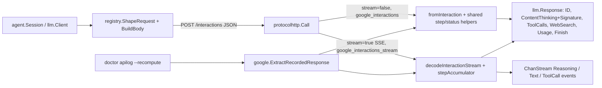

# Google Interactions API client and `google-vertex-express` retirement

## Intent and why

Gemini 4 sessions running through `llm/providers/google` (`generateContent` and `streamGenerateContent`) hit deep-context turn-boundary rollovers (such as 40 fabricated `<job-notification>` and `<delegate-notification>` envelopes in session `03507HVKeWCiXCzGHXBqyK`) and `<end_of_image>` empty-decode failures. Those failures trace directly to protocol mismatches between Evener's `generateContent` adapter and Gemini 3/4 multi-turn reasoning rules:

- `toGeminiContents` emits consecutive `{"role": "user"}` turns whenever tool results are followed by deferred steering or notifications, violating `generateContent`'s strict `user`/`model` alternation requirement.
- `stream.go` and `response.go` drop `thoughtSignature` on bare-text turns and empty trailing chunks, and `request.go` strips `ContentThinking` on replay, severing multi-turn reasoning continuity.
- `request.go` clamps `xhigh` down to `HIGH`, allows `minimal` on models that reject it, and disables `google_search` whenever `len(req.Tools) > 0`.

Google's **Interactions API** (`POST /interactions`) is Google's unified model endpoint across both the Gemini Developer API and Vertex AI (Gemini Enterprise Agent Platform). It replaces `contents[]` and part-attached signatures with a typed `steps[]` timeline (`user_input`, `thought` with explicit `signature` and `summary`, `function_call` with required `id`, `function_result` with `call_id`, `google_search_call`, `google_search_result`, and `model_output`), explicit interaction terminal statuses, lowercase `thinking_level` (`minimal | low | medium | high | xhigh`), and combined `google_search` plus `function` tools.

Jesse decided on a clean-break replacement of `generateContent` under `ProtocolGoogle` (`"google"`) and retirement of the built-in `google-vertex-express` preset, whose legacy `https://aiplatform.googleapis.com/v1` base URL and catalog-only `models_endpoint = "-"` targeted `:generateContent` rather than Vertex's `/interactions` routes (`v1/projects/{project}/locations/global/interactions` or Express Mode `v1beta1/locations/global/interactions`).

## Goals

- Replace `generateContent` and `streamGenerateContent` in `llm/providers/google` with Google's Interactions API (`POST /interactions`) for both `Complete` and `Stream`.
- Round-trip native Interactions `thought` steps (both `summary` text and cryptographic `signature`, including signature-only thoughts with empty summary), wire tool-call IDs and signatures (`function_call.id`, `function_call.signature`, and `function_result.call_id`), user images and documents (`RoleUser`), raster-image tool results (`RoleTool`, keeping PDF tool results on Evener's user-document side channel), and `google_search_call` / `google_search_result` responses with source citations.
- Support Gemini 3 and Gemini 4 `thinking_level` values (`minimal`, `low`, `medium`, `high`, `xhigh`) and `thinking_summaries` (`"auto"` / `"none"`), curating missing Gemini 4 and Gemini 2.5 capabilities in `providers_overlay.toml`.
- Enable `{"type": "google_search"}` alongside `{"type": "function", ...}` tools on models whose registry capabilities vouch for combined search and function calling.
- Default unanchored requests to stateless execution with interaction storage disabled (`"store": false` and full `steps[]` history replay whenever the row allows sending `"store"`) while supporting stateful anchored continuation (`req.PreviousResponseID` -> `"previous_interaction_id"` with `"store": true` and delta `input`), `req.Store`, and `Response.ID` (`interaction.id`) at the `llm.Protocol` boundary.
- Retire `google-vertex-express`, `GOOGLE_VERTEX_API_KEY`, and `GOOGLE_VERTEX_EXPRESS_BASE_URL` cleanly across registry, CLI, Hub tests, wire captures, envvar catalog, and documentation.
- Keep `evener doctor apilog --recompute`, local input-token estimation (`llm/token_count.go`), UI transcript projection (`internal/apptranscript`), and live model discovery (`ListModels`) accurate under the new wire contract.

## Non-goals and anti-goals

- **No `generateContent` wire fallback, deprecated config shims, or `google-vertex-express` alias.** Do not keep a legacy `generateContent` / `streamGenerateContent` endpoint path, do not accept deprecated camelCase `fields.` or `body.` keys (`generationConfig.thinkingConfig`, `safetySettings`, `toolConfig`, `cachedContent`) in `providers.toml`, do not synthesize `thought` steps from legacy `ToolCallData.ThoughtSignature`, and do not keep a deprecation alias for `google-vertex-express` (retaining only the Interactions-side pre-upgrade transcript preservation in §5.3: model-facing Grounding redaction and the 1-shot structured-text recovery when an endpoint rejects unsigned historical tool calls).
- **No `Session`-level stateful `previous_interaction_id` anchor planner in this change.** Generalizing `Session`'s multi-phase `OpenAIResponsesContinuation` state machine to Google is separate follow-up work; `Session` sends full `steps[]` history with `"store": false` by default.
- **No managed-agent, asynchronous background polling, or outbound `continuation_token` resumption.** Do not implement `agent`-targeted requests, `background: true` submission or polling (`GET /interactions/{id}`, `/cancel`, `DELETE`), or outbound `continuation_token` resumption for `status: "requires_continuation"` (which requires empty `input` and Vertex `v1beta1`). Foreground `Complete` and `Stream` reject `"agent"`, `background: true`, and outbound `continuation_token` up front while preserving partial output and returned `r.Raw["continuation_token"]`.
- **No generated image, audio, video, or document outputs.** `ProtocolGoogle` remains a text/tool chat adapter; `RoleAssistant` rejects `ContentAudio` and `ContentDocument` on input (matching `anthropic` and `responses`), and responses containing only non-text generated media surface an explicit error rather than settling as empty completions.
- **No assistant-output string filters in `Session`.** Typed Q&A user-turn markup (`AskReply`) and `TurnSummary` provenance are tracked separately in issue `#6988`.
- **Lean protocol core only (Jesse's 2026-11-20 scope ruling).** Do not build transitive historical Grounding taint-tracking across follow-up turns, memory frontmatter digests, shared notes, delegate journals, or Manager Hub RPCs; do not add cold Hub `resumeThread` model-override plumbing or a `delegate_send(model=...)` write-ahead journal state machine; and do not introduce a cross-transport `AcceptedInteractionError` / `DeadlineError` / `BodyTimeoutError` hierarchy. Grounding non-replay is handled directly in `expandHistory` and `BuildBody` (~40 LoC omitting `ContentWebSearch` and legacy unprefixed `"web_search"` tool pairs); saved `google-vertex-express` sessions recover via CLI `--resume <id> --model ...`; and `ProtocolGoogle` uses standard permanent/retryable `llm.Error` classification on top of the existing `protocolhttp` and `StreamRunner` transport.

## Constraints

1. **Verified endpoints and Vertex location rules:**
   - **Gemini Developer API (`google`):** `POST {BASE_URL}/interactions` where default `BASE_URL` is `https://generativelanguage.googleapis.com/v1beta` (`https://generativelanguage.googleapis.com/v1beta/interactions`), authenticated via `x-goog-api-key`. Both `/v1beta/interactions` and `/v1/interactions` are served upstream.
   - **Vertex AI (`google-vertex`):** `POST {GOOGLE_VERTEX_HOST}/v1/projects/{GOOGLE_VERTEX_PROJECT}/locations/{GOOGLE_VERTEX_LOCATION}/interactions`, authenticated via `Authorization: Bearer <token>` (`gcp-adc`, requiring IAM permission `aiplatform.interactions.create` on `projects/{project}/locations/{location}`, included in `roles/aiplatform.user` and `roles/aiplatform.admin`). Per Google Cloud's Interactions API documentation, only `global` (`https://aiplatform.googleapis.com`), `us` (`https://aiplatform.us.rep.googleapis.com`), and `eu` (`https://aiplatform.eu.rep.googleapis.com`) serve `/interactions`; single-region endpoints (`us-central1`, `europe-west1`, etc.) return HTTP 404 for every model. Evener's `vertex-location` host rule (`llm/registry/hostrules.go`) already derives those exact three hosts.
   - **Streaming:** Uses the same `POST .../interactions` URL with `"stream": true` in the JSON request body, returning `text/event-stream` SSE terminated by `event: done` / `data: [DONE]`.
2. **Model family support:**
   - **Vertex AI `/interactions`** serves Gemini 3.1+ and Gemini 4 (`gemini-3.1*`, `gemini-3.5*`..`gemini-3.8*`, `gemini-4*`, `gemini-omni*`, `lyria-3*`), while rejecting `gemini-1.5-*`, `gemini-2.5-*`, and early 3.0 preview IDs documented by Google Cloud as `GenerateContent`-only or retired (`gemini-3-flash-preview` and `gemini-3-pro-preview`).
   - **Gemini Developer API `/v1beta/interactions`** serves Gemini 2.5, Gemini 3, Gemini 4, Omni, and Gemma 4, using `thinking_level` only (`GenerationConfig` has no `thinking_budget` field).
3. **Server storage default (`store: true`):**
   - Omitting `"store"` defaults to `"store": true` upstream, with surface-specific retention: on the **Gemini Developer API** (`google`), stored interactions are retained for **55 days** by default on the Paid Tier (customizable to 7, 14, 28, or 55 days in Google AI Studio) and **1 day** on the Free Tier (distinct from Google's separate 55-day safety/abuse-monitoring retention on non-exempt accounts); on **Vertex AI** (`google-vertex`), stored interactions are retained for **7 days** (subject to Vertex's 240 GiB/day stateful write quota and 500 concurrent stateful interaction limit, and rejected by stateless-only models such as `lyria-3-*`). `"store"` is therefore sendable by default (`prunable[ProtocolGoogle]["store"] == true`) on all `ProtocolGoogle` providers, and `BuildBody` emits `"store": false` on unanchored calls unless overridden per Design §2.1. Note that `"store": false` disables interaction-resource persistence only: Google documents separate retention rules when Grounding with Google Search is enabled on both the Gemini Developer API and Vertex AI, and custom `google-compatible` rows with `fields.store = false` omit `"store"` and delegate retention to that gateway's own policy.
4. **Wire schema invariants (`googleapis/go-genai` `interactions/models/interactions`):**
   - `model` is a bare model ID string (`"gemini-4-neon"`, `"gemini-3.8-flash"`) in the JSON body on both Gemini API and Vertex AI.
   - `input` is `string | Content | []Content | []Step` (never a bare single `Step` object).
   - `system_instruction` is a plain `string` (never `{parts: [...]}`).
   - `response_format` is top-level `{"type": "text", "mime_type": "application/json", "schema"?: {...}}` (outside `generation_config`, with no `json_schema` wrapper key).
   - `safety_settings` is a top-level array of `{"type": "<harm_category>", "threshold": "<threshold>", "method"?: "<method>"}` with lowercase snake_case enums (`harassment`, `hate_speech`, `sexually_explicit`, `dangerous_content`; `block_only_high`, etc.).
   - `function_result.result`: while the Gemini Developer API documents `string | object | []FunctionResultSubcontent`, the Vertex AI Interactions REST reference documents **only** `string` or `[]FunctionResultSubcontent` (omitting bare JSON objects, and parsing arrays as typed `text`/`image` subcontent items). Serializing all non-image structured tool outputs (`map[string]any`, slices, primitives) to JSON `string` and emitting `[]FunctionResultSubcontent` only for inline raster-image tool results keeps one wire representation valid across both surfaces.
   - Response `Interaction` carries `id`, `model`, `status` (`in_progress | requires_action | completed | failed | cancelled | incomplete | budget_exceeded | queued | requires_continuation`), `steps[]`, `usage`, and `errors[]` (`{code: string, message: string}`). `outputs` and `finish_reason` do not exist.
   - Assembled `function_call.arguments` is a JSON object, whereas streamed SSE `step.delta` `arguments_delta.arguments` is a JSON string fragment concatenated across deltas.
5. **Discovery and token counting:**
   - Interactions defines no model-list or token-count endpoints. `ListModels` stays on `GET {BASE_URL}/models` (Gemini API) and `GET {scheme}://{host}/v1beta1/publishers/google/models` (Vertex). `CountTokensEndpoint` becomes `"-"` and `Protocol.CountTokens` unconditionally returns `llm.ErrInputTokenCountUnsupported`, delegating pre-call token accounting to `llm/token_count.go`.

## Approaches

1. **Sibling `google-interactions` protocol alongside `google` (`generateContent`).** Adds a fifth protocol ID (`google-interactions`) for Gemini 3/4 while keeping `llm/providers/google` (`generateContent`) for Vertex 2.5, `google-vertex-express`, third-party `google-compatible` `:generateContent` gateways, and `:countTokens`. Preserves legacy surfaces at the cost of maintaining two Google wire adapters and keeping `generateContent` failure modes in the tree. Rejected by Jesse.
2. **Clean-break replacement of `generateContent` under `ProtocolGoogle` and retirement of `google-vertex-express` (Chosen by Jesse).** Replaces `llm/providers/google`'s request, response, stream, and recompute paths in place with `/interactions`, retires `google-vertex-express`, hides unsupported `<3` Gemini rows on `google-vertex`, and removes `:countTokens`. Keeps one Google protocol and deletes the legacy wire surface outright.
3. **Depend on `google.golang.org/genai` directly.** Adds a heavy generated SDK dependency, bypasses `protocolhttp.Call` (`Prune`, `ApplyBodyConstants`, credential sanitization, `APIAttemptRecord` raw body capture, byte-faithful `RawArguments` decoding, and `AdapterTimeout`), and trips over stale Vertex example guards in upstream `go-genai`. Rejected.

## Design

### Architecture overview

`llm/providers/google` remains the single registered implementation of `registry.ProtocolGoogle` (`"google"`). `Complete` and `Stream` build an Interactions JSON body via `buildBody(req, res, stream)` and `POST` to `protocolhttp.URL(res, res.Transport.Endpoint)` (or `StreamEndpoint`), recording under endpoint families `"google_interactions"` (JSON) and `"google_interactions_stream"` (SSE) so `evener-fuzz-harvest` routes only SSE streams to the stream fuzz corpus while `doctor apilog --recompute` registers both families against `google.ExtractRecordedResponse`.

### 1. Registry, transports, providers, and `google-vertex-express` retirement

#### Decisions from Jesse
- `ProtocolGoogle` switches cleanly to `/interactions` with no legacy `generateContent` fallback.
- `google-vertex-express` is retired completely.

#### Registry and overlay changes (engineering calls)
- **`llm/registry/resolve.go` (`protocolDefaults[ProtocolGoogle]`):**
  - `Endpoint`: `"/interactions"`
  - `StreamEndpoint`: `"/interactions"`
  - `ModelsEndpoint`: `"/models"`
  - `CountTokensEndpoint`: `EndpointUnsupported` (`"-"`)
- **`llm/registry/types.go` and `schema.go` (`Caps.CombinedSearchAndFunctions`):**
  - Add `CombinedSearchAndFunctions *bool` (`toml:"combined_search_and_functions" json:"combined_search_and_functions,omitempty"`, layered and provenanced alongside `MultimodalToolResults` and `WebSearch`) so model-family eligibility for combining `google_search` with `function` tools lives in registry data rather than hardcoded string prefixes in `request.go`.
- **`llm/registry/data/providers_overlay.toml`:**
  - **`[transports."vertex-gemini"]`:** specify only `auth = "gcp-adc"` and `models_endpoint = "/publishers/google/models"`; `endpoint`, `stream_endpoint`, and `count_tokens_endpoint` inherit `protocolDefaults[ProtocolGoogle]`.
  - **`[providers.google]` and `[providers."google-vertex"]`:** bump `cheap_model` from `"gemini-2.5-flash-lite"` to `"gemini-3.5-flash-lite"` on both, and set `web_search = false` by default on **both** (deferring built-in `Session` and `cmd/llmcall --web-search` Google Grounding enablement until Search Suggestions rendering and non-replayed Grounded Result retention exist — `cmd/llmcall` rejects `--web-search` before HTTP when the resolved target speaks `ProtocolGoogle` while preserving ordinary Google `llmcall` output and OpenAI/Anthropic `--web-search`; direct programmatic `llm.Client` callers that implement compliant display, retention, and non-replay may opt in explicitly via `providers.toml` `web_search = true`, updating `agent/provider/profile_test.go:101` accordingly). Enable `[providers.google.fields]` (`previous_interaction_id = true`, `service_tier = true`, `labels = true`, keeping `safety_settings = true` from `prunable[ProtocolGoogle]` to match Gemini Developer API's `CreateInteraction` schema) and `[providers."google-vertex".fields]` (`previous_interaction_id = true`, `service_tier = true`, `labels = true`, **plus `safety_settings = false` by default** because Vertex AI's `CreateModelInteraction` REST schema omits `safety_settings`, letting `registry.Prune` strip `Profile.ProviderOptions()`'s `safety_settings` on `google-vertex` while preserving explicit `[providers.<name>.fields] safety_settings = true|false` overrides and documenting surface support in `docs/llm-providers.md`; `cached_content` is omitted on both because Google documents explicit context caching as unavailable on Interactions, replaced by automatic implicit prefix caching and `previous_interaction_id`). For `gemini-2.5-pro`, `gemini-2.5-flash`, and `gemini-2.5-flash-lite` under `[providers.google.models.*]` (where `models.dev` records `budget_tokens`), curate `thinking_shape = "level"` and `effort_values = ["low", "medium", "high"]`.
  - **Curated Gemini 3 and Gemini 4 chat model globs (top-level `[models.*]`, single source of truth from `ai.google.dev/gemini-api/docs/thinking`; `gemini-omni*` and non-chat media/speech variants such as `gemini-3-pro-image` are excluded from tool-calling capabilities because Vertex/Gemini document function calling as unsupported on `gemini-omni-1.2-flash`, `gemini-3-pro-image`, TTS, transcription, and live-translate rows):**
    - `[models."*gemini-3*"]`: `multimodal_tool_results = true`, `combined_search_and_functions = true`
    - `[models."*gemini-4*"]`: `multimodal_tool_results = true`, `combined_search_and_functions = true`, `thinking_shape = "level"`
    - `[models."*gemini-flash-latest*"]`, `[models."*gemini-flash-lite-latest*"]`: `multimodal_tool_results = true`, `combined_search_and_functions = true`
    - `[models."*gemini-*-image*"]`: `tools = false`, `multimodal_tool_results = false`, `combined_search_and_functions = false` (replays after `*gemini-3*` / `*gemini-4*` via `orderedGlobKeys`, keeping function-calling caps off image rows including `gemini-3-pro-image` and `gemini-3.1-flash-lite-image` while leaving `web_search` untouched for opted-in search-only Grounding on Gemini Developer API)
    - `[models."*gemini-*-tts*"]`, `[models."*gemini-*-transcribe*"]`, `[models."*gemini-*-live*"]`: `tools = false`, `multimodal_tool_results = false`, `combined_search_and_functions = false`
    - `[models."*gemini-omni*"]`: `tools = false`, `web_search = false`, `multimodal_tool_results = false`, `combined_search_and_functions = false` (paired with `derive.go` and `request.go` guards below so a provider-wide `web_search = true` in user `LayerConfig` — which replays after `LayerOverlay` globs — still resolves `Caps.WebSearch == false` and omits `google_search` on Vertex `gemini-omni*` while enabling `google_search` on eligible Vertex models)
    - `[models."*gemini-4-neon*"]`, `[models."*gemini-4-hydrogen*"]`: `effort_values = ["low", "medium", "high", "xhigh"]`, `default_effort = "high"`
    - `[models."*gemini-4-carbon*"]`, `[models."*gemini-4-argon*"]`: `effort_values = ["low", "medium", "high"]`, `default_effort = "medium"`
    - `[models."*gemini-3.1-pro*"]`, `[models."*gemini-3-pro*"]`, `[models."*gemini-3-flash*"]`: `default_effort = "high"` (`models.dev` already supplies the Gemini 3 `effort_values` ladders, including `minimal..high` on `3.6-flash`, `3.5-flash`, `3.5-flash-lite`, `3.1-flash-lite`, and `3-flash-preview`, and `low..high` on `3.8-flash`, `3.7-flash`, and `3.1-pro-preview`).
  - **Retire `google-vertex-express`:** remove `"google-vertex-express"` from `default_order` and delete `[providers."google-vertex-express"]`.
  - **`[providers."google-compatible"]`:** unchanged in TOML; because `"store"` is `true` in `prunable[ProtocolGoogle]`, `google-compatible` sends `"store": false` by default so proxies forwarding to either the Gemini Developer API (55-day Paid Tier / 1-day Free Tier default) or Vertex AI (7-day default) do not persist interaction logs upstream. Operators targeting a gateway that rejects `"store"` can set `fields.store = false` in `providers.toml` to delegate retention to that gateway (documented in `docs/llm-providers.md`, subject to the explicit `store=false` guard in Design §2.1).
- **`llm/registry/prune.go` (`prunable[ProtocolGoogle]`):**
  Replace the camelCase `generateContent` table with exact Interactions snake_case paths:
  - Send-by-default (`true`):
    - `"generation_config.temperature": true`
    - `"generation_config.top_p": true`
    - `"generation_config.stop_sequences": true`
    - `"generation_config.max_output_tokens": true`
    - `"generation_config.thinking_level": true` (`FieldGoogleThinkingLevel`)
    - `"generation_config.thinking_summaries": true` (`FieldGoogleThinkingSummaries`)
    - `"generation_config.tool_choice": true`
    - `"safety_settings": true`
    - `"store": true`
  - Off-by-default (`false`, enabled per-provider where supported):
    - `"generation_config.seed": false`
    - `"previous_interaction_id": false`
    - `"service_tier": false`
    - `"labels": false`
  - Update `TemperaturePath(ProtocolGoogle)` to return `"generation_config.temperature"`, and update `samplingPaths(registry.ProtocolGoogle)` in `llm/registry_shape.go` to return `"generation_config.temperature"`, `"generation_config.top_p"`, and `"generation_config.stop_sequences"`.
  - Remove `FieldGoogleThinkingConfig` (`"generationConfig.thinkingConfig"`), replacing it with `FieldGoogleThinkingLevel` and `FieldGoogleThinkingSummaries`. Authored `providers.toml` files that still reference retired Google `[providers.<name>.fields]` keys fail `ValidateFields` at load time with an explicit error naming the exact **quoted** TOML replacement key(s) or removal (`"generationConfig.thinkingConfig" = false` -> both `"generation_config.thinking_level" = false` and `"generation_config.thinking_summaries" = false`, `"toolConfig"` -> `"generation_config.tool_choice"`, `"cachedContent"` -> remove, etc., since `Fields` is a flat `map[string]bool` where dotted TOML keys must be quoted) alongside the valid Interactions field paths.
  - Reject legacy authored `endpoint` or `stream_endpoint` overrides on `ProtocolGoogle` containing `:generateContent` or `:streamGenerateContent` with an actionable `ConfigurationError` telling the operator to remove the legacy endpoint override so an Interactions JSON body is never posted to a `generateContent` URL.
- **`llm/registry/derive.go` and `llm/types.go` (`EffortReachesWire`):**
  - Export one shared predicate `registry.IsVertexGeminiOmni(preset, wireID string) bool` returning `preset == PresetVertexGemini && strings.HasPrefix(strings.ToLower(strings.TrimSpace(wireID)), "gemini-omni")` (threading `TransportPreset` on `deriveInput`). In `derive.go` (landed in Stage 1 with `Caps.CombinedSearchAndFunctions`), mirror the `reasoningOff` guard for `Tools`: whenever `c.Tools != nil && !*c.Tools && BoolValue(c.CombinedSearchAndFunctions)`, set `c.CombinedSearchAndFunctions = new(false)` (`prov["CombinedSearchAndFunctions"] = provDerived`); and whenever `IsVertexGeminiOmni(in.TransportPreset, m.WireID)` is true, clamp `c.WebSearch = new(false)` (`prov["WebSearch"] = provDerived`) so a provider-wide `web_search = true` on `google-vertex` still resolves `Caps.WebSearch == false` on Vertex Gemini Omni while opted-in `google-compatible` gateways (such as an unrelated `acme-omni-chat` row) and Gemini Developer API rows keep their search settings untouched.
  - Remove the `shape = "budget"` branch for `ProtocolGoogle` in `derive.go`; `ProtocolGoogle` derives `ThinkingShape = "level"` only when `effort` is vouched by non-alias catalog/layer evidence (or set by a curated overlay rule). Any unrecognized authored `thinking_shape` (such as `"budget"`) omits `thinking_level` while still sending `thinking_summaries`.
  - Update `EffortReachesWire` (`llm/types.go`, `case registry.ProtocolGoogle:`) to gate on `caps.Fields[registry.FieldGoogleThinkingLevel]`, drop the `"budget"` branch, and mirror `google.thinkingConfig`: return `true` when the vouched (or unladdered) tier is in `{"minimal", "low", "medium", "high", "xhigh"}` (`"max"` clamps onto the ceiling and continues to report `false`).
- **Vertex regional warnings, pre-Gemini-3 hiding, and discovery (`llm/registry/modelsdev.go`, `llm/registry/resolve.go`, `llm/providers/google/vertex_models.go`, `protocol_transport.go`):**
  - Export one helper `registry.VertexSupportsGeminiModel(id string) bool` returning `false` for `gemini-1*` and `gemini-2*` (`-2.5-`) prefixes **and** for known Vertex `GenerateContent`-only or retired 3.0 preview IDs (`vertexInteractionsUnsupportedGemini`: `"gemini-3-flash-preview"` and `"gemini-3-pro-preview"`, which Google Cloud documents as unsupported on Vertex `/interactions` while `gemini-3.1-pro-preview`, `gemini-3.1-flash-lite`, `gemini-3.5*`..`gemini-3.8*`, and `gemini-4*` are supported; Gemini Developer API `google` continues serving `gemini-3-flash-preview`). Call `VertexSupportsGeminiModel` across: (1) `modelsdev.go` (`case "google-vertex":` setting `m.Hidden = true`, matching existing unservable-row hiding rather than exposing user-toggleable `disabled` rows), (2) `vertex_models.go` (`vertexTextModel`, updating `vertex_models_test.go` so `gemini-3-flash-preview` in `testdata/vertex_publisher_models.json` is filtered out alongside `gemini-2.5-*` while `gemini-3.8-flash` and `gemini-3.1-pro-preview` remain offered), (3) explicit live and cold model-switch validation (`resolveModelSwitchTarget`, `resolveStartupModelProfile`, and `validateModelSwitchMembership` in `agent/session_set_model.go` and `agent/live_model_metadata.go`, checked **before** live-listing enumeration so switching to `google-vertex/gemini-2.5-flash` or `google-vertex/gemini-3-flash-preview` fails locally before committing even when live discovery fails or is static-only, keeping the current model, transcript, and queue intact while preserving fail-open discovery for targets whose availability is unknown), (4) `validateModelFallbackEntry` (`agent/session_init.go`), and (5) `protocol_transport.go` (`completionCall` / `BuildBody`: when `isVertexTransport(res) && !registry.VertexSupportsGeminiModel(res.WireID)`, fail fast with an actionable `llm.ConfigurationError` instructing the user to switch the session to a Vertex Interactions-supported model such as `gemini-3.8-flash`). Keep `"omni"` in `vertexTextModelDenylist` so live discovery stays scoped to text-chat models.
  - Update `isVertexTransport(res)` in `vertex_models.go` to check `res.Transport.Preset == registry.PresetVertexGemini` rather than path-prefix sniffing.
  - Because Vertex `/interactions` rejects single-region endpoints (`us-central1`, `europe-west1`, etc.) for **every** model, extend the Vertex regional warning in `resolve.go` and `regionalVertexLocationRemedy` in `protocol_transport.go`: any `ProtocolGoogle` row whose host was derived by `host_rule = "vertex-location"` from a location outside `{"global", "us", "eu"}` emits a resolve warning and reclassifies an HTTP 404 from `/interactions` into an actionable `llm.ConfigurationError` stating the **actual residency boundary of each supported endpoint** (`us` = United States multi-region residency, `eu` = European Union multi-region residency, `global` = global routing with **no data-residency guarantee**): lead with `GOOGLE_VERTEX_LOCATION=us` **only** for `us-*` regions, lead with `GOOGLE_VERTEX_LOCATION=eu` **only** for European Union `europe-*` regions (excluding non-EU `europe-west2` London and `europe-west6` Zurich), and for every other geography (`northamerica-*`, `southamerica-*`, `europe-west2`, `europe-west6`, `asia-*`, `australia-*`, `me-*`, `africa-*`) list `us`, `eu`, and `global` while **explicitly disclosing** in both the remedy message and `docs/llm-providers.md` that switching from `loc` changes the geographic data-residency boundary.
  - Keep Gemini Developer API `ListModels` on `GET {BASE_URL}/models?pageSize=1000` (`supportsGenerateContent` + `registry.IsChatModelID`). Make `Protocol.CountTokens` unconditionally return `0, llm.RewriteErrorProvider(llm.ErrInputTokenCountUnsupported, res.Instance)`.
- **`google-vertex-express` removal inventory:**
  - `envvars/envvars.go` and `envvars/envvars_test.go`: delete `GoogleVertexAPIKey`, `GoogleVertexExpressBaseURL`, and `TestGoogleVertexExpressVariablesAreRegistered`.
  - `cmd/evener/models_live_test.go`, `cmd/evener-hub/frontend/src/panes/settings/sections/credentials/instanceDialogs.test.tsx`, `llm/providers/wirecapture/` (removing `google-vertex-express` captures and adding explicit `web_search = true` opt-in on the fixture stanza that captures Google's `"google_search"` tool payload), `llm/registry/resolve_test.go` (`TestResolve_WebSearchCanonicalGate` switching `vertexaliastarget` to `base = "google-vertex-anthropic"` so curated `web_search = true` endpoint-gating coverage stays intact when `google-vertex` defaults `web_search = false`), `llm/registry/golden_test.go` (plus `go test ./llm/registry -update` for surviving Google/Vertex goldens), `llm/registry/instances_test.go`, `llm/registry/overlay_test.go`, and `llm/registry/testdata/golden/google-vertex-express-gemini-2.5-flash.json`: remove `google-vertex-express` cases and golden files, and update surviving `ProtocolGoogle` live smoke paths in `cmd/evener/models_live_test.go` (`:913`, `:1078`, and stored-credential Vertex Gemini tests) to execute through `google.DefaultProtocol.Complete` and `Stream` rather than hand-crafting legacy `contents`/`generationConfig`/`candidates` payloads.
  - Keep `gcp-adc` JSON credential handling in `cmd/evener-hub/app_auth.go`, `CredentialsSection.tsx`, `llm/providers/tokenauth/gcpadc.go`, and `llm/registry/credential_json.go` intact, updating comments that cited `google-vertex-express`.
  - Regenerate and update `docs/environment-variables.md` (`make generate` / `make docs-check`), `docs/product/subsystems.md` (`S15` provider configuration and `S16` model catalog), `docs/llm-providers.md`, `docs/developing-evener/environment.md`, and `docs/developing-evener/config-knobs.md`. `docs/llm-providers.md` must document: (1) `store = false` disables interaction storage by default while documenting the distinct upstream retention windows when opting into `store = true` (Gemini Developer API: 55-day Paid Tier default customizable to 7/14/28/55 days, 1-day Free Tier default, plus separate abuse-monitoring rules; Vertex AI: 7-day retention; custom `google-compatible` gateways with `[providers.<name>.fields]` `store = false`: gateway-defined retention) and noting that Grounding with Google Search defaults `web_search = false` on both `google` and `google-vertex` (deferring `Session` enablement and documenting the Search Suggestions display, storage, and non-replay obligations for direct `llm.Client` callers opting in under either Gemini Developer API or Vertex AI Service Specific Terms), (2) Vertex AI IAM prerequisite `aiplatform.interactions.create` on `projects/{project}/locations/{location}` (included in `roles/aiplatform.user` and `roles/aiplatform.admin`) and HTTP 403 troubleshooting for custom ADC roles that previously granted only `aiplatform.endpoints.predict` (`generateContent`), (3) `google-compatible` gateways must serve `POST {BASE_URL}/interactions` (plus `store = false` under `[providers.<name>.fields]` for gateways that reject `store`), (4) pre-upgrade `providers.toml` migrations and load-failure/call-time symptoms so operators recover healthy providers without discarding their config file — `providers.<name>: base "google-vertex-express" is not a registry id` on custom child stanzas, `providers.google-vertex-express: no protocol` on bare override stanzas, updating `default = "google-vertex-express"`, removing `:generateContent` / `:streamGenerateContent` endpoint overrides, migrating `[providers.<name>.body]` legacy `generateContent` constants (`"generationConfig.*"`, `"safetySettings"`, `"toolConfig"`, `"cachedContent"` -> snake_case `"generation_config.*"`, `"safety_settings"`, or removal, rejected at call time with an actionable `ConfigurationError`), and a **complete TOML `[providers.<name>.fields]` example plus explicit key-by-key migration table with quoted dotted keys** (because `Fields` is a flat `map[string]bool` where unquoted `generation_config.x` would create a rejected nested TOML table: `"generationConfig.temperature"` -> `"generation_config.temperature"`; `"generationConfig.topP"` -> `"generation_config.top_p"`; `"generationConfig.stopSequences"` -> `"generation_config.stop_sequences"`; `"generationConfig.thinkingConfig" = false` -> **both** `"generation_config.thinking_level" = false` and `"generation_config.thinking_summaries" = false`; `"toolConfig"` -> `"generation_config.tool_choice"`; `"safetySettings"` -> `safety_settings`; `labels` unchanged; and **remove** `"cachedContent"`, which has no direct Interactions field beyond automatic prefix caching and `previous_interaction_id`) — and (5) the three verified migration paths for retired `google-vertex-express` depending on credential type (never placing secret key values in `providers.toml`; because a custom `base_url` stops `api_key_env` inheritance, each custom stanza must bind its credential explicitly via `api_key_env = ["GOOGLE_VERTEX_API_KEY"]` — or another env var name — or via a stored credential under `<name>` in Settings -> Credentials / `evener auth`): (a) keep an existing **projectless Vertex Express API key** on Vertex via custom `[providers.<name>]` with `base = "google-compatible"`, `base_url = "https://aiplatform.googleapis.com/v1beta1/locations/global"`, `auth = "header"`, `auth_header = "x-goog-api-key"`, `api_key_env = ["GOOGLE_VERTEX_API_KEY"]` (or stored credential), `models_endpoint = "-"`, **`default_model = "gemini-3.8-flash"`, and static model stanza `[providers.<name>.models."gemini-3.8-flash"] alias_of = "google/gemini-3.8-flash"`** (since `google-compatible` carries no inherited catalog rows when `models_endpoint = "-"`, plus showing `--resume <session-id> --model <name>/gemini-3.8-flash` and UI picker selection `<name>/gemini-3.8-flash`), (b) use a **project-scoped Vertex API key** via custom `[providers.<name>]` with `base = "google-vertex"`, `GOOGLE_VERTEX_PROJECT`, `GOOGLE_VERTEX_LOCATION = "global"`, `auth = "header"`, and `auth_header = "x-goog-api-key"`, and `api_key_env = ["GOOGLE_VERTEX_API_KEY"]` (or stored credential) (`POST https://aiplatform.googleapis.com/v1/projects/{GOOGLE_VERTEX_PROJECT}/locations/global/interactions`), or (c) issue a separate **Google AI Studio key** (`GEMINI_API_KEY` / `GOOGLE_API_KEY`, distinct from a Google Cloud Express key) and use built-in `google`.

### 2. Request assembly (`llm/providers/google/request.go`)

`Protocol.BuildBody(req, res)` delegates to `buildBodyWithPolicy(req, res, false)` and returns `(body, err)`. `Complete` selects SSE vs JSON via `protocolhttp.RequiresStreamingCompleteContext(ctx, res)` (`protocolhttp/exchange.go:162`, resolving `llm.AuthenticatorForContext(ctx, res.Transport.Auth)` so call-scoped `llm.WithAuthenticatorOverride` and global auth schemes share one effective `RequestPreparer` across exchange-mode selection, `PrepareRequest`, and `FinalizeBody` snapshots) -> `protocolhttp.CompleteViaStream(ctx, res.Instance, ...)` (`protocol_transport.go:87-89`, delegating to `p.Stream` so streaming-required auth preparers send `"stream": true`, decode SSE, and record `"google_interactions_stream"`), and otherwise runs a direct JSON exchange (`stream = false`, recording `"google_interactions"`). Direct `Complete` (`stream = false`) and `Stream` (`stream = true`) call `buildBodyWithPolicy(req, res, stream)` and pass the resolved `interactionBodyPolicy{stream, wireModel, combinedTools, anchorID, storeOmitted, effectiveStore}` into `completionCall`'s `FinalizeBody`:

1. **Top-level envelope and option guards:**
   - Unconditionally set `body["model"] = res.WireID` (`CreateModelInteraction.model` is always required in the JSON body on `/interactions`, even if a custom gateway configures `{model}` in one endpoint template).
   - If `stream` is true, set `body["stream"] = true`.
   - **Anchor (`previous_interaction_id`) and `store` resolution (single source of truth):**
     - Resolve `anchorID` from `strings.TrimSpace(req.PreviousResponseID)` if non-empty, else `ProviderOptions["google"]["previous_interaction_id"]` (returning `ConfigurationError` if present and not `string`).
     - Resolve `explicitStore *bool` from `req.Store` if non-nil, else `ProviderOptions["google"]["store"]` (returning `ConfigurationError` if present and not `bool`).
     - Let `storeSendable := requestutil.WireFieldEnabled(caps, "store", res.Protocol)` (`requestutil/fields.go:10`, which returns `false` **only** when `caps.Fields["store"]` is explicitly present and `false`, and returns `true` when `"store"` is `true` or absent from an unseeded `Caps.Fields` map, matching `prunable[ProtocolGoogle]["store"] == true`).
     - **Unanchored (`anchorID == ""`):** if `!storeSendable` (an explicit `fields.store = false` gateway opt-out), require `explicitStore == nil` (returning `ConfigurationError` if the caller passed an explicit `store` setting the row forbids sending) and record `policy.storeOmitted = true`. Otherwise (`storeSendable == true`), record `policy.storeOmitted = false`, `policy.effectiveStore = false` (or `*explicitStore` when non-nil, preserving explicit stateful `store=true` requests), and set `body["store"] = policy.effectiveStore` so direct `Protocol.Complete` / `Stream` callers with nil or unseeded `Caps.Fields` still send `"store": false`.
     - **Anchored (`anchorID != ""`):** Google rejects `previous_interaction_id` when `store=false`, and the stored interaction already holds prior turns. Require `caps.Fields["previous_interaction_id"]` and `storeSendable` both `true` (else return `ConfigurationError`), reject `explicitStore != nil && !*explicitStore` with `ConfigurationError`, record `policy.anchorID = anchorID`, `policy.storeOmitted = false`, `policy.effectiveStore = true`, and set `body["store"] = true` and `body["previous_interaction_id"] = anchorID` (callers supply only the new user/tool delta turns since the anchor, matching `openai-responses`).
   - **Unsupported execution-mode and caching guards (`agent`, `background`, `continuation_token`, `cached_content`, and `service_tier="deferred"`):** return `ConfigurationError` when `options["agent"]`, `options["continuation_token"]`, or `options["cached_content"]` is present (and not `""`), when `(req.Background != nil && *req.Background)` or `options["background"]` is present and not `false`, or when `req.ServiceTier` / `options["service_tier"]` equals `"deferred"` (case-insensitive; Google's `deferred` tier requires `background=true` and `store=true`, whereas foreground tiers `"flex"`, `"standard"`, and `"priority"` remain supported).
   - **Request-local ownership in `registry.ApplyBodyConstants` and final outbound body enforcement (`FinalizeBody` in `protocol_transport.go`):** in `llm/registry/prune.go` (`ApplyBodyConstants`, `:209`, landed in Stage 1), deep-clone `map[string]any` and `[]any` constant values (`cloneJSONValue`) before `setPath` installs them onto `body`, so combining a whole-object `"generation_config"` constant with a dotted `"generation_config.seed"` constant gives each concurrent request its own mutable map before dotted writes or `FinalizeBody` run (preserving whole-object replacement and dotted-key precedence while leaving the shared `res.Transport.Body` configuration untouched). Because `protocolhttp.Prepare` runs `registry.Prune` and `registry.ApplyBodyConstants(body, res.Transport.Body)` *after* `BuildBody` (`protocolhttp/call.go:73-107`), `completionCall`'s `FinalizeBody` then enforces `policy` on the request-owned `finalBody`:
     1. **`stream` authority:** pin `finalBody["stream"] = true` when `policy.stream` is true (SSE exchange via `Stream`, including `Complete` routed through `CompleteViaStream`) and `delete(finalBody, "stream")` when `policy.stream` is false (direct JSON exchange in `Complete`), so neither `ProviderOptions` nor `Transport.Body` can desynchronize the wire `"stream"` flag from the actual exchange decoder and capture family.
     2. **`agent`, `background`, `continuation_token`, `cached_content`, `service_tier="deferred"`, and retired `generateContent` body-constant guards:** delete `finalBody["agent"]`, `finalBody["continuation_token"]`, and `finalBody["cached_content"]` when `""` and return `ConfigurationError` if any non-empty or non-string value is present on those keys; delete `finalBody["background"]` when `false` and return `ConfigurationError` for any other `finalBody["background"]` value; return `ConfigurationError` if `finalBody["service_tier"]` is non-string or case-insensitively equals `"deferred"`; and return an actionable `ConfigurationError` naming the snake_case Interactions replacement (or removal) if `ProviderOptions` or `[providers.<name>.body]` (`ApplyBodyConstants`) injected any retired `generateContent` top-level key (`"generationConfig"`, `"safetySettings"`, `"toolConfig"`, `"cachedContent"`, `"contents"`, or `"systemInstruction"`) while leaving unrelated custom gateway constants untouched.
     3. **Anchor lock:** require `finalBody["previous_interaction_id"]` to be absent when `policy.anchorID == ""` and equal to `policy.anchorID` otherwise, returning `ConfigurationError` if `Transport.Body` added, removed, or replaced the anchor after `input` was assembled.
     4. **Storage policy lock:** when `policy.storeOmitted` is true, require `"store"` to be absent from `finalBody` (returning `ConfigurationError` if `Transport.Body` injected `"store"` onto a `fields.store = false` gateway); when `policy.storeOmitted` is false, require `finalBody["store"] == policy.effectiveStore` (returning `ConfigurationError` if `Transport.Body` flipped the unanchored `store=false` default or an explicit `store` setting).
     5. **Unconditional `model` authority, zero-encode `Transport.Body` key validation, and effective-preparer snapshot lock:** require `finalBody["model"] == policy.wireModel` **unconditionally** in `FinalizeBody` on every request (rejecting any deletion or replacement of `"model"` by `Transport.Body` or a `RequestPreparer` after history signatures and capabilities were resolved for `res.WireID`). Validate configured `res.Transport.Body` keys **in O(`len(res.Transport.Body)`) before `ApplyBodyConstants` with zero extra JSON marshaling or buffer allocations** on ordinary requests — for every key `k` in `res.Transport.Body`, extract `root, _, hasDot := strings.Cut(k, ".")` and return `ConfigurationError` if `root` is in `{"input", "model", "response_format", "agent", "previous_interaction_id", "store", "continuation_token", "cached_content", "background"}` or `root == "tools" && hasDot` (rejecting top-level/nested overrides on request-owned fields and dotted `"tools.*"` paths, while allowing top-level `"tools"` replacement per `llm.EffectiveToolsJSONBytes` and unrelated constants such as `"labels.env"` or `"generation_config.seed"`). Resolve the **effective** authenticator via `llm.AuthenticatorForContext(ctx, res.Transport.Auth)` (`protocolhttp.Prepare` `:92`, covering call-scoped `llm.WithAuthenticatorOverride` as well as globally registered schemes): take pre/post JSON byte snapshots of `input`, `tools`, and `response_format` **only** when `_, hasPreparer := auth.(llm.RequestPreparer)` is true, preserving the single-encode fast path for all non-preparer calls while rejecting protected-field mutations by a call-scoped or global `RequestPreparer`.
     6. **Authoritative `reasoning = false` and `generation_config.tool_choice` enforcement after all overlays:**
        - **`reasoning = false`:** when `res.Caps.ReasoningDisabled()` is true, unconditionally delete `"thinking_level"` and `"thinking_summaries"` from `finalBody["generation_config"]` (deleting `"generation_config"` if empty, while preserving sibling keys such as `"temperature"` or `"seed"` and keeping native `thought` / `function_call.signature` steps in `finalBody["input"]` intact), so neither `ProviderOptions["google"]["generation_config"]` nor `Transport.Body` constants can re-introduce generation thinking controls onto a reasoning-disabled row.
        - **`generation_config.tool_choice`:** let `toolChoiceEnabled := requestutil.WireFieldEnabled(res.Caps, "generation_config.tool_choice", res.Protocol)`. When `policy.combinedTools` is true, require `toolChoiceEnabled` **and** `finalBody["generation_config"]["tool_choice"]` present with an effective mode in `{"validated", "any", "none"}` across both wire shapes (bare string or `map[string]any` `allowed_tools.mode`), returning `ConfigurationError` before HTTP if disabled, absent, `"auto"`, or unrecognized. When `!policy.combinedTools` (function-only or tool-less requests) and `!toolChoiceEnabled`, delete `"tool_choice"` from `finalBody["generation_config"]` (deleting `"generation_config"` if empty, while preserving enabled sibling keys) so `Transport.Body["generation_config.tool_choice"]` cannot bypass `"generation_config.tool_choice" = false`.
     7. **Output-limit pruning and minimum-cap precedence (`reconcileOutputField`, combining `responses/request.go:162-169` and `google/request.go:175-189`):** check `requestutil.WireFieldEnabled(res.Caps, "generation_config.max_output_tokens", res.Protocol)` first; when `false` (the row explicitly disabled `fields."generation_config.max_output_tokens"`), delete `"max_output_tokens"` from `finalBody["generation_config"]` (deleting `"generation_config"` if empty) and return without re-creating it. When `WireFieldEnabled` is `true`, compute `ceiling := requestutil.MinPositiveInt(requestutil.PositivePointerInt(req.MaxTokens), requestutil.PositivePointerInt(res.Caps.MaxOutputTokens))` and set `genCfg["max_output_tokens"] = requestutil.MinPositiveInt(requestutil.PositiveInt(genCfg["max_output_tokens"]), ceiling)` when positive so a lower positive wire override (e.g. `200` under a `1,000` ceiling) is preserved while a higher override clamps down to `ceiling`.
   - Emit `"service_tier"` (`req.ServiceTier`), `"labels"` (copying into a fresh request-owned `map[string]any` — never `map[string]string` — **only** generic `req.Metadata` entries that satisfy Google's documented Unicode code-point label rules: let `isGoogleLabelLetter(r) := unicode.IsLower(r) || (unicode.IsLetter(r) && !unicode.IsUpper(r))` and `isGoogleLabelRune(r) := isGoogleLabelLetter(r) || unicode.IsNumber(r) || r == '_' || r == '-'`; require `<= 64` entries total, lengths measured in Unicode code points via `utf8.RuneCountInString`, **every code point of both keys and values satisfying `isGoogleLabelRune(r)`**, keys `1..63` code points **starting with `isGoogleLabelLetter(firstRune)`**, and values `0..63` code points — preserving valid international labels such as `"équipe"` while silently skipping invalid generic `req.Metadata` keys or values such as `"team/id"` or `trace_id="trace/123"` without mutating `req.Metadata`, and validating any explicitly supplied `ProviderOptions["google"]["labels"]` or `Transport.Body` `"labels.*"` entries in `BuildBody` / `FinalizeBody` with a local `llm.ConfigurationError` on invalid keys, values, or counts; `setPath` descends into `body["labels"]` to merge dotted constants such as `"labels.env"` alongside request labels such as `"team"`), and `"system_instruction"` (joined `RoleSystem` / `RoleDeveloper` text blocks as a plain `string`) when non-empty.

2. **Conversation history -> `input` (`[]Step`):**
   Walk `req.Messages` once, maintaining `callIDToName map[string]string` (plus a FIFO queue of synthetic IDs assigned to any legacy empty-ID `ContentToolCall` parts) for O(1) `function_result` pairing, emit `input` as `steps []any`, and require `len(steps) > 0` after assembly for both unanchored and anchored calls (returning `ConfigurationError` when `req.Messages` is empty, system-only, empty-text-only, or contains only skipped legacy/foreign thinking parts):
   - **Lazy `user_input` coalescing (`RoleUser`):** accumulate `RoleUser` content items into `pendingUser []any` (user prompts, environment context, memory notifications, or deferred `<job-notification>` / `<delegate-notification>` steering) and flush `pendingUser` as a **single** `{"type": "user_input", "content": pendingUser}` step **lazily inside `appendNonUserStep(step)` right before a `model_output`, `thought`, `function_call`, or `function_result` step is actually emitted** (plus one final flush after walking `req.Messages`) — never eagerly at `RoleAssistant` or `RoleTool` message entry. If an intermediate `RoleAssistant` message contains only skipped legacy/foreign `ContentThinking` or empty text and emits zero steps, `pendingUser` stays open so the surrounding `RoleUser` messages coalesce into one `user_input` step rather than producing adjacent `user_input` steps:
     - `ContentText` (non-empty): `{"type": "text", "text": p.Text}`.
     - `ContentImage`: inline bytes or local file path normalized via `googleInlineImageBytes` and encoded with `llm.CachedBase64(b)` -> `{"type": "image", "data": b64, "mime_type": mt}`; remote/GCS URI -> `{"type": "image", "uri": u, "mime_type": mt}`.
     - `ContentDocument`: inline bytes encoded with `llm.CachedBase64(doc.Data)` -> `{"type": "document", "data": b64, "mime_type": mt}`; URI -> `{"type": "document", "uri": u, "mime_type": mt}` (default `application/pdf`).
     - `ContentAudio`: rejected with `ConfigurationError`.
   - **`RoleAssistant`:** walks `msg.Content` in order, flushing `pendingUser` via `appendNonUserStep` only when an assistant step is actually emitted:
     - **Step-boundary-faithful `ContentText` and `ContentImage` -> `model_output` replay:** add persisted `GoogleStep int` (`json:"google_step,omitempty"`, 1-based `stepIdx + 1` stamped by both JSON and SSE `appendInteractionSteps` on every `ContentText` part decoded from a `model_output` step; `0` on synthetic, non-Google, or provenance-stripped parts) on `llm.ContentPart` (`llm/types.go:131`, alongside `Phase`). Within `RoleAssistant`, both non-empty `ContentText` (`{"type": "text", "text": p.Text}`) and `ContentImage` (encoded via `googleInlineImageBytes` + `llm.CachedBase64` as `{"type": "image", "data": b64, "mime_type": mt}` or URI `{"type": "image", "uri": u, "mime_type": mt}`, preserving `TestBuildBodyAssistantAndToolResultContents` in `requestedges_test.go` and keeping `ContentImage` representable in `unrepresentableContentKinds[ProtocolGoogle]`) append in order into the open `{"type": "model_output", "content": [...]}` step while their `GoogleStep` matches (`pendingStep == p.GoogleStep`), and flush into a new `model_output` step whenever `p.GoogleStep != pendingStep` or before any `thought`, `function_call`, or `google_search_*` step — so adjacent assistant text and images stay in exact order and two consecutive `model_output` steps followed by a `function_call` replay as two `model_output` steps after transcript reload, while generated media *outputs* decoded from upstream responses remain rejected per Non-goals. `ContentAudio` and `ContentDocument` in `RoleAssistant` return `ConfigurationError` (matching `anthropic/request.go` and `responses/input.go`).
     - `ContentThinking` (**adapter-enforced non-empty `(Instance, WireID)` Interactions provenance, decoupled from `caps.ReasoningDisabled()`**): add persisted `GoogleInteraction bool` (`json:"google_interaction,omitempty"`), `GoogleInstance string` (`json:"google_instance,omitempty"`), `GoogleModel string` (`json:"google_model,omitempty"`), and `ReplayableGoogleThoughtFor(instance, wireModel string) bool` on `llm.ThinkingData` (`llm/types.go`, stamped with `(res.Instance, res.WireID)` on live `Complete` and `Stream` decode, and left with `GoogleInstance == ""` on offline `ExtractRecordedResponse`), returning `true` **only** when `t != nil && t.GoogleInteraction && !t.Redacted && t.EncryptedContent == "" && !llm.IsOpenAICompatReasoningField(t.Signature) && (strings.TrimSpace(t.Signature) != "" || len(t.Summary) > 0) && instance != "" && wireModel != "" && t.GoogleInstance == instance && t.GoogleModel == wireModel` (never treating an empty `GoogleInstance` or `GoogleModel` as a wildcard). Emit `{"type": "thought", "signature"?: sig, "summary"?: summaryItems}` (built from `t.Summary`) whenever `p.Kind == llm.ContentThinking && p.Thinking.ReplayableGoogleThoughtFor(res.Instance, res.WireID)` — enforcing the strict same-instance, same-wire-model replay boundary in `request.go` for **both** `Session` and direct `llm.Client` / `Protocol` callers (including rejecting cross-instance reuse of offline-recomputed messages while preserving their summaries for inspection), independent of `caps.ReasoningDisabled()` (`reasoning = false` suppresses outbound `thinking_level` / `thinking_summaries` generation controls only). Signed Anthropic thoughts (`GoogleInteraction == false`), pre-cutover `generateContent` display-only `ThinkingData.Text`, offline-recomputed thoughts (`GoogleInstance == ""`), and native Google thoughts from a different `(Instance, WireID)` never replay onto Google's wire.
     - `ContentWebSearch` (**no client-side Grounding history replay**): both Gemini Developer API and Vertex AI Grounding terms forbid resending stored Search Suggestions and completed Grounded Results in later prompts, while combined `google_search` + `function` tool context circulation requires signed search steps. `buildBodyWithPolicy` therefore **rejects** any `RoleAssistant` message carrying a `ContentWebSearch` part in `req.Messages` with an actionable `ConfigurationError` (preventing both raw `google_search_*` steps / `search_suggestions` and associated grounded assistant text from being resent in stateless history). Direct callers running combined `google_search` + `function` rounds continue a pending `requires_action` tool round via Google's recommended stateful mode (`store: true` on the initial request, then `previous_interaction_id` (`store: true`) + delta `input` (`[function_result]` only, with no stored Grounding steps resent) **alongside** turn-scoped `req.Tools`, `req.WebSearch = true`, `system_instruction`, and `generation_config` (`tool_choice: "validated"`), since Google persists only conversation `steps[]` on the interaction and requires resending active tool declarations on each follow-up), and omit completed grounded turns from subsequent unanchored requests.
     - `ContentToolCall` (**including adapter-enforced non-empty `(Instance, WireID)` `function_call.signature` and validated JSON object `arguments` replay, decoupled from `caps.ReasoningDisabled()`**): add persisted `GoogleInteraction bool` (`json:"google_interaction,omitempty"`), `GoogleInstance string` (`json:"google_instance,omitempty"`), and `GoogleModel string` (`json:"google_model,omitempty"`) on `llm.ToolCallData` (`llm/types.go:188`), stamped with `(true, res.Instance, res.WireID)` alongside `ThoughtSignature` on live `Complete` and `Stream` decode (and `GoogleInstance: ""` on offline `ExtractRecordedResponse`). Record `id -> tc.Name` in `callIDToName` (assigning a deterministic fallback ID if `tc.ID == ""`). While `ToolCallData.ArgumentsSpelling` / `WireArguments()` preserves the model's exact original bytes in memory and on durable transcripts for inspection, `protocolhttp.MarshalBody` delegates `json.RawMessage` to `encoding/json` (`TestMarshalBodyMatchesStdlib`), which compacts whitespace: read `rawArgs := []byte(tc.WireArguments())` and validate `trimmed := bytes.TrimSpace(rawArgs)` so when `len(trimmed) > 0 && trimmed[0] == '{' && json.Valid(trimmed)`, `json.RawMessage(trimmed)` serializes on the outbound HTTP wire as an equivalent JSON object preserving key order and exact numeric tokens (falling back to `json.RawMessage("{}")` when empty or malformed). Emit `"signature": strings.TrimSpace(tc.ThoughtSignature)` on the `function_call` step **only** when `tc.GoogleInteraction && strings.TrimSpace(tc.ThoughtSignature) != "" && res.Instance != "" && res.WireID != "" && tc.GoogleInstance == res.Instance && tc.GoogleModel == res.WireID` (never treating empty `GoogleInstance` or `GoogleModel` as a wildcard, independent of `caps.ReasoningDisabled()`, so direct `llm.Client` callers switching Google instances/models or reusing offline-recomputed messages omit the original `function_call.signature` automatically while keeping `id`, `name`, `arguments`, and same-target tool follow-ups intact, and legacy `generateContent` `ToolCallData` stays off the wire).
   - **`RoleTool` (`ContentToolResult`):** each emitted `ContentToolResult` flushes `pendingUser` via `appendNonUserStep` before appending its `function_result` step so an earlier `user_input` precedes the tool round and `function_result` precedes any subsequent deferred `RoleUser` steering step. Each `ContentToolResult` resolves `name` from `callIDToName[callID]` **first** (preserving surface tool renames such as `list_dir -> list_directory` from the matching `ContentToolCall.Name`) with fallback to `strings.TrimSpace(tr.Name)`, and emits `{"type": "function_result", "call_id": callID, "name"?: name, "is_error"?: true, "result": resultVal}`:
     - **Raster-image-only inline media (preserving Evener's PDF side channel):** `llm.DeliversToolResultMedia` and `TestRowSeesToolResultMediaStaysImageOnlyForGoogle` (`llm/document_delivery_test.go:47-60`) stay unchanged so `read_file` PDFs continue to take the `RoleUser` `ContentDocument` side channel once (`#4463`), and non-`image/*` `tr.ImageData` (such as `"application/pdf"`) is ignored here. When `len(tr.ImageData) > 0` and `mediaType := strings.ToLower(strings.TrimSpace(tr.ImageMediaType))` is `""` or `strings.HasPrefix(mediaType, "image/")`: require `registry.BoolValue(caps.MultimodalToolResults)` (else return `ConfigurationError`, matching `google/request.go:594-596`), normalize via `googleInlineImageBytes` + `llm.CachedBase64`, and emit `result` as `[{"type": "text", "text": textStr}, {"type": "image", "data": b64, "mime_type": imageType}]` (matching Gemini API's documented `(ImageContent | TextContent)[]` subcontent).
     - Otherwise pass `string` `tr.Content` directly as `string`, and serialize any non-string `tr.Content` (`map[string]any`, slices, primitives) via `json.Marshal` to a JSON `string` (satisfying both the Gemini Developer API and Vertex AI's Interactions REST schema, which documents only `string` or `[]FunctionResultSubcontent` for `function_result.result`).

3. **Tools and `google_search`:**
   - Let `toolsSupported := caps.Tools == nil || *caps.Tools`. When `len(req.Tools) > 0 && !toolsSupported` (such as `gemini-3-pro-image`, where `models.dev` records `tool_call: false`), return an actionable `llm.ConfigurationError` so neither `function` tools nor a combined `google_search` + `function` payload is ever emitted on a model that lacks function calling. Otherwise (`len(req.Tools) > 0 && toolsSupported`), validate each `req.Tools` entry with `openaichat.CyclicSchema(t.Parameters)` (returning `&llm.ConfigurationError{Cause: openaichat.ErrCyclicSchema}` on cycles, matching `responses/request.go`), then emit `{"type": "function", "name": t.Name, "description": t.Description, "parameters": sanitizeGeminiSchema(t.Parameters)}`.
   - Let `webSearch := req.WebSearch && (caps.WebSearch == nil || *caps.WebSearch) && !registry.IsVertexGeminiOmni(res.Transport.Preset, res.WireID)` (using the exact same `PresetVertexGemini` + `gemini-omni*` predicate as `derive.go`). When `webSearch` is true:
     - When `len(req.Tools) == 0`: append `{"type": "google_search"}` (single-turn search, valid with `store: false` or `store: true`, including on search-capable non-function models such as `gemini-3-pro-image` when opted in).
     - When `len(req.Tools) > 0` and `toolsSupported && registry.BoolValue(caps.CombinedSearchAndFunctions)`: require stateful mode **and** an enabled `generation_config.tool_choice` field (`policy.effectiveStore == true`, `storeSendable`, `caps.Fields["previous_interaction_id"]`, and `requestutil.WireFieldEnabled(caps, "generation_config.tool_choice", res.Protocol)`, returning `ConfigurationError` if the caller left `store` at `false`, the row forbids stateful chaining, or the operator set `"generation_config.tool_choice" = false`, since omitting `tool_choice` falls back to Google's unsupported `"auto"` default on combined tools), append `{"type": "google_search"}`, and record `policy.combinedTools = true` (when `toolsSupported` is true and `CombinedSearchAndFunctions` is false, such as `gemini-2.5-flash`, omit `google_search` and send only the `function` tools).
     - **`llm.Generate` and `llm.StreamGenerate` preflight guard (`llm/generate.go:218-248`):** because `Generate` and `StreamGenerate` run stateless `history` tool loops without advancing `PreviousResponseID`, `prepareGeneration` resolves the effective Google anchor using the exact same rule as §2.1 (`strings.TrimSpace(opts.PreviousResponseID)` else `opts.ProviderOptions["google"]["previous_interaction_id"]`) and rejects requests **before Turn 1 or any `t.Execute` handler runs** with an actionable `llm.ConfigurationError` whenever the resolved target speaks `ProtocolGoogle`, automatic tool looping is enabled (`maxToolRounds > 0 && hasActiveTool`), and **either** an effective anchor is set (including non-string invalid option values) **or** combined `google_search` + `function` tools are active — preserving `MaxToolRounds == 0` (tool looping disabled), passive tools (`!hasActiveTool`), unanchored stateless function loops, and explicit `Client.Complete` / `Client.Stream` anchored continuations.

4. **`generation_config`, `response_format`, `safety_settings`, and `ProviderOptions`:**
   - `generation_config` (emitted when non-empty):
     - `temperature`, `top_p`, `stop_sequences`, and `max_output_tokens` (reconciled via `reconcileOutputField` on `generation_config.max_output_tokens`).
     - **`google.thinkingConfig` (single owner of thinking wire fields):** when `caps.ReasoningDisabled()` is false:
       - If normalized `req.ReasoningEffort == "none"`: omit `thinking_level` and set `"thinking_summaries": "none"`.
       - Otherwise: set `"thinking_summaries": "auto"` (or lowercase `*caps.ReasoningSummary` when `"auto"` or `"none"`). When `req.ReasoningEffort != nil`, `registry.StringValue(caps.ThinkingShape) == "level"`, and `!registry.BoolValue(caps.EffortParameterUnsupported)`, resolve `level` via `llm.VouchedEffort(*req.ReasoningEffort, caps.EffortValues)` when `len(caps.EffortValues) > 0` (Note: `ShapeRequest` already clamps `"max"` onto the ladder ceiling before `BuildBody`; when `EffortValues` is empty, map `"max"` -> `"high"`), and emit `"thinking_level"` if in `{"minimal", "low", "medium", "high", "xhigh"}`.
     - **`tool_choice`:** per Google's tool-combination specification (`ai.google.dev/gemini-api/docs/tool-combination#limitations`), combining `google_search` with `function` tools activates tool context circulation, where `"auto"` mode is unsupported and automatic selection uses `"validated"`. Let `autoMode = "validated"` when **both** `google_search` and `function` tools are emitted on the request, and `"auto"` otherwise (including function-only requests): map `""` / `"auto"` -> `autoMode`; `"none"` -> `"none"`; `"required"` -> `"any"` (downgraded to `autoMode` if `caps.ToolChoiceForcing != nil && !*caps.ToolChoiceForcing`); `"named"` -> `{"allowed_tools": {"mode": "any", "tools": [req.ToolChoice.Name]}}` (error if `Name == ""`).
   - **`response_format` (top-level):** `"json"` -> `{"type": "text", "mime_type": "application/json"}`; `"json_schema"` -> validate `req.ResponseFormat.JSONSchema` with `openaichat.CyclicSchema` first (returning `&llm.ConfigurationError{Cause: openaichat.ErrCyclicSchema}` on cycles so recursive traversal never stack-overflows), then emit `{"type": "text", "mime_type": "application/json", "schema": sanitizeInteractionResponseSchema(req.ResponseFormat.JSONSchema)}`. Unlike legacy `sanitizeGeminiSchema` (which stripped `additionalProperties` and rewrote `["string", "null"]` for Gemini's old proto `Schema`), Interactions structured output supports standard JSON Schema (`ai.google.dev/gemini-api/docs/structured-output#json-schema-support`), so `sanitizeInteractionResponseSchema` strips only `$` document-metadata keys (`geminiSchemaMetaKeys`: `$schema`, `$id`, `$comment`, `$anchor`, `$dynamicAnchor`, `$vocabulary`, leaving property names under `"properties"` untouched) and preserves `"additionalProperties"` (boolean or recursively cleaned sub-schema), `"type": ["string", "null"]` arrays, `"prefixItems"`, `"minItems"`, `"maxItems"`, `"minimum"`, `"maximum"`, `"enum"`, `"format"`, `"required"`, `"title"`, and `"description"`.
   - **`safety_settings` (`agent/provider/profile.go`):** update `Profile.ProviderOptions()` for `ProtocolGoogle` to `{"safety_settings": [{"type": "harassment", "threshold": "block_only_high"}, {"type": "hate_speech", "threshold": "block_only_high"}, {"type": "sexually_explicit", "threshold": "block_only_high"}, {"type": "dangerous_content", "threshold": "block_only_high"}]}`.
   - **`ProviderOptions["google"]` merge (with request-local deep-cloning):** reject `"input"`, `"model"`, and `"response_format"` in `ProviderOptions["google"]` with `ConfigurationError` (owned by typed request assembly, while allowing top-level `"tools"` replacement per `llm.EffectiveToolsJSONBytes`), and **deep-clone** (`cloneJSONValueWithPath`, converting any `map[string]string` such as `options["labels"]` into a fresh `map[string]any` alongside map/slice deep clones) remaining top-level keys onto `body` except `"generation_config"`, `"agent"`, `"stream"`, `"store"`, `"previous_interaction_id"`, `"continuation_token"`, `"cached_content"`, and `"background"` — giving every mutable option map request-local ownership so `ApplyBodyConstants` (`"labels.env"`) merges cleanly with existing labels and never mutates the caller's `ProviderOptions` or `req.Metadata`. If `options["generation_config"]` is present, require a non-nil `map[string]any` and merge deep-cloned copies of its values into the request-owned `body["generation_config"]` map (creating `genCfg` if absent) so caller-supplied keys such as `"seed"` layer onto typed settings (`temperature`, `tool_choice`, `thinking_level`) without erasing them, followed by `registry.Prune`, `ApplyBodyConstants`, and `FinalizeBody`.

### 3. Response decoding and shared settlement helpers (`llm/providers/google/response.go`)

`fromInteraction(raw map[string]any, requestedModel string, body []byte) (llm.Response, error)` and `decodeInteractionStream` share three helpers so JSON and SSE paths never diverge:

1. **Identity and continuation hash (`llm.StampContinuationIDHash`):**
   - Extract `r.ID` from `raw["id"].(string)` and `r.Model` from `raw["model"].(string)` (fallback `requestedModel`). Hoist `responses.(*Protocol).stampResponseIDHash` (`llm/providers/responses/complete.go:60-76`) to `llm.StampContinuationIDHash(ctx, &resp, p.Hasher)` and call it from both `responses` and `google`.
2. **`appendInteractionSteps` (shared step-slice -> `[]llm.ContentPart` builder):**
   - `captureInteractionArgsRaw(body)` (using `rawArgsBodyDecode`) runs lazily **at most once per response body** (`rawCaptured` guard), returning raw `arguments` tokens indexed by `stepIdx`.
   - `"thought"`: extract `summarySlice` via **one shared normalizer `extractThoughtSummaryItems(step["summary"])`** (shared by settled JSON `appendInteractionSteps` and SSE `step.start`, accepting **both** Gemini Developer API's `[]any` array of `{"type": "text", "text": ...}` items — preserving exact item boundaries — **and** Vertex AI's singleton `map[string]any` `ThoughtSummaryContent` object `{"text": ...}`) with `Text = strings.Join(summarySlice, "\n\n")`, plus `signature`; whenever `signature != ""` or `len(summarySlice) > 0`, emit `ContentThinking{Thinking: &ThinkingData{GoogleInteraction: true, GoogleInstance: instance, GoogleModel: wireModel, Text: joinedText, Signature: signature, Summary: summarySlice}}` (passing `res.Instance` and `res.WireID` on live `Complete` and `Stream`, and `""` / `r.Model` on offline `ExtractRecordedResponse`).
   - `"model_output"`: extract `url_citation` annotations (`annotation["type"] == "url_citation"`, reading `title` and `url`) across **all** three entry points — settled JSON `content[].annotations`, SSE `step.start` `step["content"][].annotations`, and SSE `text_annotation_delta` — via **one shared normalizer `extractCitationAnnotations(raw)`** that accepts **both** a `[]any` array of annotation objects (Gemini Developer API) **and** a singleton `map[string]any` `Annotation` object (Vertex AI Interactions reference, including `annotations`, `annotation`, or inline `url_citation` fields), returning deduplicated `[]llm.WebSearchSource` entries (preserving first-seen order, skipping entries where both `title` and `url` are empty). When non-empty citations exist, attach them onto the most recent preceding `ContentWebSearch` part in `msg.Content`, **or — if no preceding `ContentWebSearch` part exists in `msg.Content` (e.g. a citation-only Vertex or Gemini grounded response that omitted an explicit `google_search_*` step) — insert `ContentPart{Kind: ContentWebSearch, WebSearch: &WebSearchData{Sources: citations}}` immediately before this `model_output` step's `ContentText` part(s)** so settled answers produce the identical `WebSearchSource` list and `ContentWebSearch` Grounding replay guard across `Complete`, `Stream`, and offline `ExtractRecordedResponse` (`doctor apilog --recompute`). Emit `ContentPart{Kind: ContentText, Text: text, GoogleStep: stepIdx + 1}` for each non-empty `content[].text` (in both JSON and SSE settlement so step boundaries and intra-step `content[]` item boundaries survive persistence and stateless replay), and record `step["error"]` (`{code, message}`) and any non-text `content[].type` (`image`, `audio`, `video`, `document`) if present.
   - `"function_call"`: normalize raw `arguments` token at `stepIdx` (or marshaled `normalizeJSONNumbers(step["arguments"])`) via `llm.NormalizeToolArguments` (`llm/types.go:198-204`: valid JSON compacts into `Arguments` with original bytes in `ArgumentsSpelling`, while invalid JSON stays verbatim in `Arguments` with `RawArguments == ""` across all adapters so `Session`'s `execToolBatch` / `argrepair` at `agent/session_tool_round.go:546` validates the raw bytes before `assistantHistoryMessage` at `agent/session.go:3395` moves `!json.Valid(Arguments)` into `RawArguments` and sets `Arguments = "{}"` for durable history); preserve wire `id` (fallback `identifier.MustNewSyntheticCallID()` only if empty) and optional `step["signature"].(string)` on `ToolCallData{GoogleInteraction: true, GoogleInstance: instance, GoogleModel: wireModel, ID: id, Name: name, Arguments: argsRaw, Type: "function", ThoughtSignature: sig, ArgumentsSpelling: spelling}`; emit `ContentToolCall`.
   - `"google_search_call"` / `"google_search_result"`: normalize every `"google_search_result"` step in **both** synchronous JSON (`fromInteraction`) and streaming SSE (`interactionStreamAccumulator`) through one shared helper `normalizeGoogleSearchResultStep(step)` before pairing and marshaling `ws.Raw` — wrapping a singleton `map[string]any` `step["result"]` (`GoogleSearchResultItem` on Vertex AI JSON/SSE) into a 1-element `[]any{item}` array alongside Gemini API's `[]any` array, mirroring any `"rendered_content"` field onto `"search_suggestions"` when `"search_suggestions"` is absent on an item, appending a top-level `step["search_suggestions"]` / `delta["search_suggestions"]` item when no element carries `"search_suggestions"`, and preserving `step["call_id"]` — then pair a `"google_search_call"` (`id`, `arguments.queries`) with an immediately following normalized `"google_search_result"` (`call_id == id`, or emit standalone if unpaired) into `ContentWebSearch{WebSearch: &WebSearchData{Query: strings.Join(queries, "; "), Raw: rawJSONArrayOfSteps}}` (`WebSearchData` in `llm/types.go` gains `Sources []WebSearchSource` `json:"sources,omitempty"` so opted-in direct callers read `step.result[].search_suggestions` and `step.call_id` via the identical array accessor across Vertex JSON, Vertex SSE, Gemini API JSON, and Gemini API SSE).
3. **`settleInteractionStatus`, `classifyStepRPCStatus`, and `classifyInteractionError` (shared status and error settlement):**
   - **Empty-output error, unsupported-media check, and terminal-status precedence (`"completed"`, `"incomplete"`, `"budget_exceeded"`, `"requires_continuation"`):** whenever the settled message has zero text parts and zero tool calls (preserving any response that carries partial text or tool calls alongside media), inspect `model_output.error` first — routing Google's `google.rpc.Status` (`{code: int, message: string, details: []}`) through `classifyStepRPCStatus(status map[string]any) error`, mapping canonical gRPC integer codes (`3` `INVALID_ARGUMENT` -> HTTP `400`, `4` `DEADLINE_EXCEEDED` -> `408` `KindTimeout`, `5` `NOT_FOUND` -> `404` `KindNotFound`, `7` `PERMISSION_DENIED` -> `403`, `8` `RESOURCE_EXHAUSTED` -> `429` `KindRateLimit`, `13` `INTERNAL` / `14` `UNAVAILABLE` -> `503` `KindServer`, else `500`) into `llm.ErrorFromHTTPStatus` while preserving `code` and `details` on `err.Raw()` — and then check recorded non-text `model_output` modalities (`image`, `audio`, `video`, `document`), building `&llm.ConfigurationError{...}` naming the unsupported output modality. **Enforce one precedence rule between terminal status and step errors:** on `"completed"`, return that `stepErr` directly (preserving retryable `KindTimeout` on gRPC code `4` when `store: false`); on **`"incomplete"`, `"budget_exceeded"`, and `"requires_continuation"`** (where the interaction already hit a terminal budget/continuation boundary and must not re-submit automatically), wrap `stepErr` in a shared permanent non-HTTP sentinel `ErrTerminalStatusStepFailure` (`StatusCode() == 0` and `Retryable() == false` so `llm.Classify == ErrorClassPermanent`, preserving `status`, `r.ID`, and `stepErr` via `Unwrap()`) so `llm` retries stop after **one** `POST /interactions`!
   - `"completed"`: `FinishReasonStop` (overridden to `FinishReasonToolCalls` if `len(r.ToolCalls()) > 0`).
   - `"requires_action"`: `FinishReasonToolCalls` (`Raw: "requires_action"`).
   - `"incomplete"`, `"budget_exceeded"`, `"requires_continuation"`: `FinishReasonLength` (`Raw: status`), preserving `r.ID`, partial output (including tool calls for direct `llm.Client` inspection), and `r.Raw["continuation_token"]`. See §5.3: in `Session`, **only** `"completed"` and `"requires_action"` authorize tool dispatch; `"incomplete"`, `"budget_exceeded"`, and `"requires_continuation"` all settle terminally before tool dispatch or `handleNoToolCalls`.
   - `"cancelled"`: `FinishReasonOther` (`Raw: "cancelled"`, preserving `r.ID` and any partial output; see §5.3 for `Session`'s terminal pre-tool-dispatch single-call settlement on `"cancelled"`).
   - `"queued"`, `"in_progress"`: return a shared permanent non-HTTP sentinel `ErrPendingInteractionStatus` (`StatusCode() == 0` and `Retryable() == false` so `llm.Classify(err) == llm.ErrorClassPermanent`, retaining `status`, `r.ID`, and `raw` on `err.Raw()`, supporting `RewriteErrorProvider`) across live `Complete`, live `Stream` (`&transport.FatalStreamError{Err: ...}`), and offline `ExtractRecordedResponse`.
   - `"failed"`: inspect `raw["errors"]` (`[]{code: string, message: string}`). Safety/content codes (`safety`, `recitation`, `prohibited_content`, `blocklist`) map to `FinishReasonContentFilter` (`Raw: code`); all other codes route through `classifyInteractionError(code, msg, raw)` (shared by JSON `"failed"` and SSE `"error"`), which maps **`not_found` to HTTP `404` (`http.StatusNotFound`, permanent `llm.KindNotFound` with `Retryable() == false` so an expired or unknown `previous_interaction_id` anchor fails immediately without retrying an unusable anchor)**, `permission_denied` to `403` (`KindAccessDenied`), `unauthenticated` to `401` (`KindAuth`), `gateway_timeout` / `deadline_exceeded` to `408` (`http.StatusRequestTimeout`, `llm.KindTimeout` with `Retryable() == true`), `resource_exhausted` / `rate_limit_exceeded` to `429` (`KindRateLimit`), `internal` / `unavailable` to `503` (`KindServer`), and `invalid_argument` / `failed_precondition` to `400` (`KindInvalidRequest`) via `llm.ErrorFromHTTPStatus`, preserving the upstream `code` and any accepted `interaction.id` in raw error metadata.
   - **Default (missing `""` or unrecognized `status`):** return a shared non-retryable protocol `llm.Error` (`ErrUnexpectedInteractionStatus`, retaining `raw` on `err.Raw()` and supporting `RewriteErrorProvider`) rather than settling as an empty completion, while preserving partial output only for the explicitly supported response-producing statuses (`"completed"`, `"requires_action"`, `"incomplete"`, `"budget_exceeded"`, `"requires_continuation"`, `"cancelled"`). Live `Complete`, live `Stream` (wrapping in `&transport.FatalStreamError{Err: ...}` when `interaction.completed` carries a missing or unknown `status`), and offline `ExtractRecordedResponse` (`doctor apilog --recompute`, including SSE streams that end without `interaction.completed`) all fail with protocol errors on unexpected HTTP 200 envelopes.
4. **Usage (`raw["usage"]`):**
   - Let `baseIn := max(llm.IntFromAny(u["total_input_tokens"]), 0)`, `toolIn := max(llm.IntFromAny(u["total_tool_use_tokens"]), 0)`, `cachedRead := max(llm.IntFromAny(u["total_cached_tokens"]), 0)`, `rawOut := max(llm.IntFromAny(u["total_output_tokens"]), 0)`, `thought := max(llm.IntFromAny(u["total_thought_tokens"]), 0)`, and `total := max(llm.IntFromAny(u["total_tokens"]), 0)`.
   - Reconcile `cachedRead`, `toolIn`, and `thought` **jointly** against `total` so `llm.Usage`'s invariant (`TotalTokens == InputTokens + CacheReadTokens + OutputTokens`, with thinking tokens included once in `OutputTokens`, `ReasoningTokens` kept as display metadata, and `Raw` retaining the unmodified `u` map for diagnosis per `llm/types.go:725-748`) holds across every valid upstream breakdown:
     - Evaluate the candidate interpretations `(cacheIncluded, toolAdditive, thoughtAdditive)` in deterministic preference order: `(true, false, true)`, `(true, false, false)` (matching Google's published `CreateInteraction` subset-tool-use example `100` input, `50` tool-use, `25` output, `125` total -> `InputTokens=100, OutputTokens=25, TotalTokens=125`), `(true, true, true)`, `(true, true, false)` (matching `10` input, `20` tool-use, `25` output, `20` thought, `55` total -> `InputTokens=30, OutputTokens=25, ReasoningTokens=20, TotalTokens=55`), `(false, false, true)`, `(false, false, false)` (matching additive cache + output-included thought `100` input, `25` output, `5` thought, `10` cached, `135` total -> `InputTokens=100, CacheReadTokens=10, OutputTokens=25, ReasoningTokens=5, TotalTokens=135`), `(false, true, true)`, and `(false, true, false)`. A candidate is valid **only** when subset-containment bounds hold: if `toolAdditive` then `toolIn > 0` (`effectivePrompt = baseIn + toolIn`), else `toolIn <= baseIn` (`effectivePrompt = baseIn`, rejecting impossible subset interpretations where `toolIn > baseIn`); if `thoughtAdditive` then `thought > 0` (`billedOut = rawOut + thought`), else `thought <= rawOut` (`billedOut = rawOut`, rejecting impossible subset interpretations where `thought > rawOut`); and if `cacheIncluded` then `cachedRead <= effectivePrompt` (`uncachedIn = effectivePrompt - cachedRead`), else `cachedRead > 0` (`uncachedIn = effectivePrompt`).
     - When `total > 0`, pick the first valid candidate in the preference order above whose `uncachedIn + cachedRead + billedOut == total` (resolving genuinely ambiguous ties toward Google's standard `cacheIncluded=true, toolAdditive=false, thoughtAdditive=true` convention while retaining `Usage.Raw = u` verbatim; `TotalTokens = total == InputTokens + cachedRead + OutputTokens`).
     - **Fallback when `total == 0` (omitted) or no candidate matches `total`:** apply the exact same subset-containment bounds across all three counters (`toolIn`, `cachedRead`, and `thought`) — let `effectivePrompt = baseIn + toolIn` when `toolIn > baseIn` (proving `toolIn` cannot be a subset of `baseIn`) and `baseIn` otherwise; let `InputTokens = effectivePrompt - cachedRead` when `cachedRead <= effectivePrompt` and `effectivePrompt` when `cachedRead > effectivePrompt` (additive cache); let `OutputTokens = rawOut + thought` whenever **`thought > rawOut`** (proving `thought` cannot be a subset of `rawOut`, e.g. `10` input, `10` output, `20` thought, reported `total=30` -> `InputTokens=10, OutputTokens=30, ReasoningTokens=20, TotalTokens=40` with `OutputTokens >= ReasoningTokens` preserved) `|| total == 0 || total >= InputTokens + cachedRead + rawOut + thought` (else `rawOut`); **normalize `TotalTokens = InputTokens + cachedRead + OutputTokens`**; set `CacheReadTokens = &cachedRead` (when `cachedRead > 0`) and `ReasoningTokens = &thought` (when `thought > 0`); and retain the original provider counts (including the raw `total_tokens`) in `Usage.Raw = u` for diagnosis. Both live decoding (`Complete` / `Stream`) and `ExtractRecordedResponse` (`doctor apilog --recompute`) share `parseInteractionUsage`.

### 4. Streaming SSE decoder (`llm/providers/google/stream.go`) and offline recompute (`recompute.go`)

`decodeInteractionStream` runs inside `transport.StreamRunner` and shares `interactionStreamAccumulator` with `ExtractRecordedResponse`:

1. **Framing and dispatch:**
   - Ignore empty `ev.Data`. Treat `ev.Event == "done" || bytes.Equal(bytes.TrimSpace(ev.Data), []byte("[DONE]"))` as clean end-of-stream after terminal settlement (avoiding per-event string allocations).
   - Decode `ev.Data` JSON with `UseNumber()` and dispatch on `payload["event_type"].(string)` (fallback `ev.Event`).
2. **Per-event state machine (keyed by `index int`):**
   - `"interaction.created"` / `"interaction.status_update"`: extract per-event identity and state from each frame's documented schema (`"interaction.created"` nests `interaction["id"]`, `interaction["model"]`, `interaction["status"]`, `interaction["usage"]`, `interaction["continuation_token"]`, whereas `"interaction.status_update"` carries top-level `payload["interaction_id"]`, `payload["status"]`, and optional `payload["usage"]` / `payload["continuation_token"]`), updating `acc.id` from `cmp.Or(interaction["id"], payload["interaction_id"])` whenever non-empty (**retaining** an already-known `acc.id` across later frames that omit it), updating `acc.model` and `acc.status` when non-empty, storing non-empty cumulative `usage` in `acc.latestUsage`, and retaining the latest non-empty `continuation_token` in `acc.continuationToken`. Do **not** emit a start event here: `protocolhttp.Stream` (`protocolhttp/stream.go:63`) is already the sole publisher of `llm.StreamEventStreamStart` when the HTTP 2xx stream opens.
   - **Single per-slot `Start -> Delta(s) -> End` event queue (`slot.emit(ev)` + `acc.nextEmitIndex int`, initialized to `0`):** on live `Stream`, route **every** event for slot `index` through `slot.emit(ev)` — publishing immediately when `index == acc.nextEmitIndex` (zero buffering on normal sequential `0, 1, 2, ...` streams) and appending onto `slot.deferredEvents []llm.StreamEvent` whenever `index > acc.nextEmitIndex` (while an earlier slot `j` in `acc.nextEmitIndex..index-1` is still unstarted or open so `interaction.completed.steps[j]` can still fill `j`). Advance `acc.nextEmitIndex` past slot `j` at `step.stop` **only** once slot `j` has closed its span (`slot.spanEnded == true`, or slot `j` is `"google_search_*"`), draining `slot.deferredEvents` in FIFO order as each consecutive slot becomes ready.
   - `"step.start"`: initialize step slot at `index` and seed any initial payload carried on `step` (Google's stream places initial `thought.summary` items and the opening `model_output.content` text in `step.start`, and `interaction.completed` omits `steps[]`):
     - `"thought"`: seed `signature` from `step["signature"]` and `slot.summaryItems []string` via §3.2's singleton-or-array `extractThoughtSummaryItems(step["summary"])` in order; **only** when `len(slot.summaryItems) > 0`, mark `slot.spanStarted = true`, `slot.hadStreamedSummary = true`, and emit `StreamEventReasoningStart` plus `StreamEventReasoningDelta` with `strings.Join(slot.summaryItems, "\n\n")` (leaving `slot.spanStarted = false` on signature-only or initially empty thoughts until visible summary text actually arrives).
     - `"model_output"`: set `textID = fmt.Sprintf("text_%d", index)`, record any `step["error"]` or initial `step["content"][].annotations` (normalized via §3.2's singleton-or-array `extractCitationAnnotations`), and walk `step["content"]` in order: for each non-empty `"text"` item, append a heap-allocated `new(strings.Builder)` pointer to `slot.textBuilders []*strings.Builder` (never a `[]strings.Builder` value slice, so slice reallocation across mixed text and media items never copies a populated `strings.Builder` value or violates `strings.Builder`'s no-copy invariant; set `slot.textNeedsNewBuilder = false`) and emit `StreamEventTextStart` (once) plus `StreamEventTextDelta`; for any non-text media item (`"image"`, `"audio"`, `"video"`, `"document"`), record the non-text output modality and set `slot.textNeedsNewBuilder = true`.
     - `"function_call"`: capture `id`, `name`, optional `step["signature"]`, and raw initial `step["arguments"]` — because Google's streaming protocol sends `"arguments": {}` on `step.start` as an opening placeholder before argument deltas arrive, record `slot.initialArgs` (and set `slot.hasNonEmptyInitialArgs = true` **only** when `step["arguments"]` is a `map[string]any` with `len(m) > 0` or a non-empty JSON string other than `"{}"`, leaving `false` when absent, null, or the opening `{}` placeholder) — and emit `StreamEventToolCallStart`.
     - `"google_search_call"` / `"google_search_result"`: seed `id` or `call_id`, `arguments` or `result`, and optional `search_type`, `is_error`, `signature`.
   - `"step.delta"`: dispatch on `delta["type"]` at `index`:
     - `"thought_summary"`: per Google's Interactions REST reference, each `ThoughtSummaryDelta` (`delta["content"]`, `{"type": "text", "text": itemText}`) is a new `Content` item appended to the `thought` step's `summary` array at `index`. Emit `StreamEventReasoningStart` (`slot.spanStarted = true`) on the first non-empty `itemText` if not already started in `step.start`, mark `slot.hadStreamedSummary = true`, and append each non-empty `itemText` as its own element `slot.summaryItems = append(slot.summaryItems, itemText)` so settled `ThinkingData.Summary` and next-turn replayed `thought.summary` preserve exact item boundaries identically across JSON and SSE. For display parity (`ThinkingData.Text = strings.Join(slot.summaryItems, "\n\n")` and `apptranscript.identityReasoning`), emit `StreamEventReasoningDelta` with `itemText` on the first summary item of step `index` and `"\n\n" + itemText` on subsequent summary items of that step, so streamed display text and settled `ThinkingData.Text` match byte-for-byte.
     - `"thought_signature"`: set `slot.signature = delta["signature"]` (applicable to both `"thought"` and `"function_call"` step slots at `index`).
     - `"text"`: emit `StreamEventTextStart` on first chunk (if not already started in `step.start`); if `len(slot.textBuilders) == 0 || slot.textNeedsNewBuilder`, append `new(strings.Builder)` onto `slot.textBuilders []*strings.Builder` and clear `slot.textNeedsNewBuilder = false`, then write `chunk` onto `slot.textBuilders[len(slot.textBuilders)-1]` at its stable heap address in O(`len(chunk)`) amortized time and emit `StreamEventTextDelta` with `chunk`. At settlement (`appendInteractionSteps`), materialize each `*strings.Builder` once (`b.String()`) into its own `ContentText` part (`GoogleStep: stepIdx + 1`), matching JSON `fromInteraction` across `step.start` items and mixed `text -> media -> text` steps (noting the inherent SSE wire limit that two adjacent text items streamed purely via `"text"` deltas with no `step.start` seed or intervening non-text delta carry no wire boundary in SSE).
     - `"text_annotation_delta"`: normalize **both** documented shapes via `extractCitationAnnotations(delta)` — an `[]any` array under `delta["annotations"]` (Gemini Developer API `TextAnnotationDelta`) **and** a singleton `map[string]any` `Annotation` object under `delta["annotations"]`, `delta["annotation"]`, or inline `url_citation` fields on `delta` (Vertex AI Interactions reference) — appending deduplicated `url_citation` entries (`title`, `url`) onto the `model_output` slot's citations list so `appendInteractionSteps` attaches them to a preceding `ContentWebSearch.Sources` **or inserts the standalone `ContentWebSearch` carrier** when no explicit `google_search_*` step preceded `model_output`, triggering the identical Grounding replay guard across Vertex SSE, Gemini API SSE, and JSON responses.
     - `"image"`, `"audio"`, `"video"`, `"document"`: record the non-text output modality on the `model_output` slot at `index` and set `slot.textNeedsNewBuilder = true` so any subsequent `"text"` delta starts a distinct `ContentText` item after the media boundary.
     - `"arguments_delta"`: extract the argument fragment from `delta["arguments"]`, falling back to `delta["partial_arguments"]` when `"arguments"` is absent (the `go-genai` SDK spells `"arguments"` while the Vertex Interactions REST reference documents `"partial_arguments"`; decode string tokens via `protocolhttp.RawStringContent` or retain raw object bytes if a JSON object token is sent), mark `slot.receivedArgFragments = true` (tracking fragment receipt separately from `slot.settledArgs` — including when the delta confirms an explicit empty `"{}"` object), append to `slot.argBuf`, and emit `StreamEventToolCallDelta`.
     - `"google_search_call"` / `"google_search_result"`: merge `GoogleSearchCallDelta` (`arguments`, `signature`) or `GoogleSearchResultDelta` (`result`, `is_error`, `signature`, `search_suggestions`, `rendered_content`, preserving `call_id` from `step.start`) into the slot at `index` and pass the assembled step through §3.2's `normalizeGoogleSearchResultStep` (wrapping any singleton `map[string]any` `result` object into `[]any{item}`, normalizing `"rendered_content"` -> `"search_suggestions"`, and appending top-level `delta["search_suggestions"]` onto `slot.result` without dropping existing items) so equivalent Vertex JSON, Vertex SSE, Gemini API JSON, and Gemini API SSE responses expose identical `step.call_id` and `step.result[].search_suggestions` structure in `ws.Raw` while `Session` keeps Google Grounding disabled.
   - `"step.stop"`: capture any non-empty top-level cumulative `payload["usage"].(map[string]any)` (`StepStop.usage` in Google's SSE schema, keeping any per-step `step["usage"]` separate and ignored) into `acc.latestUsage`, mark `slot.stepStopped = true`, and close its span via `slot.emit(...)` **whenever wire payload for that span is finalized (or summaries are disabled on the request)**, advancing `acc.nextEmitIndex` past consecutive `spanEnded` slots and deferring `slot.spanEnded = false` while terminal `interaction.completed.steps` can still produce visible content: on `"thought"`, when `slot.hadStreamedSummary` is `true`, emit `StreamEventReasoningEnd` and mark `slot.spanEnded = true`, and **when `!slot.hadStreamedSummary && policy.summariesDisabled`** (`finalBody["generation_config"]["thinking_summaries"] == "none"` or `res.Caps.ReasoningDisabled()`), **immediately mark `slot.spanEnded = true` and advance `acc.nextEmitIndex` at `step.stop`** (preserving `slot.signature` in settled `ContentThinking` and ignoring any summary text on terminal merge so `summariesDisabled` streams let subsequent `"model_output"` text deltas and `"function_call"` deltas reach the caller **before** `interaction.completed` without ever diverging from settled `resp.Message`), whereas **when `!policy.summariesDisabled && !slot.hadStreamedSummary` (even if `slot.signature != ""` already arrived on the wire!)**, leave `slot.spanEnded = false` until `interaction.completed` so a summary-enabled signed thought that receives its summary only in `interaction.completed.steps` publishes identical reasoning on both the live stream and settled `resp.Message`; on `"model_output"`, emit `StreamEventTextEnd` (`slot.spanEnded = true`) **only** when `slot.hadStreamedText` is `true`; and on `"function_call"`, when `slot.receivedArgFragments || slot.hasNonEmptyInitialArgs` is `true` — meaning at least one `arguments_delta` (including a delta-confirmed `{}` or malformed bytes closed by `step.stop`) or non-empty initial `step["arguments"]` arrived — normalize `slot.argBuf` (else `slot.initialArgs`) into `slot.settledArgs` (`slot.hasSettledArgs = true`) via `llm.NormalizeToolArguments` (keeping invalid JSON bytes verbatim in `ToolCallData.Arguments` with `RawArguments == ""` at the adapter boundary for `Session` `argrepair` before `assistantHistoryMessage` converts them to `Arguments = "{}"` + `RawArguments` on durable `Session` turns) and emit `StreamEventToolCallEnd` (`slot.spanEnded = true`), whereas when `!slot.receivedArgFragments && !slot.hasNonEmptyInitialArgs` — absent/null `arguments` or only `step.start`'s opening `{}` placeholder with zero deltas — leave `slot.hasSettledArgs = false` and `slot.spanEnded = false` until `interaction.completed`.
   - `"interaction.completed"`: call `acc.settle(interaction, requestedModel)` to merge terminal `interaction` metadata — preferring non-empty `interaction["usage"]` and falling back to `acc.latestUsage` when the terminal event omits `usage` (normalizing via §3.4's `parseInteractionUsage`), preserving `r.Raw["continuation_token"] = acc.continuationToken` when `interaction` omits `"continuation_token"` and `acc.continuationToken != ""`, backfilling any unfinalized slots from `interaction.steps`, **and enriching slots from matching `interaction.steps[index]` without duplicating streamed content** (streamed non-empty `slot.textBuilders` and `slot.summaryItems` win over terminal step text/summaries so streamed text is never appended twice, only backfilling text when empty on the slot and backfilling `"thought"` `summaryItems` only when `!policy.summariesDisabled && len(slot.summaryItems) == 0`; on `"function_call"`, if `slot.hasSettledArgs` is `true` — finalized at `step.stop` — `slot.settledArgs` wins, whereas on an **open (`!slot.stepStopped`) or unresolved (`!slot.hasSettledArgs`) slot**: if `slot.receivedArgFragments` is `true` and trimmed `slot.argBuf` is already a complete valid JSON object (`trimmed[0] == '{' && json.Valid(trimmed)`, including an explicit streamed `"{}"`), normalize `slot.argBuf` into `slot.settledArgs`; otherwise, if terminal `step["arguments"]` supplies a valid non-nil argument object/JSON string, backfill `slot.settledArgs` from terminal `step["arguments"]` via `llm.NormalizeToolArguments` (recovering complete terminal arguments when an open slot had incomplete fragments or zero deltas), else if `slot.receivedArgFragments || slot.hasNonEmptyInitialArgs` retain the raw `slot.argBuf` / `slot.initialArgs` bytes via `llm.NormalizeToolArguments` for `Session` `argrepair`, and apply the `"{}"` default **only when none of those supplied arguments**; **and on live `Stream`, before `runner.Finish(resp)`, walk slots `j = acc.nextEmitIndex .. maxIndex` in ascending `index` order and emit one canonical `Start -> Delta(s) -> End` sequence per slot `j` by draining `slot.deferredEvents` in FIFO order FIRST (publishing any deferred `Start` and streamed `Delta`s that arrived during `step.start` / `step.delta`) and THEN completing any open/unstarted span (`!slot.spanEnded`) from terminal backfills**: for a `"model_output"` slot `j` with `!slot.spanEnded`, if `!slot.hadStreamedText` and `interaction.steps[j]` supplied non-empty text, emit `StreamEventTextStart` (if `!slot.spanStarted`), `StreamEventTextDelta` for each non-empty text item, and `StreamEventTextEnd` (`slot.spanEnded = true`), **and if `slot.spanStarted` was already `true` (streamed text deltas arrived without `step.stop`), emit `StreamEventTextEnd` (`slot.spanEnded = true`) without re-emitting deltas**; for a `"thought"` slot `j` with `!slot.spanEnded`, if `!policy.summariesDisabled && !slot.hadStreamedSummary` and `interaction.steps[j]` supplied non-empty `summaryItems`, emit `StreamEventReasoningStart` (if `!slot.spanStarted`), `StreamEventReasoningDelta(strings.Join(summaryItems, "\n\n"))`, and `StreamEventReasoningEnd` (`slot.spanEnded = true`), **and if `slot.spanStarted` was already `true` (streamed reasoning deltas arrived without `step.stop`), emit `StreamEventReasoningEnd` (`slot.spanEnded = true`) without re-emitting deltas**; and for a `"function_call"` slot `j` with `!slot.spanEnded`, emit `StreamEventToolCallStart` (if `!slot.spanStarted`), emit `StreamEventToolCallDelta` when terminal `step["arguments"]` backfilled non-empty non-`"{}"` bytes not already streamed in `slot.argBuf`, and emit `StreamEventToolCallEnd` carrying the exact settled `ToolCallData` (`slot.spanEnded = true`); terminal `step["signature"]` fills `slot.signature` when `slot.signature == ""` while a non-empty streamed `slot.signature` wins if both are present; terminal `step["error"]` fills `slot.stepError` when `slot.stepError == nil`; terminal `"model_output"` `step["content"]` annotations are extracted via `extractCitationAnnotations` and appended deduplicated by `(title, url)` after any streamed `slot.citations`; and terminal `"google_search_*"` steps fill missing `call_id`, `search_type`, `is_error`, or `result`/`search_suggestions` via `normalizeGoogleSearchResultStep` when absent on the streamed slot), building `msg.Content` in ascending index order via §3's `appendInteractionSteps`, and settling status/errors via §3's `settleInteractionStatus`. If `settleInteractionStatus` returns an error on live `Stream`, return `&transport.FatalStreamError{Err: err}`; otherwise pass `resp` to **`runner.Finish(resp)`** (`transport/runner.go:79`, which holds `StreamEventFinish` in `runner.final`, sets `*runner.Finished = true`, cancels `ParseSSE`, and ensures `runner.Run` writes the `APIAttemptRecord` with the decoded `resp` **before** publishing the single `StreamEventFinish` to the caller when API logging is active).
   - `"error"`: extract `errObj, _ := payload["error"].(map[string]any)` (`code, _ := errObj["code"].(string)`, `msg, _ := errObj["message"].(string)`) from the nested SSE error envelope, classify `err := classifyInteractionError(code, msg, payload)` (retaining `payload` and any known `acc.id` on `err.Raw()`), and return `&transport.FatalStreamError{Err: err}`.
   - **Premature stream close without `interaction.completed` (`StreamRunner.TerminalError`):** when the stream ends before `interaction.completed` (`!*runner.Finished`), if `acc.status == "queued"`, return permanent `ErrPendingInteractionStatus` (`StatusCode() == 0 && !Retryable()`, retaining `acc.id` and `acc.status` on `err.Raw()`); otherwise return retryable `llm.NewStreamError(res.Instance, runner.IncompleteMsg, parseErr)` on top of the existing `transport.StreamRunner` and `protocolhttp` transport.
3. **`ExtractRecordedResponse` (`llm/providers/google/recompute.go` and `agent/doctor/apilog.go`):**
   - Register `"google_interactions"` and `"google_interactions_stream"` -> `google.ExtractRecordedResponse` in `recomputeExtractors` (`agent/doctor/apilog.go`). Pre-cutover `"google_generate_content"` and `"google_stream_generate_content"` records remain unregistered so `recomputeRow` (`apilog.go:896-899`) skips historical rows cleanly (`return false`) in mixed logs while recomputing Interactions rows.
   - JSON (`trimmed[0] == '{'`): reject mis-filed `choices` or `candidates` bodies; call `fromInteraction`. SSE: replay through `interactionStreamAccumulator`.

### 5. Cross-cutting updates (`llm/token_count.go`, `internal/apptranscript`, `agent/`, and `cmd/evener-fuzz-harvest`)

1. **Local input-token estimation (`llm/token_count.go`):**
   - Guard `p.Thinking != nil && p.Thinking.GoogleInteraction && t.protocol != registry.ProtocolGoogle` **upfront in `estimateMessageInputParts` (`llm/token_count.go:423`, before `t.stripOpaqueThinking`, `chatReasoning.add`, and `thinkingReplayChars`) as well as inside `chatReasoningEstimate.add` and `thinkingReplayChars`** so a Google `thought` adds **zero** estimated input tokens across every non-Google destination — including `ProtocolOpenAIChat` rows with `thinking_as_text` enabled (`chatReasoningEstimate.add`), `stripOpaqueThinking` Responses rows, and `ProtocolAnthropic` — while native Chat/Responses/Anthropic reasoning still bills normally. For `ProtocolGoogle` (`thinkingReplayChars` `case registry.ProtocolGoogle:`, independent of `target.reasoningOff`), mirror `request.go` (`ReplayableGoogleThoughtFor(target.instance, target.wireID)`): return `0` when `p.Kind != ContentThinking || !p.Thinking.ReplayableGoogleThoughtFor(target.instance, target.wireID)`, and otherwise return `len(strings.TrimSpace(t.Signature))` plus total character length across `t.Summary` (and include `len(strings.TrimSpace(tc.ThoughtSignature))` on `ContentToolCall` parts whenever `target.protocol == registry.ProtocolGoogle && tc.GoogleInteraction && target.instance != "" && target.wireID != "" && tc.GoogleInstance == target.instance && tc.GoogleModel == target.wireID`). Keep `unsignedThinkingReplayed` and `unsignedThinkingReplayedByName` returning `false` for `ProtocolGoogle` / `"google"` / `"gemini"` because bare display `ThinkingData.Text` without `GoogleInteraction: true` is never replayed on the wire.
2. **Transcript UI projection (`internal/apptranscript/apptranscript.go`):**
   - Extend `MetadataOnlyResponsesReasoning` in place (no rename) to also return `true` when `t.Text == "" && len(t.Summary) == 0 && t.EncryptedContent == "" && (t.GoogleInteraction || t.Signature != "")`, keeping signature-only Google `thought` steps invisible without splitting adjacent assistant text bubbles.
   - Update `WebSearchProjection` (`internal/apptranscript/apptranscript.go:1185-1212`): when `len(ws.Sources) > 0`, format `ws.Sources` through `webSearchResultLine(s.Title, s.URL)`; otherwise fall back to `ws.Raw` (`GroundingChunks` / `Content`), preserving existing historical `generateContent` fixtures (`apptranscript_test.go:943`) while rendering Interactions `url_citation` source links both live and after transcript reload (raw `result[].search_suggestions` HTML/CSS is never injected into Evener's UI DOM).
3. **Session lifecycle, replay provenance, legacy `web_search` removal, saved-fallback pruning, session namer, and fuzz harvesting (`agent/` and `cmd/evener-fuzz-harvest`):**
   - **`agent/session_lifecycle.go` (`ProtocolGoogle` tool-call suppression on all non-authorizing statuses, surviving thinking persistence, and single-call failure settlement):** on Google's Interactions API, **only `"completed"` and `"requires_action"` authorize client tool execution**. For **every** `ProtocolGoogle` response (`usedProfile.Protocol() == registry.ProtocolGoogle`) whose status is outside `{"completed", "requires_action"}` — specifically: (a) `resp.Finish.Reason == llm.FinishReasonLength && (resp.Finish.Raw == "incomplete" || resp.Finish.Raw == "budget_exceeded" || resp.Finish.Raw == "requires_continuation")`, (b) `resp.Finish.Reason == llm.FinishReasonOther && resp.Finish.Raw == "cancelled"`, **and** (c) `resp.Finish.Reason == llm.FinishReasonContentFilter` — strip all `ContentToolCall` parts from `resp.Message.Content` and clear `calls = nil` **before** `emitAssistantResponse` (`:1769-1788`), reset any streamed `communicatePreviewCalls` (`s.resetCommunicatePreviews`), and close any streamed tool-call previews as non-executable so no orphan `ContentToolCall` is persisted or dispatched (**zero tool handler calls**, even when a schema-valid `function_call` step preceded the status). Because `classifyRoundContent` (`:273-286`) marks a response with `txt == ""` and `len(calls) == 0` as `SkipHistory: true` when no part carries `Phase != ""`, **explicitly set `skipHistory = false` whenever `len(resp.Message.Content) > 0` on the terminal failure-settlement branch** (`"incomplete"`, `"budget_exceeded"`, `"requires_continuation"`, and `"cancelled"`, mirroring `FinishReasonPauseTurn` at `:1784`) so `emitAssistantResponse` appends `TurnAssistant` to the transcript even when stripping `ContentToolCall` leaves only partial `ContentThinking` and no text. After `emitAssistantResponse` persists any surviving text/thinking: for `"incomplete"`, `"budget_exceeded"`, `"requires_continuation"`, and `"cancelled"`, **immediately** settle at a failure boundary (`emitTurnFailure` + `finishProcessingAtFailureBoundary`, surfacing `resp.ID` and `resp.Finish.Raw`) **before** `handleNoToolCalls` (`:1840`) so **one `POST /interactions`** runs; for `FinishReasonContentFilter` (now with `len(calls) == 0`), fall through to `handleNoToolCalls` so `Session`'s existing stateless safety recovery policy decides whether to make a fresh request while executing zero tool calls.
   - **`agent/session_model_call.go`, `llm/providers/anthropic/request.go`, `llm/providers/chatcompletions/messages.go`, and `llm/types.go` (shared `(Instance, WireID)` Google replay criterion across primary `Session` requests, `ModelFallbacks` re-expansion, and direct `llm.Client` destination wire boundaries):** add `WireID string` onto `replayScope` (`:1985`), populate `WireID: profile.Resolved().WireID` on primary request assembly (`session_model_call.go:241-245`), **and rebind `scope.WireID = fbProfile.Resolved().WireID` alongside `scope.Instance, scope.Model, scope.Protocol` when re-expanding `fallbackSource.turns` in the `ModelFallbacks` loop (`session_model_call.go:1711-1714`)** so falling back from Google Model A to Google Model B preserves B's own previously issued `thought` steps and `function_call.signature`s while dropping A's (and preserving signatures across aliases resolving to the same `WireID` on both primary and fallback paths). Check **producer** provenance before destination `switch rs.Protocol` in `thinkingReplayEligible` / `projectTurnMessage`: for Google-origin parts (`t.GoogleInteraction` / `tc.GoogleInteraction` or `producer == registry.ProtocolGoogle`), use the **exact same `GoogleInteraction` + non-empty `(Instance, WireID)` replay criterion** as `request.go` (`GoogleInteraction && rs.Protocol == registry.ProtocolGoogle && rs.Instance != "" && rs.WireID != "" && GoogleInstance == rs.Instance && GoogleModel == rs.WireID`), preserving `ProtocolAnthropic`'s `TestExpandHistory_InFlightTurn_NotFiltered` exemption on non-Google producers. Enforce the identical `!GoogleInteraction` boundary at every non-Google destination wire builder for direct `llm.Client` callers: skip `p.Thinking.GoogleInteraction` in `anthropic/request.go:468`, return `""` / skip `p.Thinking.GoogleInteraction` in `ThinkingData.ChatReplayText` (`llm/types.go:318`) and `chatcompletions/messages.go:236`, guard `!t.GoogleInteraction` in `ThinkingData.ReplayableResponsesPlaintext` (`llm/types.go:312`), and emit `extra_content.google.thought_signature` in `chatcompletions/messages.go:452` **only** when `!p.ToolCall.GoogleInteraction && sig != ""`.
   - **Remove legacy `Session` Google `web_search` function-tool workaround and omit direct Grounding outputs on outbound `expandHistory` (`agent/tool_web_search.go`, `agent/session_tools_web.go`, `agent/session.go`, `agent/session_model_call.go`, `agent/provider/profile.go`, `agent/session_tool_registry.go`, `agent/internal/tool/definitions.go`):**
     - Gate `req.WebSearch` in `buildModelRequest` (`agent/session_model_call.go:1423`, and fallback request assembly) on `s.providerWebSearchEnabled(profile) && protocolInjectsNativeWebSearch(profile.Protocol())`, where `protocolInjectsNativeWebSearch(ProtocolGoogle)` remains `false`.
     - Delete `agent/tool_web_search.go` (`(s *Session) webSearch`), `deps.webSearchEnabled` / `deps.web.search` in `agent/session_tools_web.go` and `agent/session_tool_registry.go`, `reapplyProviderSpecificTools` in `agent/session.go:1969-1994`, `capabilityWebSearch` in `agent/provider/profile.go`, and `DefWebSearch` in `agent/internal/tool/definitions.go` (plus its references in `definitions_test.go` and `definitions_program_fuzz_test.go`), replacing `TestWebSearch_MakesGroundingCall` (`agent/tool_web_search_test.go`) with a regression test verifying `Session` registers no `web_search` function tool and dispatches zero side Grounding calls on `ProtocolGoogle` profiles even when `providers.toml` enables `web_search = true` for direct `llm.Client` callers.
     - **Direct outbound Grounding non-replay in `agent/session_model_call.go` (~40 LoC, leaving durable `.transcript.jsonl` untouched on disk):** return `false` for `producerProtocol == ProtocolGoogle` in `webSearchReplayEligible` (`:2171`); when projecting a `ProtocolGoogle` `TurnAssistant` carrying `ContentWebSearch`, strip `ContentWebSearch` and replace non-empty `ContentText` with `"[historical grounded output omitted from model replay]"`; and when `s.resultToolName() != "web_search"`, replace any historical unprefixed `"web_search"` `ContentToolCall` arguments (`{"_omitted": "[historical grounded tool input omitted from model replay]"}`, clearing `ArgumentsSpelling` and `RawArguments`) and paired `"web_search"` `ContentToolResult.Content` (`"[historical web_search output omitted from model replay]"`), preserving explicit `SessionConfig{ResultToolName: "web_search"}` (`agent/result_tool_name_test.go:199`) and `mcp__`/`plugin_` prefixed tools unchanged.
   - **Resuming pre-cutover Google sessions whose history contains legacy signed tool calls (`llm/providers/google/`):** pre-cutover `generateContent` transcripts carry `ToolCallData{ThoughtSignature: "...", GoogleInteraction: false}` with no Interactions `thought` steps. On outbound projection, `request.go` omits those non-Interactions signatures while preserving the `function_call` + `function_result` pairs; per Google's signature rules, completed prior turns ahead of a new `user_input` step do not require signatures, whereas an interrupted mid-round tool tail (or stricter upstream validation) can reject unsigned `function_call` steps with HTTP `400` (`INVALID_ARGUMENT` referencing `thought_signature` / `signature`). On a signature-validation `400` (`StatusCode() == 400`) for an unanchored request containing unsigned `function_call` steps (`!tc.GoogleInteraction` or mismatched `(GoogleInstance, GoogleModel)`): `Complete` retries **at most once** with a request-local projection rendering only those unsigned non-native `function_call` + `function_result` pairs into structured `model_output` / `user_input` transcript blocks; and `Stream` retries transparently **at most once ONLY when zero text, reasoning, or tool-call events have been published to the caller** — either on a pre-2xx HTTP `400` (before `protocolhttp.Stream` emits `StreamEventStreamStart`) or on an HTTP `200` `store: false` stream wrapper that emits **one single `StreamEventStreamStart`** across the outer `ChanStream` and suppresses the retry's duplicate `StreamEventStreamStart` when an in-band signature `invalid_argument` arrives before any output event. Once any text, reasoning, or tool-call delta has been published on `Stream`, never retry inside the adapter — surface `StreamEventError` directly so the caller's existing retry boundary (`RetryStream` `OnReset` / `Session` `AssistantTextResetData`) owns attempt reset without duplicating text or leaving stale tool previews.
   - **Saved fallback and saved `SessionMeta.CheapModel` pruning on restore (`agent/session_init.go`, `agent/session_set_model.go`, `agent/live_model_metadata.go`):** keep `ProtocolGoogle` in `unrepresentableContentKinds` (`agent/session_set_model.go`) as `{llm.ContentDocument: true, llm.ContentAudio: true}`. Extend `validateModelFallbackEntry` (`agent/session_init.go:1961`) to also resolve same-instance fallback entries (`s.profile.WithModel(fbModel)`) and reject any Vertex Gemini target unsupported on `/interactions` (`fbResolved.Transport.Preset == registry.PresetVertexGemini && !registry.VertexSupportsGeminiModel(fbResolved.WireID)`). Likewise, on restore (`agent/session_init.go`), prune saved `meta.Config.ModelFallbacks` (when not explicitly passed on the CLI via `--model-fallback`, emitting an `events.WarningData` diagnostic) and skip reapplying any saved `meta.CheapModel` that targets a retired/unconfigured provider (such as `"google-vertex-express/gemini-2.5-flash-lite"`) or an unsupported Vertex Gemini model (`PresetVertexGemini && !VertexSupportsGeminiModel`, emitting an `events.WarningData` diagnostic) so auxiliary session naming and summarization fall back cleanly to the profile's healthy default `cheap_model` (`gemini-3.5-flash-lite`) or primary model while preserving valid `CheapModel` overrides and keeping explicit `--model-fallback` strict. Users resuming sessions whose primary model was saved on retired `google-vertex-express` or `google-vertex/gemini-2.5-*` recover via CLI `--resume <id> --model <provider>/<model>`.
   - **`agent/session_namer.go` (`isTemperatureUnsupported`):** compare against `registry.TemperaturePath(registry.ProtocolGoogle)` (`"generation_config.temperature"`) so single temperature-stripped namer retries match Interactions field names.
   - **`cmd/evener-fuzz-harvest/raw.go` (and `raw_test.go`):** map `"google_interactions_stream"` to `dirGeminiStream` in `endpointFamilyTargetDirs`; treat `"google_interactions"`, `"google_generate_content"`, and historical `"google_stream_generate_content"` as terminal no-provider-target matches in `providerTargetDirsForAttempt` (so historical `generateContent` SSE streams enter only the generic `ParseSSE` corpus and never feed retired `candidates` frames to the Interactions decoder corpus); replace `isGeminiStream` (`candidates`/`usageMetadata`/`promptFeedback`) with `isGoogleInteractionsStream` matching Interactions SSE frames (`event: interaction.` or `"event_type"` for `interaction.*`/`step.*`); and drop the blind `case "google": return []string{r.dir(dirGeminiStream)}` fallback (updating `llm/providers/google/stream_fuzz_test.go` seeds to Interactions SSE frames).

### What is left to the builder

- **Safe 6-task cutover staging (honoring `AGENTS.md`'s rule that every production symbol has a live production caller):**
  1. **Task 1 (completed at `9163f99c06`):** `llm.StampContinuationIDHash` (`*llm.ContinuationHasher` fallback, adopted by `llm/providers/responses`), `Caps.CombinedSearchAndFunctions`, `registry.IsVertexGeminiOmni` + `derive.go` clamps, and `registry.ApplyBodyConstants` deep-cloning.
  2. **Task 2 (`apptranscript` & `llm` citation and signature-only thought projection):** `WebSearchSource` + `WebSearchData.Sources` and `ThinkingData.GoogleInteraction` (`llm/types.go`) wired directly into `WebSearchProjection` and `MetadataOnlyResponsesReasoning` (`internal/apptranscript`).
  3. **Task 3 (Interactions JSON/SSE settlement, 8-way usage reconciliation, cross-protocol `!GoogleInteraction` destination guards, and `doctor/apilog` recompute):** `ContentPart.GoogleStep`, `ThinkingData.{GoogleInstance, GoogleModel}`, `ToolCallData.{GoogleInteraction, GoogleInstance, GoogleModel}`, non-Google `!GoogleInteraction` guards (`anthropic`, `chatcompletions`, `llm/token_count.go`), and shared settlement/SSE/usage/recompute helpers (`interactions_response.go`, `interactions_stream.go`, `recompute.go`) wired immediately into `recomputeExtractors` (`agent/doctor/apilog.go`).
  4. **Task 4 (Remove legacy `Session` Google `web_search` tool, direct ~40-LoC `expandHistory` Grounding omission, and `ProtocolGoogle` non-authorizing tool-call suppression):** Delete `agent/tool_web_search.go` + `DefWebSearch`, omit `ContentWebSearch` and legacy unprefixed `"web_search"` tool pairs on outbound `expandHistory` in `agent/session_model_call.go`, update `isTemperatureUnsupported` in `agent/session_namer.go`, and enforce `ProtocolGoogle` tool-call suppression + `skipHistory = false` + single-call failure settlement on non-authorizing statuses in `agent/session_lifecycle.go`.
  5. **Task 5 (Atomic `ProtocolGoogle` `/interactions` cutover, `llm/registry` overlay & `VertexSupportsGeminiModel`, `(Instance, WireID)` replay provenance, `evener-fuzz-harvest`, and `google-vertex-express` retirement):** Flip `ProtocolGoogle` to `/interactions` across `llm/providers/google`, `llm/registry`, `llm/generate.go`, `cmd/llmcall`, `cmd/evener-fuzz-harvest`, `envvars`, `agent` (`ReplayableGoogleThoughtFor`, `VertexSupportsGeminiModel`, saved `CheapModel`/fallback pruning), `wirecapture`, `difftest`, `instanceDialogs.test.tsx`, `models_live_test.go`, goldens, and evergreen/migration docs.
  6. **Task 6 (End-to-end `Session` rollover & pre-cutover legacy-signature restore regressions + opt-in `EVENER_LIVE_TESTS=1` verification suite):** Deterministic multi-turn notification rollover and legacy-signed tool-call restore E2E tests (`agent/google_interactions_rollover_e2e_test.go`) plus `EVENER_LIVE_TESTS=1`-gated live suites (`llm/providers/google/live_interactions_test.go` and `agent/google_interactions_live_test.go`).

### Verification

- **Unit and contract tests (TDD, offline deterministic):**
  - `apptranscript` projection of `WebSearchData.Sources` citations and hiding of signature-only `ThinkingData{GoogleInteraction: true, Signature: "..."}` parts while preserving legacy `ws.Raw` fixtures.
  - `fromInteraction`, `interactionStreamAccumulator`, and `ExtractRecordedResponse` (`doctor apilog --recompute`) parity across Vertex singleton & Gemini array `thought.summary`, `GoogleStep` step boundaries, mixed `text -> image -> text` `*strings.Builder` slots, Vertex singleton & Gemini array `google_search_result` & `url_citation`, raw tool-call argument preservation (valid `ArgumentsSpelling` + verbatim invalid JSON for `Session` `argrepair`), per-slot `Start -> Delta(s) -> End` SSE event ordering (`step.start` `{}` placeholder vs delta-confirmed `{}` vs terminal backfill, `summariesDisabled` immediate advance, open span closure before `Finish`, `runner.Finish(resp)` before `StreamEventFinish`), joint 8-way `parseInteractionUsage` billing reconciliation across all subset/exceeding/additive-cache/fallback cases, `ErrPendingInteractionStatus` (`StatusCode() == 0 && !Retryable()`) on `"queued"`/`"in_progress"`, `ErrTerminalStatusStepFailure` on empty terminal-status gRPC step errors, `ErrUnexpectedInteractionStatus` on missing/unknown statuses, `404` `KindNotFound` on `"not_found"`, `408` `KindTimeout` on `gateway_timeout`/`deadline_exceeded`, and skipping historical `google_generate_content` rows in mixed API logs.
  - Cross-protocol `!GoogleInteraction` isolation across `anthropic/request.go`, `chatcompletions/messages.go`, `llm/types.go`, `llm/token_count.go`, and `agent/session_model_call.go` (primary + `ModelFallbacks` `scope.WireID` rebinding).
  - Removal of `Session`'s legacy `web_search` function tool (`tool_web_search.go`, `DefWebSearch`, `reapplyProviderSpecificTools`), direct outbound `expandHistory` omission of `ContentWebSearch` and legacy unprefixed `"web_search"` tool pairs while preserving `.transcript.jsonl` on disk and `ResultToolName: "web_search"`, and `Session` making **one** model call with **zero** tool executions across `"incomplete"`, `"budget_exceeded"`, `"requires_continuation"`, and `"cancelled"` (retaining surviving `ContentThinking` via `skipHistory = false` and suppressing tool calls on `FinishReasonContentFilter`).
  - Full `ProtocolGoogle` `/interactions` request assembly, `FinalizeBody` policy locks, Unicode code-point `"labels"` validation/filtering, deep-cloned `ProviderOptions["google"]` and `ApplyBodyConstants`, `thinking_level` (`minimal..xhigh`) + `thinking_summaries`, combined `google_search` + `function` tools (`tool_choice: "validated"`, `store: true`, `previous_interaction_id`, `Generate`/`StreamGenerate` active-loop guard, `cmd/llmcall --web-search` guard), 1-shot unsigned-legacy-tool-call `400` structured-text fallback on `Complete` and zero-output `Stream` (with single `StreamEventStreamStart`), `VertexSupportsGeminiModel` hiding/switch-rejection/call-time remedy, Vertex regional (`us`/`eu`/cross-border residency disclosure) warning & 404 remedy, `:generateContent` override `ConfigurationError`, saved `CheapModel` and `ModelFallbacks` restore pruning (keeping explicit `--model-fallback` strict), `evener-fuzz-harvest` routing + 5 Google fuzz harnesses, complete `google-vertex-express` removal, `make docs-check`, and `make test-web`.
- **Multi-turn rollover and legacy-restore E2E regressions + opt-in live verification:**
  - Deterministic `Session` multi-turn notification rollover test reproducing session `03507HVKeWCiXCzGHXBqyK`'s turn structure against scripted `/interactions` (`"store": false`, paired `function_call`/`function_result` ahead of one coalesced `user_input` step, round-tripped `thought` `signature`+`summary`) and pre-cutover legacy-signed tool-call + Grounding `.transcript.jsonl` restore/1-shot fallback test, plus `EVENER_LIVE_TESTS=1`-gated Gemini API and Vertex AI (`global`) live verification suites.
