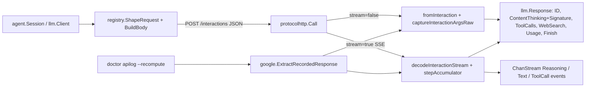

# Google Interactions API client and `google-vertex-express` retirement

## Intent and why

Gemini 4 sessions running through `llm/providers/google` (`generateContent` and `streamGenerateContent`) hit deep-context turn-boundary rollovers (such as 40 fabricated `<job-notification>` and `<delegate-notification>` envelopes in session `03507HVKeWCiXCzGHXBqyK`) and `<end_of_image>` empty-decode failures. Those failures trace directly to protocol mismatches between Evener's `generateContent` adapter and Gemini 3/4 multi-turn reasoning rules:

- `toGeminiContents` emits consecutive `{"role": "user"}` turns whenever tool results are followed by deferred steering or notifications, violating `generateContent`'s strict `user`/`model` alternation requirement.
- `stream.go` and `response.go` drop `thoughtSignature` on bare-text turns and empty trailing chunks, and `request.go` strips `ContentThinking` on replay, severing multi-turn reasoning continuity.
- `request.go` clamps `xhigh` down to `HIGH`, allows `minimal` on models that reject it, and disables `google_search` whenever `len(req.Tools) > 0`.

Google's **Interactions API** (`POST /interactions`) is Google's unified model and agent endpoint across both the Gemini Developer API and Vertex AI (Gemini Enterprise Agent Platform). It replaces `contents[]` and part-attached signatures with a typed `steps[]` timeline (`user_input`, `thought` with explicit `signature` and `summary`, `function_call` with required `id`, `function_result` with `call_id`, `google_search_call`, `google_search_result`, and `model_output`), explicit interaction terminal statuses, lowercase `thinking_level` (`minimal | low | medium | high | xhigh`), and combined `google_search` plus `function` tools.

Jesse decided on a clean-break replacement of `generateContent` under `ProtocolGoogle` (`"google"`) and retirement of the `google-vertex-express` preset, which lacks the `GOOGLE_VERTEX_PROJECT` path segment that Vertex `/interactions` requires.

## Goals

- Replace `generateContent` and `streamGenerateContent` in `llm/providers/google` with Google's Interactions API (`POST /interactions`) for both `Complete` and `Stream`.
- Round-trip `thought` steps (both `summary` text and cryptographic `signature`, including signature-only thoughts with empty summary), wire tool-call IDs (`function_call.id` and `function_result.call_id`), multimodal tool results, user images and documents, and `google_search_call` / `google_search_result` steps.
- Support Gemini 3 and Gemini 4 `thinking_level` values (`minimal`, `low`, `medium`, `high`, `xhigh`, with `max` clamped to `xhigh` or the model's vouched ladder ceiling) and `thinking_summaries` (`"auto"` / `"none"`), curating Gemini 4 model capabilities and defaults in `providers_overlay.toml`.
- Enable `{"type": "google_search"}` alongside `{"type": "function", ...}` tools on Gemini 3 and Gemini 4 models.
- Default to stateless Zero Data Retention execution (`"store": false` with full `steps[]` history replay) when `req.Store` is unset, while supporting `req.Store` and `req.PreviousResponseID` (`"previous_interaction_id"`) at the `llm.Protocol` boundary and recording `interaction.id` on `llm.Response.ID`.
- Retire `google-vertex-express`, `GOOGLE_VERTEX_API_KEY`, and `GOOGLE_VERTEX_EXPRESS_BASE_URL` cleanly across registry, CLI, Hub tests, wire captures, envvar catalog, and documentation.
- Keep `evener doctor apilog --recompute`, local input-token estimation (`llm/token_count.go`), UI transcript projection (`internal/apptranscript`), and live model discovery (`ListModels`) accurate under the new wire contract.

## Non-goals and anti-goals

- **No `generateContent` fallback or backward-compatibility shims.** Do not keep a legacy `generateContent` code path, do not accept deprecated camelCase `fields.` paths (`generationConfig.thinkingConfig`, `safetySettings`, `toolConfig`, `cachedContent`) in `providers.toml`, do not synthesize `thought` steps from legacy `ToolCallData.ThoughtSignature`, and do not keep a deprecation alias for `google-vertex-express`.
- **No `Session`-level stateful `previous_interaction_id` anchor planner in this change.** Generalizing `Session`'s multi-phase `OpenAIResponsesContinuation` state machine to Google is separate follow-up work; `Session` sends full `steps[]` history with `"store": false` by default.
- **No managed-agent or asynchronous background polling lifecycle.** Do not implement `agent`-targeted requests, `background: true` polling (`GET /interactions/{id}`, `/cancel`, `DELETE`), or automatic multi-call stitching for `status: "requires_continuation"`.
- **No assistant-output string filters in `Session`.** Typed Q&A user-turn markup (`AskReply`) and `TurnSummary` provenance are tracked separately in issue `#6988`.

## Constraints

1. **Verified endpoints and Vertex location rules:**
   - **Gemini Developer API (`google`):** `POST {BASE_URL}/interactions` where default `BASE_URL` is `https://generativelanguage.googleapis.com/v1beta` (resolving to `https://generativelanguage.googleapis.com/v1beta/interactions`), authenticated via `x-goog-api-key`. Both `/v1beta/interactions` and `/v1/interactions` are served upstream.
   - **Vertex AI (`google-vertex`):** `POST {GOOGLE_VERTEX_HOST}/v1/projects/{GOOGLE_VERTEX_PROJECT}/locations/{GOOGLE_VERTEX_LOCATION}/interactions`, authenticated via `Authorization: Bearer <token>` (`gcp-adc`). Per Google Cloud's Interactions API documentation, only `global` (`https://aiplatform.googleapis.com`), `us` (`https://aiplatform.us.rep.googleapis.com`), and `eu` (`https://aiplatform.eu.rep.googleapis.com`) serve `/interactions`; single-region endpoints (`us-central1`, `europe-west1`, etc.) return HTTP 404 for every model. Evener's existing `vertex-location` host rule (`llm/registry/hostrules.go`) already derives those exact three hosts.
   - **Streaming:** Uses the same `POST .../interactions` URL as synchronous creation with `"stream": true` in the JSON request body, returning `text/event-stream` SSE terminated by `data: [DONE]`.
2. **Model family support:**
   - **Vertex AI `/interactions`** serves Gemini 3 and later (`gemini-3*`, `gemini-4*`, `gemini-omni*`, `lyria-3*`) and rejects `gemini-2.5-*` and `gemini-1.5-*`.
   - **Gemini Developer API `/v1beta/interactions`** serves Gemini 2.5, Gemini 3, Gemini 4, Omni, and Gemma 4, using `thinking_level` only (`GenerationConfig` has no `thinking_budget` field).
   - **Verified `thinking_level` support (`ai.google.dev/gemini-api/docs/thinking`):**
     - `gemini-4-neon`, `gemini-4-hydrogen`: `low, medium, high, xhigh` (default `high`).
     - `gemini-4-carbon`, `gemini-4-argon`: `low, medium, high` (default `medium`).
     - `gemini-3.8-flash`, `gemini-3.7-flash`, `gemini-3.1-pro-preview`: `low, medium, high` (`3.8`/`3.7` default `medium`; `3.1-pro` default `high`).
     - `gemini-3.6-flash`, `gemini-3.5-flash`, `gemini-3.5-flash-lite`, `gemini-3.1-flash-lite`, `gemini-3-flash-preview`: `minimal, low, medium, high`.
3. **Server storage default (`store: true`):**
   - Omitting `"store"` causes Google to persist interactions server-side for 7 days (subject to Vertex's 240 GiB/day stateful write quota and 500 concurrent stateful interaction limit, and rejected by stateless-only models such as `lyria-3-*`). Whenever `"store"` is sendable (`caps.Fields["store"] == true`) and `req.Store == nil`, `BuildBody` must emit `"store": false`, matching `llm/providers/responses/request.go`.
4. **Wire schema invariants (`googleapis/go-genai` `interactions/models/interactions`):**
   - `model` is a bare model ID string (`"gemini-4-neon"`, `"gemini-3.8-flash"`) in the JSON body on both Gemini API and Vertex AI.
   - `input` is `string | Content | []Content | []Step` (never a bare single `Step` object).
   - `system_instruction` is a plain `string` (never `{parts: [...]}`).
   - `response_format` is a top-level field `{"type": "text", "mime_type": "application/json", "schema"?: {...}}` (not nested inside `generation_config`, and there is no `json_schema` wrapper key).
   - `safety_settings` is a top-level array of `{"type": "<harm_category>", "threshold": "<threshold>", "method"?: "<method>"}` with lowercase snake_case enums (`harassment`, `hate_speech`, `sexually_explicit`, `dangerous_content`; `block_only_high`, etc.).
   - Response `Interaction` carries `id`, `model`, `status` (`in_progress | requires_action | completed | failed | cancelled | incomplete | budget_exceeded | queued | requires_continuation`), `steps[]`, `usage`, and `errors[]` (`{code: string, message: string}`). `outputs` and `finish_reason` do not exist.
   - Assembled `function_call.arguments` is a JSON object (`map[string]any`), whereas streamed SSE `step.delta` `arguments_delta.arguments` is a JSON string fragment concatenated across deltas.
5. **Discovery and token counting:**
   - Interactions defines no model-list or token-count endpoints. `ListModels` stays on `GET {BASE_URL}/models` (Gemini API) and `GET {scheme}://{host}/v1beta1/publishers/google/models` (Vertex). `CountTokensEndpoint` becomes `"-"` (`ErrInputTokenCountUnsupported`), so callers fall back to `llm/token_count.go`.

## Approaches

1. **Sibling `google-interactions` protocol alongside `google` (`generateContent`).** Adds a fifth protocol ID (`google-interactions`) for Gemini 3/4 while keeping `llm/providers/google` (`generateContent`) for Vertex 2.5, `google-vertex-express`, third-party `google-compatible` `:generateContent` gateways, and `:countTokens`. Preserves legacy surfaces at the cost of maintaining two Google wire adapters and keeping `generateContent` failure modes in the tree. Rejected by Jesse.
2. **Clean-break replacement of `generateContent` under `ProtocolGoogle` and retirement of `google-vertex-express` (Chosen by Jesse).** Replaces `llm/providers/google`'s request, response, stream, and recompute paths in place with `/interactions`, retires `google-vertex-express`, disables unsupported `<3` Gemini rows on `google-vertex`, and sets `CountTokensEndpoint` to `"-"`. Keeps one Google protocol and deletes the legacy wire surface outright.
3. **Depend on `google.golang.org/genai` directly.** Adds a heavy generated SDK dependency, bypasses `protocolhttp.Call` (`Prune`, `ApplyBodyConstants`, credential sanitization, `APIAttemptRecord` raw body capture, byte-faithful `RawArguments` decoding, and `AdapterTimeout`), and trips over stale Vertex example guards in upstream `go-genai`. Rejected.

## Design

### Architecture overview



`llm/providers/google` remains the single registered implementation of `registry.ProtocolGoogle` (`"google"`). Both `Complete` and `Stream` build an Interactions JSON body via `buildBody(req, res, stream)` and dispatch `POST` to `protocolhttp.URL(res, res.Transport.Endpoint)` (or `StreamEndpoint`), recording under endpoint family `"google_interactions"`. Offline `apilog --recompute` drives the same JSON and SSE decoders through `google.ExtractRecordedResponse`.

### 1. Registry, transports, providers, and `google-vertex-express` retirement

#### Decisions from Jesse
- `ProtocolGoogle` switches cleanly to `/interactions` with no legacy `generateContent` fallback.
- `google-vertex-express` is retired completely.

#### Registry and overlay changes (engineering calls)
- **`llm/registry/resolve.go` (`protocolDefaults[ProtocolGoogle]`):**
  - `Endpoint`: `"/interactions"`
  - `StreamEndpoint`: `"/interactions"`
  - `ModelsEndpoint`: `"/models"`
  - `CountTokensEndpoint`: `EndpointUnsupported` (`"-"`)
- **`llm/registry/data/providers_overlay.toml`:**
  - **`[transports."vertex-gemini"]`:** `auth = "gcp-adc"`, `endpoint = "/interactions"`, `stream_endpoint = "/interactions"`, `models_endpoint = "/publishers/google/models"`, `count_tokens_endpoint = "-"`.
  - **`[providers.google]`:** bump `cheap_model` from `"gemini-2.5-flash-lite"` to `"gemini-3.5-flash-lite"`. Enable `[providers.google.fields]`: `store = true`, `previous_interaction_id = true`, `service_tier = true`, `background = true`, `continuation_token = true`, `cached_content = true`, `labels = true`. For `gemini-2.5-pro`, `gemini-2.5-flash`, and `gemini-2.5-flash-lite` under `[providers.google.models.*]` (where `models.dev` records `budget_tokens` rather than `effort`), curate `thinking_shape = "level"` and `effort_values = ["low", "medium", "high"]` (engineering call: Gemini Developer API `/v1beta/interactions` serves Gemini 2.5 with `thinking_level` only).
  - **`[providers."google-vertex"]`:** bump `cheap_model` from `"gemini-2.5-flash-lite"` to `"gemini-3.5-flash-lite"`. Enable `[providers."google-vertex".fields]`: `store = true`, `previous_interaction_id = true`, `service_tier = true`, `background = true`, `continuation_token = true`, `labels = true`. Disable unsupported pre-Gemini-3 families on Vertex Interactions via `[providers."google-vertex".models."gemini-2*"] disabled = true` and `[providers."google-vertex".models."gemini-1*"] disabled = true`.
  - **Curated Gemini 4 and Gemini 3 model globs (top-level `[models.*]`):** `models.dev` does not yet list Gemini 4 models, so live-discovered or user-configured Gemini 4 rows otherwise lack `thinking_shape`, `effort_values`, `default_effort`, and `multimodal_tool_results`. Add:
    - `[models."*gemini-4*"]`: `multimodal_tool_results = true`, `thinking_shape = "level"`
    - `[models."*gemini-omni*"]`: `multimodal_tool_results = true`
    - `[models."*gemini-4-neon*"]`: `effort_values = ["low", "medium", "high", "xhigh"]`, `default_effort = "high"`
    - `[models."*gemini-4-hydrogen*"]`: `effort_values = ["low", "medium", "high", "xhigh"]`, `default_effort = "high"`
    - `[models."*gemini-4-carbon*"]`: `effort_values = ["low", "medium", "high"]`, `default_effort = "medium"`
    - `[models."*gemini-4-argon*"]`: `effort_values = ["low", "medium", "high"]`, `default_effort = "medium"`
    - `[models."*gemini-3.1-pro*"]`, `[models."*gemini-3-pro*"]`, `[models."*gemini-3-flash*"]`: `default_effort = "high"`
  - **Retire `google-vertex-express`:** remove `"google-vertex-express"` from `default_order` and delete `[providers."google-vertex-express"]`.
  - **`[providers."google-compatible"]`:** unchanged in TOML; because `protocol = "google"`, custom `GOOGLE_COMPATIBLE_BASE_URL` targets now receive `POST {BASE_URL}/interactions` with `store` omitted by baseline unless enabled in `fields`.
- **`llm/registry/prune.go` (`prunable[ProtocolGoogle]`):**
  Replace the camelCase `generateContent` table with exact Interactions snake_case paths:
  - Send-by-default (`true`):
    - `"generation_config.temperature": true`
    - `"generation_config.top_p": true`
    - `"generation_config.stop_sequences": true`
    - `"generation_config.max_output_tokens": true`
    - `"generation_config.thinking_level": true` (`FieldGoogleThinkingLevel`)
    - `"generation_config.thinking_summaries": true` (`FieldGoogleThinkingSummaries`)
    - `"generation_config.tool_choice": true`
    - `"safety_settings": true`
  - Off-by-default (`false`, enabled per-provider where supported):
    - `"generation_config.seed": false`
    - `"store": false`
    - `"previous_interaction_id": false`
    - `"continuation_token": false`
    - `"service_tier": false`
    - `"background": false`
    - `"cached_content": false`
    - `"labels": false`
  - Update `TemperaturePath(ProtocolGoogle)` to return `"generation_config.temperature"`.
  - Update `samplingPaths(registry.ProtocolGoogle)` in `llm/registry_shape.go` to return `"generation_config.temperature"`, `"generation_config.top_p"`, and `"generation_config.stop_sequences"` so `ShapeRequest` and `registry.Prune` agree on every sampling key.
  - Remove `FieldGoogleThinkingConfig` (`"generationConfig.thinkingConfig"`), replacing it with `FieldGoogleThinkingLevel` (`"generation_config.thinking_level"`) and `FieldGoogleThinkingSummaries` (`"generation_config.thinking_summaries"`). Update `EffortReachesWire` in `llm/types.go` (`case registry.ProtocolGoogle:`) to gate on `caps.Fields[registry.FieldGoogleThinkingLevel]`, drop the `"budget"` branch, and accept `"minimal" | "low" | "medium" | "high" | "xhigh"` as wire-spelled tiers (`"max"` clamps onto `"xhigh"` or `"high"` and continues to report `false`). Authored `providers.toml` files that still reference old camelCase keys fail `ValidateFields` at load time with an explicit error listing the valid snake_case paths (no silent alias).
- **`llm/registry/derive.go`:**
  - Remove the `shape = "budget"` branch for `ProtocolGoogle`. Interactions `GenerationConfig` has no `thinking_budget` field; `ProtocolGoogle` derives `ThinkingShape = "level"` only when `effort` is vouched by non-alias catalog/layer evidence (or set explicitly by a curated overlay rule). Any unrecognized authored `thinking_shape` (such as `"budget"`) omits `thinking_level` while still sending `thinking_summaries`.
- **Vertex regional warnings and remedies (`llm/registry/resolve.go` and `llm/providers/google/protocol_transport.go`):**
  - Because Vertex `/interactions` rejects single-region endpoints (`us-central1`, `europe-west1`, etc.) for **every** model, extend the Vertex regional warning in `resolve.go` and `regionalVertexLocationRemedy` in `protocol_transport.go`: any `ProtocolGoogle` row whose host was derived by `host_rule = "vertex-location"` from a location outside `{"global", "us", "eu"}` emits a resolve warning and reclassifies an HTTP 404 from `/interactions` into an actionable `llm.ConfigurationError` advising `GOOGLE_VERTEX_LOCATION=global` (or `us` / `eu`), without requiring the legacy `"publisher model"` 404 body substring.
- **Discovery and `CountTokens` (`llm/providers/google/vertex_models.go`, `models.go`, `protocol_transport.go`):**
  - Fix `isVertexTransport(res)` in `vertex_models.go`: detect Vertex by `res.Transport.ModelsEndpoint == "/publishers/google/models"` (instead of `strings.HasPrefix(res.Transport.Endpoint, "/publishers/google/models/")`, which broke as soon as `Endpoint` became `"/interactions"`).
  - Update `vertexTextModel` in `vertex_models.go` to exclude `gemini-1*` and `gemini-2*` prefixes so Vertex live discovery offers only Gemini 3+ models supported by Vertex `/interactions`. Keep `"omni"` in `vertexTextModelDenylist` (engineering call: live discovery stays scoped to text-chat models rather than realtime voice/audio models, while `[models."*gemini-omni*"]` still supplies capabilities when a caller configures or names an Omni model explicitly).
  - Keep Gemini Developer API `ListModels` (`GET {BASE_URL}/models?pageSize=1000` filtering `supportedGenerationMethods` containing `"generateContent"` and `registry.IsChatModelID`), since Google's `/v1beta/models` catalog continues to mark interactive text models with `"generateContent"`.
  - Simplify `Protocol.CountTokens` to return `llm.ErrInputTokenCountUnsupported` when `CountTokensEndpoint == "-"` (and return a clear unsupported error if a custom config sets a path, since Interactions defines no token-counting request schema).
- **`google-vertex-express` removal inventory:**
  - `envvars/envvars.go` and `envvars/envvars_test.go`: delete `GoogleVertexAPIKey`, `GoogleVertexExpressBaseURL`, and `TestGoogleVertexExpressVariablesAreRegistered`.
  - `cmd/evener/models_live_test.go`, `cmd/evener-hub/frontend/src/panes/settings/sections/credentials/instanceDialogs.test.tsx`, `llm/providers/wirecapture/`, `llm/registry/golden_test.go`, `llm/registry/instances_test.go`, `llm/registry/overlay_test.go`, and `llm/registry/testdata/golden/google-vertex-express-gemini-2.5-flash.json`: remove `google-vertex-express` cases and golden files.
  - Keep `gcp-adc` JSON credential handling in `cmd/evener-hub/app_auth.go`, `CredentialsSection.tsx`, `llm/providers/tokenauth/gcpadc.go`, and `llm/registry/credential_json.go` intact (used by `google-vertex` and `google-vertex-anthropic`), updating comments that cited `google-vertex-express`.
  - Regenerate and update `docs/environment-variables.md` (`make generate` / `make docs-check`), `docs/llm-providers.md`, `docs/developing-evener/environment.md`, and `docs/developing-evener/config-knobs.md`.

### 2. Request assembly (`llm/providers/google/request.go`)

`BuildBody(req, res)` calls `buildBody(req, res, false)` (`Stream` calls `buildBody(req, res, true)`):

1. **Top-level envelope:**
   - If `protocolhttp.ModelInBody(res)` is true (always true for `/interactions`), set `body["model"] = res.WireID`.
   - If `stream` is true, set `body["stream"] = true`.
   - If `caps.Fields["store"]` is true: set `body["store"] = false`, overridden by `*req.Store` when `req.Store != nil` (preserving Evener's ZDR default while allowing stateful callers).
   - If `req.PreviousResponseID != ""`: set `body["previous_interaction_id"] = strings.TrimSpace(req.PreviousResponseID)`.
   - If `req.ServiceTier != ""`: set `body["service_tier"] = strings.TrimSpace(req.ServiceTier)`.
   - If `req.Background != nil`: set `body["background"] = *req.Background`.
   - If `len(req.Metadata) > 0`: set `body["labels"] = req.Metadata`.
   - If `system != ""` (joined `RoleSystem` / `RoleDeveloper` text blocks): set `body["system_instruction"] = system` (plain string).

2. **Conversation history -> `input` (`[]Step`):**
    Always emit `input` as a non-empty `[]map[string]any` (`[]Step`) so stateless history replay, tool-result turns (`[function_result, ...]`), and single-turn prompts share one canonical shape and never hit the single-Step union trap:
   - **`RoleSystem` / `RoleDeveloper`:** concatenated with `"\n\n"` into `system_instruction` (matching current `google` behavior).
   - **Coalescing consecutive user-side messages (`RoleUser`):** adjacent `RoleUser` messages (such as user input, environment context, memory notifications, or deferred `<job-notification>` / `<delegate-notification>` steering messages) coalesce into a **single** `{"type": "user_input", "content": [...]}` step in message order, flushed before any assistant or tool-result step.
     - `ContentText` (non-empty): `{"type": "text", "text": p.Text}`.
     - `ContentImage`: inline bytes or local file path normalized via existing `googleInlineImageBytes` (PNG/JPEG/WebP/HEIC/HEIF; GIF/BMP/TIFF re-encoded to PNG) -> `{"type": "image", "data": base64, "mime_type": mt}`; remote/GCS URI -> `{"type": "image", "uri": u, "mime_type": mt}`.
     - `ContentDocument`: inline bytes -> `{"type": "document", "data": base64, "mime_type": mt}`; URI -> `{"type": "document", "uri": u, "mime_type": mt}` (default `application/pdf`).
     - `ContentAudio`: rejected with `ConfigurationError` (matching `agent/session_set_model.go:29`).
   - **`RoleAssistant`:** flushes any pending `user_input` step, then walks `msg.Content` in order so step ordering matches how the model produced them:
     - Consecutive `ContentText` (and any `ContentDocument` / `ContentImage`) parts coalesce into a `{"type": "model_output", "content": [...]}` step, flushed before any `thought`, `function_call`, or `google_search_*` step.
     - `ContentThinking` (skipped when `caps.ReasoningDisabled()`, `p.Kind == ContentRedThinking`, or `p.Thinking.EncryptedContent != ""` from a foreign provider):
       - Signature `sig` is `strings.TrimSpace(t.Signature)`, cleared if `llm.IsOpenAICompatReasoningField(sig)`.
       - Summary items: if `len(t.Summary) > 0`, each non-empty string becomes `{"type": "text", "text": s}`; else if `t.Text != ""`, `[{"type": "text", "text": t.Text}]`.
       - If `sig != ""` or `len(summary) > 0`, emit `{"type": "thought", "signature"?: sig, "summary"?: summary}`. (Signature-only thoughts with empty `summary` replay `{"type": "thought", "signature": sig}` intact.)
     - `ContentWebSearch`: if `p.WebSearch != nil` and `len(p.WebSearch.Raw) > 0` decodes as a JSON array of objects whose `"type"` is `"google_search_call"` or `"google_search_result"`, append those steps verbatim; ignore legacy untyped `groundingMetadata` blobs.
     - `ContentToolCall`: parse `tc.Arguments` as a JSON object (`map[string]any`, defaulting empty to `{}`); call ID is `tc.ID` (generating a deterministic fallback ID only if empty, paired with subsequent tool results). Emit `{"type": "function_call", "id": id, "name": tc.Name, "arguments": argsObj}`.
   - **`RoleTool` (`ContentToolResult`):** flushes any pending `user_input` step (so a `RoleTool` message followed by a deferred `RoleUser` `<job-notification>` emits `function_result` steps first, then one `user_input` step, with zero role-alternation violations!). Each `ContentToolResult` emits one `{"type": "function_result", ...}` step:
     - `"call_id"`: `tr.ToolCallID` (required; looked up from the preceding `ContentToolCall` only if `tr.ToolCallID == ""`).
     - `"name"`: `tr.Name` (or looked up by `ToolCallID` from history when non-empty).
     - `"is_error"`: `true` when `tr.IsError` is true (omitted when false).
     - `"result"`:
       - When `multimodalToolResults` is true (`caps.MultimodalToolResults`) and `len(tr.ImageData) > 0` (normalized via `googleInlineImageBytes`), or when `tr.Content` carries inline document/image media, emit `result` as a `[]map[string]any` subcontent array: `[{"type": "text", "text": textString}, {"type": "image", "data": b64, "mime_type": mt}]` (keeping text plus image inside the tool result itself rather than splitting synthetic user messages).
       - Otherwise: if `tr.Content` is already a JSON object (`map[string]any`), pass it directly; if a string (or marshaled slice/primitive), pass the string.

3. **Tools and `google_search`:**
   - Each `req.Tools` entry emits `{"type": "function", "name": t.Name, "description": t.Description, "parameters": sanitizeGeminiSchema(t.Parameters)}` ( checking `openaichat.CyclicSchema` or keeping `sanitizeGeminiSchema`'s cycle-safe copy).
   - When `webSearch` is true (`req.WebSearch && (caps.WebSearch == nil || *caps.WebSearch)`): append `{"type": "google_search"}` when `len(req.Tools) == 0` **or** when `res.WireID` is Gemini 3+ / Omni (`!strings.HasPrefix(res.WireID, "gemini-2") && !strings.HasPrefix(res.WireID, "gemini-1")`), unlocking combined web search and function calling on all Gemini 3 and Gemini 4 models while avoiding 400s on Gemini 2.5 rows on `google`.

4. **`generation_config`, thinking, tool choice, and `response_format`:**
   - `generation_config` (emitted when non-empty):
     - `temperature` (`*req.Temperature`), `top_p` (`*req.TopP`), `max_output_tokens` (clamped to `min(req.MaxTokens, caps.MaxOutputTokens)` via updated `reconcileOutputField` reading `generation_config.max_output_tokens`), `stop_sequences` (`req.StopSequences`).
     - **Thinking (`thinking_level` and `thinking_summaries`):**
       - When `!caps.ReasoningDisabled()` and normalized `req.ReasoningEffort != "none"`:
         - Emit `"thinking_summaries": "auto"` (or `strings.ToLower(*caps.ReasoningSummary)` when `"auto"` or `"none"`).
         - When `req.ReasoningEffort != nil`, `registry.StringValue(caps.ThinkingShape) == "level"`, and `!registry.BoolValue(caps.EffortParameterUnsupported)`: resolve `level` through `llm.VouchedEffort(effort, caps.EffortValues)` when `len(caps.EffortValues) > 0`; map `"max"` -> `"xhigh"` when `"xhigh"` is supported (or `"high"` otherwise); emit lowercase `"thinking_level"` in `{"minimal", "low", "medium", "high", "xhigh"}`.
       - When `req.ReasoningEffort` normalizes to `"none"` and `"minimal"` is in `caps.EffortValues`? No: keep Evener's current Google rule (`effort == "none"` omits `thinking_level` and sets `"thinking_summaries": "none"` unless disabled by `fields`).
     - **`tool_choice` (inside `generation_config`):**
       - `""` / `"auto"` -> `"auto"`
       - `"none"` -> `"none"`
       - `"required"` -> `"any"` (downgraded to `"auto"` if `caps.ToolChoiceForcing != nil && !*caps.ToolChoiceForcing`)
       - `"named"` -> `{"allowed_tools": {"mode": "any", "tools": [req.ToolChoice.Name]}}` (error if `Name == ""`)
   - **`response_format` (top-level):**
     - `Type == "json"` -> `{"type": "text", "mime_type": "application/json"}`
     - `Type == "json_schema"` -> `{"type": "text", "mime_type": "application/json", "schema": sanitizeGeminiSchema(req.ResponseFormat.JSONSchema)}`
   - **`safety_settings` and `agent/provider/profile.go`:**
     - Update `Profile.ProviderOptions()` in `agent/provider/profile.go` for `ProtocolGoogle` from legacy `safetySettings` to exact Interactions `safety_settings`:
       ```go
       map[string]any{registry.ProtocolGoogle: map[string]any{"safety_settings": []map[string]any{
           {"type": "harassment", "threshold": "block_only_high"},
           {"type": "hate_speech", "threshold": "block_only_high"},
           {"type": "sexually_explicit", "threshold": "block_only_high"},
           {"type": "dangerous_content", "threshold": "block_only_high"},
       }}}
       ```
   - **`ProviderOptions["google"]` merge:**
     - Copy top-level keys onto `body` (this is the wire entry point for caller-supplied `"continuation_token"` and `"cached_content"`, which `llm.Request` does not model directly and `registry.Prune` strips when disabled in `caps.Fields`); if `options["generation_config"]` is present, validate it is a `map[string]any` and merge its keys onto `body["generation_config"]` before `FinalizeBody` (`reconcileOutputField`).

### 3. Response decoding (`llm/providers/google/response.go`)

`fromInteraction(raw map[string]any, requestedModel string, body []byte) (llm.Response, error)`:

1. **Identity and metadata:**
   - `r.ID`, _ = `raw["id"].(string)` (also stamped via `ContinuationHasher` into `r.Raw["id_hash"]` when a hasher is on `ctx`, matching `responses/complete.go`).
   - `r.Model` = `raw["model"].(string)` if non-empty, else `requestedModel`.
2. **Step timeline (`steps[]`):**
   - `"thought"`: extract `signature` (`string`) and `summary` (`[]any` of `{"type": "text", "text": "..."}`). Collect summary text blocks into `summarySlice []string` and `joinedText = strings.Join(summarySlice, "\n\n")`. Whenever `signature != ""` or `len(summarySlice) > 0`, append `ContentThinking{Thinking: &ThinkingData{Text: joinedText, Signature: signature, Summary: summarySlice}}`.
   - `"model_output"`: iterate `content[]`:
     - `{"type": "text", "text": t}` (when `t != ""`): append `ContentText{Text: t}`.
     - If `step["error"]` (`{code, message}`) is present and the interaction produced no usable content/tool calls, classify and return an in-band `llm.Error` (or `FinishReasonContentFilter` when safety-blocked).
   - `"function_call"`: extract `id`, `name`, and byte-faithful `arguments` token from `body` at step index `stepIdx` via single-pass `captureInteractionArgsRaw(body)` (falling back to `json.Marshal(normalizeJSONNumbers(step["arguments"]))`), normalized via `llm.NormalizeToolArguments`. Use wire `id` (falling back to `identifier.MustNewSyntheticCallID()` only if `id == ""`). Append `ContentToolCall`.
   - `"google_search_call"` and `"google_search_result"`: pair a `"google_search_call"` with an immediately following `"google_search_result"` matching `call_id == id` (or record standalone steps if unpaired) into one `ContentWebSearch{WebSearch: &WebSearchData{Query: strings.Join(queries, "; "), Raw: rawJSONArrayOfSteps}}`.
3. **Status -> `FinishReason` and error surfacing:**
   - `"completed"`: `FinishReasonStop` (overridden to `FinishReasonToolCalls` if `len(r.ToolCalls()) > 0`).
   - `"requires_action"`: `FinishReasonToolCalls` (`Raw: "requires_action"`).
   - `"incomplete"`, `"budget_exceeded"`: `FinishReasonLength` (`Raw: status`).
   - `"requires_continuation"`: `FinishReasonPauseTurn` (`Raw: "requires_continuation"`).
   - `"cancelled"`: `FinishReasonOther` (`Raw: "cancelled"`).
   - `"failed"`: inspect `raw["errors"]` (`[]{code: string, message: string}`). If `code` indicates safety/content filtering (`safety`, `recitation`, `prohibited_content`, `blocklist`), return `FinishReasonContentFilter` with `Raw: code`; otherwise return a classified `llm.Error` (`gateway_timeout` / `deadline_exceeded` -> timeout, `resource_exhausted` / `rate_limit_exceeded` -> rate limit, `internal` / `unavailable` -> server error, else provider error) so `Complete` callers never mistake a failed interaction for an empty `"stop"`.
4. **Usage (`raw["usage"]`):**
   - `totalInput := tokenCountInt(u["total_input_tokens"])`
   - `cached := tokenCountInt(u["total_cached_tokens"])`
   - `InputTokens = max(totalInput - cached, 0)` (preserving `llm.Usage`'s invariant that `InputTokens` excludes cached tokens!)
   - `CacheReadTokens = &cached` (when `u["total_cached_tokens"] != nil`)
   - `thought := tokenCountInt(u["total_thought_tokens"])`
   - `toolUse := tokenCountInt(u["total_tool_use_tokens"])`
   - `rawOut := tokenCountInt(u["total_output_tokens"])`
   - Check and document exact billing alignment: `OutputTokens = rawOut + thought` when `total_output_tokens` excludes `total_thought_tokens`, or `rawOut` if `total_tokens == totalInput + rawOut + toolUse` (compute against `total_tokens` when present, matching current `parseUsage` invariant so thinking tokens are never double-counted or dropped!). Set `ReasoningTokens = &thought` when `u["total_thought_tokens"] != nil`.

### 4. Streaming SSE decoder (`llm/providers/google/stream.go`) and offline recompute (`recompute.go`)

`decodeInteractionStream` runs inside `transport.StreamRunner` and shares an `interactionStreamAccumulator` with `ExtractRecordedResponse`:

1. **Framing and dispatch:**
   - Ignore empty `ev.Data`. Treat `strings.TrimSpace(string(ev.Data)) == "[DONE]"` (or `ev.Event == "done"`) as clean end-of-stream after terminal settlement.
   - Decode `ev.Data` JSON with `UseNumber()`. Dispatch on `payload["event_type"].(string)` (falling back to `ev.Event` if absent).
2. **Per-event state machine (keyed by `index int`):**
   - `"interaction.created"`: capture `interaction.id` and `interaction.model`; emit `StreamEventStart` once.
   - `"interaction.status_update"`: update current `status` and optional `usage`.
   - `"step.start"`: inspect `step["type"]` at `index`:
     - `"thought"`: record step slot `kind = stepThought`, seed any initial `signature` / `summary`, emit `StreamEventReasoningStart`.
     - `"model_output"`: record `kind = stepModelOutput`, `textID = fmt.Sprintf("text_%d", index)`.
     - `"function_call"`: record `kind = stepFunctionCall`, `id`, `name`, and byte-faithful initial `step.arguments` (if non-empty object `{}`), emit `StreamEventToolCallStart`.
     - `"google_search_call"` / `"google_search_result"`: record raw step payload at `index`.
   - `"step.delta"`: inspect `delta["type"]` for step at `index`:
     - `"thought_summary"`: extract `delta["content"]["text"]`; append to step's summary buffer and emit `StreamEventReasoningDelta`.
     - `"thought_signature"`: set step's `signature = delta["signature"]`.
     - `"text"`: on first non-empty text delta for this step emit `StreamEventTextStart`; append `delta["text"]` and emit `StreamEventTextDelta`.
     - `"arguments_delta"`: append string fragment `delta["arguments"]` (decoded via `protocolhttp.RawStringContent` / JSON string decode) to step's streamed-args buffer and emit `StreamEventToolCallDelta`.
   - `"step.stop"`: finalize step at `index`:
     - `"thought"`: emit `StreamEventReasoningEnd`; commit `ContentThinking` if `signature != ""` or summary non-empty.
     - `"model_output"`: if text started, emit `StreamEventTextEnd`; commit `ContentText`.
     - `"function_call"`: if `arguments_delta` fragments were received, normalize the concatenated fragment bytes via `llm.NormalizeToolArguments` (setting `RawArguments` and `{}` fallback if invalid JSON, matching `#2724`); otherwise use initial `step.arguments` bytes (default `{}`). Emit `StreamEventToolCallEnd` and commit `ContentToolCall`.
   - `"interaction.completed"`: merge terminal `interaction` metadata (`id`, `model`, `status`, `usage`, and any `interaction.steps` if no `step.*` events preceded it), settle `FinishReason` (turning `status == "failed"` into `FatalStreamError` unless safety-filtered), emit `StreamEventFinish`, and set `finished = true`.
   - `"error"`: classify `payload["error"]` (`{code: string, message: string}`) into `llm.Error` (`gateway_timeout` -> timeout, `resource_exhausted` -> rate limit, `unavailable`/`internal` -> server error) and return `&transport.FatalStreamError{Err: ...}` so `RetryStream` retries transient mid-stream errors accurately.
3. **`ExtractRecordedResponse` (`llm/providers/google/recompute.go` and `agent/doctor/apilog.go`):**
   - Register `"google_interactions": google.ExtractRecordedResponse` in `recomputeExtractors` (`agent/doctor/apilog.go`).
   - JSON body (`trimmed[0] == '{'`): reject mis-filed `choices` or legacy `candidates` payloads; call `fromInteraction`.
   - SSE body: replay through `interactionStreamAccumulator` + `settleInteractionStream` so `doctor apilog --recompute` recovers exact text length and tool-call counts.

### 5. Cross-cutting updates (`llm/token_count.go`, `internal/apptranscript`, `agent/`, and `cmd/evener-fuzz-harvest`)

1. **Local input-token estimation (`llm/token_count.go`):**
   - Update `thinkingReplayChars` (`case registry.ProtocolGoogle:`): when `p.Kind == ContentThinking && !target.reasoningOff && p.Thinking.EncryptedContent == ""`, return `googleThinkingChars(t)` (`len(sig)` when `!IsOpenAICompatReasoningField(t.Signature)`, plus summary character length if `len(t.Summary) > 0` else `len(t.Text)`).
   - Update `unsignedThinkingReplayed` and `unsignedThinkingReplayedByName`: `ProtocolGoogle` (and `"google"` / `"gemini"` name fallback) now replays unsigned `ContentThinking.Text` as a `thought` summary when reasoning is enabled (`!res.Caps.ReasoningDisabled()`).
2. **Transcript UI projection (`internal/apptranscript/apptranscript.go`):**
   - Extend `MetadataOnlyResponsesReasoning` (or rename/generalize to cover signature-only Google `ContentThinking` parts where `t.Text == "" && len(t.Summary) == 0 && t.EncryptedContent == "" && t.Signature != ""`) so a signature-only `thought` step never splits adjacent assistant text into two bubbles or renders a blank reasoning row in the Hub or mobile client.
3. **Model switching, session namer, and fuzz harvesting (`agent/` and `cmd/evener-fuzz-harvest`):**
   - **`agent/session_set_model.go` (`unrepresentableContentKinds`):** because Interactions `user_input`, `model_output`, and `function_result` steps all accept `document` content, move `registry.ProtocolGoogle` to the `{llm.ContentAudio: true}` arm alongside `ProtocolAnthropic` and `ProtocolOpenAIResponses` (engineering call: switching an active session with non-user documents in history onto Google now succeeds instead of refusing).
   - **`agent/session_namer.go` (`isTemperatureUnsupported`):** update the `ProtocolGoogle` (and empty-protocol fallback) rejected-parameter check from `"generationConfig.temperature"` to `"generation_config.temperature"` (`registry.TemperaturePath(registry.ProtocolGoogle)`).
   - **`cmd/evener-fuzz-harvest/raw.go` (and `raw_test.go`):** map endpoint family `"google_interactions"` to `dirGeminiStream`, and update `isGeminiStream` to recognize Interactions SSE bodies (`"event_type":"interaction.` / `"event_type": "interaction.` / `"event_type":"step.` / `"event_type": "step.`) alongside updating `llm/providers/google/stream_fuzz_test.go` seeds to Interactions SSE frames.

### What is left to the builder

- Internal file split inside `llm/providers/google/` (for example `protocol.go`, `protocol_transport.go`, `request.go`, `input.go`, `response.go`, `stream.go`, `recompute.go`, `rawargs.go`, `models.go`, `vertex_models.go`).
- Exact helper structure for single-pass raw JSON token extraction (`captureInteractionArgsRaw`) modeled on `llm/providers/responses/response.go`.
- Updating existing `llm/providers/google/*_test.go`, `llm/providers/difftest/`, `llm/providers/wirecapture/`, `llm/token_count*_test.go`, `llm/registry/*_test.go`, and `internal/apptranscript/*_test.go` fixtures from `generateContent` wire shapes to Interactions API wire shapes, plus adding focused TDD tests for:
  - Consecutive `RoleUser` message coalescing after `RoleTool` (`function_result` followed by single `user_input`).
  - `thought` step round-trip with both `summary` + `signature` and signature-only (`summary` empty), including UI non-splitting in `apptranscript`.
  - Streamed `arguments_delta` string concatenation vs non-streamed `arguments` object parity, plus malformed streamed JSON `RawArguments` preservation.
  - Combined `google_search` + `function` tools on Gemini 3/4, `google_search_call`/`google_search_result` replay, and Gemini 2.5 exclusion when `len(req.Tools) > 0`.
  - Vertex single-region (`us-central1`) resolve warning and 404 `ConfigurationError` remedy on `/interactions`, Vertex `<3` model exclusion in overlay and `vertex_models.go`, and complete absence of `google-vertex-express`.
  - Live opt-in smoke test (`EVENER_LIVE_TESTS=1`) against `google` and `google-vertex` (`GOOGLE_VERTEX_LOCATION=global`) covering streaming tool calls, thought signature replay across a bare-text acknowledgement turn, and `ListModels`.
