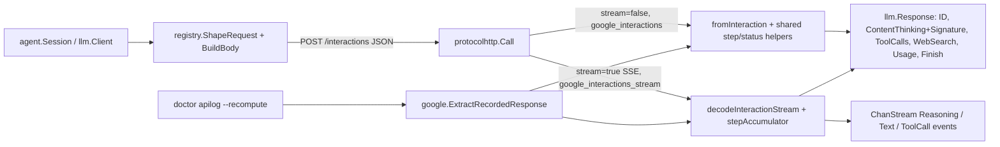

# Google Interactions API client and `google-vertex-express` retirement

## Intent and why

Gemini 4 sessions running through `llm/providers/google` (`generateContent` and `streamGenerateContent`) hit deep-context turn-boundary rollovers (such as 40 fabricated `<job-notification>` and `<delegate-notification>` envelopes in session `03507HVKeWCiXCzGHXBqyK`) and `<end_of_image>` empty-decode failures. Those failures trace directly to protocol mismatches between Evener's `generateContent` adapter and Gemini 3/4 multi-turn reasoning rules:

- `toGeminiContents` emits consecutive `{"role": "user"}` turns whenever tool results are followed by deferred steering or notifications, violating `generateContent`'s strict `user`/`model` alternation requirement.
- `stream.go` and `response.go` drop `thoughtSignature` on bare-text turns and empty trailing chunks, and `request.go` strips `ContentThinking` on replay, severing multi-turn reasoning continuity.
- `request.go` clamps `xhigh` down to `HIGH`, allows `minimal` on models that reject it, and disables `google_search` whenever `len(req.Tools) > 0`.

Google's **Interactions API** (`POST /interactions`) is Google's unified model endpoint across both the Gemini Developer API and Vertex AI (Gemini Enterprise Agent Platform). It replaces `contents[]` and part-attached signatures with a typed `steps[]` timeline (`user_input`, `thought` with explicit `signature` and `summary`, `function_call` with required `id`, `function_result` with `call_id`, `google_search_call`, `google_search_result`, and `model_output`), explicit interaction terminal statuses, lowercase `thinking_level` (`minimal | low | medium | high | xhigh`), and combined `google_search` plus `function` tools.

Jesse decided on a clean-break replacement of `generateContent` under `ProtocolGoogle` (`"google"`) and retirement of the `google-vertex-express` preset, which lacks the `GOOGLE_VERTEX_PROJECT` path segment that Vertex `/interactions` requires.

## Goals

- Replace `generateContent` and `streamGenerateContent` in `llm/providers/google` with Google's Interactions API (`POST /interactions`) for both `Complete` and `Stream`.
- Round-trip `thought` steps (both `summary` text and cryptographic `signature`, including signature-only thoughts with empty summary), wire tool-call IDs (`function_call.id` and `function_result.call_id`), multimodal tool results, user and non-user documents and images, and `google_search_call` / `google_search_result` steps.
- Support Gemini 3 and Gemini 4 `thinking_level` values (`minimal`, `low`, `medium`, `high`, `xhigh`) and `thinking_summaries` (`"auto"` / `"none"`), curating missing Gemini 4 and Gemini 2.5 capabilities in `providers_overlay.toml`.
- Enable `{"type": "google_search"}` alongside `{"type": "function", ...}` tools on models whose registry capabilities vouch for combined search and function calling.
- Default to stateless Zero Data Retention execution (`"store": false` with full `steps[]` history replay) across all `ProtocolGoogle` providers while supporting `req.Store`, `req.PreviousResponseID` (`"previous_interaction_id"`), and `Response.ID` (`interaction.id`) at the `llm.Protocol` boundary.
- Retire `google-vertex-express`, `GOOGLE_VERTEX_API_KEY`, and `GOOGLE_VERTEX_EXPRESS_BASE_URL` cleanly across registry, CLI, Hub tests, wire captures, envvar catalog, and documentation.
- Keep `evener doctor apilog --recompute`, local input-token estimation (`llm/token_count.go`), UI transcript projection (`internal/apptranscript`), and live model discovery (`ListModels`) accurate under the new wire contract.

## Non-goals and anti-goals

- **No `generateContent` fallback or backward-compatibility shims.** Do not keep a legacy `generateContent` code path, do not accept deprecated camelCase `fields.` paths (`generationConfig.thinkingConfig`, `safetySettings`, `toolConfig`, `cachedContent`) in `providers.toml`, do not synthesize `thought` steps from legacy `ToolCallData.ThoughtSignature`, and do not keep a deprecation alias for `google-vertex-express`.
- **No `Session`-level stateful `previous_interaction_id` anchor planner in this change.** Generalizing `Session`'s multi-phase `OpenAIResponsesContinuation` state machine to Google is separate follow-up work; `Session` sends full `steps[]` history with `"store": false` by default.
- **No managed-agent or asynchronous background polling lifecycle.** Do not implement `agent`-targeted requests, `background: true` submission or polling (`GET /interactions/{id}`, `/cancel`, `DELETE`), or automatic multi-call stitching for `status: "requires_continuation"`. Foreground `Complete` and `Stream` reject `background: true` up front rather than stranding callers with unpolled `queued` or `in_progress` interactions.
- **No assistant-output string filters in `Session`.** Typed Q&A user-turn markup (`AskReply`) and `TurnSummary` provenance are tracked separately in issue `#6988`.

## Constraints

1. **Verified endpoints and Vertex location rules:**
   - **Gemini Developer API (`google`):** `POST {BASE_URL}/interactions` where default `BASE_URL` is `https://generativelanguage.googleapis.com/v1beta` (`https://generativelanguage.googleapis.com/v1beta/interactions`), authenticated via `x-goog-api-key`. Both `/v1beta/interactions` and `/v1/interactions` are served upstream.
   - **Vertex AI (`google-vertex`):** `POST {GOOGLE_VERTEX_HOST}/v1/projects/{GOOGLE_VERTEX_PROJECT}/locations/{GOOGLE_VERTEX_LOCATION}/interactions`, authenticated via `Authorization: Bearer <token>` (`gcp-adc`). Per Google Cloud's Interactions API documentation, only `global` (`https://aiplatform.googleapis.com`), `us` (`https://aiplatform.us.rep.googleapis.com`), and `eu` (`https://aiplatform.eu.rep.googleapis.com`) serve `/interactions`; single-region endpoints (`us-central1`, `europe-west1`, etc.) return HTTP 404 for every model. Evener's `vertex-location` host rule (`llm/registry/hostrules.go`) already derives those exact three hosts.
   - **Streaming:** Uses the same `POST .../interactions` URL with `"stream": true` in the JSON request body, returning `text/event-stream` SSE terminated by `event: done` / `data: [DONE]`.
2. **Model family support:**
   - **Vertex AI `/interactions`** serves Gemini 3 and later (`gemini-3*`, `gemini-4*`, `gemini-omni*`, `lyria-3*`) and rejects `gemini-2.5-*` and `gemini-1.5-*`.
   - **Gemini Developer API `/v1beta/interactions`** serves Gemini 2.5, Gemini 3, Gemini 4, Omni, and Gemma 4, using `thinking_level` only (`GenerationConfig` has no `thinking_budget` field).
3. **Server storage default (`store: true`):**
   - Omitting `"store"` causes Google to persist interactions server-side for 7 days (subject to Vertex's 240 GiB/day stateful write quota and 500 concurrent stateful interaction limit, and rejected by stateless-only models such as `lyria-3-*`). `"store"` is therefore sendable by default (`prunable[ProtocolGoogle]["store"] == true`) on all `ProtocolGoogle` providers, and `BuildBody` emits `"store": false` unless overridden per Design §2.1.
4. **Wire schema invariants (`googleapis/go-genai` `interactions/models/interactions`):**
   - `model` is a bare model ID string (`"gemini-4-neon"`, `"gemini-3.8-flash"`) in the JSON body on both Gemini API and Vertex AI.
   - `input` is `string | Content | []Content | []Step` (never a bare single `Step` object).
   - `system_instruction` is a plain `string` (never `{parts: [...]}`).
   - `response_format` is top-level `{"type": "text", "mime_type": "application/json", "schema"?: {...}}` (outside `generation_config`, with no `json_schema` wrapper key).
   - `safety_settings` is a top-level array of `{"type": "<harm_category>", "threshold": "<threshold>", "method"?: "<method>"}` with lowercase snake_case enums (`harassment`, `hate_speech`, `sexually_explicit`, `dangerous_content`; `block_only_high`, etc.).
   - `function_result.result` (`FunctionResultStepResultUnion`) accepts `string | object | []FunctionResultSubcontent`; bare JSON arrays in `result` are parsed by Google as typed subcontent items (`text`, `image`, `document`, etc.), so arbitrary non-object tool outputs must be serialized to `string`.
   - Response `Interaction` carries `id`, `model`, `status` (`in_progress | requires_action | completed | failed | cancelled | incomplete | budget_exceeded | queued | requires_continuation`), `steps[]`, `usage`, and `errors[]` (`{code: string, message: string}`). `outputs` and `finish_reason` do not exist.
   - Assembled `function_call.arguments` is a JSON object, whereas streamed SSE `step.delta` `arguments_delta.arguments` is a JSON string fragment concatenated across deltas.
5. **Discovery and token counting:**
   - Interactions defines no model-list or token-count endpoints. `ListModels` stays on `GET {BASE_URL}/models` (Gemini API) and `GET {scheme}://{host}/v1beta1/publishers/google/models` (Vertex). `CountTokensEndpoint` becomes `"-"` and `Protocol.CountTokens` unconditionally returns `llm.ErrInputTokenCountUnsupported`, delegating pre-call token accounting to `llm/token_count.go`.

## Approaches

1. **Sibling `google-interactions` protocol alongside `google` (`generateContent`).** Adds a fifth protocol ID (`google-interactions`) for Gemini 3/4 while keeping `llm/providers/google` (`generateContent`) for Vertex 2.5, `google-vertex-express`, third-party `google-compatible` `:generateContent` gateways, and `:countTokens`. Preserves legacy surfaces at the cost of maintaining two Google wire adapters and keeping `generateContent` failure modes in the tree. Rejected by Jesse.
2. **Clean-break replacement of `generateContent` under `ProtocolGoogle` and retirement of `google-vertex-express` (Chosen by Jesse).** Replaces `llm/providers/google`'s request, response, stream, and recompute paths in place with `/interactions`, retires `google-vertex-express`, hides unsupported `<3` Gemini rows on `google-vertex`, and removes `:countTokens`. Keeps one Google protocol and deletes the legacy wire surface outright.
3. **Depend on `google.golang.org/genai` directly.** Adds a heavy generated SDK dependency, bypasses `protocolhttp.Call` (`Prune`, `ApplyBodyConstants`, credential sanitization, `APIAttemptRecord` raw body capture, byte-faithful `RawArguments` decoding, and `AdapterTimeout`), and trips over stale Vertex example guards in upstream `go-genai`. Rejected.

## Design

### Architecture overview

`llm/providers/google` remains the single registered implementation of `registry.ProtocolGoogle` (`"google"`). `Complete` and `Stream` build an Interactions JSON body via `buildBody(req, res, stream)` and `POST` to `protocolhttp.URL(res, res.Transport.Endpoint)` (or `StreamEndpoint`), recording under endpoint families `"google_interactions"` (JSON) and `"google_interactions_stream"` (SSE) so `evener-fuzz-harvest` routes only SSE streams to the stream fuzz corpus while `doctor apilog --recompute` registers both families against `google.ExtractRecordedResponse`.

### 1. Registry, transports, providers, and `google-vertex-express` retirement

#### Decisions from Jesse
- `ProtocolGoogle` switches cleanly to `/interactions` with no legacy `generateContent` fallback.
- `google-vertex-express` is retired completely.

#### Registry and overlay changes (engineering calls)
- **`llm/registry/resolve.go` (`protocolDefaults[ProtocolGoogle]`):**
  - `Endpoint`: `"/interactions"`
  - `StreamEndpoint`: `"/interactions"`
  - `ModelsEndpoint`: `"/models"`
  - `CountTokensEndpoint`: `EndpointUnsupported` (`"-"`)
- **`llm/registry/types.go` and `schema.go` (`Caps.CombinedSearchAndFunctions`):**
  - Add `CombinedSearchAndFunctions *bool` (`toml:"combined_search_and_functions" json:"combined_search_and_functions,omitempty"`, layered and provenanced alongside `MultimodalToolResults` and `WebSearch`) so model-family eligibility for combining `google_search` with `function` tools lives in registry data rather than hardcoded string prefixes in `request.go`.
- **`llm/registry/data/providers_overlay.toml`:**
  - **`[transports."vertex-gemini"]`:** specify only `auth = "gcp-adc"` and `models_endpoint = "/publishers/google/models"`; `endpoint`, `stream_endpoint`, and `count_tokens_endpoint` inherit `protocolDefaults[ProtocolGoogle]`.
  - **`[providers.google]`:** bump `cheap_model` from `"gemini-2.5-flash-lite"` to `"gemini-3.5-flash-lite"`. Enable `[providers.google.fields]`: `previous_interaction_id = true`, `service_tier = true`, `continuation_token = true`, `cached_content = true`, `labels = true`. For `gemini-2.5-pro`, `gemini-2.5-flash`, and `gemini-2.5-flash-lite` under `[providers.google.models.*]` (where `models.dev` records `budget_tokens`), curate `thinking_shape = "level"` and `effort_values = ["low", "medium", "high"]`.
  - **`[providers."google-vertex"]`:** bump `cheap_model` from `"gemini-2.5-flash-lite"` to `"gemini-3.5-flash-lite"`. Enable `[providers."google-vertex".fields]`: `previous_interaction_id = true`, `service_tier = true`, `continuation_token = true`, `labels = true`.
  - **Curated Gemini 3, Gemini 4, and Omni model globs (top-level `[models.*]`, single source of truth from `ai.google.dev/gemini-api/docs/thinking`):**
    - `[models."*gemini-3*"]`: `multimodal_tool_results = true`, `combined_search_and_functions = true`
    - `[models."*gemini-4*"]`: `multimodal_tool_results = true`, `combined_search_and_functions = true`, `thinking_shape = "level"`
    - `[models."*gemini-omni*"]`: `multimodal_tool_results = true`, `combined_search_and_functions = true`
    - `[models."*gemini-flash-latest*"]`, `[models."*gemini-flash-lite-latest*"]`: `multimodal_tool_results = true`, `combined_search_and_functions = true`
    - `[models."*gemini-4-neon*"]`, `[models."*gemini-4-hydrogen*"]`: `effort_values = ["low", "medium", "high", "xhigh"]`, `default_effort = "high"`
    - `[models."*gemini-4-carbon*"]`, `[models."*gemini-4-argon*"]`: `effort_values = ["low", "medium", "high"]`, `default_effort = "medium"`
    - `[models."*gemini-3.1-pro*"]`, `[models."*gemini-3-pro*"]`, `[models."*gemini-3-flash*"]`: `default_effort = "high"` (`models.dev` already supplies the Gemini 3 `effort_values` ladders, including `minimal..high` on `3.6-flash`, `3.5-flash`, `3.5-flash-lite`, `3.1-flash-lite`, and `3-flash-preview`, and `low..high` on `3.8-flash`, `3.7-flash`, and `3.1-pro-preview`).
  - **Retire `google-vertex-express`:** remove `"google-vertex-express"` from `default_order` and delete `[providers."google-vertex-express"]`.
  - **`[providers."google-compatible"]`:** unchanged in TOML; because `"store"` is `true` in `prunable[ProtocolGoogle]`, `google-compatible` sends `"store": false` by default so proxies forwarding to Google do not persist turns for 7 days. Operators targeting a gateway that rejects `"store"` can set `fields.store = false` in `providers.toml` (documented in `docs/llm-providers.md`, subject to the explicit `store=false` guard in Design §2.1).
- **`llm/registry/prune.go` (`prunable[ProtocolGoogle]`):**
  Replace the camelCase `generateContent` table with exact Interactions snake_case paths:
  - Send-by-default (`true`):
    - `"generation_config.temperature": true`
    - `"generation_config.top_p": true`
    - `"generation_config.stop_sequences": true`
    - `"generation_config.max_output_tokens": true`
    - `"generation_config.thinking_level": true` (`FieldGoogleThinkingLevel`)
    - `"generation_config.thinking_summaries": true` (`FieldGoogleThinkingSummaries`)
    - `"generation_config.tool_choice": true`
    - `"safety_settings": true`
    - `"store": true`
  - Off-by-default (`false`, enabled per-provider where supported):
    - `"generation_config.seed": false`
    - `"previous_interaction_id": false`
    - `"continuation_token": false`
    - `"service_tier": false`
    - `"cached_content": false`
    - `"labels": false`
  - Update `TemperaturePath(ProtocolGoogle)` to return `"generation_config.temperature"`, and update `samplingPaths(registry.ProtocolGoogle)` in `llm/registry_shape.go` to return `"generation_config.temperature"`, `"generation_config.top_p"`, and `"generation_config.stop_sequences"`.
  - Remove `FieldGoogleThinkingConfig` (`"generationConfig.thinkingConfig"`), replacing it with `FieldGoogleThinkingLevel` and `FieldGoogleThinkingSummaries`. Authored `providers.toml` files that still reference old camelCase keys fail `ValidateFields` at load time with an explicit error listing the valid snake_case paths.
- **`llm/registry/derive.go` and `llm/types.go` (`EffortReachesWire`):**
  - Remove the `shape = "budget"` branch for `ProtocolGoogle` in `derive.go`; `ProtocolGoogle` derives `ThinkingShape = "level"` only when `effort` is vouched by non-alias catalog/layer evidence (or set by a curated overlay rule). Any unrecognized authored `thinking_shape` (such as `"budget"`) omits `thinking_level` while still sending `thinking_summaries`.
  - Update `EffortReachesWire` (`llm/types.go`, `case registry.ProtocolGoogle:`) to gate on `caps.Fields[registry.FieldGoogleThinkingLevel]`, drop the `"budget"` branch, and mirror `google.thinkingConfig`: return `true` when the vouched (or unladdered) tier is in `{"minimal", "low", "medium", "high", "xhigh"}` (`"max"` clamps onto the ceiling and continues to report `false`).
- **Vertex regional warnings, pre-Gemini-3 hiding, and discovery (`llm/registry/modelsdev.go`, `llm/registry/resolve.go`, `llm/providers/google/vertex_models.go`, `protocol_transport.go`):**
  - Export one helper `registry.VertexSupportsGeminiModel(id string) bool` returning `false` for `gemini-1*` and `gemini-2*` prefixes. Call it in `modelsdev.go` (`case "google-vertex":` setting `m.Hidden = true`, matching existing unservable-row hiding rather than exposing user-toggleable `disabled` rows) and in `vertex_models.go` (`vertexTextModel`). Keep `"omni"` in `vertexTextModelDenylist` so live discovery stays scoped to text-chat models while `[models."*gemini-omni*"]` still supplies capabilities when an Omni model is named explicitly.
  - Update `isVertexTransport(res)` in `vertex_models.go` to check `res.Transport.Preset == registry.PresetVertexGemini` rather than path-prefix sniffing.
  - Because Vertex `/interactions` rejects single-region endpoints (`us-central1`, `europe-west1`, etc.) for **every** model, extend the Vertex regional warning in `resolve.go` and `regionalVertexLocationRemedy` in `protocol_transport.go`: any `ProtocolGoogle` row whose host was derived by `host_rule = "vertex-location"` from a location outside `{"global", "us", "eu"}` emits a resolve warning and reclassifies an HTTP 404 from `/interactions` into an actionable `llm.ConfigurationError` advising `GOOGLE_VERTEX_LOCATION=global` (or `us` / `eu`).
  - Keep Gemini Developer API `ListModels` on `GET {BASE_URL}/models?pageSize=1000` (`supportsGenerateContent` + `registry.IsChatModelID`). Make `Protocol.CountTokens` unconditionally return `0, llm.RewriteErrorProvider(llm.ErrInputTokenCountUnsupported, res.Instance)`.
- **`google-vertex-express` removal inventory:**
  - `envvars/envvars.go` and `envvars/envvars_test.go`: delete `GoogleVertexAPIKey`, `GoogleVertexExpressBaseURL`, and `TestGoogleVertexExpressVariablesAreRegistered`.
  - `cmd/evener/models_live_test.go`, `cmd/evener-hub/frontend/src/panes/settings/sections/credentials/instanceDialogs.test.tsx`, `llm/providers/wirecapture/`, `llm/registry/golden_test.go`, `llm/registry/instances_test.go`, `llm/registry/overlay_test.go`, and `llm/registry/testdata/golden/google-vertex-express-gemini-2.5-flash.json`: remove `google-vertex-express` cases and golden files.
  - Keep `gcp-adc` JSON credential handling in `cmd/evener-hub/app_auth.go`, `CredentialsSection.tsx`, `llm/providers/tokenauth/gcpadc.go`, and `llm/registry/credential_json.go` intact, updating comments that cited `google-vertex-express`.
  - Regenerate and update `docs/environment-variables.md` (`make generate` / `make docs-check`), `docs/llm-providers.md`, `docs/developing-evener/environment.md`, and `docs/developing-evener/config-knobs.md`.

### 2. Request assembly (`llm/providers/google/request.go`)

`BuildBody(req, res)` calls `buildBody(req, res, false)` (`Stream` calls `buildBody(req, res, true)`):

1. **Top-level envelope and option guards:**
   - If `protocolhttp.ModelInBody(res)` is true, set `body["model"] = res.WireID`.
   - If `stream` is true, set `body["stream"] = true`.
   - **`store` precedence (single source of truth):** resolve `explicitStore *bool` from `req.Store` if non-nil, else `ProviderOptions["google"]["store"]` (returning `ConfigurationError` if present and not `bool`). If `explicitStore != nil && !*explicitStore && !caps.Fields["store"]`, return `ConfigurationError` because `fields.store = false` prevents honoring an explicit ZDR `store=false` request. Set `body["store"] = false` (or `*explicitStore` when `explicitStore != nil`); `registry.Prune` strips `"store"` when `!caps.Fields["store"]`.
   - **Foreground-only `background` guard:** if `(req.Background != nil && *req.Background)` or `options["background"]` is present and not `false`, return `ConfigurationError` before issuing the HTTP call.
   - Emit `"previous_interaction_id"` (`req.PreviousResponseID`), `"service_tier"` (`req.ServiceTier`), `"labels"` (`req.Metadata`), and `"system_instruction"` (joined `RoleSystem` / `RoleDeveloper` text blocks as a plain `string`) when non-empty.

2. **Conversation history -> `input` (`[]Step`):**
   Walk `req.Messages` once, maintaining `callIDToName map[string]string` (plus a FIFO queue of synthetic IDs assigned to any legacy empty-ID `ContentToolCall` parts) for O(1) `function_result` pairing, and emit `input` as `[]any`:
   - **Coalescing consecutive user-side messages (`RoleUser`):** adjacent `RoleUser` messages (user prompts, environment context, memory notifications, or deferred `<job-notification>` / `<delegate-notification>` steering) coalesce into a **single** `{"type": "user_input", "content": [...]}` step, flushed before any assistant or tool-result step:
     - `ContentText` (non-empty): `{"type": "text", "text": p.Text}`.
     - `ContentImage`: inline bytes or local file path normalized via `googleInlineImageBytes` and encoded with `llm.CachedBase64(b)` -> `{"type": "image", "data": b64, "mime_type": mt}`; remote/GCS URI -> `{"type": "image", "uri": u, "mime_type": mt}`.
     - `ContentDocument`: inline bytes encoded with `llm.CachedBase64(doc.Data)` -> `{"type": "document", "data": b64, "mime_type": mt}`; URI -> `{"type": "document", "uri": u, "mime_type": mt}` (default `application/pdf`).
     - `ContentAudio`: rejected with `ConfigurationError`.
   - **`RoleAssistant`:** flushes any pending `user_input` step, then walks `msg.Content` in order:
     - Consecutive `ContentText`, `ContentImage`, and `ContentDocument` parts coalesce into a `{"type": "model_output", "content": [...]}` step, flushed before any `thought`, `function_call`, or `google_search_*` step.
     - `ContentThinking` (skipped when `caps.ReasoningDisabled()`, `p.Kind == ContentRedThinking`, or `p.Thinking.EncryptedContent != ""` from a foreign provider): `sig` is `strings.TrimSpace(t.Signature)` (cleared if `llm.IsOpenAICompatReasoningField(sig)`). Summary items come from `t.Summary` if non-empty, else `t.Text` if non-empty. If `sig != ""` or `len(summary) > 0`, emit `{"type": "thought", "signature"?: sig, "summary"?: summary}`.
     - `ContentWebSearch`: unmarshal `p.WebSearch.Raw` into `[]json.RawMessage`; for each element whose focused `struct{ Type string }` is `"google_search_call"` or `"google_search_result"`, append the `json.RawMessage` token directly to `steps` (supported natively by `protocolhttp.MarshalBody` without map re-encoding; legacy untyped `groundingMetadata` objects are ignored).
     - `ContentToolCall`: record `id -> tc.Name` in `callIDToName` (assigning a deterministic fallback ID if `tc.ID == ""`). Pass `tc.Arguments` (`json.RawMessage`) directly as `"arguments"` when `len(tc.Arguments) > 0 && tc.Arguments[0] == '{' && json.Valid(tc.Arguments)` (else `json.RawMessage("{}")`) so `MarshalBody` writes canonical bytes without re-parsing `map[string]any` on every turn.
   - **`RoleTool` (`ContentToolResult`):** flushes any pending `user_input` step so `function_result` steps precede any subsequent deferred `RoleUser` notification step. Each `ContentToolResult` emits `{"type": "function_result", "call_id": callID, "name"?: name, "is_error"?: true, "result": resultVal}`:
     - When `registry.BoolValue(caps.MultimodalToolResults)` and `len(tr.ImageData) > 0` (normalized via `googleInlineImageBytes` + `llm.CachedBase64`) or `tr.Content` carries inline media, emit `result` as a `[]map[string]any` subcontent array (`text`, `image`, `document`).
     - Otherwise pass `map[string]any` or `string` `tr.Content` directly, and serialize slices or primitives to `string` (since Interactions reserves array `result` values for `[]FunctionResultSubcontent`).

3. **Tools and `google_search`:**
   - Validate each `req.Tools` entry with `openaichat.CyclicSchema(t.Parameters)` (returning `&llm.ConfigurationError{Cause: openaichat.ErrCyclicSchema}` on cycles, matching `responses/request.go`), then emit `{"type": "function", "name": t.Name, "description": t.Description, "parameters": sanitizeGeminiSchema(t.Parameters)}`.
   - When `webSearch` is true (`req.WebSearch && (caps.WebSearch == nil || *caps.WebSearch)`): append `{"type": "google_search"}` when `len(req.Tools) == 0` or `registry.BoolValue(caps.CombinedSearchAndFunctions)`.

4. **`generation_config`, `response_format`, `safety_settings`, and `ProviderOptions`:**
   - `generation_config` (emitted when non-empty):
     - `temperature`, `top_p`, `stop_sequences`, and `max_output_tokens` (reconciled via `reconcileOutputField` on `generation_config.max_output_tokens`).
     - **`google.thinkingConfig` (single owner of thinking wire fields):** when `caps.ReasoningDisabled()` is false:
       - If normalized `req.ReasoningEffort == "none"`: omit `thinking_level` and set `"thinking_summaries": "none"`.
       - Otherwise: set `"thinking_summaries": "auto"` (or lowercase `*caps.ReasoningSummary` when `"auto"` or `"none"`). When `req.ReasoningEffort != nil`, `registry.StringValue(caps.ThinkingShape) == "level"`, and `!registry.BoolValue(caps.EffortParameterUnsupported)`, resolve `level` via `llm.VouchedEffort(*req.ReasoningEffort, caps.EffortValues)` when `len(caps.EffortValues) > 0` (Note: `ShapeRequest` already clamps `"max"` onto the ladder ceiling before `BuildBody`; when `EffortValues` is empty, map `"max"` -> `"high"`), and emit `"thinking_level"` if in `{"minimal", "low", "medium", "high", "xhigh"}`.
     - **`tool_choice`:** `""` / `"auto"` -> `"auto"`; `"none"` -> `"none"`; `"required"` -> `"any"` (downgraded to `"auto"` if `caps.ToolChoiceForcing != nil && !*caps.ToolChoiceForcing`); `"named"` -> `{"allowed_tools": {"mode": "any", "tools": [req.ToolChoice.Name]}}` (error if `Name == ""`).
   - **`response_format` (top-level):** `"json"` -> `{"type": "text", "mime_type": "application/json"}`; `"json_schema"` -> `{"type": "text", "mime_type": "application/json", "schema": sanitizeGeminiSchema(req.ResponseFormat.JSONSchema)}`.
   - **`safety_settings` (`agent/provider/profile.go`):** update `Profile.ProviderOptions()` for `ProtocolGoogle` to `{"safety_settings": [{"type": "harassment", "threshold": "block_only_high"}, {"type": "hate_speech", "threshold": "block_only_high"}, {"type": "sexually_explicit", "threshold": "block_only_high"}, {"type": "dangerous_content", "threshold": "block_only_high"}]}`.
   - **`ProviderOptions["google"]` merge:** copy top-level keys onto `body` except `"store"` and `"background"` (handled in step 1; `"continuation_token"` and `"cached_content"` enter here and are governed by `registry.Prune`). If `options["generation_config"]` is present, require `map[string]any` and merge onto `body["generation_config"]` before `FinalizeBody`.

### 3. Response decoding and shared settlement helpers (`llm/providers/google/response.go`)

`fromInteraction(raw map[string]any, requestedModel string, body []byte) (llm.Response, error)` and `decodeInteractionStream` share three helpers so JSON and SSE paths never diverge:

1. **Identity and continuation hash (`llm.StampContinuationIDHash`):**
   - Extract `r.ID` from `raw["id"].(string)` and `r.Model` from `raw["model"].(string)` (fallback `requestedModel`). Hoist `responses.(*Protocol).stampResponseIDHash` (`llm/providers/responses/complete.go:60-76`) to `llm.StampContinuationIDHash(ctx, &resp, p.Hasher)` and call it from both `responses` and `google`.
2. **`appendInteractionSteps` (shared step-slice -> `[]llm.ContentPart` builder):**
   - `captureInteractionArgsRaw(body)` (using `rawArgsBodyDecode`) runs lazily **at most once per response body** (`rawCaptured` guard), returning raw `arguments` tokens indexed by `stepIdx`.
   - `"thought"`: collect `summary[].text` into `summarySlice` (`Text = strings.Join(summarySlice, "\n\n")`) and `signature`; emit `ContentThinking` whenever `signature != ""` or `len(summarySlice) > 0`.
   - `"model_output"`: emit `ContentText` for each non-empty `content[].text`; record `step["error"]` (`{code, message}`) if present.
   - `"function_call"`: normalize raw `arguments` token at `stepIdx` (or marshaled `normalizeJSONNumbers(step["arguments"])`) via `llm.NormalizeToolArguments`; preserve wire `id` (fallback `identifier.MustNewSyntheticCallID()` only if empty); emit `ContentToolCall`.
   - `"google_search_call"` / `"google_search_result"`: pair a `"google_search_call"` (`id`, `arguments.queries`) with an immediately following `"google_search_result"` (`call_id == id`, or emit standalone if unpaired) into `ContentWebSearch{WebSearch: &WebSearchData{Query: strings.Join(queries, "; "), Raw: rawJSONArrayOfSteps}}`.
3. **`settleInteractionStatus` and `classifyInteractionError` (shared status and error settlement):**
   - `"completed"`: `FinishReasonStop` (overridden to `FinishReasonToolCalls` if `len(r.ToolCalls()) > 0`; if `msg.Content` is empty and a `model_output.error` was recorded, surface via `classifyInteractionError`).
   - `"requires_action"`: `FinishReasonToolCalls` (`Raw: "requires_action"`).
   - `"incomplete"`, `"budget_exceeded"`: `FinishReasonLength` (`Raw: status`).
   - `"requires_continuation"`: `FinishReasonPauseTurn` (`Raw: "requires_continuation"`).
   - `"cancelled"`: `FinishReasonOther` (`Raw: "cancelled"`).
   - `"queued"`, `"in_progress"`: return a retryable server/protocol `llm.Error` naming the unfinished status and `interaction.id`.
   - `"failed"`: inspect `raw["errors"]` (`[]{code: string, message: string}`). Safety/content codes (`safety`, `recitation`, `prohibited_content`, `blocklist`) map to `FinishReasonContentFilter` (`Raw: code`); all other codes route through `classifyInteractionError(code, msg, raw)` (mapping `gateway_timeout`/`deadline_exceeded` -> 504 timeout, `resource_exhausted`/`rate_limit_exceeded` -> 429 rate limit, `internal`/`unavailable` -> 503 server error, `invalid_argument` -> 400 invalid request via `llm.ErrorFromHTTPStatus`).
4. **Usage (`raw["usage"]`):**
   - `totalInput := tokenCountInt(u["total_input_tokens"])`, `cached := tokenCountInt(u["total_cached_tokens"])` -> `InputTokens = max(totalInput - cached, 0)`, `CacheReadTokens = &cached` (when non-nil).
   - `thought := tokenCountInt(u["total_thought_tokens"])`, `toolUse := tokenCountInt(u["total_tool_use_tokens"])`, `rawOut := tokenCountInt(u["total_output_tokens"])`, reconciled against `total_tokens` so thinking tokens are included in `OutputTokens` once and `ReasoningTokens = &thought` when `u["total_thought_tokens"] != nil`.

### 4. Streaming SSE decoder (`llm/providers/google/stream.go`) and offline recompute (`recompute.go`)

`decodeInteractionStream` runs inside `transport.StreamRunner` and shares `interactionStreamAccumulator` with `ExtractRecordedResponse`:

1. **Framing and dispatch:**
   - Ignore empty `ev.Data`. Treat `ev.Event == "done" || bytes.Equal(bytes.TrimSpace(ev.Data), []byte("[DONE]"))` as clean end-of-stream after terminal settlement (avoiding per-event string allocations).
   - Decode `ev.Data` JSON with `UseNumber()` and dispatch on `payload["event_type"].(string)` (fallback `ev.Event`).
2. **Per-event state machine (keyed by `index int`):**
   - `"interaction.created"` / `"interaction.status_update"`: capture `id`, `model`, `status`, and `usage`; emit `StreamEventStart` once.
   - `"step.start"`: initialize step slot at `index` for `"thought"` (emit `StreamEventReasoningStart`), `"model_output"` (`textID = fmt.Sprintf("text_%d", index)`), `"function_call"` (capture `id`, `name`, and raw initial `step.arguments`, emit `StreamEventToolCallStart`), `"google_search_call"` (`id`, `arguments`, `search_type`, `signature`), or `"google_search_result"` (`call_id`, `result`, `is_error`, `signature`).
   - `"step.delta"`: dispatch on `delta["type"]` at `index`:
     - `"thought_summary"`: append `delta["content"]["text"]` and emit `StreamEventReasoningDelta`.
     - `"thought_signature"`: set slot `signature = delta["signature"]`.
     - `"text"`: emit `StreamEventTextStart` on first chunk; append `delta["text"]` and emit `StreamEventTextDelta`.
     - `"arguments_delta"`: append decoded string fragment `delta["arguments"]` (`protocolhttp.RawStringContent`) to slot's streamed-args buffer and emit `StreamEventToolCallDelta`.
     - `"google_search_call"` / `"google_search_result"`: merge `GoogleSearchCallDelta` (`arguments`, `signature`) or `GoogleSearchResultDelta` (`result`, `is_error`, `signature`, preserving `call_id` from `step.start`) into the slot at `index`.
   - `"step.stop"`: close open stream spans (`StreamEventReasoningEnd`, `StreamEventTextEnd`, or `StreamEventToolCallEnd` after normalizing streamed argument bytes via `llm.NormalizeToolArguments`, falling back to initial `step.arguments` or `{}`) and mark slot `index` finalized.
   - `"interaction.completed"`: merge terminal `interaction` metadata, backfill any unfinalized slots from `interaction.steps`, build `msg.Content` in ascending index order via §3's `appendInteractionSteps`, and settle status/errors via §3's `settleInteractionStatus` (wrapping errors as `&transport.FatalStreamError{Err: ...}`). Emit `StreamEventFinish` and set `finished = true`.
   - `"error"`: return `&transport.FatalStreamError{Err: classifyInteractionError(code, msg, payload)}`.
3. **`ExtractRecordedResponse` (`llm/providers/google/recompute.go` and `agent/doctor/apilog.go`):**
   - Register `"google_interactions"` and `"google_interactions_stream"` -> `google.ExtractRecordedResponse` in `recomputeExtractors` (`agent/doctor/apilog.go`). Pre-cutover `"google_generate_content"` and `"google_stream_generate_content"` records remain unregistered so `recomputeRow` (`apilog.go:896-899`) skips historical rows cleanly (`return false`) in mixed logs while recomputing Interactions rows.
   - JSON (`trimmed[0] == '{'`): reject mis-filed `choices` or `candidates` bodies; call `fromInteraction`. SSE: replay through `interactionStreamAccumulator`.

### 5. Cross-cutting updates (`llm/token_count.go`, `internal/apptranscript`, `agent/`, and `cmd/evener-fuzz-harvest`)

1. **Local input-token estimation (`llm/token_count.go`):**
   - Add one shared helper `googleReplaysThinking(reasoningOff bool, p ContentPart) bool` (`p.Kind == ContentThinking && !reasoningOff && p.Thinking != nil && p.Thinking.EncryptedContent == ""`) called by `thinkingReplayChars`, `unsignedThinkingReplayed`, and `unsignedThinkingReplayedByName`, pricing `len(sig)` (when `!IsOpenAICompatReasoningField(sig)`) plus `Summary` (or `Text`) length.
2. **Transcript UI projection (`internal/apptranscript/apptranscript.go`):**
   - Extend `MetadataOnlyResponsesReasoning` in place (no rename) to also return `true` when `t.Text == "" && len(t.Summary) == 0 && t.EncryptedContent == "" && t.Signature != ""`, keeping signature-only Google `thought` steps invisible without splitting adjacent assistant text bubbles.
3. **Model switching, session namer, and fuzz harvesting (`agent/` and `cmd/evener-fuzz-harvest`):**
   - **`agent/session_set_model.go` (`unrepresentableContentKinds`):** move `registry.ProtocolGoogle` to `{llm.ContentAudio: true}` alongside `ProtocolAnthropic` and `ProtocolOpenAIResponses`.
   - **`agent/session_namer.go` (`isTemperatureUnsupported`):** compare against `registry.TemperaturePath(registry.ProtocolGoogle)` (`"generation_config.temperature"`).
   - **`cmd/evener-fuzz-harvest/raw.go` (and `raw_test.go`):** map `"google_interactions_stream"` to `dirGeminiStream` in `endpointFamilyTargetDirs` (and update `llm/providers/google/stream_fuzz_test.go` seeds to Interactions SSE frames).

### What is left to the builder

- **Safe cutover staging:**
  1. **Stage 1 (inert codecs and shared helpers):** Land `Caps.CombinedSearchAndFunctions`, `llm.StampContinuationIDHash`, `registry.VertexSupportsGeminiModel`, Interactions request/step assembly, `fromInteraction`, `interactionStreamAccumulator`, and `ExtractRecordedResponse` with unit and fuzz tests against Interactions fixtures while `Protocol.Complete`/`Stream` and registry defaults still point at `generateContent`.
  2. **Stage 2 (atomic wire and registry cutover):** In one atomic change, switch `Protocol.BuildBody`/`Complete`/`Stream`/`CountTokens`, `protocolDefaults[ProtocolGoogle]`, `[transports."vertex-gemini"]`, `prunable[ProtocolGoogle]`, `samplingPaths`, `EffortReachesWire`, `derive.go`, `modelsdev.go`, `providers_overlay.toml` (including `google-vertex-express` removal and Gemini 4 / 2.5 curation), `envvars`, `agent/` (`profile.go`, `session_set_model.go`, `session_namer.go`, `doctor/apilog.go`), `token_count.go`, `apptranscript.go`, `evener-fuzz-harvest`, docs, and updated test/wirecapture goldens.
  3. **End-to-end verification:** `go test ./llm/... ./agent/... ./internal/apptranscript/... ./envvars/... ./cmd/...`, `make test-web`, `make docs-check`, `make vet`, and `make lint` (plus opt-in `EVENER_LIVE_TESTS=1` against `google` and `google-vertex` with `GOOGLE_VERTEX_LOCATION=global`).
- Internal file split inside `llm/providers/google/` and focused TDD coverage for:
  - Consecutive `RoleUser` message coalescing after `RoleTool` (`function_result` followed by single `user_input`), O(1) `call_id -> name` pairing, `json.RawMessage` `function_call.arguments` pass-through, and `llm.CachedBase64` on inline images and documents.
  - `thought` step round-trip (`summary` + `signature` and signature-only) and UI non-splitting in `apptranscript`.
  - Single-decode `captureInteractionArgsRaw` memoization per body, streamed `arguments_delta` concatenation vs non-streamed `arguments` object parity, and malformed JSON `RawArguments` preservation.
  - Combined `google_search` + `function` tools gated on `Caps.CombinedSearchAndFunctions` (eligible Gemini 3/4/Omni vs ineligible `gemini-2.5-flash` and `gemma-4-31b-it`), search-only preservation when `len(req.Tools) == 0`, and streamed `google_search_call` + `google_search_result` accumulation and `json.RawMessage` next-turn replay.
  - `store: false` default across `google`, `google-vertex`, and `google-compatible`, `req.Store` vs `ProviderOptions["google"]["store"]` precedence, `ConfigurationError` on explicit `store=false` when `fields.store = false`, `ConfigurationError` on `background: true`, non-terminal `queued`/`in_progress` error handling, and mixed pre/post-cutover log handling in `doctor apilog --recompute`.
  - Vertex single-region (`us-central1`) resolve warning and 404 `ConfigurationError` remedy on `/interactions`, Vertex `<3` model hiding (`modelsdev.go` and `vertex_models.go`), `PresetVertexGemini` detection, and complete removal of `google-vertex-express`.
