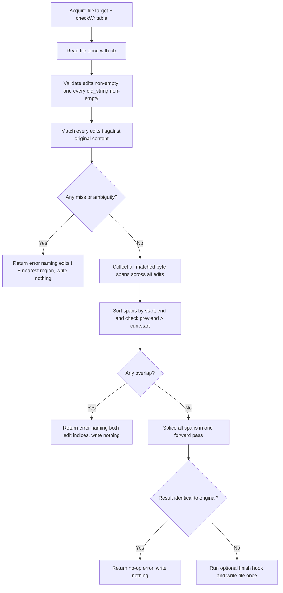

# Atomic Multi-Edit for `edit_file`

**Date:** 2026-11-21
**Status:** Ready for approval (builder check passed)

## Intent and Why

On Anthropic and Gemini sessions, Evener exposes `edit_file` for exact-text file mutations (OpenAI/Codex sessions use `apply_patch`). Today `edit_file` accepts only one `{file_path, old_string, new_string, replace_all}` replacement per call, and its description tells the model to "Keep each call small and focused." Changing three disjoint locations in one file takes three tool calls and three separate read/write cycles, with no atomicity if the third edit fails.

Comparing with `pi` (`@earendil-works/pi-coding-agent` 0.85.1) and Claude Code's former `MultiEdit` showed why `pi` is markedly more efficient at editing a file:

1. Its single edit tool takes an `edits[]` array only, so batching disjoint edits in one file is the default habit rather than an opt-in mode.
2. Its tool description and system prompt guidelines explicitly tell the model to batch disjoint changes in one file into one call and keep each target snippet small while unique.
3. Its pre-validation argument normalization heals off-distribution model outputs (top-level single-edit fields, bare edit objects, and stringified JSON arrays emitted by models like Opus 4.6 and GLM-5.1) instead of burning a turn on a schema error.
4. Every edit matches against the **original** file text, overlapping spans fail the whole call, and the file is written once atomically.

This design brings that efficiency and atomicity to Evener's `edit_file` (and `memory_edit`, which shares its schema and executor).

## Goals, Non-Goals, and Anti-Goals

### Goals
- Support atomic, all-or-nothing multi-edit on a single file in `edit_file` via an `edits[]`-only schema.
- Match every edit against the original file text and reject overlapping or nested spans cleanly before writing.
- Preserve per-edit `replace_all` support, Evener's whitespace-normalized fuzzy matching, and nearest-region failure diagnostics.
- Let `memory_edit` inherit atomic multi-edit through the shared `DefEditFile()` definition and executor.
- Heal off-distribution model tool calls (legacy top-level `old_string`/`new_string`, bare edit object, stringified JSON `edits`, nested aliases) in `agent/internal/tool/repair`.
- Update tool descriptions and system prompt guidance so models batch disjoint edits in one file by default.
- Render multi-edit diffs and summaries cleanly in `@evener/appwire-client`, web UI, mobile-native, and Go transcript rendering while continuing to render historical single-edit transcripts.

### Non-Goals
- Multi-file edits inside `edit_file`. Cross-file patching remains `apply_patch`'s job (and keeping `edit_file` single-file preserves sandbox escalation, `memory_edit` reuse, and web "open beside").
- Changing which providers expose `edit_file` vs `apply_patch` (`agent/provider/profile.go` stays unchanged).
- Adding BOM/CRLF line-ending rewriting beyond Evener's existing byte-preserving read/write behavior.
- Adding positional/occurrence-index matching for non-unique snippets.

### Anti-Goals
- **Partial writes on failure:** if any edit in `edits[]` is invalid, missing, ambiguous, or overlaps another edit, zero bytes change on disk (and `memory_edit`'s frontmatter stamp / index refresh does not run).
- **Ambiguous dual-mode schemas:** never expose both top-level `old_string`/`new_string` and `edits[]` in the advertised schema.
- **Silent non-atomic fallback:** if an `ExecutionEnvironment` does not support batch editing, a multi-edit call (`len(edits) > 1`) must error rather than loop over single-edit calls.

## Constraints

- **Provider schema compatibility:**
  - Anthropic strips root-level `oneOf`, `anyOf`, and `allOf` (`llm/providers/anthropic/emit.go`). The schema must be a single flat root object.
  - Gemini's Schema proto strips `additionalProperties` and `$`-prefixed metadata (`llm/providers/google/request.go`), and accepts `minItems` (already used by `DefAskUser`).
  - OpenAI strict mode (`llm/providers/internal/openaichat/strict.go`) falls back cleanly on optional properties (already the case for `DefEditFile` because `replace_all` is optional).
  - Every declared property, including nested `edits.items.properties`, must carry a `description` (`TestAllBuiltinParametersCarryDescriptions`).
- **Single-file invariants across Evener:**
  - `agent/session_escalation.go` (`escalatableTools`) only escalates single-file tools because human approval grants one leaf path.
  - `cmd/evener-hub/frontend/src/panes/session/transcript/tools/editTools.tsx` binds `openBesidePath: filePathArg`, which requires one file path per call.
  - `agent/session_tools_memory.go` binds `memory_edit` via `tool.MemoryDefinition(tool.DefEditFile(), "memory_edit")` and writes one page per call with a frontmatter `updated:` stamp.
- **Interface compatibility:** `execenv.ExecutionEnvironment` is implemented by over a dozen test doubles across `agent/`. Extending `execenv` via an optional capability interface (like `ContextualFileReader`, `GlobBudgeter`, `DirListBudgeter`, `FileMutator`) keeps existing doubles compiling.
- **Testing rules (`docs/developing-evener/testing.md`):** Tests assert behavior, never exact error-message phrasing or copy constants.
- **Compatibility rule:** Historical transcript rendering for saved `{file_path, old_string, new_string}` calls is preserved so existing transcripts remain readable. Runtime argument repair for top-level `{old_string, new_string}` is permanent off-distribution model-quirk healing in `agent/internal/tool/repair` (same class as `old_str` -> `old_string`), explicitly approved by Jesse as part of Approach A.

## Approaches Considered

| Approach | Summary | Tradeoffs |
| --- | --- | --- |
| **A. Pi-style `edits[]`-only on `edit_file` (Selected)** | Replace top-level `old_string`/`new_string`/`replace_all` in `DefEditFile()` with required `edits: [{old_string, new_string, replace_all?}]`. Heal legacy top-level calls, bare edit objects, and stringified `edits` in `agent/internal/tool/repair`. | Cleanest schema across Anthropic/Gemini/OpenAI; eliminates dual-mode schema errors (`pi` `#2639`); nudges models to batch by default; preserves single-file escalation, `memory_edit`, and "open beside". Costs ~10 extra tokens on single-edit calls and requires updating existing `edit_file` tool-call test fixtures. |
| **B. Dual-mode `edit_file`** | Keep top-level `old_string`/`new_string` alongside optional `edits[]`, making only `file_path` required in JSON Schema and enforcing mutual exclusivity in the handler. | Zero churn for single-edit calls, at the cost of the exact invalid-call failures `pi` hit before `#2639` (exacerbated by Anthropic stripping root `oneOf`/`anyOf`) and weaker nudging toward batching. |
| **C. Separate `multi_edit` tool** | Leave `edit_file` unchanged and add a second single-file `multi_edit` tool (Claude Code 1.x model). | Avoids schema churn on `edit_file`, at the cost of extra tool-catalog tokens, models splitting across two edit tools (why Claude Code 2.0 removed it), and wiring a second edit tool through hooks, escalation, memory, and both UIs. |

**Decision (Jesse):** Approach A with original-file, non-overlapping matching.

## Detailed Design

Design items agreed with Jesse are unmarked; design calls filled in by this spec are marked *(proposal / builder call)*.

### 1. Tool Schema and Description (`agent/internal/tool/definitions.go`)

Update `DefEditFile()` to:

```go
func DefEditFile() llm.ToolDefinition {
	return llm.ToolDefinition{
		Name: "edit_file",
		Description: "Edit an existing file using one or more exact string replacements applied atomically. " +
			"Always read the file first so you know the exact text to match. " +
			"When changing multiple separate locations in one file, batch them into a single call with multiple entries in edits instead of making separate calls. " +
			"Every edits[].old_string is matched against the original file (not incrementally) and must not overlap any other edit in the same call; merge nearby changes into one edit. " +
			"Keep each old_string as small as possible while still uniquely identifying its location in the file. " +
			"Set replace_all on an entry only for deliberate whole-file replacements such as a symbol rename. " +
			"If any edit fails to match, is ambiguous, or overlaps another edit, nothing is written.",
		Parameters: map[string]any{
			"type":                 "object",
			"additionalProperties": false,
			"properties": map[string]any{
				"file_path": map[string]any{
					"type":        "string",
					"description": "Path of the existing file to edit.",
				},
				"edits": map[string]any{
					"type":        "array",
					"minItems":    1,
					"description": "One or more targeted replacements to apply atomically to the file. Each edit is matched against the original file, not incrementally. Do not include overlapping or nested edits; merge nearby changes into one edit.",
					"items": map[string]any{
						"type":                 "object",
						"additionalProperties": false,
						"properties": map[string]any{
							"old_string": map[string]any{
								"type":        "string",
								"description": "Exact text from the original file to replace; must be non-empty, unique unless replace_all is true, and disjoint from all other edits in this call.",
							},
							"new_string": map[string]any{
								"type":        "string",
								"description": "The replacement text.",
							},
							"replace_all": map[string]any{
								"type":        "boolean",
								"description": "Replace every occurrence of old_string in the original file instead of requiring a unique match. Defaults to false.",
							},
						},
						"required": []string{"old_string", "new_string"},
					},
				},
			},
			"required": []string{"file_path", "edits"},
		},
	}
}
```

**`memory_edit` inheritance:** `tool.MemoryDefinition(tool.DefEditFile(), "memory_edit")` clones `DefEditFile()`, adds `scope` to `properties` and `required`, and rewrites `file_path`'s description. No structural change is needed in `MemoryDefinition`; `memory_edit` automatically gains `edits[]`.

### 2. System Prompt Guidance (`agent/prompts/system.md.tmpl`)

*(Proposal)* Under the tool usage section, add a short instruction gated on `{{ if .HasTool "edit_file" }}`:
- Batch multiple separate edits to the same file into one `edit_file` call via `edits` rather than issuing separate `edit_file` calls.
- Each `edits[].old_string` matches the original file; merge nearby edits into one entry rather than emitting overlapping edits.

Keep it to two short sentences so it matches the surrounding prose budget and does not duplicate the full tool description.

### 3. Argument Repair (`agent/internal/tool/repair/repair.go`)

`prepareToolCall` (`agent/session_tool_repair.go`) runs `repair.RepairArgs(t.Definition.Parameters, args, ...)` whenever `t.Schema.Validate(args)` fails, and records any applied `repair.Change` items on `EventToolCallRepaired`. Add schema-driven repair rules in `agent/internal/tool/repair` (so both `edit_file` and `memory_edit` benefit automatically without tool-name hardcoding):

1. **Stringified JSON arrays in `applyCoercions` (`case "array"`):**
   When a property has `"type": "array"`, its `items` schema declares `"type": "object"`, and the incoming value is a `string`:
   - Attempt `json.Unmarshal` of the string (bounded by existing argument limits).
   - If it decodes to `[]any`, replace with that slice (`ChangeCoerceType`, detail `"json_string→array"`).
   - If it decodes to `map[string]any`, wrap as `[]any{decoded}` (`ChangeCoerceType`, detail `"json_string→[object]"`).
   - If it is not valid JSON or decodes to neither array nor object, leave it untouched so schema validation reports the real type error (do **not** wrap a raw string into `[]any{raw}` when `items.type == "object"`).
   - If the incoming value is already a `map[string]any`, existing scalar-to-array coercion wraps it into `[]any{raw}`.
2. **Legacy top-level edit folding (`applyEditBatchFolding`, running before `dropUnknown` and before `applyCoercions` or composed with it):**
   When `params` declares `"edits"` as an array whose `items` declare `"old_string"` and `"new_string"`, AND `params` does **not** declare top-level `"old_string"` or `"new_string"`:
   - Only trigger when `args["edits"]` is absent (or `nil`). *(Proposal: if the model sent both `edits` and top-level `old_string`/`new_string`, do not silently merge them; let schema validation fail so a confused call never applies unintended duplicates.)*
   - Recognize top-level `old_string` (or alias `old_str`, `oldText`, `old_text`) and `new_string` (or alias `new_str`, `newText`, `new_text`), plus optional `replace_all` (or `replaceAll`).
   - Require at least one of the old/new pair to be present as a string (or both present; if only one is present, folding still lets schema validation report the missing sibling inside `edits[0]`, or require both `old` and `new` present as strings before folding; *(proposal: require both old and new keys present before folding, so random unknown keys never fabricate a partial `edits` entry)*).
   - Move those keys into `args["edits"] = []any{item}` and delete the top-level keys, recording a `repair.Change` (`ChangeAlias` or `ChangePromoteJSONObject` / new `ChangeFoldSingleEdit` on field `"edits"`).
3. **Nested item repair inside `edits[i]`:**
   Once `args["edits"]` is a `[]any`, walk each `map[string]any` element against `edits.items` (without mutating the caller's input map or slice):
   - Apply item-level aliases under the safe-apply rule (alias present, canonical absent, canonical declared on `items`, alias not declared):
     - `old_str`, `oldText`, `old_text` -> `old_string`
     - `new_str`, `newText`, `new_text` -> `new_string`
     - `replaceAll` -> `replace_all`
   - Apply scalar coercion on item properties (notably `replace_all`: `"true"`/`"false"` -> `bool`).
   - Drop unknown keys on item objects when `items.additionalProperties == false` (note: `dropEmptyOptionals` already recurses into array items; ensure `dropUnknown` handles item objects or leave unknown item keys for validation if unsafe, *(proposal: do not drop unknown keys inside `edits[i]` beyond resolved aliases, so a typo like `old_sting` fails loudly instead of being silently dropped)*).

**Non-mutation invariant:** `FuzzRepairArgs` enforces that `RepairArgs` never mutates its input `args` map (or nested slices/maps). Every nested edit repair must clone the slice and modified item maps before writing.

### 4. Multi-Edit Execution Engine (`agent/execenv`)

#### Types and Capability Interface (`agent/execenv/execenv.go`)

```go
// FileEdit is one exact-text replacement within a single-file batch edit.
type FileEdit struct {
	OldString  string
	NewString  string
	ReplaceAll bool
}

// BatchFileEditor is an optional execution-environment capability for applying
// multiple non-overlapping replacements to one file atomically in a single read
// and write. Separate from ExecutionEnvironment so existing test doubles remain
// unaffected.
type BatchFileEditor interface {
	EditFileBatchCtx(ctx context.Context, path string, edits []FileEdit) (string, error)
}
```

`LocalExecutionEnvironment` implements:
- `EditFileBatchCtx(ctx context.Context, path string, edits []FileEdit) (string, error)` -> calls `EditFileBatchWithCtx(ctx, path, edits, nil)`
- `EditFileBatchWithCtx(ctx context.Context, path string, edits []FileEdit, finish func(edited []byte) []byte) (string, error)`
- Existing `EditFileWithCtx(ctx, path, oldString, newString, replaceAll, finish)` delegates directly to `EditFileBatchWithCtx(ctx, path, []FileEdit{{OldString: oldString, NewString: newString, ReplaceAll: replaceAll}}, finish)` so there is one engine and zero duplicated matching/writing logic.

#### Atomic Matching and Splicing Algorithm (`agent/execenv/local_files.go`)



Walkthrough:
1. **Target & write preflight:** Call `e.fileTarget("edit_file", path, targetWrite)` and defer `t.release()`. Under sandbox (`t.sfs != nil`), run `t.sfs.checkWritable("edit_file", t.abs)` before reading or validating, so a non-writable path always returns a clean sandbox denial (enabling human escalation on containment denials) rather than a match error.
2. **Input guard:** Reject `len(edits) == 0`. Reject any entry with `edits[i].OldString == ""`, naming `edits[i]` when `len(edits) > 1`. *(Do this after `checkWritable` or before reading; checking empty `edits` / empty `old_string` before reading avoids unnecessary I/O while keeping `checkWritable` first so sandbox denials still take precedence.)*
3. **Single read:** Read file bytes once via `t.sfs.readFileCtx` (sandboxed) or `readFileCappedCtx` (unconfined). Let `s := string(b)`.
4. **Per-edit matching against original `s`:** For each `i, ed := range edits`:
   - Set `target := ed.OldString`.
   - Exact match check: `if !strings.Contains(s, target)`:
     - Try whitespace-normalized fuzzy fallback: `match := findFuzzyMatch(s, target)`.
     - If `match == ""`: fail immediately with a not-found error. Include `nearestFileRegion(s, ed.OldString)` when non-empty. When `len(edits) > 1`, prefix the error with `edits[i]` (0-based index) so the model knows exactly which item missed.
     - Otherwise set `target = match` and mark `usedFuzzy = true`.
     - *(Proposal on fuzzy uniqueness: `findFuzzyMatch` returns the verbatim substring of `s` for the first matching line or multi-line window. Check `strings.Count(s, target)` as today, AND also check whether a second distinct whitespace-normalized match exists in `s` when `!ed.ReplaceAll` so a fuzzy edit never silently picks the first of two ambiguous whitespace variants. See `findFuzzyMatch` enhancement note below.)*
   - Uniqueness check: if `!ed.ReplaceAll && strings.Count(s, target) != 1`: fail naming `edits[i]` (when `len(edits) > 1`), telling the model to provide more context or set `replace_all: true`.
   - Span collection:
     - If `!ed.ReplaceAll`: `idx := strings.Index(s, target)`; append span `{start: idx, end: idx + len(target), newString: ed.NewString, editIndex: i}`.
     - If `ed.ReplaceAll`: loop with `strings.Index(s[pos:], target)`, appending `{start: pos + idx, end: pos + idx + len(target), newString: ed.NewString, editIndex: i}` and advancing `pos = pos + idx + len(target)` until no more occurrences remain (matches `strings.ReplaceAll`'s exact non-overlapping occurrence set).
5. **Overlap detection across all spans:**
   - Sort all collected spans by `start` ascending, then `end` ascending (tie-breaking by `editIndex` ascending for determinism).
   - For `k := 1; k < len(spans); k++`:
     - If `spans[k-1].end > spans[k].start`: fail the whole call with an error naming `edits[spans[k-1].editIndex]` and `edits[spans[k].editIndex]` and instructing the model to merge overlapping or nearby edits into one entry.
     - Touching spans (`spans[k-1].end == spans[k].start`) are disjoint and allowed.
     - Duplicate edits targeting the same text automatically trigger overlap because `len(target) > 0` implies `spans[k-1].end > spans[k].start`.
6. **Single-pass splice:**
   - Build the edited string with a `strings.Builder` walking `spans` in sorted order: copy `s[cursor:sp.start]`, write `sp.newString`, set `cursor = sp.end`; after the loop copy `s[cursor:]`.
7. **No-op guard:** *(Proposal)*
   - If the spliced string equals `s` (zero bytes changed), return an error (`no changes made to <path>: replacements produced identical content`) without calling `finish` or writing to disk. Checking the spliced output rather than `old_string == new_string` up front still permits intentional whitespace normalization via fuzzy match while catching true no-ops.
8. **Finish hook & single write:**
   - Convert to `edited := []byte(out)`. If `finish != nil`, call `edited = finish(edited)`.
   - Write once through `t.sfs.writeFile("edit_file", t.abs, edited, 0o644)` or `afero.WriteFile(e.filesystem(), t.abs, edited, 0o644)`.
9. **Confirmation summary:**
   - Keep the existing phrasing for 1 edit: `edited <path>: <n> replacement[s][fuzzyNote]` (so single-edit confirmation shape stays unchanged).
   - For multiple edits (`len(edits) > 1`): `edited <path>: <totalSpans> replacement[s] across <len(edits)> edits[fuzzyNote]`.

#### Fuzzy Ambiguity Check (`agent/execenv/local_edit_match.go`) *(Proposal)*

Today `findFuzzyMatch(content, oldString)` returns on the first whitespace-normalized match. When `replace_all: false`, if a file has two lines `"  foo  bar"` and `"foo\tbar"` and the model passes `old_string: "foo bar"`, stopping on the first line silently edits the first occurrence instead of reporting ambiguity. Updating `findFuzzyMatch` (or adding a sibling `findFuzzyMatchUnique`) to scan for a second whitespace-normalized match and return `(match string, ambiguous bool)` makes fuzzy matching obey the same uniqueness invariant as exact matching, while keeping `EditFile` behavior unchanged when the fuzzy match is unique.

### 5. Session File and Memory Executors (`agent/session_tools_file.go`, `agent/session_tools_memory.go`)

- **Decoding `edits` (`parseFileEdits` in `agent/session_tools_file.go`):**
  - Extract `edits` from `args["edits"]` as `[]any`. Each element is a `map[string]any` with string `old_string`, string `new_string`, optional bool `replace_all` (default `false`).
  - Return a validation error if `edits` is missing, empty, or contains a malformed entry.
- **`execFileEdit` (`agent/session_tools_file.go`):**
  - Check `readGuard.ReadBeforeWriteWarning(path)` once for `file_path`.
  - If `env` implements `execenv.BatchFileEditor`, call `be.EditFileBatchCtx(ctx, path, edits)`.
  - Otherwise (minimal test double implementing only `ExecutionEnvironment` / `ContextualFileReader`):
    - If `len(edits) == 1`: call `ContextualFileReader.EditFileCtx` (or `env.EditFile`) with `edits[0]`.
    - If `len(edits) > 1`: return an error (`"edit_file: execution environment does not support multi-edit"`).
  - Prepend `warn` when `err == nil && warn != ""`.
- **`execMemoryEdit` (`agent/session_tools_memory.go`):**
  - `execOwnMemoryWrite` already passes `*execenv.LocalExecutionEnvironment` and the `stamp` finish callback.
  - Switch `execMemoryEdit` to call `execFileEditBatchWith(forwarded, s.fileReadGuard(env), func(path string, edits []execenv.FileEdit) (string, error) { return env.EditFileBatchWithCtx(ctx, path, edits, stamp) })`.
  - One read, one atomic multi-edit, one frontmatter `updated:` stamp, one write, one memory index update.
- **Hooks and sandbox escalation:**
  - `PreToolUse` / `PostToolUse` hooks receive the canonical post-repair JSON `{ "file_path": "...", "edits": [...] }` unchanged.
  - `session_escalation.go` keeps `"edit_file": true` in `escalatableTools` because `edit_file` remains strictly single-file.

### 6. Go Transcript Rendering and Checkpointing

- **`agent/transcript_render.go` (`case "edit_file"`):**
  - Read `edits` array when present:
    - 1 edit: preserve compact summary `path (replace <oldLen>→<newLen> chars[, all])`.
    - N > 1 edits: summarize total count and aggregate char delta, e.g. `path (<N> edits, replace <sumOld>→<sumNew> chars)`.
  - Fall back to legacy top-level `old_string`/`new_string`/`replace_all` when `edits` is absent (for historical transcripts).
- **`agent/internal/contextmgr/checkpoint.go`:**
  - Already reads only `args["file_path"]` for `case "edit_file"`. No change needed.

### 7. Shared TypeScript Client, Web UI, and Mobile (`appwire-client`, `cmd/evener-hub/frontend`, `mobile-native`)

#### Shared Helpers (`appwire-client/typescript/editDiff.ts`)

Add a shared edit-extraction and diff-synthesis API exported from `@evener/appwire-client`:

```ts
export interface EditOperation {
  readonly oldString: string;
  readonly newString: string;
  readonly replaceAll?: boolean;
}

// Extracts edit operations from edit_file / memory_edit arguments.
// Reads the current edits[] shape first; falls back to historical top-level
// old_string / new_string for archived transcripts. Returns null when neither
// shape is present (malformed call).
export function editOperationsOf(args: Record<string, unknown>): EditOperation[] | null;

// Synthesizes unified-style diff text for one or more edits to a single file.
// For a single edit, output is identical to editDiffText (no @@ header).
// For multiple edits, each edit is separated by an "@@ edit N @@" header so
// both web DiffBlock and mobile Diff render clear visual boundaries and
// diffStats counts added/removed lines across all edits.
export function editBatchDiffText(path: string, edits: readonly EditOperation[]): string;
```

Keep existing `editDiffText(path, oldString, newString)` exported so existing callers/tests do not break.

#### Summary and Body Consumers

All four consumers switch to `editOperationsOf(args)` + `editBatchDiffText(path, ops)`:

1. **`appwire-client/typescript/toolSummaries.ts` (`editFileWords`):**
   - Sums `+added -removed` across all edits via `diffResultText(editBatchDiffText(path, ops))`.
   - *(Proposal)* For `ops.length > 1`, include the edit count in the detail or keep the compact `Edited <path> · +A -R` format (or `Edited <path> · <N> edits, +A -R`). Keeping `Edited <path> · +A -R` (identical to `applyPatchWords`, which renders `Patched <files> · +A -R` regardless of hunk count) is consistent across all diff tools.
   - Falls back cleanly when `ops === null` (malformed args).
2. **`appwire-client/typescript/memorySteps.ts` (`memoryEditWords`):**
   - Uses `editOperationsOf(args)` + `editBatchDiffText(path, ops)`. When `ops === null`, omits diff detail (matching existing malformed-call guard).
3. **`cmd/evener-hub/frontend/src/panes/session/transcript/tools/bodies.tsx` (`EditFileBody`) and `memoryTools.tsx` (`MemoryEditBody`):**
   - `EditFileBody` extracts `ops = editOperationsOf(args)` and renders `<DiffBlock unified={editBatchDiffText(path, ops)} />` (when `ops === null`, falls back to empty `editDiffText(path, "", "")` or `null`, preserving existing `EditFileBody` behavior for malformed calls).
   - `MemoryEditBody` checks `editOperationsOf(args) === null` (instead of checking top-level `old_string`/`new_string` directly) before falling back to `defaultToolBody(props)`.
   - `openBesidePath: filePathArg` on `edit_file` stays unchanged.
4. **`mobile-native/src/session/evidence.ts` and `StepEvidence.tsx`:**
   - `evidence.ts` uses `editOperationsOf(args)` + `editBatchDiffText(path ?? "", ops)` for both `edit_file` and `memory_edit`.
   - `StepEvidence.tsx` (`diffLineStyle`) styles lines starting with `@@` with `{ color: palette.inkLow }` (same muted header style as `+++`/`---`), so multi-edit `@@ edit N @@` separators (and `apply_patch` hunk headers) read clearly on mobile.

### 8. Verification Plan

Follow `docs/developing-evener/testing.md` (behavior assertions, never phrasing assertions):

- **Go `execenv` tests (`agent/execenv`):**
  - Multi-edit disjoint replacements in one call (forward order, reverse file order, adjacent touching spans).
  - Atomicity: edit 0 matches, edit 1 misses (or is ambiguous, or empty `old_string`) -> error returned, file bytes unchanged, `finish` callback not called.
  - Overlap rejection: partial overlap, nested span, identical duplicate edits, and `replace_all: true` overlapping another edit -> error returned, file bytes unchanged.
  - `replace_all: true` combined with a disjoint targeted edit in the same call.
  - Whitespace-normalized fuzzy match in multi-edit + fuzzy ambiguity rejection when `!replace_all`.
  - No-op batch rejected without writing or calling `finish`.
  - Sandboxed (`NewConfinedFileEnvironment` / read-only / masked path) write-denial precedes read/match on multi-edit, and confined atomic write preserves all edits.
  - Update / extend `FuzzEditFile` (and add a multi-edit fuzz target or extend `FuzzEditFileDifferential`) to verify atomicity and MemMapFs/OsFs parity across batches.
- **Go repair & session tests (`agent/internal/tool`, `agent/internal/tool/repair`, `agent/`):**
  - `TestAllBuiltinParametersCarryDescriptions` and `TestDefEditFile` schema assertions.
  - Provider schema emission tests (Anthropic, Google, OpenAI strictness) confirm `DefEditFile()` emits cleanly on every provider.
  - `repair.RepairArgs` tests: top-level `{old_string, new_string, replace_all}` folded into `edits[0]`; top-level `{old_str, new_str}` folded; conflicting top-level + `edits` NOT silently merged; stringified JSON array `edits` decoded; stringified JSON single object `edits` decoded and wrapped; bare object `edits` wrapped; non-JSON string `edits` NOT wrapped into `[string]`; nested aliases (`old_str`, `new_str`, `oldText`, `newText`, `replaceAll`) and boolean string coercion (`"true"` -> `true`); non-mutation of input map/slices.
  - `agent` session tests: `edit_file` multi-edit end-to-end, `memory_edit` multi-edit updating frontmatter once, single-edit fallback on minimal `ExecutionEnvironment` fake, explicit error on multi-edit against a fake without `BatchFileEditor`, `readGuard` warning emitted once, update existing test fixtures that send raw `edit_file` calls directly to `Registry.ExecuteCall`.
- **TypeScript tests (`appwire-client/typescript`, `cmd/evener-hub/frontend`, `mobile-native`):**
  - `editOperationsOf` and `editBatchDiffText` unit tests covering single `edits[]`, multi `edits[]`, legacy top-level `{old_string, new_string}`, and malformed inputs.
  - `editFileSummary`, `memoryEditWords`, `EditFileBody`, `MemoryEditBody`, `evidence.ts`, and `StepEvidence.tsx` tests covering both new `edits[]` and historical top-level transcripts.
  - Gates: `make test-api-package`, `make test-web`, `make test-native` (or targeted vitest + `tsc` + Biome per repo workflow).

### 9. Left to the Builder

- Exact wording of error messages (must identify the failing `edits[i]` index, both indices on overlap, and include `nearestFileRegion` on misses; tests assert behavior, not phrasing).
- Exact `repair.ChangeKind` value for top-level single-edit folding (reusing an existing kind like `ChangeAlias` or adding a dedicated constant).
- Whether `edit_file` summary detail on multi-edit says `Edited a.ts · +4 -3` or includes an edit count, as long as web and mobile share `@evener/appwire-client`'s single formatter.
- Helper decomposition inside `agent/execenv/local_files.go` and `agent/internal/tool/repair/repair.go`.
- Updating existing Go/TS tests whose hardcoded `edit_file` arguments bypass `prepareToolCall` (direct `Registry.ExecuteCall` callers).
