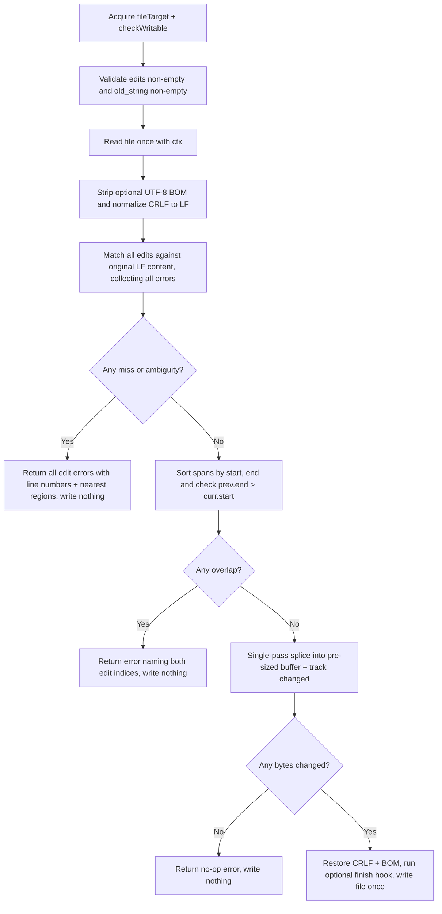

# Atomic Multi-Edit for `edit_file`

**Date:** 2026-11-21
**Status:** Ready for design review and approval

## Intent and Why

On Anthropic and Gemini sessions, Evener exposes `edit_file` for exact-text file mutations (OpenAI/Codex sessions use `apply_patch`). Today `edit_file` accepts only one `{file_path, old_string, new_string, replace_all}` replacement per call, and its description tells the model to "Keep each call small and focused." Changing three disjoint locations in one file takes three tool calls and three separate read/write cycles, with no atomicity if the third edit fails.

An audit of `pi` (`@earendil-works/pi-coding-agent` 0.85.1), Claude Code (`Edit` / former `MultiEdit`), OpenCode (`anomalyco/opencode`), Gemini CLI, Cline, Roo Code, Goose, Sourcegraph Amp, Cursor, and 2025-2026 harness postmortems surfaced five concrete design lessons:

1. **One `edits[]`-only tool beats dual-mode schemas (`pi` `#2639`):** exposing both top-level `old_string`/`new_string` and `edits[]` produces frequent invalid calls, and Anthropic strips root-level `oneOf`/`anyOf`/`allOf`. Making `edits[]` the sole schema makes batching disjoint changes in one file the model's default habit.
2. **RL priors require schema-generic argument healing (Armin Ronacher, July 2026):** frontier models heavily RL-trained on Claude Code's `str_replace` sometimes send top-level `old_string`/`new_string`, stringify `edits` as a JSON string (Opus 4.6, GLM-5.1), wrap a bare edit object, or append invented trailing keys inside `edits[]` (`type`, `unique`, `notes`) even when `old_string`/`new_string` are byte-correct. Keeping Claude/Gemini field names (`file_path`, `old_string`, `new_string`, `replace_all`) and healing those shapes in `agent/internal/tool/repair` eliminates retry loops without loosening execution semantics.
3. **Byte-faithful CRLF and BOM handling:** LLMs always emit LF (`\n`) and never emit a UTF-8 BOM, and Evener's `read_file` already strips `\r` from CRLF lines (`agent/execenv/local_files.go:296`). Matching in LF space after stripping an optional leading BOM and restoring original line endings and BOM on write prevents silent CRLF corruption and exact-match failures.
4. **Tight fuzzy matching beats deep fallback ladders (OpenCode `#32559`, `#44996`):** deep Levenshtein/block-anchor cascades silently bind to the wrong block in repetitive code and contradict exact-match error copy. Evener's whitespace-normalized fallback stays narrow and safe when paired with a uniqueness check and truthful error reporting.
5. **Errors are recovery prompts, and tool descriptions stay concise (OpenCode `edit.txt`, Amp, `pi`):** collecting all edit misses/ambiguities in one pass, naming 1-based line numbers for duplicate hits and nearest regions, telling the model never to copy `read_file`'s line-number prefix (`12\t`), and stating rules once without repetition cuts retry turns and per-turn schema tokens.

This design brings atomic single-file multi-edit, clean repair, CRLF/BOM fidelity, and actionable diagnostics to Evener's `edit_file` (and `memory_edit`, which shares `DefEditFile()` and the same executor).

## Goals, Non-Goals, and Anti-Goals

### Goals
- Support atomic, all-or-nothing multi-edit on a single file in `edit_file` via an `edits[]`-only schema.
- Match every edit against the original file text and reject overlapping or nested spans cleanly before writing.
- Preserve per-edit `replace_all`, Evener's whitespace-normalized fuzzy matching (with uniqueness checking), CRLF/BOM preservation, and nearest-region failure diagnostics with line numbers.
- Let `memory_edit` inherit atomic multi-edit automatically through the shared `DefEditFile()` definition and `execFileEditWith`.
- Generalize `agent/internal/tool/repair` to handle nested object/array aliasing, coercion, unknown-key stripping, stringified JSON arrays, and single-item array promotion without hardcoding `edit_file` field names.
- Tighten the `edit_file` tool description and add a one-line batching nudge in `agent/prompts/system.md.tmpl`.
- Render multi-edit diffs and summaries cleanly in `@evener/appwire-client`, web UI, mobile-native, and Go transcript rendering while continuing to render historical single-edit transcripts.

### Non-Goals
- Multi-file edits inside `edit_file`. Cross-file patching remains `apply_patch`'s job (keeping `edit_file` single-file preserves sandbox escalation, `memory_edit` reuse, and web "open beside").
- Changing which providers expose `edit_file` vs `apply_patch` (`agent/provider/profile.go` stays unchanged).
- Hash-anchored editing (`hashline`) or changing `read_file`'s wire format (noted separately as a potential future direction for non-Claude/non-OpenAI models).
- Positional/occurrence-index matching or deep Levenshtein fuzzy cascades.

### Anti-Goals
- **Partial writes on failure:** if any edit in `edits[]` is invalid, missing, ambiguous, or overlaps another edit, zero bytes change on disk (and `memory_edit`'s frontmatter stamp and index refresh do not run).
- **Ambiguous dual-mode schemas:** never expose both top-level `old_string`/`new_string` and `edits[]` in the advertised schema.
- **Silent non-atomic fallback:** if an `ExecutionEnvironment` does not support batch editing, a multi-edit call (`len(edits) > 1`) must error rather than loop over single-edit calls.
- **Misleading error copy:** never tell the model "must match exact whitespace" when whitespace-normalized fuzzy matching also ran.

## Constraints

- **Provider schema compatibility:**
  - Anthropic strips root-level `oneOf`, `anyOf`, and `allOf` (`llm/providers/anthropic/emit.go`). The schema must be a single flat root object.
  - Gemini's Schema proto strips `additionalProperties` and `$`-prefixed metadata (`llm/providers/google/request.go`), and accepts `minItems` (already used by `DefAskUser`).
  - OpenAI strict mode (`llm/providers/internal/openaichat/strict.go`) falls back cleanly on optional properties (already the case for `DefEditFile` because `replace_all` is optional).
  - Every declared property, including nested `edits.items.properties`, must carry a `description` (`TestAllBuiltinParametersCarryDescriptions`).
- **Single-file invariants across Evener:**
  - `agent/session_escalation.go` (`escalatableTools`) only escalates single-file tools because human approval grants one leaf path.
  - `cmd/evener-hub/frontend/src/panes/session/transcript/tools/editTools.tsx` binds `openBesidePath: filePathArg`, which requires one file path per call.
  - `agent/session_tools_memory.go` binds `memory_edit` via `tool.MemoryDefinition(tool.DefEditFile(), "memory_edit")` and writes one page per call with a frontmatter `updated:` stamp.
- **Interface compatibility:** `execenv.ExecutionEnvironment` is implemented by over a dozen test doubles across `agent/`. Extending `execenv` via an optional capability interface (matching `ContextualFileReader`, `GlobBudgeter`, `DirListBudgeter`, `FileMutator`) keeps existing doubles compiling.
- **Testing rules (`docs/developing-evener/testing.md`):** Tests assert behavior, never exact error-message phrasing or copy constants.
- **Compatibility rule:** Historical transcript rendering for saved `{file_path, old_string, new_string}` calls is preserved so existing transcripts remain readable. Runtime argument repair for top-level `{old_string, new_string}` is permanent off-distribution model-quirk healing in `agent/internal/tool/repair` (same class as `old_str` -> `old_string`), approved by Jesse as part of Approach A.

## Approaches Considered

| Approach | Summary | Tradeoffs |
| --- | --- | --- |
| **A. Pi-style `edits[]`-only on `edit_file` (Selected)** | Replace top-level `old_string`/`new_string`/`replace_all` in `DefEditFile()` with required `edits: [{old_string, new_string, replace_all?}]`. Heal off-distribution shapes in `agent/internal/tool/repair`. | Cleanest schema across Anthropic/Gemini/OpenAI; eliminates dual-mode schema errors (`pi` `#2639`); nudges models to batch by default; preserves single-file escalation, `memory_edit`, and "open beside". Costs ~10 extra tokens on single-edit calls and updates existing raw `edit_file` test fixtures. |
| **B. Dual-mode `edit_file`** | Keep top-level `old_string`/`new_string` alongside optional `edits[]`, making only `file_path` required in JSON Schema and enforcing mutual exclusivity in the handler. | Zero churn for single-edit calls, at the cost of the invalid-call failures `pi` removed in `#2639` (exacerbated by Anthropic stripping root `oneOf`/`anyOf`) and weaker nudging toward batching. |
| **C. Separate `multi_edit` tool** | Leave `edit_file` unchanged and add a second single-file `multi_edit` tool (Claude Code 1.x model). | Avoids schema churn on `edit_file`, at the cost of extra tool-catalog tokens, models splitting across two edit tools (why Claude Code 2.0 removed it), and wiring a second edit tool through hooks, escalation, memory, and both UIs. |

**Decision (Jesse):** Approach A with original-file, non-overlapping matching.

## Detailed Design

Design items agreed with Jesse are unmarked; design calls filled in by this spec are marked *(proposal)*.

### 1. Tool Schema and Description (`agent/internal/tool/definitions.go`)

State the behavioral rules **once** in `DefEditFile.Description` and keep each property description to one short clause (since `memory_edit` clones `DefEditFile()`, avoiding repetition saves ~120-160 tokens per turn across both tools):

```go
func DefEditFile() llm.ToolDefinition {
	return llm.ToolDefinition{
		Name: "edit_file",
		Description: "Apply one or more exact replacements to an existing file atomically. " +
			"Read the file first and never copy read_file line-number prefixes (like '12\\t') into old_string or new_string. " +
			"Batch disjoint changes in the same file into one call via edits rather than separate calls. " +
			"Every edits[].old_string matches the original file (not after earlier edits) and must not overlap any other edit; merge nearby changes into one entry. " +
			"Keep each old_string as small as possible while unique, and use write_file when replacing most or all of a file. " +
			"If any edit fails to match, is ambiguous, or overlaps another edit, nothing is written.",
		Parameters: map[string]any{
			"type":                 "object",
			"additionalProperties": false,
			"properties": map[string]any{
				"file_path": map[string]any{
					"type":        "string",
					"description": "Path of the existing file to edit.",
				},
				"edits": map[string]any{
					"type":        "array",
					"minItems":    1,
					"description": "Disjoint replacements matched against the original file and applied atomically.",
					"items": map[string]any{
						"type":                 "object",
						"additionalProperties": false,
						"properties": map[string]any{
							"old_string": map[string]any{
								"type":        "string",
								"description": "Non-empty exact text from the original file to replace (unique unless replace_all is true).",
							},
							"new_string": map[string]any{
								"type":        "string",
								"description": "Replacement text.",
							},
							"replace_all": map[string]any{
								"type":        "boolean",
								"description": "Replace every occurrence in the original file instead of requiring a unique match (default false).",
							},
						},
						"required": []string{"old_string", "new_string"},
					},
				},
			},
			"required": []string{"file_path", "edits"},
		},
	}
}
```

**`memory_edit` inheritance:** `tool.MemoryDefinition(tool.DefEditFile(), "memory_edit")` clones `DefEditFile()`, adds `scope` to `properties` and `required`, and updates `file_path`'s description. No structural change is needed in `MemoryDefinition`; `memory_edit` automatically gains `edits[]`.

### 2. System Prompt Guidance (`agent/prompts/system.md.tmpl`)

*(Proposal)* Under `## Tool usage`, add a single sentence gated on `{{ if .HasTool "edit_file" }}`:

> When making multiple separate edits to the same file, batch them into one `edit_file` call via `edits` instead of issuing separate calls.

All detailed matching, overlap, and line-prefix rules stay in `DefEditFile.Description` alone so they are never duplicated.

### 3. Schema-Generic Argument Repair (`agent/internal/tool/repair/repair.go`)

`prepareToolCall` (`agent/session_tool_repair.go`) runs `repair.RepairArgs(t.Definition.Parameters, args, ...)` whenever `t.Schema.Validate(args)` fails, and records applied `repair.Change` items on `EventToolCallRepaired`. Instead of adding `edit_file`-specific walkers to the leaf `repair` package, generalize the existing schema-driven passes in `repair.go` (mirroring how `dropEmptyOptionalsWithin` at `repair.go:443` already recurses into nested objects and array items):

1. **Extend `aliasTable` (`repair.go:46`):**
   Add `oldText` -> `old_string`, `old_text` -> `old_string`, `newText` -> `new_string`, `new_text` -> `new_string`, `replaceAll` -> `replace_all` alongside the existing `old_str` -> `old_string`, `new_str` -> `new_string` entries. The safe-apply rule (rename only when canonical is declared on the active object schema, alias is not declared, alias is present, canonical is absent) prevents collisions on unrelated tools.
2. **Schema-generic single-item array promotion (before recursive alias/coercion/drop-unknown):**
   When an object schema declares a required property `K` with `"type": "array"` whose `items` is an object schema with a non-empty `required` list, and `args[K]` is absent or `nil`:
   - Inspect top-level keys of `args` that are **not** declared on the root object schema.
   - Map each such key to a property of `K.items` (directly or via `aliasTable`, respecting the safe-apply rule).
   - If the matched keys cover every key in `K.items.required`, move those matched unknown keys into `args[K] = []any{item}` and delete them from the root `args`, recording a `repair.Change` on field `K`.
   - When `args[K]` is already present and non-nil, promotion does **not** run, so a confused call carrying both `edits` and top-level `old_string`/`new_string` fails validation cleanly instead of silently merging duplicates.
   - Works identically for both `edit_file` and `memory_edit` (and any future required array-of-objects tool) with zero hardcoded tool or field names.
3. **Stringified JSON arrays in `applyCoercions` (`case "array"`):**
   When a property has `"type": "array"`, its `items` schema declares `"type": "object"`, and the incoming value is a `string`:
   - Attempt `json.Unmarshal` of the string (bounded by the existing argument size/depth limits).
   - If it decodes to `[]any`, replace with that slice (`ChangeCoerceType`, detail `"json_string→array"`).
   - If it decodes to `map[string]any`, wrap as `[]any{decoded}` (`ChangeCoerceType`, detail `"json_string→[object]"`).
   - If it is not valid JSON or decodes to neither array nor object, leave it untouched so schema validation reports the real type error (never wrap a plain string into `[]any{raw}` when `items.type == "object"`).
   - If the incoming value is already a `map[string]any`, existing scalar-to-array coercion wraps it into `[]any{raw}`.
4. **Recursive `applyAliases`, `applyCoercions`, and `dropUnknown` into nested object/array items:**
   - Recurse `applyAliases` and `applyCoercions` into nested `type: "object"` properties and `type: "array"` elements whose `items` is `type: "object"`, prefixing `Change.Field` with `edits[i].` (same copy-on-write cloning pattern as `dropEmptyOptionalsWithin`). This automatically heals nested `old_str`/`oldText`/`new_str`/`newText`/`replaceAll` aliases and `replace_all: "true"` boolean strings.
   - Recurse `dropUnknown` into nested object items when `items.additionalProperties == false` (running *after* recursive `applyAliases` and `applyCoercions`). This directly neutralizes the Claude Opus 4.8 / Sonnet 5 failure mode documented in July 2026 where models emit byte-correct `old_string`/`new_string` alongside invented trailing keys (`type`, `unique`, `notes`) inside `edits[]`, while still failing loudly if a typo like `old_sting` leaves required `old_string` missing.

**Non-mutation invariant:** `FuzzRepairArgs` enforces that `RepairArgs` never mutates its input `args` map or nested slices/maps. Every recursive pass clones slices and modified item maps on write.

### 4. Multi-Edit Execution Engine (`agent/execenv`)

#### Types and Capability Interface (`agent/execenv/execenv.go`)

```go
// FileEdit is one exact-text replacement within a single-file batch edit.
type FileEdit struct {
	OldString  string
	NewString  string
	ReplaceAll bool
}

// BatchFileEditor is an optional execution-environment capability for applying
// multiple non-overlapping replacements to one file atomically in a single read
// and write. Separate from ExecutionEnvironment so existing test doubles remain
// unaffected.
type BatchFileEditor interface {
	EditFileBatchCtx(ctx context.Context, path string, edits []FileEdit) (string, error)
}
```

`LocalExecutionEnvironment` implements:
- `EditFileBatchCtx(ctx context.Context, path string, edits []FileEdit) (string, error)` -> calls `EditFileBatchWithCtx(ctx, path, edits, nil)`
- `EditFileBatchWithCtx(ctx context.Context, path string, edits []FileEdit, finish func(edited []byte) []byte) (string, error)`
- Existing `EditFileWithCtx(ctx, path, oldString, newString, replaceAll, finish)` delegates directly to `EditFileBatchWithCtx(ctx, path, []FileEdit{{OldString: oldString, NewString: newString, ReplaceAll: replaceAll}}, finish)` so there is one engine and zero duplicated matching/writing logic.

#### Atomic Matching and Splicing Algorithm (`agent/execenv/local_files.go`)



Walkthrough:
1. **Target & write preflight:** Call `e.fileTarget("edit_file", path, targetWrite)` and defer `t.release()`. Under sandbox (`t.sfs != nil`), run `t.sfs.checkWritable("edit_file", t.abs)` first so a non-writable path always returns a clean sandbox denial (enabling human escalation on containment denials) rather than an input or match error.
2. **Input guard:** Reject `len(edits) == 0`. Reject any entry with `edits[i].OldString == ""`, collecting all empty-`old_string` errors (naming `edits[i]` when `len(edits) > 1`) before doing file I/O.
3. **Single read + BOM/CRLF normalization *(proposal)*:** Read file bytes once via `t.sfs.readFileCtx` (sandboxed) or `readFileCappedCtx` (unconfined).
   - Detect and strip a leading UTF-8 BOM (`\xEF\xBB\xBF`) so an invisible BOM never breaks an edit touching line 1.
   - Detect whether the file uses CRLF (`\r\n` appears before the first `\n`). When CRLF, normalize `\r\n` -> `\n` on the file content and on each `ed.OldString` / `ed.NewString` for matching, then restore `\r\n` on the spliced output before writing. (Pure LF files skip both conversions with zero extra allocation.)
4. **Match ALL edits against original LF content `s` (single-scan per edit, collect all errors):**
   For each `i, ed := range edits`:
   - Let `target := oldLF`.
   - Call `idx := strings.Index(s, target)` **once**.
   - **Exact-match path (`idx >= 0`):**
     - If `!ed.ReplaceAll`: check `second := strings.Index(s[idx+len(target):], target)`. If `second >= 0`, record an ambiguity error for `edits[i]` listing the 1-based line numbers of the occurrences (capped at e.g. 10 line numbers) and continue validating remaining edits. Otherwise append span `{start: idx, end: idx + len(target), newString: newLF, editIndex: i}`.
     - If `ed.ReplaceAll`: append the first span at `idx`, then continue scanning from `pos := idx + len(target)` with `strings.Index(s[pos:], target)` until no more occurrences remain (matches `strings.ReplaceAll`'s non-overlapping occurrence set).
   - **Fuzzy fallback (`idx < 0`):**
     - Call `match, ambiguous := findFuzzyMatch(s, target, !ed.ReplaceAll)` (`checkUnique := !ed.ReplaceAll` so `replace_all: true` stops on the first match without scanning to EOF, and `!ed.ReplaceAll` verifies uniqueness in one pass without a second `strings.Count` scan).
     - If `ambiguous`: record an ambiguity error for `edits[i]` (noting multiple whitespace-normalized matches and advising more context or `replace_all: true`) and continue.
     - If `match == ""`: record a not-found error for `edits[i]`, truthfully stating that exact and whitespace-normalized matching ran and attaching `nearestFileRegion(s, target)` with 1-based line numbers (capping nearest-region snippets to the first 3 missed edits to keep error size bounded), then continue.
     - Otherwise mark `usedFuzzy = true` and collect span(s) for `match` in `s` (`strings.Index` for single, loop for `replace_all`).
   - If any errors were collected across `edits`, return them joined together without writing anything to disk.
5. **Overlap detection across all collected spans:**
   - Sort `spans` by `start` ascending, then `end` ascending, then `editIndex` ascending.
   - For `k := 1; k < len(spans); k++`:
     - If `spans[k-1].end > spans[k].start`: fail the whole call naming `edits[spans[k-1].editIndex]` and `edits[spans[k].editIndex]` and instructing the model to merge overlapping or nearby edits into one entry.
     - Adjacent touching spans (`spans[k-1].end == spans[k].start`) are disjoint and allowed.
     - Identical duplicate edits automatically fail overlap because `len(target) > 0` guarantees `spans[k-1].end > spans[k].start`.
6. **Single-pass pre-sized splice & no-op guard:**
   - Compute exact output byte length: `outLen := len(s) + sum(len(sp.newString) - (sp.end - sp.start))`.
   - Allocate `edited := make([]byte, 0, outLen)` once; walk sorted `spans`, appending `s[cursor:sp.start]` and `sp.newString`, setting `changed = changed || s[sp.start:sp.end] != sp.newString`, and recording the 1-based starting line number of each changed span for the confirmation summary.
   - If `!changed`: return a no-op error without calling `finish` or writing to disk. (Checking `changed` after fuzzy matching still permits intentional whitespace cleanup while rejecting true no-ops.)
7. **Restore line endings & BOM, run `finish`, write once:**
   - If the original file used CRLF, restore `\n` -> `\r\n`; if it had a leading UTF-8 BOM, prepend it.
   - If `finish != nil`, call `edited = finish(edited)`.
   - Write once through `t.sfs.writeFile("edit_file", t.abs, edited, 0o644)` or `afero.WriteFile(e.filesystem(), t.abs, edited, 0o644)`.
8. **Confirmation summary:**
   - Single edit (`len(edits) == 1`): `edited <path>: <n> replacement[s][fuzzyNote]` (preserves existing single-edit summary shape).
   - Multiple edits (`len(edits) > 1`): `edited <path>: <totalSpans> replacement[s] across <len(edits)> edits[fuzzyNote]`.

#### Fuzzy Uniqueness (`agent/execenv/local_edit_match.go`) *(Proposal)*

Add `checkUnique bool` to `findFuzzyMatch(content, oldString string, checkUnique bool) (match string, ambiguous bool)`. When `checkUnique` is `true`, keep scanning lines (or multi-line windows) after the first normalized hit and return `("", true)` immediately upon seeing a second match; when `false` (`replace_all: true`), return on the first match as today. This is ~10 lines inside the existing streaming `eachLine` scan, eliminates redundant `strings.Count` on the fuzzy path, and closes the silent wrong-location fuzzy edit failure mode documented in OpenCode `#32559`. Also include the 1-based starting line number in `nearestFileRegion` output so a missed edit tells the model where in the file the nearest region sits.

### 5. Session File and Memory Executors (`agent/session_tools_file.go`, `agent/session_tools_memory.go`)

- **Decode `edits` (`parseFileEdits` in `agent/session_tools_file.go`):**
  - Extract `args["edits"]` as `[]any`, decoding each `map[string]any` into `execenv.FileEdit{OldString, NewString, ReplaceAll}`. Return a validation error if `edits` is missing, empty, or contains a malformed element.
- **Update `execFileEditWith` in place (`agent/session_tools_file.go`):**
  - `execFileEditWith` is unexported and has only two callers (`execFileEdit` and `execMemoryEdit`). Update its signature in place to take `edit func(path string, edits []execenv.FileEdit) (string, error)` instead of creating a parallel `execFileEditBatchWith`.
  - Check `readGuard.ReadBeforeWriteWarning(path)` once for `file_path`, and prepend `warn` when `err == nil && warn != ""`.
- **`execFileEdit` fallback (`agent/session_tools_file.go`):**
  - If `env` implements `execenv.BatchFileEditor`, call `be.EditFileBatchCtx(ctx, path, edits)`.
  - Otherwise (minimal test double implementing only `ExecutionEnvironment` / `ContextualFileReader`):
    - If `len(edits) == 1`: call `ContextualFileReader.EditFileCtx` (or `env.EditFile`) with `edits[0]`.
    - If `len(edits) > 1`: return an error (`"edit_file: execution environment does not support multi-edit"`).
- **`execMemoryEdit` (`agent/session_tools_memory.go`):**
  - `execOwnMemoryWrite` already passes `*execenv.LocalExecutionEnvironment` and `stamp`. Call updated `execFileEditWith` delegating to `env.EditFileBatchWithCtx(ctx, path, edits, stamp)`.
  - One read, one atomic multi-edit, one frontmatter `updated:` stamp, one write, one memory index update.
- **Hooks and sandbox escalation:**
  - `PreToolUse` / `PostToolUse` hooks receive the canonical post-repair JSON `{ "file_path": "...", "edits": [...] }` unchanged.
  - `session_escalation.go` keeps `"edit_file": true` in `escalatableTools` because `edit_file` remains strictly single-file.

### 6. Go Transcript Rendering and Checkpointing

- **`agent/transcript_render.go` (`case "edit_file"`):**
  - Read `edits` array when present:
    - 1 edit: preserve compact summary `path (replace <oldLen>→<newLen> chars[, all])`.
    - N > 1 edits: summarize edit count and aggregate char delta, e.g. `path (<N> edits, replace <sumOld>→<sumNew> chars)`.
  - Fall back to legacy top-level `old_string`/`new_string`/`replace_all` when `edits` is absent (for historical transcripts).
- **`agent/internal/contextmgr/checkpoint.go`:**
  - Already reads only `args["file_path"]` for `case "edit_file"`. No change needed.

### 7. Shared TypeScript Client, Web UI, and Mobile (`appwire-client`, `cmd/evener-hub/frontend`, `mobile-native`)

#### Shared Helpers (`appwire-client/typescript/editDiff.ts`)

Add one shared edit-extraction and diff-synthesis path exported from `@evener/appwire-client`:

```ts
export interface EditOperation {
  readonly oldString: string;
  readonly newString: string;
  readonly replaceAll?: boolean;
}

// Extracts edit operations from edit_file / memory_edit arguments.
// Reads the current edits[] shape first; falls back to historical top-level
// old_string / new_string for archived transcripts. Returns null when neither
// shape is present (malformed call).
export function editOperationsOf(args: Record<string, unknown>): EditOperation[] | null;

// Single diff-synthesis implementation for one or more edits to a single file.
// For a single edit, output is identical to editDiffText (no @@ header).
// For multiple edits, each edit is separated by an "@@ edit N @@" header so
// both web DiffBlock and mobile Diff render clear visual boundaries and
// diffStats counts added/removed lines across all edits.
export function editBatchDiffText(path: string, edits: readonly EditOperation[]): string;
```

Reduce existing `editDiffText(path, oldString, newString)` to a one-line wrapper: `return editBatchDiffText(path, [{ oldString, newString }]);` so there is one formatting implementation across the repo.

#### Summary and Body Consumers

All four consumers switch to `editOperationsOf(args)` + `editBatchDiffText(path, ops)`:

1. **`appwire-client/typescript/toolSummaries.ts` (`editFileWords`):**
   - Sums `+added -removed` across all edits via `diffResultText(editBatchDiffText(path, ops))`, rendering `Edited <path> · +A -R` (consistent with `applyPatchWords`, which renders `Patched <files> · +A -R`). Omits diff detail when `ops === null`.
2. **`appwire-client/typescript/memorySteps.ts` (`memoryEditWords`):**
   - Uses `editOperationsOf(args)` + `editBatchDiffText(path, ops)`. When `ops === null`, omits diff detail (matching existing malformed-call guard).
3. **`cmd/evener-hub/frontend/src/panes/session/transcript/tools/bodies.tsx` (`EditFileBody`) and `memoryTools.tsx` (`MemoryEditBody`):**
   - `EditFileBody` extracts `ops = editOperationsOf(args)`. When `ops === null`, returns `null` (matching `ApplyPatchBody`); otherwise renders `<DiffBlock unified={editBatchDiffText(path, ops)} />`.
   - `MemoryEditBody` checks `editOperationsOf(args) === null` before falling back to `defaultToolBody(props)`.
   - `openBesidePath: filePathArg` on `edit_file` stays unchanged.
4. **`mobile-native/src/session/evidence.ts` and `StepEvidence.tsx`:**
   - `evidence.ts` uses `editOperationsOf(args)` + `editBatchDiffText(path ?? "", ops)` for both `edit_file` and `memory_edit`.
   - `StepEvidence.tsx` (`diffLineStyle`) styles lines starting with `@@` with `{ color: palette.inkLow }` (same muted header style as `+++`/`---`), so multi-edit `@@ edit N @@` separators (and `apply_patch` hunk headers) read clearly on mobile.

### 8. Verification Plan

Follow `docs/developing-evener/testing.md` (behavior assertions, never phrasing assertions):

- **Go `execenv` tests (`agent/execenv`):**
  - Multi-edit disjoint replacements in one call (forward order, reverse file order, adjacent touching spans).
  - Atomicity: edit 0 matches, edit 1 misses (or is ambiguous, or empty `old_string`) -> error returned naming every failing edit, file bytes unchanged, `finish` callback not called.
  - Multi-error collection: two missing edits in one batch report both failures in a single error; `nearestFileRegion` snippets cap at 3 and include line numbers.
  - Overlap rejection: partial overlap, nested span, identical duplicate edits, and `replace_all: true` overlapping another edit -> error returned naming both edit indices, file bytes unchanged.
  - `replace_all: true` combined with a disjoint targeted edit in the same call.
  - CRLF + UTF-8 BOM preservation across single and multi-edit calls (exact match succeeds with LF `old_string`, file retains `\r\n` and BOM).
  - Whitespace-normalized fuzzy match in multi-edit + fuzzy ambiguity rejection when `!replace_all`.
  - No-op batch rejected without writing or calling `finish`, while fuzzy whitespace-cleanup edit (`old_string == new_string` matching differently indented file text) succeeds.
  - Sandboxed (`NewConfinedFileEnvironment` / read-only / masked path) write-denial precedes read/match on multi-edit, and confined atomic write preserves all edits.
  - Update / extend `FuzzEditFile` (and `FuzzEditFileDifferential`) to verify atomicity and MemMapFs/OsFs parity across batches.
- **Go repair & session tests (`agent/internal/tool`, `agent/internal/tool/repair`, `agent/`):**
  - `TestAllBuiltinParametersCarryDescriptions` and `TestDefEditFile` schema assertions.
  - Provider schema emission tests (Anthropic, Google, OpenAI) confirm `DefEditFile()` emits cleanly on every provider.
  - `repair.RepairArgs` tests: top-level `{old_string, new_string, replace_all}` promoted into `edits[0]`; top-level `{old_str, new_str}` promoted; conflicting top-level + `edits` NOT silently merged; stringified JSON array `edits` decoded; stringified JSON single object `edits` decoded and wrapped; bare object `edits` wrapped; non-JSON string `edits` NOT wrapped into `[string]`; nested aliases (`old_str`, `new_str`, `oldText`, `newText`, `replaceAll`), boolean string coercion (`"true"` -> `true`), and invented trailing keys inside `edits[i]` dropped while missing required `old_string` still fails; non-mutation of input map/slices.
  - `agent` session tests: `edit_file` multi-edit end-to-end, `memory_edit` multi-edit updating frontmatter once, single-edit fallback on minimal `ExecutionEnvironment` fake, explicit error on multi-edit against a fake without `BatchFileEditor`, `readGuard` warning emitted once, update existing test fixtures that send raw `edit_file` calls directly to `Registry.ExecuteCall`.
- **TypeScript tests (`appwire-client/typescript`, `cmd/evener-hub/frontend`, `mobile-native`):**
  - `editOperationsOf` and `editBatchDiffText` unit tests covering single `edits[]`, multi `edits[]`, legacy top-level `{old_string, new_string}`, and malformed inputs.
  - `editFileSummary`, `memoryEditWords`, `EditFileBody`, `MemoryEditBody`, `evidence.ts`, and `StepEvidence.tsx` tests covering both new `edits[]` and historical top-level transcripts.
  - Gates: `make test-api-package`, `make test-web`, `make test-native`.

### 9. Left to the Builder

- Exact wording of error messages (must identify every failing `edits[i]` index, both indices on overlap, include 1-based line numbers on duplicates and `nearestFileRegion` snippets, and truthfully state exact + whitespace-normalized matching ran; tests assert behavior, not phrasing).
- Exact `repair.ChangeKind` value for generic single-item array promotion.
- Helper decomposition inside `agent/execenv/local_files.go` and `agent/internal/tool/repair/repair.go`.
- Updating existing Go/TS tests whose hardcoded `edit_file` arguments bypass `prepareToolCall` (direct `Registry.ExecuteCall` callers).

### 10. Related Future Directions (Out of Scope Here)

- **Strict grammar-constrained tool decoding for `edit_file`:** Armin Ronacher's July 2026 findings showed enabling strict tool schemas eliminated ~20% `edits[]` schema errors on Opus 4.8 / Sonnet 5. Enabling strict mode on `DefEditFile()` (making `replace_all` nullable/required or opting into Anthropic's strict tool mode) is a clean follow-up orthogonal to this spec.
- **Hash-anchored edits (`hashline`):** Benchmarks in 2026 (Can Bölük, Lamberti arXiv:2607.12713, Oh My Pi) showed strong gains on non-Claude/non-OpenAI models by annotating `read_file` lines with short hashes/tags, at the cost of ~6% read token overhead and cross-cutting `read_file` wire changes. Worth evaluating separately if non-Claude/non-OpenAI edit reliability becomes a bottleneck.
