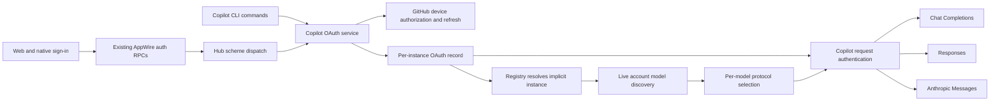

# GitHub Copilot subscription provider design

## Intent

Add GitHub Copilot as a first-class Evener provider. A subscriber can sign in with GitHub on the execution host, use the resulting `github-copilot` instance from the CLI and clients, and select GitHub Copilot on the initial provider-connection screen.

Evener keeps its own agent loop, history, tools, model profiles, streaming, and recovery. Copilot supplies models, not a nested agent runtime.

## Support boundary

GitHub documents third-party subscription access through the Copilot SDK and CLI. The reviewed documentation does not define a stable public HTTP contract for direct calls to `api.githubcopilot.com`. OpenCode and Pi maintain direct HTTP integrations, but they differ in token handling and request routing.

Jesse selected a direct provider despite that compatibility risk. Production wiring therefore waits for a successful live probe with an Evener-owned GitHub OAuth App and a real subscription. The probe must prove the exact behavior this design uses. A failed probe stops the direct implementation; it does not trigger silent use of the SDK, another client's OAuth identity, or another client's stored credentials.

Sources current on 2026-11-21:

- [GitHub's Copilot SDK OAuth guide](https://github.com/github/docs/blob/d7487f5debb5a5a2a6e65e6f9fa539266f5f8db6/content/copilot/how-tos/copilot-sdk/setup/github-oauth.md) supports OAuth Apps acting for users with active Copilot subscriptions. The application owns token storage, refresh, and expiry handling.
- [GitHub's OAuth device-flow guide](https://github.com/github/docs/blob/d7487f5debb5a5a2a6e65e6f9fa539266f5f8db6/content/apps/oauth-apps/building-oauth-apps/authorizing-oauth-apps.md) defines device authorization and refresh. Device-flow tokens need no embedded client secret.
- [OpenCode's pinned Copilot provider](https://github.com/anomalyco/opencode/blob/9a2f16d16588a37427614cd18c8bd44c6d8e2e95/packages/core/src/plugin/provider/github-copilot.ts) is the primary compatibility reference for direct GitHub-token bearer access and per-model endpoint discovery.
- [Pi's pinned Copilot provider](https://github.com/earendil-works/pi/blob/780bf31fcaeb252fa9b68df3964c735eae75bde3/packages/ai/src/auth/oauth/github-copilot.ts) documents an older Copilot-session-token exchange. This design does not use that exchange.

## Goals

- Offer **GitHub Copilot** in the popular provider set shown by New session and Settings.
- Provide device login, local status, and local logout through `evener github-copilot login|status|logout`.
- Reuse the existing AppWire authentication RPCs and web/native sign-in controllers.
- Create an implicit `github-copilot` instance only when its own OAuth record exists.
- Discover models and capabilities for the signed-in account.
- Route models to the Chat Completions, Responses, or Anthropic Messages adapters from advertised endpoint support.
- Preserve existing credential-write locking, endpoint fencing, model checks, draft state, and client cancellation behavior.
- Keep all credentials out of logs, status responses, configuration output, fixtures, and diagnostics.
- Retain explicit opt-in live coverage without making default tests depend on GitHub credentials or network access.

## Non-goals

- Embedding Copilot CLI or the Copilot SDK as Evener's agent runtime.
- Reusing OpenCode, Pi, VS Code, or Copilot CLI OAuth client IDs or credential stores.
- Automatic use of `GITHUB_TOKEN`, `GH_TOKEN`, `COPILOT_GITHUB_TOKEN`, or a PAT for the subscription instance.
- GitHub App server-to-server authentication, organization billing, or a multi-tenant token broker.
- Copilot's `/auto` model router, model-policy writes, or remote OAuth revocation.
- Account-discovered API hosts, enterprise data-residency routing, and GHES in the initial version. The initial provider serves github.com accounts through `https://api.githubcopilot.com` or an explicit endpoint override.
- A browser redirect flow or a new cancellation RPC for Copilot. Device flow works locally and on remote hosts; existing client-side cancellation semantics remain unchanged.
- Treating a successful model list as proof of generation access, quota, or billing state.

## Anti-goals

- Do not spoof another client's identity or copy its private compatibility constants without a demonstrated need.
- Do not make ambient GitHub credentials change Evener's default provider.
- Do not add a second agent orchestration owner.
- Do not weaken existing OpenAI auth behavior while generalizing shared surfaces.
- Do not expose models that advertise no protocol Evener supports.

## Approaches considered

### Direct provider, Evener OAuth App, and live probe — selected

Evener owns the GitHub OAuth identity, device login, token lifecycle, registry instance, and model requests. This preserves Evener's semantics and delivers the requested provider. Its cost is a new auth service and compatibility risk around the undocumented direct HTTP API.

### Official Copilot SDK or CLI runtime

This is GitHub's documented application path. It also gives Copilot CLI ownership of sessions, tool selection, history, and streaming. That is a nested agent integration, not a model provider, and would change Evener's behavior.

### Another client's identity or stored login

This avoids registering an Evener app but couples authorization and token lifecycle to another application. It does not provide an Evener-owned first-class login. Rejected.

## Prerequisites and stop conditions

Before the live probe, Jesse supplies the public client ID of an Evener-owned GitHub OAuth App with **Device flow** enabled. The source contains only that public identifier. It contains no client secret.

The disposable probe uses a real Copilot subscription and performs these steps without logging credentials:

1. Request `read:user offline_access` through GitHub device flow.
2. Complete user authorization and obtain an expiring GitHub access token plus refresh token.
3. Read the stable GitHub account identity through the documented `GET https://api.github.com/user` endpoint.
4. Refresh the OAuth token once, proving that rotation works without a client secret, then use the replacement pair.
5. Call `GET https://api.githubcopilot.com/models` with the GitHub access token as bearer.
6. Complete a streamed tool call through each protocol the initial provider will expose: Chat Completions, Responses when advertised, and Anthropic Messages when advertised.
7. Confirm the request headers and model metadata needed by the implementation.

If direct GitHub-token bearer access fails, stop. Do not switch to `/copilot_internal/v2/token` without a new design decision. If a required protocol fails, stop its exposure and report whether the remaining provider is still useful before broadening the implementation. Remove the disposable probe after recording its non-secret evidence; retain an opt-in live smoke test with the shipped provider.

## Architecture

The OAuth service owns GitHub authorization and refresh. The registry owns instance and model resolution. The authenticator applies the current GitHub token to a request. Existing protocol adapters own wire encoding and streaming. The hub owns provider dispatch, credential-write exclusion, endpoint fences, reloads, and change notifications.

## Registry and configuration

Add `oauth-github-copilot` to the registry auth vocabulary and load-time schema. Add a curated `github-copilot` overlay with:

- `implicit = true`;
- `auth = "oauth-github-copilot"`;
- `api_key_env = []`;
- `base_url` defaulting to `https://api.githubcopilot.com`;
- `GITHUB_COPILOT_BASE_URL` as the endpoint override;
- `default_model = "gpt-5.5"` and `cheap_model = "gpt-5.4-mini"`;
- inherited models.dev model facts and family-derived surfaces.

Place `github-copilot` after `openai-codex` and before `openai` in `default_order`. Stored subscription access therefore ranks ahead of the OpenAI metered API key, while existing Anthropic and Codex defaults keep priority. An explicit `default` remains authoritative. If Copilot's live listing lacks the configured default, New session asks for a model instead of adopting another row.

The OAuth record alone creates the implicit instance. Ambient GitHub variables do not. An explicit instance based on `github-copilot` uses its own instance-named record and may override the endpoint through the existing provider configuration rules.

Register the new environment variable through `envvars/envvars.go` and regenerate its documentation. Update the implicit-provider table and default-order documentation in the same change.

## OAuth service and stored record

Add `auth/githubcopilot`. Do not force Copilot into `auth/openai`: its device endpoints, account claims, errors, and refresh lifecycle differ. Use the existing atomic-file and state-directory primitives rather than copying OpenAI's storage implementation.

The versioned JSON record lives at `<state-root>/auth/<instance>.json` with mode 0600. It contains:

- the instance name, record version, and `oauth` source;
- access token, refresh token, token type, scope, obtained-at time, access expiry, and refresh expiry;
- stable GitHub account ID and optional account email;
- a persisted refresh-rejected flag when GitHub permanently refuses the refresh token.

Access token, refresh token, expiry, obtained-at, account ID, and instance identity are required. The record has no OpenAI ID token, ChatGPT workspace, environment fallback, or Copilot session token.

The service provides device login, status, logout, and runtime credential resolution. It refreshes five minutes before access expiry. Refresh rotates both tokens and atomically replaces the record. Serialize refresh by record path within a process, re-read after acquiring the lock, and do not overwrite a record replaced by a newer login. A permanent `bad_refresh_token` marks the record as needing login while retaining it for diagnosis. A new successful login or refresh clears that state.

Status is local. It reports signed-in state, account ID or email when available, refresh state, and stored-record presence. Logout deletes only the Evener-owned local record. Neither operation claims live Copilot access.

## Hub integration

Keep the existing AppWire methods and response shapes. Extend scheme handling instead of building a general OAuth framework:

- `authModesFor` returns `oauth` for both OAuth schemes.
- Browser login start/complete remain Codex-only. Copilot device start returns a real device flow, never redirect fallback.
- Device start/poll dispatch on the resolved auth scheme and retain flow TTL, polling intervals, endpoint fingerprints, restart responses, write locking, registry reload, and commit notifications.
- Status and logout load or delete the record type selected by the instance's scheme.
- API-key set and conditional-set refuse the Copilot OAuth scheme just as they refuse Codex OAuth.
- Rename, removal, rollback, auth fingerprints, stray-record detection, and command-credential pinning recognize both record types. Rename updates the record's instance identity and preserves raw-byte rollback.
- Scoped model-list, probe, and generation requests select the authenticator by scheme and state root. A Copilot credential never authenticates another scheme or provider.

A corrupt or expired record produces an actionable sign-in state without deleting user configuration. Cancelling a dialog keeps the existing client-only semantics: an already-running exchange may still save the record, but a dismissed client flow performs no model check or model adoption.

## Model discovery and protocol routing

Reuse the existing live-model layer, extending it where necessary to retain Copilot's advertised `supported_endpoints` and model capabilities. Live protocol facts sit between curated overlay and user configuration; an explicit user protocol override wins.

For each live model:

1. Prefer Anthropic Messages when advertised for a Claude-family row.
2. Otherwise prefer Responses when advertised.
3. Otherwise use Chat Completions when advertised.
4. When endpoint metadata is absent, use Chat Completions, matching the models.dev OpenAI-compatible declaration.
5. Hide a live row that advertises only unsupported endpoints. Do not synthesize a protocol for it.

Preserve family-derived surfaces, so Claude rows retain Anthropic agent behavior and Gemini rows retain Google agent behavior even though the provider is GitHub Copilot. Keep tool, media, reasoning, context, output, and plan-availability facts account-specific. Never enable a model through a policy write.

The initial default and cheap models are compatibility choices, not entitlement guarantees. Live model absence leaves them unavailable and preserves the user's explicit model choice.

## Request authentication and headers

The Copilot authenticator reads the current record through the Copilot service and applies the refreshed GitHub access token as `Authorization: Bearer`. It also supplies the account scope used by continuation storage.

Start with the compatibility headers the probe validates:

- `User-Agent: evener/<build-version>`;
- `X-GitHub-Api-Version: 2026-08-01`;
- `Openai-Intent: conversation-edits`;
- `X-Interaction-Type: conversation-agent`;
- `X-Interaction-Id` from the Evener session or thread identity;
- `X-Initiator: user` when the latest input is a user message and `agent` for subsequent tool-driven steps;
- `Copilot-Vision-Request: true` when the request contains images.

Do not send VS Code, OpenCode, Pi, or Copilot CLI identifying headers. Remove or adjust any compatibility header the live probe disproves, and record the final non-secret request contract in the provider documentation.

A missing, corrupt, expired-and-unrefreshable, or refresh-rejected credential returns the existing typed sign-in-required error with the Copilot login command. No ambient GitHub token fallback occurs.

## CLI and clients

Add `evener github-copilot login`, `status`, and `logout`, defaulting `--instance` to `github-copilot` and retaining the existing state-directory and working-directory conventions. Login is device-only and prints the verification URL and user code without printing tokens. Status remains compact and machine-readable. Logout removes local state only.

Add `github-copilot` to `ProviderConnection.tsx`'s presentation table. Its keys define the popular set, so this one addition places Copilot in initial provider discovery. The card offers GitHub sign-in rather than an API-key field, then performs the ordinary model-list check and preserves the originating draft.

Generalize the web's host-device scheme gate and cross-language scheme pin to include both device-capable OAuth schemes. Parameterize device-dialog provider copy so it names GitHub rather than OpenAI. Existing shared TypeScript and native sign-in controllers need no new RPCs; add focused coverage proving they accept the new scheme.

## Verification

Use scripted HTTP servers at the GitHub and Copilot boundaries and real Evener code below them. Default tests never use real credentials or network access.

Cover:

- device pending, slow-down, denial, expiry, malformed responses, cancellation, and concurrent completion;
- refresh rotation, refresh rejection, stale-record replacement, account stability, atomic writes, file permissions, and logout;
- registry scheme registration, implicit-instance creation, no environment conjuring, default ranking, custom instance isolation, and corrupt records;
- scoped authenticator selection and proof that tokens never cross schemes or state roots;
- live protocol selection, unsupported-model filtering, family surfaces, user overrides, request headers, images, and streamed tool calls;
- hub endpoint fences, flow expiry/restart, rename/remove/rollback, stray records, auth notifications, and API-key refusal;
- CLI login/status/logout behavior;
- Copilot's presence in the popular provider choices, web device sign-in and model check, remote-host sign-in, and native shared sign-in;
- the transition from failed or expired access back to useful operation after a fresh login.

Retain an `EVENER_GITHUB_COPILOT_E2E=1` opt-in live smoke test in addition to the stored credential. Report the probe and live-test evidence separately from deterministic tests.

Run targeted Go and frontend tests during implementation. Before the PR, run Biome on touched TypeScript, `make test-web`, `make vet`, and `make lint` once each, letting CI run the full suite. Use the normal simplify-code and review workflow.

## Documentation

Update the evergreen provider, connection, launch-configuration, environment-variable, and getting-started guides. Update S15/S16 in the product subsystem map. State the direct-HTTP compatibility boundary, github.com endpoint limitation, device-only login, local logout, plan-dependent model availability, and the distinction between model-list success and generation or quota access.

## Size and delivery order

This is a project-sized change, estimated at roughly 1,000–1,500 production lines plus tests and documentation. Keep the worktree and branch scoped to Copilot. Do not absorb unrelated auth redesign or existing main-checkout changes.

Deliver in checked slices:

1. Disposable live probe and stop/go evidence.
2. Copilot auth record, device service, refresh, status, and logout.
3. Registry scheme, overlay, scoped authenticator, model discovery, and protocol routing.
4. Hub dispatch and instance lifecycle.
5. CLI and web/native setup surfaces, including the popular-provider option.
6. Opt-in live smoke, evergreen docs, gates, simplification, and review.

Each slice must leave existing providers working and add its behavior tests before the next slice.

## Builder discretion

The builder may choose concrete function decomposition, test helpers, internal interfaces, and the smallest scheme-dispatch implementation that preserves these contracts. The builder may adjust model defaults or compatibility headers only from live evidence and must record that evidence. The builder does not change the selected direct-provider approach, OAuth ownership, credential sources, endpoint scope, cancellation semantics, or stop conditions without returning to Jesse.
