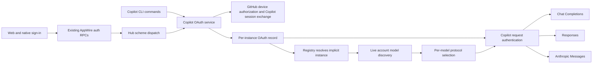

# GitHub Copilot subscription provider design

## Intent

Add GitHub Copilot as a first-class Evener provider. A subscriber can sign in with GitHub on the execution host, use the resulting `github-copilot` instance from the CLI and clients, and select GitHub Copilot on the initial provider-connection screen.

Evener keeps its own agent loop, history, tools, model profiles, streaming, and recovery. Copilot supplies models, not a nested agent runtime.

## Support boundary

GitHub documents third-party subscription access through the Copilot SDK and CLI. The reviewed documentation does not define a stable public HTTP contract for direct calls to `api.githubcopilot.com`. OpenCode and Pi maintain direct HTTP integrations, but they differ in token handling and request routing.

Jesse selected a direct provider despite that compatibility risk. Controlled probes then showed that an Evener-owned OAuth App receives only legacy GPT models and cannot complete the Copilot session-token exchange. After reviewing OpenCode's formal partnership and Pi's source history, Jesse explicitly chose a temporary Pi-compatible authentication path. It uses Pi's public Copilot client identity and VS Code-compatible exchange headers, with no claim of GitHub approval or stability. Model requests retain Evener's User-Agent.

Production wiring waits for the complete live probe with a real subscription. A failed probe stops the direct implementation; it does not trigger a switch to the SDK, OpenCode's identity, or another unapproved path.

Sources current on 2026-11-21:

- [GitHub's Copilot SDK OAuth guide](https://github.com/github/docs/blob/d7487f5debb5a5a2a6e65e6f9fa539266f5f8db6/content/copilot/how-tos/copilot-sdk/setup/github-oauth.md) supports OAuth Apps acting for users with active Copilot subscriptions. The application owns token storage, refresh, and expiry handling.
- [GitHub's OAuth device-flow guide](https://github.com/github/docs/blob/d7487f5debb5a5a2a6e65e6f9fa539266f5f8db6/content/apps/oauth-apps/building-oauth-apps/authorizing-oauth-apps.md) defines device authorization and refresh. Device-flow tokens need no embedded client secret.
- [OpenCode's pinned Copilot provider](https://github.com/anomalyco/opencode/blob/9a2f16d16588a37427614cd18c8bd44c6d8e2e95/packages/core/src/plugin/provider/github-copilot.ts) is the primary compatibility reference for direct GitHub-token bearer access and per-model endpoint discovery.
- [Pi's pinned Copilot provider](https://github.com/earendil-works/pi/blob/780bf31fcaeb252fa9b68df3964c735eae75bde3/packages/ai/src/auth/oauth/github-copilot.ts) is the compatibility reference for the public Copilot client identity, session-token exchange, expiry, and required headers.

## Goals

- Offer **GitHub Copilot** in the popular provider set shown by New session and Settings.
- Provide device login, local status, and local logout through `evener github-copilot login|status|logout`.
- Reuse the existing AppWire authentication RPCs and web/native sign-in controllers.
- Create an implicit `github-copilot` instance only when its own OAuth record exists.
- Discover models and capabilities for the signed-in account.
- Route models to the Chat Completions, Responses, or Anthropic Messages adapters from advertised endpoint support.
- Preserve existing credential-write locking, endpoint fencing, model checks, draft state, and client cancellation behavior.
- Keep all credentials out of logs, status responses, configuration output, fixtures, and diagnostics.
- Retain explicit opt-in live coverage without making default tests depend on GitHub credentials or network access.

## Non-goals

- Embedding Copilot CLI or the Copilot SDK as Evener's agent runtime.
- Claiming GitHub approval for the temporary Pi-compatible identity, reusing OpenCode's formally partnered identity, or reading another application's credential store.
- Automatic use of `GITHUB_TOKEN`, `GH_TOKEN`, `COPILOT_GITHUB_TOKEN`, or a PAT for the subscription instance.
- GitHub App server-to-server authentication, organization billing, or a multi-tenant token broker.
- Copilot's `/auto` model router, model-policy writes, or remote OAuth revocation.
- Account-discovered API hosts, enterprise data-residency routing, and GHES in the initial version. The initial provider serves github.com accounts through `https://api.githubcopilot.com` or an explicit endpoint override.
- A browser redirect flow or a new cancellation RPC for Copilot. Device flow works locally and on remote hosts; existing client-side cancellation semantics remain unchanged.
- Treating a successful model list as proof of generation access, quota, or billing state.

## Anti-goals

- Do not conceal the temporary compatibility identity or copy private client secrets. Use only public values Jesse explicitly approved and the live probe verified.
- Do not make ambient GitHub credentials change Evener's default provider.
- Do not add a second agent orchestration owner.
- Do not weaken existing OpenAI auth behavior while generalizing shared surfaces.
- Do not expose models that advertise no protocol Evener supports.

## Approaches considered

### Pi-compatible direct provider and live probe — selected for now

Evener uses the public Copilot client identity Pi uses, device login, session-token exchange, and the registry/model requests. This preserves Evener's semantics and delivers the requested provider. Its cost is an explicit dependency on an undocumented compatibility identity that Evener does not own. GitHub's partner/support path remains the durable route to an Evener-owned identity.

### Official Copilot SDK or CLI runtime

This is GitHub's documented application path. It also gives Copilot CLI ownership of sessions, tool selection, history, and streaming. That is a nested agent integration, not a model provider, and would change Evener's behavior.

### Evener-owned OAuth App or GitHub App

Controlled probes showed that Evener's OAuth App receives only eight older GPT models and that its `gho_` tokens cannot complete session exchange, regardless of expiry. An Evener GitHub App produced `ghu_` but also returned 403 before any organization installation granted Copilot Requests. This path is paused for GitHub approval, not presented as working.

## Prerequisites and stop conditions

Use the public Copilot client identity `Iv1.b507a08c87ecfe98`, decoded by Pi's source, for this temporary compatibility path. The source contains no client secret. Login must make clear that authorization uses this public Copilot identity; documentation must not imply a GitHub partnership with Evener.

The disposable probe uses a real Copilot subscription and performs these steps without logging credentials:

1. Request `read:user` through the Pi-compatible device flow. The current identity returns a non-expiring GitHub access token with no refresh token.
2. Exchange the GitHub token at `GET https://api.github.com/copilot_internal/v2/token` with Pi's compatibility headers, obtaining a Copilot session token and `expires_at`.
3. Read the stable GitHub account identity through the documented `GET https://api.github.com/user` endpoint.
4. Repeat the session exchange before expiry, proving session renewal without a client secret, then use the replacement session token.
5. Call `GET https://api.githubcopilot.com/models` with the Copilot session token as bearer.
6. Build production-equivalent resolved rows and drive the real Evener adapters through a complete loop for each exposed family/protocol combination: user request, streamed tool call, tool result with `X-Initiator: agent`, and final response. A minimal raw request is insufficient.
7. Exercise image requests before enabling image-capable rows, and confirm the request headers, final endpoint paths, and model metadata needed by the implementation.

If device login, session exchange, session renewal, model discovery, or an enabled tool-loop scenario fails, stop. Do not switch to another client identity without a new decision from Jesse. Remove disposable bootstrap code after recording non-secret evidence; retain the opt-in live smoke test. Before enabling the popular-provider card, rerun the complete loop through the shipped provider.

Build the probe and shipped-provider smoke from one opt-in scenario table and adapter driver. Only the temporary OAuth bootstrap is discarded; both gates run the same protocol, tool-loop, header, and image scenarios.

## Architecture

The OAuth service owns GitHub authorization and refresh. The registry owns instance and model resolution. The authenticator applies the current GitHub token to a request. Existing protocol adapters own wire encoding and streaming. The hub owns provider dispatch, credential-write exclusion, endpoint fences, reloads, and change notifications.

## Registry and configuration

Add `oauth-github-copilot` to the registry auth vocabulary and load-time schema. Add a curated `github-copilot` overlay with:

- `implicit = true`;
- `auth = "oauth-github-copilot"`;
- `api_key_env = []`;
- `base_url` defaulting to `https://api.githubcopilot.com`;
- `GITHUB_COPILOT_BASE_URL` as the endpoint override;
- `default_model = "gpt-5.6-sol"` and `cheap_model = "claude-haiku-5.5"`, both present in the proven modern roster;
- inherited models.dev model facts and family-derived surfaces, except monetary prices.

Place `github-copilot` after `openai-codex` and before `openai` in `default_order`. Stored subscription access therefore ranks ahead of the OpenAI metered API key, while existing Anthropic and Codex defaults keep priority. An explicit `default` remains authoritative. If Copilot's live listing lacks the configured default, New session asks for a model instead of adopting another row.

Add a per-auth-scheme credential-readiness hook for automatic instance and default selection. Existing schemes retain their current presence policy. Copilot readiness rejects corrupt, refresh-rejected, refresh-expired, and otherwise login-required records while allowing an expired access token with a usable refresh token. Keep an unhealthy Copilot instance visible in Settings. An explicit `default` still selects it and surfaces its sign-in error.

A valid OAuth record creates the implicit instance. Ambient GitHub variables do not. An explicit instance based on `github-copilot` uses its own instance-named record and may override the endpoint through the existing provider configuration rules.

Remove inherited monetary `Cost` facts for this subscription provider and ignore dollar prices in its live listing. Absent cost means no dollar estimate; it does not mean zero cost. Plan multipliers and quota are separate facts and are not rendered as API charges.

Register the new environment variable through `envvars/envvars.go` and regenerate its documentation. Update the implicit-provider table and default-order documentation in the same change.

## OAuth service and stored record

Add `auth/githubcopilot`. Do not force Copilot into `auth/openai`: its device endpoints, account claims, errors, and refresh lifecycle differ. Use the existing atomic-file and state-directory primitives rather than copying OpenAI's storage implementation.

The versioned JSON record lives at `<state-root>/auth/github-copilot/<instance>.json` with mode 0600. The scheme-specific namespace leaves Codex paths and validation unchanged. The record contains:

- the instance name, required `auth_scheme = "oauth-github-copilot"`, and record version;
- the GitHub access token, its optional refresh token and expiry fields, and token type/scope;
- the Copilot session token, its required session expiry, and obtained-at time;
- stable GitHub account ID and optional account email;
- a persisted refresh-rejected flag when GitHub permanently refuses the refresh token.

GitHub access token, Copilot session token, session expiry, obtained-at, account ID, instance identity, and matching auth scheme are required. GitHub refresh/access-expiry fields are optional because the current compatibility identity returns a non-expiring token; when present, they must form a valid refreshable pair. Both the scheme-namespaced path and record discriminator are checked on every load. Changing an instance to another auth scheme leaves the Copilot record unusable by that scheme. The record has no OpenAI ID token or ChatGPT workspace.

Derive the runtime and status credential source `oauth` from the auth scheme instead of storing a redundant source field.

The service provides device login, session exchange, status, logout, and runtime credential resolution. It renews the Copilot session token five minutes before session expiry by repeating the exchange with the stored GitHub token. If that GitHub token has an expiry, the existing refresh path refreshes it first. Every refreshed record replaces the old one atomically.

Use an inter-process lock keyed by the canonical record path around re-read, refresh, rejection updates, and save. Login, logout, rename, and rollback participate in the same record-lifecycle exclusion. After acquiring the lock, compare the current record with the generation read before the request. A refresh may save only over that unchanged, still-present generation; a newer login or logout wins. Re-read after `bad_refresh_token` and mark rejection only when the same refresh token and generation are still current. A request that receives a 401 after another process rotated the record reloads once and retries only when the record changed.

A permanent GitHub `bad_refresh_token` on a refreshable generation, or a permanent rejection of the GitHub token during session exchange, marks the current record as needing login while retaining it for diagnosis. A successful login or renewal clears that state. Tests cover two actual processes, stale success and rejection writes, and logout during session renewal.

Status is local. It reports signed-in state, account ID or email when available, refresh state, and stored-record presence. Logout deletes only the Evener-owned local record. Neither operation claims live Copilot access.

## Hub integration

Keep the existing AppWire methods and response shapes. Extend scheme handling instead of building a general OAuth framework:

- `authModesFor` returns `oauth` for both OAuth schemes.
- Browser login start/complete remain Codex-only. Copilot device start returns a real device flow, never redirect fallback.
- Device start/poll dispatch on the resolved auth scheme and retain provider-owned flow state, actual device expiry, endpoint fingerprints, restart responses, write locking, registry reload, and commit notifications. The provider flow owns and updates the interval; the hub stores only `nextPollAt`, answers early client polls as local pending without contacting GitHub, and advances the deadline from the flow after each provider contact. This preserves the AppWire response shape while enforcing outbound cadence on `slow_down`.
- Status and logout load or delete the record type selected by the instance's scheme.
- API-key set and conditional-set refuse the Copilot OAuth scheme just as they refuse Codex OAuth.
- Rename, removal, rollback, auth fingerprints, stray-record detection, and command-credential pinning recognize both record types. Rename updates the record's instance identity and preserves raw-byte rollback.
- Scoped model-list, probe, and generation requests select the authenticator by scheme and state root. A Copilot credential never authenticates another scheme or provider.

The hub's existing notice sweep also observes Copilot record existence, scheme, account identity, and login-health changes independently of `providers.toml`. External CLI login, account switch, and logout reload the registry, invalidate account-scoped live-model state, and broadcast visible changes. No credential value enters the change signature or notification.

A corrupt or expired record produces an actionable sign-in state without deleting user configuration. Cancelling a dialog keeps the existing client-only semantics: an already-running exchange may still save the record, but a dismissed client flow performs no model check or model adoption.

## Model discovery and protocol routing

Reuse the existing live-model layer, extending it where necessary to retain Copilot's advertised `supported_endpoints` and model capabilities. Live protocol facts sit between curated overlay and user configuration; an explicit user protocol override wins.

For each live model:

1. Prefer Anthropic Messages when advertised for a Claude-family row.
2. Otherwise prefer Responses when advertised.
3. Otherwise use Chat Completions when advertised.
4. When endpoint metadata is absent, use Chat Completions, matching the models.dev OpenAI-compatible declaration.
5. Hide a live row that advertises only unsupported endpoints. Do not synthesize a protocol for it.
6. Hide and refuse a row whose account policy explicitly marks it disabled. Missing policy metadata does not imply either enablement or disablement. Never enable a model through a policy write.

Protocol selection also selects the transport. Messages uses `/v1/messages` for generation and streaming, Responses uses `/responses`, and Chat Completions uses `/chat/completions`. Copilot Messages count-token routing is unsupported unless separately proven. An explicit user transport override wins. Tests assert the final request URL through the real registry and adapter.

Carry an authoritative-listing policy through the shared list-and-apply path, including empty results. Copilot opts in; existing providers retain static fallback. A successful Copilot `/models` response is therefore authoritative even when empty or wholly unsupported, and static rows cannot reappear through another caller. Setup succeeds only when the live listing is usable and at least one supported row resolves; otherwise it returns a non-success no-usable-models result. Fetch and parse failures retain diagnostic fallback behavior without being reported as verified access.

Preserve family-derived surfaces, so Claude rows retain Anthropic agent behavior and Gemini rows retain Google agent behavior even though the provider is GitHub Copilot. Keep tool, media, reasoning, context, output, and plan-availability facts account-specific.

The initial default and cheap models are compatibility choices, not entitlement guarantees. Validate direct CLI launches and auxiliary cheap-model selection against the current live roster when available. Reuse the single startup `ModelListing`, including an already-primed `StartupModelListing`, for both decisions; account/auth invalidation refreshes that shared snapshot instead of issuing a second `/models` request. An absent primary model returns an actionable available-models error rather than silently substituting another model. An absent cheap model uses an advertised cheap fallback or the session model, never a static unadvertised row.

## Request authentication and headers

The Copilot authenticator reads the current record through the Copilot service and applies the renewed Copilot session token as `Authorization: Bearer`. It supplies stable account scope through the call-scoped authenticator, never the process-global authenticator.

Start with the compatibility headers the probe validates:

- `User-Agent: evener/<build-version>`;
- `Editor-Version: vscode/1.107.0`, `Editor-Plugin-Version: copilot-chat/0.35.0`, and `Copilot-Integration-Id: vscode-chat`, the compatibility identity headers the live probe proved necessary;
- `X-GitHub-Api-Version: 2026-08-01`;
- `Openai-Intent: conversation-edits`;
- `X-Interaction-Type: conversation-agent`;
- `X-Interaction-Id` from the Evener session or thread identity;
- `X-Initiator: user` when the latest input is a user message and `agent` for subsequent tool-driven steps;
- `Copilot-Vision-Request: true` when the request contains images.

Use only the compatibility headers this path needs. Do not use OpenCode's identity or Pi's User-Agent on model requests. Record the final non-secret request contract and the lack of a GitHub approval claim in the provider documentation.

A missing, corrupt, expired-and-unrefreshable, or refresh-rejected credential returns the existing typed sign-in-required error with the Copilot login command. No ambient GitHub token fallback occurs.

Give Copilot Responses a distinct endpoint family and disable Responses continuation for the initial version. Always send full history; do not inherit public OpenAI `previous_response_id`, conversation, or store-based continuation behavior. Account and state-root isolation tests cover two accounts and two state roots. Enabling continuation later requires live storage proof and use of the Copilot account scope.

## CLI and clients

Add `evener github-copilot login`, `status`, and `logout`, defaulting `--instance` to `github-copilot` and retaining the existing state-directory and working-directory conventions. Login is device-only and prints the verification URL and user code without printing tokens. Status remains compact and machine-readable. Logout removes local state only.

A running hub observes these external record changes through the notice sweep described above; CLI login and logout do not require a hub restart.

After the shipped-provider live smoke passes, add `github-copilot` to `ProviderConnection.tsx`'s presentation table. Its keys define the popular set, so this one addition places Copilot in initial provider discovery. The card offers GitHub sign-in rather than an API-key field, then performs the ordinary model-list check and preserves the originating draft. An empty or wholly unsupported roster cannot complete setup.

Generalize the web's host-device scheme gate and cross-language scheme pin to include both device-capable OAuth schemes. Parameterize device-dialog provider copy so it names GitHub rather than OpenAI. Existing shared TypeScript and native sign-in controllers need no new RPCs; add focused coverage proving they accept the new scheme.

## Verification

Use scripted HTTP servers at the GitHub and Copilot boundaries and real Evener code below them. Default tests never use real credentials or network access.

Cover:

- device pending, hub-enforced slow-down cadence, denial, actual provider expiry, malformed responses, cancellation, and concurrent completion;
- two-process refresh rotation, refresh rejection keyed to record generation, stale-record replacement, one-time 401 reload after rotation, account stability, atomic writes, file permissions, and logout-during-refresh;
- registry scheme registration, scheme-path binding, implicit-instance creation, no environment conjuring, healthy default ranking, custom instance isolation, and corrupt records;
- scoped authenticator selection and proof that tokens never cross schemes or state roots;
- live protocol and transport selection, final `/v1/messages` paths, policy-disabled and unsupported-model filtering, authoritative empty rosters, family surfaces, user overrides, request headers, images, and complete tool loops;
- disabled Copilot Responses continuation and account/state-root isolation;
- absent live defaults and cheap-model fallback behavior;
- absent monetary prices and no dollar estimates for subscription usage;
- hub endpoint fences, flow expiry/restart, rename/remove/rollback, stray records, external CLI login/account-switch/logout reloads, auth notifications, and API-key refusal;
- CLI login/status/logout behavior, including direct-launch roster validation;
- Copilot's presence in the popular provider choices, web device sign-in and model check, remote-host sign-in, and native shared sign-in;
- the transition from failed or expired access back to useful operation after a fresh login.

Retain an `EVENER_GITHUB_COPILOT_E2E=1` opt-in live smoke test in addition to the stored credential. Report the probe and live-test evidence separately from deterministic tests.

Run targeted Go and frontend tests during implementation. Before the PR, run Biome on touched TypeScript, `make test-web`, `make vet`, and `make lint` once each, letting CI run the full suite. Use the normal simplify-code and review workflow.

## Documentation

Update the evergreen provider, connection, launch-configuration, environment-variable, and getting-started guides. Update S15/S16 in the product subsystem map. State the direct-HTTP compatibility boundary, github.com endpoint limitation, device-only login, local logout, plan-dependent model availability, and the distinction between model-list success and generation or quota access.

## Size and delivery order

The accepted task-budget total before the Pi session adaptation is 2,442 production lines. Measure the adaptation separately and report any overage instead of hiding it. Keep the worktree and branch scoped to Copilot. Do not absorb unrelated auth redesign or existing main-checkout changes.

Deliver in checked slices:

1. Disposable live probe and stop/go evidence.
2. Copilot auth record, device service, refresh, status, and logout.
3. Registry scheme, overlay, scoped authenticator, model discovery, and protocol routing.
4. Hub dispatch and instance lifecycle.
5. CLI, external-change recovery, and web/native setup surfaces.
6. Shipped-provider live smoke, then the popular-provider option, evergreen docs, gates, simplification, and review.

Each slice must leave existing providers working and add its behavior tests before the next slice.

## Builder discretion

The builder may choose concrete function decomposition, test helpers, internal interfaces, and the smallest scheme-dispatch implementation that preserves these contracts. The builder may adjust model defaults or compatibility headers only from live evidence and must record that evidence. The builder does not change the selected Pi-compatible approach, credential sources, endpoint scope, cancellation semantics, or stop conditions without returning to Jesse.
