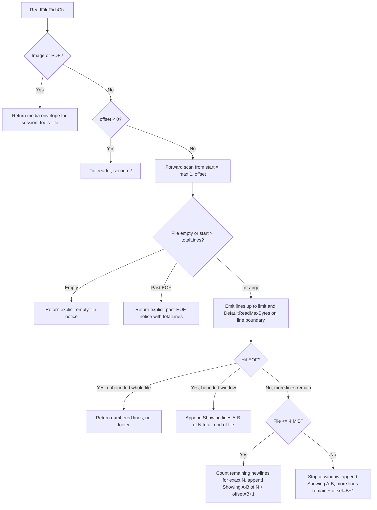

# `read_file` v2: Head-Only Paging, Line Clamping, Tail Reads, Range-Aware Repeat Tracking, and Media Hygiene

**Date:** 2026-11-21
**Status:** Draft (pending builder check and Jesse's approval)

## Intent and Why

A 30-day forensic audit of Evener (`2026-10-22` to `2026-11-21`, 6,868 real sessions across 26 real buckets, 133,781 `read_file` calls, 1.103 billion output chars, cross-validated 1:1 against `doctor_evener`), combined with primary-source audits of 14 coding-agent harnesses and 85 academic and practitioner studies from 2025-2026, identified five concrete, high-ROI defects in Evener's `read_file` (and shared `memory_read`):

1. **`TruncHeadTail` middle-cutting plus missing line/EOF metadata causes defensive micro-slicing and jigsaw recovery turns:** `DefReadFile` promises `default 2000` lines while `agent/internal/tool/registry.go:1255` cuts `read_file` at 50,000 chars using `TruncHeadTail` (25k head + 25k tail, removing the middle). Only 1.9% of reads (2,468) hit the cap, yet 29.1% (719) trigger another same-file read within 3 turns, and models learned to fear truncation (`gpt-6.1-sol` wrote `"read_file limit400 safe (1000 truncates)"` in its own compaction note). As a result, 63.7% of all `read_file` calls pass `limit <= 250`, burning **8,717 same-file paging chains and 11,860 extra turns** (70.5% from small limits, 0.0% from the 2,000-line default). Bounded reads emit no EOF or total-line footer, and offsets past EOF return silent `""`.
2. **No per-line length cap breaks minified and generated files:** Without a per-line character limit, a single 5.5 MB line (such as `mermaidPage.ts`) fills the entire 50k budget, gets cut mid-line by `TruncHeadTail`, causes `omittedNumberedLines` to return `nil` (dropping the recovery hint completely), and forces shell workarounds.
3. **No tail-of-file read mode forces shell `tail` calls:** Across 30 days, models issued **8,575 `tail` shell commands** reading log and file tails because `read_file` only accepts positive 1-based offsets from the start of the file.
4. **Wide padded `%4d\t` prefixes waste tokens, collide with Go tab indentation, and `DefReadFile` does not steer against shell `sed -n`/`cat`:** Every line 1-999 pays 3 leading spaces, tab-indented files (including all Go files) produce `\t\t` between prefix and content, and models issued **137,233 direct-path shell file reads** (`103,107` `sed -n`, `13,660` `cat`, 77.1% from `deepseek-*`).
5. **Exact-tuple repeat tracking misses 90.3% of redundant reads and fires false positives after compaction:** 18,987 `read_file` calls (14.2%, 130.5M chars) re-read unchanged files without an intervening edit; 90.3% (17,140) are overlapping/subset slices that `agent/session_read_repeat.go`'s exact `(path, offset, limit)` key misses, while 64.7% of exact duplicates (95.1% on OpenAI) happen after compaction where the earlier content is no longer in context.
6. **Unbounded image and PDF payloads risk context blowups:** `read_file` currently base64-encodes raster images and PDFs up to `MaxWholeFileReadBytes` (128 MiB) without image downscaling or PDF page-range selection.

## Goals, Non-Goals, and Anti-Goals

### Goals
- Replace `TruncHeadTail` middle-cutting on `read_file` and `memory_read` with **engine-owned head-only line-boundary paging** (`DefaultReadMaxBytes = 48_000`, `DefaultReadLines = 2000`), backed by a thin `schema.TruncHead` (`50_000` chars) safety backstop in `agent/internal/tool/registry.go`.
- Clamp individual long lines at `DefaultReadMaxLineChars = 2000` runes (UTF-8 safe, visibly marked), with an explicit `offset=N, limit=1` uncut escape (up to `DefaultReadMaxBytes`, plus a `sed -n` byte-slice hint if line `N` alone exceeds the byte cap).
- Emit concise range/EOF/continuation footers on bounded or truncated reads (exact total lines up to `4 MiB`, preserving O(window) non-EOF streaming above `4 MiB`), and return an explicit notice when `offset` exceeds EOF or a file is empty.
- Support **negative `offset`** (e.g. `offset=-100` reads the last 100 lines), including backward chunked `ReadAt`/`Seek` scanning on large files (`> 4 MiB`).
- Compact line prefixes from `%4d\t` to `%d\t`, switching to `%d:` on windows containing tab-indented lines (Claude Code `tengu_tab_read_sep` rule), and tighten `DefReadFile` descriptions to state the real char cap and discourage micro-slicing and shell `cat`/`sed -n` reads.
- Upgrade `agent/session_read_repeat.go` to **range-aware interval tracking** keyed on returned `[startLine, endLine]` (and `pages` for PDFs), reset it on compaction (`publishFoldedHistory`), keep returning full content, and escalate the hint after 3+ pre-compaction repeats.
- Add **pure-Go image downscaling** (`<= 2000px` longest edge, `<= 4.5 MiB` encoded, coordinate-mapping note) using existing `golang.org/x/image/draw` in `llm`, and **pure-Go PDF `pages` slicing** (`github.com/pdfcpu/pdfcpu` in `agent/go.mod`, max 20 pages/call, requiring `pages` over 10 pages or 20 MiB).

### Non-Goals
- **Item 3 (`parallel_tool_calls` on `openai-codex` and optional batch/multi-range `read_file`):** Currently under live empirical evaluation in a separate subagent (`test-item-3-parallel-codex`). Any change to `providers_overlay.toml` or multi-file/multi-range schemas will be specced or landed separately once those numbers are in.
- **Issue #7458 (`agent/doctor/health.go` `truncationBanner`):** Tracked as a separate bugfix issue. (The implementation of this spec should ensure `ExecResult.Truncated` and registry truncation markers remain consistent with it.)
- **AST/LSP/CodeGraph/RepoMap outline modes or semantic search:** Out of scope; 2026 empirical evidence shows they add latency/cost or lower accuracy vs `rg` + verbatim `read_file` on frontier models.
- **Persisting `priorReads` across daemon restarts:** Keeps scope minimal and avoids disk schema churn; clearing on compaction already fixes the dominant false-positive class.

### Anti-Goals
- **Contentless duplicate-read stubs:** Never replace a repeated `read_file` response with a contentless `"Wasted call — file unchanged"` refusal. Claude Code added that in `v2.1.86` and removed it in `v2.1.317` after models looped 7+ times and fell back to `cat` (`#64882`).
- **Rolling per-turn observation masking or in-place history rewriting:** 2026 studies (>20,000 runs, `arXiv:2611.22238v1`, `arXiv:2610.34763v2`) prove prefix mutation increases billed API cost +38% to +116% under 0.1x prompt caching and degrades solve rates.
- **Lossy line/token compression:** Never silently drop lines or compress syntax inside `read_file`; verbatim text is required for exact `edit_file` / `apply_patch` matching (`arXiv:2610.21073v1`).
- **Silent truncation or fake line numbers:** Never return `""` past EOF, never silently truncate a long line without a marker, and never fabricate 1-based line numbers when a backward tail seek skipped byte 0 on a >4 MiB file (`arXiv:2607.12713v2`, `arXiv:2609.14758v1`).
- **Double truncation of footers:** Never let `registry.go`'s char cap chop off `execenv`'s own continuation footer.

## Constraints

- **Go workspace module layout (`go.work`):**
  - `llm/go.mod` already directly requires `golang.org/x/image v0.48.0`. Image downscaling belongs in `llm` (`llm/media_utils.go` or sibling `llm/image_scale.go`) with **zero new dependencies**.
  - `agent/go.mod` owns `github.com/pdfcpu/pdfcpu` (latest `v0.16.4`, Apache-2.0, pure Go `CGO_ENABLED=0`), isolated inside a small internal package `agent/internal/pdfslice` so `llm` and `agent/execenv` stay free of PDF dependencies.
  - Adding `github.com/pdfcpu/pdfcpu` triggers `.github/workflows/ci.yml`'s `go-dependency-review` gate, which passes when the PR carries an approving review or the `go-dependency-reviewed` label.
- **Sandbox and arm parity (`agent/execenv`):**
  - Every `read_file` path (positive window, negative tail, whole-file, image, PDF) must honor identical admission across all three `fileTarget` arms (`off` / `OsFs`, confined `sandboxFS` fd-anchored reads, and granted scratch), refusing symlinks/FIFOs/devices under confinement and checking `ctx` cancellation on every read chunk (`file_op_arm_parity_test.go`, `read_window_sandbox_unix.go`).
  - `ReadFileCtx` and `ReadFileAndBytesCtx` (`NumberLinesBytes` vs `scanLineWindow`) must produce byte-identical output for the same file and arguments (`read_window_equivalence_test.go`).
- **Interface compatibility:**
  - `execenv.ExecutionEnvironment` is implemented by over a dozen test doubles across `agent/`. Rich metadata (`ReadFileMeta`) must be exposed via a new optional capability interface (`RichFileReader`) rather than changing `ExecutionEnvironment.ReadFile`'s signature.
- **Schema and golden gates:**
  - Every parameter on `DefReadFile()` (including `pages`) must have a non-empty `description` (`TestAllBuiltinParametersCarryDescriptions`).
  - `DefReadFile()`, `DefReadFileNativeVision()`, `DefReadFilePDFVisionOnly()`, and `DefMemoryRead()` share the same base parameter map; changing descriptions requires updating all 6 goldens in `agent/testdata/readfilevision/` via `go test ./agent -run 'TestReadFileVisionProseGoldens$' -count=1 -update-prompt` and checking `agent/testdata/memoryprompt/` and `agent/testdata/messagingprompt/`.
  - `memory_read` (`agent/session_tools_memory.go`) shares `execFileReadWith` and `DefReadFile()` (via `MemoryDefinition`), so it inherits head-only paging, line clamping, tail reads, and `pages` automatically; `MEMORY.md` generated index reads continue taking their dedicated branch in `execMemoryRead`.
- **Testing rules (`docs/developing-evener/testing.md`):** Tests assert behavior (returned line ranges, byte caps, clamped markers, footer recoverability, scaled image dimensions, extracted PDF page count, repeat detection), never hardcoded prose strings or copy constants.
- **Supported platforms:** Linux and Darwin only (`GOOS=windows` compile-only via build-tag cross-vet).

## Approaches Considered

### Paging & Truncation Ownership (Items 1 & 2)

| Approach | Summary | Tradeoffs |
| --- | --- | --- |
| **A. Engine-owned paging + thin registry `TruncHead` backstop (Selected)** | `execenv` enforces the per-line clamp (2,000 chars), head-only output byte cap (48,000 bytes), line cap (2,000), EOF/total-line counting (<=4 MiB), negative-offset tail scan, and continuation footer, returning structured `ReadFileMeta` via optional `RichFileReader`. `registry.go` switches `read_file`/`memory_read` to `schema.TruncHead` (`50_000` chars) as a pure safety net for custom test doubles. | Single source of truth for line boundaries, EOF, and total lines; stops disk reads immediately at 48 KB instead of reading 2,000 lines only to throw 1,600 away; passes exact `[StartLine, EndLine]` to `session_read_repeat.go` without string parsing; never double-truncates its own footer. Slightly more state inside `scanLineWindow` / `NumberLinesBytes`. |
| **B. Registry-owned head truncation** | Keep `execenv` emitting unbounded numbered lines (clamped per line) and do the 50k head-only cut in `registry.go`. | Wastes disk I/O and memory reading lines `registry.go` discards; `registry.go` cannot know total file lines, EOF status, or whether a file is `>4 MiB`; requires re-parsing line numbers from strings to feed `session_read_repeat.go`. |

### PDF Page Slicing (Item 6)

| Approach | Summary | Tradeoffs |
| --- | --- | --- |
| **A. Pure-Go `github.com/pdfcpu/pdfcpu` in `agent/internal/pdfslice` (Selected by Jesse)** | Add `pdfcpu` (`v0.16.4`, Apache-2.0) to `agent/go.mod` to count pages and extract `pages="A-B"` ranges 100% in memory (`bytes.NewReader` -> `bytes.Buffer`). | Works identically on Linux and macOS with `CGO_ENABLED=0`, zero external binaries, deterministic hermetic tests, keeps raw PDF bytes (preserving native vector text/fonts for Claude/Gemini PDF readers and vision side-channels). Adds one audited pure-Go module to `agent/go.mod`. |
| **B. Image downscale + 20 MiB raw PDF cap only** | No PDF library, no `pages` parameter; reject PDFs over 20 MiB. | Zero new dependencies, but leaves multi-page PDFs (>10 pages or >20 MiB) unreadable without shell hacks. |
| **C. Shell out to `pdftoppm`/`qpdf` on PATH** | Invoke external binaries when installed. | Fragile across environments/sandboxes, requires rasterizing vector PDFs into JPEGs, harder to test hermetically. |

**Decision (Jesse):** Engine-owned paging + thin registry backstop (Items 1, 2, 4, 5) + pure-Go `pdfcpu` for PDF `pages` alongside zero-dep `golang.org/x/image` downscaling (Item 6).

---

## Detailed Design

Design calls decided with Jesse are unmarked; builder-level defaults proposed here are marked *(proposal)*.

### 1. Head-Only Paging, Per-Line Clamping, EOF/Total-Line Footers, and `TruncHead` Backstop (Item 1)

#### Package-Level Constants (`agent/execenv/local_files.go` / `read_window.go`)
Make all caps package-level `var`s (matching `MaxWholeFileReadBytes` and `readWindowWholeBelow`) so unit tests can exercise boundaries on small fixtures:

- `DefaultReadLines = 2000` (unchanged default line cap when `limit` is omitted or `<= 0`).
- `DefaultReadMaxBytes = 48_000` *(proposal)*: maximum rendered body bytes emitted by `execenv` before stopping on a clean line boundary. Leaving 2,000 bytes of headroom under `registry.go`'s `MaxChars: 50_000` guarantees `execenv`'s footer is never chopped off by the registry backstop.
- `DefaultReadMaxLineChars = 2000`: maximum UTF-8 runes kept per line when `limit != 1` (or `limit` omitted).
- `ReadTotalLinesScanCap int64 = 4 << 20` (4 MiB) *(proposal)*: files at or below this size scan to EOF (if needed) to report exact `totalLines`; files above this size stop at the window boundary to preserve `#6427`/`#6637` O(window) I/O performance.

#### Structured Read Metadata & Optional Capability Interface (`agent/execenv/execenv.go`)
```go
// ReadFileMeta reports exact structural facts about a text read_file result so
// tool truncation telemetry and repeat-read tracking never re-parse prose.
type ReadFileMeta struct {
	StartLine    int  // 1-based first emitted line (0 if empty, past EOF, or unscanned huge-file tail)
	EndLine      int  // 1-based last emitted line (0 if empty, past EOF, or unscanned huge-file tail)
	TotalLines   int  // exact total line count when known, 0 when >ReadTotalLinesScanCap and not scanned to EOF
	Truncated    bool // true when stopped early by DefaultReadMaxBytes or line limit before EOF
	TruncatedBy  string // "", "chars", or "lines"
	ClampedLines int  // count of emitted lines clamped at DefaultReadMaxLineChars
	PastEOF      bool // true when positive offset > TotalLines
	TailMode     bool // true when negative offset selected tail lines
}

// RichFileReader is an optional capability implemented by LocalExecutionEnvironment.
// Existing ExecutionEnvironment test doubles remain unaffected.
type RichFileReader interface {
	ReadFileRichCtx(ctx context.Context, path string, offsetLine, limitLines *int) (string, ReadFileMeta, error)
}
```
`ReadFileCtx` delegates to `ReadFileRichCtx` (discarding `meta`) so there is one formatting engine and zero behavioral drift. `ReadFileAndBytesCtx` shares the same formatter (`formatTextWindow`) over its loaded `[]byte` so `NumberLinesBytes` and `scanLineWindow` stay byte-identical.

#### Line-Length Clamping & Single-Line Uncut Escape
- **Normal reads (`limit == nil || *limit != 1`):**
  - If a line exceeds `DefaultReadMaxLineChars` (2,000 runes), slice at exact UTF-8 rune boundary `2000` and append `... [line truncated: %d chars total; read with offset=%d limit=1 for full line]` (using the line's actual 1-based number, or omitting `offset=` if in unscanned >4 MiB tail mode). Increment `meta.ClampedLines`.
  - This guarantees a single 5.5 MB minified line consumes ~2 KB instead of blowing the entire 48 KB page.
- **Explicit single-line escape (`limit != nil && *limit == 1`):**
  - Bypass `DefaultReadMaxLineChars` so the caller can inspect an entire long line up to `DefaultReadMaxBytes` (`48_000` bytes).
  - If that single line alone exceeds `DefaultReadMaxBytes` (or if **the very first line of any read** still exceeds `DefaultReadMaxBytes` after accounting for overhead): slice at the last valid UTF-8 rune boundary fitting inside `DefaultReadMaxBytes`, set `meta.Truncated = true`, `meta.TruncatedBy = "chars"`, and append:
    `\n[Line %d is %d bytes, exceeding the %d-byte single-read cap. To inspect further bytes: sed -n '%dp' %s | head -c %d]` (matching `pi`'s exact recovery pattern; omit the `sed` command under confined `memory_read` or non-OS paths where shell does not apply).

#### Head-Only Line-Boundary Budgeting & Footer Rules


Walkthrough: Forward reads scan from `start = max(1, offset)`, emitting complete lines (each clamped at 2,000 runes unless `limit == 1`) until either EOF, `limit` lines (default 2,000), or the next line would push rendered bytes past `DefaultReadMaxBytes` (48,000). At least one line is always emitted (using the single-line byte-slice rule if line 1 alone exceeds 48 KB).

- **Empty file (0 bytes):** Return `[File %s is empty (0 bytes).]` (never silent `""` or a bogus empty `1\t` row when read through `ReadFileRichCtx`; note: check existing empty-file tests in `agent/execenv` and keep `NumberLines` raw helper behavior clean if unit-tested directly, or update the dedicated read_file empty-file expectation explicitly).
- **Positive `offset` past EOF (`start > totalLines`):** Return `[File %s has %d lines; requested offset=%d is past end of file.]` with `meta.PastEOF = true, meta.TotalLines = totalLines`. Never return silent `""`. Because detecting `start > totalLines` requires scanning every `\n` from byte 0 until EOF during the prefix-skip loop, `meta.TotalLines` is **always exact** on past-EOF reads even for files `> ReadTotalLinesScanCap` (zero extra scan).
- **Unbounded whole-file read that fit completely (`offset` omitted/<=0 AND `limit` omitted/<=0 AND reached EOF within both caps):** Emit numbered lines with **no** trailing footer (zero noise on small files, zero churn on small-file callers), unless `meta.ClampedLines > 0` (in which case append `[%d line(s) exceeded %d chars and were truncated; pass offset=N limit=1 to read one line uncut.]`).
- **Bounded read (`offset` or `limit` explicitly passed) that reached EOF:** Append `\n[Showing lines %d-%d of %d total (end of file).]` so the model immediately knows not to issue another paging turn.
- **Read stopped before EOF (hit `DefaultReadMaxBytes` OR hit `limit`):**
  - If file size `<= ReadTotalLinesScanCap` (4 MiB): finish counting `\n` bytes to EOF (streaming in 64 KiB chunks, zero extra line allocation) to obtain exact `totalLines`, and append:
    - When stopped by byte cap (`meta.Truncated = true, meta.TruncatedBy = "chars"`):
      `\n[Showing lines %d-%d of %d total (%d-byte output cap reached). Continue with offset=%d.]`
    - When stopped by `limit` (`meta.Truncated = (limit was default 2000 && more lines remain)`, `meta.TruncatedBy = "lines"` when default cap hit; note: an explicit user-chosen `limit=100` stopping at line 100 is a bounded slice, not an unexpected truncation, so `meta.Truncated = false` while still emitting the continuation footer!):
      `\n[Showing lines %d-%d of %d total. Continue with offset=%d.]`
  - If file size `> ReadTotalLinesScanCap` (4 MiB): do **not** scan to EOF; append:
    `\n[Showing lines %d-%d (more lines remain; file >4 MiB not scanned to EOF). Continue with offset=%d.]`
- **Important nuance on `Continue with offset=B+1`:** Unlike the old `registry.go:1050` hint (`offset=X limit=N` where `N` could itself exceed 50 KB and truncate a second time!), the new hint names **only `offset=B+1`** (never an over-cap `limit`), so the next call naturally takes another clean 48 KB head page!

#### Registry Backstop (`agent/schema/tool_limit.go`, `agent/internal/tool/registry.go`)
- Add `TruncHead TruncationStrategy = "head"` to `agent/schema/tool_limit.go` (keeps the first `MaxChars` runes, drops the tail, and appends `\n\n[Output truncated: %d characters removed from the end.]` using the existing `truncateCharsFromTailWithStatus` helper in `registry.go:1190`!).
- Change `defaultToolLimit("read_file", "memory_read")` (`registry.go:1254`) from:
  `schema.ToolOutputLimit{MaxChars: 50_000, Strategy: schema.TruncHeadTail}`
  to:
  `schema.ToolOutputLimit{MaxChars: 50_000, Strategy: schema.TruncHead}`
- Extend `tool.TextResult` (`agent/internal/tool/registry.go`) with optional `Truncated bool` and `TruncatedBy TruncationReason` (and `ReadRange *[2]int` or pass via `StateResult` / `TextResult`) so when `execFileReadWith` receives `meta.Truncated == true` from `ReadFileRichCtx`, `dispatchedResult` preserves `res.Truncated = true` and `res.TruncatedBy` even though the 48 KB output fits under the 50 KB registry backstop.
- Keep `omittedNumberedLines` working cleanly if `TruncHeadTail` is ever explicitly configured via `ToolOutputLimits` override, and update `numberedLineAt` (`registry.go:1103`) to recognize both `\t` and `:` separators.

---

### 2. Negative `offset` Tail Reads (Item 2)

#### Semantics (`agent/execenv/read_window.go`, `agent/execenv/local_files.go`)
- Update `lineWindowRequested(offsetLine, limitLines *int)` to return `true` when `(offsetLine != nil && *offsetLine != 0) || (limitLines != nil && *limitLines > 0)`.
- When `offsetLine != nil && *offsetLine < 0`:
  - Let `tailN = -*offsetLine` (clamp `tailN` at `DefaultReadLines` only when `limit` is omitted? Wait: if a user asks `offset=-5000, limit=50`, they want 50 lines starting 5,000 lines from the end — so do NOT clamp `tailN` before finding the start line, only bound emitted lines by `effLimit` and `DefaultReadMaxBytes`!).
  - Let `effLimit`:
    - If `limitLines != nil && *limitLines > 0`: `effLimit = *limitLines`, reading **forward** from `start = max(1, totalLines - tailN + 1)` up to `effLimit` lines and `DefaultReadMaxBytes` bytes (head-bounded, with continuation footer `offset=B+1` if more lines follow).
    - If `limitLines == nil || *limitLines <= 0`: `effLimit = min(tailN, DefaultReadLines)`, reading the **final** lines of the file up to `effLimit` lines and `DefaultReadMaxBytes` bytes. If the last `effLimit` lines exceed `DefaultReadMaxBytes`, keep the **tail-most complete lines** that fit inside `DefaultReadMaxBytes` (so `offset=-500` on a noisy log always shows the very end of the log!) and note the earlier start line in the footer: `[Showing last %d lines (lines %d-%d of %d total; %d-byte cap reached). Read earlier lines with offset=%d limit=%d.]`.
- **Two read paths for negative `offset` (staying byte-identical across `ReadFileCtx` and `ReadFileAndBytesCtx`):**
  1. **Files `<= ReadTotalLinesScanCap` (4 MiB) or non-`io.ReadSeeker` handles:** Load/scan the file cleanly (existing capped read), count exact `totalLines`, compute exact 1-based `start = max(1, totalLines - tailN + 1)`, and format with exact 1-based line numbers.
  2. **Files `> ReadTotalLinesScanCap` (4 MiB):**
     - On `scanLineWindow` (`io.ReadSeeker`, true for `*os.File` on both unconfined `OsFs` and confined `sandboxFS` fd handles): seek backward from `size` in 64 KiB chunks (`readWindowChunk`) scanning for `\n` (checking for NUL bytes on every scanned chunk; stopping if total scanned tail bytes exceed `MaxWholeFileReadBytes`) until `tailN + 1` newlines are found or byte 0 is reached.
     - If byte 0 is reached during the backward scan, we know the exact `totalLines` and emit real 1-based line numbers.
     - If byte 0 is NOT reached (`startOffset > 0`), **never fabricate line numbers** (`1\t...` would be false); emit unnumbered lines (still clamped at 2,000 chars/line) prefixed with a 1-line header `[Tail of %s: last %d lines (file >4 MiB, absolute line numbers omitted)]` and set `meta.StartLine = 0, meta.EndLine = 0, meta.TailMode = true`.
     - **Equivalence rule *(builder call)*:** `NumberLinesBytes` (used by `ReadFileAndBytesCtx` / `memory_read`) checks `int64(len(b)) > ReadTotalLinesScanCap` and applies the exact same two `>4 MiB` rules (omitting total-line EOF scan on forward partial reads, and emitting unnumbered tail lines with the same header when backward tail selection starts past byte 0). That keeps `ReadFileCtx` and `ReadFileAndBytesCtx` **100% byte-identical at every file size** and lets `read_window_equivalence_test.go` test the `>ReadTotalLinesScanCap` boundary directly by lowering `ReadTotalLinesScanCap` on a small fixture.

---

### 3. Compact Tab-Aware Line Prefixes & Tool Description Tightening (Item 4)

#### Line Prefix Format (`agent/execenv/local_files.go`, `agent/execenv/read_window.go`)
- Replace `%4d\t%s\n` with zero-padded-free compact prefixes:
  - Default: `%d\t%s\n` (e.g. `1\tpackage main`, saving 3 spaces per line on lines 1-999).
  - **Tab-aware switch (Claude Code `tengu_tab_read_sep`):** Before emitting the collected window lines, check if any emitted line starts with `\t`. If so, format every line in that returned window with `%d:%s\n` (e.g. `12:\tif err != nil {`) instead of `%d\t%s\n`, eliminating `\t\t` ambiguity on Go, Makefile, and TSV files.
  - Because `DefaultReadMaxBytes` is 48 KB, buffering the window's lines (<= 48 KB) before deciding `\t` vs `:` costs negligible memory and ensures one uniform separator across the entire returned window.
- Update `DefEditFile()`'s description (`agent/internal/tool/definitions.go`) from `(like '12\t')` to `(like '12\t' or '12:')`.

#### Tightening `DefReadFile()` and Its Variants (`agent/internal/tool/definitions.go`)
Update `DefReadFile()` (and keep `DefReadFileNativeVision`, `DefReadFilePDFVisionOnly`, and `DefMemoryRead` synchronized via a single helper `defReadFile(visionMode)` to avoid description drift across the 3 vision regimes):

- **Core description:**
  `"Read a file from the filesystem. Returns line-numbered content for text files (up to 2000 lines or ~48 KB per call; lines over 2000 chars are truncated, and passing limit=1 on a line returns it uncut up to ~48 KB). Prefer reading whole files or 300-500+ line windows over small 50-100 line slices, batch independent read_file calls in parallel, and use read_file instead of shell cat/head/tail/sed. Pass a negative offset (e.g. offset=-100) to read from the end of a file. For image files (PNG, JPEG, GIF, WebP, BMP), returns the image (downscaled if oversized). For PDF files, returns the document (pass pages for PDFs over 10 pages or 20 MiB)."`
  *(followed by the existing regime-specific `vision_prompt` sentence in Regimes 2 and 3, omitted in Regime 1).*
- **Parameters:**
  - `file_path`: `"Path of the file to read."` (required)
  - `offset`: `"1-based start line (default 1), or a negative integer to read from the end of the file (e.g. -100 reads the last 100 lines)."`
  - `limit`: `"Maximum lines to return (default 2000; output is also bounded at ~48 KB). Pass 1 to read a single long line uncut."`
  - `pages`: `"PDF reads only: 1-based page or inclusive page range (e.g. \"1-5\" or \"3\"; max 20 pages per call). Required for PDFs over 10 pages or 20 MiB."`
  - `vision_prompt`: unchanged per vision regime (omitted in Regime 1, PDF-scoped in Regime 2, image+PDF in Regime 3).
- Update `agent/testdata/readfilevision/regime{1,2,3}-{read-file,memory-read}.md` (plus any affected `memoryprompt`/`messagingprompt` goldens) with `-update-prompt` and inspect every diff.

---

### 4. Range-Aware Repeat Tracking & Compaction Reset (Item 5)

#### Data Structure (`agent/session.go`, `agent/session_read_repeat.go`, `agent/session_compaction.go`)
- Replace `priorReads map[readRangeKey]priorRead` on `Session` with `priorReads map[string][]priorReadSpan` (still guarded by `s.readFilesMu`):
  ```go
  type priorReadSpan struct {
      startLine   int              // 1-based inclusive (0 for whole-media or unscanned tail)
      endLine     int              // 1-based inclusive
      pages       string           // normalized PDF pages selector ("" for non-PDF or whole PDF)
      stamp       readStamp        // size + mtime taken before the read
      content     [sha256.Size]byte // hash of RecoverableOutput (used when exact range repeats)
      turn        int              // session totalRounds when first read in current uncompacted window
      repeatCount int              // consecutive/cumulative unchanged repeats of this covered span
  }
  ```
- **Plumbing returned range, PDF `pages`, and content hash into `noteReadFileRepeat` *(builder call)*:**
  - `execenv` stays PDF-free (`ReadFileMeta` covers text line windows only).
  - Add optional metadata fields to `tool.TextResult`, `tool.ImageResult`, and `tool.ExecResult` (`ReadStartLine, ReadEndLine int`, `ReadPastEOF bool`, `ReadUnnumberedTail bool`, `ReadPages string`, plus `Truncated bool` / `TruncatedBy TruncationReason` on `TextResult`).
  - `execFileReadWith` populates those fields from `ReadFileMeta` (text reads) or from `pdfslice.SlicePDF`'s canonical `fmt.Sprintf("%d-%d", from, to)` (PDF reads), and `dispatchedResult` copies them onto `tool.ExecResult`.
  - In `noteReadFileRepeat`: for media results (`len(res.ImageData) > 0`), hash `res.ImageData` (not `res.RecoverableOutput`, which only carries the short header text!); for text results, hash `res.RecoverableOutput`.
- **Recording & matching (`noteReadFileRepeat`):**
  1. Skip repeat detection when `res.ReadPastEOF` is true, when `res.ReadUnnumberedTail` is true (unscanned >4 MiB tail with no absolute line numbers), or when `statReadStamp` fails (non-regular/virtual file).
  2. When the file's `before` stamp (`size`, `mtime`) differs from the stored spans' stamp for `path`, discard stale spans for `path` and record the new span (file changed on disk -> not a repeat).
  3. When `before` matches the stored stamp:
     - Check whether any existing span **covers** the newly returned range:
       - For text reads (`res.ReadStartLine > 0 && res.ReadEndLine >= res.ReadStartLine`): `existing.startLine <= res.ReadStartLine && existing.endLine >= res.ReadEndLine` (AND if exact same `[startLine, endLine]`, also require `existing.content == nowHash` so an atomic same-size/same-mtime rewrite is still treated as changed!).
       - For PDF/image reads (`res.ReadStartLine == 0`): require matching `res.ReadPages` AND `existing.content == nowHash`.
     - **If covered:**
       - Increment `existing.repeatCount`.
       - Set `res.UnchangedSinceTurn = &existing.turn`.
       - **Always keep the full content in `res.Output`** (never stub!).
       - Append concise hint:
         - If `existing.repeatCount < 3`:
           - Text: `\n[Unchanged since turn %d: lines %d-%d of this file were already read.]`
           - Media: `\n[Unchanged since turn %d: this file was already read.]`
         - If `existing.repeatCount >= 3`:
           - `\n[Unchanged since turn %d (repeated %d times): lines %d-%d are already in context. Use the text already read rather than re-reading.]`
     - **If not covered:** append (or coalesce adjacent/overlapping same-stamp spans, keeping the earliest `turn` and capping at 32 spans per path).
- **Compaction reset (`agent/session_compaction.go`):**
  - Inside `publishFoldedHistory` (right after `s.bumpHistoryRevisionLocked()`), clear `s.priorReads` under `s.readFilesMu` (`s.clearPriorReads()`).
  - Do **not** clear `s.readFiles` (read-before-write guard stays valid across compaction).
  - Result: post-compaction re-reads (which were 95.1% of OpenAI exact duplicates!) are cleanly treated as fresh reads because compaction actually removed the prior read from context.

---

### 5. Media Hygiene: Pure-Go Image Downscaling & Pure-Go PDF `pages` Slicing (Item 6)

#### A. Pure-Go Image Downscaling (`llm/image_scale.go` or `llm/media_utils.go`)
Reuses `golang.org/x/image v0.48.0` already in `llm/go.mod` (`golang.org/x/image/draw`, plus standard library `image/jpeg`, `image/png`, `image/gif` and already-registered `bmp`/`tiff`/`webp` decoders):

- Constants (package vars for testability):
  - `MaxModelImageDimension = 2000` (pixels on longest edge)
  - `MaxModelImageBytes = 4_500_000` (~4.29 MiB raw, keeping base64 < 6 MiB)
  - `MaxScalableImagePixels = 36_000_000` *(builder call)*: 36 MP decode ceiling (~144 MB max transient RGBA, released immediately after downscaling to `<= 2000px`). Handles 24 MP phone/DSLR photos and 5K/6K Retina screenshots while rejecting decompression bombs; existing `maxDecodedImagePixels = 16_000_000` in `llm.NormalizeImage` stays untouched for unscaled wire re-encoding.
- Behavior of `llm.PrepareImageForModel(data []byte) (PreparedImage, error)`:
  1. Check `image.DecodeConfig` first (fast header check, O(1) memory). Verify `w > 0 && h > 0` and `w <= MaxScalableImagePixels/h`.
  2. Detect animated GIF (`format == "gif"` -> `gif.DecodeAll` -> `len(g.Image) > 1`): do not strip animation; if `len(data) <= MaxModelImageBytes`, return unchanged; else return an error stating the animated GIF exceeds the 4.5 MiB cap.
  3. Fast path: if `max(w, h) <= MaxModelImageDimension` AND `len(data) <= MaxModelImageBytes` AND `ImageBlockMediaType(format) != ""` (PNG/JPEG/GIF/WebP), return original bytes untouched (`Scaled: false`) with zero re-encoding loss!
  4. Otherwise decode full image:
     - Compute target `(tw, th)` scaling proportionally so `max(tw, th) <= MaxModelImageDimension` (preserving aspect ratio, minimum 1x1).
     - Resize using `draw.CatmullRom.Scale` (when shrinking, produces crisp UI text).
     - Encode to fit `<= MaxModelImageBytes`:
       - If source was PNG/WebP/BMP/TIFF (often screenshots with sharp text/alpha), try PNG first; if `<= MaxModelImageBytes`, done.
       - Otherwise encode JPEG at quality `85`, then `75`, then `65`. If still `> MaxModelImageBytes`, shrink dimensions by `0.75x` (up to 3 rounds) and re-encode JPEG quality `75`.
     - Return `PreparedImage{Data, MediaType, OriginalWidth: w, OriginalHeight: h, Width: tw, Height: th, Scaled: true}`.
- **Wiring & interaction with `llm.NormalizeImageForWire` *(builder call)*:**
  - Call `llm.PrepareImageForModel(img.Data)` inside `execFileReadWith` (`agent/session_tools_file.go`, covering `read_file` and `memory_read` only, leaving browser/other image tools unaffected) **before** returning `tool.ImageResult`.
  - When `Scaled == true`, replace `img.Data` and `img.MediaType` and append coordinate guidance to `img.Text`:
    `[Image: original %dx%d, displayed at %dx%d (multiply coordinates by %.2f to map to original)]`.
  - Because `PrepareImageForModel` always produces a wire-accepted media type (`image/png`, `image/jpeg`, `image/gif`, or `image/webp`) within `<= 2000px` and `<= 4.5 MiB`, downstream `llm.NormalizeImageForWire` at the provider boundary sees an already-accepted media type (`ImageBlockMediaType != ""`) and passes the bytes through untouched with zero double-encoding. `NormalizeImageForWire` stays in place as the provider-layer safety net for user attachments and other tools.

#### B. Pure-Go PDF `pages` Slicing (`agent/internal/pdfslice`, `github.com/pdfcpu/pdfcpu`)
- Add `github.com/pdfcpu/pdfcpu v0.16.4` to `agent/go.mod` (isolated to `agent/internal/pdfslice`; verified directly against `pdfcpu` tag `v0.16.4` on 2026-11-21: Apache-2.0, pure Go `CGO_ENABLED=0`, context-aware APIs).
- Constants (package vars for testability):
  - `MaxUnpagedPDFPages = 10`
  - `MaxPDFPagesPerCall = 20`
  - `MaxModelPDFBytes = 20 << 20` (20 MiB)
- `pages` syntax parser (`pdfslice.ParsePageRange(spec string) (from, to int, provided bool, err error)`):
  - `strings.TrimSpace(spec) == ""` -> `provided = false` (empty string treated as omitted).
  - Accepts `"N"` (single 1-based page `from = to = N`) or `"A-B"` (`1 <= A <= B`).
  - Rejects comma lists (`"1,3,5"`), non-numeric input, `<= 0`, `A > B`, or `B - A + 1 > MaxPDFPagesPerCall` with an actionable error naming the rule (`max 20 pages per call; use "A-B" or "N"`).
- `pdfslice.SlicePDF(ctx context.Context, raw []byte, spec string) (sliced []byte, from, to, totalPages int, err error)`:
  - Call `api.DisableConfigDir()` once in `init()` (verified at `pkg/api/api.go` in `v0.16.4`: mutex-guarded flag preventing `pdfcpu` from creating or reading `~/.config/pdfcpu` — keeps Evener 100% hermetic and sandbox-safe).
  - Build a per-call `conf := model.NewDefaultConfiguration()` with `conf.ValidationMode = model.ValidationRelaxed` and `conf.WriteXRefStream = true`.
  - Count pages via verified `v0.16.4` signature: `api.PageCount(ctx, bytes.NewReader(raw), conf)`.
  - If `!provided`:
    - If `totalPages > MaxUnpagedPDFPages` or `len(raw) > MaxModelPDFBytes`: return actionable error:
      `PDF has %d pages (%d bytes), exceeding the unpaged limit (%d pages / %d MiB). Call read_file with pages="1-%d" (max %d pages per call).`
    - Otherwise return `(raw, 1, totalPages, totalPages, nil)` verbatim.
  - If `provided`:
    - If `from > totalPages`: return error `PDF has %d pages; requested pages %q is out of range.`
    - Clamp `actualTo := min(to, totalPages)`.
    - If `from == 1 && actualTo == totalPages && len(raw) <= MaxModelPDFBytes`: return raw bytes untouched.
    - Otherwise extract `[]string{fmt.Sprintf("%d-%d", from, actualTo)}` in memory via verified `v0.16.4` signature: `api.Trim(ctx, bytes.NewReader(raw), &buf, selectedPages, conf)`.
    - Verify `buf.Len() <= MaxModelPDFBytes`; if still `> 20 MiB`, return error advising a smaller page range (e.g. half as many pages).
    - Return `(buf.Bytes(), from, actualTo, totalPages, nil)`.
- Wiring in `execFileReadWith` (`agent/session_tools_file.go`):
  - Pass `ctx` into `execFileReadWith` so PDF parsing/trimming respects cancellation.
  - Read optional `pages, _ := args["pages"].(string)`.
  - If `doc := tool.ParseDocumentResult(path, result); doc != nil`:
    - Call `pdfslice.SlicePDF(ctx, doc.Data, pages)`. On error, return `"", err` (do not emit oversized PDF bytes into context!).
    - Update `doc.Data = sliced`, `doc.ReadPages = fmt.Sprintf("%d-%d", from, to)`, and `doc.Text = fmt.Sprintf("[document: pdf, pages %d-%d of %d total, %d bytes, base64 data follows]", from, to, totalPages, len(sliced))`.
  - If `strings.TrimSpace(pages) != ""` on a **non-PDF** file (text or image): return an explicit error (`"read_file: pages parameter is only supported for PDF files"`) rather than silently ignoring it.
- Note on large PDFs (`> 20 MiB`, `<= 128 MiB`): `execenv`'s `MaxWholeFileReadBytes` (`128 MiB`) already lets `ReadFile` load a 50 MiB PDF cleanly into memory so `pdfslice.SlicePDF` can extract a 2 MiB 5-page range from it!

---

### 6. Implementation Order & Verification Plan

#### Staged Implementation Order
1. **Stage 1 (`execenv` + `schema` + `registry`):** Implement `ReadFileMeta`, `RichFileReader`, head-only line-boundary budgeting (`48_000` bytes), 2,000-rune line clamping + `limit=1` uncut escape, EOF/total-line footers, past-EOF/empty notices, negative `offset` tail reads (including `>4 MiB` backward `ReadSeeker` scan), compact tab-aware `%d\t`/`%d:` prefixes, and `schema.TruncHead` backstop in `registry.go`.
2. **Stage 2 (`session_read_repeat` + `session_compaction`):** Upgrade `priorReads` to interval spans using `ReadFileMeta`, reset on `publishFoldedHistory`, and add repeat-count escalation (keeping full content).
3. **Stage 3 (Media hygiene):** Add `llm.PrepareImageForModel` (pure-Go `golang.org/x/image/draw`) and `agent/internal/pdfslice` (`github.com/pdfcpu/pdfcpu` with `api.DisableConfigDir()`), wire into `execFileReadWith` / `dispatchedResult`.
4. **Stage 4 (Schema, goldens, docs, and live fluency probes):** Update `DefReadFile` (+ vision/memory variants) and `DefEditFile` line-prefix note, regenerate `agent/testdata/readfilevision/*.md` (and any affected prompt goldens), update evergreen docs (`docs/tools/memory.md`, `docs/product/subsystems.md` if needed), and add `tools/tool-fluency` probes.

#### Verification Cases (Behavior Assertions Only, per `docs/developing-evener/testing.md`)
- **`agent/execenv`:**
  - Head-only byte-cap stop on clean line boundary (never drops middle); continuation `offset=B+1` reaches every line without gaps or double truncation.
  - Per-line 2,000-rune clamping (including multi-byte UTF-8 runes near byte 2000 so no invalid UTF-8 is produced) + `offset=N, limit=1` returns the full line uncut up to 48 KB + single line `> 48 KB` returns valid UTF-8 prefix + byte-extraction hint.
  - Exact `totalLines` footer on `<= 4 MiB` files; non-EOF `> 4 MiB` fixture proves O(window) read does not scan to EOF.
  - Positive `offset > totalLines` sets `meta.PastEOF` and returns non-empty notice; 0-byte empty file returns non-empty notice.
  - Negative `offset` (`offset=-10`, `offset=-500` exceeding byte cap keeps tail-most lines, `offset=-100 limit=20` reads forward 20 lines from 100-from-end, `offset=-50` on `> 4 MiB` sparse/large fixture via backward `ReadSeeker` emits no fake line numbers, NUL byte in tail still refuses as binary).
  - Compact `%d\t` on space-indented files vs `%d:` on tab-indented files; `read_window_equivalence_test.go` verifies `NumberLinesBytes` and `scanLineWindow` remain byte-identical across all modes; sandbox arm parity (`off`, `sandboxFS`, `scratch`) holds for positive and negative offsets.
- **`agent/internal/tool` & `agent/`:**
  - `schema.TruncHead` backstop keeps head and drops tail; `ExecResult.Truncated` stays true when `execenv` capped output at 48 KB.
  - `TestAllBuiltinParametersCarryDescriptions` and `TestReadFileVisionProseGoldens` pass across all 3 vision regimes for both `read_file` and `memory_read`.
  - `session_read_repeat`: exact duplicate, overlapping subset (`1-500` -> `100-200`), repeat-count >= 3 escalation, modified file (`size`/`mtime` or content hash change) clears repeat, compaction (`publishFoldedHistory`) clears `priorReads` so post-compaction re-read gets no repeat hint, and full content is always returned.
  - `llm.PrepareImageForModel`: small valid PNG passes through byte-identical (`Scaled: false`); 3000x2000 PNG downscales to `<= 2000px` preserving aspect ratio; >4.5 MiB image compresses below cap; animated GIF is not corrupted; >36 MP bomb is rejected before decode.
  - `agent/internal/pdfslice` + `read_file`: real multi-page synthetic PDF (generated in test via Go, zero external fixture binary): <=10 pages returns full PDF; >10 pages without `pages` returns error naming total page count; `pages="2-4"` returns a valid 3-page PDF readable back by `pdfcpu` with `PageCount == 3`; `pages="11-20"` on 15-page PDF clamps cleanly to 11-15; `pages="1,3"` and `pages="1-25"` and `pages` on a text file return errors; `api.DisableConfigDir()` leaves zero files written under `$HOME`/config dir.
- **Live fluency evaluation (`tools/tool-fluency`):**
  - Add probes for large-file paging, minified single-line recovery, log tail reading (`offset=-N`), and multi-file read on `deepseek-4.1-flash`, `gemini-4-hydrogen`, `glm-5.3`, and `kimi-for-coding` to measure turn count, `limit` distribution, and shell `cat`/`sed`/`tail` fallback reduction before and after.

### 7. Left to the Builder
- Exact wording of footers, hints, and error messages (must carry exact line numbers, total lines when known, next `offset`, and scale factor; tests assert behavior, never phrasing).
- Exact helper decomposition inside `agent/execenv/read_window.go`, `llm/image_scale.go`, and `agent/internal/pdfslice`.
- Updating existing tests in `agent/execenv` and `agent/` that pinned exact `%4d\t` prefix spacing or old `TruncHeadTail` middle-cut behavior.
- Choosing whether `execFileReadWith` receives `ReadFileMeta` via `tool.TextResult` fields or a dedicated unexported helper struct.
