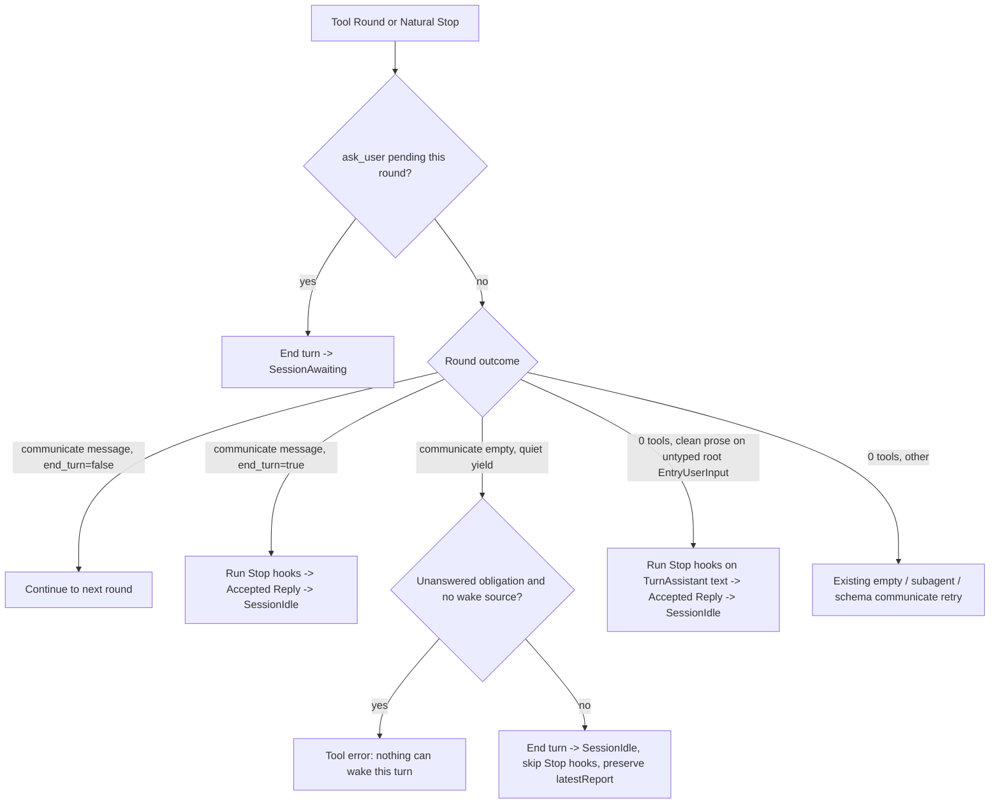

# `communicate` Quiet Yield, `end_reason` Removal, and Root Bare-Text Fallback

## Intent and why

Evener's `communicate` tool grew to carry lifecycle state that belongs to the runtime (`end_reason: "done" | "needs_response" | "waiting_on_work"`), forced every conversational message to emit an empty `output: {message: "", data: {}, artifacts: []}` envelope, split the tool schema between interactive root sessions and subagents (`WithCommunicateEndReason`), and relied on a prompt and runtime exception (`agent/prompts/system.md.tmpl:132` and `routeNoToolCalls` in `agent/session_lifecycle.go:354`) telling agents to acknowledge no-op notifications in one line of bare plain text (`"Noted: ..."`) with no tool call.

That design caused four production problems:

1. **Bare-text notification acknowledgements trigger `<end_of_turn>` rollovers on `gemini-4-neon`.** Across `37,070` `communicate` calls with empty `ContentText` in 30 days, `0` rolled over, whereas `100%` of `03507HVKeWCiXCzGHXBqyK`'s `41` rollovers and `100%` of `03516xVgaKl2CjlpkA0mmb`'s `3` rollovers on `/interactions` (`Turns 553, 602, 967`) began with bare-text wait/acknowledgement prose (`"Noted: ..."`, `"Received X; waiting for Y"`). Only a `function_call` forces Vertex `/interactions` into a hard `status: "requires_action"` stop.
2. **Subagents waiting on their own background shell jobs (`go test`) prematurely report completion.** Because subagents lacked a non-reporting yield, calling `communicate(end_turn=true, message="Waiting on go test...")` latched `acceptCommunicateTerminal` and `recordTerminalSeen`, delivering a premature `OutcomeCompleted` report when the shell job exited across finalization or forcing `result_schema` delegates to invent dummy schema fields just to pause.
3. **`needs_response` duplicated `ask_user` while muddying `SessionAwaiting`.** Web Rail `Needs you` (`docs/product/attention-navigation.md`), Phone Board `Needs you`, Phone alerts (`docs/product/session-activity.md`), `notifications/attention.ts` (where `needsResponse` is unreachable behind `levelFromState`), and `session_lifecycle.go:565`'s autonomous-wake gate already ignore `needs_response` in favor of `askPending > 0`, leaving ~150 lines of 5-second quiet-period timers and restore transcript scans with no actionable UI object.
4. **Root bare-text scolding killed 4 root sessions and burned `1,061` retry turns in 30 days**, `85.9%` of which merely re-wrapped the same prose in `communicate` even though Hub, mobile-native, and CLI already render `TurnAssistant` `ContentText` visibly at all detail presets.

This design reduces `communicate` to one uniform schema across every agent role: a message ends the turn with a final reply unless `end_turn: false` makes it a progress update, and an empty call `communicate({})` ends the turn quietly without sending anything.

## Goals

- Unify `communicate` across interactive roots, headless roots, subagents, and observers with three optional properties: `message`, `end_turn` (default `true`), and `output`.
- Support quiet turn termination via `communicate({})` (or `{"end_turn": true}` with empty/omitted `message` and no `output`) for both waiting on live background work and acknowledging no-op notification or watch wakes on a hard `function_call` boundary.
- Delete `end_reason`, `waiting_on_work`, and `needs_response` from `communicate`, along with `WithCommunicateEndReason`, `offersEndReason`, `HasEndReason`, and the 5-second `needs_response` quiet-period timer and restore scanner; make `ask_user` the sole conversational owner of `SessionAwaiting`.
- Make `output` optional on ordinary replies, progress updates, and quiet yields; enforce `result_schema` and `WithAllowedDecisions` strictly on final replies (`end_turn: true` with non-empty `message` or present `output`), never on `end_turn: false` updates or `communicate({})`.
- Preserve the dead-wait guard (`2026-11-01` shepherd bug) without `waiting_on_work`: reject `communicate({})` on an unanswered turn when nothing can wake the session, while allowing `communicate({})` unconditionally on admitted notification and attention-only wakes.
- Key Hub completion watches (`agent/job_watch_hub.go:587`) off an **accepted final reply** rather than `EndReason == "done"` or raw `hasWakeableWork()`, so pausing with `communicate({})` while 3 delegates run never completes a watch, while delivering a final reply with an unrelated background dev server running still completes cleanly.
- Add a Claude Code `--brief`-style root bare-text fallback: keep teaching `communicate` in prompts (and replace `system.md.tmpl:132`'s bare-text `"Noted:"` rule with `communicate({})`), while accepting clean natural-stop prose (`FinishReasonStop`, zero tool calls, non-blank text) on untyped root `EntryUserInput` turns through the same accepted-reply path.
- Update evergreen product documentation (`docs/product/lifecycles.md`, `docs/product/attention-navigation.md`, `docs/product/session-activity.md`, `docs/product/subsystems.md`) in the same change.

## Non-goals and anti-goals

- **No runtime inbound rollover string-filtering or multi-step `/interactions` truncation in this change.** Live inbound rollover protection is tracked separately in GitHub issue `#7460`.
- **No new tool in the registry.** Quiet yields use `communicate({})`, keeping the tool surface at one communication/turn-end tool.
- **No heuristic prose parsing.** Never inspect `message` text for phrases like `"Waiting on CI"` to guess whether a reply is a wait.
- **No new backward-compatibility shims on the live tool schema.** Do not advertise `end_reason` on `communicate`. Retain read-only decoding of historical `end_reason` / `communicate_end_reason` records already stored in transcripts (`job_watch_hub.go` replay of old `"waiting_on_work"` / `"needs_response"` entries must continue not to count them as completed).
- **No bare-text fallback on subagents, structured-schema roots, or autonomous notification wakes.** Subagents still owe an explicit `communicate` final report, `--output-schema` / `AllowedDecisions` sessions still owe validated `output`, and notification/watch wakes teach `communicate({})`.

## Constraints

- `DefCommunicateNamed` keeps `Strict: &strictFalse` (`strict: false`) so OpenAI Responses and other strict-capable adapters do not force-require optional `message`, `end_turn`, or `output` fields.
- Configured `--result-tool-name` overrides (`SessionConfig.ResultToolName`), exact `json.Number` preservation inside `output` (`unmarshalCommunicateArguments`), and atomic first-winner terminal capture (`#570`) must remain intact.
- Historical transcripts on disk may carry `TurnCommunicate.EndReason` (`"done"`, `"waiting_on_work"`, `"needs_response"`) and `communicateEndState` without the new quiet/accepted fields; replay and `doctor_evener` must read historical transcripts cleanly without migrating files on disk.
- `internal/apptranscript` (`apptranscript.go:751-885`) and `agent/transcript_render.go` (`writeResultToolMessage`) currently treat a `communicate` call whose extracted `message` is `""` and `rawArgs != ""` as a malformed healed call and render `communicateRawFallbackText(rawArgs)` (`"{}"`) as a visible `agentMessage`. A successful quiet `communicate({})` must project **zero** `agentMessage` or `commandExecution` items on both live streaming and transcript reload.
- `agent/watch_types.go:29` maps `assistant.tool` (and wildcard `*` watches) to `events.EventToolCallEnd`. Suppressing only `EventCommunicate` on a quiet `communicate({})` would still wake an observer watching `*` or `assistant.tool` on the observed session's quiet ack. Successful quiet `communicate({})` calls must also be excluded from watch firing in `evaluateWatchEvent` / `watchEventFilterMatches` (while erroring `communicate({})` calls remain observable).

## Approaches Considered

1. **Five-mode or two-axis control parameters (`communicate(mode=...)` or `communicate(deliver: bool, next: "continue" | "wait_for_work" | "finish")`).**
   Replaced `end_turn` + `end_reason` with explicit delivery and `wait_for_work` enums. Rejected because baking `"wait_for_work"` into a communication tool asks the model to classify runtime liveness and creates a Cartesian matrix of control flags.
2. **Variant B (`gpt-6.2-astra` council seat): `communicate({ message?, result? })` with `end_turn` removed.**
   Used `message` for non-terminal updates, `result` for terminal answers, and `{}` for quiet yields. Rejected because existing skills, plugins, and model habits calling `communicate({"message": "Done!"})` or passing `end_turn` would either fail schema validation or loop forever instead of ending the turn.
3. **Literal two-tool split: `communicate` (always requires `message`) + 0-arg `yield({})`.**
   Kept `communicate`'s name 100% literal at the cost of adding another tool to every session's registry and prompt. Rejected by Jesse in favor of keeping a single tool.
4. **Variant A (3-of-4 council majority: `gpt-6.2-sol`, `gemini-4-carbon`, `kimi/k3.1-pro` — Chosen by Jesse): `communicate({ message?, end_turn?: bool = true, output? })` where `{}` is a quiet yield.**
   Deletes `end_reason`, `waiting_on_work`, and `needs_response`; makes `end_turn` default to `true` and `output` optional; uses `{}` for quiet waits and notification acknowledgements; keeps full skill/plugin compatibility with `end_turn: true | false`; and adds root `EntryUserInput` bare-text fallback.

## Decisions from Jesse

1. **Single tool (`Variant A`):** Keep one `communicate` tool across all sessions (`message?`, `end_turn?: boolean` defaulting to `true`, `output?`), with `communicate({})` (no `message`, `end_turn` omitted/`true`, no `output`) ending the turn quietly without sending anything.
2. **Delete `end_reason`, `waiting_on_work`, and `needs_response`:** Remove model-declared wait/await states from `communicate`; `ask_user` owns conversational `SessionAwaiting`.
3. **Claude Code `--brief`-style root bare-text fallback:** Keep teaching `communicate` in prompts (and teach `communicate({})` instead of bare-text `"Noted:"` on wakes), while accepting clean natural-stop prose on untyped root user turns without scolding.
4. **Split `#7460`:** Keep live inbound rollover filtering/truncation separate in issue `#7460`.

## Detailed Design

### 1. Unified `communicate` Schema and Validation

`DefCommunicateNamed(name)` in `agent/internal/tool/definitions.go` defines the single schema shared by roots, headless sessions, delegates, and observers:

```json
{
  "name": "communicate",
  "strict": false,
  "parameters": {
    "type": "object",
    "additionalProperties": false,
    "properties": {
      "message": {
        "type": "string",
        "description": "Text to send to your human partner or parent agent. Omit when ending your turn with nothing to send."
      },
      "end_turn": {
        "type": "boolean",
        "default": true,
        "description": "true (default): end this turn. false: send message as a progress update and continue working in the next round."
      },
      "output": {
        "type": "object",
        "additionalProperties": false,
        "description": "Optional structured payload for a final reply.",
        "properties": {
          "message":   { "type": "string" },
          "data":      { "type": "object", "additionalProperties": true, "properties": {} },
          "artifacts": { "type": "array", "items": { "type": "string" } }
        }
      }
    }
  }
}
```

*(Engineering call on `output.message`: keeping optional `message` inside the default `output` properties map preserves compatibility with skills/callers that still pass `output: {message: "", data: {}, artifacts: []}`, while removing `"required": ["message", "data", "artifacts"]` and top-level `"required"` so ordinary callers omit `output` entirely and `#627` default-filling remains harmless when `output` is supplied.)*

#### Argument Normalization & Validation Rules (`agent/session_tools_communicate.go`)

1. `endTurn` defaults to `true` when `args["end_turn"]` is absent; if present, schema validation already enforces `boolean`.
2. `message` is `strings.TrimSpace` of `args["message"]` (falling back to `strings.TrimSpace(originalOutput.Message)` only when default-envelope `output.message` is non-empty).
3. Determine whether structured `output` was meaningfully supplied:
   - Under a custom `result_schema` or `AllowedDecisions` (`!usesDefaultCommunicateOutputEnvelope(resultToolDef)`): `_, outputPresent := args["output"]` (key presence, never truthiness or non-nullness, because a caller's `result_schema` may legitimately accept `{}` or `false` or `0`).
   - Under the default envelope: `explicitNodeOutput || hasMeaningfulRawOutput(rawOutput)` (so legacy callers passing the empty boilerplate `output: {message: "", data: {}, artifacts: []}` alongside `end_turn: true` and `message: ""` still count as a quiet yield rather than a structured payload error, while non-empty `data`/`artifacts` without `message` is rejected).
4. **Four exhaustive cases:**
   - **Case A — Progress update (`!endTurn`):**
     - Requires `message != ""` (reject whitespace-only/missing `message` with `"communicate with end_turn=false requires a non-empty message"`).
     - Rejects custom-schema/non-empty `output` on `!endTurn`? Wait: existing callers sometimes pass empty default `output: {message:"", data:{}, artifacts:[]}` on `end_turn=false` — allow empty default `output` for compatibility, and do **not** require `result_schema` on `!endTurn` updates! If `output` is present under a custom `result_schema`, JSON schema validation still validates its shape.
   - **Case B — Final reply (`endTurn && message != ""`):**
     - If the session carries a custom `result_schema` or `AllowedDecisions` (`requiresStructuredFinalOutput`), `outputPresent` must be `true` (and validated against `output`'s schema); otherwise return a recoverable tool error naming the missing `output` requirement before delivery or terminal capture.
     - Delivers `TurnCommunicate` + `EventCommunicate`, captures atomic first-winner terminal reply (`acceptCommunicateTerminal`), drains daemon steering into `inbox`, and ends the turn.
   - **Case C — Contradictory structured-only empty message (`endTurn && message == "" && meaningfulOutputPresent`):**
     - Return a recoverable tool error (`"communicate with output requires a non-empty message"`), unless `originalOutput.Message` supplied `message` under the default envelope.
   - **Case D — Quiet yield (`endTurn && message == "" && !meaningfulOutputPresent`):**
     - Check the **dead-wait guard** (see §2 below). When permitted:
       - Do **not** call `deliverCommunicate` (no `TurnCommunicate`, no `EventCommunicate`).
       - Do **not** call `acceptCommunicateTerminal` or `recordTerminalSeen` or overwrite `s.latestReport`.
       - Set `s.comm.quietEnd = true` under `s.mu` (and drain daemon steering into `inbox` the same way `endTurn` does so steering arriving mid-round is surfaced or preserved cleanly — wait: check steering! If daemon steering arrived during the round, putting it in `inbox` when the turn is ending with no next model round would drop it unless either `quietEnd` leaves steering queued for the next wake OR drains it the same way `endTurn=true` already does: look at `session_tools_communicate.go:152` comment: *"Client-authored steering remains durable pending work for wakeForPendingSteering... daemon entries..."* Leaving steering untouched on `quietEnd` or draining daemon-only steering matches `endTurn=true`; keeping `drainSteering()` identical to `endTurn=true` preserves existing steering invariants).
       - On a leased `EntryDelegateAttention` turn with no prior mutating/reporting tool activity and `requirement == delegateCompletionAttentionOnly`, record `recordAttentionNoAction(lease)`.
       - Return `tool.StateResult` with display JSON `{"accepted": true, "end_turn": true, "quiet": true, "inbox": inbox}` (plus `runningJobsEndTurnWarning` omitted on quiet yields? Yes — warning the model that jobs are running when it explicitly called `communicate({})` *in order to wait on running jobs* would be noise; keep `runningJobsEndTurnWarning` on visible final replies only!) and typed state `communicateEndState{Accepted: &tr, EndTurn: &tr, Quiet: &tr}`.

#### `WithCommunicateOutputSchema` & `WithAllowedDecisions` (`agent/provider/profile_overrides.go`)

- Stop adding `"output"` to top-level `Parameters["required"]` in `replaceCommunicateOutputSchema` and `addDecisionToSchema`. Keep `output`'s inner schema (including `decision` in `output.required` for `WithAllowedDecisions`) exact so `t.Schema.Validate` validates `output` whenever `output` is present, and enforce `"output"` presence in `registerCommunicateTool` (or `PreValidate`) **only on Case B (final reply: `endTurn && message != ""`)**.
- This lets a `result_schema` or `AllowedDecisions` session call `communicate({"message": "...", "end_turn": false})` for mid-run updates and `communicate({})` to wait on background jobs or acknowledge wakes without fabricating placeholder schema objects.

### 2. Turn Settlement, Dead-Wait Guard, and Subagent Drain



#### Dead-Wait Guard on `communicate({})`

When `communicate({})` is called:
- **Admitted `EntryNotification` or `EntryDelegateAttention` wake:**
  - On a **root session** (`!s.reportsToParent()`): `EntryNotification` is an autonomous wake; `communicate({})` is **always permitted**, even when `hasWakeableWork() == false` (covering the trailing straggler notification after all work is already handled).
  - On a **subagent / observer** (`s.reportsToParent()`):
    - Check **drainable owned work** (`s.treeHasOutstandingWork()`, covering owned running jobs, active/deliverable child delegates, pending notifications, and pending watch sends — deliberately excluding unfired standing watches, because `drainForFinalization` does not block on unfired standing watches; observers finish setup with their readiness report and future fires start new attention generations).
    - If drainable owned work is `true`: permitted (parks back into `drainForFinalization` / `keepingReport`).
    - If drainable owned work is `false`: permitted when `s.communicated()` is already `true` (post-report housekeeping wake in `keepingReport`) **or** when the generation is attention-only (`EntryDelegateAttention` where `recordAttentionNoAction(lease)` succeeds / `completionDecision != delegateCompletionNeedsNudge`). If the subagent owes a `reportRequired` result (`!s.communicated()`) and has no drainable owned work, **refuse `communicate({})`** with `"Nothing can wake this turn, and you have not sent your report yet. Start the work, or send your final report with communicate(message=...)."` so a worker subagent cannot pass the yield gate on an unfired standing watch or after its last job finished only to hit the post-drain missing-report nudge.
- **Initiating / continuation turns (`EntryUserInput`, `EntryContinuation`, `EntryRuntime`):**
  - **Root session (`!s.reportsToParent()`):** permitted **iff** `s.hasWakeableWork()` is `true` (a running shell job, running/driving delegate, armed watch/timer on self, runnable steering, or pending notification exists to wake this session).
  - **Subagent (`s.reportsToParent()`):** permitted **iff** drainable owned work (`s.treeHasOutstandingWork()`) is `true`.
  - Otherwise (when `!s.communicated()`): **refuse in-band** with `"Nothing can wake this turn. Start the work or arm a watch before yielding, or send your final reply with communicate(message=...)."`

#### Active Goal Interaction (Unchanged Ownership)

`communicate({})` adds no new goal-scheduler state (`agent/session_goal.go`, `agent/session_lifecycle.go:980-1045`): `communicate` already counts as non-progressing in `toolResultsMadeProgress`, `EntryNotification` turns already skip the goal gate (`RanKind == EntryNotification`), and `hasWakePendingDependents` / `goalDependentsHeld` continues to own holding the goal engine on live delegates and watched jobs.

#### Subagent Owned-Job Drain (`agent/subagents.go` & `agent/session_jobtree_drain.go`)

In `(*subagent).run` (`agent/subagents.go:2613-2680`):
- When `processInputKindWithProvenance` ends via a quiet yield (`a.sess.quietlyYielded()`) and the subagent has wakeable/drainable work:
  - **Skip** the pre-drain `deliverCommunicateNudge` (`shouldNudge = false`) so the subagent is not scolded for omitting its report before its background `go test` or child delegate has finished.
  - Enter `drainForFinalization` (`drainJobTreeKeepingReport`). When the owned background shell job or child delegate completes, the drain runs the `EntryNotification` turn where the subagent reads the output and calls `communicate({"message": "...", "output": ...})`.
  - If `drainForFinalization` finishes and the subagent *still* has not delivered a required report (`completionDecision(lease) == delegateCompletionNeedsNudge`), the existing **post-drain** `deliverCommunicateNudge` at `subagents.go:2645` fires as today, guaranteeing a `reportRequired` subagent never settles with an empty `completed` packet.
- Also check nested child-delegate wake routing inside `drainJobTreeKeepingReport` (`agent/session_jobtree_drain.go:1313-1342` / `subagents.go`): verify with a deterministic test that both an owned background `shell` job and a spawned sub-delegate wake a quietly-yielded subagent cleanly to produce its single final report.

### 3. `SessionAwaiting` Owned Solely by `ask_user` (`needs_response` Deleted)

- Delete `CommunicateEndReasonDone`, `CommunicateEndReasonNeedsResponse`, `CommunicateEndReasonWaitingOnWork`, `CommunicateEndReasons`, and `WithCommunicateEndReason` (`agent/internal/tool/definitions.go`).
- Delete `offersEndReason` (`agent/session_tool_registry.go`) and `HasEndReason` (`agent/prompt_data.go`, `agent/session_prompts.go`).
- Simplify `armAwaitingAtSettle` (`agent/session_state.go:796-905`): `SessionAwaiting` is entered at settle **iff** `len(s.askPending) > 0`. Delete `needsResponseQuietPeriodDefault`, the 5-second `AfterFunc` timer, `restMu`, `restOwedGeneration`, `resumeQuietRest`, `EventStatusSettled` emission for `needs_response`, and `endedOnNeedsResponse` / `communicateEndReasonOf` restore scanning (`agent/session_tools_ask.go:800-860`). Historical transcripts that ended on `needs_response` without an unresolved `ask_user` restore to `SessionIdle` (matching how Web Rail and Phone Board already display them).
- Clean up dead `needsResponse` / `needsResponseRest` predicates in `hubapi/attention.go`, `appwire-client/typescript/railSessionState.ts`, and `cmd/evener-hub/frontend/src/notifications/attention.ts` (keeping any wire struct JSON fields optional/zero-valued if required for wire compatibility across older daemons).

### 4. Root Bare-Text Fallback (`Claude --brief` Style)

- **Scope:** Applies **only** when all four hold:
  1. Root session (`!s.reportsToParent()`),
  2. `kind == EntryUserInput` (never `EntryNotification`, `EntryContinuation`, or `EntryDelegateAttention`),
  3. Session has no custom `communicate` schema or `AllowedDecisions` (`usesDefaultCommunicateOutputEnvelope`),
  4. Model finished cleanly (`resp.Finish.Reason == llm.FinishReasonStop`, `len(calls) == 0`, `!noContent`, non-blank `lastText`).
- **Mechanics (`agent/session_lifecycle.go` & `agent/session_tool_round.go`):**
  - Instead of entering `handleNoToolCalls` scolding, accept `lastText` through a shared boundary helper:
    1. Record the accepted reply on `s.comm` (`s.comm = communicateResult{called: true, text: lastText, reply: lastText}`) **without** appending a duplicate `TurnCommunicate` entry (since `TurnAssistant` is already persisted in the transcript and rendered as `agentMessage` by `apptranscript`, Hub, mobile-native, and CLI `EventAssistantTextEnd`).
    2. Run `deliverIfCommunicated` (`HookStop` with `LastAssistantMessage = lastText`). On **both** explicit `communicate` and root bare-text fallback:
       - If `stopResult.Blocked` is `true`, clear the pending accepted-reply candidate (`s.comm = communicateResult{}`) so no stale candidate survives into the continued round and no `hubCompletion` verdict fires for a blocked reply.
       - If `stopResult.Stopped` is `true`, `replaceAcceptedReply(text)` replaces the reply on both paths (`TurnCommunicate` replacement as today) and marks the replacement as the accepted final reply.
    3. Emit an accepted-reply completion marker / observation (only after `Stop` hooks allow or replace the reply) so `cmd/evener/run.go` (`ProcessInput` return value), `doctor_evener` (`outcomeHint`), and `job_watch_hub.go` (`hubCompletion`, both live and replayed) see the accepted root reply identically to `communicate({"message": lastText})`.

### 5. Transcript Projection, Reload Parity, and Watch Suppression

1. **Quiet `communicate({})` in `apptranscript` & `transcript_render.go`:**
   - `communicateEndState` (`agent/session_tools_communicate.go:281`) gains `Quiet *bool` (`json:"communicate_quiet,omitempty"`).
   - In `internal/apptranscript/apptranscript.go:834-877`: when `part.ToolResult` carries `communicate_quiet: true` (or when `msg == ""` and raw arguments parse cleanly as a valid JSON object with no `"message"` / `"output"`), emit **no** `agentMessage` and **no** `communicateRawFallbackText` item. (Malformed unparseable raw bytes that were not a quiet yield keep the existing fallback.)
   - Apply the same guard in `agent/transcript_render.go` (`writeResultToolMessage`) so markdown transcript views render quiet `communicate({})` concisely without dumping raw `"{}"` as assistant prose.
2. **Quiet `communicate({})` in `watch_fire.go` (`assistant.tool` and `*` watches):**
   - When `EventToolCallEnd` carries `communicate_quiet: true` in `ToolCallEndData.ToolState` and `Error == ""` (`toolCallStatus == "ok"`), `evaluateWatchEvent` returns a miss (`matched: false`, without advancing `eventCount`), so neither `assistant.tool` nor wildcard `*` watches wake an observer when a watched session yields quietly with `communicate({})`. Failed/rejected `communicate({})` calls (`Error != ""`) still match `assistant.tool` normally.
3. **Hub Completion Watch (`agent/job_watch_hub.go:587` & `internal/apptranscript/notice.go`):**
   - Preserve `job_watch_hub.go`'s existing turn-anchoring (`cfg.hubTurnID` and `hubAnswerLookup` over `AnswerToTurnIDs` for `ask_user` resolutions; do not invent new cross-notification-turn continuation links). Just as `waiting_on_work` previously prevented a root's turn A wait message from falsely completing turn A's watch, `communicate({})` on turn A emits no `TurnCommunicate` at all so turn A never falsely completes its watch.
   - For `TurnCommunicate` entries: historical entries with `EndReason == "waiting_on_work"` or `EndReason == "needs_response"` continue to evaluate `terminal = false` on replay. All new `TurnCommunicate` entries are written **only** for visible messages (`Case A` `EndTurn: false` and `Case B` `EndTurn: true`), and `TerminalAccepted` is stamped true only when `deliverIfCommunicated` accepts the turn-ending reply (not when `Stop` hook `Blocked` reopens the turn).
   - For root bare-text fallback replies (where no `TurnCommunicate` entry is written to avoid duplicate chat cards): stamp `AcceptedReply: true` on the `TurnAssistant` turn (or `TurnCompletion`) after `Stop` hooks pass, so `apptranscript` attaches `Observation{TurnID, EndTurn: true, TerminalAccepted: &true, CausalKnown, Causal}` to that final `agentMessage` `ThreadItem`, letting live and replayed `hubCompletion` watches complete identically on root bare-text fallback replies without rendering a duplicate message!

### 6. System Prompt & Golden Updates

- **`agent/prompts/system.md.tmpl`:**
  - Line ~100 (`Background work`): replace `call {{ .ResultToolName }} with end_turn=true{{ if .HasEndReason }}, end_reason="waiting_on_work",{{ end }} and one sentence saying what you are waiting for` with: when you want to post a brief status note before waiting, send an update (`end_turn=false`) or include `message`, and when you have nothing to add while work runs, end your turn quietly with `{{ .ResultToolName }}({})`.
  - Line ~132 (`Reporting`): delete `"The one exception is a notification or watch frame that needs nothing from you: note that in one line of plain text and call no tool."` and delete the `{{ if .HasEndReason }}` `end_reason` sentence. Replace with: `"When a notification or watch frame needs nothing from you, or you are yielding while work you started keeps running, call {{ .ResultToolName }}({}) with no message to end your turn quietly."`
- Update `EndTurnToWait`, `ObserverReporting`, and `WithCommunicateDelegateUpdates` in `agent/internal/tool/definitions.go`, regenerate/update `agent/testdata/messagingprompt/*.md`, and update `docs/product/{lifecycles,attention-navigation,session-activity,subsystems}.md`.

## What's Left to the Builder

- Exact struct field names on `s.comm` (`quietEnd` vs enum) and `schema.Turn` (`AcceptedReply bool` vs observation helper) for root bare-text `hubCompletion` parity.
- Exact test file organization when retiring obsolete `session_needs_response_*_test.go` / `session_waiting_on_work_test.go` assertions and replacing them with behavior tests for `communicate({})` dead-wait refusal, subagent `go test` + sub-delegate quiet drain, `result_schema` delegate updates + quiet yields, `apptranscript` reload silence on `communicate({})`, wildcard `assistant.tool` watch silence on `communicate({})`, `hubCompletion` on dev-server final reply vs 3-delegate quiet yield, and root `EntryUserInput` bare-text fallback.
