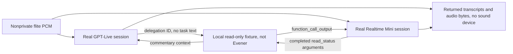

# Hosted voice protocol spike — 2026-11-04

**Both hosted endpoints worked. Live preserved a correction but supplied no
durable user-intent boundary. Realtime Mini supplied completed function arguments
and acknowledged cancellation and truncation.** Neither result qualifies a phone.

This is throwaway research for Evener's persistent chief of staff. No product
code, Evener manager connection, microphone, speaker, browser, or iPhone was used.
**Locked-iPhone listening remains untested and is still required.**

## Findings

- Inventory returned HTTP 200 with 140 model IDs, including `gpt-live-1`,
  `gpt-realtime-2.1`, and `gpt-realtime-2.1-mini`. Both measured models completed
  actual HTTP 101 WebSocket sessions with those resolved model names. Mini was
  chosen to limit cost; full `gpt-realtime-2.1` was **not** measured.
- **Live:** two delegations contained only `type`, `event_id`, `offset_ms`, and
  `delegation`. The first followed the last input transcript fragment by 28 ms,
  but its offset was that fragment's start, not an end-of-turn boundary. No turn
  completion or explicit speech-cancel acknowledgement arrived. The correction
  clip began while incoming PCM exceeded the signal threshold; subsequent Alpha
  text ended at “running”. The returned answer then said “Beta is blocked while
  a test’s being repaired.” This preserves the correction in the returned text,
  not proof of physical interruption or durable manager intent.
- **Mini:** the model itself returned `read_status({"project":"Alpha"})`, then
  `read_status({"project":"Beta"})`. On correction, the server returned
  `response.done` with `cancelled/client_cancelled` 88.3 ms after cancellation.
  It acknowledged `conversation.item.truncate` at **470 ms of simulated playback**
  after 90.6 ms. The probe discarded 3,529.2 ms of queued audio. The final generated
  transcript said Beta was blocked and no writes or deployments had been made.
- **No exact reading guarantee:** Live paraphrased commentary. Mini also changed
  the supplied summary despite the instruction to read it verbatim: the Beta
  reply added “Summary:” and omitted “Fixture only.” Do not equate returned text,
  injected text, accepted context, and audio the user heard.

One corrected sample per candidate, not p95, reliability, or a quality ranking:

| Headless observation | Live | Realtime Mini |
| --- | ---: | ---: |
| Local session elapsed | 25.555 s | 17.844 s |
| First delegation/completed function arguments after request end | 903.9 ms | 1,046.4 ms |
| First PCM peak ≥185 after request end, **not audibility** | 1,561.2 ms | 1,492.8 ms |
| Received PCM bytes, including possible silence | 1,090,560 | 736,800 |
| Final reported usage | 23 seconds | 4 response usage records |
| Calculated sample cost, no cache discounts | $0.0191667 | $0.0111834 |

Times are relative to the estimated end of the last input frame, not an actual
microphone utterance. The 5.095-second source request took 5.513 s / 5.388 s to
send because pacing never catches up in bursts. Maximum frame gaps were 25.85 /
28.77 ms. This is a protocol sample, not a controlled latency comparison.

### Two retained pilot failures, then two corrected samples

`results.json` retains **all four sessions**. `summary.json` selects attempts 1
and 3 (zero-based) as the analyzed samples and excludes these pilot metrics:

1. Initial Live triggered correction on the first post-fixture audio packet.
   Packets arrived before spoken output; this did not establish barge-in. The
   corrected trigger waits for “Alpha” in output text and separately logs PCM
   activity. Live's first packet was still 4.829 s **before** the request ended,
   so first-packet latency must not be presented as first speech.
2. Initial Mini's tool-call response also contained speech. That exposed an
   invalid per-item playback clock, which could simulate two items playing at
   once. A two-item test failed before the FIFO fix (wrong result: 200 ms played
   on the second item), then passed (400 ms on the first, 0 on the queued second).
   Its original acknowledged 467 ms offset is excluded. The final run used the
   corrected FIFO and confirmed 470 ms. It had no initial spoken preface, so the
   multi-item FIFO case is covered offline, not claimed as a second live result.

Exactly two corrective retries were used. All four sessions were under 27 s.
Reported-usage cost for **all attempts**, without cache discounts, is at most
**$0.0619962**, within $0.60 reserved and the $1 authorized budget. Live reported
22 + 23 seconds. Both Mini runs returned usage for all four responses. This is
calculated API usage, not a checked billing invoice. No other inference ran.

## Scope and evidence

- `probe.py`: opt-in, bounded, reproducible WebSocket experiment.
- `requirements.txt`: `websocket-client==1.9.0`, installed only in scratch.
- `fixture-status.json`: synthetic Alpha/Beta state, actually read from disk.
- `results.json`: model inventory, exact clip scripts and PCM hashes, sanitized
  event timestamps/counts, returned transcripts, fixture reads, usage and costs.
- `summary.json`: compact conclusions, pilot exclusions, derived timing and cost,
  independently checked against the event records.
- Python 3.12.3, FFmpeg 6.1.1 with its local `flite` `slt` voice. No paid TTS.
  Input is raw mono PCM16 little-endian, 24 kHz, in 20 ms frames paced by a
  monotonic clock, including silence between clips. No audio binary is retained.

## Current official sources

Fetched independently on 2026-11-04, before authenticated requests:

1. [Live WebSocket transport](https://developers.openai.com/api/docs/guides/voice-websockets?api=live)
2. [Live delegation](https://developers.openai.com/api/docs/guides/live-delegation)
3. [Live conversations](https://developers.openai.com/api/docs/guides/live-conversations)
4. [Realtime conversations](https://developers.openai.com/api/docs/guides/realtime-conversations)
5. [Realtime transcription](https://developers.openai.com/api/docs/guides/realtime-transcription)
6. [Voice latency and cost](https://developers.openai.com/api/docs/guides/voice-latency-cost)
7. [Live model pricing](https://developers.openai.com/api/docs/models/gpt-live-1)
8. [Realtime 2.1 Mini pricing](https://developers.openai.com/api/docs/models/gpt-realtime-2.1-mini)
9. [Realtime session schema](https://developers.openai.com/api/docs/api-reference/realtime-client-events/session/update)

The guide's $0.05/min example is illustrative; the Live model page independently
lists that actual rate, billed per second. Mini lists audio input/output at
$10/$20 per million tokens and text input/output at $0.60/$2.40. Calculations
claim no cached-input discount. Input transcription is disabled for Mini, so
this experiment does not measure independent ASR quality or cost.

## Safety and reproduction

Read `probe.py` before running. These commands make real billable requests.
Run serially with one results file so reservations and retries are shared.
Do not overwrite the recorded `results.json` to repeat an experiment. A later
run needs its own authorization and fresh output file.

```bash
HOSTED=docs/superpowers/spikes/2026-11-04-voice/hosted
SCRATCH="$EVENER_SCRATCH_DIR/voice"
python3 -m venv "$SCRATCH/venv"
"$SCRATCH/venv/bin/python" -m pip --disable-pip-version-check --no-cache-dir install -r "$HOSTED/requirements.txt"
PYTHON="$SCRATCH/venv/bin/python"
"$PYTHON" "$HOSTED/probe.py" --self-check

# The authorized source is only opened for an exact private copy, never sourced.
# The copy is mode 0600, parsed only for OPENAI_API_KEY, and immediately unlinked.
# No key is placed in argv, the environment, repository, logs, or a subprocess.
KEY_SOURCE=/home/jesse/git/terminal-bench/.env
OUT="$SCRATCH/reproduction-results.json"
EVENER_VOICE_LIVE=1 "$PYTHON" "$HOSTED/probe.py" --mode inventory \
  --key-source "$KEY_SOURCE" --scratch "$SCRATCH" --out "$OUT"
EVENER_VOICE_LIVE=1 "$PYTHON" "$HOSTED/probe.py" --mode live \
  --key-source "$KEY_SOURCE" --scratch "$SCRATCH" --out "$OUT"
EVENER_VOICE_LIVE=1 "$PYTHON" "$HOSTED/probe.py" --mode realtime \
  --key-source "$KEY_SOURCE" --scratch "$SCRATCH" --out "$OUT"
```

Actual execution used `--out "$HOSTED/results.json"`, with modes in this order:
`inventory`, `live`, `live --corrective-retry`, `realtime`,
`realtime --corrective-retry`. All five commands exited 0. The first dependency
install omitted `--no-cache-dir`; the command above avoids incidental pip cache.
Do not repeat the pilot bugs: the delivered probe contains both fixes.

The source `.env` is never modified. Only fixed `https://api.openai.com` and
`wss://api.openai.com` endpoints receive the key. HTTP/WebSocket redirects and
proxies are disabled. Transport logging and raw exception/error messages are
suppressed. Errors retain HTTP status, exception class, provider error code/type
and sanitized access/billing flags, not request headers or response bodies.
The initial no-inference `GET /v1/models` must list the chosen model before a
measurement is allowed. This inventory does not itself prove session access.

Each session has a hard 60-second `SIGALRM` and socket shutdown. Normal finish
starts by 50 seconds, leaving time for Live's `session.closed`. Live uses client
delegation only, so no paid backend inference is launched. Realtime has automatic
responses disabled, at most four explicitly created responses, 192 output tokens
per response including tools, and at most 3,000 bytes of injected text/JSON.
Only two fixture reads are allowed. Both synthetic clips must be under 12 seconds.

A Live attempt reserves $0.05. A Mini attempt reserves $0.25. At most one initial
attempt per candidate and two corrective retries total are allowed. The largest
allowed combination reserves $0.80, below the $1 budget. The Mini reservation
uses maximum modality rates, 600 input audio tokens, 768 prior output tokens,
3,000 text bytes treated as tokens, and a 1,024-token protocol margin per response:
`4 * ((3000 + 600 + 768 + 1024) * 10 + 192 * 20) / 1e6 = $0.23104`.
This is a conservative engineering bound under the documented tokenizer/rates,
not a billing-account spending limit. Access rejection blocks retries of that
candidate; billing/quota rejection blocks every candidate. No other key is tried.
The final global billing guard was added and checked offline after the measured
runs; no actual run encountered an access or billing error.

## Interpretation rules



Live client delegation carries an ID and timeline offset, **not task arguments**.
The probe assigns Alpha/Beta from the known clip schedule, not transcript deltas.
That mapping is an experimental fixture, not a proposed intent parser or manager
integration. Transcript deltas never trigger side effects. Realtime instead
receives a `read_status` schema and must produce completed function-call arguments
before the same file is read. Only this latter argument choice is vendor behavior.

Live commentary is context for speech and may be paraphrased. An append
acknowledgement confirms context injection, not spoken delivery. Live has no
completed-turn event or output-audio-done event on this socket. Neither a transcript
delivery gap nor `session.delegation.created` establishes a durable user intent.

All timings are headless network observations, not physical audibility. Audio byte
counts can include silence. The updated probe records PCM peak above 185 (roughly
-45 dBFS) separately; this is a signal heuristic, not speech recognition. Realtime's
truncation offset comes from an arrival-driven simulated playback FIFO, not a
phone sound device. No acoustic echo cancellation, speaker feedback, wake word,
background lifetime, lock screen, reconnect, route change or cellular handoff was
tested. There is one corrected sample per candidate, not p95 or a quality ranking.
Returned transcripts concatenate generated deltas, including canceled or unplayed
words. The probe does not wait for all simulated output to play before exit.

## Checks and cleanup

- `python3 "$HOSTED/probe.py" --self-check`: opt-in, private-copy removal and
  unchanged fake source, literal parsing, redaction, attempt/retry budgets, blocked
  access/billing, response/output caps, simulated FIFO and Live trigger checks.
- A real invocation without `EVENER_VOICE_LIVE` and with a nonexistent key source
  exited 2 with `explicit_opt_in_required`, without creating output or reading a key.
- Independent offline tests exercised the separate dollar-budget and two-retry
  rejection branches and interrupted a local blocked connection with `SIGALRM`.
  No network was used for those checks.
- Independent saved-evidence assertions checked model resolution, session/frame
  limits, fixture hashes, Alpha/Beta arguments, matching cancellation/truncation
  IDs and offsets, token caps, final usage, and costs recomputed with `Decimal`.
- All scratch dependencies and synthesis scripts were removed after verification.
  Audio remained in memory only. Repository changes contain no key, audio binary,
  or dependency directory, and touch only the owned spike path. No commit or push
  was made.
