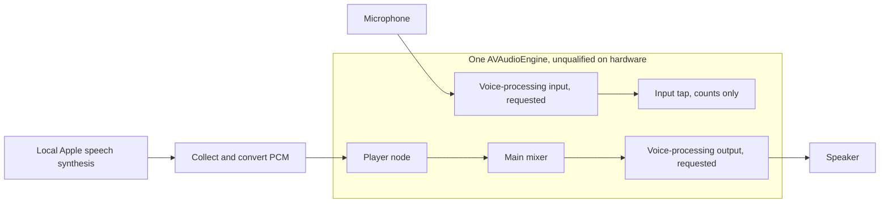

# Throwaway iPhone voice audio probe

This is **not persistent voice v1**. It is a standalone Swift audio-graph probe,
with a disarmed simulator smoke test. It does not implement wake words, ASR,
automatic barge-in, provider transport, or reconnection. No production files,
Apple registrations, provisioning, or TestFlight builds are involved.

The simulator-only identifier is
`dev.evener.experimental.voiceprobe20261104`. **Never register it with Apple,
and never replace it with `com.primeradiant.evener.native`.** The unprovisioned
device compile deliberately produces no installable application bundle.

## What the source does

`ProbeAppDelegate` retains `AudioProbe` independently of SwiftUI scenes. Only
foreground **Arm microphone** requests microphone consent and starts audio.
Backgrounding does not intentionally stop the service. `Info.plist` declares
`UIBackgroundModes = [audio]` and the microphone purpose string. Those facts
are prerequisites, not evidence that iOS will keep it running while locked.

Arm requests `.playAndRecord`, `.voiceChat`, `.defaultToSpeaker`, and Bluetooth
HFP support. It enables `setVoiceProcessingEnabled(true)` on a stopped engine
**before** reading final formats, connecting the player, and installing the
input tap. It then starts the engine and records the actual format and the
voice-processing flag. **`voiceChat` alone is not AEC.** Even a true
voice-processing flag does not measure echo suppression or wake-word accuracy.



**Play synthetic speech** uses `AVSpeechSynthesizer.write`, not direct synth
playback. The fixed utterance is collected in memory, converted to the graph's
PCM format, and scheduled on that same engine's player. This is the intended
playback-reference topology for voice processing, not a measured AEC result.
Apple synthesis is not provider TTS, and whole-utterance buffering is not a
low-latency streaming implementation.

**Stop playback, keep listening** advances a generation fence before stopping
synthesis and the player. Late synthesized buffers and playback completions
from older generations are rejected. The smoke test exercises the real stale
synthesis callback path while disarmed. It does **not** measure audible stop
latency, device output tail, actual queued-audio cancellation, or speech-driven
barge-in.

Interruption, hardware route change, media-service reset, or engine format
change disarms this probe and requires explicit foreground re-arm. This is a
deliberate fail-closed experiment choice, **not** the recovery behavior needed
by persistent voice v1. Engine teardown is deferred outside the configuration
notification, as `AVAudioEngine.h` requires.

### Telemetry and privacy

- The microphone tap reads **frame counts only**. No microphone samples are
  retained, inspected for speech, written to disk, or sent anywhere. There is
  no RMS/VAD/wake classifier and no cloud connection.
- JSON contains simulator/physical runtime class, OS version, phase, engine and
  voice-processing flags, callback/frame counts, monotonic first/last callback
  times and maximum gap, playback generations/counters, route **types**, sample
  rate, and the latest 256 lifecycle/control events. It excludes device names,
  route identifiers, transcripts, secrets, and raw audio.
- Timestamps use `ContinuousClock` relative to probe start, including system
  sleep. They do not export device boot uptime. Record the 5/30-minute physical
  test duration independently as well, and compare frame totals with the
  measured input sample rate.
- Capture counters reset when a new input tap is installed. Events and playback counters
  last for the process. Evidence is otherwise in memory until the user exports
  it. A force-quit loses unexported evidence and requires re-arm after launch.
- A small lock protects tap counters. PCM conversion runs on the main actor.
  These are bounded probe shortcuts, not a production real-time implementation.

## Build on an Apple Silicon Mac

Requirements: the installed Xcode Swift compiler and iOS/simulator SDKs, Bash,
and Python 3 for the smoke runner. The probe targets iOS 17+, independently of
the production app's iOS 16.4 minimum. It has no third-party dependencies.

Read the scripts first. They refuse existing output directories. There are no
Xcode package-setup, `sudo`, provisioning, Keychain, `codesign`, or publishing
commands. On the measured host, `simctl` itself attempted pending Xcode setup
and printed an authorization failure, even when the simulator operation
completed. Package receipts stayed unchanged. `swiftc` links Apple Silicon
executables normally, with no developer identity or provisioning profile.

From this directory on the Mac:

```sh
bash build.sh --help                 # Offline, also works on Linux
bash run-simulator-smoke.sh --help   # No Apple tools or filesystem writes
scratch=$(mktemp -d /tmp/evener-voice-ios.XXXXXX)
bash build.sh simulator "$scratch/build-simulator"
bash build.sh device-compile "$scratch/build-device"
bash run-simulator-smoke.sh "$scratch/build-simulator/VoiceProbe.app" "$scratch/smoke"
```

Both builds compile and link all three real Swift source files in Swift 6 mode.
They also compile and execute `Tests/PlaybackFenceCheck.swift` on macOS. The
device executable is **unprovisioned, not installable, and never run** by these
scripts. A successful compile checks symbols and source construction, not
hardware initialization. The script sets both `-sdk` and `SDKROOT`: the latter
was necessary for the link step to advertise SDK 27.2 rather than SDK 17.0 on
this toolchain. `vtool -show-build` independently checked the resulting metadata.

`run-simulator-smoke.sh` creates its own device set under the new run directory,
using iPhone 17 / iOS 27.0 by default. Pass an installed compatible runtime ID as
argument three if needed. It boots only its own simulator, installs only the
probe, waits for the app's disarmed smoke run, checks the exported JSON, and
shuts that simulator down. It never grants microphone access, presses Arm,
changes macOS microphone permissions, opens the shared Simulator GUI, or touches
an existing simulator's data. Boot/launch waits have 120-second failure bounds.

The smoke app exits itself after its SwiftUI view enters and its evidence is
written. This is not a persistence test or a visual-layout test. Read
`$scratch/smoke/disarmed-smoke.json` before removing your exact scratch path.

For a manual simulator UI run, use the same isolated device set and its UUID:

```sh
simctl="$(xcode-select -p)/usr/bin/simctl"
"$simctl" --set "$scratch/smoke/devices" list devices
# Substitute only the UUID just created by this run, never `booted` or `all`.
"$simctl" --set "$scratch/smoke/devices" boot PROBE_UUID
"$simctl" --set "$scratch/smoke/devices" launch PROBE_UUID dev.evener.experimental.voiceprobe20261104
# Launch without --disarmed-smoke leaves the interactive UI running.
# Do not Arm or grant host microphone permission as part of automation.
"$simctl" --set "$scratch/smoke/devices" shutdown PROBE_UUID
```

## Actual qualification

See [`evidence/results.md`](evidence/results.md) for exact commands, exit codes,
source hashes, toolchain/setup findings, and the simulator-only JSON. Builds
and simulated control flow must not be relabeled as a phone audio test.

## Physical iPhone and TestFlight are still separate work

No project signing or registration was performed. To run on a phone, the parent
must choose an approved **test** identity/signing route and make the device
available. An operator can create a new isolated SwiftUI iOS App project in
Xcode, replace its generated app/view with the three files in `Sources/`, use
iOS 17+ and Swift 6, and copy the microphone, background-audio, iPhone-family,
and scene settings from `Info.plist`. Do not copy this simulator bundle ID into
an Apple registration or overwrite the production app. Compile-only evidence
does not authorize distribution. TestFlight needs its own parent-approved
archive, export, upload, and physical install/acceptance decision.

Run the following on the real target phone, without a debugger for the lifetime
and battery checks. Export before/after evidence and record the observed result,
not just whether a button was pressed. Wake/ASR and network rows remain blocked
until those real components exist.

| Check | Required observation | Current probe boundary |
| --- | --- | --- |
| Foreground Arm | Permission accepted, `graph_started`, actual VPIO flag and formats, capture counters advancing | Source ready, hardware untested |
| Lock with **no playback**, 5 minutes then 30 minutes | Callback counts advance throughout, first/last times and maximum gap show no suspension, microphone indicator and battery/thermal cost recorded | Hardware untested, background flag is not proof |
| Speak wake phrase while locked, receive answer, speak over answer | Real wake accepted, response audible, real user speech stops output and stale generations cannot return | Wake/ASR/transport and automatic barge-in absent |
| Self-output and nonwake negatives | Own speech output never activates wake, overlapping human speech still works across volumes/distances | AEC/wake efficacy untested |
| Stop during synthesis and during audible playback | Generation advances, delayed old work rejected, audible stop tail measured independently | Manual stop available, audio path untested |
| Headset → speaker and back | Correct actual routes, no replay or leaked mic, explicit re-arm restores graph | Probe deliberately disarms, automatic recovery not implemented |
| Wi-Fi → cellular, disconnect/reconnect, locked auth refresh | Native reconnect and credential refresh work without UI, no duplicate actions or stale output | No network/auth code in this probe |
| Phone/Siri/alarm interruption and media-service reset | No stale playback, visible disarmed state, deliberate re-arm recovers | Notifications implemented, real interruptions untested |
| Force-quit and relaunch | No listening after force-quit, explicit re-arm required after relaunch | Intended behavior, physical check unrun |
| Unplugged soak, no debugger | Continuous idle listening, reliable waking, acceptable battery/thermal cost | Hardware untested, no battery threshold invented |

Neither simulated success nor Apple's background-audio capability establishes
App Store acceptance for indefinite wake-word listening. That policy and the
phone qualification are release gates, not conclusions of this spike.
