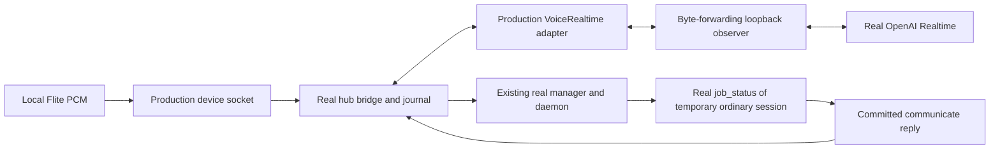

# Production voice relay qualification, 2026-11-05

**One synthetic, read-only turn passed through the production OpenAI voice
adapter, an isolated real hub/daemon manager, its real `job_status` tool and
committed speech presentation.** The input was interpreted as “What is the
status of Amber?” The canonical reply and provider-generated transcript were
both “Amber is idle.” Real nonempty PCM returned through the device socket.
Nothing was played or heard, and this does not qualify locked-iPhone operation.

## Scope and source

- Base: `191d1442c9654e687b5b87d126f2f19ca4903f6f`.
- New test: [`cmd/evener-hub/e2e_voice_live_test.go`](../../../../cmd/evener-hub/e2e_voice_live_test.go),
  `TestE2E_VoiceLiveProductionRelay`.
- Test source SHA-256 at execution:
  `b8e65bf3dd2565cd263f8669d177fa5b861a02a1ad8e16be6272b7674f729fa4`.
- The unchanged production paths are `voice_http.go`, `voice_bridge.go`,
  `voice_realtime.go` and `voice_speech.go`. Arm resolves the configured provider;
  the bridge constructs `VoiceRealtimeConfig` and calls `OpenVoiceRealtime`.
- This is a **mixed-boundary qualification**: the manager's external model is
  scripted with the existing OpenAI-compatible `fakellm` server. The voice model
  is real OpenAI. Manager reasoning and target selection are not live-model
  results. The scripted manager selects only the temporary inspection target.



The test configures a loopback observer as the voice provider's base URL. It
forwards WebSocket messages unchanged to `wss://api.openai.com/v1/realtime`,
adding the real authorization header only upstream. It does not generate,
rewrite or substitute provider events, prompts, arguments, transcripts or audio.
This makes the production adapter's actual requests observable without changing
production code. The loopback routing hop and scripted device are test plumbing,
not a native transport qualification or a direct-origin networking test.

## Input and execution budget

FFmpeg `6.1.1-3ubuntu5`, built with libflite, generated a fresh `slt` speech fixture:

```sh
ffmpeg -hide_banner -loglevel error -f lavfi \
  -i "flite=text='What is the status of Amber?':voice=slt" \
  -ac 1 -ar 24000 -c:a pcm_s16le amber.wav
```

The test parses the RIFF/WAVE chunks and checks PCM format, channel count,
sample rate, byte rate, block alignment and bit depth. It streams only the data
chunk, not a WAVE header, in paced 100 ms frames. This is synthesized speech,
not silent PCM presented as speech.

| Input measurement | Observed |
|---|---|
| Format | Mono, 24,000 Hz, signed 16-bit little-endian PCM |
| PCM bytes / samples | 93,360 / 46,680 |
| Duration | 1.9450 seconds |
| Nonzero samples | 46,366 |
| Frames | 20, final frame shorter than 100 ms |
| WAVE SHA-256 | `9d2aaa9ca872a6d88162ec92fd8bb1eacb54d37a98957b0abf9c85bd7709263a` |
| PCM SHA-256 | `15560ecd177a871d681ac9c43eab8574aa779c5d21f75fc0246040edc647138c` |

The enabled run made one model-catalog GET, one upstream Realtime WebSocket,
one input commit, and two `response.create` requests: interpretation and speech.
Both responses completed. There were no TTS requests, retries, model fallbacks,
second conversation or reconnect. The observer refuses a second upstream
session, second input commit or third response request before forwarding it.

The catalog confirmed `gpt-realtime-2.1-mini`; the real provider's
`session.created` also reported `gpt-realtime-2.1-mini`. The production setup
accepted `marin` with app-owned endpointing and mono24k input/output. Inventory
alone was not treated as inference access.

## Observed end-to-end evidence

| Boundary | Evidence |
|---|---|
| Quiet Arm/socket | At the device `ready` barrier, the observer had zero upstream WebSocket sessions and zero audio bytes. The catalog GET had already occurred. `input_start` opened the first voice connection. This is not a timed quiet-state soak or a microphone/pre-wake upload test. |
| Input identity | `input_started` named a durable open voice turn before PCM was sent. |
| Interpretation | Real completed `submit_utterance` produced `What is the status of Amber?`, matching the independent local speech fixture in this run. |
| Admission | Journal state `accepted`, method `turn/start`, receipt disposition `applied`, original manager instance and matching mutation identity. Mutation: `551f168f-7e2c-4ed0-b822-59a886dea792`. |
| Manager identity/context | Manager `local:034sAcFdGQ2jCrA74km1gq`, instance `034sAcFdGQ2jCrA74km1gq`, unchanged after the voice turn. The model request retained the earlier `AMBER-CONTEXT-73` opening marker. |
| Real read-only tool | A correlated `job_status` result named ordinary session `local:034sAcEHEVlqtRYytEU3so`, instance `034sAcEHEVlqtRYytEU3so`, and the original manager actor. The target had no active turn. Its status was not supplied by a fake tool result. |
| Canonical source | One admitted user input and one committed `agentMessage` matching the delivery's source item ID and carrying conversation provenance. Canonical text: `Amber is idle.` |
| Presentation request | Observed production `response.create` had empty tools, `tool_choice=none`, and one user `input_text` containing only the committed canonical text. Interpretation exposed only `submit_utterance` and used `conversation=none`. |
| Generated output | Provider transcript: `Amber is idle.` Device received 32,400 PCM samples, including 32,197 nonzero samples, corresponding to 1.35 seconds at 24 kHz. |
| Durable delivery | Canonical/generated text stayed separate. The journal's generated and queued sample totals equaled the received PCM. `OutputComplete=true`, `Interrupted=false`, played samples zero and no playback-complete acknowledgement. |

All session identifiers above belong to the temporary test stack, not real user
sessions. The manager model was allowed to produce only the fixture's
`job_status` and `communicate` calls. No real project/user action was performed.

Provider response evidence:

| Response | Status | Input tokens | Output tokens | Total |
|---|---|---:|---:|---:|
| `resp_EglHswmnQYHkQN11bIaxP`, interpretation | completed | 368 | 52 | 420 |
| `resp_EglHtW2qhB4i6S9eshYk9`, presentation | completed | 1,210 | 52 | 1,262 |
| Sum | | 1,578 | 104 | 1,682 |

These are provider-reported token counts, not billing verification or a cost
forecast. No provider failure occurred in this single live attempt.

## Meaning: the narrow verdict

The automated oracle checks independent fixture tokens (`amber`, `status` for
input, `amber`, `idle` for output), identities, real tool results, committed
source provenance, request structure, nonempty audio and durable completion.
It does **not** compare generated prose to a hardcoded expected sentence.
Token preservation is not sufficient to prove meaning in arbitrary sentences.

A separate text comparison of this run's reported input/output against the
independent fixture found no change of target, request or idle outcome. The
canonical and generated text happened to be identical. This supports this one
simple read-only text case only. There was no independent transcription or
listening to the returned PCM, so transcript agreement is not acoustic fidelity
and says nothing about what a person heard.

## Verification commands and results

The scripts/helpers and selected test bodies were inspected before execution.
Commands ran from the repository root with the existing machine Go caches.

```sh
# No opt-in was set. A credential-shaped value alone must not enable the test.
OPENAI_API_KEY=credential-present-but-no-opt-in GOMAXPROCS=4 \
  go test -p 2 ./cmd/evener-hub -run '^TestE2E_VoiceLive' -count=1 -v

GOMAXPROCS=4 go test -p 2 ./cmd/evener-hub \
  -list '^TestE2E_Voice(ReadOnlyManagerJourney|IntakeExistingManager|LiveProductionRelay)$'

# OPENAI_API_KEY supplied only through the child process environment.
EVENER_VOICE_RELAY_E2E=1 GOMAXPROCS=4 \
  go test -p 2 ./cmd/evener-hub -run '^TestE2E_VoiceLive' -count=1 -v

GOMAXPROCS=4 go test -p 2 ./cmd/evener-hub \
  -run '^TestE2E_Voice(ReadOnlyManagerJourney|IntakeExistingManager)$' -count=1 -v

git diff --check
```

| Check | Exit and actual result |
|---|---|
| Credential-only default | Exit 0, `TestE2E_VoiceLiveProductionRelay` **SKIP**, 0.00 s. No credential read in the test body, fixture generation or provider requests. Existing package TestMain still prepares its local build environment. |
| Selector inventory | Exit 0, listed all three named tests. |
| Enabled selector | Exit 0, `TestE2E_VoiceLiveProductionRelay` **PASS**, 7.75 s test time, 10.683 s package time. |
| Existing deterministic journeys | Exit 0, `TestE2E_VoiceReadOnlyManagerJourney` **PASS** (2.58 s), `TestE2E_VoiceIntakeExistingManager` **PASS** (2.42 s), package 7.103 s. These use fake Realtime and scripted playback, not live acoustic evidence. |
| Diff whitespace | Exit 0, no findings. |

The enabled command was launched by a small Python wrapper which first copied
Jesse's authorized `/home/jesse/git/terminal-bench/.env` byte-for-byte to a fresh
0600 file under `$EVENER_SCRATCH_DIR`, parsed exactly one literal
`OPENAI_API_KEY` without sourcing the file, and removed the copy in `finally`
before starting Go. The key was never printed. The test clears the key from its
environment before starting fixture commands or the hub; the test process uses
it only for the catalog request and observer. The hub's private 0600 provider
file contains only a nonsecret observer token. Temporary WAV, stack, journal and
binary files are owned and cleaned by the existing test harness. No raw audio
or credentials are retained in this report or repository.

## Reproduction and remaining gates

Use the enabled command only with authorization for a paid OpenAI call and a
locally installed FFmpeg built with libflite. Overrides
`EVENER_VOICE_RELAY_MODEL` and `EVENER_VOICE_RELAY_VOICE` select another model or
voice without fallback; the model must pass the live catalog check. The test
skips before reading credentials unless `EVENER_VOICE_RELAY_E2E=1` is explicit.
The key alone, or the repository's general live-test opt-in, does not enable it.

The judgment call was to stop after the first successful turn instead of
spending more requests on the optional reconnect conversation. This leaves
live provider reconnect and multiple voice conversations unqualified here.
No claim follows for human speech, names/numbers/negations/corrections as a
corpus, live manager reasoning, exact reading, useful-answer latency, acoustic
barge-in, microphone/AEC, wake detection, locked/background iPhone lifetime,
battery, device routes, TestFlight, or browser operation. The approved
[design's qualification gates](../../specs/2026-11-04-voice-chief-of-staff-design.md#10-qualification-and-delivery-gates)
still require those separate measurements. No production, native, signing or
compaction code was changed, and no full-suite, race or signed-build gate ran.
