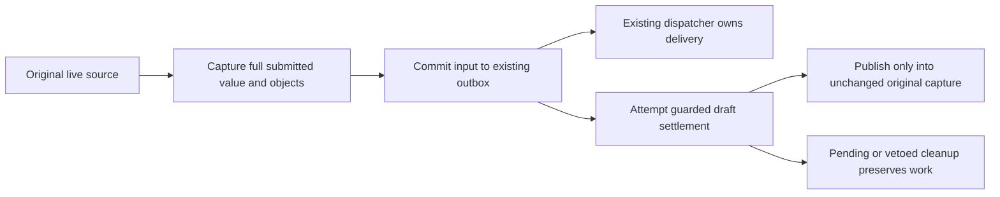

# Browser composer drafts

Browser drafts use IndexedDB, not localStorage. A retained pane owns the live
editor and attachments; a per-session revision fences durable ordinary and
recovered input changes. Saving a draft, accepting input and clearing an editor
are separate outcomes.

This is the current contract. The historical [composer parity checklist](parity/contracts-composer-queue-pending.md#drafts)
describes the removed localStorage writer and remove-on-empty behavior. Its
storage claims do not describe this implementation.

## Storage and initialization

[BrowserDraftRepository](../../cmd/evener-hub/frontend/src/stores/browserDraftRepository.ts)
owns ordinary drafts in the existing `evener-mutation-outbox` database.
`browserDraftKey` scopes them by browser origin and session ref.
[compositionRevision](../../cmd/evener-hub/frontend/src/stores/compositionRevision.ts)
owns the namespace incarnation and monotonic session revision. Ordinary saves,
clear and recovery transitions advance that same revision in their actual
transactions. An empty ordinary row retains its revision. There is no durable
pane owner, losing-draft archive or second active draft writer.

`transferSupportedDrafts` decodes supported v1/v2 localStorage inputs, imports
only before an existing durable row or recorded transfer outcome, and commits
inspected-byte markers before removing exactly matching legacy bytes. An
existing draft, including an explicit empty one, wins. Changed legacy bytes are
not removed by an older inspection. LocalStorage is migration input only.

`ComposerSourceState.ready` awaits committed transfer before load or first-row
seeding. [MutationOutboxIndexedDB](../../cmd/evener-hub/frontend/src/stores/mutationOutboxIndexedDB.ts)
also awaits transfer before browser write transactions that can initialize
session metadata, including recovery before any composer opens. Pending transfer
or failed initialization cannot be treated as an empty, successfully loaded draft.

## Live work and retry ownership

[ComposerSourceState](../../cmd/evener-hub/frontend/src/panes/session/composer/sourceState.ts)
starts `ready` when created. Initialization failure reports an error, retains the
source and accepted edits, and resets the failed readiness promise. A later
`ready` call retries transfer/load. `whenSettled`, `submissionDraft` and
`prepareAnnotation` also reach that readiness path. `whenSettled` makes a bounded
ordinary-write drain attempt, not a promise that everything saved.

`acceptEdit` copies the full structured value at acceptance and serializes saves.
Typing before hydration stays visible. Explicit same-incarnation conflicts
rebase that immutable value, so the later committed edit wins without merging
competing drafts. A namespace fence leaves stale work unsaved until a fresh
deliberate edit supersedes it. Storage failure retains queued work for a later
`whenSettled` attempt or an edit's scheduled drain. There is no autonomous draft
retry timer and no process-death guarantee before commit.

Recovery edits use `queueRecoveryPersistence`, not an ordinary draft duplicate.
An abort or guarded refusal leaves the latest accepted recovery edit marked
unsaved, even if its promise resolves. Preparation returns no usable capture
while that work remains unsaved and does not replace it with the stored value.
A successful update/discard of that accepted version resolves the marker.
[Composer](../../cmd/evener-hub/frontend/src/panes/session/composer/Composer.tsx)
calls `persistRecoveryEffect` when recovery text, selections or attachment
readiness change. A detached source schedules it after its edits or attachment
changes. Callers can retry through `queueRecoveryPersistence`; preparation only
waits for existing recovery attempts, it does not silently retry or authorize a
refused write from a newer read.

[conversationPaneLifetime](../../cmd/evener-hub/frontend/src/shell/paneLifetime.ts)
retains the source through editor unmount, cascade promotion and Return.
Close/reset or replacement disposes it, even when pane ID and session ref are
reused. Captured hydration and acknowledgments publish only into their original
live generation and backing. Accepted ordinary saves may finish after disposal
from their queued copies; they cannot publish into a replacement source.
Attachments and editor cursor/selection continuity belong to the live source.
Ordinary draft persistence does not store attachment bytes or cursor state.
Submitted attachment retirement joins deferred exact-object cleanup with the
corresponding ordinary drain or recovery persistence attempt.

A doc pane opened from a session, a read-only transcript or a cascade column
serializes the OPENING scope's provenance into its params: the source session's
runtime composer identity (`browser-origin`) or an explicit read-only source pane
(`browser-readonly-session`). [docOpeningOriginFor](../../cmd/evener-hub/frontend/src/panes/doc/docOpeningContext.tsx)
derives it from the pane lifetime and the scope's displayed requestedRef, never
from focus; a missing provider leaves the params origin-less.
[retainedComposerSourceFor](../../cmd/evener-hub/frontend/src/shell/paneLifetime.ts)
resolves a saved note's destination against that retained, still-live source,
using the existing WeakMap and workspace record, and returns null for a closed,
replaced or mismatched one. A missing origin stays readable and session-bound; a
malformed serialized origin is refused by the doc pane's `parseParams`, not read
as the older origin-less shape. Reader UI, automatic handoff and browser/phone
qualification are not part of this contract.

## Submission and cleanup

[submitWithPendingTracking](../../cmd/evener-hub/frontend/src/panes/session/composer/queue/pendingTurnsStore.ts)
awaits the source's preparation, then the real local input commit and settlement.
Local outbox acceptance is not daemon acceptance. Once input is accepted, a
cleanup failure cannot report that submission failed or submit it again.
`DraftSettlement.persistence`, `cleared` and sender-local cleanup describe
different facts.

Ordinary settlement uses `clearSubmitted`: the namespace/session token,
ordinary backing, live edit authority and full submitted value must still match.
A competing explicit edit can veto durable clear while the unchanged original
sender retires only its own local payload. Pending storage cleanup clears
nothing. Committed notifications cannot replace newer same-ref work.

Recovered resend advances the shared revision and removes its recovery in the
outbox transaction. Source settlement does not perform a second durable clear.
Post-await publication and committed recovery broadcasts require the original
sender's capture, generation/backing, replacement epoch, edit revision, local
token and full value, including meaningful absent-versus-empty mentions.
Attachment authorization compares the exact live objects, not copied IDs or
marker numbers. If a local edit already vetoes settlement, the sender may release
only the consumed recovery backing under its original capture and replacement
epoch. That release preserves newer text, selections, attachments and generation
and performs no read, token refresh or draft write.

The shared [submission runner](../../appwire-client/typescript/state/mutation/submission.ts)
awaits the browser's optional `settleDraft` hook. Hosts without that hook retain
the synchronous `settleSubmittedDraft` default, including native behavior.
Browser source preparation (`prepareAnnotation`, `ownsPreparation`,
`acknowledgeAnnotation`) is not an annotation operation queue or annotation UI.
Those later features and real-browser/phone qualification are outside this
composer contract.
