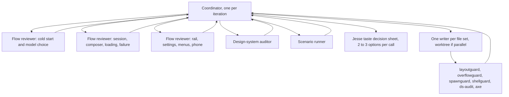

# Evener web UI: why it still feels amateurish, and how to fix it agentically

**Date:** 2026-11-06
**Author:** research subagent
**App under review:** live hub at `http://127.0.0.1:9180`, build `55635d1` ("feat(web): replace the beige palette with cool neutral surfaces", PR 5638)
**Source cited:** commit `55635d1`. The working checkout's `HEAD` is `278fb3670a` (PR 5335), which is behind the running build; source was extracted read-only with `git archive 55635d1 cmd/evener-hub/frontend cmd/evener-hub/frontend/src docs/web-ui docs/product` into `/tmp/uxsrc`.
**Method:** real-browser walk at 1440x1000 and 390x844 (Chrome, mobile+touch), DOM geometry and computed styles via `eval`, screenshots, cross-check against the design law and component source, plus `ds-audit` and one `layoutguard` run. Read-only: no app, repo, hub, or state was edited.
**Evidence directory:** `shots/` (all screenshots named below).

---

## Bottom line

The palette change did what a token change can do. It did not fix the things that make the app feel amateurish, because those are structural:

1. **The page has up to three left edges.** The pane header starts at x=304, the reading column at x=503–508, and the settings content at x=528. On `/new` the title "New session" sits 204 px left of the form it titles. This is the first thing the eye sees on every screen.
2. **The rail's "+ New session" is the loudest control on every route.** It is a 247x32 filled button (7,904 px²); the session's Send is 70x24 (1,690 px²) and the spawn pane's Start is 69x24. The global navigation CTA outranks the current task by 4.7x in area.
3. **The command palette is a 338px near-blank card.** Opened cold, it shows one needs-you row (or nothing) and a placeholder clipped at "…/ for comma". Typing `settings` returns transcript hits, not "Open settings"; commands exist only after a `/` prefix.
4. **Opening a session shows a blank pane, a destructive recovery link, and a stray "Verbosity" word.** There is no composer and no skeleton while the transcript loads; the recovery copy appears before there is any evidence the session is stuck.
5. **The phone composer violates the app's own tap floor.** The reasoning-effort control is 30x27 at 390x844 with `(any-pointer: coarse)` true; `--tap-min` is 44.

The transcript is authored. The frame, the rail, the palette, the loading state, and the phone control row are not. That is the gap Jesse is feeling.

---

## 1. Ranked findings

Ranking is by user impact: how often the surface is seen, how much it blocks, and how many flows it touches. "New" means not named in the prior Impeccable critique; "known" means the critique named it and it survives.

### 1. Every screen has three left edges; the header does not share the content measure (new)

**Impact:** every route, every session, every window. This is the single largest "unfinished" tell.

**Evidence**

- `shots/02b-new-session-axes.png` — `/new` at 1440x1000. Red line = pane header title at x=304. Blue line = the form column at x=508.
- `shots/03b-session-axes.png` — `/s/local:034sXHcXbFBvT8hvzMgJdg`. Header title at x=304; transcript turn at x=503 (704 wide); composer at x=508 (704 wide).
- Measured live: `h2 "New session"` x=304 w=1026; form x=508 w=704; `h2 "What should the agent do?"` x=508 w=704; session `h2` x=304 w=1026; `.turn` x=503 w=704; `<form>` x=508 w=704; settings content x=528 w=704; settings nav x=304 w=200; settings title x=304.
- Source: `cmd/evener-hub/frontend/src/widgets/panescaffold/panescaffold.module.css:12-20` gives the header `padding: var(--space-3) var(--space-5)` (24px sides). The body (`:64-89`) does the same, but each pane's content then centers itself on `--session-measure`: `panes/spawn/spawn.module.css:6-12` and `panes/session/session.module.css:87-88,110-111,150-151`.
- `layoutguard` confirms the intended measure: `node scripts/layoutguard/run.mjs transcript-measure` → PASS, "column 704px centred (204/204px gaps)". The header's 24px padding is the odd one out.

**Why it reads amateurish:** the title is the page's name, but it is not attached to the page. On `/new` there is a 204px empty gutter between "New session" and the form. On a session, "Evener Web UI Redesign" floats above the far left while the conversation starts a fifth of a screen to the right. The header's only other element, the cadence instrument, sits at x=1342, 134px beyond the conversation's right edge. Nothing in the header shares an axis with the content, so the frame looks accidental.

**Cause:** there is no page-frame primitive. `PaneScaffold` owns header padding; each pane owns its own content measure. The two were tuned independently.

**Fix direction:** one `PaneFrame` (header inner, body inner, optional footer inner) that shares the measure. Single-column panes (spawn, session) align the header to the content column; settings aligns the header to its nav. Do not change the reading measure itself.

**Check:** a layoutguard case `page-frame-alignment` at 1440 and 1920 asserting header-title left == composer left ±1px and the turn within 6px (scrollbar allowance); a `spawnguard` assertion for the spawn form; a `shellguard` assertion for settings.

---

### 2. The rail's "+ New session" is the visual primary on every screen (new)

**Impact:** every route. It competes with the action the user is actually doing.

**Evidence**

- `03b-session-axes.png` and `01-welcome.png`: the rail's black "+ New session" is the largest filled control on screen.
- Measured: rail button 247x32, area 7,904 px², background `rgb(26,29,35)`, text `rgb(246,247,249)`. Session Send 70x24, area 1,690 px². Spawn Start 69x24, area 1,656 px². The rail CTA is 4.7x the Send area and 4.8x the Start area.
- Source: `cmd/evener-hub/frontend/src/shell/rail/Rail.tsx:1048-1059` renders `<Button variant="primary">+ New session</Button>`; `shell/rail/Rail.module.css:78-82` stretches it full width.
- On `/new` there are two filled primaries in one view: the rail CTA and Start. On a session there are two: the rail CTA and Send.

**Why it reads amateurish:** a global navigation button that shouts on every screen makes the product feel like a launcher, not a workspace. The current task's primary is small and, when the composer is empty, also 50% opacity. On Welcome it also competes with "Jump back in", which is the real primary for that moment.

**Cause:** the rail CTA has no hierarchy variant beyond `primary`; there is no "one primary per route" contract.

**Fix direction:** make the rail CTA `secondary` (ink text, hairline border) or an icon+label in the rail header; reserve the filled ink for the pane's primary. Keep it keyboard-reachable and 44px tall on coarse pointers. This is a taste call for Jesse; the check is geometric, not aesthetic.

**Check:** `shellguard` assertion that a route has at most one filled `--ink-hi` primary, and that the rail CTA is not it; screenshot before/after.

---

### 3. The command palette is a 338px near-blank card, and commands are hidden behind `/` (new)

**Impact:** every command search, every "find a session" action, every attempt to reach Settings/theme/new session from the keyboard.

**Evidence**

- `shots/04-palette-empty.png`: Ctrl+K on `/new`; the palette is 338px wide, 210px tall, title "Command palette", one row under `NEEDS YOU` ("Improve Evener Retry Self-Healing"), placeholder clipped at "search live + past sessions · / for comma".
- `shots/05-palette-commands.png`: after typing `/`, a clean 9-row `COMMANDS` list appears.
- Typing `settings` (not `/settings`) produced `PAST · 20` and `IN SESSION · 10` only; no "Open settings" row. DOM text: `PAST · 20 … IN SESSION · 10 …`; no `COMMANDS` group.
- Source: `cmd/evener-hub/frontend/src/shell/palette/CommandPalette.tsx:103` defines the placeholder; `shell/palette/mode.ts:14-17` makes `command-filter` only when `query.startsWith("/")`; `CommandPalette.tsx:892-910` renders the Commands group only in that mode.
- Width source: `widgets/dialog/dialog.module.css:125-128` sets `min-width: 320px; max-width: min(560px, …)`; the palette body sizes to content, so an empty/short view lands at the 320 floor.
- Existing tests pin the empty view: `shell/palette/CommandPalette.test.tsx:223` ("lists needs-you sessions when any exist") and `:799` ("keeps its old (empty) behavior when there are no needs-you sessions").
- At the time of the earlier capture with no needs-you data, the palette was literally blank (0 rows); the live view later had one row.

**Why it reads amateurish:** the app's power surface looks like an unfinished search box. The one sentence that teaches the palette is cut off at the exact word that matters ("commands"). A user who types the name of a command sees their transcript, not the command.

**Cause:** the palette's empty state was optimized for needs-you triage, and command discovery was pushed into a prefix mode. The width is content-driven, so the most important state is the smallest.

**Fix direction:** a fixed 520px palette width; a `Commands` group after needs-you on empty query; command-label matches in plain search (so "settings" finds "Open settings"); a footer hint that fits. This deliberately changes the two tests above; supersede them with the new contract rather than weakening them.

**Check:** `CommandPalette.test.tsx` cases for empty query and plain-word command search; a browser scenario asserting panel width >= 480, the placeholder not clipped (canvas text width <= input width), and the "Open settings" row for `settings`.

---

### 4. Opening a session shows a blank pane, a destructive recovery link, and a stray "Verbosity" (new)

**Impact:** every session open, especially the first open or a slow hub. We hit it repeatedly while reviewing.

**Evidence**

- `shots/14-session-loading.png`: a mostly blank pane with "Loading transcript", "If the session is unresponsive, you can stop its process to recover it.", a "Force shutdown..." link, no composer, and "Verbosity" in the bottom-left footer.
- Source: `cmd/evener-hub/frontend/src/panes/session/Session.tsx:186-205` renders `<Loader label="Loading transcript" />` plus the unconditional unresponsive hint and `<SessionForceStopRecovery>` for local refs. No skeleton, no composer.
- The "Verbosity" word is `ConversationBody.tsx:164-183`'s `UnavailablePresentationControl`, rendered as the pane footer while the transcript display defaults are unavailable. It appears with no context.
- The state persisted for several seconds on a cold open and resolved on its own; the recovery copy was visible the whole time.

**Why it reads amateurish:** the first impression of a session is an empty page with a warning and a destructive action. "Force shutdown" is presented as a plain link before there is any evidence of a stall. A lone "Verbosity" label looks like a leaked internal control.

**Cause:** the loading branch was written as a fallback, not as a designed state. It reuses the recovery affordance and the footer slot without a threshold or a skeleton.

**Fix direction:** keep the composer mounted; reserve the transcript shape with `Skeleton`; show "If the session is unresponsive…" only after a stall threshold (8s) or an explicit timeout; render the force-stop inside the threshold state; drop the unavailable-verbosity footer while loading.

**Check:** `Session.states.test.tsx` fake-timer cases: hint absent at t=0, present at t=8s; composer present during loading; no `Verbosity` text in the loading footer. Plus a browser scenario on a cold session.

---

### 5. The phone reasoning-effort control is 30x27, below the app's 44px tap floor (new)

**Impact:** every phone session; the control is hard to hit and easy to miss.

**Evidence**

- At 390x844, `(any-pointer: coarse)` true: `[data-testid="status-row-effort"]` is 30x27 with `min-height: auto`; its invisible native `<select>` is also 30x27. Model trigger is 136x44; Session actions 44x44; Send 44x44.
- Source: `cmd/evener-hub/frontend/src/panes/session/chrome/StatusRow.tsx:90-125` builds the trigger from two spans plus a transparent native select; `shell/.../statusrow.module.css:43-56` sets padding and hover, no tap floor; `:191-206` sizes the select to the trigger. The model trigger next door has its own `@media (any-pointer: coarse) { min-height: var(--tap-min) }`.
- Design law: `docs/web-ui/design-system.md` §11, floor `--tap-min` 44px, and `src/styles/display-gates.test.ts` only covers widget-owned floors. This raw control is not a widget, so no gate catches it.
- `07-phone-session.png`: the model name truncates ("deepseek-4.1-flash-abliterat…"), and the effort readout ("max") is a tiny, unlabeled-looking word between the model and the "⋯".

**Why it reads amateurish:** the phone composer looks like a squeezed desktop toolbar. The smallest control is the one that changes reasoning behavior, and it is below the finger size the rest of the app respects.

**Cause:** the reasoning control is a bespoke composition inside `StatusRow`, not a shared widget, so it did not inherit the tap-floor rule.

**Fix direction:** add `min-height`/`min-width: var(--tap-min)` to `.effortTrigger` under the same coarse-pointer gate; keep the native select overlay. Optionally show the visible label "Effort: max" at phone width, or move it into the Session actions menu on phone.

**Check:** a `layoutguard` case `composer-tap-floor-phone` with real `StatusRow` markup at 390/coarse, asserting every interactive control >=44; plus the `spawnguard` pattern for the composer. Mutation: remove the rule → fail.

---

### 6. The failure warning tells you to retry but gives you nothing to click (partly known)

**Impact:** failure and recovery moments; the user reaches a dead end.

**Evidence**

- `shots/warning-retry.png`: the warning is 670x107 at x=537. Text: "Summary output rejected"; "Summary failed for session model lunaroute/deepseek-4.1-flash-abliterated: rejected_output, empty_reply"; "The response could not safely replace the conversation. Retry or choose a more capable summary model. Existing history or the checkpoint remains available."
- Measured: the warning row contains **zero** `button` or `a` elements.
- Source: `cmd/evener-hub/frontend/src/panes/session/transcript/messages/WarningItem.tsx:74-87` renders `Chip`, message, hint only. `WarningBlock` has no action slot, so every warning of this family is text-only.
- The raw wire codes (`rejected_output, empty_reply`) are shown to the reader before any plain-language cause.

**Why it reads amateurish:** the UI knows the next step ("Retry or choose a more capable summary model") and offers neither. The raw code string is machine evidence in the human message slot.

**Cause:** the warning renderer is a passive block; recovery actions live in other components, and there is no shared "warning with action" grammar.

**Fix direction:** add an `action` slot to `WarningBlock`; for summary rejection, a `Retry summary` button wired to the existing summary action, and a "Choose model" link. Keep the raw code behind the disclosure/title, not as the body.

**Check:** a browser scenario `failure-warning` asserting the warning is visible before expansion and contains a `Retry` button; a `WarningItem.test.tsx` action case.

---

### 7. The rail is a dense wall of truncated titles with hover-only actions (known)

**Impact:** every navigation and session-management action.

**Evidence**

- `01-welcome.png`, `03b-session-axes.png`: 280px rail, 13px titles, 12px section labels, timestamps right-aligned. Titles cap at 194px: "Evener Flake Fixes And Native …", "Implement Summary Retry Sel…", "Fix Hub Watch Delivery Reliabi…".
- Measured: row title buttons are 21px tall in 32px rows; `⋯` triggers are 28x28 but `visibility: hidden` at rest. Hovering reveals them and hides the timestamp.
- Source: `shell/rail/Rail.module.css:20-28` pins 280px; `:51-72` documents the shared right cell; `:85-120` and `RailRow.test.tsx:2189-2261` pin the hover-only reveal (a deliberate "Linear/VS Code-quality sidebar" choice).
- The project header dots say "Needs you" while every child row says "Working" in the current data; whether that is an aggregate of descendant state or a mismatch needs Jesse's product call. The accessible names are correct; the visible text is not.

**Why it feels amateurish:** every row is the same weight, and the one action per row is invisible until hover. The distinguishing end of each title is exactly what truncates. This is a known note, but the palette change made the rail more visually prominent (cool neutral rail vs white content), so the density is now the first thing on screen.

**Cause:** the rail is a tree of 13px rows with per-row actions sharing the timestamp cell. There is no title tooltip/hover card on all rows, no persistent action affordance at rest, and no readable status word.

**Fix direction:** show a faint `⋯` at rest (or on row focus) on hover-capable desktop; keep the timestamp; add a title/`HoverCard` with project/branch/status; consider 300px or a user-resizable floor. This is a taste call; do not silently break `rail-row-chevron-actions-overlap`.

**Check:** `shellguard`/`layoutguard` case `rail-row-actions-visible` asserting the trigger is visible at rest and does not overlap the timestamp; screenshot.

---

### 8. Destructive menu items look exactly like Rename; the model picker offers a primary "Retry models" with no visible reason (new)

**Impact:** shutdown/archive/delete moments, and every model change when a provider read is partial.

**Evidence**

- `shots/12-session-menu.png`: menu groups `Overview · 2 active`, separator, `Rename`, `Pin this session…`, `Archive`, separator, `Shut down`, `Force shutdown…`, `Delete…`. All items are `--ink-hi`, no icons, no danger color.
- Source: `widgets/menu/menu.module.css:121-139` gives every `.item` `color: var(--ink-hi)`; `widgets/menu/index.tsx` has no `tone`/danger entry. `shell/sessionMenu/SessionMenu.tsx:183-196` puts `Shut down`, `Force shutdown…`, `Delete…` in the same list.
- `shots/11-model-picker.png`: a bottom-pinned black 115x32 "Retry models" primary under a long model list. The `role="alert"` region is empty at the measured point; the panel text contains the model rows, not a diagnostic.
- Source: `panes/session/chrome/ModelSwitchTrigger.tsx:233-250` sets `recoveryAvailable` when `error` or `catalog.diagnostics.length > 0` and renders `<Button>Retry models</Button>` (primary). The diagnostics are the *reason*; the button is the only visible consequence.

**Why it feels amateurish:** destructive actions are indistinguishable from harmless ones, and a primary recovery button appears with no error in view. It looks like the app is asking you to fix something it will not name.

**Cause:** `Menu` has no semantic tone/icon API (the widget catalog, `docs/web-ui/widget-adoption-catalog-2026-10-11.md:19,30,80`, already proposes the extension). The picker's diagnostics are not surfaced in the same place as the retry action.

**Fix direction:** add `MenuEntry.tone?: "danger"` and mark `Archive`, `Shut down`, `Force shutdown…`, `Delete…`; add icons to the session menu; show the provider diagnostic as a dim line above `Retry models`, or make Retry quiet when the list is usable. Do not make Retry primary.

**Check:** `menu.test.tsx` dangerous-item class/tone; `layoutguard` `menu-danger` computed color; a model-picker scenario asserting a diagnostic line is visible when `Retry models` is.

---

### 9. The status footer is 12px furniture with mixed placeholders and no relation to the content (known, worse after the palette change)

**Impact:** every session; the footer is the only steady liveness read.

**Evidence**

- `03b-session-axes.png`, `shots/13-live-turn.png`: footer left at x=300 (cwd), right at x=1186+ (`Agents`, `Jobs`, `Watches`, `Tasks`), while the reading column is x=508..1208.
- Values seen live: `Agents —`; `Jobs 0/68`; `Watches —`; `Tasks 2/7`; `Agents 0/6`; `Jobs 1/22`; `Agents 2/10`. The same count uses `—`, `0/0`, `0/68`, and `2/10` across states.
- Source: `shell/statusbar/StatusBar.tsx:24-70` renders only `ACTIVITY_TABS.filter(chipVisible)`, and `statusbar.module.css:34-95` sets 12px, `--ink-mid`, no focus-visible rule. The widget catalog already flags the raw chips: `widget-adoption-catalog-2026-10-11.md:19` ("has no `:focus-visible` ring … uses native `title` in place of Tooltip").
- The footer's cwd is `RepoLocation`, whose middle-truncation split is two block spans (`RepoLocation.tsx:103-114,170-174`); visually it reads as `/home/jesse`, but the DOM's `innerText` is `/home/j\nesse`, so a selection or copy can carry the break.

**Why it feels amateurish:** the footer is a status bar from an IDE pasted under a reading room. The numbers do not say what they count, zero/unavailable is inconsistent, and the cwd is outside the column. It is the smallest text on screen but the most repeatedly read.

**Cause:** the footer is a separate full-width strip, not part of the page frame; `chipVisible` shows categories with unknown counts; no copy/selection treatment for the truncation pair.

**Fix direction:** align the footer inner to the frame; hide categories with no data (or render "0 running"); use one placeholder vocabulary; add a focus-visible ring to the chips; make the cwd a single copyable string with middle ellipsis rather than two block spans. Keep the counts factual.

**Check:** `StatusBar.test.tsx` for zero/unavailable omission; `layoutguard` `statusbar-frame`; a clipboard/selection test for the cwd.

---

### 10. Attention floats over the transcript, capped at 18rem/55vw (known)

**Impact:** the moment a human is needed; on phone the title is the most likely to truncate.

**Evidence**

- `13-live-turn.png`: a floating "Needs you / Improve Evener Retry Self-Healing" card at the bottom right, with a "…" for more, over the transcript area.
- Measured: `.stack` is `position: absolute; z-index: 1` at y=738, 1088px wide (the visible card is right-aligned inside it). The transcript's last lines sit under it.
- Source: `panes/session/nextNeedsYou.module.css:18-24` caps `.nextSlot` at `min(18rem, 55vw)`; `:52-60` clamps the label to two lines. The placement is "FlowOverlay's measured stack or session.module.css's dormant attention dock" (`:1-4`).
- On phone, 55vw of 390 = 214px, so longer session titles truncate.

**Why it feels amateurish:** the attention signal is a floating chip, not a place. It covers the reading surface and truncates the sentence that explains why it is there. The prior critique's P2 said "let attention occupy a strip above the composer"; that is still the right direction.

**Fix direction:** a reserved attention strip above the composer or below the header, full measure, with a two-line title and a persistent "Needs you" label; keep the "more sessions" menu. On phone, use the full width minus safe area. This is a taste/layout call; the check is no overlap and no truncation at 390/1440.

**Check:** `layoutguard` `attention-strip-no-overlap` (card box disjoint from the last transcript row, title `scrollWidth <= clientWidth` at 390); screenshot.

---

### Also seen (lower impact, not separately ranked)

- **Jargon on /new:** "Effective access is being resolved." with an unlabeled "Change"; "Watches", "Jobs 0/68", "Verbosity". A first-timer has to decode the product's internal vocabulary. The prior critique scored match-to-real-world 2/10; the palette change did not touch copy.
- **Model picker group heads:** raw hostnames in caps (`CODEX-JESSE-FSCK.COM`) beside 12px dot-separated metadata (`lunaroute · vision · reasoning · $0 in · $0 out /Mtok · 1M`). It is dense machine text in the human list.
- **Dark raised layers:** `tokens.css:24-30` sets `--surface-2` equal to `--surface-1` in dark, and `--shadow-overlay` (`:205`) carries depth as a 1px `--edge-strong` ring plus a weak shadow. Menus over the pane read as outlines, not layers. This is the prior critique's note; source confirms it.
- **Settings:** 16 equal-weight nav items in 4 groups, content x=528 with the title at x=304. The close is now labeled "Close settings" (prior note addressed). The filter input is 192px. It is functional but flat.
- **Phone spawn:** the form reorders the prompt before host/cwd/harness; the "Working directory: (default)" row is below the composer and off the first screen. The same form orders those fields differently on desktop. This may be deliberate (`design-system.md` §11 mobile rows) but it changes what the user can verify before starting.
- **Repeated "36px" control sizes:** Send 24px, Start 24px, model trigger 23px, effort 27px, attach 24px, status chips ~30px, menu items 28px. There is no chrome size tier; every row picks a height.

---

## 2. Systemic causes

These are the reasons the same class of problem keeps appearing after each visual pass.

### A. No page-frame primitive

`PaneScaffold` provides a header and a scrolling body but no shared inner frame. Every pane's content sets `max-width: var(--session-measure); margin-inline: auto` on its own (`spawn.module.css:6-12`, `session.module.css:87-88,150-151`, settings' own content column). The header keeps `padding: 24px` (`panescaffold.module.css:12-20`). The result is predictable: the body centers, the header does not. The same thing happens to the footer (`StatusBar` full width) and to the palette (content-sized dialog).

**Fix:** a frame primitive, not another per-pane max-width. Once the header, body, composer, and footer read the same inner box, the three-axis problem disappears and future panes inherit the alignment.

### B. No chrome control tier; raw-control drift is a documented work list, not a gate

`node scripts/ds-audit.mjs` (run against 55635d1) reports:

```
raw controls   23x button, 6x input, 2x select, 2x textarea
module classes re-implementing a widget concept: 38
```

`docs/web-ui/widget-adoption-catalog-2026-10-11.md` lists 100+ sites with SWAP/EXTEND/NEW classifications and proposed widgets (`CountButton`, `ListRowButton`, `DisclosureHeading`, `PropertyList`, `StatusDot variant="signal"`, Menu `tone`/`icon`/`size`). It is a catalog, not a test. Nothing fails when a new raw `<button>` lands, and nothing asserts that a visible control's computed font is `--font-sans` or that its height is on a control tier.

Concrete consequence: `ModelSwitchTrigger`'s `<button>` computes `font-family: Arial; font-size: 13.3333px` because `.trigger` (`modelswitch.module.css:7-22`) does not set a font and there is no global `button { font: inherit }`. The visible `.value` span opts into Schibsted at 12px (`:29-38`), so the visible label is correct today; any direct text, the visually-hidden suffix, or a future markup change falls back to the UA font. The effort trigger has a similar bespoke composition and no tap floor.

**Fix:** a `chrome` control tier (heights 24/28/32, one font token, one focus ring, one tap floor) and a CI budget for raw controls. Ratchet the count down; fail on an increase.

### C. Menu semantics are incomplete, so destructive actions are unmarked

`Menu` supports items, separators, disabled, and an icon trigger, but no tone. Every item is `--ink-hi` (`menu.module.css:121-139`). `SessionMenu` uses the same component for `Rename` and `Delete…`. The widget catalog already proposes `Menu` `label` + icon-only square + `align="end"` (`:80`), but not a danger tone. The result is a safety problem and a craft tell: the most consequential items look like the least consequential.

**Fix:** `MenuEntry.tone` (`default | danger`) with a token color and an optional icon; mark `Archive`, `Shut down`, `Force shutdown…`, `Delete…`; test the tone. This is one widget change and one consumer change.

### D. The guards check the mechanisms they were built for, not the UX contracts

Existing real-browser checks are strong: `layoutguard` (geometry of hand-authored CSS), `overflowguard` (real Session, no sideways scroll), `spawnguard` (real Spawn at 320/390/899/900/1440, tap floors), `shellguard` (real AppShell, rail/settings geometry), `browserguard` (the CI gate). They pass while the app has three left edges, a 30x27 phone control, a 338px palette, and a primary rail CTA, because none of those is a contract they assert.

- `layoutguard`'s `transcript-measure` asserts the reading column is 704px and centered. It never asserts the header shares that axis.
- `spawnguard` asserts the Spawn form's controls at 390. It does not assert the composer's effort control in a session.
- `shellguard` asserts the shell height, the rail, settings geometry, and hover cards. It does not assert the rail CTA's fill or the palette's width/empty state.
- `ds-audit` counts raw controls but exits 0 with the count; no gate compares it to a budget.

**Fix:** add UX contracts to the guard that already renders the real component. Do not start with a new framework. Add `uxguard` only when the corpus outgrows the existing entries.

### E. The command surface is built for recall

`mode.ts` makes commands a prefix mode. The placeholder is the only teaching. The empty query is optimized for needs-you, and the palette is content-sized. That is a coherent implementation of "the palette is where you go" (`design-system.md` §9), but it assumes the user remembers the `/` grammar and the command names. A first-timer opens the most powerful surface and sees one row.

**Fix:** make commands visible on open and searchable by name; keep `/` as a shortcut, not a gate. The prefix can still be the fastest path for experts.

### F. Loading and failure are fallbacks, not designed states

`Session.tsx:186-205` is a `Loader` plus a recovery hint. `WarningItem.tsx:74-87` is a chip plus text. Both are truthful, and both are the states where the product's promise is most visible. They were written to be honest, not to be good. The same is true of the model picker's recovery: `recoveryAvailable` adds a primary button, but the diagnostic reason is in the list, not beside the button.

**Fix:** give loading and failure their own shared grammar: a skeleton with a threshold, a warning with an action slot, and a recovery action next to its reason. These are the states where "amateurish" becomes "untrustworthy".

---

## 3. Agentic remediation workflow

The goal is a repeatable loop that raises UX quality without turning taste into a test. The loop has three kinds of work: **find** (flow reviewers and a design-system auditor), **prove** (a scenario runner and the existing guards), and **decide** (Jesse on taste). One coordinator keeps them from duplicating or colliding.



### 3.1 Roles and exact inputs

| Role | Inputs it needs | Output | May change |
|---|---|---|---|
| **Coordinator** | The brief, commit `55635d1`, live URL + auth path, the prior critique, design law and decisions, the four flow routes, the guard commands, a findings schema | Ranked, deduped findings; a decision sheet; a file-ownership map | Nothing |
| **Flow reviewer: cold start / model** | `/` and `/new` at 1440x1000 and 390x844; a provider-configured hub; the no-provider fixture (FakeClient) if available; model picker; spawn form; screenshots | Findings with route, selector, rect, computed style, screenshot, source line | Nothing |
| **Flow reviewer: session** | `/s/local:034sXHcXbFBvT8hvzMgJdg` (settled), `/s/local:034sXA3ffXGOkCZaLsRoDS` (live), `/s/local:034STI1Ujw4O7xgaEFFTuM` (old), a session with a warning; 1440 and 390; loading capture; composer; stop/steer | Findings | Nothing |
| **Flow reviewer: shell / phone** | `/`, `/settings`, the phone sessions drawer, rail, session menu, model picker, needs-you card; 1440 and 390 mobile+touch | Findings | Nothing |
| **Design-system auditor** | `node scripts/ds-audit.mjs --files bypass`, the widget adoption catalog, `tokens.css`, each widget's CSS, computed styles from the live app | Raw-control map, missing primitives, proposed widget extensions | Nothing |
| **Scenario runner** | The existing guard entries (`shellguard-entry.tsx`, `spawnguard-entry.tsx`, `overflowharness-entry.tsx`), `browserGuardProcess.mjs`, `browserGuardCdp.mjs`, `src/dev` FakeClient fixtures, the scenario corpus | New/changed deterministic cases in the guard that already renders the surface | `scripts/<guard>/**`, `src/dev/*-entry.tsx`, `cmd/evener-dev/webbrowser.go` only if adding a guard |
| **Writer** | One approved change, its files, its red-first check, the other guards | Patch + before/after evidence | Only the named files |
| **Jesse** | A contact sheet: current screenshot, 2–3 options, one-line consequence, the check it would satisfy | A pick per taste call | The decision record entry |

**Facts every reviewer gets in the brief:** the hub is auth-gated; visit `http://127.0.0.1:9180/auth/<token>` first, with the token read from `/home/jesse/.local/state/evener/auth-token` (do not paste the token into a report). The app build is `55635d1`; the checkout is `278fb36`, so cite source from `/tmp/uxsrc` or `git show 55635d1:path`. Viewports: 1440x1000 desktop, 390x844 mobile+touch. Report format: one JSON object per finding with `route`, `selector`, `rect`, `computed`, `screenshot`, `source`, `impact`, `new_or_known`. Read-only.

### 3.2 Scenario corpus

Keep a single corpus file (`cmd/evener-hub/frontend/scripts/uxguard/scenarios.mjs` or JSON) with one scenario per row. A scenario names a route, a viewport, a fixture, the steps, and the assertions. Run the same corpus in two modes:

- **live mode:** the agent points the browser at the real hub; data-dependent flows (live turn, needs-you, warning). This is the research/audit mode; not a CI gate.
- **fake mode:** the guard mounts the real component against `FakeClient`; deterministic, no hub, no credentials. This is the CI mode.

| Scenario | Viewport | What it catches |
|---|---|---|
| `cold-start-blank` | 1440, 390 | title/form axis; one primary; Start enabled on blank; host/cwd visible |
| `cold-start-disabled` | 1440, 390 | disabled Start reason; one primary; effective-access copy |
| `model-picker` | 1440, 390 | group heads; row metadata; selected state; Retry reason; no empty alert |
| `send` | 1440, 390 | input clears; Send disabled at empty; message appears; no overflow |
| `steer` | 1440, 390 | Stop/Steer visible; steer message appears; ack |
| `live-turn` | 1440, 390 | elapsed/context/thinking; Stop/Steer; no frozen "running" |
| `session-open-loading` | 1440, 390 | no recovery copy <8s; composer present; no stray Verbosity |
| `failure-warning` | 1440, 390 | warning visible before expansion; Retry action; raw code behind disclosure |
| `palette-empty` | 1440, 390 | width >=480; commands visible; placeholder not clipped |
| `palette-command` | 1440 | `settings` finds "Open settings"; `/settings` still works |
| `settings` | 1440, 390 | nav; close label; content alignment; tap floors |
| `rail` | 1440 | title truncation has a title; action visible at rest/focus; project status |
| `phone` | 390 | drawer; tap floors; no horizontal overflow; model label |
| `theme-dark` | 1440, 390 | menu/popover surface/ring; contrast; focus |
| `welcome` | 1440, 390 | one primary; jump-back; chord hints |

**Passing criteria are behavior and geometry, not pixels.** A screenshot is evidence for the human, not the gate. If a pixel diff is used, scope it to a component with stable fonts and a `maxDiffPixelRatio`, never a full page.

### 3.3 Acceptance gates

| Gate | What it proves | Command / file |
|---|---|---|
| **Page frame** | header title, content column, composer share one axis at 1440/1920; ±1px | new `layoutguard/cases/page-frame-alignment`; `node scripts/layoutguard/run.mjs page-frame-alignment` |
| **Phone tap floor** | every visible control in the composer/row >=44 at 390/coarse | new `layoutguard/cases/composer-tap-floor-phone`; `node scripts/layoutguard/run.mjs composer-tap-floor-phone`; `spawnguard` for Spawn |
| **One primary** | at most one filled ink primary per route; rail CTA is not it | `shellguard` real-shell check; screenshot |
| **Control typography** | each visible control's computed `font-family` resolves to `--font-sans`; no Arial/Times fallback | `shellguard`/`overflowguard` computed-style walk |
| **Focus ring** | every interactive element has a visible `:focus-visible` outline, including status chips | `shellguard` focus sweep; `statusbar.module.css` |
| **Palette** | width >=480; commands on empty; plain-word command search; placeholder fits | `CommandPalette.test.tsx`; `shellguard` palette scenario |
| **Menu danger** | destructive items compute to `--danger-ink` and carry an icon | `layoutguard/cases/menu-danger`; `menu.test.tsx` |
| **Raw-control budget** | `ds-audit` count does not increase; ratchet down | a node test around `scripts/ds-audit.mjs` output |
| **A11y** | axe-core on `/`, `/new`, `/s/<ref>`, `/settings` at 1440 and 390; no serious/critical | inject `axe-core` via CDP, or `@axe-core/playwright` if Playwright is added |
| **Behavior** | each scenario's actions complete and the expected role/text is present | scenario corpus |
| **Taste** | Jesse's decision sheet, not CI | a recorded decision in `docs/web-ui/decisions.md` |

The existing gate to join is `make test-web-browser` (`scripts/web/test-web-browser.sh` → `evener-dev dev web-browser-guards`; guard list in `cmd/evener-dev/webbrowser.go`). `layoutguard`, `overflowguard`, `spawnguard`, and `shellguard` are already in it. Add a case to the guard that already renders the surface before adding a new guard.

### 3.4 How the work is partitioned

- **One reviewer per flow, read-only, in parallel.** They do not edit. They return findings in the same schema so the coordinator can dedupe by `selector` + `source`.
- **One design-system auditor, read-only, in parallel.** It works from `ds-audit`, token files, and the widget catalog; it names the widget extension, not a bespoke fix.
- **One scenario runner, writer, in its own worktree.** It owns `scripts/<guard>/**` and `src/dev/*-entry.tsx`. It adds the red-first case for each approved finding; it does not touch the app components.
- **Writers for fixes run one at a time per file set.** The frame change touches `panescaffold` + three pane CSS files; the palette change touches `shell/palette`; the loading change touches `panes/session/Session.tsx` + `ConversationBody.tsx`; the tap-floor change touches `statusrow.module.css`; the rail CTA touches `shell/rail`. Those sets are disjoint, so the frame, loading, tap-floor, and rail writers can run in parallel worktrees; the palette writer is independent.
- **Coordinator merges after each writer's check passes.** It runs the four relevant guards plus `make test-web-browser` before calling the iteration done.

### 3.5 What the first iteration looks like (bounded, 5 changes)

Each change names the files and the check that proves it. Order is risk/impact: each step leaves the app usable and independently shippable.

#### Change 1 — Phone tap floor for the reasoning-effort control

- **Files:** `cmd/evener-hub/frontend/src/panes/session/chrome/statusrow.module.css` (add `min-height`/`min-width: var(--tap-min)` to `.effortTrigger` under `@media (max-width: 899px), (any-pointer: coarse)`); optionally `StatusRow.tsx` for a visible "Effort" label at phone width.
- **Check:** new `layoutguard/cases/composer-tap-floor-phone` with the real `StatusRow` markup at 390/coarse, asserting every control >=44; `node scripts/layoutguard/run.mjs composer-tap-floor-phone`. Mutation: remove the rule → fail.
- **Why first:** smallest, zero layout risk, and it closes an objective accessibility gap.

#### Change 2 — Loading state that does not look broken

- **Files:** `cmd/evener-hub/frontend/src/panes/session/Session.tsx:186-205` (threshold the recovery copy at 8s; keep the composer; use `Skeleton`); `panes/session/ConversationBody.tsx:164-183` (do not render the unavailable-verbosity footer while loading); `panes/session/session.module.css`.
- **Check:** `Session.states.test.tsx` fake-timer cases (hint absent at 0, present at 8s; composer present; no "Verbosity" in loading footer); `npm run overflowguard` at 390.
- **Why second:** every session open, and the fix is local to the loading branch.

#### Change 3 — One page frame

- **Files:** `cmd/evener-hub/frontend/src/widgets/panescaffold/index.tsx` and `panescaffold.module.css` (a header inner that shares `--session-measure`; optional footer inner); `panes/spawn/spawn.module.css:6-12` and `panes/session/session.module.css:87-88,150-151` (consume the frame; remove per-pane centering); `panes/settings/settings.module.css` (title aligns to the settings nav, content keeps its column).
- **Check:** new `layoutguard/cases/page-frame-alignment` at 1440/1920: header title x == composer x ±1; turn within 6px (scrollbar); balanced gaps; `node scripts/layoutguard/run.mjs page-frame-alignment`. Add `spawnguard` and `shellguard` assertions for Spawn and settings.
- **Why third:** biggest visual impact, but it touches the most files, so it comes after the two small fixes.

#### Change 4 — Rail CTA no longer outranks the task

- **Files:** `cmd/evener-hub/frontend/src/shell/rail/Rail.tsx:1048-1059` (`variant="secondary"` or an icon+label), `Rail.module.css:78-82`; optionally a `rail-cta` test id.
- **Check:** `shellguard` `one-primary` assertion (a route has at most one filled `--ink-hi` primary; the rail CTA is not it); `npm run test -- src/shell/rail`; screenshot before/after. This is a taste call; the check proves the hierarchy, Jesse picks the variant.
- **Why fourth:** small change, but it changes the first thing the eye sees.

#### Change 5 — Palette that shows its commands

- **Files:** `cmd/evener-hub/frontend/src/shell/palette/CommandPalette.tsx` (empty-query Commands group after needs-you; plain-word command matches; footer hint); `shell/palette/commandpalette.module.css` and/or a `Dialog` width prop for a 520px panel; `shell/palette/mode.ts` only if the mode split changes.
- **Check:** update `CommandPalette.test.tsx:223` and `:799` to the new contract (needs-you still first; Commands present; no-needs-you empty still lists Commands); add a `settings`-query case that finds "Open settings"; `shellguard` palette scenario asserts width >=480 and placeholder not clipped. `npm run test -- src/shell/palette`.
- **Why last:** it changes behavior and two pinned tests, so it is the one change that needs a deliberate decision record. It is still bounded to one folder.

**Deliberately left for iteration 2:** warning retry action, menu danger tone, rail title/status, needs-you strip, footer zero/unavailable, dark raised layers, jargon. Each has a smaller blast radius or needs a product/taste decision first.

---

## 4. External agentic-UX skills and frameworks (sourced)

Surveyed 2026-11-06. Star/commit counts are what the project pages showed that day; treat them as maturity signals, not precision metrics. The hub frontend is React 19 + Vite 8 + Vitest 4, and **does not use `@playwright/test`**; its real-browser checks are raw-CDP Node scripts (`layoutguard`, `overflowguard`, `spawnguard`, `shellguard`) driven by `scripts/browserGuardProcess.mjs` and `scripts/browserGuardCdp.mjs`. `docs-site` does use Playwright 1.56.1. This matters for fit: a tool that assumes Playwright is a `docs-site` fit today, and a hub fit only after adding `@playwright/test`.

| Name / source | What it actually does | Maturity | License | Install / run | Fit for Evener |
|---|---|---|---|---|---|
| **Impeccable** — https://impeccable.style/ , https://github.com/pbakaus/impeccable | Design vocabulary/skill for coding agents: `polish`, `critique`, `audit`, `typeset`, `colorize`, etc.; a deterministic 62-rule "AI slop" detector (no LLM/key); hooks; CLI; Chrome extension; `.impeccable/` artifacts | Widely adopted, ~104k stars, 2,667 commits; evolving, no formal 1.0 shown | Apache-2.0 | `npx impeccable install`; reload agent; `/impeccable init`; `/impeccable hooks on`; `npx impeccable update` | **Strong.** Already used for the prior critique; keep as the design critic and slop detector. It is taste guidance plus a deterministic detector, not a geometry gate. |
| **Anthropic frontend-design skill** — https://github.com/anthropics/skills/blob/main/skills/frontend-design/SKILL.md | Guidance for distinctive UI: subject grounding, type scale, <80-char lines, avoiding "AI tells", two-pass plan/build, self-critique, quality floor | Example skill in the official repo; stable guidance, no runtime | Apache-2.0 (`skills/frontend-design/LICENSE.txt`) | `/plugin marketplace add anthropics/skills`; `/plugin install example-skills@anthropic-agent-skills`; invoke by name | **Strong as a rubric.** Give it to each flow reviewer. It is prose, not a checker; pair with a geometry gate. |
| **Anthropic webapp-testing skill** — https://github.com/anthropics/skills/blob/main/skills/webapp-testing/SKILL.md | Python Playwright toolkit for local web apps: recon-then-act, screenshots, console logs; `scripts/with_server.py` starts/stops servers | Example skill; stable | Apache-2.0 | Install example skills; write Python Playwright; `python scripts/with_server.py --server "npm run dev" --port 5173 -- python your_automation.py` | **Medium.** Good for one-off live recon, but the hub's TS/CDP guards are stronger and already in CI. Use it for a researcher's quick walk, not the gate. |
| **Playwright Test Agents** — https://playwright.dev/docs/test-agents | Built-in planner/generator/healer agents: planner writes a Markdown plan, generator writes tests, healer repairs failing tests | Introduced in Playwright 1.56; current 1.65; Microsoft-maintained | Apache-2.0 (Playwright) | `npx playwright init-agents --loop=claude` (or `codex`, `vscode`, `opencode`); regenerate after upgrade | **Strong if Playwright is adopted.** `docs-site` has 1.56.1; the hub does not. Best use: author/heal a scenario suite for the docs site now, and for the hub only if `@playwright/test` is added. The current raw-CDP guards would remain the deterministic gate. |
| **Chrome DevTools MCP** — https://github.com/ChromeDevTools/chrome-devtools-mcp , tool reference: https://raw.githubusercontent.com/ChromeDevTools/chrome-devtools-mcp/main/docs/tool-reference.md | MCP server for a live Chrome: 61 tools, including `take_snapshot` (accessibility tree), `get_css_styles` (matched/inherited/custom properties, source lines), `take_screenshot`, `performance_start_trace`, `lighthouse_audit` (accessibility/SEO/best practices, not performance), `emulate` (contrast/reduced motion/viewport), console/network | ~54.9k stars, 1,560 commits; actively developed, no releases page shown | Apache-2.0 | `npx -y chrome-devtools-mcp@latest` in an MCP client; CLI `npm i -g chrome-devtools-mcp@latest`; `chrome-devtools navigate_page …` | **Strongest live-audit fit.** No repo change; point it at the authenticated hub. Its `get_css_styles`, `take_snapshot`, and `lighthouse_audit` give an agent the same evidence this report used. |
| **Playwright MCP** — https://github.com/microsoft/playwright-mcp | MCP server for browser automation using structured accessibility snapshots (not screenshots); fast, deterministic, vision-free; persistent/iterative browser workflows | ~39.2k stars, 612 commits; Microsoft-maintained | Apache-2.0 | `npx @playwright/mcp@latest` in an MCP client; or `--port 8931` and `http://localhost:8931/mcp` | **Good second choice.** Cleaner a11y snapshots than Chrome DevTools MCP, but less CSS/cascade depth and no Lighthouse. Use for scenario exploration, not the CSS evidence. |
| **axe-core / @axe-core/playwright** — https://github.com/dequelabs/axe-core , https://github.com/dequelabs/axe-core-npm | Accessibility engine: WCAG 2.0/2.1/2.2 A/AA/AAA + best practices; claims ~57% of WCAG issues automatically; inject `axe.min.js` and run `axe.run()` | Mature: ~7.8k stars, 5,604 commits, Deque-backed, regular releases | MPL-2.0 | `npm i -D @axe-core/playwright` (Playwright) or inject `axe-core` in the CDP harness; run on each route/viewport | **Strong.** Add to the scenario corpus: `/`, `/new`, `/s/<ref>`, `/settings` at 1440 and 390. The hub has no Playwright, so use `axe-core` directly in the CDP page or add Playwright. |
| **Lighthouse CI** — https://github.com/GoogleChrome/lighthouse-ci | Runs Lighthouse on every commit, stores results, asserts budgets for accessibility/SEO/performance/offline; `lhci autorun` | Mature: ~7.1k stars, 1,048 commits, GoogleChrome | Apache-2.0 | `npm i -g @lhci/cli@0.16.x`; `lhci autorun`; needs a URL/auth strategy for the hub | **Medium.** Good for a performance/a11y budget; the hub is auth-gated, so it needs an auth route or a static build. Not the first tool. |
| **Storybook MCP** — https://storybook.js.org/docs/ai | Storybook addon + MCP server: `docs-list`, `docs-show`, `get-storybook-story-instructions`, `test-run`; agentic setup writes stories/tests | **Preview** | MIT (Storybook) | `npx storybook add @storybook/addon-mcp`; `features: { componentsManifest: true }`; `npx mcp-add --type http --url "http://localhost:6006/mcp" --scope project` | **Medium, later.** The hub has `/dev/widgets`, `/dev/type`, `/dev/surfaces` galleries, not Storybook. Add only if the team wants stories as the design-system source of truth. |
| **Chromatic** — https://www.chromatic.com/docs/ | Hosted visual testing: pixel snapshots of real code, cross-browser/responsive, TurboSnap, axe accessibility per component | Commercial, mature; supports Storybook/React Native/Vitest/Playwright/Cypress | Commercial hosted | Storybook/Playwright/Cypress quickstart; project token; CI | **Optional.** Good if Jesse wants a visual-review queue with humans; adds a hosted dependency and cost. Playwright `toHaveScreenshot` is enough for a first gate. |
| **Figma MCP server** — https://developers.figma.com/docs/figma-mcp-server/ | Gives agents Figma design context (variables, components, layout), Code Connect, and writes frames/components back to Figma; code-to-canvas | Mature product, remote server; canvas writes free in beta then paid | Proprietary | Remote `https://mcp.figma.com/mcp`; desktop server needs a Dev/Full seat | **Low.** Evener's design law is `docs/web-ui/design-system.md`, not Figma. Use only if design moves to Figma. |
| **UXAgent** — https://arxiv.org/abs/2504.09407 | Simulated usability testing: Persona Generator, LLM agent, Universal Browser Connector, Result Viewer; 16-UX-researcher heuristic evaluation | arXiv preprint v3, 2025-09-19; code not linked on the abstract page | Paper (arXiv); code license not stated | No install path from the abstract; reimplement the persona/browser loop or use the authors' code if released | **Medium as a method.** Use it to generate persona-based scenario scripts (first-timer, distracted phone user, accessibility-dependent), then run them through the deterministic corpus. Not a gate. |
| **BrowserGym / AgentLab** — https://github.com/ServiceNow/BrowserGym | Gym-style web-task environment over MiniWoB/WebArena/VisualWebArena/WorkArena etc.; `AbstractBrowserTask` for custom tasks; AgentLab for tracing/eval | Research framework, TMLR 2025; ~1.4k stars, 390 commits | License file present; not named on the page | Python; `AbstractBrowserTask`; AgentLab | **Low/medium.** Research rigor, heavy for a product loop. Use if Evener wants a formal agent-as-user benchmark. |
| **WebArena** — https://github.com/web-arena-x/webarena | Self-hosted realistic web environment with 812 test tasks, Gym-like `ScriptBrowserEnv`, evaluation harness, Docker | Stable research benchmark, v0.2.0 annotation, ~1.6k stars | Apache-2.0 | Docker/AMI; `ScriptBrowserEnv`; test configs | **Low.** A benchmark, not a design-review harness. Useful for "can an agent use the app" research, not "is the app well designed". |
| **browser-use** — https://github.com/browser-use/browser-use | Python library/CLI for agents to drive a real browser like a human; 31 actions; local/remote/CDP; cloud option; "skill install" for Claude Code/Codex/Cursor | Fast-moving, ~120.2k stars, 10,438 commits, v4 | MIT (library); hosted inference/browsers billed | Python >=3.11, `uv add browser-use`, `Agent(task=..., llm=...)`, `uv run`; or `browser-use skill install` | **Exploratory only.** Good for a persona walk that discovers new scenarios; nondeterministic and model-dependent, so not the gate. |
| **Stagehand** — https://github.com/browserbase/stagehand | TypeScript/Python/Go SDK on Playwright-style APIs plus natural-language `act`, `observe`, `extract`, self-healing, schema-validated extraction, MCP server | ~26k stars, 1,681 commits, v4; production-oriented but fast-moving | MIT | `pnpm add @browserbasehq/stagehand zod`; local Chrome; `act`/`observe`/`extract` | **Exploratory only.** TS fit is better than browser-use for this repo, but it adds a model dependency. Use to explore, then encode the discovered step as a deterministic guard case. |
| **Superdesign** — https://github.com/superdesigndev/superdesign | AI product-design agent/IDE extension: mockups, components, wireframes; `superdesign-skill` for coding agents; local `.superdesign/` | Original IDE extension no longer maintained; ~7.6k stars; moved to web app | Open source (repo LICENSE; type not shown) | Cursor/VS Code Marketplace; SuperDesign sidebar; `superdesign-skill` | **Low.** A mockup generator, not a reviewer; the product moved to a hosted app. |

### 4.1 Shortlist for Evener

1. **Chrome DevTools MCP** — the live-audit workhorse. It gives a flow reviewer the exact evidence this report needed: DOM/accessibility snapshots, matched CSS/custom properties, screenshots, console/network, `emulate` for contrast/reduced motion, and `lighthouse_audit` for a11y.
2. **Impeccable** — the design critic and deterministic slop detector. Already installed/used; keep it for the "does this read as designed" pass, not for geometry.
3. **Anthropic frontend-design skill** — the rubric each reviewer carries: subject, type scale, line length, one bold element, quality floor. Cheap, no install risk.
4. **The existing guard harness** — `layoutguard`, `overflowguard`, `spawnguard`, `shellguard`, `browserguard` with new UX contracts. This is the actual regression gate; no new framework is needed for the first iteration.
5. **axe-core** — run on every route/viewport. Use directly in the CDP harness (the hub has no Playwright) or `@axe-core/playwright` if Playwright is added.
6. **Playwright Test Agents** — adopt for `docs-site` now (it has 1.56.1); for the hub, only if the team wants `@playwright/test`. Their planner/generator/healer loop is a good way to grow the scenario corpus, but the healer must not "fix" a real UX defect by loosening an assertion.
7. **UXAgent's method** — use its persona generator + browser connector idea to author the first-timer/phone/accessibility personas; encode the resulting steps in the deterministic corpus.

**Skip for now:** Figma MCP (no Figma), Chromatic (hosted cost; Playwright screenshots suffice for the first gate), BrowserGym/WebArena (research benchmarks), Superdesign (mockup generator), browser-use/Stagehand (exploratory only).

### 4.2 How the shortlist combines with the workflow

- **Find:** each flow reviewer runs Chrome DevTools MCP against the live hub, with the frontend-design rubric in its brief. It records `get_css_styles` output and screenshots, not vibes. The design-system auditor runs `ds-audit` + Impeccable's detector. The coordinator dedupes by selector/source.
- **Prove:** the scenario runner turns each accepted finding into a deterministic case in the guard that already renders the surface (`shellguard` for rail/palette, `spawnguard` for spawn, `overflowguard` for session/composer, `layoutguard` for pure CSS). axe-core runs on the same routes. Playwright Test Agents, if adopted, author/maintain the `docs-site` suite and a future hub suite; they do not replace the deterministic gate.
- **Decide:** the coordinator sends Jesse a contact sheet with 2–3 options per taste call (rail CTA variant, attention strip placement, rail density). The chosen option is recorded in `docs/web-ui/decisions.md`; the geometry/behavior check is what CI enforces.

A useful rule: **agents propose, guards dispose, Jesse decides.** Do not let an agent's "this looks better" become a test. Do not let a test decide a taste question.

---

## 5. What I did not test, and how sure I am

**Not tested**

- **No-provider cold start.** A provider is configured on the live hub; I did not clear credentials or open the Connect-provider flow. The prior critique's P1 on that flow may still be partly live.
- **A real send and a real steer.** I inspected a live session's Stop/Steer controls and a settled session's composer, but did not send a message (to avoid changing live state) or verify the steer round-trip.
- **A failed turn.** No failed session was in the rail; I reviewed a wire warning ("Summary output rejected"), not a `FailureEndCap` or a failed tool row.
- **Dark theme rendering.** I read the dark tokens (`surface-2 == surface-1`, ring-plus-shadow overlay) but did not toggle the theme and inspect menus/dialogs in dark.
- **Keyboard-only traversal.** I read focus styles in source and checked a few computed outlines; I did not tab through every route or verify focus order/traps.
- **Screen reader / assistive tech.** No AT run; the accessible names in the DOM were checked, not the announcements.
- **Phone model picker sheet, phone needs-you, phone attachments, safe-area/keyboard.** Only the phone session, new-session, settings, and sessions drawer were walked.
- **Safari, Firefox, 1920, 1280, XL text, zoom.** Only Chrome at 1440x1000 and 390x844.
- **The full CI gate.** I ran `node scripts/layoutguard/run.mjs transcript-measure` (PASS) and `node scripts/ds-audit.mjs` (counts), not `make test-web-browser` or the full Vitest suite.
- **The prior Impeccable score.** I did not re-score the app; the 26/40 is historical.

**Confidence**

- **High** on measured geometry, computed styles, DOM roles/labels, and source citations at `55635d1`; those are reproducible from the screenshots and the commands below.
- **High** that the page-frame mismatch, rail CTA dominance, palette empty state, loading state, phone tap floor, and warning-without-action are real and user-visible. Each has a measurement or a DOM/action count, not just a screenshot.
- **Medium** on the taste calls (rail CTA variant, rail density, attention strip placement, dark layers): they are design decisions, and Jesse may prefer a different shape.
- **Medium** on flows not exercised (provider setup, real steer, failed turn, AT, dark, Safari).
- **One build caveat:** the running hub is `55635d1`; the checkout is `278fb36`. Source lines are from `55635d1` (extracted to `/tmp/uxsrc`). If the branch moves, re-check the lines before implementing.

**Read-only compliance:** `git status --porcelain` after the review matches the pre-existing state (the same four modified files and untracked research files). No app, hub, repo, package, or config file was edited. The only writes were `/tmp/uxsrc` (extracted source), `/tmp/ux-shots` (screenshots), and this report.

---

## Appendix A — commands run

```bash
# build identity
curl -s http://127.0.0.1:9180/api/health         # backend_git_sha 55635d1, frontend_hash 7c3343aee631
git log --oneline -1 HEAD                         # 278fb3670a
git log --oneline -1 55635d1                      # 55635d1101 (PR 5638)
git merge-base --is-ancestor HEAD 55635d1         # HEAD is an ancestor; checkout is behind

# exact source of the running build
git archive 55635d1 cmd/evener-hub/frontend/src cmd/evener-hub/frontend/scripts \
  cmd/evener-hub/frontend/package.json docs/web-ui docs/product | tar -x -C /tmp/uxsrc

# design-system drift
cd /tmp/uxsrc/cmd/evener-hub/frontend
node scripts/ds-audit.mjs
node scripts/ds-audit.mjs --files bypass

# existing geometry gate (one case)
cd /home/jesse/git/prime-radiant-inc/evener/cmd/evener-hub/frontend
node scripts/layoutguard/run.mjs transcript-measure
# PASS - 1440px: 79 chars/line, column 704px centred (204/204); 1920px: 444/444

# browser evidence (via the browser tool)
# navigate http://127.0.0.1:9180/auth/<token>, then /
# set_viewport 1440x1000; inspect /, /new, /s/<ref>, /settings
# set_viewport 390x844 mobile; inspect /s/<ref>, /new, /settings, drawer
# eval: document.querySelector(...).getBoundingClientRect(), getComputedStyle(...)
# screenshot: shots/*.png
```

## Appendix B — evidence index

| File | What it shows |
|---|---|
| `shots/01-welcome.png` | Welcome at 1440; rail CTA, jump-back, chord hints |
| `shots/02-new-session-desktop.png` | `/new` at 1440; form and helper text |
| `shots/02b-new-session-axes.png` | `/new` with x=304 (header) and x=508 (form) lines |
| `shots/03-session-desktop.png` | Session at 1440; header, transcript, composer, footer |
| `shots/03b-session-axes.png` | Session with x=304, 503, 508 lines |
| `shots/04-palette-empty.png` | Ctrl+K empty: 338px, one needs-you row, clipped placeholder |
| `shots/05-palette-commands.png` | `/` command list |
| `shots/06-settings-desktop.png` | Settings at 1440; 16 nav items |
| `shots/07-phone-session.png` | Phone session; truncated model; Stop/Steer not running |
| `shots/08-phone-new-session.png` | Phone `/new`; stacked form |
| `shots/09-phone-settings.png` | Phone settings list |
| `shots/10-phone-drawer.png` | Phone sessions drawer |
| `shots/11-model-picker.png` | Model picker; dense metadata; Retry models |
| `shots/12-session-menu.png` | Session actions menu; destructive items unmarked |
| `shots/13-live-turn.png` | Live turn; Stop/Steer; needs-you float |
| `shots/14-session-loading.png` | Loading: bare loader, Force shutdown, stray Verbosity |
| `shots/15-warning-retry.png` | Warning with "Retry…" and no action |

---

*End of report.*
