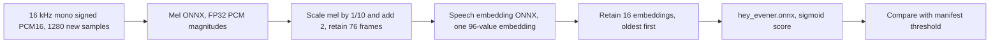

# Custom “Hey Evener” openWakeWord model

At the pinned **0.99** threshold, this bundle detects **598/600 held-out
synthetic positives (99.67%)**, with **zero false accepts over 1,311 negative
clips / 2.089803 hours**. Two positives were missed.

This is an **offline synthetic qualification**, not a qualified iPhone wake
feature. The classifier is trained here, not copied from openWakeWord's
non-commercial pretrained phrase models. No Swift detector or hub code is changed.
Human recordings, phone acoustics and the design's ≥60 intended trials at ≥95%
detection plus ≥30 hours of negative audio remain untested.

## Measured results (2026-11-06)

These are real `openwakeword.Model.predict` calls on every 80 ms hop, not a
similarity score or a classifier-only check. The commands below produced
[`results/calibration.json`](results/calibration.json) and
[`results/evaluation.json`](results/evaluation.json).

| Split at threshold 0.99 | Positives detected | Negative clips | Negative hours | False accept events |
| --- | ---: | ---: | ---: | ---: |
| Calibration, threshold selection only | 599/600 (99.83%) | 1,371 | 1.926277 | 0 |
| Held-out test | 598/600 (99.67%) | 1,311 | 2.089803 | 0 |

Test negatives comprise 800 Piper confusers/ordinary utterances (0.671044 h),
491 LibriSpeech recordings (1.085426 h) and 20 procedural clips (0.333333 h).
Observed false accepts/hour are zero, **not a claim of zero real-world risk**.
The largest test negative score was 0.955786. The warmup peak was 0.000097603.

The calibration-only rule chose 0.99 before test inference. Raising the
threshold rejects near-misses but loses weak positives. This descriptive test
sweep did not select or change the shipped threshold:

| Threshold | Test positives detected | Test false accept events | Observed events/hour |
| --- | ---: | ---: | ---: |
| 0.50 | 599/600 | 7 | 3.349597 |
| 0.95 | 599/600 | 1 | 0.478514 |
| **0.99, pinned** | **598/600** | **0** | **0** |

The committed assets in `mobile-native/modules/evener-voice/resources/wake-word/`
are ready for the separate native integration lane, not yet wired into Swift:

| Artifact | Bytes | Purpose |
| --- | ---: | --- |
| `hey_evener.onnx` | 402,340 | Our trained phrase classifier |
| `melspectrogram.onnx` | 545,383 | Shared mel frontend, compact weights |
| `embedding_model.onnx` | 675,263 | Shared speech embeddings, compact weights |
| `manifest.json` | 775 | Threshold, streaming contract and SHA-256 checksums |

All three ONNX graphs pass the unchanged 1 MiB-per-file repository budget.
[`results/verification.json`](results/verification.json) records five passing
checks: ONNX contracts/hashes, disjoint speakers/audio, deterministic Piper,
compact/original frontend agreement and cached/live streaming parity. The last
comparison has zero score error on four independently streamed source cases.
The separate `test_prepare.py` regression also passes. It first failed when an
FP16 conversion rounded the mel log floor to zero, producing NaN on silence;
the converter now preserves that FP32 constant.

## Reproduce

Run from the repository root on Linux x86-64 with **CPython 3.12.3**. This lane
uses four single-threaded CPU workers for audio and two BLAS threads for fitting,
not CUDA, cloud TTS or local ASR. Put the work directory on a disk with at least
8 GiB free. Downloads need network access once; synthesis, training, verification
and evaluation are entirely offline after `prepare.py`.

```sh
TOOLS=mobile-native/modules/evener-voice/tools/wake-word
WORK=$(mktemp -d /tmp/evener-wake.XXXXXX)
python3.12 -m venv "$WORK/venv"
PY="$WORK/venv/bin/python"
"$PY" -m pip install --no-deps -r "$TOOLS/requirements.txt"
export OPENBLAS_NUM_THREADS=1 OMP_NUM_THREADS=1 MKL_NUM_THREADS=1
export PYTHONDONTWRITEBYTECODE=1

"$PY" "$TOOLS/prepare.py" --work "$WORK"
"$PY" "$TOOLS/corpus.py" --work "$WORK" --phrase 'Hey Evener.' --workers 4
"$PY" "$TOOLS/features.py" --work "$WORK" --workers 4
"$PY" "$TOOLS/train.py" --work "$WORK"
"$PY" "$TOOLS/evaluate.py" --work "$WORK" --split calibration --calibrate \
  --workers 4 --output "$WORK/calibration.json"
"$PY" "$TOOLS/evaluate.py" --work "$WORK" --split test \
  --workers 4 --output "$WORK/evaluation.json"
"$PY" "$TOOLS/verify.py" --work "$WORK" --output "$WORK/verification.json"
"$PY" -m unittest discover -s "$TOOLS" -p 'test_*.py' -v
make lint-tracked-file-size
```

The default destination is
`mobile-native/modules/evener-voice/resources/wake-word/`. `prepare.py` writes
the two shared ONNX graphs, `train.py` writes `hey_evener.onnx`, and calibration
writes `manifest.json` with the pinned threshold and checksums. To reproduce
without replacing these committed assets, pass `--assets "$WORK/rebuilt-assets"`
to prepare, features, train, evaluate and verify. Corpus generation does not use
that flag. A new work directory avoids stale caches. Keep generated audio,
features and the large source archives out of Git.

`requirements.txt` pins all trainer/runtime Python dependencies, including openWakeWord
**0.6.0**, Piper **1.3.0**, ONNX **1.17.0**, ONNX Runtime **1.20.1**, NumPy
**1.26.4**, SciPy **1.14.1**, scikit-learn **1.5.2** and SoundFile **0.13.1**.
`--no-deps` is deliberate: openWakeWord declares an unused Linux TFLite runtime
that has no CPython 3.12 wheel. The complete ONNX-path dependencies are in the
lock. This environment does not claim TFLite support or a clean `pip check`.

All random generators use **20261106**. Piper's stochastic synthesis scales are
both zero. Voices, speaking rates, gains, offsets and augmentation supply the
variation. `corpus.jsonl` records each clip's source, text, split, speaker, sample
count and SHA-256. Source archives/models are SHA-256 locked in `sources.json`.
Reproduction on other CPU architectures or dependency versions is not promised
to be bit-identical; rerun evaluation rather than trusting an old threshold.

### Runtime and reproduction evidence

Measured on an AMD Ryzen 9 PRO 8945HS, Linux x86-64, CPython 3.12.3, with the
worker/thread counts above. See [`results/environment.json`](results/environment.json)
for installed versions and the corresponding JSON report for each stage.

| Stage | Wall seconds |
| --- | ---: |
| Synthesize/assemble corpus | 306.58 |
| Extract actual streaming features, all 15,336 clips | 1,521.58 |
| Fit, mine hard negatives and export | 63.74 |
| Calibration inference | 210.50 |
| Held-out inference | 263.60 |

The sum is 39.43 minutes, excluding downloads, verification and reproduction.
Training used 21,126 positive and 99,084 initial negative windows, 28 initial
epochs and 10 additional passes with 240 mined hard-negative windows. Export's
maximum absolute error against scikit-learn was 1.28e-7.

An independent corpus-generation run reproduced all 15,336 audio hashes and
the manifest exactly. Rebuilding the shared graphs and refitting the classifier
from the **same cached features** reproduced all three ONNX files byte for byte;
this second check did not repeat the entire feature extraction. Evidence is in
[`results/reproduction.json`](results/reproduction.json). The classifier SHA-256 is
`a519522a2fa56b8a1c761fc71a17ff38e9c8d980c0584610214f61d42cf6851d`.
Load affected elapsed time: the repeated corpus generation took 609.71 s and
refitting took 184.14 s. No claim of bit identity on other machines is made.

## Corpus and training

The entire source pool has **15,336 clips / 16.647 hours**, including padding and
silence. It is not 16.647 hours of human conversational audio.

| Split | Synthetic positives | Synthetic negatives | Real speech negatives | Procedural negatives |
| --- | ---: | ---: | ---: | ---: |
| Train | 4,224 / 704 voices | 5,632 / 4.754 h | 1,568 / 3.236 h / 24 speakers | 30 / 0.500 h |
| Calibration | 600 / 100 voices | 800 / 0.677 h | 561 / 1.082 h / 8 speakers | 10 / 0.167 h |
| Test | 600 / 100 voices | 800 / 0.671 h | 491 / 1.085 h / 8 speakers | 20 / 0.333 h |

- **Piper LibriTTS-R medium**, 904 speakers, revision
  `e7229f7d33a10e145e109b886d661984201ac3c4`, is downloaded once and runs locally.
  Its model card identifies its dataset as **CC BY 4.0**. Six positives per
  speaker use length scales 0.85, 1.0 and 1.15, each clean and augmented. Audio is
  resampled from 22,050 to 16,000 Hz with `resample_poly(320,441)`, trimmed at TTS
  boundaries, padded 0.8–1.6 s before and 0.96 s after, and gain-scaled 0.2–0.85.
  Augmented clips add a 20–120 ms echo and colored noise at 15–30 dB SNR.
  The phonemes produced for the target are `/hˈeɪ ˈiːvənɚ/`, “hey EE-vuh-ner”.
- Each speaker also says eight of the 48 authored confuser/ordinary phrases in
  `corpus.py`, including “Hey Evan”, “Hey everyone”, “Hey evening”, “Evener”
  alone and “Even her”. Negative synthesis uses the same gain/noise treatment.
  Confuser text is shared across splits; voices and rendered waveforms are not.
- **LibriSpeech test-clean**, **CC BY 4.0**, supplies all 2,620 recordings from
  its 40 speakers. Its *official* test-clean partition is used as a source pool
  and repartitioned 24/8/8 speakers here, not presented as an untouched official
  benchmark. Transcripts are checked for “evener”.
- Procedural white/colored noise, 60 Hz hum, swept tones and digital silence are
  generated locally. Exactly one fifth of this category is silence: **4 minutes
  of the 20-minute test category**. This is not recorded environmental noise.
- Train/calibration/test speakers are disjoint within both sources. Piper's
  original speaker IDs do not overlap LibriSpeech test-clean's speakers. The
  held-out positive set uses new speakers from the **same TTS checkpoint**, not
  a new engine or human recordings. Silence necessarily repeats across splits.

Training runs the actual openWakeWord streaming frontend at every 80 ms hop,
not its approximate whole-clip batch frontend. Windows ending between the
annotated phrase end and 400 ms later are positive training examples. Every
fourth negative window is initially used; a subsequent pass mines all training
negative hops scoring ≥0.05. Calibration and test examples never train weights.
A standardized, flattened 16×96 feature window feeds a 64-ReLU / 32-ReLU /
1-sigmoid MLP. Standardization is folded into the first ONNX dense layer. The
export is checked against scikit-learn probabilities on 512 sampled training
windows, independently of the ONNX graph.

Attribution, licenses and model-card provenance are in
[`resources/wake-word/NOTICE.md`](../../resources/wake-word/NOTICE.md). Piper
1.3.0 is GPL-3.0 **training-only** software, not a shipped runtime. The shared
openWakeWord frontend is Apache-2.0; no CC BY-NC-SA phrase classifier is used.
The module introduces no new license grant for Evener's own classifier.

## Evaluation protocol

`evaluate.py` loads the actual `openwakeword.Model`, resets it per clip, primes
it with 25 zero-filled hops, then calls `predict` for **every 1,280 samples**.
A final partial hop is zero-padded. A positive is detected if any hop crosses
the threshold. A negative activation event is a rising threshold crossing;
there is no debounce, VAD, verifier, patience filter or noise-suppression filter
hiding false accepts. Negative duration is the original input sample count,
excluding artificial warmup and final-hop padding. Warmup scores are checked
separately and must also stay below the threshold.

The threshold is selected **only on calibration negatives** by
`max(0.50, ceil((maximum_negative_score + 0.01) * 100) / 100)` and is then frozen
in `manifest.json`. Calibration/test commands exit nonzero unless ≥95% of
positives are detected and there are **zero** negative events and warmup
triggers. The test threshold sweep is descriptive, not used to pick a threshold.
Detailed per-clip scores and hop arrays remain in the work directory; compact
aggregate reports are committed alongside this README.

## Inference contract for the native integration lane



The mel model takes `input: float32[batch,samples]` using **signed PCM16
magnitudes cast to float**, not normalized −1…1 audio. With steady-state 80 ms
hops, retain 480 previous PCM samples and append 1,280 new samples for its
1,760-sample input. Follow openWakeWord 0.6.0 `AudioFeatures` startup behavior:
initial mel history is 76×32 ones, first audio hop is unprefixed, mel output is
transformed by `/10 + 2`, and subsequent hops append eight mel frames.
The embedding input is `input_1: float32[batch,76,32,1]`; output `conv2d_19` is
`float32[batch,1,1,96]`. The classifier input is
`embeddings: float32[batch,16,96]`; output `score` is `float32[batch,1]`.
Prime with 25 silent hops before accepting microphone predictions to replace
openWakeWord's randomized startup feature history. No wall-clock sleep is
required for that priming. A classifier window spans about 1.96 s of audio.

Both shared models store **FP16 matrix/convolution weights with FP32 casts**.
Scalars, biases and normalization vectors remain FP32, preserving the mel
model's `1e-10` log floor on silence. `test_prepare.py` covers this boundary.
Their operator/input/output types stay FP32, so they do not require an FP16 CPU
kernel. This is real weight rounding, not lossless packing; use these exact
assets, not upstream originals with the same filenames. It reduces each graph
below the repository's 1 MiB tracked-file budget without changing the lint
allowlist. `verify.py` compares the modified and original feature extractors,
checks all ONNX graphs/shapes/checksums and disjoint positive audio, and compares
cached training features against independent `Model.predict` calls on real
speech, a confuser, a positive and procedural noise.

The iOS module currently pins ONNX Runtime 1.20.0; this lane tested Python CPU
1.20.1 only. Native bundling, Swift buffering, AVAudioEngine resampling,
microphone gain, phone CPU/battery and full on-device inference are **not tested**.
Keep audio local until the separate native detector admits activation.

## Data gaps

This is a bounded CPU baseline, not openWakeWord's production-scale training
recipe (which recommends many thousands of positives and very large negative
corpora). It lacks real “Hey Evener” recordings, rooms/microphones, music/TV,
far-field speech, varied accents/engines and prolonged continuous negatives.
The held-out negatives are only 2.090 h, of which 1.085 h is recorded audiobook
speech. Clip resets and synthetic noise cannot establish a real-world false
accept rate, and none of this substitutes for the design's physical-phone gate.
